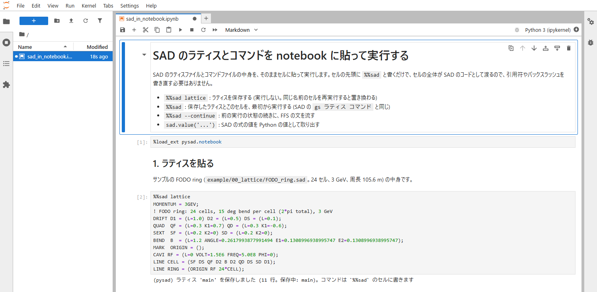
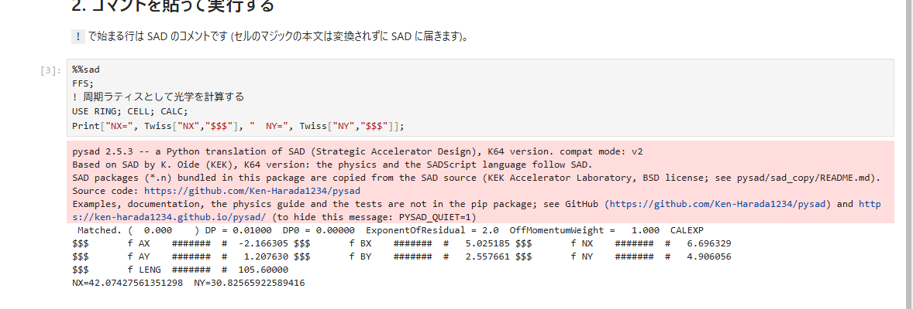
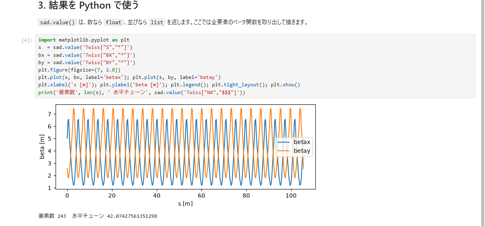
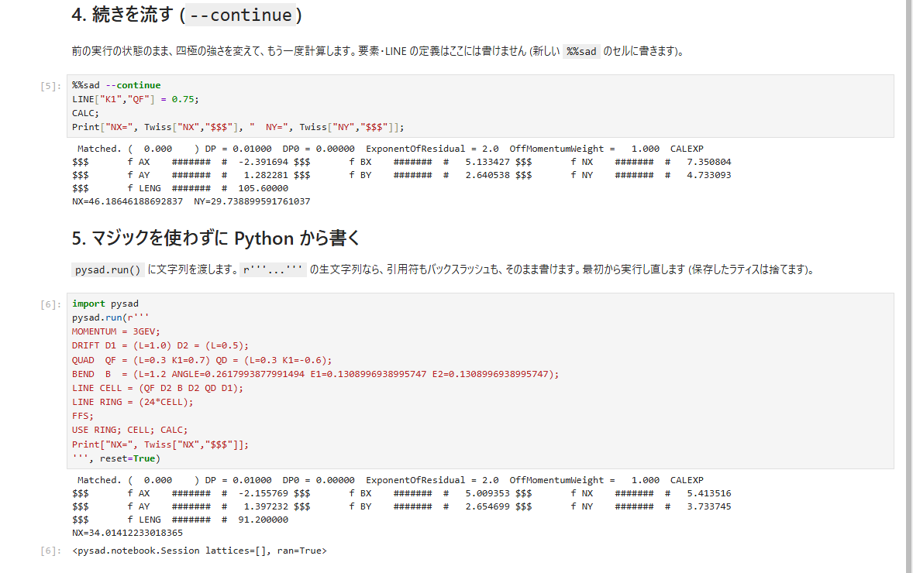

# pysad ガイド: SAD のラティスとコマンドを notebook にコピペして動かす

**この文書で分かること**: SAD のラティスファイルとコマンドファイルの中身を、Jupyter の notebook のセルにそのままコピペして実行する手順。実際の画面と出力を載せています。
**前提**: SAD のラティスとコマンド (FFS) の書き方を知っていること。Jupyter のセルの実行 (Shift+Enter) を知っていること。
**読む順**: この文書 → 仕様と限界は [`docs/12_pysad_api.md`](docs/12_pysad_api.md) §11b → 出力つきの notebook は [`example/17_notebook/`](example/17_notebook/README.md)。

最終更新: 2026-11-28 (現状のスナップショット)。

> **注意 (公開版との関係)**: `%%sad` は GitHub の `main` に入っていますが、PyPI の最新の公開版 (2.5.3) には、まだ入っていません。PyPI の版を `pip install` しただけでは `%load_ext pysad.notebook` が見つからないので、下の §1 のとおり、GitHub のソースを使ってください。次の公開のあとは、この注意は不要になります。

## 1. 準備

必要なもの: Python 3.12、`numpy`・`numba`・`scipy` (pysad の依存)、`matplotlib` (図を描くとき)、`jupyterlab`・`ipykernel`。

GitHub のソースを使う手順 (PowerShell):

```powershell
git clone https://github.com/Ken-Harada1234/pysad.git
cd pysad
py -3.12 -m pip install numpy numba scipy matplotlib jupyterlab ipykernel
$env:PYTHONPATH = (Get-Location).Path
py -3.12 -m jupyterlab
```

`PYTHONPATH` に、`pysad` のフォルダが入ったリポジトリのルートを指定すると、notebook のカーネルが `import pysad` できます。同じ PowerShell から JupyterLab を起動してください (環境変数がカーネルに引き継がれます)。

確認した範囲: 上の手順のうち、私が実際に走らせたのは「リポジトリのルートを `PYTHONPATH` に置いて、`jupyterlab` のカーネルで notebook を実行する」形です。`pip install` でリポジトリを入れる形 (`pip install git+https://...` や `pip install -e .`) は、まだ試していません。

## 2. 手順

### 手順 1: notebook を作り、最初のセルで拡張を読み込む

JupyterLab で新しい notebook (Python 3) を作り、最初のセルに次を書いて実行します。

```
%load_ext pysad.notebook
```

### 手順 2: ラティスファイルの中身を、そのまま貼る

1. 新しいコードセルを作る。
2. **1 行目に `%%sad lattice` と書く。**
3. 2 行目以降に、ラティスファイル (例: `example/00_lattice/FODO_ring.sad`) の中身を、全部コピーして貼る。
4. Shift+Enter で実行する。

実行すると、ラティスを保存します (この時点では計算しません)。次の画面は、手順 1・2 を実行したあとの notebook です (JupyterLab の画面)。



### 手順 3: コマンドファイルの中身を、そのまま貼って実行する

1. 新しいコードセルを作る。
2. **1 行目に `%%sad` と書く。**
3. 2 行目以降に、コマンドファイル (`FFS;` で始まる SAD のスクリプト) の中身を、全部貼る。
4. Shift+Enter で実行する。

保存したラティスとこのセルを、最初から実行します (SAD の `gs ラティス コマンド` と同じです)。`!` で始まるコメント行、引用符、バックスラッシュは、書き直さずに、そのまま通ります。



出力の文字は、次のとおりです (この画面と同じ実行の出力)。

```
 Matched. (  0.000    ) DP = 0.01000  DP0 = 0.00000  ExponentOfResidual = 2.0  OffMomentumWeight =   1.000  CALEXP  
$$$       f AX    #######  #  -2.166305 $$$       f BX    #######  #   5.025185 $$$       f NX    #######  #   6.696329
$$$       f AY    #######  #   1.207630 $$$       f BY    #######  #   2.557661 $$$       f NY    #######  #   4.906056
$$$       f LENG  #######  #  105.60000
NX=42.07427561351298  NY=30.82565922589416
```

画面の赤い枠は、pysad の起動時の案内です。標準エラー出力に、プロセスの最初の 1 回だけ出ます。エラーではありません (`PYSAD_QUIET=1` を環境変数に設定すると、出ません)。

### 手順 4: 結果を Python で使う

`sad.value('式')` は、SAD の式を評価して、Python の値で返します (数は `float`、並びは `list`)。次は、全要素のベータ関数を取り出して、matplotlib で描いた例です。



### 手順 5: 続きを流す、文字列で渡す

前の実行の状態のまま、FFS の文を流すには、`%%sad --continue` を使います (次の画面の上のセルは、QF の `K1` を 0.7 から 0.75 に変えて、もう一度計算した例です)。マジックを使わずに、Python の文字列として渡すには、`pysad.run(r'''...''')` を使います (下のセル)。



### 手順 6: SAD の関数・コマンドの説明を引く

`%sad_help 名前` (または `sad.help('名前')`。コマンドでは `pysad-help 名前`) で、SAD の FFS コマンド・関数・特別変数・フラグ・要素の説明が引けます。名前は大文字・小文字を区別せず、略形 (`CAL`)・`Twiss[]` の形・要素のキーワード (`BEND AE1`) も使えます。
**名前はタブ補完できます** (`%%sad` のセルの中でも、`Twi` と打って Tab で `Twiss`)。

```
%sad_help Twiss
```
```
Twiss  [function / FFS-dedicated-functions]
  SADHelp : Twiss[optical-function, component] returns the value of the optical-function at the entrance of component. The values are tho ...
  pysad   : 実装
  SAD 側  : Fortran tfinitn.f; .n correction.n,corutility.n,optimize.n
```

キーワードで探すには `--search` を使います。

```
%sad_help --search chromaticity
```
```
「chromaticity」を含む項目: 3 件
  CHROMATICITY(CHRO)         [FFS command] (実装) CHRO prints out the chromaticity of QUAD and SEXT in the entire beam l
  SynchroBetaEmittance       [function] (実装) SynchroBetaEmittance calculates equilibrium emittance under influence 
  ChromaticityTerms          [function] (pysad のみ) Chromaticity terms from the optics.
詳しくは pysad.sad_help("名前") (全文は full=True)
```

`--full` を付けると、SAD 自身のヘルプの全文を出します (pysad に同梱している SAD のコピーの `HelpMessages.n` から。先頭の 11 行を示します)。

```
%sad_help CAL --full
```
```
CALCULATE(CAL)  [FFS command / FFS commands]
  SADHelp : Usage: (1) CALCULATE(CAL) [[NO]EXPAND]]
  pysad   : 実装
  SAD 側  : Fortran tffsa.f
  全文 (SAD の HelpMessages.n (同梱の SAD のコピー)):
    | Usage: (1) CALCULATE(CAL) [[NO]EXPAND]]
    |        (2) CALCULATE(CAL) matching-function1[-] [matching-function2[-]..]
    |  
    | (1) With no argument or with an option [NO]EXPAND, calculates the optics and the matching-functions using the current values of the components. It prints out the values of the matching-functions specified either by the matching-function-commands or the second usage of CAL, as described below. If an option EXPAND is given, it expands the beam line before the calculation. If NOEXPAND is given, it calculates without any expansion. The default behavior on EXPAND is controlled by the KEEPEXP flag.   FFS["CAL"] and FFS["GO"] returns the result as a list, whose format is
    | 
    |    {dp, kind, reslist, function-values},
```

SAD の `.n` (同梱の `Packages/*.n`) で定義されている関数や、Tkinter のウィジェットも引けます。説明はなく、署名と定義されているファイルが出ます。

```
%sad_help CorrectOrbit
```
```
CorrectOrbit  [SAD package (.n) function / correction.n]
  pysad   : SAD の .n  (pysad が SAD 自身の .n を解釈して実行する (同梱のコピーか PYSAD_SAD_PACKAGES))
  .n      : Packages/correction.n
  署名    : CorrectOrbit[orbitkind_,mon_,str_,opt_,options___]
  文書    : 06_sadscript_library.md  (https://ken-harada1234.github.io/pysad/docs/06_sadscript_library.html)
```

上の出力は、`py -3.12 -m pysad help ...` で実際に出したものです (notebook でも同じ文字が出ます)。説明の最初の行が長いものは、途中で切れていて、切れたものには ` ...` が付きます。

## 3. 貼るときの決まり

| こうしたい | こう書く |
|---|---|
| ラティスとコマンドが別のファイル | ラティスを `%%sad lattice` のセル、コマンドを `%%sad` のセルに貼る |
| ラティスとコマンドが 1 つのファイル | ファイル全体を、1 つの `%%sad` のセルに貼る (ラティスのセルは要らない) |
| ラティスが複数のファイル | `%%sad lattice 名前1`、`%%sad lattice 名前2` のセルに 1 つずつ貼る (保存した順に連結される) |
| 設定を変えて、最初から計算し直す | `%%sad` のセルを編集して、もう一度実行する (毎回、最初から実行する) |
| 前の状態のまま、少しだけ変える | `%%sad --continue` のセルに、FFS の文だけを書く (要素・LINE の定義は書けない) |
| ラティスを差し替える | 同じ名前の `%%sad lattice` のセルを、もう一度実行する (置き換わる)。全部捨てるのは `%%sad --reset` |

- `%%sad` は、セルの**1 行目**に、単独で書きます (その前に他の行を書けません)。
- 2 行目以降は、変換されずに SAD に渡ります。

## 4. うまくいかないとき

| 症状 | 原因と対処 |
|---|---|
| `ModuleNotFoundError: No module named 'pysad'` | カーネルの Python から `pysad` が見えません。`PYTHONPATH` を設定した PowerShell から JupyterLab を起動したか、確認してください |
| `%load_ext pysad.notebook` が見つからない | `pysad.notebook` が入っていない版です。冒頭の注意のとおり、GitHub のソースを使ってください |
| `--continue: 続きにする実行がまだありません` | 先に、`--continue` なしの `%%sad` のセルを実行してください |
| カーネルを再起動した | `%load_ext pysad.notebook` と、ラティスのセル (`%%sad lattice`) を、もう一度実行してください (保存したラティスは、カーネルの中にあります) |
| SAD のエラーが表示されるが止まらない | SAD と同じ動作です。エラーの文を表示して、次の文に進みます |
| `%sad_help 名前` で「見つかりませんでした」 | 名前の一部で `%sad_help --search キーワード` を試してください。要素のキーワードは `BEND AE1` の形です。SAD にない名前 (Python の関数など) は、Python の `help()` を使ってください |

## 5. 確認した範囲と限界

- **画面について**: 画面は、JupyterLab 4.6.6 に、保存済みの notebook を開いて、Chrome (ヘッドレス) で撮影しました。出力は、本物のカーネル (ipykernel 7.4.0) で notebook を実行して保存したものです。撮影のときには、実行していません (画面下の「Connecting」は、撮影の間にカーネルへの接続が完了していなかったためと考えられます)。
- **環境**: Windows、Python 3.12、IPython 9.19.1、ipykernel 7.4.0、nbclient 0.11.0、JupyterLab 4.6.6。VS Code の notebook、Colab、他の OS は、未確認です。
- **制限**: `--continue` で流せるのは、FFS 部の文だけです。`%%sad` のセルごとに、最初から実行するので、重い計算は毎回走ります。Tk の GUI は、notebook では動きません。SAD の描画関数 (Plot 系) の notebook 内の表示は、未確認です。
- **ヘルプ**: SAD の関数・コマンドの説明は `%sad_help 名前` (手順 6)。説明の最初の行 (英語) は、SADHelp 由来の 538 項目のうち 537 項目に、pysad の状態は 258 項目 (FFS コマンド・関数・特別変数・フラグ・要素の型) にあります。全文は、538 項目のうち 363 項目を、同梱の SAD の `HelpMessages.n` から出せます (要素のキーワードなど、残りは手元の `SADHelp.html` が要ります。環境変数 `SADHELP_HTML`)。`.n` の関数と Tkinter のウィジェットには、説明はありません (署名とファイル名だけ)。Python の関数 (`pysad.run`、`sad.value` など) の説明は、Jupyter の `?` と `help()` で読めます (英語と日本語の 2 行。公開の関数・クラス・メソッド 1160 個のうち、両方があるのは 1072 個で、説明のないもの (数値計算の核や登録用の内部の関数など) が 82 個あります)。詳しくは [`docs/12_pysad_api.md`](docs/12_pysad_api.md) §11c。

## 6. もっと詳しく

- 仕様、`Session` の API、限界: [`docs/12_pysad_api.md`](docs/12_pysad_api.md) §11b
- 出力つきの notebook (この文書の画面の元): [`example/17_notebook/sad_in_notebook.ipynb`](example/17_notebook/sad_in_notebook.ipynb)
- pysad 全体: [`README.md`](README.md)
