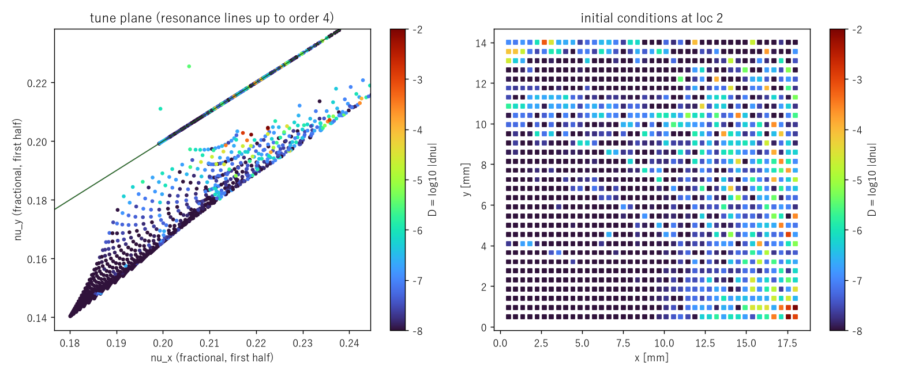
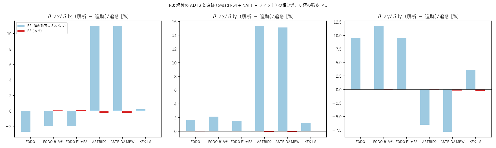

- 本リポジトリ（作業メモ、解説文書、実例を含む）は、生出さんのソースをもとに、Claude Code で全自動生成したものです。
- 動作確認は、基本的に自分で書いた SAD スクリプトに対してしかしていません。
- うまくいかない場合は、そのまま AI に渡して、作業メモや SAD メモを読ませると、修正を続けられます。（随時修正しています。サンプルの SAD スクリプト（それも自動生成）も載せました。）
- 以下の README も AI による自動生成です。

> **注意 / Notice**: PyPI のパッケージ名は `pysad-k64` です。PyPI にある異常検知ライブラリ `pysad` (Streaming anomaly detection) とは**無関係の別物**です。import 名はどちらも `pysad` なので、**同じ Python 環境に両方をインストールしないでください** (仮想環境を分けてください)。 / The PyPI package `pysad-k64` is **unrelated** to the streaming anomaly-detection library `pysad`. Both use the import name `pysad`; do not install both into the same environment.

# pysad — SAD (K64 版) の Python 直訳

> **v1 と v2 の違い (注釈)**: 以下の「直訳」は **v1 系 (v1.0.0) の方針**です。**v2 系 (v2.0.0 以降) は直訳ではありません。** v2 は K64 を出発点に、K64 のバグの修正、物理の誤りの修正、機能の追加を行った版で、**gs (K64) と結果が変わる箇所があります** ([`docs/47_v2_changes.md`](docs/47_v2_changes.md))。gs と同じ結果が要るときは、環境変数 `PYSAD_COMPAT=k64` (互換モード。v1 と同じ K64 の動作) を指定してください。なお、v2 でも、K64 の式・分割数・反復順序を写したコードの大部分は、そのままです。

## インストール (PyPI)

```
pip install pysad-k64
```

PyPI: <https://pypi.org/project/pysad-k64/>。import 名は `pysad` です (パッケージ名と違います)。**v2.3.0** (K64 のバグの修正と機能の追加。互換モード `PYSAD_COMPAT=k64` で K64 と同じ動作。v2 は直訳ではありません。GitHub のリリース v2.3.0 と同じ) が最新です。ソースに忠実な翻訳の **v1.0.0** は `pip install pysad-k64==1.0.0` で入ります。

## 必要なもの

Python 3.12 と numpy, scipy, numba, pytest (`py -3.12 -m pip install numpy scipy numba pytest`)。

確認した Python の版 (v2.0.0、全試験): **3.12** と **3.10** は全通過 (937 通過・4 skip)。**3.14** は 935 通過・2 失敗 (3.14 に同梱の Tcl/Tk が 9.0 で、試験が 8.6 を期待していること、数値的に脆い 1 試験の閉軌道の収束の違い)。v2.1.0 では 2 件とも直し、3.14 で GUI 系と D2 の試験 (計 115 件) が通ることを確かめた (全試験は 3.14 では走らせていない。詳細は [`docs/46_unimplemented_and_unverified.md`](docs/46_unimplemented_and_unverified.md) §3)。3.13 は未確認。

## 使い方

SAD の `gs` に渡すのと同じ順にファイルを並べる (複数ファイルは連結される。`Get[]` は最後のファイルのフォルダ基準)。

```
py -3.12 run_sad.py lattice.sad script.sad > script.pysad.out
py -3.12 run_sad.py lattice_and_script.sad              # ラティスとコマンドを 1 ファイルにしてあれば 1 つ
```

Python から:

```python
from pysad.ffscmd import run_sad_string
ffs, I = run_sad_string(open('script.sad', encoding='utf-8').read(), cwd='.')
print(I.get('EMITX'), ffs.rows[-1].betx)
ffs.run_text('fit NX 47.3; free QF* K1; go;')
```

下位の API (Lattice, Matcher, emittance6d, TrackParticles など) は [`docs/12_pysad_api.md`](docs/12_pysad_api.md)。

## オリジナルの SAD にない機能 (pysad で追加)

pysad v2 系は直訳に加えて、**オリジナルの SAD (K64) にない解析機能**を持ちます。入門は [`docs/50_adts_rdt_primer.md`](docs/50_adts_rdt_primer.md)、台本ごとの数値のまとめは [`ADTS_summary.md`](example/v2_3/ADTS_summary.md)・[`FMAP_summary.md`](example/v2_3/FMAP_summary.md)、例の索引は [`example/v2_3/README.md`](example/v2_3/README.md) です。

| 機能 | 何を求めるか | 使い方 (SAD の台本 / Python) | 解説・例 | 版 |
|---|---|---|---|---|
| 周波数マップ | 初期条件の格子ごとのチューンの拡散 D の地図と共鳴線 | `FrequencyMap[]` / `pysad.freqmap` (NAFF ベース) | [docs/48](docs/48_frequency_map_lma.md)、[FMAP_summary](example/v2_3/FMAP_summary.md) | v2.3.0 |
| 局所運動量アクセプタンス (LMA) と Touschek 寿命 | 位置ごとの δ+(s)・δ−(s) (RF バケットとアパーチャを区別。`check_every` の既定は 1) と、それを使った Touschek 寿命 | `MomentumAcceptance[]`・`TouschekLifetimeLMA[]` / `pysad.lma`・`pysad.lmabucket` | [docs/48](docs/48_frequency_map_lma.md)、[L2](example/v2_3/L2_README.md)、[T1](example/v2_3/T1_README.md) | v2.3.0 |
| Touschek 寿命の独立な式 (Piwinski 型) | 結合・丸いビームまで正しい損失率。K64 の式との差は結合 1% で +0.1〜+6%、丸いビームで ±20% (B162)。v2 の `TouschekLifetime[INF, INF, nz]`・`TouschekLifetimeLMA[]` の既定 (`Formula->"K64"` で K64 の表) | `touschek.touschek_piwinski` | [docs/48 §4.6](docs/48_frequency_map_lma.md)、[T2](example/v2_3/T2_README.md) | v2.3.0 |
| 共鳴駆動項 (RDT) | 6 極 (1 次・2 次の 4 次の h_jklm)・8 極・偏向磁石の項。厚いレンズと薄レンズの両方 | `ResonanceDrivingTerms[]` / `pysad.resdrive`・`pysad.rdt2nd` | [docs/49](docs/49_resonance_terms_adts.md)、[ADTS_summary](example/v2_3/ADTS_summary.md) | v2.3.0 |
| 振幅依存チューンシフト (ADTS) | 6 極の 2 次・8 極・運動学・フリンジ・偏向磁石の項の ADTS (既定は物理的な項だけ。精密版は `fourth='r6'`・`optics='tracked'`) | `AmplitudeTuneShift[]` / `pysad.resdrive.adts` | [docs/49](docs/49_resonance_terms_adts.md)、[ADTS_summary](example/v2_3/ADTS_summary.md) | v2.3.0 |
| クロマティシティの項 | 自然クロマティシティ、6 極と偏向磁石の寄与 | `ChromaticityTerms[]` / `pysad.resdrive` | [docs/49](docs/49_resonance_terms_adts.md) | v2.3.0 |
| 数値の正規形 | 追跡の 1 周の写像から ADTS を取り出す | `pysad.nform` | [docs/49 §10](docs/49_resonance_terms_adts.md) | v2.3.0 |
| 振幅・δ に依る ν のべき級数 (J²・δ 依存・交差項) | ν(Jx, Jy, δ) を J・δ のべき級数 Σ c_abp Jx^a Jy^b δ^p として (J¹ = ADTS、J²、ξ の高次、振幅と δ の交差項)。模型の 1 周の写像を TPSA で作り Birkhoff の正規形で求める。線形 + 6 極・8 極に、オプションで偏向磁石の曲率の項・運動学的な項・端部のフリンジ (FODO・ASTRID2・大きなリング A で追跡と 1e-6 前後。入れていない効果は docs/49 §13.3) | `NormalFormTune[]` / `pysad.ampnf` | [docs/49 §13](docs/49_resonance_terms_adts.md)、[example/v2_4/](example/v2_4/README.md) | v2.4.0 |
| ν(J) の J の次数・5・6 次の駆動項・1 本の共鳴の島 | `ampnf` の J² (D ≥ 5)・J³ (D ≥ 7) を J の次数ごとに追跡と比較 (`nu(jorder=)`・`d2nu`)。純粋な 3〜6 次の共鳴の駆動項の表 (`drive_table`)。1 本の共鳴を残した正規形から固定点の作用と島の半幅 (`island_theory`。6 次で追跡と 0.04〜1.5%・島の端 0.3〜1.3%、5 次以下は島が広く外れる。対称性で禁止された共鳴にも有限の幅を返す)。K0≠0 の磁石の非線形の切り替え `k0_nonlinear` | `pysad.ampnf_ext`・`pysad.ampnf` | [docs/49 §15](docs/49_resonance_terms_adts.md)、[example/v2_4/](example/v2_4/README.md) | v2.4.1 |
| Touschek のバンチ内の δ の分布 (オプション) | 散乱される粒子の δ の分布 (対の重心の δ_c と相対運動量の縦成分 q_s) を入れた損失率。既定は入れない (K64・elegant・Piwinski と同じ δ=0 の基準)。ASTRID2 で受容が σδ の 9 倍のとき損失率が +4%。対のモンテカルロと 0.3% 以内 | `TouschekLifetimeLMA[BunchDelta->True, BunchQs->True]` / `pysad.touschek_bunch` | [docs/48 §4.4](docs/48_frequency_map_lma.md)、[example/v2_4/](example/v2_4/README.md) | v2.4.0 |
| `DynamicApertureSurvey` の `ExpandElementValues`・`ReferenceOrbit` | `ExpandElementValues->False` で成分ごとの値 (補正磁石の K0・位置ずれ) を揃えない。既定 (True) は gs と同じく揃えるので、補正した状態の DA は `False` を書く (DDBA v07_14 の誤差の例で gs と pysad が 29〜36σ で一致)。`ReferenceOrbit->{x0,px0,y0,py0,z0,dp0}` はその軌道のまわりで追跡 | `DynamicApertureSurvey[…, ExpandElementValues->False]` / `pysad.dapert` | [docs/09](docs/09_dynamic_aperture.md)、[`docs/history/v24_A.md`](docs/history/v24_A.md) | v2.4.0 |
| FFS の `DRAW` (matplotlib) | `DRAW [r1 [r2]] BX BY & EX LAT;` を Tk でなく matplotlib に描く (領域・`&` で枠を分ける・ラティス図と名前・クリックの InfoLabel)。保存は `PYSAD_DRAW_FILE` か `Draw$Option`。`OpticsPlot` の Graphics と点列が一致 (gs の Graphics と 1e-13 台)。matplotlib は任意 (`pip install pysad-k64[plot]`) | `DRAW …;` / `pysad.draw_mpl.draw` | [docs/42 §7b](docs/42_graphics_guide.md)、[example/11_graphics/fn_DRAW](example/11_graphics/fn_DRAW.md) | v2.4.1 (開発中) |
| `$DisplayFunction` の matplotlib 出口 (`MatplotlibDrawer`) | `Plot`・`ListPlot`・`OpticsPlot`・`GeometryPlot` などが作る `Graphics[…]` を Tk でなく matplotlib に描く (色・線の太さ・破線・点の記号・誤差棒・文字の位置揃え・`PlotRange`・`Scale`・`Frame`・`FrameTicks`・`GridLines`・`FrameLabel`・`PlotLabel`・凡例)。保存は `PYSAD_DISPLAY_FILE` (2 回目以降は番号つき)。未対応の要素は警告して飛ばす。Graphics の要素数・座標が matplotlib 側のデータと一致 (試験)。見た目は Tk の窓と比べていない。matplotlib は任意 | `PYSAD_DISPLAY=mpl` / `$DisplayFunction=MatplotlibDrawer;` / `pysad.mpl_display.render` | [docs/42 §7c](docs/42_graphics_guide.md)、[example/11_graphics/fn_OpticsPlot_mpl](example/11_graphics/fn_OpticsPlot_mpl.md) | v2.4.1 (開発中) |
| ラティスの CAD 図 (DXF) | ラティスの平面図 (基準軌道・偏向磁石・四極・6 極などの外形・MARK・要素名) を、テキストの DXF (R12 相当、外部ライブラリなし) に書き出す。レイヤーと色・`Region`・単位 (m・mm)・`Spec` (磁石の寸法)。gs でも pysad でも走る台本の関数と Python 関数の出力が一致 (gs と 8 本全行一致)。立体は未対応 | `DrawMagnetsDXF[]` / `pysad.dxf_lattice.write_dxf` | [docs/51](docs/51_lattice_dxf.md)、[example/dxf_lattice](example/dxf_lattice/README.md) | v2.4.1 (開発中) |
| 6 極の検討 (試作) | 6 極の K2L の最適化の試作と、解析式による検証の可否 (結論: 検証には条件つきで使える。最適化は最終設定より DA の広い解を出せなかった) | `pysad.sxtopt` | [example/ddba/v07_14/sextupole](example/ddba/v07_14/sextupole/README.md) | v2.3.0 (試作) |
| 6 極の最適化の項の指定 | 項ごとに objective/constraint/ignore・重み・目標値を指定して K2L を計算 (`SxtSpec`・`design_k2l`)、誤差感度の項、作動点の周りの共鳴の一覧。HLS ring v07_14 の例: K2L のランダム誤差 (3%・10%) の DA で評価 (ADTS だけの最適化は完成版の 0.6 倍、h00201 を 0 にした候補は誤差なしで 1.30 倍・3% で 1.17 倍、10% で同じ。gs で確認、LMA は未了) | `pysad.sxtopt` (`design_k2l`・`near_resonances`) | [example/ddba/v07_14/sextupole_v2](example/ddba/v07_14/sextupole_v2/README.md)、[docs/47](docs/47_v2_changes.md) | v2.4.1 (開発中) |

<p>


</p>

**v2 で K64 から改良・追加した主な点** (v2.0.0〜v2.4.0。一覧と条件は [`docs/47_v2_changes.md`](docs/47_v2_changes.md)):
- NAFF ([`pysad/naff.py`](pysad/naff.py))、複素の特殊関数の追加 (`specfn_cx.py`・`specfn_cx2.py`)。
- 偏極: n が傾く・非平面のリングの Polarization (`spin.ST_EXACT`・`KINETIC`・`STEP_RATE`)、スピン軌道の側帯のクロマティックな式 (`spin.CHROMATIC`)。
- 放射・エミッタンス: SynchroBeta・tradke の符号 (B111) などの修正、K1≠0 の BEND の端のオプション `compat.set_bend_k1_edge('face')`。
- TrackParticles: MULT・ANGLE=0 の BEND の F1・FB1・FB2・FRINGE と AE1・AE2、光子 (PhotonList)、DAPWIDTH の窓 (既定 7)。
- 空間電荷: PSPAC の K64 の形状関数 (`spch_k64.py`)、`WSPACSC` (追跡の WSPAC に空間電荷つきのビーム行列)。
- そのほか: 成分ごとの `FREE`、`Parallelize`、K64 のバグの修正 (B72〜B162、[`docs/21_sad_bug_report.md`](docs/21_sad_bug_report.md))。
- v2.4.0: パーサ・評価器・FIT の修正 (ユーザー定義の関数名 `At`、`FitFunction` を併用する `fit`、`ElementValues` とフィット変数の連動など)、放射・エミッタンス (tcod が収束しないときの Emittance[] (B163)、RADINT の ANGLE=0・K0≠0 の極、v2 の EMITDIV の既定を 4 に)、`DynamicApertureSurvey` の `ExpandElementValues`・`ReferenceOrbit`、`ampnf` (J²・δ 依存)。変更の一覧は [`CHANGELOG.md`](CHANGELOG.md) と [`docs/47_v2_changes.md`](docs/47_v2_changes.md)、朝に判断する項目の表は docs/47 の末尾。

- v2.3.0 の新しい例: PF の履歴ラティス ([`example/pf/lattice/PF_history.md`](example/pf/lattice/PF_history.md))、KEK-LS の例集 ([`example/kek_ls/`](example/kek_ls/README.md)。参考: KEK-LS Conceptual Design Report (CDR)、KEK、2017 年 5 月 22 日)、DDBA (HLS ring の系列) の複雑なセルの設計手順の例集 ([`example/ddba/`](example/ddba/README.md)・最終版 [`v07_14/`](example/ddba/v07_14/README.md)・6 極の検討 (試作) [`v07_14/sextupole/`](example/ddba/v07_14/sextupole/README.md)。参考: K. Harada et al., *Conceptual design of the Hybrid Ring with superconducting linac*, J. Synchrotron Rad. 29, 118–124 (2022)、DOI 10.1107/S1600577521012753)、ASTRID2 の例集 ([`example/astrid/`](example/astrid/README.md)。参考: *ASTRID2 Preliminary Design Report*、Aarhus University、ISA、2009 年 8 月)。
- v2.3.0 のパーサの修正 (pysad 自身の不具合): 逆向きの文脈の `-LINE` の二重反転、k64 モードの `1.7MV` などの数に隣接する単位 (gs は読む)。

**解析式の位置づけ**: RDT・ADTS・共鳴線の予想などの解析式は、摂動論の定義された次数と、入れた効果の範囲で原理的に作ります。追跡 (全非線形) とは入れている効果が違うので、厳密な一致は目的ではなく、追跡に合わせるための補正項・当てはめは足していません。追跡との一致の数値は、入れた効果と次数の検証の結果として載せ、入れていない効果と差の主因は [`docs/49`](docs/49_resonance_terms_adts.md) §11.9 にあります (原因が分からないものは「未特定」)。追跡から係数を取り出す唯一の部分 (偏向磁石の生成関数) の原理は、写像の 2 次のテイラー係数が生成関数を一意に決める、です ([`docs/49`](docs/49_resonance_terms_adts.md) §8.1、[`docs/50`](docs/50_adts_rdt_primer.md))。

**注意**
- これらは **pysad のみ**で、gs (SAD 本体) では走りません。v2.3.0 の新機能 (上の表) は互換モード (`PYSAD_COMPAT=k64`) によらず同じ動作です。v2.0.0〜v2.2.0 で K64 の動作を変えたもの (互換モードで切り替わる) は docs/47 の (a) に区別して書いてあります。
- **PyPI は v2.3.0 まで公開**しています。v2.3.0 の新機能も `pip install pysad-k64` で入ります。SAD の台本を `py -3.12 run_sad.py lattice.sad script.sad` で動かすには、リポジトリを clone してください (PyPI のパッケージには `run_sad.py`・`example/`・`docs/` が入りません)。
- 検証の範囲と未確認は [`docs/46_unimplemented_and_unverified.md`](docs/46_unimplemented_and_unverified.md)・[`docs/47_v2_changes.md`](docs/47_v2_changes.md)・docs/48〜50・[`example/v2_3/`](example/v2_3/) の各まとめを参照してください。

## 構成

Git で追跡するのは [`pysad/`](pysad/)、[`docs/`](docs/)、`run_sad.py`、`README.md`、`LICENSE`、`CLAUDE.md`、`.gitignore` ([`docs/history/00_RESUME.md`](docs/history/00_RESUME.md) §9)。
ベンチ・回帰スクリプト・出力は入れない (`.gitignore`)。以下の一覧は 2026-11-18 の作業ツリー。

### トップ

| ファイル | 内容 |
|---|---|
| [`run_sad.py`](run_sad.py) | SAD スクリプトの実行 (`gs` と同じ引数: `py -3.12 run_sad.py lattice.sad script.sad`) |
| [`README.md`](README.md) | この文書 |
| [`CLAUDE.md`](CLAUDE.md) | AI アシスタント向けの読み順と要点 |
| [`CHANGELOG.md`](CHANGELOG.md) | 変更履歴 (リリースごとの内容、未対応・未確認の要点) |
| [`LICENSE`](LICENSE) | SAD の利用条件 (KEK Accelerator Laboratory) |
| [`.gitignore`](.gitignore) | 追跡しないもの (出力、ログ、キャッシュ) |
| [`pysad/`](pysad/) | 本体 (下の表) |
| [`pysad/tests/`](pysad/tests/) | 試験 (下の表) |
| [`example/`](example/) | 機能・関数ごとの短い例 (gs と pysad の画面表示つき。下の表) |
| [`docs/`](docs/) | 解説文書 (下の表。現状のスナップショット) |
| [`docs/history/`](docs/history/) | 作業履歴 (下の表) |

### `pysad/` (本体)

**SADScript と FFS**

| ファイル | 内容 |
|---|---|
| [`__init__.py`](pysad/__init__.py) | パッケージの入口 |
| [`parser.py`](pysad/parser.py) | SAD の MAIN レベル (ラティス定義、要素、LINE) と SADScript の読み取り |
| [`sadscript.py`](pysad/sadscript.py) | SADScript (SAD の Mathematica 風言語) のインタプリタ |
| [`sadlist.py`](pysad/sadlist.py) | SADScript のリスト・式の操作関数 |
| [`sadclass.py`](pysad/sadclass.py) | SAD の Class (`Class[...]`、`obj@member`、Constructor / Destructor) |
| [`sadelem.py`](pysad/sadelem.py) | 要素とビームラインに関する FFS 用の関数 (`LINE[...]`、`Element[...]` など) |
| [`sadkw.py`](pysad/sadkw.py) | 要素型ごとのキーワード一覧 |
| [`sadrandom.py`](pysad/sadrandom.py) | SAD の既定の乱数 (random_plugin_sad.c の直訳) |
| [`vecfn.py`](pysad/vecfn.py) | `Vector` / `ReleaseVector` |
| [`miscfn.py`](pysad/miscfn.py) | 小さな組み込み関数と `Packages/optimize.n` の翻訳 |
| [`specfn.py`](pysad/specfn.py) | 特殊関数・数学関数 |
| [`specfn_cx.py`](pysad/specfn_cx.py) | 複素の `Zeta`・`HurwitzZeta`・`PolyLog`・`HypergeometricU` (v2.1.0) |
| [`specfn_cx2.py`](pysad/specfn_cx2.py) | 複素の `ExpIntegralE`・`ExpIntegralEi`・`PolyGamma`・`WhittakerM/W`・`ProductLog`・`CosIntegral`・`FresnelS/C`・`GammaRegularized`・`Beta`・`Factorial`・`BesselJ` (複素の次数) など 15 関数 (v2.2.0) |
| [`fitroot.py`](pysad/fitroot.py) | `FindRoot`・`Fit`・`FitGaussian`・`FitEmit`・`NIntegrate` |
| [`fileops.py`](pysad/fileops.py) | ファイル・ディレクトリ関数 (`Packages/FileSystem.n` の置き換え) |
| [`pkgload.py`](pysad/pkgload.py) | SAD の `Packages/*.n` を SADScript のまま読み込む仕組み |
| [`ffscmd.py`](pysad/ffscmd.py) | FFS のコマンド層 (`tffsa.f` の再現) と FFS 系の組み込み関数。`TrackParticles` もここ |
| [`ffsextra.py`](pysad/ffsextra.py) | FFS の小さなコマンド (VARIABLES・ATTRIBUTE・MATRIX・SHOW など) |
| [`maintrack.py`](pysad/maintrack.py) | MAIN レベルの `TRACK` コマンド |
| [`radint.py`](pysad/radint.py) | `RADINT` (放射積分) |
| [`nbcache.py`](pysad/nbcache.py) | numba のキャッシュの無効化 (`py -3.12 -m pysad.nbcache`。kernel を編集したら試験の前に走らせる。v2.1.0)。docs/12 §16.7 |
| [`compat.py`](pysad/compat.py) | 互換モード (`v2` が既定、`PYSAD_COMPAT=k64` か `compat.set_mode('k64')` で K64 (gs) の動作)。docs/47 |
| [`elements.py`](pysad/elements.py) | 要素の定義 |
| [`constants.py`](pysad/constants.py) | 物理定数 |

**光学・エミッタンス・マッチング**

| ファイル | 内容 |
|---|---|
| [`lattice.py`](pysad/lattice.py) | CELL/INS の光学計算 (qcell・qcod・qtwiss の直訳) |
| [`teigen.py`](pysad/teigen.py)、[`tsvd.py`](pysad/tsvd.py) | 固有値・固有ベクトル (teigen.f)、特異値分解ソルバ (tsvd) |
| [`turnkern.py`](pysad/turnkern.py)、[`perfkern.py`](pysad/perfkern.py)、[`perfkern_bend.py`](pysad/perfkern_bend.py)、[`elkern.py`](pysad/elkern.py) | 性能用の numba カーネル (結果は Python 版と同じ演算順) |
| [`emit6d.py`](pysad/emit6d.py) | `Emittance[]` (6 次元の平衡エミッタンス) |
| [`emit_extra.py`](pysad/emit_extra.py) | `Emittance[]` の戻り規則 (OneTurnInformation・Orbit・Matrix) |
| [`synchrobeta.py`](pysad/synchrobeta.py) | `SynchroBetaEmittance` (v2.2.0 で始点の分散による過大を v2 で修正) |
| [`calc6d.py`](pysad/calc6d.py) | `CALC6D` (6 次元 CALC) |
| [`match6.py`](pysad/match6.py)、[`match6d.py`](pysad/match6d.py) | `FIT`/`FREE`/`GO` と解析微分 (tdgeo の GX.. を含む) |
| [`touschek.py`](pysad/touschek.py) | `INTRA`・`TouschekTable`・`TouschekLifetime` |
| [`trptacc.py`](pysad/trptacc.py) | TRPT (輸送線) の加速 |
| [`geo.py`](pysad/geo.py)、[`sgeo.py`](pysad/sgeo.py) | 要素の幾何 (GX・GY・GZ・CHI)、SOL 領域の幾何 |
| [`optics_fn.py`](pysad/optics_fn.py) | 光学・追跡の補助関数 (TransferMatrix など) |
| [`corr.py`](pysad/corr.py) | 軌道補正の組み込み (`ResponseMatrix`・`LinearSolveConditioned`) |

**追跡と物理の機能**

| ファイル | 内容 |
|---|---|
| [`track6.py`](pysad/track6.py) | `TrackParticles` の Python 版 (tturn の直訳)。POL のスピン追跡もここ |
| [`track6n.py`](pysad/track6n.py)、[`track6n_ext.py`](pysad/track6n_ext.py) | 同じ追跡の numba 版、MULT・SOL 領域の numba カーネル |
| [`dapert.py`](pysad/dapert.py) | `DynamicApertureSurvey` (v2.2.0 で DAPWIDTH の窓を `trackd.f` の直訳に。既定 7) |
| [`wake.py`](pysad/wake.py)、[`wakeopt.py`](pysad/wakeopt.py) | ウェイク場 (追跡と光学) |
| [`beambeam.py`](pysad/beambeam.py)、[`bbbrem.py`](pysad/bbbrem.py)、[`gausscoul.py`](pysad/gausscoul.py) | BEAMBEAM 要素、BBBrem1、GaussianCoulomb |
| [`csr.py`](pysad/csr.py) | CSR (CSRTrack・CSRHaissin・CSRInit・CSRMatrix ほか) |
| [`spin.py`](pysad/spin.py) | POL (スピンと偏極。v2.1.0 でシンクロトロン側帯の項、v2.2.0 で厳密な緩和率・運動論的偏極・クロマティックな変調) |
| [`naff.py`](pysad/naff.py) | NAFF 風のチューン抽出 (`naff`・`naff_real`・`tune_xp`・`tunes_from_coords`。v2.1.0)。docs/12 §16.7 |
| [`trksetup.py`](pysad/trksetup.py) | 追跡の設定の共通部分 (v2.3.0。`TrackSetup`・`find_periodicity`・`select_locations`、閉軌道の求め直し、RF バケット) |
| [`freqmap.py`](pysad/freqmap.py) | 周波数マップ (v2.3.0。`frequency_map`、共鳴線の表。台本 `FrequencyMap[]`) |
| [`lma.py`](pysad/lma.py) | 局所運動量アクセプタンス (v2.3.0。`momentum_acceptance`、`touschek_lifetime_local`。台本 `MomentumAcceptance[]`・`TouschekLifetimeLMA[]`) |
| [`q1cmd.py`](pysad/q1cmd.py) | 周波数マップ・LMA の台本の関数の登録 (v2.3.0) |
| [`resdrive.py`](pysad/resdrive.py) | 6 極の共鳴駆動項 (R4 で偏向磁石の 3 次の項つき)・ADTS・クロマティシティ (v2.3.0。台本 `ResonanceDrivingTerms[]`・`AmplitudeTuneShift[]`・`ChromaticityTerms[]`) |
| [`adtsdirect.py`](pysad/adtsdirect.py) | 実際の強さの追跡 + NAFF + 多項式フィットで ADTS・チューンの δ 依存を直接求める (v2.3.0 R2。解析値 `resdrive.adts` の検証・基準値。`direct_adts`・`paraxial_tracker`) |
| [`bendnl.py`](pysad/bendnl.py) | 偏向磁石の 3 次の項 (曲率・硬い端・複合機能の本体・E1/E2) のリー生成関数を K64 の追跡の写像の 2 次のテイラー展開から取り出し、`resdrive.adts` の 2 次の摂動に渡す (v2.3.0 R3。K64 にない新機能) |
| [`rdttrack.py`](pysad/rdttrack.py) | 追跡から共鳴駆動項 (RDT) を取り出す (v2.3.0 R4。1 周の写像の 2 次のテイラー展開、閉軌道のヤコビ行列の δ 微分、3νx の近くの不動点。`resdrive.resonance_terms` の検証。K64 にない新機能) |
| [`fmapres.py`](pysad/fmapres.py) | 周波数マップの D の大きい領域を、RDT・ADTS から予想した共鳴の領域と比べる (v2.3.0 S1。台本ごとのまとめ [`example/v2_3/FMAP_summary.md`](example/v2_3/FMAP_summary.md)) |
| [`rdt2nd.py`](pysad/rdt2nd.py) | 4 次の共鳴駆動項 h_jklm (6 極の 2 次・8 極・運動学・端のフリンジ・偏向磁石の項。v2.3.0 R5。`resonance_terms` の 4 次の名前、台本 `Order2->`。K64 にない新機能) |
| [`nform.py`](pysad/nform.py) | 追跡の 1 周の写像の 3 次のテイラー展開からの数値の正規形 (J の 1 次の ADTS。v2.3.0 R5) |
| [`sxtopt.py`](pysad/sxtopt.py) | 6 極の K2L の最適化の**試作** (v2.3.0 R7。K2L の多項式モデル + 解析的な勾配 + SLSQP。結論: 検証には条件つきで使えるが、最終設定より DA の広い解は出せなかった。例 [`example/ddba/v07_14/sextupole/`](example/ddba/v07_14/sextupole/README.md)) |
| [`ampnf.py`](pysad/ampnf.py) | 振幅・δ に依る ν(Jx, Jy, δ) のべき級数 (v2.4.0。1 周の写像の TPSA + Birkhoff の正規形。J²・ξ の高次・振幅と δ の交差項。台本 `NormalFormTune[]`) |
| [`ampnf_ext.py`](pysad/ampnf_ext.py) | ampnf の拡張 (v2.4.1): 5・6 次の共鳴の駆動項の表 `drive_table`、1 本の共鳴を残した正規形 `resonance_normal_form` と島の理論 `island_theory`、追跡の島 `track_island` (検証用) |
| [`touschek_bunch.py`](pysad/touschek_bunch.py) | Touschek の損失率にバンチ内の δ の分布 (対の重心の δ_c と相対運動量の縦成分 q_s) を入れるオプション (v2.4.0。`touschek_piwinski_bunch`・`qs_ratio`) |
| [`radfield.py`](pysad/radfield.py) | `RadiationField`・`RadiationSpectrum` |
| [`measure.py`](pysad/measure.py) | `tlum`・`tluma`、MEASURE・TRCOD・LOGMEASURE・MAIN の `TRACK TURNS=-1` (v2 モード)、TRCOD FIXCOD など |
| [`coord.py`](pysad/coord.py) | COORD (座標変換) |
| [`tcav.py`](pysad/tcav.py) | TCAVI (横偏向空洞) |
| [`und.py`](pysad/und.py) | UND (アンジュレータ。v2 は磁場 `FBX`・`FBY` を含む) |
| [`phsrot.py`](pysad/phsrot.py) | PHSROT (位相の回転・減衰・拡散。v2 モード) |
| [`radtaper.py`](pysad/radtaper.py) | RADTAPER (閉軌道の局所の運動量に磁石の強さを合わせる) |
| [`spch.py`](pysad/spch.py) | 空間電荷 SPAC・PSPAC (SPCH)・WSPAC (v2 モード) |
| [`spch_k64.py`](pysad/spch_k64.py) | PSPAC の K64 の形状関数 (k64 モード。v2.2.0。NPARA = 1 で gs と rms が 12 桁以上) |
| [`multa.py`](pysad/multa.py)、[`multae.py`](pysad/multae.py) | MULT (ANGLE≠0) の追跡、COD 写像と行列 |
| [`solmap.py`](pysad/solmap.py)、[`solemit.py`](pysad/solemit.py) | SOL 領域の Twiss と Emittance |

**GUI・描画**

| ファイル | 内容 |
|---|---|
| [`tclbridge.py`](pysad/tclbridge.py) | SAD の Tcl/Tk 接点を Python の tkinter で実装 |
| [`tkcanvas.py`](pysad/tkcanvas.py) | Tk の Canvas の組み込み関数 |

**旧 API (SAD と未照合の独自実装。文書の表の対象外)**: `ffs.py`、`matching.py`、`optics.py`、`tracking.py`。診断用: `diag_fit.py`、`diag_trace.py`。

### `example/` (SAD の機能・関数ごとの短い例)

SAD の機能・関数を 1 つずつ短い例にしたものです。1 つの例は 4 ファイルで、`NAME.sad` (台本。サンプルのラティスを先頭に含み、そのまま走る)、`NAME.gs.txt` (gs で走らせた画面表示のリダイレクト)、`NAME.pysad.txt` (pysad で走らせた画面表示のリダイレクト)、`NAME.md` (説明。式と数値の照合、gs と pysad の比較、未確認・限界) です。ファイル名は SAD の機能・関数の名前そのままで、接頭辞は `FFS_` (コマンド)、`fn_` (関数)、`flag_` (フラグ)、`elem_` (要素)、`var_` (特殊変数)、`syntax_` (文法) です。図は同じフォルダの PNG を `.md` から埋め込んでいます。一覧と読み方は [`example/README.md`](example/README.md)。走らせ方: `py -3.12 example/tools/run_example.py example/02_optics_cod/FFS_CALCULATE.sad` (gs は WSL、pysad は `PYSAD_SAD_PACKAGES` つき)。例は既定の v2 モードで走らせた。gs と同じ結果が要るときは `PYSAD_COMPAT=k64`。

| フォルダ | 内容 |
|---|---|
| [`example/00_lattice/`](example/00_lattice/) | サンプルのラティス (`FODO_ring`: 24 セル、3 GeV、周長 105.6 m ほか) |
| [`example/01_lattice_elements/`](example/01_lattice_elements/) | ラティスと要素定義 (要素、LINE、USE、SPLIT、TYPE、ワイルドカード) |
| [`example/02_optics_cod/`](example/02_optics_cod/) | 線形光学と COD (CALCULATE、チューン、クロマティシティ、転送行列、ジオメトリ) |
| [`example/03_matching/`](example/03_matching/) | マッチング (FIT・FREE・FIX・GO、フラグ、OptimizeOptics) |
| [`example/04_emittance_radiation/`](example/04_emittance_radiation/) | エミッタンスと放射 (EMITTANCE、RADINT、RFSW・RAD・FLUC) |
| [`example/05_tracking/`](example/05_tracking/) | トラッキング (TrackParticles、DA、APERT、TRPT、JITTER) |
| [`example/06_collective/`](example/06_collective/) | 集団効果 (WAKE、BEAMBEAM、CSR、Touschek、IBS) |
| [`example/07_spin_solenoid_special/`](example/07_spin_solenoid_special/) | スピン・ソレノイド・特殊要素 (POL、SOL、MULT ANGLE、COORD、RADLIGHT) |
| [`example/08_scripting/`](example/08_scripting/) | SADScript (制御構文、反復子、`;`、リスト・文字列、関数定義、Module・Class、乱数) |
| [`example/09_io_system/`](example/09_io_system/) | 入出力・システム (Print・Write・Read、ファイル、`$FORM`、時間) |
| [`example/10_math_data/`](example/10_math_data/) | 数値・データ処理 (Fit、Spline、NIntegrate、特殊関数、行列、定数) |
| [`example/11_graphics/`](example/11_graphics/) | 描画 (Plot 系、OpticsPlot、BeamPlot、LaTeX) |
| [`example/12_gui_tkinter/`](example/12_gui_tkinter/) | Tkinter・GUI (`Tkinter.n`、`KBFrame.n`) |
| [`example/13_packages/`](example/13_packages/) | `Packages/*.n` (CorrectOrbit、MakeBump、optimize、D.n、TableForm) |
| [`example/pf/`](example/pf/) | PF (2.5 GeV) のラティスでの例集 (光学、マッチング、チューンシフト、放射積分、トラッキング、入射軌道)と、PF の履歴ラティス 4 本 (1981・1986・1997・2005 年。説明は [`example/pf/lattice/PF_history.md`](example/pf/lattice/PF_history.md))。索引は [`example/pf/README.md`](example/pf/README.md) |
| [`example/astrid/`](example/astrid/) | ASTRID2 (0.58 GeV) のラティスでの例集 (チューンサーベイ、MPW、位相空間、ラティスの作り方)。索引は [`example/astrid/README.md`](example/astrid/README.md) |
| [`example/kek_ls/`](example/kek_ls/README.md) | KEK-LS (3 GeV、20 セル、ESRF 型 HMBA) のラティス v03_68 の例集。設計 (セルのチューン・6 極・入射セル・リングを閉じる・縮小・セル数・チューンサーベイ)、パラメータ表示 (εx・ξ・オプティクス・チューンシフト)、誤差入りの COD の補正。元の設計用スクリプトを整えた一式。元との対応は [`example/kek_ls/ORIGINAL_MAP.md`](example/kek_ls/ORIGINAL_MAP.md) |
| [`example/ddba/`](example/ddba/README.md) | 複雑なセルのラティスを設計する手順の例 (DDBA、HLS ring の系列。5 GeV・2.5 GeV、周長 731〜757 m)。28 本のラティス `DDBA_01`〜`DDBA_28` を、基本セルの構想・セルのマッチング・チューン点・6 極・等時性セル・リングへの展開・誤差と補正・最終の版の段階に並べ直したもの。最終の版 v07_14 のチューンのマッチング・チューンサーベイ・誤差の計算 (補正しながら誤差を大きくする手法) の一式は [`example/ddba/v07_14/`](example/ddba/v07_14/README.md)、6 極の最適化を RDT・ADTS で検証・代替できるかの検討 (試作) は [`example/ddba/v07_14/sextupole/`](example/ddba/v07_14/sextupole/README.md) |
| [`example/v2_B/`](example/v2_B/README.md) | v2.0.0 の例 (特殊関数、文脈、共有メモリ・System・Fork、FFS の小項目)。既定の v2 モードで走る (pysad の出力のみ) |
| [`example/v2_C/`](example/v2_C/README.md) | v2.0.0 の例 (UND の磁場、PHSROT、SOL 領域内、ずれたソレノイド、スピン追跡、RADTAPER、LOSSMAP、RADLIGHT、MEASURE・TRCOD、空間電荷 ほか)。既定の v2 モードで走る (pysad の出力のみ) |
| [`example/v2_next/`](example/v2_next/) | v2.1.0・v2.2.0 の例 (P1〜P5: 偏極の緩和率と側帯、SynchroBeta・tradke・`face`、F1・AE の追跡、k64 の PSPAC・DAPWIDTH・WSPACSC・領域内のスピン・光子、MEASURE・DETR ≥ 1・複素の特殊関数・Tk 9.0。放射・F1・CAVI・陽子の追跡・PSPAC、スピン・MPW・RADINT、Emittance の F1・WSPAC・SOL、FREE・複素の特殊関数・Parallelize・文脈・Packages、偏極の側帯・光子・NAFF・幾何の fit、MEASURE・RadiationField・NPARA、NORFSW・光子・POL + 加速、MAIN の式・Micado・CSROYMatrix、ステアリングの F1・B108)。台本・gs の出力 (`.gs.txt`)・pysad の v2 (`.pysad.txt`)・k64 (`.pysad_k64.txt`)。A1・B1・B3・C3・D2 は README (`A1_README.md` ほか) |
| [`example/v2_3/`](example/v2_3/README.md) | v2.3.0 の例 (Q1: 周波数マップ・局所運動量アクセプタンス・gs との比較・台本の関数。Q2: 共鳴駆動項・ADTS・クロマティシティ・厚い ⇔ 薄い・追跡と gs の比較。R1〜R5: ADTS の追跡との検証・4 次の共鳴駆動項。S1: 周波数マップの検証。T1: elegant との比較。入門の図 `primer_*`。台本ごとのまとめ `ADTS_summary.md`・`FMAP_summary.md`。台本・出力・図) |
| [`example/11_graphics/fn_DRAW`](example/11_graphics/fn_DRAW.md) | v2.4.1 の `DRAW` (matplotlib): FODO と ASTRID2 の `DRAW BX BY & EX LAT;` の図 |
| [`example/11_graphics/fn_OpticsPlot_mpl`](example/11_graphics/fn_OpticsPlot_mpl.md) | v2.4.1 の `MatplotlibDrawer`: `OpticsPlot`・`Plot`・`ListPlot` の `Graphics[…]` を matplotlib に描いた図 (`$DisplayFunction=MatplotlibDrawer;`) |
| [`example/dxf_lattice/`](example/dxf_lattice/README.md) | v2.4.1 の `DrawMagnetsDXF[]` (ラティスの平面図の DXF): FODO・ASTRID2・KEK-LS の 1 セルと全周。台本・DXF・図・gs との一致 |
| [`example/v2_4/`](example/v2_4/README.md) | v2.4.0 の例 (A1: ampnf の ν(J, δ) と追跡の比較、A2: K0≠0 の偏向磁石の共鳴駆動項・ADTS・ξ、A3: Touschek のバンチ内の δ と対のモンテカルロ、A4: LMA の k64・結合・誤差、A5: 周波数マップと ν(J)、A7: 大きなリングの ampnf) |
| [`example/v2_4/I1_*`・`I2_*`](example/v2_4/I1_nu_of_J_orders.py) | v2.4.1 の ampnf の拡張: ν(J) の J の次数ごとの誤差 (FODO・ASTRID2・KEK-LS、gs の TrackParticles で基準を確認)、1 本の共鳴の島と追跡の島の比較 (非周期の FODO の 4〜6 次) |
| [`example/tools/`](example/tools/) | `.sad` の作成と、gs・pysad での実行 (`mk.py`、`run_example.py` ほか) |

pysad の試験が走らせる台本と、その gs・pysad の画面表示は [`pysad/tests/scripts/`](pysad/tests/scripts/) にあります (対応表は [`pysad/tests/OUTPUTS.md`](pysad/tests/OUTPUTS.md))。`example/` とは別のスクリプトなので、それぞれのフォルダに、それぞれの結果を置いています。

### `docs/` (解説文書。現状のスナップショットで、履歴は書かない)

| 文書 | 何の説明文書か |
|---|---|
| [`01_overview.md`](docs/01_overview.md) | pysad の全体像とモジュールの地図。最初に読む |
| [`02_lattice_main.md`](docs/02_lattice_main.md) | SAD の MAIN レベル (ラティス定義) と `parser.py` |
| [`03_ffs_commands.md`](docs/03_ffs_commands.md) | FFS のコマンドの解釈 (`tffsa.f`) と `ffscmd.py` |
| [`04_sadscript.md`](docs/04_sadscript.md) | SADScript 言語と `sadscript.py` |
| [`05_calc_optics.md`](docs/05_calc_optics.md) | CELL/INS の光学計算 (CALC) と `lattice.py` |
| [`06_matching.md`](docs/06_matching.md) | マッチング (FIT/FREE/GO)、解析微分、幾何の条件 |
| [`07_emittance.md`](docs/07_emittance.md) | `Emittance[]` と EMIT (`emit6d.py`) |
| [`08_tracking.md`](docs/08_tracking.md) | `TrackParticles` の粒子追跡 (`track6.py`・`track6n.py`) |
| [`09_dynamic_aperture.md`](docs/09_dynamic_aperture.md) | `DynamicApertureSurvey` (`dapert.py`) |
| [`10_benchmarks.md`](docs/10_benchmarks.md) | SAD (K64) との照合ベンチマーク一覧と回帰・試験の現状 |
| [`11_sad_quirks.md`](docs/11_sad_quirks.md) | SAD の癖・仕様・ビルド依存の挙動と pysad での扱い |
| [`12_pysad_api.md`](docs/12_pysad_api.md) | pysad の公開 API のリファレンス |
| [`13_sad_help_index.md`](docs/13_sad_help_index.md) | SADHelp (CERN 版) から機械的に抽出したコマンド・関数・変数の一覧 |
| [`14_pysad_vs_sadhelp.md`](docs/14_pysad_vs_sadhelp.md) | SADHelp の項目と pysad の対応表 |
| [`15_sadhelp_purpose_policy.md`](docs/15_sadhelp_purpose_policy.md) | SADHelp の項目の目的別分類と翻訳方針 |
| [`16_fortran_status.md`](docs/16_fortran_status.md) | SAD の Fortran ファイル別の翻訳状況と未翻訳の一覧 |
| [`17_implementation_summary.md`](docs/17_implementation_summary.md) | 実装のまとめ (モジュール表、準拠状況、未対応) |
| [`18_physics_guide.md`](docs/18_physics_guide.md) | SAD の物理計算ガイド (式と K64 の実装) |
| [`19_source_analysis.md`](docs/19_source_analysis.md) | SAD ソースの解析と pysad の対応表 |
| [`20_translation_candidates.md`](docs/20_translation_candidates.md) | pysad の翻訳候補と状況 (SAD の機能別、済み・見送りと理由) |
| [`21_sad_bug_report.md`](docs/21_sad_bug_report.md) | pysad の移植中に見つかった SAD K64 のバグ・癖の報告 (B 番号) |
| [`22_gui_tclbridge.md`](docs/22_gui_tclbridge.md) | Tcl/Tk の GUI (`Tkinter.n`・`KBFrame.n`) を pysad で動かす仕組み |
| [`23_wake.md`](docs/23_wake.md) | ウェイク場 (WakeFunction、LWAKE/TWAKE、WAKEOPT) の現状 |
| [`24_beambeam.md`](docs/24_beambeam.md) | BEAMBEAM (強弱ビームのビーム・ビーム相互作用) の現状 |
| [`25_coord.md`](docs/25_coord.md) | COORD (座標変換) の現状 |
| [`26_tcav.md`](docs/26_tcav.md) | TCAVI (横偏向空洞) の現状 |
| [`27_und.md`](docs/27_und.md) | UND (アンジュレータ) の現状 |
| [`28_mult_angle.md`](docs/28_mult_angle.md) | MULT (ANGLE≠0、曲げつき多極) の現状 |
| [`29_sol_optics.md`](docs/29_sol_optics.md) | SOL 領域の Twiss・Emittance・EMIT の現状 |
| [`30_map.md`](docs/30_map.md) | MAP (ExternalMap) の現状 |
| [`31_delcor.md`](docs/31_delcor.md) | DELCOR (相関のあるずれ) の現状 |
| [`32_gaussiancoulomb_bbbrem.md`](docs/32_gaussiancoulomb_bbbrem.md) | GaussianCoulomb と BBBrem1 の現状 |
| [`33_specfn_fit_misc.md`](docs/33_specfn_fit_misc.md) | 特殊関数、Fit・FindRoot・NIntegrate、DownhillSimplex などの現状 |
| [`34_sad_packages.md`](docs/34_sad_packages.md) | SAD の `Packages/*.n` を SADScript のまま使う (軌道補正・最適化・数学) |
| [`35_ffs_small_commands.md`](docs/35_ffs_small_commands.md) | FFS の小さなコマンド (`ffsextra.py`) |
| [`36_spin_csr.md`](docs/36_spin_csr.md) | POL (スピン) と CSR の現状 |
| [`37_plot_canvas.md`](docs/37_plot_canvas.md) | 描画 (ListPlot・Plot と Tk のキャンバス) の現状 |
| [`38_wake_guide.md`](docs/38_wake_guide.md) | 解説: WAKE (使い方、式、K64 の癖、限界) |
| [`39_beambeam_guide.md`](docs/39_beambeam_guide.md) | 解説: BEAM-BEAM (BEAMBEAM、BSTRL、光子、ルミノシティ、BBBrem) |
| [`40_csr_guide.md`](docs/40_csr_guide.md) | 解説: CSR (`CSR.n` と組み込み関数の使い方、物理、限界) |
| [`41_tcltk_guide.md`](docs/41_tcltk_guide.md) | 解説: Tcl/Tk の GUI (部品、使い方、ヘッドレス試験) |
| [`42_graphics_guide.md`](docs/42_graphics_guide.md) | 解説: グラフィック描画 (Plot 系、OpticsPlot、Canvas、gs との比較) |
| [`43_pol_guide.md`](docs/43_pol_guide.md) | 解説: POL (スピンと偏極、TrackParticles のスピン追跡) |
| [`44_sol_guide.md`](docs/44_sol_guide.md) | 解説: ソレノイド (SOL 領域の仕組みと対応範囲) |
| [`45_radlight_guide.md`](docs/45_radlight_guide.md) | 解説: RADLIGHT と放射場 (RadiationField・RadiationSpectrum) |
| [`46_unimplemented_and_unverified.md`](docs/46_unimplemented_and_unverified.md) | オリジナル SAD (K64) に対する pysad の未対応・未確認の一覧 (未翻訳、一部未対応、未確認、既知の差、gs 側の問題、優先度) |
| [`47_v2_changes.md`](docs/47_v2_changes.md) | pysad v2 の変更の一覧 (v2.0.0・v2.1.0・v2.2.0・v2.3.0。v1 = K64 に忠実な翻訳との違い。互換モード、v2 で結果が変わるもの、新しい機能、pysad の不具合の修正、要判断、試験の状態) |
| [`48_frequency_map_lma.md`](docs/48_frequency_map_lma.md) | 解説: 周波数マップと局所運動量アクセプタンス (LMA)。台本の関数 `FrequencyMap[]`・`MomentumAcceptance[]`・`TouschekLifetimeLMA[]` (v2.3.0) |
| [`49_resonance_terms_adts.md`](docs/49_resonance_terms_adts.md) | 解説: 6 極の共鳴駆動項・ADTS・クロマティシティ。台本の関数 `ResonanceDrivingTerms[]`・`AmplitudeTuneShift[]`・`ChromaticityTerms[]` (v2.3.0) |
| [`50_adts_rdt_primer.md`](docs/50_adts_rdt_primer.md) | **入門**: ADTS・RDT・周波数マップ・LMA を何をどうやって求めたか (v2.3.0。48・49 の前に読む。図と数値は `example/v2_3/primer_*`) |
| [`51_lattice_dxf.md`](docs/51_lattice_dxf.md) | 解説: ラティスの CAD 図 (DXF)。平面図の書き出し `DrawMagnetsDXF[]` / `pysad.dxf_lattice` (v2.4.1。使い方・描くもの・限界) |
| [`sadhelp_summary.html`](docs/sadhelp_summary.html) | SADHelp 対応文書 (13・14・15) の要約 (リポジトリ外の `perf_work/sadhelp_html.py` で md から生成) |
| [`html/`](docs/html/) | 上の md を html にしたもの (`make_html.py` で生成。追跡しない)。手書きの `sad_wake_sigsegv_fixes_v001.html` (2026-11-14) と `_v002.html` (2026-11-16、B33 の差の原因と解消を追記) は K64 の wake まわりの SIGSEGV 3 件 (B31〜B33) の原因と修正の報告。差分は [`docs/history/sad_patch/wake_sigsegv_fixes.patch`](docs/history/sad_patch/wake_sigsegv_fixes.patch) |

## オリジナルの SAD (gs) との一致度

**基準**: `PYSAD_COMPAT=k64` (互換モード) で gs (SAD 本体) と同じ台本を走らせ、物理計算の出力 (光学・エミッタンス・追跡・DA・偏極など) が SAD の印字精度 (1e-10〜1e-11) で一致すること。既定の `v2` モードは K64 のバグを直すので、一部の結果が gs と違います (下の「v2 で意図的に違うもの」)。

| 集計 | 結果 |
|---|---|
| 回帰ベンチ (gs の出力との比較、`run_regression.py`、`QUICK=1`、k64。ベンチと `run_regression.py` は作業者のローカルにあり、このリポジトリには入っていない) | **50 ベンチ FAIL 0 (`QUICK=1`、133 s、k64)** |
| 全試験 (`pytest pysad/tests`、gs の出力との比較を含む、k64 が既定) | **2507 通過・13 skip・失敗 0 (2520 件収集。v2.4.1 の試験を含む)** (2026-11-23、v2.4.1 の最終の通し (1 時間 40 分)。その前の通しで落ちた 8 件は、四極の 4 次の合成 B226 と 6 極のフリンジ B291 による期待値の変化で、原因を切り分けて試験の期待を更新した。回帰 `QUICK=1` は 50 ベンチ FAIL 0。以前の記録: v2.4.0 は 2263 通過・9 skip・失敗 0 (2026-11-22)。`PYSAD_SAD_PACKAGES` つき、k64 が既定。skip の内訳: PYSAD_SLOW=1 が要る 4 件 ([`test_csr.py`](pysad/tests/test_csr.py)・[`test_v2_C3_measure.py`](pysad/tests/test_v2_C3_measure.py)・[`test_v2_D1_emit.py`](pysad/tests/test_v2_D1_emit.py)・[`test_v2_E_pol_kick.py`](pysad/tests/test_v2_E_pol_kick.py))、`PYSAD_ERR_LATTICE` が要る 2 件 ([`test_elkern.py`](pysad/tests/test_elkern.py))、POSIX だけ・fork が要る 2 件 ([`test_v2_B_script.py`](pysad/tests/test_v2_B_script.py)・[`test_v2_B2_script.py`](pysad/tests/test_v2_B2_script.py))) |
| `example/` の例 (下の表。gs と pysad の画面表示の比較。判定は各フォルダの README の ○△×) | 224 例中 ○ 189・△ 34・× 1 |

`example/` の例のフォルダごとの内訳 (○ 一致、△ 差あり (理由は各例の `.md`)、× gs 失敗または pysad 未対応)。判定は、v2 で違うものも含めて `PYSAD_COMPAT=k64` で gs と一致するものを ○ としています。数えたスクリプトは [`example/tools/count_match.py`](example/tools/count_match.py)。

| フォルダ | ○ | △ | × | 計 |
|---|---|---|---|---|
| 01_lattice_elements | 18 | 1 | 0 | 19 |
| 02_optics_cod | 14 | 1 | 0 | 15 |
| 03_matching | 7 | 3 | 0 | 10 |
| 04_emittance_radiation | 6 | 1 | 0 | 7 |
| 05_tracking | 9 | 3 | 0 | 12 |
| 06_collective | 8 | 0 | 0 | 8 |
| 07_spin_solenoid_special | 5 | 1 | 0 | 6 |
| 08_scripting | 28 | 2 | 0 | 30 |
| 09_io_system | 7 | 3 | 0 | 10 |
| 10_math_data | 11 | 4 | 1 | 16 |
| 11_graphics | 12 | 2 | 0 | 14 |
| 12_gui_tkinter | 5 | 1 | 0 | 6 |
| 13_packages | 9 | 0 | 0 | 9 |
| astrid | 6 | 2 | 0 | 8 |
| ddba | 5 | 1 | 0 | 6 |
| kek_ls | 12 | 8 | 0 | 20 |
| pf | 27 | 1 | 0 | 28 |
| **合計** | 189 | 34 | 1 | 224 |

- **gs が落ちる・誤る** (`docs/46` §5 の 6 項目、B 番号は `docs/21`): `For` の本体を実行しない (B71)、Bessel・HermiteH・Ei などの誤値 (B43〜B47、B53、B54)、複素の PolyLog・HypergeometricU・HurwitzZeta の誤値 (B118〜B120)、`RadiationField`・`TRCOD`・`ON FOURIER` の TRACK の SIGSEGV (B49、B42)、SPAC の力・領域内の BEND・SOL 内の四極 + RAD・WSPAC のチューンシフトの誤り (B89、B69、B68、B127)、`draw` コマンド。pysad は、特殊関数は真値を返し、`For` は k64 で gs と同じ・v2 で本体を実行し、落ちるものは値を返すか (RadiationField)、先頭の MARK の位置だけ動かします (MEASURE・TRCOD)。
- **一致しないもの** (未対応・差が残る主なもの。`docs/46` の既知の差、[`docs/history/work_unimpl.md`](docs/history/work_unimpl.md)): SOL 領域内の四極 + RAD (gs の欠陥の疑い、B68) と領域内の BEND・MULT・CAVI (k64 は未対応)、K3 が強くずれの大きい MULT リング (`pm1.sad`) の CALC の閉軌道 (gs と別の解、原因未調査)、`LOSSAMPL`・RAD・FLUC つきの TRPT・MAIN の TRACK の損失報告・DAPERT の APERT (gs と未比較)、Tkinter の Widget の値 (gs は `Widget[…]`、pysad は裸のシンボル)・最初の `Window[]` の親、`MEASURE`・`TRCOD` (先頭の MARK の位置だけ)、偏向磁石の本体の B∥ (B136)・B108 の残る 2.7%、ASTRID2 + MPW (K0≠0 の極) の RADINT と Emittance[] の差 (B115)。
- **v2 で意図的に gs と違うもの**: v2 は K64 のバグ・物理の誤りを直すので結果が変わります ([`docs/47_v2_changes.md`](docs/47_v2_changes.md)。K64 側のバグは [`docs/21_sad_bug_report.md`](docs/21_sad_bug_report.md) の **B01〜B162 の 162 件**: v2.0.0 は B72〜B110、v2.1.0 は B111〜B134、v2.2.0 は B135〜B159、v2.3.0 は B160〜B162。B160 は誤りではなく K1 の暗黙の定義、B161 は CALC の行列の dk の不整合 (v2 で直した)、B162 は Touschek の損失率の式の適用範囲 (v2 は Piwinski 型が既定))。v2.3.0 の新機能 (上の節) は互換モードによらず同じ動作です。v2.3.0 で既存の v2 の結果を変えたのは `TouschekLifetime[INF, INF, nz]` の既定 (Piwinski 型。`Formula->"K64"` で K64 の表) と CALC の BEND の行列の dk (B161) だけです (`docs/47` の v2.3.0 の (a))。gs と同じ結果が要るときは `PYSAD_COMPAT=k64`。
- **検証の限界**: 動作確認は基本的に自分で書いた SAD 台本に対してです。gs は KatsOide/SAD の `master` (2026-02-18) と同じ内容のソースを WSL でビルドしたもの (現在の `bin/gs` は 2026-10-19 ビルド) で、保存済みの参照値 (2026-10-14 など) と現在の gs の値が違うことがあります (SOL 内の四極 + RAD など。[`docs/history/00_RESUME.md`](docs/history/00_RESUME.md) §8)。

詳細は [`docs/46_unimplemented_and_unverified.md`](docs/46_unimplemented_and_unverified.md)・[`docs/47_v2_changes.md`](docs/47_v2_changes.md)・[`example/README.md`](example/README.md)・[`pysad/tests/OUTPUTS.md`](pysad/tests/OUTPUTS.md)。

加速器設計コード SAD (Strategic Accelerator Design) の K64 版 ([KatsOide/SAD](https://github.com/KatsOide/SAD)) の
光学計算・エミッタンス・マッチング・粒子追跡・ダイナミックアパーチャを Python に直訳したもの。
SAD の Fortran の式・分割数・反復順序・乱数の引き方を写し、SAD の数値 (印字精度 1e-10〜1e-11) を再現することを基準にしている。
SADScript のインタプリタと FFS のコマンド層を持ち、SAD のスクリプトをそのまま実行できる。

- 文書は [`docs/`](docs/) ([`docs/01_overview.md`](docs/01_overview.md) から。作業メモは [`docs/history/00_RESUME.md`](docs/history/00_RESUME.md) と `docs/history/work_*.md`)。
- SAD の仕様と癖の一覧は [`docs/11_sad_quirks.md`](docs/11_sad_quirks.md)、SADHelp との対応は [`docs/14_pysad_vs_sadhelp.md`](docs/14_pysad_vs_sadhelp.md)。
- 要素・機能別の文書は `docs/22_*.md`〜`docs/37_*.md` (GUI/Tcl、WAKE、BEAMBEAM、COORD、TCAVI、UND、MULT、SOL、MAP、DELCOR、GaussianCoulomb・BBBrem、特殊関数・Fit、SAD パッケージ、FFS の小コマンド、POL・CSR、描画)。
  大きな項目の解説文書は [`docs/38_wake_guide.md`](docs/38_wake_guide.md) (WAKE)、`39_beambeam_guide.md`、`40_csr_guide.md`、`41_tcltk_guide.md`、`42_graphics_guide.md`、`43_pol_guide.md`、`44_sol_guide.md`、`45_radlight_guide.md`。
- 現状 (2026-11-21、v2.3.0。PyPI は v2.3.0 まで公開): 試験・回帰の件数は上の「オリジナルの SAD (gs) との一致度」の節。gs と合わない箇所・未対応は [`docs/history/work_unimpl.md`](docs/history/work_unimpl.md) と [`docs/history/00_RESUME.md`](docs/history/00_RESUME.md) §6 (例: SOL 領域内の四極 + RAD (gs の疑い)、最初の `Window[]` の親 (gs は Toplevel)、`Polarization` の追跡との比 (4.2 GeV・12 MV の 1 点)、偏向磁石の本体の B∥ (B136)、B108 の残る 2.7%、ユーザー定義の関数名 `At` が `@` と衝突して呼べない、`FitFunction` を `fit` と併用すると gs と別の解に落ちる)。v2.2.0 の要判断 (EMITDIV・DAPWIDTH・WSPACSC の既定など) は [`docs/47_v2_changes.md`](docs/47_v2_changes.md) の v2.2.0 の (d)、v2.3.0 の要判断・未解決 (共鳴線の予想の判別力、精密版の δ 微分、Touschek のバンチ内の δ 分布など) は同じく v2.3.0 の (d)。v2.3.0 の新機能 (周波数マップ・局所運動量アクセプタンス・Touschek の Piwinski 型の式・共鳴駆動項・ADTS・数値の正規形。K64 にない追加) の解説は [`docs/48_frequency_map_lma.md`](docs/48_frequency_map_lma.md)・[`docs/49_resonance_terms_adts.md`](docs/49_resonance_terms_adts.md) (入門は [`docs/50_adts_rdt_primer.md`](docs/50_adts_rdt_primer.md))。未対応・未確認の最新の一覧は [`docs/46_unimplemented_and_unverified.md`](docs/46_unimplemented_and_unverified.md)。
- **互換モード (v2.0.0 から)**: 既定は `v2` (K64 のバグを直した動作)。gs (K64) と同じ結果が要るときは環境変数 `PYSAD_COMPAT=k64` (または `pysad.compat.set_mode('k64')`)。既存の試験と回帰は gs との比較なので k64 モードで走る。v1 との違いの一覧は [`docs/47_v2_changes.md`](docs/47_v2_changes.md)、K64 側のバグは [`docs/21_sad_bug_report.md`](docs/21_sad_bug_report.md) (B01〜B162)、変更履歴は [`CHANGELOG.md`](CHANGELOG.md)。
- SAD 本体はこのリポジトリに含まない。参照先は K64 版のソース (`src/*.f`, `Packages/*.n`) と CERN の SADHelp。

## 検証

- `py -3.12 -m pytest pysad/tests -q --ignore=pysad/tests/test_bend_feeddown.py --ignore=pysad/tests/test_coord.py --ignore=pysad/tests/test_sext_radiation.py` (`--ignore` する旧式の 3 本。手順は [`docs/history/00_RESUME.md`](docs/history/00_RESUME.md) §4)。
  GUI 系 ([`test_plot.py`](pysad/tests/test_plot.py)、[`test_tclbridge.py`](pysad/tests/test_tclbridge.py)) は環境変数 `PYSAD_SAD_PACKAGES` (K64 の `Packages` の場所) が無いと skip。`PYSAD_SLOW=1` で遅い試験 (CSR MakeZL、約 7 分) も走る。
  このリポジトリには pysad 本体と文書だけを入れている。SAD の参照値付きベンチ、回帰スクリプトは含めていない。
  誤差入りラティスを使う [`test_elkern.py`](pysad/tests/test_elkern.py) の 2 件は環境変数 `PYSAD_ERR_LATTICE` (SAD スクリプトのパス) を指定したときだけ走る (無ければ skip)。

## [`pysad/tests/`](pysad/tests/) (試験)

1899 通過・8 skip・失敗 0 (1907 件収集。R7 の試験 [`test_ddba_sextupole.py`](pysad/tests/test_ddba_sextupole.py) 8 件を含む) (2026-11-21、v2.3.0 V3 の最終の通し。回帰 `QUICK=1` 50 ベンチ FAIL 0 (`QUICK=1`、133 s、k64)。skip の内訳: PYSAD_SLOW=1 が要る 4 件 ([`test_csr.py`](pysad/tests/test_csr.py)・[`test_v2_C3_measure.py`](pysad/tests/test_v2_C3_measure.py)・[`test_v2_D1_emit.py`](pysad/tests/test_v2_D1_emit.py)・[`test_v2_E_pol_kick.py`](pysad/tests/test_v2_E_pol_kick.py))、`PYSAD_ERR_LATTICE` が要る 2 件 ([`test_elkern.py`](pysad/tests/test_elkern.py))、POSIX だけ・fork が要る 2 件 ([`test_v2_B_script.py`](pysad/tests/test_v2_B_script.py)・[`test_v2_B2_script.py`](pysad/tests/test_v2_B2_script.py)))。以前: V1 (2026-11-20) は 1759 通過・8 skip、R5 の後は 1752 通過、R4 の後は 1718 通過、v2.2.0 は 1647 通過・9 skip、v2.1.0 は 1345 通過・8 skip、v2.0.0 は 937 通過・4 skip。参照は多くが SAD K64 (`gs`) の出力で、既存の試験は互換モード k64 で走る ([`conftest.py`](pysad/tests/conftest.py))。試験が走らせる SAD スクリプトと gs・pysad の画面表示は [`pysad/tests/scripts/`](pysad/tests/scripts/)、対応表は [`pysad/tests/OUTPUTS.md`](pysad/tests/OUTPUTS.md)。

| ファイル | 試験の対象 |
|---|---|
| [`conftest.py`](pysad/tests/conftest.py) | 試験の共通設定 (互換モードの既定を `k64` にする。フィクスチャ `v2_mode`・`k64_mode`。各試験ファイルのあと、残った Tk のルート窓を閉じる autouse の module fixture) |
| `test_v2_A_*.py`、`test_v2_B_*.py`、`test_v2_C_*.py`、`test_v2_C2_*.py` | v2.0.0 の変更の試験 (29 ファイル 363 件: 放射・エミッタンス・スピン、特殊関数・スクリプト・FFS、追跡・集団効果・要素、残りの仕上げ)。v2 の動作は試験の中で `compat.set_mode('v2')` を明示する。一覧は [`docs/47_v2_changes.md`](docs/47_v2_changes.md) |
| `test_v2_P*_*.py` (P1・P2・P3・P4・P5) | v2.2.0 の変更の試験 (19 ファイル: 偏極の厳密な緩和率・クロマティックな側帯・反転した BEND、SynchroBeta・tradke・RADCOD の微分・`face`、F1 と AE の追跡、k64 の PSPAC・DAPWIDTH の窓・FREE・領域内のスピンと光子・WSPACSC、k64 の MEASURE・DETR ≥ 1・複素の特殊関数・Micado・FITP・文法・Tk 9.0)。補助の独立な計算は `_p1_dk.py`・`_p1_models.py`・`_p2_indep.py`・`_p3_indep.py`・`_p3_gsdata.py`・`_p5_util.py`・`_p5_gscx.py` |
| [`test_v23_Q1_fmap_lma.py`](pysad/tests/test_v23_Q1_fmap_lma.py)、[`test_v23_Q2_resdrive.py`](pysad/tests/test_v23_Q2_resdrive.py)、[`test_v23_R1_rfsw_adts.py`](pysad/tests/test_v23_R1_rfsw_adts.py)、[`test_v23_R2_adts_direct.py`](pysad/tests/test_v23_R2_adts_direct.py)、[`test_v23_R3_bend_cubic.py`](pysad/tests/test_v23_R3_bend_cubic.py)、[`test_v23_R4_rdt.py`](pysad/tests/test_v23_R4_rdt.py)、[`test_v23_S1_fmapres.py`](pysad/tests/test_v23_S1_fmapres.py)、[`test_v23_R5_rdt4.py`](pysad/tests/test_v23_R5_rdt4.py)、[`test_v23_R6_bend_orbit.py`](pysad/tests/test_v23_R6_bend_orbit.py)、[`test_v23_S2_fmapcheck.py`](pysad/tests/test_v23_S2_fmapcheck.py)、[`test_v23_S3_fmappred.py`](pysad/tests/test_v23_S3_fmappred.py)、[`test_v23_L2_lma.py`](pysad/tests/test_v23_L2_lma.py)、[`test_v23_T1_elegant.py`](pysad/tests/test_v23_T1_elegant.py)、[`test_v23_T2_touschek.py`](pysad/tests/test_v23_T2_touschek.py)、[`test_v23_U1_bend_k1_field.py`](pysad/tests/test_v23_U1_bend_k1_field.py)、[`test_v23_U2_bend_k1_def.py`](pysad/tests/test_v23_U2_bend_k1_def.py)、PF 履歴・KEK-LS・DDBA の例の試験 ([`test_pf_history_lattices.py`](pysad/tests/test_pf_history_lattices.py)・[`test_kek_ls_example.py`](pysad/tests/test_kek_ls_example.py)・[`test_ddba_lattices.py`](pysad/tests/test_ddba_lattices.py)・[`test_ddba_v07_14.py`](pysad/tests/test_ddba_v07_14.py)・[`test_ddba_sextupole.py`](pysad/tests/test_ddba_sextupole.py) (R7、8 件)) | v2.3.0 の新機能と例の試験 (R6 の K0≠0・δ≠0・閉形式・非対角の正規形・`adts()` の既定と精密版、S2 の周波数マップの信頼性、S3 の共鳴線の予想、L2 の LMA の信頼性、T2 の Touschek の式、U2 の K1 の定義のオプションなどを含む。以下は R・S1 の内訳 (R5 の 4 次の共鳴駆動項・ADTS との整合・追跡の 3 次のテイラー展開・四極の積分器・数値の正規形・周波数マップの 14 件、S1 の周波数マップと RDT・ADTS の接続・誤差つき・δ・k64・MPW・gs の 12 件、R4 の共鳴駆動項の追跡との照合・偏向磁石の項 13 件、R3 の偏向磁石の 3 次の項 12 件を含む。以下は Q の計 35 件: 周波数マップ・共鳴線・LMA・周期性・Touschek への受け渡し・台本の関数・gs の出力との比較 (Q1 21 件)、共鳴駆動項・ADTS・クロマティシティ・厚いレンズ ⇔ 薄レンズ・追跡との照合 (Q2 14 件)) |
| [`test_v24_A1_ampnf.py`](pysad/tests/test_v24_A1_ampnf.py)、[`test_v24_A2_k0_bend.py`](pysad/tests/test_v24_A2_k0_bend.py)、[`test_v24_A3_touschek_bunch.py`](pysad/tests/test_v24_A3_touschek_bunch.py)、[`test_v24_A5_dapert_options.py`](pysad/tests/test_v24_A5_dapert_options.py)、[`test_v24_A7_misc.py`](pysad/tests/test_v24_A7_misc.py) | v2.4.0: `ampnf` (J¹ の収束・同じ模型の追跡との一致・ξ)、K0≠0 の偏向磁石の h・ADTS、Touschek のバンチ内の δ と q_s (対のモンテカルロとの一致)、`DynamicApertureSurvey` の `ExpandElementValues`・`ReferenceOrbit`、`errors_summary` の誤判定・`NormalFormTune[]` |
| [`test_v241_ampnf_ext.py`](pysad/tests/test_v241_ampnf_ext.py) | v2.4.1: `nu(jorder=)`・`d2nu`・J² の追跡との比較、6 次の島の理論と追跡の周期 6 の固定点・分離線、対称性で禁止された共鳴の駆動項、`k0_nonlinear` の独立性 (5 件) |
| [`test_v2_A1_next.py`](pysad/tests/test_v2_A1_next.py)、`test_v2_A2_*.py`、`test_v2_B1_*.py`、`test_v2_B2_*.py`、`test_v2_B3_*.py`、`test_v2_C3_*.py`、[`test_v2_D1_emit.py`](pysad/tests/test_v2_D1_emit.py)、`test_v2_D2_*.py`、`test_v2_E_*.py` | v2.1.0 の変更の試験 (25 ファイル 412 件: 放射・F1・CAVI・MASS/CHARGE、スピン角・Polarization・RADINT、Emittance の F1・WSPAC・SOL、FREE・複素の特殊関数・Parallelize、側帯・光子・NAFF、MEASURE・RadiationField・NPARA、NORFSW・光子・POL + 加速、MAIN の式・Micado・nbcache、傾いたソレノイドの POL・ステアリングの F1)。補助の独立な計算は `_a2_indep.py`・`_c3_indep.py`・`_e_spinkick.py`。遅い試験は `PYSAD_SLOW=1` |
| [`test_pysad.py`](pysad/tests/test_pysad.py)、[`test_new_features.py`](pysad/tests/test_new_features.py) | 基本の数値検証、新機能 |
| [`test_item4.py`](pysad/tests/test_item4.py)、[`test_small_items.py`](pysad/tests/test_small_items.py)、[`test_error_spreading.py`](pysad/tests/test_error_spreading.py) | SADScript のリスト関数・tsvd・小項目 A〜E・誤差の spreading |
| [`test_evalfixes.py`](pysad/tests/test_evalfixes.py)、[`test_symbol_names.py`](pysad/tests/test_symbol_names.py)、[`test_symbolic.py`](pysad/tests/test_symbolic.py)、[`test_miscfn.py`](pysad/tests/test_miscfn.py) | gs に合わせた評価器の修正、シンボル名、記号微分 D、DownhillSimplex など |
| [`test_specfn.py`](pysad/tests/test_specfn.py)、[`test_fitroot.py`](pysad/tests/test_fitroot.py) | 特殊関数・数学関数、FindRoot・Fit・NIntegrate |
| [`test_fileops.py`](pysad/tests/test_fileops.py)、[`test_ffsextra.py`](pysad/tests/test_ffsextra.py)、[`test_sadrandom.py`](pysad/tests/test_sadrandom.py) | ファイル関数、FFS の小コマンド、乱数 |
| [`test_perf_kernels.py`](pysad/tests/test_perf_kernels.py)、[`test_elkern.py`](pysad/tests/test_elkern.py) | 性能用カーネルの回帰 (従来の経路と同じ結果) |
| [`test_emit_jac.py`](pysad/tests/test_emit_jac.py)、[`test_emit_report.py`](pysad/tests/test_emit_report.py)、[`test_emit_unstable.py`](pysad/tests/test_emit_unstable.py)、[`test_emit_extra.py`](pysad/tests/test_emit_extra.py) | Emittance・EMIT 報告・不安定な光学 |
| [`test_synchrobeta.py`](pysad/tests/test_synchrobeta.py) | SynchroBetaEmittance |
| [`test_geo_fit_sig.py`](pysad/tests/test_geo_fit_sig.py)、[`test_tdgeo.py`](pysad/tests/test_tdgeo.py) | 幾何の fit・ビームサイズ、tdgeo の解析微分 |
| [`test_unstable.py`](pysad/tests/test_unstable.py)、[`test_fam_points.py`](pysad/tests/test_fam_points.py)、[`test_trpt_acc.py`](pysad/tests/test_trpt_acc.py)、[`test_rotate.py`](pysad/tests/test_rotate.py)、[`test_cavrot.py`](pysad/tests/test_cavrot.py) | 不安定ライン、FITP の fam 点、TRPT の加速、ROTATE、空洞の DX/DY/ROTATE |
| [`test_bendk1_track.py`](pysad/tests/test_bendk1_track.py)、[`test_bend_feeddown.py`](pysad/tests/test_bend_feeddown.py)、[`test_sext_radiation.py`](pysad/tests/test_sext_radiation.py) | K1≠0 の BEND の追跡、フィードダウン、6 極の放射 (後ろ 2 本は旧式で `--ignore`) |
| [`test_track6n_ext.py`](pysad/tests/test_track6n_ext.py)、[`test_main_track.py`](pysad/tests/test_main_track.py) | MULT・SOL の numba 追跡、MAIN の TRACK |
| [`test_coord.py`](pysad/tests/test_coord.py)、[`test_coord_elem.py`](pysad/tests/test_coord_elem.py)、[`test_tcav.py`](pysad/tests/test_tcav.py)、[`test_und.py`](pysad/tests/test_und.py)、[`test_mult_angle.py`](pysad/tests/test_mult_angle.py)、[`test_map.py`](pysad/tests/test_map.py) | COORD・TCAVI・UND・MULT ANGLE≠0・MAP ([`test_coord.py`](pysad/tests/test_coord.py) は旧式で `--ignore`) |
| [`test_sol_optics.py`](pysad/tests/test_sol_optics.py)、[`test_sol_emit.py`](pysad/tests/test_sol_emit.py)、[`test_sol_geo.py`](pysad/tests/test_sol_geo.py) | SOL の Twiss・Emittance・幾何 |
| [`test_wake.py`](pysad/tests/test_wake.py)、[`test_wake_optics.py`](pysad/tests/test_wake_optics.py) | WAKE の追跡、WAKEOPT |
| [`test_beambeam.py`](pysad/tests/test_beambeam.py)、[`test_bbbrem.py`](pysad/tests/test_bbbrem.py)、[`test_gausscoul.py`](pysad/tests/test_gausscoul.py)、[`test_measure.py`](pysad/tests/test_measure.py) | BEAMBEAM、BBBrem1、GaussianCoulomb、tlum |
| [`test_csr.py`](pysad/tests/test_csr.py) | CSR |
| [`test_spin.py`](pysad/tests/test_spin.py)、[`test_spin_track.py`](pysad/tests/test_spin_track.py) | POL (Emittance のスピン、TrackParticles のスピン追跡) |
| [`test_radfield.py`](pysad/tests/test_radfield.py)、[`test_radlight.py`](pysad/tests/test_radlight.py) | RadiationField、RADLIGHT |
| [`test_delcor.py`](pysad/tests/test_delcor.py)、[`test_corr.py`](pysad/tests/test_corr.py)、[`test_optics_fn.py`](pysad/tests/test_optics_fn.py) | DELCOR、軌道補正、光学の補助関数 |
| [`test_sadclass.py`](pysad/tests/test_sadclass.py)、[`test_gui_lang.py`](pysad/tests/test_gui_lang.py)、[`test_tclbridge.py`](pysad/tests/test_tclbridge.py)、[`test_plot.py`](pysad/tests/test_plot.py) | Class、GUI の言語機能、Tcl/Tk の接点、描画 (後 2 本は `PYSAD_SAD_PACKAGES` が必要) |

## [`docs/history/`](docs/history/) (作業履歴)

| 文書 | 内容 |
|---|---|
| [`00_RESUME.md`](docs/history/00_RESUME.md) | 引き継ぎメモ (方針・環境・現状・残課題・手順・落とし穴・履歴の索引)。最初に読む |
| [`work_unimpl.md`](docs/history/work_unimpl.md) | 11/14 以降の未実装要素の実装と、未解決の差 (最新) |
| [`work_session_20261116.md`](docs/history/work_session_20261116.md) | 2026-11-16 の作業 (POL のスピン追跡、RADLIGHT など) を話題別に |
| [`review_notes.md`](docs/history/review_notes.md) | docs のレビューメモ (2026-10-15) |
| [`work_wake.md`](docs/history/work_wake.md)、[`work_beambeam.md`](docs/history/work_beambeam.md)、[`work_gui_tclbridge.md`](docs/history/work_gui_tclbridge.md) | WAKE、BEAMBEAM、GUI の実装の経緯 (11/12〜11/14) |
| [`work_analytic_deriv.md`](docs/history/work_analytic_deriv.md)、[`work_descend.md`](docs/history/work_descend.md)、[`work_k0fit.md`](docs/history/work_k0fit.md)、[`work_match_fixes.md`](docs/history/work_match_fixes.md) | 解析微分、最急降下、K0 の fit 変数、match6 の修正 |
| [`work_calc6d.md`](docs/history/work_calc6d.md)、[`work_emit_extra.md`](docs/history/work_emit_extra.md)、[`work_emit_report.md`](docs/history/work_emit_report.md)、[`work_emit_unstable.md`](docs/history/work_emit_unstable.md) | CALC6D、Emittance の戻り規則、EMIT 報告、不安定な光学 |
| [`work_geo.md`](docs/history/work_geo.md)、[`work_geo_sig.md`](docs/history/work_geo_sig.md)、[`work_ins_offset.md`](docs/history/work_ins_offset.md)、[`work_bend_k0.md`](docs/history/work_bend_k0.md)、[`work_rotate.md`](docs/history/work_rotate.md) | 幾何、幾何の fit とビームサイズ、INS の初期軌道、BEND の K0、ROTATE |
| [`work_touschek.md`](docs/history/work_touschek.md)、[`work_track6n_ext.md`](docs/history/work_track6n_ext.md)、[`work_loss_rng.md`](docs/history/work_loss_rng.md)、[`work_loss_rng2.md`](docs/history/work_loss_rng2.md)、[`work_zdp.md`](docs/history/work_zdp.md)、[`work_trpt_acc.md`](docs/history/work_trpt_acc.md)、[`work_main_track.md`](docs/history/work_main_track.md) | Touschek、numba の追跡の拡張、粒子損失の乱数、z/dp、TRPT の加速、MAIN の TRACK |
| [`work_integration.md`](docs/history/work_integration.md)、[`work_item4.md`](docs/history/work_item4.md)、[`work_item6.md`](docs/history/work_item6.md)、[`work_small_items.md`](docs/history/work_small_items.md)、[`work_unstable.md`](docs/history/work_unstable.md) | モジュールの接続、SADScript と FFS の拡張、disp/emit の出力、小項目、不安定ライン |
| [`v2_changes_A.md`](docs/history/v2_changes_A.md)、[`B`](docs/history/v2_changes_B.md)、[`C`](docs/history/v2_changes_C.md)、[`C_measure`](docs/history/v2_changes_C_measure.md)、[`C_spch`](docs/history/v2_changes_C_spch.md)、[`C2`](docs/history/v2_changes_C2.md)、[`C2_measure`](docs/history/v2_changes_C2_measure.md)、[`C2_misc`](docs/history/v2_changes_C2_misc.md)、[`C2_spch`](docs/history/v2_changes_C2_spch.md) | v2.0.0 の作業の記録 (根拠の数値、試験、使える範囲、要判断)。まとめは [`docs/47_v2_changes.md`](docs/47_v2_changes.md) |
| [`v23_R5.md`](docs/history/v23_R5.md)・[`v23_S1.md`](docs/history/v23_S1.md)・[`v23_Q1.md`](docs/history/v23_Q1.md)・[`Q2`](docs/history/v23_Q2.md)・[`T1`](docs/history/v23_T1.md) | v2.3.0 の作業の記録 (Q1: 周波数マップ・LMA、Q2: 共鳴駆動項・ADTS、T1: elegant との比較 (LMA・Touschek 寿命)、B160 (T1 が誤りの候補として見つけ、U1 が K1 の暗黙の定義に再分類。[`v23_U1.md`](docs/history/v23_U1.md)))。まとめは [`docs/47_v2_changes.md`](docs/47_v2_changes.md) |
| [`v24_A.md`](docs/history/v24_A.md)・[`v24_RAD.md`](docs/history/v24_RAD.md) | v2.4.0 の記録 (A: ADTS の J²・δ 依存 (ampnf)、K0≠0 の偏向磁石、Touschek のバンチ内の δ、LMA の対応範囲、DA の `ExpandElementValues`、周波数マップの予想・6 極検討の位置づけ、性能。RAD: 放射・エミッタンス (B163・RADINT の極・EMITDIV の既定)) |
| [`v2next_P1.md`](docs/history/v2next_P1.md)〜[`P5`](docs/history/v2next_P5.md) | v2.2.0 の作業の記録 (P1: 偏極、P2: 放射・エミッタンス、P3: F1・AE、P4: SOL・空間電荷・DAPWIDTH・FREE、P5: gs との検証)。まとめは [`docs/47_v2_changes.md`](docs/47_v2_changes.md) |
| [`v2next_A1.md`](docs/history/v2next_A1.md)、[`A2`](docs/history/v2next_A2.md)、[`B1`](docs/history/v2next_B1.md)、[`B2`](docs/history/v2next_B2.md)、[`B3`](docs/history/v2next_B3.md)、[`C`](docs/history/v2next_C.md)、[`D1`](docs/history/v2next_D1.md)、[`D2`](docs/history/v2next_D2.md)、[`E`](docs/history/v2next_E.md) | v2.1.0 の作業の記録 (根拠の数値、試験、使える範囲、要判断)。まとめは [`docs/47_v2_changes.md`](docs/47_v2_changes.md) |
| [`work_perf2.md`](docs/history/work_perf2.md)、[`work_perf3.md`](docs/history/work_perf3.md)、[`work_performance.md`](docs/history/work_performance.md) | 性能改善 (numba カーネル化) |

## ライセンス

`LICENSE` は SAD の利用条件 (Copyright (c) 1986-2016, KEK Accelerator Laboratory。https://acc-physics.kek.jp/SAD/how-to-get-sources/licensing/ と K64 版の LICENSE に同じ文面) をそのまま置いたもので、文面は BSD 3 条項ライセンスと同じ。pysad は SAD の派生物として、この著作権表示と条件をそのまま適用する。
