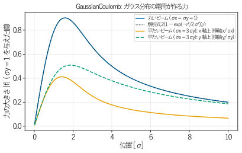

# 06. SADScript の関数ライブラリ (特殊関数・Fit・GaussianCoulomb・SAD の Packages)

最終更新: 2026-11-23 (現状のスナップショット)

**この文書で分かること**: SADScript から呼べる数学の関数 (特殊関数、数値積分、最小二乗フィット、求根、最適化)、ファイル・文字列の小さな関数、空間電荷の力を計算する `GaussianCoulomb` 系、SAD 付属の `Packages/*.n` (軌道補正・最適化・記号微分など) を pysad でどう使うか。
**前提**: SADScript の文法は [05_sadscript.md](05_sadscript.md)。物理への応用は [08_matching.md](08_matching.md)・[14_beambeam.md](14_beambeam.md) など。
**読む順**: 使う関数を §1〜§5 から探す。k64 と v2 で値が変わるものは §6 の表。限界は §7。

## 1. 特殊関数 (`pysad/specfn.py`)

scipy.special で実数引数の値を返す。K64 の実装 (gamma.f、hg.f、Packages/D.n) の定義に従う。次の表は、実装している関数を区分ごとに並べたもの。

| 区分 | 関数 |
|---|---|
| Arc 双曲線・対数ガンマ | ArcSinh ArcCosh ArcTanh LogGamma LogGamma1 (= LogGamma[x+1]) Gamma (複素も) Gamma0 (= E1) XSin |
| ガンマ族 | GammaRegularized(P/Q) PolyGamma Beta Pochhammer Factorial2 Binomial Multinomial HarmonicNumber |
| ゼータ・多重対数 | Zeta HurwitzZeta PolyLog LerchPhi HurwitzLerchPhi BernoulliB |
| 超幾何 | Hypergeometric0F1 1F1 2F1 U PFQ と Regularized |
| Bessel | BesselJ Y I K、BesselJZero |
| D.n の特殊関数 | ExpIntegralE ExpIntegralEi LogIntegral SinIntegral CosIntegral SinhIntegral CoshIntegral WhittakerM WhittakerW HermiteH FresnelS FresnelC AiryAi/Bi/AiPrime/BiPrime LegendreP InverseErf InverseErfc ProductLog |
| 基本関数の修正 (sadscript) | Log (負の引数は複素)、ArcSin/ArcCos/ArcTan (範囲外・複素)、Power (負の底の非整数べき)、Erf/Erfc (複素)、Factorial (非整数)、Exp (オーバーフローは INF)、`EulerGamma` |
| 小物 | Restrict MinMax NaNQ BitwiseAnd/Or/Xor DigitQ LetterQ RealListQ SymbolName Complex Duplicate FlattenAt Inner Fourier InverseFourier InversePower Union1 RotateRight1 `Range$` |

- **k64 モードで K64 と値を合わせたもの** (v2 モードの値は §6): `InverseErf` (B47。k64 モードは相対 1e-8 の誤差まで再現)、`ArcCosh[.5]` の符号 (-1.047 I)、`ArcTanh[2.]` = NaN、`Inner` (K64 の `Inner[f,x,y,g]` は `g@@f[x,y]`)、`Fourier` の符号 (K64 は e^{+2πi jk/n}/√n)。
- **K64 が誤値を返すので、両モードで真値にしたもの**: [30_sad_bug_report.md](30_sad_bug_report.md) の B43〜B46 (§6 (b))。
- 複素引数の PolyLog・HypergeometricU・Zeta・HurwitzZeta は実装している (§6「複素の特殊関数」)。
- PolyLog の整数次 n>=2 の z>1 は切断線の下側の複素数 (K64 と同じ)。非整数 s で z>1 (切断線の下側の複素数) と z<-1 (実数)、`HurwitzZeta[s, q]` の q<=0 の非整数 (`(n+q)^-s` は主値の複素数) も実装している (`Li_s(z) = Γ(1-s)(-μ)^{s-1} + Σ ζ(s-k) μ^k/k!`、|μ|<2π の範囲 = |z|<150。試験 `test_polylog_noninteger_outside_unit_disk_and_hurwitz_negative_q_like_gs`)。
- 未対応: 複素の次数の PolyLog、Re a ≤ 0 の複素の a・b の HypergeometricU (SADError)、z = 0 の U、HurwitzZeta の q が非正の整数 (`HurwitzZeta[2,-1]` は K64 が 2.6449 = 極の項を除いた和、pysad は NaN)、D.n の記号微分のうち `Derivative`・`ReduceExpression` (旧記述は未対応。§5 の表では D.n が動くとあり、食い違い。`D` は動く。この 2 つの現状は未確認)、`Short`、`Skip`、`Inequality`、`MessageName`、`ToInputString`。
- 検証: 458 式で K64 の値と一致 (`tests/specfn_ref.json`、`tests/test_specfn.py`)。

## 2. Fit・FindRoot・NIntegrate (`pysad/fitroot.py`)

- **Fit**・**FindRoot**: K64 の tffit1 / tfnewton を移植。K64 は式を記号微分して導関数にするが、pysad は常に数値微分の経路 (K64 が D を作れないときと同じ) を使う。`FitGaussian` も同じ経路。
- `Fit` のベクトル独立変数 (`{{x1,x2},y,dy}`) は対応する。K64 は narg を出して最小にならない値を返す (B52) ので、pysad は numpy.linalg.lstsq の解・残差と一致するよう作った (係数 1e-6、ChiSquare 1e-8。`test_b52_fit_vector_independent_variable`)。
- `FindRoot` の複素数: K64 は壊れた値を返す (B61)。**k64 モードは TypeError のまま、v2 モードは複素の Newton 法で解く** (§6)。実数は両モードで同じ。
- **NIntegrate** は D.n の分割細分 + 三次スプライン積分の移植 (Spline->False も)。scipy の CubicSpline を使う。被積分関数が複素数 (`Exp[I*x]`) でも、実部と虚部を別々に積分するのと同じ形で動く。
- **Spline** (自然スプライン)、`Sort[list, Greater]`、`Scan`。`Spline[data,0,0]` は SAD も pysad も未評価のまま。
- **FitGaussian**: `FitGaussian[d, Plot->True]` は `{…, Show[Plot (当てはめの曲線), ListPlot (ビン), opt]}` を返す (Fit.n と同じ)。キャンバスの項目は List 5・74 項目 (rectangle 1、line 40、text 13、oval 20)。`Plot[InverseErf[x] …]` のため `Vector` が `InverseErf` などの特殊関数を扱える (vecfn は specfn の後に入れる)。
- 検証: 線形な式の `Fit` で K64 と相対 1e-9、FindRoot の収束値で 1e-14、FitGaussian で 5e-10、NIntegrate で 1e-14 (複素の被積分関数は虚部 1e-15)。

## 3. 最適化・小さな組み込み・ファイルと文字列

### 3.1 DownhillSimplex (`pysad/miscfn.py`、Packages/optimize.n)

Amoeba (単体法) の移植。長く縮んだ単体 (VariableRange で拘束し続けるもの) では丸め誤差から 1e-6 ずれることがある。Output>0 の途中経過の書式は `$FORM='10.6'` ではなく `%10.6f`。`OptimizeOptics` は Python では翻訳せず、`Packages/optimize.n` を SADScript のまま実行する (§5)。検証: Rosenbrock の関数 500 反復で K64 と 1e-13。

### 3.2 小さな組み込み

StringToStream (文字列を開く)、TemporaryName、ListRandom (`{"SAD"}`)、MemoryCheck (`{0,0,0,0}`)、`$Input`=77、`$Output`=-1、FixedPointList、SelectCases。

### 3.3 ファイル・文字列・システムの関数 (`pysad/fileops.py`、`miscfn.py`)

- **ファイル**: FileQ DirectoryQ FileNames DirectoryName ToFileName CreateDirectory DeleteDirectory RenameDirectory CopyDirectory CopyFile RenameFile DeleteFile FileDate SetFileDate FileType FileByteCount `$HomeDirectory` (K64 は外部コマンド。pysad は Python の os・shutil。FileByteCount は K64 が行数を返す誤りなのでバイト数。B50)。失敗は `$Failed`。
- **init.n・functions.n の関数**: ARRAY Len Put Environment HomeDirectory StringInsert Diagonal Expand SymbolNameRoot HeldPart MkSecureTemp。
- **システム**: Directory SetDirectory Replace FindIndex Attributes ToInputString Context SetEnv GetEnv GetGID GarbageCollect ToDate FromDate、`SingularValues` `MatrixBalance`。特異ベクトルの符号は各 u の先頭成分が負になるよう揃える。

## 4. GaussianCoulomb 系 (空間電荷・ビーム・ビームの力)

[`pysad/gausscoul.py`](../pysad/gausscoul.py)。K64 の `tspac.f` (`bbkick1`、`cwerf`)、`tintrb.f` (`twspu`)、`bint.f` (`rombint`、`polint`)、`gamma.f` (`gamma0log`) を写した。ガウス分布の電荷が作る 2 次元の力とポテンシャルで、ビーム・ビームや空間電荷の計算 ([14_beambeam.md](14_beambeam.md)) と同じ系。

- **`GaussianCoulomb[x, y, sigx, sigy]`**: 大きさ (sigx, sigy) のガウス分布が (x, y) に作る力 `f_x + i f_y` (複素数。虚部が 0 なら実数で返す: K64 と同じ)。Yokoya の `CWERF` (Gautschi) をそのまま写した。
- **`GaussianCoulombU[x, y, sigx, sigy]`**: ポテンシャル。a+b<30 はロンバーグ積分 (k=5 の多項式外挿)、それ以上は漸近展開、r=1 は `gamma0log`。許容は (1e-10, 1e-13)。
- **`GaussianCoulombFitted[x, y, sigx, sigy]`** = `{fx, fy, fu, fxx, fyy, fxy}` (`twspfu`): 21×61×61 の表 (`twspu` と `bbkick1` から) を `spline1` で作り、3 次のスプラインで補間する (最初の呼び出しで表を作る、数秒)。K64 の `twspfuinit` は `spline1` の境界値に `ktaloc` の記憶を読む (uxx の 2 回目の呼び出し) が、0 とみなす。`sigx < sigy` のとき K64 は fxx と fyy を入れ替えない (そのまま写した)。
- 検証 ([`test_gausscoul.py`](../pysad/tests/script_tests/test_gausscoul.py)): 軸上・x 軸上・y 軸上・負の座標・σx<σy・σx≈σy・大きい引数・小さい引数の 15 点で K64 と 12 桁一致。`GaussianCoulombFitted` は相対 1e-9 以内 (`test_gaussian_coulomb_fitted_matches_gs`)。

`BBBrem1` (ビーム・ビーム制動放射の 1 事象) は [14_beambeam.md](14_beambeam.md) に書く。

図の読み方: 横軸はビームの中心からの距離 (σ 単位)、縦軸は力の大きさ |f| (SAD の `GaussianCoulomb[x, y, sigx, sigy]` の戻り値の符号を反転した値。長さは `sigy = 1` を与えた単位)。青の実線は丸いビーム (σx = σy = 1) の x 軸上の力で、黒の点線の解析式 2(1 − exp(−r²/2σ²))/r に重なる (r = 1.6σ 付近で最大 0.90、遠方で 2/r に近づく)。平たいビーム (σx = 3σy) では、x 軸上 (橙。横軸は x/σx) は最大 0.41、y 軸上 (緑の破線。横軸は y/σy) は最大 0.51 で、細い方向 (y) の力が強い。

## 5. SAD の Packages/*.n を SADScript のまま使う

pysad の SADScript インタプリタが、SAD の `Packages/*.n` を最初に使われたときに読む ([`pysad/pkgload.py`](../pysad/pkgload.py))。Packages ディレクトリは環境変数 `PYSAD_SAD_PACKAGES` (SAD の `Packages` のフォルダ)、なければ pysad の隣の `SAD-master/Packages`。見つからなければ何も登録しない (組み込みだけで動く)。

次の表は、Packages のファイルと、提供する関数・pysad での状況。

| パッケージ | 提供する関数 | 状況 |
|---|---|---|
| correction.n (+ bump.n、corutility.n) | CorrectOrbit、CorrectLocal、MakeBump、Bump、Monitor、Steer、CorStat、RmsReport、NearestMonitors、ReadMonitorData … | 動く (K64 と一致。§5.3) |
| optimize.n | OptimizeOptics、Amoeba、FindClosedOrbit (DownhillSimplex は Python で書いた `miscfn.py`) | OptimizeOptics が K64 と 1e-10 で一致 |
| rational.n、tableform.n、Couple.n、emit.n の Beamstrahlung 系 | Rational、TableForm、ElementValues (Couple.n の SetCoupledElements)、BeamstrahlungUpsilon … | 動く |
| D.n | Spline (K64 の `Spline$` は miscfn.py)、記号微分 `D`、`Derivative`、`ReduceExpression`、`Integrate`、特殊関数 (HermiteH など) | `D` を含め動く (59 式が K64 と文字列まで一致) |
| LDSolve.n、Optics.n | LDSolve、Optics の TransferMatrix・BeamMatrix・NormalCoordinates・OrbitGeo・PeriodicR | 動く (PeriodicR は 3e-16 以内) |

組み込み (Python) で持つ関数 (LinearSolve、Binomial、Spline など) は、パッケージの定義で上書きしない (`pkgload._protect_builtins`)。

### 5.1 UpValue を定義するパッケージ (MakeBump・Rational・ElementValues)

- `bump.n` の `(a_=Bump[…])^:=…`、`rational.n` の `Plus[Rational[…],…]^:=…`、`Canvas.n` の `(Canvas$Widget=Widget[c_,_Canvas])^:=…` は、組み込みの `Set`・`Plus`・`Times`・`Power`・`Minus`・`Divide`・`Subtract` の定義として持ち込まれる。
  `pkgload._protect_builtins` は、組み込みと同名の定義を捨てるが、この UpValue 由来の定義 (Set・SetDelayed・Plus・Times・Power・Minus・Divide・Subtract) だけは残す。
  `b=Bump[…]` のように UpValue の名前 (Bump) が最初に使われる文でも読み込まれるよう、`(a_=Name[…])^:=` の形から名前を登録する (`_UPDEF`)。`Canvas$Widget=c1` のように左辺の記号が読み込みの引き金のときも読む。
  `MakeBump` のバンプ (ybump=.0010000141、使うステアラ 12 本) は K64 と同じ。
- `Rational`: `1/3+1/6` は K64 と同じ `Rational[3,6]` (`ReducedRational` が p^2>b で打ち切るため)。`a-b`・`a/b` は Plus・Times の規則へ回す (`Subtract`・`Divide` は Rational を含むとき `a+(-b)`・`a*(1/b)`)。
- `ElementValues = {"K1"["QD"] -> -0.8*"K1"["QF"]}` は、次の `CALC` の前に `SetCoupledElements` (Couple.n を SADScript のまま実行) で要素値に反映する。`USE` で消える (K64 と同じ)。
  `"K1"["QD"]` のような文字列を頭部に持つ式は評価せず式のまま (K64 と同じ)。例: QD の K1 は -0.56、NX=6.788257。
  `VISIT` での退避と `BYE` での復元は実装している ([05_sadscript.md](05_sadscript.md) §6.2)。**未対応**: フィットの変数との連動 (`CouplingMatrix`・`CoupledKeys` を使う Fortran 側 `tffssetupcouple` は呼ばない)。
- Couple.n や `With[{f}, f&]` を動かすため、`With` は保持された式 (`Hold[y]`) と純関数の本体にも値を埋め込む。`Hold[…]` の中の `#` は純関数の置換の対象にしない。`Hold[…]/.規則` は規則の右辺 (:>) を評価せず埋め込む (`Hold` を別の頭部に替えるときは評価)。
  `Hold[…][[1]]` は取り出した式を評価し直す。`HoldAll` の引数位置の `Evaluate[x]` は評価する。`ReplaceAll` は純関数の本体にも働く。
- `DownhillSimplex` の選択肢は、規則のリストを 1 つの引数で受けても読む (`OptimizeOptics` は `Join[{opt},{VariableRange->limit}]` を渡す)。`Output->0` で途中経過を出さず、`MaxIteration` も効く。

### 5.2 組み込み (K64 の Fortran) の翻訳 (`pysad/corr.py`)

- **ResponseMatrix** (pgrmat.f): COD (閉軌道) の応答行列 (リングは周期解、ライン、`X Y PX PY MX MY MPX MPY`、`Tune`)。TRPT (加速、`gammab` の比) は実装済み (応答に sqrt(gammab(stt+1)/gammab(mon)) を掛ける)。
- **LinearSolveConditioned** (pgsolvcond.f、pmicad.f): 最小二乗 (tsvd)、条件付き (psvdcond)、Micado (ベストコレクタ法)。
- **Master[]** (pgmast.f)、**FFS["VAR"]** (tfvars.f): FREE した変数の表。
- 検証 (`tests/test_corr.py`: 12 セル、24 BPM、24 ステアラ、DX/DY の誤差つき QUAD): 応答行列、CorrectOrbit の補正量 (Y、X、Micado 6 本)、OptimizeOptics の結果が K64 と一致。
- 注意: `CorrectOrbit` が `LINE["K0"]` に足した値は `CALC NOEXP;` では効かない (SAD は "Element values are not expanded" と表示。pysad も同じ)。

### 5.3 Packages を動かすための評価器の対応

- パターン: Plus・Times は Flat に平らにして Orderless に照合、`f_[y__]` より `p_Plus` を先に、同名の変数を繰り返す定義 (`f[x_,x_]`) を `f[_Symbol,_]` より先に。`Plus[x_]` は評価しない。`{0 ..}` の Repeated。`//.` は不動点まで、`Unevaluated$[rules]` を規則にする、`f/@(a+b)` は評価し直す、`f[Unevaluated$[g[y,x]]]` は呼び出し側の y x の値を埋め込む (評価しない)。`-x` は `Times[-1,x]`、`x/2` は `(.5 x)`、`(2 x)^2` は `(4 x^2)`。
- 前置の `[x]` は括弧 (`Map[f,[g[x]]]`)、`f[x]g[y]`・`(a)(b)`・`2#1`・`x^2 y` は積 (D.n)。
- `Part[l,{i,j},k]` は要素ごとに残りの添字を適用。`Head` (Null と記号は Symbol、複素数は Complex、Function、Rule)。`VectorQ[x,test]`・`MatrixQ[x,test]`。
- `With[{g:=e/2}, f[e_]:=g*3]` は定義の中へ式を埋め込む。
- `CALC NOEXP`・`CALC EXP` を受理 (pysad は元から要素値を展開し直さないので `CALC` と同じ)。
- 数の既定の書式 (`autos`) は gdtoa に合わせた: `1e6` → `1e6`、`1e10` → `1e+10`、`123456789012345678.` → `123456789012345680`。`$FORM=" "` は既定と同じ。
- 物理定数 (`ElectronCharge`、`ElectronMass` = 510998.95 eV、`ElectronRadius`、`PlanckConstant` …) をスクリプトから参照できる。

### 5.4 Packages の関数ごとの動作と、モードによる違い

次の表は、Packages の主なファイルについて、v2 と k64 で結果が変わる点 (K64 の誤りに由来) と、残っている差をまとめたもの。確認した台本は [`example/13_packages/fn_packages_compare.sad`](../example/13_packages/fn_packages_compare.sad)・`fn_PeriodicR.sad`・`fn_CorrectLocal.sad`・`fn_CorrectOrbit_Micado.sad`、試験は [`test_v2_B2_script.py`](../pysad/tests/script_tests/test_v2_B2_script.py)・[`test_v2_D2_packages.py`](../pysad/tests/script_tests/test_v2_D2_packages.py)。

| ファイル | 関数 | k64 と v2 の違い・残っている差 |
|---|---|---|
| `functions.n` | `Log2$`、`Union` (`SameTest`)、`Names`、`Through`、`FixedPoint` ほか | **`Log2$`**: 組み込みを持つ (K64 は `Log[x]*(1/Log[b])`)。**`Union` の `SameTest`**: K64 は並べ替えも比較もせず結合した先頭の要素だけを返す (K64 の誤り。B121) → k64 は K64 と同じ、v2 は真値。**`Names`**: K64 は大域に作った記号だけ → k64 は同じ、v2 は組み込みも含める。残った差: `Through[{f,g}[1,2]]` はどちらもエラーだが文言が違う。`FixedPoint[Cos,1.,3]` は最後の桁 (libm) |
| `Misc.n` | `FunctionDefinition` ほか | **`FunctionDefinition`**: `{Hold[左辺],Hold[右辺],Hold[引数を代入した右辺]}` を返す (組み込みや定義が無ければ Null)。パターンの表示・`x//y` の表示・代入後の文字列どうしの連結を K64 に合わせた |
| `element.n` | `Element` の読み出し・代入、`PROFILE`、`SetElement` | **`Element[..]+=`・`LINE[..]+=`**: 複合代入は `Element`・`LINE` のフックを通る。**`SetElement` の戻り値**は K64 と同じく MAIN の定義の値。残った差: `PROFILE` の代入は K64 も `General::invset` で pysad は別の文言のエラー、MARK の Twiss のキー (AX など) は CALC のあとの `SetElement` で K64 は MAIN の 0、pysad は CALC が書き戻した値、`Element["K1","QF"]=0.9` の読み戻しが 1 ulp (0.8999999999999999) |
| `beamline.n` | `BeamLine`、`ExtractBeamLine`、`WriteBeamLine`・`PrintBeamLine`、`Fill$String`、`Remove$Paren` | **`WriteBeamLine` の `Name`**: K64 は `Name->"L2"` (文字列) で `Insufficient number of Names` (K64 の誤り。`{"L2"}` と書く。B122) → k64 は K64 と同じ、v2 は文字列も受ける。`Fill$String`・`Remove$Paren` は組み込みを持つ |
| `emit.n` | `Emittance[]` (既定、`OneTurnInformation`、`Matrix`、`Orbit`、`Emittance->False`、`Region`、`SaveEMIT`)、`SymplecticJ`・`SymplecticInverse`、`TouschekF`、`TouschekLifetime`、`Beamstrahlung*` | **`Emittance->False`**: K64 と同じく DampingRate 以降の規則を返さない。`Touschek` のメッセージの形は `???Touschek::undef:  …`。残った差: `SymplecticInverse` の `-0` の表示 |
| `dapert.n` | `DynamicApertureSurvey`、`AccelerateParticles`、`TrackParticles` | `TURNS` の既定は両方 −1。**残った差**: `DAPWIDTH` の既定 (K64 は 7 で x の振幅を上から 7 個ずつ追跡し、続けて生き残れば残りは追跡せず `*` で表示。pysad は 51 で全点を追跡。`Maximum number of particles` が K64 42、pysad 306。[11_dynamic_aperture.md](11_dynamic_aperture.md))、`Axes->"XZ"` で z の範囲が 3 点のとき K64 はエラー、pysad は受ける、不正な `Axes` のメッセージ (`DALib::wrongmode`) は未比較 |
| `Optics.n` の `PeriodicR` | 4x4 の一周行列 | `PeriodicOptics` を先に呼ぶ必要がある (先に呼ぶと未評価。K64 も同じ) |
| `correction.n` の `CorrectLocal` | 局所バンプの補正 | 領域の外の軌道は変わらない (局所バンプが閉じる) |
| `correction.n` の `CorrectOrbit` の Micado | `Solver->{"Micado",n}` | **K64 の誤り (B129)**: `pmicad.f` が `tsvd` に nx を渡さず、全補正量の最小二乗の先頭 nx 個を使う (24 セル FODO で補正前 9.41e-5 m に対し n=1 で 1.46e-4 に悪化、n=8 で 1.75e-4)。**k64 は K64 と同じ、v2 は選んだ nx 本だけを解く** (n = 1・2・3・4・6・8・12・24 で 4.74e-5・4.43e-5・4.37e-5・4.31e-5・4.11e-5・3.97e-5・3.51e-5・2.06e-5 m と単調に下がる。最小二乗と同じ 2.06e-5)。`Condition` つき (`CorrectLocal`) の Micado は選んだ列だけで `psvdcond` を解く元の分岐で K64 でも正しい。未確認: 水平・2 平面同時の Micado、`Bump`・`SVDmode->1` つきの Micado |

### 5.5 SAD 自身の Packages を読むときの注意

- Python 3.14 (Tcl/Tk 9.0) でも [`test_tclbridge.py`](../pysad/tests/script_tests/test_tclbridge.py)・[`test_plot.py`](../pysad/tests/script_tests/test_plot.py)・[`test_gui_lang.py`](../pysad/tests/script_tests/test_gui_lang.py)・[`test_corr.py`](../pysad/tests/script_tests/test_corr.py) が通る (Windows の Tk 9.0 は `$DefaultFixedFont` を `Courier New` にする: [20_tcltk_gui.md](20_tcltk_gui.md))。numba のキャッシュは `py -3.12 -m pysad.nbcache` ([12_pysad_api.md](12_pysad_api.md))。

## 6. v2 モードで変わった値と、モードによらない修正

根拠は K64 (gs) ではなく独立な計算 (閉じた式、級数、AGM、積分表示の数値積分、Wronskian などの恒等式、numpy の最小二乗)。mpmath はこの環境に無いので使っていない (scipy.special と、scipy に依らない独立な計算を突き合わせた)。K64 は動作の確認にだけ使った。試験 `test_v2_B_specfn.py` 13 件、`test_v2_B_script.py`。条件: 実数の倍精度。複素引数は実数のパラメータだけ確かめた。例: [`example/10_math_data/fn_SpecialFunctions_gs_errors.sad`](../example/10_math_data/fn_SpecialFunctions_gs_errors.sad)。

### 6.1 v2 モードだけ値が変わるもの (k64 モードは K64 の値)

次の表は、同じ入力で k64 と v2 の値が違う関数。

| 関数 | k64 モード | v2 モード | 根拠 |
|---|---|---|---|
| `InverseErf[.3]` (B47) | .272462711811 (Newton の係数が sqrt(π/2)、早い打ち切りで相対 1e-8 の誤差。`FitGaussian` も影響) | .2724627147267543 (scipy の erfinv)。`InverseErfc` は小さい z で桁落ちしない erfcinv | erf(InverseErf(x)) = x が 4e-16 以内、正しい係数 (sqrt(π)/2 e^{y²}) の Newton 法と 1e-13 (`test_b47_inverseerf_v2_true_value`、`test_fitgaussian_uses_true_inverseerf_in_v2`、k64: `test_b47_inverseerf_k64_unchanged`) |
| `PolynomialFit` (B18) | x の平均が 0 のとき係数が壊れる | numpy.polyfit と 1e-13 ([05_sadscript.md](05_sadscript.md) §5.1) | `test_b18_polynomialfit_mean_zero_v2` |
| `FindRoot` の複素初期値 (B61) | TypeError | 複素の Newton 法 (下の「複素の FindRoot」、[05_sadscript.md](05_sadscript.md) §6.2) | `test_b61_findroot_complex_v2` |
| ``Names["Stat`*"]`` | K64 と同じ ``{"Stat`"}`` | その文脈の記号の一覧 | [05_sadscript.md](05_sadscript.md) §6.2 |

### 6.2 モードによらず正しい値にしているもの

K64 が誤値を返す、または pysad の不具合だったもの。k64 モードでも同じ真値を返す。

| 関数 | K64 (gs) の動作 | pysad の値 | 根拠 |
|---|---|---|---|
| `Hypergeometric2F1[.5,.5,1,.99]`、`BesselJ[.5,30.]` (B43) | 2.348414、-.143924709693 (級数の打ち切り) | 2.352715816780、-.143929653370 | 2F1(½,½;1;m) = 2K(m)/π を AGM で、J_{1/2}(x) = sqrt(2/πx) sin x。相対 1e-13 |
| `ExpIntegralEi` (B44・B54) | `Ei[1.5]` = .164-2.985 I、`Ei[-.1]` = -2.2265 | 3.301285449130、-1.822923958419 (実数) | 級数、負の側は -E1(x)、大きい x は漸近級数。1e-10〜2e-12 |
| `HermiteH`・`LegendreP`・`Binomial` (B45) | `HermiteH[3,.7]`・`LegendreP[3,1,.4]`・`LegendreP[2,2,.3]`・`Binomial[-3,2]` が NaN | -5.656、+.274954541697、2.73、6 | H3 = 8x³-12x、P_3^1 = -(1-z²)^½ (15z²-3)/2、P_2^2 = 3(1-z²)、二項係数の積 |
| `HypergeometricU`・`BesselY`・`BesselK`・`BesselJ` の負の次数・`BesselJZero` (B46) | `U[1,2,.5]` = INF、`BesselY[0,.1]` = NaN、`BesselK[1.5,.7]` = INF、他は応答なし | 2、-1.534238651350、1.806573612779、-.557936507910 (`BesselJ[-1,1.5]`)、.145918137967 (`BesselY[1,2.5]`)、2.404825557696 | U(1,2,z) = 1/z、Y_0 の級数、K_{3/2} の閉じた式、Wronskian J_1 Y_0 - J_0 Y_1 = 2/(πx) |
| 大きい引数の `BesselJ/K/Y`・`FresnelS`・`AiryAi` (B53) | `BesselJ[0,33.]` 相対 3e-3、`FresnelS[6.1]` = 1.3e7、`AiryAi[15.5]` = -16 | 真値 (scipy) | 積分表示 (台形則)、Simpson 積分、Ai Bi' - Ai' Bi = 1/π。x = 33・100・1000 の Bessel、x = 6.1・20 の Fresnel |
| `PolyLog` (B54) | 複素数 (虚部 1e-15 の雑音つき) | 実数 (z ≤ 1)。z > 1 は切断線の下側 (Li_2(2) = π²/4 - iπ ln 2)、z < -1 は実数。**非整数次は \|z\| の上限なし** | Li_2(½) = π²/12 - ln²2/2、Fermi–Dirac 積分、Im = -π ln^{s-1} z/Γ(s)、Li_{s-1} = z dLi_s/dz。s ≤ 7.9、\|z\| ≤ 1e12 で相対 1e-11 |
| `LegendreP` の奇数 m の符号 | (K64 は NaN で参照なし) | `LegendreP[3,1,.4]` = +.2749545416973507 | m = 1 ± 1e-6 の式の値と閉じた式 |
| 複素引数 | TypeError | Bessel J/Y/I/K (実数の次数)、Hypergeometric0F1・1F1・2F1 (実数のパラメータ)、Airy が複素引数で使える | 積分表示・級数・Wronskian と 1e-12〜1e-13 (`test_complex_argument_bessel_hypergeometric`) |
| `FixedPointList` (B48)・`Fit` のベクトル独立変数 (B52) | 未評価・narg | Misc.n の定義どおり・最小二乗解 | Newton の反復の再計算、numpy.linalg.lstsq |

**PolyLog の非整数次・大きい |z|**: μ = ln z の展開は |μ| → 2π で収束が遅く z < -12・z > 60 で精度が落ちる (z = -140、s = -1.5 で相対誤差 1、|z| ≥ 150 は NaN) ので、そこは `specfn._polylog_far` を使う (s < 2.2 は反転公式、s ≥ 2.2 は積分表示)。使える範囲: 実数の z、実数の非整数 s。使えない範囲: 複素数の z (SADError)、負の非整数 s が大きい (s < -10 程度) ときの精度は未確認。

**複素の FindRoot** (v2): 初期値に複素数があると、式を変数について正則と仮定して、前進差分のヤコビアンと最小二乗 (numpy lstsq) の Newton 法 (歩幅を半分にする減速つき) で解く。z² = -1 → i、e^z = 2 → ln 2、z³ = 1、連立 zw = i・z + w = 2 が残差 1e-12 以下。使い方・使えない範囲は [05_sadscript.md](05_sadscript.md) §6.2。

**複素の特殊関数** ([`pysad/specfn_cx.py`](../pysad/specfn_cx.py)。両モード。mpmath はこの環境に無いので、級数・Euler–Maclaurin・解析接続・積分表示を自前で実装した。試験 [`test_v2_B2_specfn_cx.py`](../pysad/tests/script_tests/test_v2_B2_specfn_cx.py)、例 [`example/10_math_data/fn_SpecialFunctions_complex.sad`](../example/10_math_data/fn_SpecialFunctions_complex.sad)): 次の表は、複素の特殊関数の実装・使える範囲・独立な参照との一致。

| 関数 | 実装 (複素の z・s。主値) | 使える範囲 | 参照との一致 |
|---|---|---|---|
| `Zeta[s]`・`HurwitzZeta[s,a]` | Euler–Maclaurin (N = 20 + \|s\|/1.5 + \|Im a\|/2 項と補正 16 項)。Re s < 0 の Zeta は関数等式 | \|s\| ≤ 500 (\|s\| = 100 で相対 1e-11) | Zeta: Borwein のアルゴリズムと関数等式と相対 1e-11 (30 点)。HurwitzZeta: 別に書いた Euler–Maclaurin と 1e-10 |
| `PolyLog[s,z]` | \|z\| ≤ 0.5 は冪級数、\|ln z\| ≤ 4 は μ = ln z の展開 (110 項まで)、それより大きいときは倍角の公式の再帰 (\|z\| = 1e8 で 5 段)、s が 0 以下の整数は有理関数。**負の実数の z は上側 (arg z = +π)**。実軸上の z > 1 は切断線の下側 | 実数の次数、\|z\| ≤ 1e8 (s = 0.5〜7.3) | 冪級数・`scipy.special.spence`・積分表示・整数次の反転公式と 2e-11 |
| `HypergeometricU[a,b,z]` | Re a > 0 は積分表示 (被積分関数が減衰する向きに回した経路。山の付近で区間を分け、a < 1 は t = u^{1/a} で端点の特異性を除く)、a が負の整数は多項式、それ以外は a の漸化式と Kummer の変換 | \|z\| ≤ 30。b が整数でも動く | 積分表示・接続公式・多項式・漸近展開と 1e-10 (a・b の極の場合は b を ±1e-3 振った平均と 1e-5) |

- **K64 が複素引数で誤る点でも、pysad は両モードで真値を返す** (k64 も。B118〜B120): (i) `HurwitzZeta[s,a]` の s が複素で、a を 1 以下に畳んだ値が 0.5 以上 1 未満 (a = 0.5・1.5・3.5 など。0.25・1・2・10 は正しい) のとき相対 1e-6〜1e9 の誤り (例 `HurwitzZeta[2+I,.5]` = K64 3.9549+2.1791 I、真値 3.5075+2.0314 I)、(ii) 非整数次の PolyLog で Re z < 0・Im z ≤ 0・\|z\| > 1 (例 `PolyLog[1.5,-3.28-3.54 I]` = K64 3.47+9.43 I、真値 -2.09-1.06 I)、(iii) `HypergeometricU` で b が整数なら NaN (複素の z でも。実数の z の B46 と同じ)、(iv) U の \|z\| = 20 で相対 1e-8、(v) `Zeta[s]` の臨界線上の零点は 1e-16 の雑音。**これらの関数では「k64 モードは K64 と同じ」が成り立たない** (K64 の誤った値の再現には K64 の `gamma.f` の複素の不完全ガンマ `cgamma2`・`czconvb`・`cpolylogl` の直訳が要る。要判断。K64 の値が必要なら K64 を使う)。
- 実数引数の値は変えていない (`test_real_arguments_are_unchanged`)。

## 7. 未対応・限界

- 複素の特殊関数: 複素の次数の PolyLog、Re a ≤ 0 の複素の a・b の HypergeometricU (SADError)、z = 0 の U、\|s\| > 500 (Zeta・HurwitzZeta)、\|z\| > 1e8 (PolyLog)・\|z\| > 30 (HypergeometricU) は未対応・未確認。
- 記号式の標準形は SAD と同じではない (`0*x` は K64 が `(0 x)` のまま、`x^0` も `x^0` のまま、pysad は 0 と 1 にする)。D の出力は 59 式で一致するが、別の式では形が違いうる。パターンの Orderless 照合は、数を先頭にした標準順→順列 (6 引数まで)、素の Blank と列パターンが両方あるときは標準順だけ (K64 の挙動に合わせて経験的に決めた)。
- `OptimizeOptics` の最初に K64 が表示する `{{`,System`},System`}` (BeginPackage の戻り値) は、pysad は `{$ContextPath,"`"}` (文脈を持たないため。差は残る)。
- Matrix.n (`LinearSolve`、`Inverse` の SADScript 版) は読まない。`SingularValues`・`MatrixBalance` は Python (`miscfn.py`)。
- `Parallelize` が `bbbrem.n` の `BBBrem1` 呼び出しで動くかは確かめていない ([14_beambeam.md](14_beambeam.md))。
- 一覧は [31_unimplemented_and_unverified.md](31_unimplemented_and_unverified.md)。

関連文書: [05_sadscript.md](05_sadscript.md) (言語)、[28_v2_vs_k64.md](28_v2_vs_k64.md) (v2 と k64 の違い)、[30_sad_bug_report.md](30_sad_bug_report.md) (B 番号の目録)、[27_benchmarks.md](27_benchmarks.md) (検証)。
