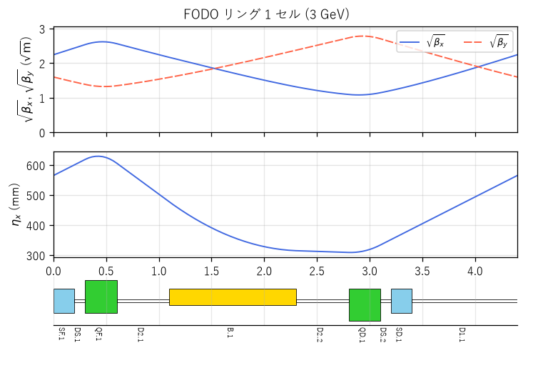
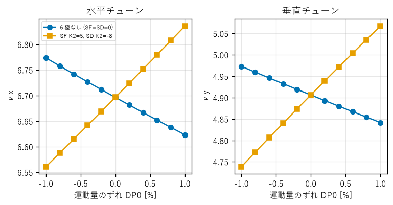

# 07. CELL/INS の光学計算 (CALC) — SAD の qcell/qcod/qtwiss と pysad の lattice.py

**この文書で分かること**: FFS の `CALC` (`CALCULATE`) が何を計算するか。結果 (Twiss パラメータ、閉軌道、分散、チューン) がどの表のどこに入るか、どんなときに「不安定」と判定されるか、要素ごとにどの写像を使うか、を述べる。SAD のソース (`qcell`・`qcod`・`qtwiss`) と pysad の対応も示す。
**前提**: FFS の基本 (docs/03_ffs_commands.md)、ラティスの書き方 (docs/02_lattice_main.md)。
**読む順**: まず §0 (動かして数字を読む) → §3 (Twiss の格納) → §4 (安定性の判定) と §4b。§1・§2 (計算の流れと要素ごとの写像) は、SAD のソースと対応づけたいときに読む。

> 照合した SAD ソースは `<SAD>/src`、pysad 側は [`pysad/lattice.py`](../pysad/lattice.py)・[`pysad/ffscmd.py`](../pysad/ffscmd.py)・[`pysad/match6.py`](../pysad/match6.py)。ソースの行番号は 2026-10 時点。

## 0. 使い方と結果の読み方

用語: **CELL** は、先頭から末尾までを 1 周とみなして周期解 (閉軌道・Twiss・分散) を求める計算。**INS** は、先頭 (先頭 MARK) の値を入口として与え、そこから末尾まで光学を伝搬する計算 (輸送路など)。`CALC` は現在の設定 (CELL か INS、運動量のずれ `DP0`) で計算して Twiss の表を更新する。

1. 次のスクリプトを `ffs_calc.sad` として保存する (24 セルの FODO リング、3 GeV、周長 105.6 m、1 セルの偏向角 15 度。`example/02_optics_cod/FFS_CALCULATE.sad` と同じラティス)。

```
MOMENTUM = 3GEV;
DRIFT D1 = (L=1.0) D2 = (L=0.5) DS = (L=0.1);
QUAD  QF = (L=0.3 K1=0.7) QD = (L=0.3 K1=-0.6);
SEXT  SF = (L=0.2 K2=0) SD = (L=0.2 K2=0);
BEND  B  = (L=1.2 ANGLE=0.2617993877991494 E1=0.1308996938995747 E2=0.1308996938995747);
MARK  ORIGIN = ();
CAVI RF = (L=0 VOLT=1.5E6 FREQ=5.0E8 PHI=0);
LINE CELL = (SF DS QF D2 B D2 QD DS SD D1);
LINE RING = (ORIGIN RF 24*CELL);
FFS;
$FORM = "10.6";
USE RING;
CELL;
CALCULATE;
Print["NX=", Twiss["NX","$$$"]/2/Pi, "  NY=", Twiss["NY","$$$"]/2/Pi];
Print["BX=", Twiss["BX","ORIGIN"], "  EX=", Twiss["EX","ORIGIN"]];
Exit;
```

2. pysad で実行する (リポジトリの直下で): `py -3.12 run_sad.py ffs_calc.sad`
3. 出力 (pysad で確認した値):

```
NX=  6.696329  NY=  4.906056
BX=  5.025185  EX=   .565228
```

数字の意味: `Twiss["NX","$$$"]` は 1 周の位相進み [rad] を 2π で割ったチューンで、(νx, νy) = (6.696, 4.906)。`BX` は先頭 (ORIGIN) での水平ベータ関数 5.03 m、`EX` は水平分散 0.565 m (結合がなければ物理分散と同じ。結合があるときはモード座標の分散で、物理分散は `PEX`。§3)。24 セル全体で偏向角が 2π になり、1 セルの位相進みは水平 0.279 (= 6.696/24) の周期。偏向磁石 15 度 ×24 のリングで分散が 0.5 m 台なのは、BEND の曲率半径 4.58 m と偏向角の大きさから見て妥当な大きさである (定量的な照合はしていない)。



図の読み方: 横軸は 1 セルの先頭 (SF の入口) からの距離 s [m] (0〜4.4 m)。上段は √βx (青の実線) と √βy (橙の破線) [√m]、中段は水平分散 ηx [mm]、下段はラティス (黄が偏向磁石、緑が四極、水色が 6 極。下の文字は要素名)。s = 0 で βx = 5.03 m (√βx = 2.24)、ηx = 565 mm で、上の出力の `BX`・`EX` と同じ。βx は QF の付近で最大 (約 6.9 m)、βy は QD の付近で最大 (約 7.7 m) になり、ηx は QF の付近で最大 (約 630 mm)、QD の付近で最小 (約 310 mm) になる。

`CALC` が不安定なリングを見つけると ` Horizontal Unstable.` などを出す (§4)。


## 1. 全体の流れ

```
tffsa (CALC)            FFS コマンド解釈。cell なら tfsetupcell、dp(-nfr:nfr) の設定   tffsa.f:544-559, 1079-1207
 └ tffsmatch            反復ループ (CALC では fitflg=.false. なので 1 回)            tffsmatch.f:139
    └ tffscalc          twmov で第1要素の値 → twiss(1,0,:) (前回の解を初期値に)      tffscalc.f:93
       ├ qcell1(ibound,0,…)   中心運動量                                           tffscalc.f:109
       │   ├ (calc6d → qcell6d)                                                   qcell.f:62
       │   ├ cell: qcod → qmdiag → lb の周期 Twiss・分散                           qcell.f:68-279
       │   └ qtwiss → qtwiss1(mat=.false.) で各要素へ伝搬                          qcell.f:282-290
       ├ 安定なら twmov(…,.false.) で twiss(1,0,:) を第1要素に書き戻す              tffscalc.f:118-120
       └ ix=±1..±nfr: qcell1(ibound,1,…) → utwiss に退避 (オフモメンタム)           tffscalc.f:194-215
```

### qcod (`qtwiss.f:810-970`) — 閉軌道の反復

| 項目 | SAD | pysad (`lattice.py`) |
|---|---|---|
| 1 周の評価 | `qtwiss1(mat=.true.)`: 軌道 cod の上で要素ごとの 4×5 行列 (第5列 = ∂/∂δ) を積算 | `_one_turn_cod_matrix`: 要素ごとの 6×6 Jacobian と出口軌道 |
| 閉じる成分 | (x, px, y, py) のみ。δ は固定、z は閉じない | 同じ (`cod0[5]=delta`, `cod0[4]=0`) |
| 収束判定 | `conv = min(1e-10, 1e-18(1+(δ/0.001)²+nlat))`、残差 `r = dx²/βx + βx(dpx+αx/βx·dx)² + (y 同様)` (1 周のずれの Courant–Snyder 不変量)。α, β は一周行列から `cx=(T11+T22)/2`、`\|cx\|>1 なら 1/cx` で推定 | `_qcod_periodic` に同式を直訳 |
| 更新 | Newton: `(T−I)·cod0_new = T·cod0 − cod_end` を `tsolvg` (SVD, 閾値 1e-8) で解く | `np.linalg.solve` |
| 減衰 | r が悪化: `fact≥1e-3` なら `cod0=(1−fact)·cod00+fact·cod0`, fact を半減。`fact<1e-3` なら fact×16 で逆方向に外挿。改善時は `fact=min(0.5,2fact)` | 同じ |
| 上限 | itmax=10 (最大 11 周) | 同じ |
| 返す行列 | **最後に 1 周させた出発点 cod0 で評価した trans**。収束後に評価し直さない | `cod_in, M_cod` を返す (同じ) |
| 初期値 | `twiss(lb,idp,DX:DDP)` = tffscalc.f:93 の `twmov(..,.true.)` が読む**先頭 MARK の DX/DPX/DY/DPY/DZ/DDP**。直前の CELL の周期解 (後述 twmov) か、スクリプトが `LINE["DX",..]=` で書いた値 | `FFSState.calc()` が先頭 MARK の DX/DPX/DY/DPY を `twiss_table(cod=…)` に渡す (`Lattice._cod_prev` は MARK がないときの代わり。詳細は `history/work_ins_offset.md`) |

この「評価し直さない」仕様のため、オフモメンタムの β は初期値 (= 直前に計算した運動量点) に依存して相対 1e-6 程度揺らぐ。pysad で SAD と一致させるには、SAD と同じ順 (0 → −nfr … → +nfr) で同じ `Lattice` に対して呼ぶ。

### qtwiss (`qtwiss.f:14-516`)

`qtwiss1` のループは `do l=la+1,lb` で要素 `l1=l−1` を通し、結果を `twiss(l)` に書く。したがって **`twiss(l)` は要素 l の入口**、`twiss(nlat)` (`$$$`) は最終要素の出口である。`$$$` 行の COD は最後の一周の出口 COD。`qmat2twiss` が入口の α, β, R, 分散から出口の値を作り、位相 NX/NY は増分 `dpsix = atan2(T12, aa)` を足していく。`ltyp > icMARK` (MONI, APRT など) は前の値をコピーする。

pysad: `Lattice.twiss()` が `_qcod_periodic` → `periodic_optics` → 分散 (後述) → `_transport_twiss` で各要素行列を伝搬。`ffscmd.FFS.calc()` の `rows[l-1]` が SAD の `twiss(l)` に対応する。

### INS (cell=.false.) と twmov (詳細: `history/work_ins_offset.md`)

流れ:
1. **CELL CALC が安定なら周期解を先頭 MARK に書き戻す** (`tffscalc.f:119` `twmov(1,twiss,nlat,ndim,.false.)`): AX BX AY BY EX EPX EY EPY R1–R4 DETR と閉軌道 DX DPX DY DPY DZ DDP (PSIX=PSIY=0)。以後 `LINE["BX","MKS"]` はこの値を返す。
2. **CALC の入口で MARK の値を読む** (`tffscalc.f:93` `twmov(..,.true.)`): ntfun は `orbitcal` (既定 .true.) か calc6d なら 28 成分すべて (DX..DDP を含む)。NX=NY=0。`DP0` は `LINE["DDP",1]` の別名 (`track.f:39`)。
3. CELL は MARK の DX..DDP を qcod の初期値にして周期解を求める。**INS は qcod を呼ばず**、`qtwiss1` が `cod=twiss(ipa,DX:DDP)` (MARK の値) から要素ごとに軌道を更新し、その軌道上の解析行列 (4×5) で `qmat2twiss` を呼ぶ。R1–R4 は MARK の値、`normal = DETR<1`、`|値|<1e-30` は 0。
4. したがって「CELL → INS に切り替える」と、直前の周期解 (βx=4.643 など) が入口になる。先頭 MARK の DX/DPX/DY/DPY を書き換える (`LINE["DX","MKS"]=…`) と、それは**初期軌道**になる (分散には入らない)。`BXI/AXI/BYI/AYI` も MARK の値を書く。

pysad: `FFSState._twmov_to_mark(rows)` が CELL CALC (4D/CALC6D) の後に MARK の raw 値へ書く。`_ins_rows` が MARK の AX..R4, DETR と DX..DZ を `lattice.ins_twiss` に渡す。`ins_twiss` は `_one_turn_cod_matrix` の要素処理で軌道を追い、その上の行列を `_transport_twiss` (SAD `qmat2twiss` の直訳、結合込み) で伝搬する。


**INS + CALC6D** (docs/history/work_emit_unstable.md B): `qcell` は calc6d なら CELL/INS に関わらず `qcell6d` に入り (qcell.f:62)、INS (cell=.false.) の枝は閉軌道も tecalc も使わず
先頭 MARK の 28 成分 (AX..ZPY、`twmov(right)`) と軌道 DX..DDP から `ri0=etwiss2ri(twiss(1))`、`twiss(1)=tfetwiss(ri0,cod,.true.)`、`ri=etwiss2ri(twiss(1))` (tfinibeam) を作り、`tturne0` で 6D 伝搬する
(各要素で `tfetwiss(ri·inv(T), cod, normali)`)。MARK には書き戻さない。pysad: `calc6d.calc6d_ins` + `ffscmd._mark_tw28`、CELL の CALC の後に MARK へ縦方向の列 (AZ BZ PSIZ ZX..) も書く。


## 2. 要素ごとの CALC 用の写像 (`qtwiss.f:184-400` の分岐)

要素パラメータは `lp = merge(ld, le, ideal)`: 通常はインスタンス値、IDEAL フラグで要素 (ファミリー) 値。

| 要素 | SAD の経路 | 内容 | pysad |
|---|---|---|---|
| DRIFT | インライン | `pzi = (1+δ)+dpz`, `a12 = L/pzi + px²·L/pzi³` など正準運動量での厳密ドリフト。`cod(5) += dpz·ale − dvemit·L` | `_drift_matrix_at_cod` + 同式で cod 更新 |
| QUAD | `qquad` → `tquade` | `L=0` なら tthine(nord=4, ak=K1 の積分値、K1<0 の −90° 回転なし。`L=0 K1 ROTATE=45 deg` の SQ が該当)、`K1=0` なら tdrife0。`K1·L<0` は θ−π/2 回転して `−K1`。`tsolrote(…,.true.)` で DX/DY/ROT の座標へ入り、`tqfrie` (ハードエッジのフリンジ、`DISFRIN=0` のとき)、`tqlfre` (線形フリンジ、`FRINGE=1,3` で入口、`2,3` で出口。係数は `tsetfringepe`: f1in = F1+F1K1F 等、`K1≠0, L≠0` のときだけ)、`tsolque` 本体 (`ndiv = 1+int(\|L·K1\|/0.1)`)、出口で逆順に戻す。z 写像は `xs = x − sin x` | `_quad_offset_map` → `_tquade_cod` (`_tqfrie_cod`, `_tqlfre_cod`, `_tsolque_cod`)。F1/F2/FRINGE/DISFRIN を `_quad_fringe_params` で読む。逆向き要素の mfr 変換は未対応 |
| BEND | `qbend` → `tbende` | 入口角 `pe1 = E1·ANGLE + AE1` (E1 は ANGLE 比)。`fb1 = F1+FB1`, `fb2 = F1+FB2`。`phib = ANGLE+K0`。`tchge` (DX/DY/DZ/ROT/DROTATE/CHI2) → `tblfre` (F1) → `tbedge` → 本体 → `tbedge` → 逆変換。`K1=0`: `tbendebody0` (F1≠0 なら `tbendef1` の 2 区間)。`K1≠0`: `tbendiinit` + `[tbendecorr + tbendebody]×ndiv` | `_bend_cod_update` (`_tbedge_cod`, `_tbendebody0_cod`, `_tblfre_cod`)、K1≠0 は `emit6d._tbende` を流用した `_bend_k1_cod_matrix` (入口・出口エッジは解析行列に差し替え)。**K1=0 でずれ・F1 のないものと K1≠0 でずれのないものは、行列を SAD の解析式 (`_tbedge*_mat`, `_tbendebody0_mat`) で作る**。ロール誤差は `_tbrote_cod` (`tchge`→`tbrote`、LGEO=L/2, ANGLGEO=ANGLE/2 まわり) |
| SEXT/OCT/DECA/DODECA | `qthin` → `tthine` | `ak=K` (積分値), `kord = nord/2−1`, `aki = ak/kord!`。L≠0 なら `L/6` ドリフト → キック (aki/2) → `2L/3` ドリフト → キック → `L/6` ドリフト。キック: `px −= aki·Re((x−iy)^kord)`, `py −= aki·Im((x−iy)^kord)`。DX/DY/ROT は `tchge` (alg=phig=0) | `_tthine_cod`, `_thin_offset_map`。pysad の K は長さあたりなので `K·L` を渡す (L=0 なら K そのまま) |
| MULT | `qmult1` → `tmulte` (seg なら `qmultseg`) | ANGLE=0, BZ=0 の多極写像 (分割数は tpara の式) | `_mult_cod_map` (`_mult_sequence`) |
| MULT (ANGLE≠0) | `tmultae` | 曲げつき多極。ndiv 個のスライスで [半曲げ → キック → 全曲げ → … → 半曲げ]。COD 写像は解析、行列は各段の解析行列の積 | `multae.lattice_step` (`lattice._el_cod_step`)。詳細・限界は docs/19_other_elements.md |
| COORD | `qcoord` → `tcoorde` | 座標変換 (DX DY DZ のずらしと CHI1-3 の回転、DIR≠0 は逆変換)。COD が設計軌道上でなくても動く | `lattice._el_cod_step` の Coord。詳細は docs/19_other_elements.md |
| TCAVI | `ttcave` | RFSW OFF (CALC の既定) は長さ L のドリフト。**RFSW ON の CALC は未対応** (NotImplementedError) | docs/19_other_elements.md |
| UND | `case default` | 恒等 (長さは幾何にだけ入る)。K64 の UND は磁場を設定できない。**v2 モードは磁場なしでも長さ L のドリフトとして光学に入り、`FBX`・`FBY` の磁場つきの UND は追跡の写像の数値微分が入る** (docs/19_other_elements.md) | k64: 恒等。v2: 追跡のカーネルの数値微分 |
| MAP | `qemap` | `ExternalMap["OPTICS", l, cod]` が `{cod1, trans}` を返す。定義がなければ恒等で長さ 0 | `lattice._map_step` (docs/19_other_elements.md) |
| CAVI | `qcav` → `tcave` | `qcav` は `rfsw = rfsw .and. trpt` にして呼ぶので、**リングの 4 次元 CALC では RFSW に依らずドリフト** (bench_level14a_dbg で確認) | `lattice.RFSW=False` で `_drift_matrix_at_cod(L)` |
| SOL | `tfbndsol` で区間判定 → `qsol` → `tsole1`。SOL 要素単体は "implementation error" | BOUND≠0 の SOL から次の BOUND≠0 の SOL までが領域。領域内は BZ のあるソレノイド内の正準運動量で動き、横方向が結合する | `solmap.py` (追跡の numba カーネルを 1 粒子に使い COD での中心差分 1e-7 を行列にする。`tsolque` の解析行列は写していない)。限界は 6 節と docs/17_sol.md |
| STEER | abort ("Use BEND with ANGLE=0") | — | — |
| MARK, MONI 等 | 前の値をコピー | — | 単位行列 |

**ROTATE (ROT/TILT) の扱い (docs/history/work_rotate.md)**: BEND は `tchge` (入口: theta で回す→回した座標系でずらす→tbrote、出口は逆) を外側に付けて中身 (tsteee / tbendebody0 / K1≠0 の tbendebody / tquade / tmulte) を誤差なしで計算する
(`lattice._bend_element_cod_matrix`、`_bend_chg_args` が tbende.f の分岐ごとの theta (ANGLE=0 の tsteee は DROTATE を渡さない、K0=0 はドリフトで tchge を呼ばない) を決める)。
薄い多極 (SEXT/OCT/DECA/DODECA と L=0 の四極) は tthine の先頭・末尾の tchge (`_thin_cod_matrix`)。四極と MULT の ROT は tsolrote (ずらす→回す)。
**SAD の癖 (k64 モード)**: tchge の入口で th≠0 かつ回した座標系のずれ≠0 (または dz≠0, dtheta≠0) のとき、tbrote が行列を上書きするので行列に回転が入らない (COD は回る)。一周行列が R^T·M になり結合が物理とずれる。`_tchge_jac` が再現 (docs/29 A25)。**v2 モードでは修正してある** (B09): 入口の回転を行列に掛ける (行列 = 軌道の写像の微分)。`_tchge_jac` が `_tchge_cod` の数値微分と 1e-8 で一致し、ロール + ずれのある6 極・BEND を含むリングの CALC のチューンが追跡の一周写像の固有値と一致する (6 極 1e-9、BEND 4e-6。K64 は 0.02〜0.18 ずれる。[`test_v2_A_tchge.py`](../pysad/tests/script_tests/test_v2_A_tchge.py))。同じ tbrote のスピン (srot) の更新も v2 は (I+rr)·srot の行列積にした (B56。直交性 1e-14)。

### BEND の K0 と ANGLE=0 のステアリング (docs/history/work_bend_k0.md)

- ANGLE≠0 の BEND の K0 は phib = ANGLE+K0 として rhob に入り、`drhob = rhob−rho0` が `tbendebody0`/`tbendebody` の `dpza = dpzi+(drhob−xi)/rhob` でキックになる (px が約 −K0 変わる)。pysad: `_bend_cod_matrix`, `_bend_k1_cod_matrix`, emit6d `_tbende`。
- **ANGLE=0 の BEND (K1..K5 付きなど)** は `tbende.f` の phi0==0 分岐: K1=0 → `tsteee` (L=0: 薄いキック `px −= K0`、K0=0: ドリフト、他: 入口エッジ (rhob=+L/K0) → 本体 (rhob=−L/K0) → 出口エッジ)、K1≠0 かつ K0=0 → tquade、K1≠0 かつ K0≠0 → tmulte (akm(0)=K0)。pysad: `lattice._tsteee_cod_matrix`, `_tsteee_body`, `emit6d._tsteee`, `track6._tsteer_ens`。
- `LINE["K0",name]` は次の CALC でファミリーに展開される (docs/02_lattice_main.md)。

### 行列の作り方: 解析行列と数値 Jacobian

SAD の各 `t*e` ルーチンは非線形写像と同時に線形化行列 `trans` を解析的に積算する。pysad は写像を直訳し、COD 位置での 6×6 行列を要素の種類に応じて次のどちらかで作る。

- **解析行列 (SAD の式の直訳)**
  - **BEND** (K1=0・K1≠0 とも、ずれなし・F1 なし): `lattice._tbedgemaxwell_mat`, `_tbedge*_mat`, `_tbendebody0_mat` ほか。SAD の解析行列 (`tbedge`, `tbendebody0` の `trans1` など) は写像の厳密な微分ではなく、px, py≠0 では数値微分と 2e-8 程度ずれる。軌道が大きい INS や δ≠0 の CELL ではこれが Twiss の 1e-7〜1e-6 の差になるので、数値微分ではなく SAD の式を使う。
  - **四極** (ずれ DX/DY・ロール ROTATE・K1<0 の −π/2・ハードエッジ tqfrie・線形フリンジ tqlfre (FRINGE=1,2,3)) と**薄い多極** (SEXT〜DODECA。ずれ・ロールは tchge の行列): `emit6d._jac_quad_full`、`_jac_tqlfre`、`_jac_thin`。lattice の CALC 経路と emit の `_USE_ANALYTIC_JAC` が同じ関数を使う (docs/history/work_emit_report.md)。
    tquade の行列は `R_出口 · [tqfrie(+) · tqlfre(入口) · (tqente + tsolque 本体) ×ndiv · tqlfre(出口) · tqfrie(−)] · R_入口` (ずれは微分に効かない)。数値微分との差は z 行を除いて 2e-12。
    四極でも解析行列を使うのは、FRINGE=1〜3 の四極を含む `Emittance[]` で数値微分を使うとチューンが 1.1e-5 ずれるため (§5 の検証を参照)。
- **数値 Jacobian** (中心差分 `_num_jacobian(f, cod, eps=1e-7)`): MULT、ANGLE=0 の BEND (tsteee/tmulte)、F1 付き BEND、DROTATE≠0 の BEND、空洞。刻みは 1e-7 (1e-6 では K1=0 の BEND の `phib`/`psi` の分岐境界 (値が 0 かどうかで経路が変わる箇所) に当たり、(1,6) 成分に 5.6e-7 の誤差が出る)。SAD の解析行列との差は 1e-10 程度。
- dp=0、軌道 0、ずれ・フリンジなしの要素では `el.transfer_matrix()` の解析行列を使う (近道)。

## 3. Twiss の格納

### `twiss(nlat, -1:1, 28)` (`tffs.f:739-742`, module `tffitcode` `tffs.f:101-130`)

| 列 | 名前 (FFS / SADScript) | 内容 | pysad `TwissRow` |
|---|---|---|---|
| 1–3 | AX BX NX / PSIX | αx, βx, 位相 ψx [rad] | alfx, betx, mux |
| 4–6 | AY BY NY / PSIY | y | alfy, bety, muy |
| 7–10 | EX EPX EY EPY | **モード座標の分散** (結合があれば物理分散 PEX とは別) | etx, etpx, ety, etpy |
| 11–15 | R1–R4 DETR | 結合行列 R と det R (モード入れ替え時は `1+xyth−detR`, xyth=0.375 のフラグ) | r1–r4, detr |
| 16–21 | DX DPX DY DPY DZ DDP | 閉軌道 (px, py は正準運動量) | x_cod … delta_cod |
| 22–24 | AZ BZ NZ / PSIZ | 縦方向 (CALC6D) | alfz, betz, muz |
| 25–28 | ZX ZPX ZY ZPY | z 結合 (CALC6D) | zx, zpx, zy, zpy |

第 2 次元は idp=0 が中心運動量、+1 がオフモメンタムの作業層 (結果は `utwiss` に退避)。位相 NX は rad で、`tffsa.f:141` の scale=2π で割った値がチューン。`Twiss["NX","$$$"]/(2π)` = Qx。

### 周期解の分散 (`qcell.f:267-279`)

"Dispersion is defined in 2*2 world": R と `c=√(1−detR)` から S を組み、`A, B` ブロックと `(a13,a23) = S·T(:,5)` を作って
`EX = 0.5(a13 + a12·a23 − a22·a13)/dcosμx`, `dcosμx = 2 sin²(μx/2)`。x_cod/δ の差分ではない。pysad `Lattice.twiss()` に同式を直訳 (`lattice.py:1800-1870`)。

### オフモメンタム (DP0 / DP)

`tffscalc` が `twiss(1,1,DDP) = twiss(1,0,DDP)+dp(ix)` として `qcell1(ibound,1,…)` を呼び、初期軌道は中心運動量の閉軌道。pysad `match6._calc_all_dp` は `dp0 + dps[idp]` で同じ順に `_calc_optics` を呼ぶ。



図の読み方: 横軸は運動量のずれ DP0 [%]、縦軸は左が νx、右が νy (§0 の FODO リング、`DP0` を変えて `CALC` を繰り返した値)。青 (6 極なし) は右下がりで、傾きが自然クロマティシティ ξ = dν/dδ: DP0 = ±1e-4 の差分で (ξx, ξy) = (−7.5, −6.6) (`example/02_optics_cod/FFS_CHROMATICITY.sad`。DP0 = ±1% で νx は 6.774〜6.623)。橙 (SF K2 = 5、SD K2 = −8) は傾きが正に変わり、(ξx, ξy) = (+13.8, +16.4) になる (DP0 = ±1% で νx は約 6.56〜6.84)。6 極の強さでクロマティシティを調整できることが分かる。

### 端数位置 (`Twiss["BX", {"Q1", 0.3}]`)

SAD: `qtwissfrac` → `qtwissfrac1` → `qfraccomp` で部分要素を作って通す。`r = rx2−rx1` として ANGLE·r, K0·r, K1·r, K(THIN)·r, VOLT·r。BEND の E1 は `rx1=0` のときだけ残し (E1·f1/r)、E2 は `rx2=1` のときだけ (それ以外 0)。FRMD を `−f1−2·f2` にして端の側だけフリンジを付ける。
pysad `ffscmd.row_frac`: `L·fr`, `ANGLE·fr`, `E1` はそのまま, `E2=0` の部分要素の**線形行列**で入口から伝搬する近似 (K1 のスケール、フリンジの切り替え、閉軌道上の非線形写像は未対応)。

## 4. 安定性判定

| 場面 | SAD | pysad |
|---|---|---|
| qcod のオーバーフロー / 非収束 | `over` (一周の途中で行列の和が NaN) → `*****qcod---> Overflow & closed orbit not found n`、twiss を書かずに戻る (前回の値が残る、条件はその値で評価、nstab は両面 +2)。収束しないだけ (`codfnd` 偽) → `*****qcod---> Closed orbit not found n` を出して stab=偽にし、Twiss は続けて計算する。メッセージは nmes<4、反復表を 1 行出すたびに 0 に戻る。qcod は一周行列を `limitnan(·,1e10)` で ±1e10 に抑える | `twiss(sad_stab=)` が一周行列を ±1e10 に抑え (`_TRMAX`)、`_LAST_QCOD_FOUND` で codfnd を返す。非有限・成分が 1e18 超 (SAD は COD の丸め雑音 1e-18 が増幅されて NaN になる) は RuntimeError → `Matcher._calc_optics` が同じメッセージ (nmes 付き) を出し、`_stale_rows` で前回の rows の残差を評価。`tsolvg` は特異に近いときだけ `tsvd` |
| qmdiag | `(TrA−TrB)² < 0` → `***qmdiag---> Sum resonance: …` (lfno=0 で次の表示まで 1 回)、`stab=.false.` (twiss(lb) は以前の値のまま); NaN も不安定。trab2 の絶対値が 1e-14 以下は特殊 6 分岐 | `lattice._qmdiag` (全分岐の直訳)。通常の場合は `periodic_optics` (ビット単位で不変) |
| `\|cosμ\| > 1` (`qcell.f:209-248`) | 常に `cosμ := 1/cosμ` に置き換えて α, β を計算し続ける。`INTRES` (cosμ>1) / `HALFRES` (cosμ<−1) が立っていれば `stabx=.false.`、立っていなければ trace も `2cosμ` にして安定扱い。分散は stabx で dcosμ≠0 のときだけ書く (不安定な面は以前の値のまま) | `lattice._qcell_periodic_sad` (直訳)。不安定な面の分散の「以前の値」は `Lattice._mark_init` (ffscmd が先頭 MARK の値を入れる)。**FFS のフラグは `NOINTRES;` と書く (`OFF INTRES;` は SAD では無効)** |
| 伝搬 (qtwiss1) | 要素に入る前に βx, βy > 0 でなければ over: 直前の正常な行のコピーで以降を埋め stabx=staby=偽 | `twiss(sad_stab=)` の伝搬 (`_transport_twiss(clamp=False)`) |
| 伝搬後の再判定 (`qcell.f:351-397`) | lb と終点の Twiss から trace=x11+x22 を作り直し、CELL では再び INTRES/HALFRES 判定 (`fam` では判定しない。立っていなければ trace=4/trace)、最後に `stab .and. (codfnd .or. fam)` | `twiss(sad_stab=)` (`Lattice._qstat` の tracex, tracey, stabx, staby) |
| 不安定の表示 | `tffsa.f:1229-1247`: 全 idp の optstat に偽があれば `Horizontal` / `Vertical` / `Horizontal/Vertical` + ` Unstable.`。CALC/GO の条件表に `1/$$$ BMAGX/BMAGY` が加わる (tfshow: cellstab が偽)。nstab は残差が 0 でない idp ごとに偽を数える (条件が何もなければ 0 で `Matched.`) | `FFSState.print_unstable`、`print_fit_table`、`Matcher._tffscalc` (`cellstab`, `last_stab`) |
| 整数共鳴帯をまたぐ (`tffscalc.f:196-213`) | オフモメンタム点で `aint(NX/2π)` (INTRES)、`aint(NX/π)` (HALFRES)、`aint((NX+NY)/2π)` (SUMRES)、`floor((NX−NY)/2π)` (DIFFRES) が中心運動量と違えば unstable | `match6.py:405-432` に直訳 (既定 INTRES/HALFRES/SUMRES=T, DIFFRES=F) |

安定時のみ (全 idp が安定のとき) `twmov(…,.false.)` で第1要素に書き戻すので、次の CALC は最後に安定だった解から始まる。pysad も `_cod_prev` と `_mark_init` を安定時だけ更新する。詳細・ベンチ (Level 28) は docs/history/work_unstable.md。

## 4b. CALC6D と新しい要素の Twiss の範囲

- **CALC6D** (`qcell6d`、列 22–28): `calc6d.py`。`CELL`/`INS` に関わらず `qcell6d` に入る (1 節)。SOL を含む CALC6D と、RADCOD つきの SOL の CALC は対応している (両モード。k64 は gs と 1e-9、docs/17)。CELL の CALC6D のあと `DP0` は先頭の `DDP` (閉軌道の δ) の別名になり、RADCOD の CALC6D のあとの 4D の CALC はそのエネルギーで光学を計算する (SOL なしの RING でも この RING でも: チューン 2.70642542976106、DP0 なしの値は 2.70675785)。
- **SOL の CALC**: 領域内の Twiss の座標は領域内の正準運動量での値 (`tsole1` と同じ)。K64 は SOL (BOUND≠0) の長さを周長 (omega0・MomentumCompaction など) に入れない。SOL には GEO=1 が要り、ないと K64 は S 座標が途切れて周長が狂う
  (pysad は GEO の有無で値を変えず、`Missing GEO of Solenoid` の警告を出して直進扱い)。ずれ・傾きのある SOL の Twiss は k64 モードでは未対応 (幾何 `sgeo.py` だけ gs と一致)、v2 モードでは対応 (docs/17)。
- **COORD・MULT (ANGLE≠0)**: 上の表のとおり CALC の COD 写像と行列を持つ。MULT (ANGLE≠0) で Twiss・Emittance[] が未対応なのは FB1/FB2 (tblfre) と CHI2、BZ≠0、VOLT、F1、TAPER、SK0、L=0 (docs/19)。
  K0 + DX DY + ROTATE を同時に与えた MULT のリングは gs と閉軌道が一致しない (docs/19)。
- **閉軌道の既知の差**: K3 が強く (K3=300、ずれ 1e-4 など) ずれの大きい MULT リングでは、pysad の CALC (qcod) の閉軌道が gs と別の解 (y=−0.033) に落ち、Emittance[] が NaN になる (docs/history/work_unimpl.md)。gs は小さい軌道で通る。qcod の初期値・後退の違いの可能性で、未解決。

### v2 モードで変わった CALC・光学の動作 (k64 モードは K64 のまま)

| 項目 | k64 モード | v2 モード | 根拠・試験 |
|---|---|---|---|
| 4D の CALC の縦方向の Twiss 列 (B11) | AZ BZ NZ ZX ZPX ZY ZPY を作り直さず、前の 6D の値が残る | 既定値 (AZ=0、BZ=1、他 0)。4D では縦方向を計算しない | `test_v2_A_ffs.py::test_calc4d_resets_longitudinal_columns_v2` |
| `UnstableLevel` (B15) | 常に 0 | 不安定な点の数 nstab。MatchingResidual = 10·nstab + NetResidual (例: 2 と 20) | `test_unstable_level_v2` |
| `CalculateOptics` の stabz・tracez (B16) | 未初期化 (pysad は 1 と 0 を返す) | idim=3 は tracez = 2cos(μz) と stabz、idim=2 は stabz=1・tracez=0 | Emittance[] のシンクロトロンチューンと 2e-3 (`test_calculate_optics_idim3_returns_z_trace_v2`) |
| ずれた BEND の CALC (B114) | tbrote の出口の (dx1, dz1) の符号が逆で、出口のドリフトが逆向き。矩形磁石 1 台の DX = 2 mm でチューンが 2.7e-5 動く (追跡は動かない) | 出口も入口と同じ回し方 | 厳密な幾何 (弦に垂直なずれの帯の中の円弧) と CALC が 2e-8。大きなリング A に DX を入れた CALC のチューンが追跡と 6e-8 (K64 は 3e-7)。[`test_v2_A2_dx.py`](../pysad/tests/script_tests/test_v2_A2_dx.py) |
| K1≠0 の BEND の追跡の端 (B117) | 追跡 (tbendi) の端が薄い写像で CALC と x-px の行列が 1.1e-5 違う | 追跡の端を CALC と同じ厳密な tbedge に | 厳密な写像と 1e-10。[`test_v2_B1_optics.py`](../pysad/tests/script_tests/test_v2_B1_optics.py) |
| tbgrote の (5,6) (B109) | px² + py² 分の誤り | コメントアウトされた式 | 写像の有限差分と 4e-12。[`test_v2_C3_misc.py`](../pysad/tests/script_tests/test_v2_C3_misc.py) ほか |
| 周期解を使う 4D の CALC の tchge | 回転が行列に入らない (上記) | 入る | 上記 |

モードによらない扱い: **`CalculateOptics` は TRPT かつ RFSW の加速を区間に入れる** (CALC と同じ。区間の途中からでも)。CalculateOptics − CALC = 0 (`test_calculate_optics_includes_trpt_acceleration`)。加速区間の分散の qmat2twiss の gr (= gammab(出口)/gammab(入口) を入口の分散に掛ける) は 入口に分散のある加速区間の EX EPX も K64 と同じ (薄い空洞・厚い空洞)。

**ソレノイド領域の CALC** (docs/17): v2 モードは領域内の BEND・MULT・CAVI・K1=0 の四極、ずれて傾いたソレノイド (`DX DY DZ CHI1..3`・`F1`) を Twiss と閉軌道に入れる (solmap)。領域内の CAVI・RF つき MULT の TRPT の加速は CALC に入る (追跡と 2e-9)。**CALC6D・RADCOD つきの CALC は SOL 領域があっても走る** (両モード。領域の写像は `solmap`・`solemit`。SOL 領域のあるリング、3 GeV、BZ = 2 T、回転四極、QFE の DX・DY: CALC 4D 2.73475252978800・1.87531224259842、CALC6D 2.73495437251036・1.87554377922481・NZ −.01173531080122、RADCOD つき CALC6D 2.73497629185364)。**RADTAPER つきの CALC6D** は両モードで入る (Emittance[] と同じ閉軌道・係数。k64 も入れる: gs の CALC6D + RADTAPER はテーパーを入れ、チューンが Emittance[] の値と同じ。**4 次元の CALC は K64 と同じくテーパーなし**: gs で RFSW・RAD・RADCOD・RADTAPER ON の CELL CALC (4D) が RADTAPER なしの CALC と全桁同じ。実装しない)。`test_radtaper_in_calc6d`・`test_v2_B1_optics.py::test_calc6d_radtaper_matches_gs_k64`。
- **`Twiss["DETR"]`** (両モード): INS の CALC の後も、`Twiss["DETR", i]` と `Twiss["R1", i]` などに値が入る (`ffscmd._rows_from_tws` が `detr` を渡す)。小さな結合リング (四極 1 台を 45 度回した 4 要素の周期セル、INS → CALC) で pysad を実行して確認した: 入口の位置 1 は R1〜R4 がすべて 0 で DETR = 0、位置 2 以降は DETR = R1R4 − R2R3 (例: 位置 2〜4 で 0.0021332033)、v2・k64 とも同じ。CELL の CALC の後の `Twiss["DETR", 1]` は周期解の値 (この例で 0.1428212)。`MEASURE` の初期分布が読むのは先頭 MARK の生の値 (CELL CALC が書く) で、正しい。**DETR ≥ 1 (モードが入れ替わる) の INS と MEASURE は未確認** (DETR < 1 のリングは R1 = 0.3 まで入れ替わらなかった。入口を DETR > 1 の生の値で与える輸送路は、入口の規格化が K64 と pysad で違い比較できなかった)。
- **ずれた BEND の CALC (B114)・K1≠0 の BEND の端 (B117)**: v2 は追跡と整合させている (下の「v2 モードで変わった CALC」の表)。k64 は K64 のまま。K1≠0 の BEND の CALC の解析行列は y ≠ 0 の軌道で自身の写像の数値微分と y = 2 mm で 1.5e-6 違う (tbfrie の解析行列の近似)。CALC の解析行列と `tbende` は DISFRIN=1 でも Maxwell のフリンジを入れる (追跡の `tbendi` は DISFRIN に従う。B134)。
**WSPAC (空間電荷) つきの CALC・CALC6D** (**v2 だけ**。K64 は入口以外の Twiss が NaN になる: B133): `WSPAC` ON で CELL の CALC6D と、RFSW ON の 4D の CALC (6D の経路 `calc6d(sc=…)` で、反復の最終パスの T_{1→l} と正規形から Twiss) に空間電荷のチューンシフトが出る。0.2 GeV の 12 セル FODO で、一次のラスレットの積分と 0.15%、Emittance[] のチューンと 2e-6、BX($$$) = BX(1) (周期的)。使えない・未確認: RF なしの CALC (σz が決まらない)、強い空間電荷 (0.2 GeV で PBUNCH ≳ 1e9 は不安定)、K64 の `qwspac` (中点間のレンズ) の直訳ではない (gs が NaN なので検証できない)。k64 モードは空間電荷を入れない。詳細は docs/09。

## 5. 検証

- 実ラティス (3563 要素、20 セル) の CELL CALC のチューン・Twiss は K64 (gs) と 4e-11 以下で一致する。FODO のオフモメンタム、6 極と色収差、結合、強さ誤差、INS・フリンジ、マッチング後、不安定ラインの各ベンチでも多くの量が 1e-7 以下で一致 (色収差 ξ は相対 3e-7)。比較の表は [`docs/history/07_calc_optics_validation.md`](history/07_calc_optics_validation.md)。
- `PYSAD_COMPAT=k64` で K64 と同じ動作になる (v2 との違いは §4b の表と docs/28_v2_vs_k64.md)。


## 6. 対応状況と既知の未対応

対応済み (本書の該当節を参照):
- **CALC6D** (`qcell6d`、列 22–28): `calc6d.py` (docs/history/work_calc6d.md)。INS + CALC6D は `calc6d_ins` (1 節)。
- **SOL の CALC** (BOUND≠0 の領域、`solmap.py`)、**COORD**、**MULT (ANGLE≠0)**、**MAP (OPTICS)**: 4b 節。
- **幾何** (GX GY GZ CHI1–3): `geo.py` (`tfgeo`) が計算し、`LINE["GX"]` などと FIT の条件 (docs/08) が使う。SOL の幾何は `sgeo.py` (GEO≠0 の SOL の DX DY DPX DPY で領域内の軌道に沿う)。
- **`|cosμ|>1` の 1/cosμ 置き換え**と伝搬後の再判定: `twiss(sad_stab=)` / `lattice._qcell_periodic_sad` (4 節)。
- **結合時の途中要素の位相**: `qmat2twiss` の coup 分岐を `_transport_twiss` に移植済み。

未対応:
- **GEO 系の端数位置** (`qtwissfracgeo`): 確認した範囲: 平面の 12 セルのリングで、端数位置 3.5・4.25・4.5 (BEND の内側)・リスト指定の `Twiss["BX","AX","NX","EX"]` と `LINE["GX","GY","GZ","GCHI3","S"]` が gs と 1e-14 で一致。結合のあるリング・SOL・COORD を含むリングの端数位置の幾何は未確認。
- **Optics.n の関数** (確認済み): `TransferMatrix`・`BeamMatrix`・`NormalCoordinates`・`OrbitGeo` は gs と表示桁で一致 (gs は 1e-16 の雑音の要素を出し、pysad は 0)。`LDSolve` は gs と一致 (docs/05)。`PeriodicR` は呼び出し方が不明で比較できなかった。
- **SOL の CALC の残り**: k64 モードでは領域内の BEND・MULT・CAVI (NotImplementedError → 警告して直進扱い)、領域内の L=0/K1=0 の四極、ずれ・傾きのある SOL が未対応 (v2 モードは対応。上の「v2 モードで変わった CALC」)。両モード共通で未対応: BOUND=0 で BZ≠0 の SOL (NotImplementedError)。(CALC6D・RADCOD つきの CALC は対応: 4b 節)。RADTAPER + SOL は未確認。v2 の領域内の TRPT 加速では、`V1 V20 V11 V02`、ANGLE≠0 の MULT が使えない (docs/17)。
- **TCAVI の RFSW ON の CALC** (NotImplementedError)。
- **モード入れ替え**: 一周の位相の小数部は `periodic_optics` のモード (qcell と同じ) だが、`periodic_optics` はモード入れ替え (`normal=.false.`) を扱わない。
- **端数位置** `row_frac`: 線形行列の近似 (qfraccomp の K1·r、フリンジ切り替え未対応)。
- **INS の fit の一部**: `FIT @ (MARK value)` 構文、逆向き要素の mfr 変換、`BXI` 以外の初期値コマンドの一部。
- **解析行列がない要素** (数値微分): ずれ・ロール付き BEND (DROTATE≠0)、MULT、F1 付き BEND、ANGLE=0 の BEND (四極と薄肉多極は解析行列。2 節)。F1 付き BEND は CALC に入る (gs と 1e-9)。ANGLE=0 の BEND (ステアリング)・MULT の F1 は CALC・Emittance[] に入る (docs/09)。
- 四極の逆向き (`dir<0`) での `mfr` 変換 (SOL 領域内の四極も同様)、ドリフトなしで続く要素が一緒に動く仕様。MULT の ANGLE≠0 の未対応の範囲は 4b 節。
