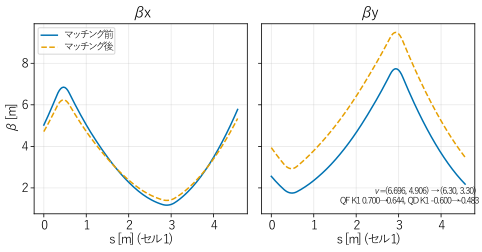

# 08. マッチング (FIT/FREE/GO) — tffsmatch の Newton/降下法と pysad の match6.py

**この文書で分かること**: FFS の `FIT` (目標)・`FREE` (動かす変数)・`GO` (実行) で光学を目標値に合わせる仕組み。目標がどんな残差になり、どう重みづけされ、どの順で反復して収束・失敗を判定するか。SAD の `tffsmatch` と pysad の `match6.py` (Matcher) の対応も示す。
**前提**: `CALC` の光学計算 (docs/07_calc_optics.md)。
**読む順**: §0 (動かして結果を読む) → §6 (pysad の API) → 失敗したときの原因を調べたいなら §1 (残差)・§4 (反復制御)。§3 (微分)・§5 (オフモメンタム点) は必要なときに読む。

対象ソース: `src/tffsmatch.f` (tffsmatch, tweigh, tfsolv, tgrad, tffsvlimit, tffsddf)、`src/tffscalc.f` (tffscalc, twfit)、
`src/qdcell.f` (tdfun, tdfun1, tdlfun, trdfun, tfgetfitval, tffsfitfun, tffsqu)、`src/tffsa.f` (nfr, dp(i))、
`src/tffsfreefix.f`、`src/tfsetv.f`、`src/tffs.f` (ffs_res, resle, res2r)、`src/tsolvg.f` (tsvd)。移植先は [`pysad/match6.py`](../pysad/match6.py) (Matcher)、
[`pysad/match6d.py`](../pysad/match6d.py) (解析微分)、[`pysad/tsvd.py`](../pysad/tsvd.py) と [`pysad/ffscmd.py`](../pysad/ffscmd.py) (FFS コマンドからの接続)。

## 0. 使い方と結果の読み方

用語: **条件** (`FIT` で指定) は「位置と関数と目標値」の組。**変数** (`FREE` で指定) は動かす要素のパラメータ (四極なら K1 など)。`GO` は、条件の目標値からのずれ (残差) の二乗和が小さくなるように変数を動かす。

1. 次のスクリプトを `ffs_fit.sad` として保存する (docs/07_calc_optics.md の §0 と同じ 24 セルの FODO リング、3 GeV)。目標は、チューン (νx, νy) を (6.30, 3.30) にすること。変数は QF・QD の K1。

```
MOMENTUM = 3GEV;
DRIFT D1 = (L=1.0) D2 = (L=0.5) DS = (L=0.1);
QUAD  QF = (L=0.3 K1=0.7) QD = (L=0.3 K1=-0.6);
SEXT  SF = (L=0.2 K2=0) SD = (L=0.2 K2=0);
BEND  B  = (L=1.2 ANGLE=0.2617993877991494 E1=0.1308996938995747 E2=0.1308996938995747);
MARK  ORIGIN = ();
CAVI RF = (L=0 VOLT=1.5E6 FREQ=5.0E8 PHI=0);
LINE CELL = (SF DS QF D2 B D2 QD DS SD D1);
LINE RING = (ORIGIN RF 24*CELL);
FFS;
$FORM = "10.6";
USE RING;
CELL;
CALCULATE;
FIT NX 6.30 NY 3.30;
FREE QF QD;
GO;
Print["QF K1=", LINE["K1","QF"], "  QD K1=", LINE["K1","QD"]];
Print["NX=", Twiss["NX","$$$"]/2/Pi, "  NY=", Twiss["NY","$$$"]/2/Pi];
Exit;
```

2. 実行: `py -3.12 run_sad.py ffs_fit.sad`
3. 出力 (pysad で確認した値):

```
       2        0   0.7046      (NEWTON)    1.000          2
       3        0   1.5008E-04  (NEWTON)    1.000          2
 Matched. ( 5.6900E-12) DP = 0.01000  DP0 = 0.00000  ExponentOfResidual = 2.0  OffMomentumWeight =   1.000  CALEXP
...
QF K1=   .643705  QD K1=  -.482765
NX=  6.300000  NY=  3.300000
```

数字の意味: 反復行は左から、反復回数・不安定な点の数 (`nstab`、0 なら安定)・残差・方法 (NEWTON はニュートン法)・刻みの比 `fact`・変数の数。残差が 0.70 → 1.5e-4 → (最後に) 5.7e-12 と下がり、` Matched.` (残差が収束判定 CONVERGENCE·(条件数) = 1e-9 × 2 以下) で止まる。`QF K1`・`QD K1` は SAD の単位 (積分値 [1/m]) で、動かした結果の値。初期値 (0.7, −0.6) はチューンが (6.696, 4.906) だったので、(6.30, 3.30) に合わせるために QF は 0.644 に弱め、QD は −0.483 に弱める。



図の読み方: 横軸は 1 セルの先頭からの距離 s [m]、縦軸は β [m] (左が βx、右が βy)。青の実線がマッチング前 (QF K1 = 0.700、QD K1 = −0.600、(νx, νy) = (6.696, 4.906))、橙の破線が `FIT NX 6.30 NY 3.30; FREE QF QD; GO;` の後 (QF K1 = 0.644、QD K1 = −0.483、(νx, νy) = (6.30, 3.30))。βx の最大は約 6.9 m から約 6.2 m に下がり、βy の最大は約 7.8 m から約 9.5 m に上がる。条件にしたのはチューンだけなので、β の形はその結果として変わる。

収束しなければ ` Residual = …` (残差を表示) か `Unstable = n Residual = …` で止まる。原因の調べ方は §4・§7 の末尾。


## 1. 残差の定義 (tffscalc + tdfun + twfit)

GO の 1 評価は tffscalc: 光学 (qcell1) を計算 → tdfun で条件ごとの差 df → twfit の重み wiq → 残差 r と不安定数 nstab。

### tdfun / tdfun1 / tdlfun (qdcell.f)

条件 ka は関数 kf、位置 kp (kp1 ≠ kp なら 2 点間)、目標 fitval (実数か {min,max})、mfitp (符号が負なら最大フィット 'M')。
tdfun1 の差は「目標 − 現在値」で、関数により変換がかかる:

| 関数 | 通常フィット (tdlfun) | 最大フィット (mfitp<0) |
|---|---|---|
| BX BY BZ GMX GMY GMZ | log 空間: tdlfun(log fmin, log fmax, log v) | v>fmax なら log(fmax/v)、他は 0 |
| AX AY AZ | atan 空間: tdlfun(atan fmin, atan fmax, atan v) | \|v\|>\|fmin\| のとき ±atan\|fmin\| − atan v |
| NX NY NZ | 線形 (ttrans なら 2π に折り返し) | min(0, fmin − v) |
| EX EY, その他 | 線形 | \|v\|>\|f\| のとき \|f\| − v、または max(−\|f\|−v, 0) |

tdlfun(fmin,fmax,f) は範囲フィット: fmin==fmax なら fmin−f、fmin<fmax なら範囲外のときだけ端との差、
fmin>fmax (反転指定) は中点 fmid を基準に外側へ追い出す。2 点間フィット (kp≠kp1) は trdfun(kf,vb,ve) = ve/vb (log 系) または
ve−vb を「現在値」として tdfun1 に渡す。最大フィットで df==0 の条件は tdfun の時点で落とされる (nqcol に入らない) ので、
条件数 nqcol は反復ごとに変わり得る (→ tffsddf の照合が要る理由)。

### FitValue / FitWeight / FitFunction フック

- `FitValue[loc, fun, {id, dp}, goal, vnow]` (1 点) / `FitValue[loc, loc1, fun, {id,dp}, goal, vb, ve]` (2 点) を tfgetfitval が呼ぶ。
  実数なら目標を置き換え (2 点では fmin + trdfun(kf, vb, 返り値))、`Null` なら irtc=−1 でその条件を外す。
  要素名は "NAME.n" → "NAME" の順に再試行する (tfgetfitval の retry)。
- `FitWeight[loc, fun, {id,dp}, wfit]` (twfit) が実数を返せば wiq をそれに置き換える。
- `FitFunction` (tffsfitfun) が実数か実数リストなら、それを重み 1・idp=0 の条件として末尾に追加 (iqcol=−i)。
- SAD の内部の挙動 (各反復の変数値・条件値・重み) を調べるときは、これらのフックと `VariableRange`/`VariableWeight` (2 節) に Print を入れて取り出す
  (VariableRange は Null を返して dlim に影響させない)。

### 重み wfit (twfit) と残差 r

emx/emy/dpmax は先頭 MARK の EMITX/EMITY/DP。em=|emx|+|emy|、coum=min(1, max(coumin, 1e-3, 1/(emx/emy+emy/emx)))/(1+coum)、
emxx=max(emx, coum·em)、dpm=max(1e-3, dpmax)、coup=sqrt(emxx/emyy+emyy/emxx)。
SAD は EMITX/EMITY を FFS に入った最初の 1 回だけマークから読み (USE では読み直さない)、emit が閉軌道を見つけられなければ NaN になる
(gfortran の MAX/MIN は NaN を無視するので emminv 由来の ~1e-17 が使われ、EX/EPX 系の重みが 1e6 級になる)。pysad の `use()` も最初の 1 回だけ読む (docs/history/work_item4.md §E)。

| 関数 | wfit |
|---|---|
| EX/PEX | dpm/sqrt(emxx·bx) |
| EPX/PEPX | dpm·sqrt(bx/(1+ax²)/emxx) (Y も同様) |
| R1..R4 | coup·sqrt(bx/by), coup/sqrt(bx·by), coup·sqrt(bx·by), coup·sqrt(by/bx) |
| DX/DPX/DY/DPY | 1/sqrt(bx·emxx) など (EX 系から dpm を除いた形) |
| LENG | max(νx,νy)/(pos(maxf)−pos(1)) |
| DZ / GX..GZ | DZ は 0.01、GX GY GZ は 1e-3 を掛けた sqrt(max(νx,νy)/em/max(1, L)) |
| BMAG* / CHI* | 3 / 1e3 |
| AX BX NX AY BY NY など | 1 |

wfit は wcal (モード変更時) にだけ再計算される。残差は
`df(i) ← df(i)·wiq(i)`、`rw = Σ min(1e50, max(1e-50, |df|))^w`、`r = wsum·(rw/wsum)^(2/w)` (w=ExponentOfResidual、既定 2 なので r=Σdf²)。
nstab は CELL のとき、残差が 0 でない idp ごとに stabx/staby の偽を 1 ずつ数える (INS では stabx の偽で 2)。どの idp も残差 0 (条件なし) なら nstab=0 で、cellstab だけ全 idp の積 (CALC で条件がないとき不安定でも ` Matched.` を出し、続く ` Horizontal Unstable.` で知らせる)。
idp=0 の stabx/staby は qcell1 の判定そのもの (|cosμ|>1 の INTRES/HALFRES、tracex、qmdiag の stab、codfnd、over)、idp≠0 はそれに整数部の判定 (INTRES/HALFRES/SUMRES/DIFFRES) を加える。
CELL の GO/CALC は tfsetupcell が条件の最後に `AX(1→$$$)=0, AY(1→$$$)=0` の 2 条件 (mfitp=既存条件の最大 |mfitp|) を足し (`rl=CONVERGENCE·nfcol` もその分増える)、|df|<1e-8 なら捨てる (安定な周期解では 1 周で閉じるので効かない。不安定な「周期解」では効く)。
tdfun は |mfitp| が奇数 (mp·2+1=|mfitp|) の条件を idp=0 では評価しない。`UnstableLevel` は K64 の綴りの誤り (`ktfsymbolz('UnstableLevel',14)`) で常に 0、`NetResidual=r%r`、`MatchingResidual=res2r(r)`。詳細は docs/history/work_unstable.md。
比較は `resle(r1,r2[,tol])`: nstab が小さい方が常に良く、同じなら r1.r ≤ r2.r/tol。
`res2r(r) = rb·nstab + r.r` (rb は r.r を超える最小の 10^n、最低 10) が MatchingResidual。
収束判定は `res2r(r) ≤ CONVERGENCE·max(nfcol,1)` (nfcol = FIT 条件の数、CONVERGENCE 既定 1e-9)。

## 2. 変数 (FREE / tweigh / tffsvlimit / tfsetv)

- FREE の既定キーワードは tfinit.f の `ival` (各要素型の 2 番目のキーワード: DRIFT L, BEND ANGLE, QUAD K1, SEXT K2, OCT K3,
  CAVI VOLT, MULT K1)。tffsfreefix は nvevx に ivarele 順で挿入し、ival の変数なら `valvar = 値/errk(1,k)` (誤差を除いた「設計値」)。
- tfsetv: ファミリーの全要素に `value = valvar·errk(1,i)·couple(i)` を書く (ival 以外のキーワードは errk なし)。
  pysad の ffscmd は `set_family(fam, key, v)` でこれを模し (errk は要素の `_errk`、COUPLE は `couples` 辞書)、
  `_patch_matcher_setters` で Matcher の `_apply_vars` を差し替える。
- tweigh (absweit=.true.) の変数重み wvar: K1→1、L→1/avebeta²、ANGLE/K0/SK0→1/avebeta、K2→max(1e-3,dpmax)·max(1e-2,etamax)、
  K3→(同)²、K4→(同)³、MULT の Kn→(同)^n、VOLT/FREQ→100/max(1,|v|)、QUAD/BEND の DX/DY→0.1/avebeta、BZ→1/brho。
  avebeta=(pos(maxf)−pos(1))/max(νx,νy)、etamax=max(1e-2, |ηx|,|ηy|) は tffscalc の wcal 時に出す。
  `VariableWeight[element,keyword,v_]` フック (変数の重みを置換) で上書き可。
- tffsvlimit: `"QF MAX 0"`/`MIN` で設定した vlim(1:2) に収め、BIPOL が off なら符号反転も禁止 (0 に止める)。
  `VariableRange[element,keyword,v_]` フックも可 (実数: 0 なら変更前の値に戻す・それ以外は dlim だけ、`{min,max}`: 範囲を狭める)。
  DRIFT L の既定は [0.1, 1e10]。pysad: `_vlimit` (vlim は要素の `_vlim`)。

## 3. 微分

SAD の既定は解析微分 tffsqu (qdcell の dtwiss: 要素ごとの伝達行列の微分を伝播、1550 行)。pysad の既定も解析微分 `match6d.py`
(`Matcher._derivative`; 未対応の条件・状況は自動的に以下の数値微分にフォールバック。history/work_integration.md §2)。
INS (cell=False) でも解析微分 (`match6d.analytic_qu`) を使う。SAD の INS で数値微分 (`FFS$NumericalDerivative`) を使うと `qtwiss Overflow (fb)` で壊れる。
`PYSAD_INS_NUMERIC=1` で pysad を INS の数値微分に戻せる (docs/history/work_item4.md §E)。

### 幾何の条件 (GX GY GZ CHI1–3) と tdgeo

- 条件の値 (`Matcher._tgfun`、tgfun.f): GX/GY/GZ は `geo(:,4,kp)`、CHI1–3 は `tfchi(geo(:,:,kp))`。幾何 `geo.py` は変数を反映した現在の要素から ORG 込みで作り直す (`ffscmd` が `geo_fn` を差し替える。CALC のたびに tfgeo が計算し直す)。
- **目標値は任意** (`fit gx <値>`)。0 は**リングを閉じるための目標**で (`fit gx 0; fit gy 0; free <DRIFT の名前> L; go;` の形)、BT (輸送路) やセルでは任意の値を指定する。CHI1–3 の目標は度で書き、内部でラジアンにする (NX/NY/NZ は 2π 倍)。
  GX..CHI の条件は idp≠0 では評価しない (LENG・TR* も同じ)。重みは GX GY GZ が 1e-3·sqrt(max(νx,νy)/em/max(1,L))、CHI が 1e3 (1 節の表)。
- **解析微分 `match6d.tdgeo_term`** (tdgeo.f の直訳): 変数が DRIFT の L、BEND の ANGLE (ROTATE 付きも)・L のときだけ。**幾何の条件だけの行**に使う。BEND の L は K64 が出射の向き `geo(:,3,k+1)` で近似する式のまま
  (有限差分とは O(ANGLE²) 違う)。DRIFT の L と BEND の ANGLE は幾何の有限差分と 1e-5 以内で一致 ([`test_tdgeo.py`](../pysad/tests/script_tests/test_tdgeo.py))。
  **四極などの変数 (DX・DY。K64 は `qdtrans`・`tftmatu` を使う、未移植) と、Twiss の条件が同じ行にある列は中心差分のまま**。
- 未確認: 不安定なリングの幾何の fit は gs が不安定の罰則を残差に入れず、pysad は入れるので結果が違う (比べていない)。COORD を含む区間の解析微分、SOL の幾何の fit も未確認。
- **COORD を含むリングの FIT** (確認済み): COORD の対 (C1・C2、DX DY DZ CHI3 付き) を含むリングで NX・NY=0.2、QF K1・QD K1 を FREE にした fit (解析微分の経路) は、K1・チューンとも gs と全桁一致。**COORD のパラメータそのものを FIT 変数にする場合は未確認**のまま。
- **フラグ UNIPOL・RELW の効果**: gs は UNIPOL で変数の符号を変えず (tffsmatch.f:669)、RELW で重みが変わり、FIT の結果が変わる。pysad は `ffscmd.matcher_` でフラグを `match6` の `bipol`・`absweit` につなぐ。2 変数の小さな例 (3 通り) だけで確認した (§7)。多数の変数・条件の組での比較はしていない。
- **DELCOR で OCT を対象に含める**: 動作を確認している (§7)。

`FFS$NumericalDerivative=True` (または SOL を含むとき) は数値微分になり、pysad はこの経路を直訳している:

```
dvkc = max(|valvar|·eps(1e-5), |eps1(1e-8)/wvar|)
val+dvkc → tffscalc → df1 ; val−dvkc → tffscalc → df2
ddf1 = tffsddf(df, df1)  (iqcol, lfp, kdp が一致する条件だけ df−df1、無い条件は 0)
qu(:,kc) = (ddf1 − ddf2)/2/dvkc/wvar(kc)
```

pysad では条件を (id, idp) のキーで持つ辞書なので、tffsddf は `dfs[cid] − dfs1.get(cid, dfs[cid])` で同じ結果になる。
解析微分と数値微分の違いは「反復の経路」に出る (7 節)。

## 4. 反復制御 (tffsmatch.f)

定数 (module match): flim=(−4,−3), aimp=(−1.8,−0.8), badc=(−3.5,−2.5), amedc=(−2.3,−1.3), alit=0.75, wlmin=0.009,
rtol1=1.02, tstol=1e-6, amtol=1e-9。`fuzz(x,a,b)=max(0,min(1,(x−a)/(b−a)))`。

```
bestval=valvar; chgmod=T; newton=T; fact=1; rbest=(1e300,10000); nretry=1 (CELL) / 0 (INS)
do9000:
  do200:                                   ! 1 回の評価
    wcal=chgmod; beforecal=valvar; tffscalc → df, r
    if res2r(r) ≤ rl: print " Matched."; exit9000
    if not fitflg: print " Residual =" / "Unstable =" ; exit9000
    do1082:                                ! 1 回の方向決定
      iter+=1
      if chgmod:  fact=min(1,2fact); chgmod=F; crate=1; if resle(r,rbest): rbest=r, bestval=beforecal, ra=rbest·(1+amtol)
      else:
        imprv=resle(r,rbest)
        if imprv: 表示 (resle(r,rprint,rtol1) のとき); aimprv=fuzz(log10((ra−r)/ra),aimp); crate=(rbest−r)/rbest
                  fact=min(1, fact·4 (NEWTON) / ·2 (DESCEND)); bestval=beforecal; rbest=r
        else:     aimprv=0; crate=(rbest−r)/rbest        ! <0 !
        alate=fuzz(iter, 0.75·itmax, itmax); smallf=1−fuzz(log10 fact, flim)
        badcnv=1−fuzz(log10 crate, badc); amedcv=1−fuzz(log10 crate, amedc)
        NEWTON:  chgmod = max(smallf, badcnv, min(alate, amedcv)) > 0.5
        DESCEND: iter>10·itmax → fitflg=F | aimprv>0.5 → chgmod=T | 上の条件 → chgmod=T, nretry-- (尽きたら fitflg=F)
        if chgmod or not fitflg: r=rbest; newton=¬newton; fact=1; valvar=bestval; exit200   ! モード切替
        elif not imprv:                                                 ! 直線探索
           NEWTON: f2=f1; g2=g1; f1=fact; g1=r; fact=fmincube(f1,f2,g1,g2,rp0,dg)   DESCEND: fact/=2
           if nvara==nvar: valvar = valvar·(fact/f1) + bestval·(1−fact/f1); exit200
           else: df=df0; wlimit=max(wlmin,wlimit); exit1082          ! 同じ qu で解き直し
      wvar=tweigh(...); qu = 微分 (3 節); df0=df; wlimit=1; nvara=nvar
    1082: NEWTON: tfsolv(qu·wlimit, df, eps=tstol/fact) → dval, dg;  dg>0 なら newton=F で 1082 へ
          DESCEND: tgrad → dval (勾配を r/|grad|² で正規化)
    valvar = bestval + dval·fact/wvar·wlimit;  tffsvlimit で制限 → wlimit を縮め (×min(|(vl−v)/dv|,0.3))、
    wlimit<wlmin なら 0 (nvara−−)、制限があれば df=df0 で 1082 へ
```

- tfsolv: 最大フィット条件 (mfitp<0) は最初は外して SVD (tsolva; 特異値 ≤ eps·最大 を落とす) で解き、解が外した条件を
  越える ((s−df)·df<0) ならその条件を入れて解き直す (最大 nqcol 回)。dg = w·Σ(−df·s) は方向微分で、>0 なら上り方向なので DESCEND へ。
- fmincube (findr): g0=rp0 と (f1,g1),(f2,g2) の 3 次補間で極小を探し、[f1/16, γ·f1] に挟む (γ=0.5772 はオイラー定数。tfstk.f の `m_euler`。
  ネイピア数 e ではない。この定数は不安定な試行点で直線探索が伸びたときの反復の経路に効く: docs/history/work_unstable.md)。
- 表示: `(i8,3x,i6,2x,1pG11.4,a,1pG11.4,i7)` = `iter nstab residual (NEWTON)/(DESCEND) fact nvara`、
  改善して `resle(r,rprint,1.02)` のときだけ出る。終了行は ` Matched. (res2r)` / ` Residual = r` / `Unstable = n Residual = r`
  の後に ` DP = f8.5  DP0 = f8.5  ExponentOfResidual = f4.1  OffMomentumWeight = f8.3  CALEXP`。

### tsvd (tsolvg.f) — tfsolv の線形最小二乗 (docs/history/work_item4.md §E)

SAD の `tfsolv → tsolva → tsvd` は numpy の SVD (特異値 ≤ eps·最大を落とす) とは別物。2 重対角化の後、対角要素の最小値が `anorm*eps`
(eps = TSTOL/fact = 1e-6) を超えれば **特異値を一つも落とさない** quick path、そうでなければ暗黙 QR で特異値を求めて滑らかに減衰 (`w=(s·v/anorm²)²`)。
[`pysad/tsvd.py`](../pysad/tsvd.py) に直訳し `Matcher._tsolva` が使う (`PYSAD_TSVD_NUMPY=1` で numpy 版)。良条件の J (13a/13b/実ラティス) では numpy と一致し、
条件数 1e6 以上 (INS のフィット: 9 条件 × 11 変数、特異値 1.6e7〜1.5) で SAD と同じ 1 歩目になる。

### DESCEND (最急降下) とモード切替 (詳細は history/work_descend.md)

- NEWTON (`tfsolv`: 線形化した条件を SVD で解く) は 1 歩の `dg` (方向微分) が 0 以上になる (上り方向) か、収束の悪さ (`smallf` `badcnv` `min(alate,amedcv)` のいずれかが 0.5 超)
  になると DESCEND に切り替わる。DESCEND の方向は `tgrad`: `grad = quw^T · dfw` (`dfw_i = |df_i|^p / df_i`、p=ExponentOfResidual)、`grad *= r/Σgrad²` (`r=Σ|df_i|^p`)。
  ステップは `dval·fact/wvar·wlimit`、`fact` は評価のたびに 1 から始め、悪化すれば `fact/2` (NEWTON のように fmincube では選ばない)、改善すれば `fact*2` (NEWTON は `*4`)。
  DESCEND 側は `aimprv>0.5` (改善が十分大きい) で NEWTON に戻る。`iter>10·itmax` で打ち切り。
- **`wcal=chgmod` (重要)**: モード切替 (と最初の評価) の直後の `tffscalc` だけが `wcal=真` で、条件の重み `wfit` (EX/EPX/R1.. などは適合点の β, α と EMITX/EMITY に依存)、`etamax`、`avebeta`
  を **現在の光学から計算し直す**。それ以外の評価 (直線探索の途中、数値微分の評価) は前の重みを使う。切替のたびに重みが変わるので、切替後の残差・微分は切替前と同じ点でも値が違う。
  pysad も同じ (`wcal` を最初の 1 回だけにすると、モード切替のある走りで DESCEND の 1 歩目から SAD と 16% ずれる)。
- 勾配は微分 `qu` の全成分に効く (NEWTON は特異値の小さい方向が SVD で効きにくいので、qu や重みの誤差が見えにくい)。DESCEND でずれが出たときは、df と qu の行・列ごとの比を SAD のデバッグ版と
  比べると、重みの違い (行ごとに一様な比) か微分の違い (列にも依存) かが分かる。

### gfortran の min/max と NaN (重要)

残差が悪化すると crate<0 で `log10(crate)` は NaN になる。gfortran の MIN/MAX は NaN を無視して「NaN でない方」を返すので
fuzz(NaN,…)=max(0,min(1,NaN))=1、よって badcnv=amedcv=0 となり、NEWTON ではモードを変えずに fmincube の直線探索に入る。
Python の `max/min` は NaN を伝播する (比較が偽) ため、素直に書くと badcnv=1 → 即 DESCEND → nretry 消費 → 早く諦めて
" Residual =" で終わる。pysad の `_fuzz` は x≠x のとき 1 を返して SAD を再現する。

crate=0 (残差が全く動かない。不安定ラインで qu が 0 になる点) は `log10(0)` = **-Infinity** (NaN ではない) で fuzz=0、badcnv=1 → モード切替になる。
0 を NaN と同じに扱うと同じ点を無限に反復する (不安定ライン、history/work_unstable.md)。pysad の `_log10` は 0 → -inf、負 → NaN。

## 5. オフモメンタム点 (FITP、"NX nx0 2")

- tffsa: `nfr = max((|mfitp|−1)/2)`。`dp(i) = dpmax·i/nfr` (DPM が正なら dp(±1)=±DPM; DP が {dp1,dp2} のリストなら sin 分布)。
  pysad: `_nfr`, `_dp_list`。FITP n は mfitp=n+1 (点数 n)、fit に付けた数字も同じ。
- tffscalc の idp ループ: idp=0 を計算し、+1,+2,… と −1,−2,… を「前の点の閉軌道を初期値に」連鎖で計算する
  (`twiss(1,1,dx:dpy)=utwiss(..,i2,1)`、ddp は dp(ix))。前の点が over なら同じ値をコピーして over にする。pysad `_optics_all` は
  `cod0=(x,px,y,py,0,dp0+dp)` で連鎖し、失敗 (None) を over とする。
- 安定判定 (CELL): idp=0 の整数部 aint(ν/2π)、aint(ν/π)、和/差と比べ、INTRES/HALFRES/SUMRES/DIFFRES が ON の項が一致しなければ
  stabx/staby=偽。nstab はその idp の残差が非 0 のときだけ数える (pysad は qcod が overflow した点を、前回の Twiss の残差で評価し両面 unstable として +2)。
- 重み: idp≠0 の条件は `wi=(OffMomentumWeight/2/sqrt|mfitp|)²` を wsum に加え、wiq に wi^(1/w) を掛ける (idp=0 は wsum+=1)。
- 目標のずらし: kp==nlat の NX/NY で |idp|≤1 のとき目標に (dp(idp)−dp0)·XIX/XIY を足す (idp≠0 または mfitp が偶数のとき)。
- LENG/GX..CHI/TR* は idp≠0 では条件にしない。DX..DPY は |idp|>nfr では条件にしない。
- 注意: WSL ビルドの SAD は FITP>1 の GO で "*** Run time Environment" からスクリプトを再実行する (クラッシュ→再起動) ため、
  bench_level15a の参照値が取れていない。pysad 側はソースの直訳のまま未照合。

## 6. pysad の API と接続

`Matcher(lattice, cell=True, dp0, dpmax, emx, emy, itmax=40, convergence=1e-9, exponent=2, offmw=1, out=print)`:

| メソッド | SAD | 備考 |
|---|---|---|
| `fit_at(loc[, loc1])` | `FIT loc [loc1]` | 以後の条件の位置 (mfpnt/mfpnt1)。省略で `$$$` |
| `fit(fun, value[, npoints], loc=, loc1=)` | `fit loc BX 1.2`, `NX nx0 2`, `BXM`, `{min,max}` | NX/NY は 2π 倍、CHI は度→rad、BX/BY ≤0 はエラー |
| `fit_clear()` / `fitp(n)` | `FIT;` / `FITP n` | fitp は mfitp>2 の条件にだけ効く |
| `free(pattern[, key])` / `fix(...)` | `FREE Q*,SF` / `FIX` | ワイルドカード、ivarele 順に並べる |
| `go(calc_only)` | `GO` / `CALC` | 戻り `_Res`; `matching_residual`, `unstable_level`, `iterations` |
| `values()` | | {"QF K1": 値} (SAD 単位: K1 は積分値) |

内部: `_tffscalc(wcal)` (tffscalc+tdfun+twfit、戻りは {(id,idp): df·wiq}, `_Res`, rows)、`_optics_all(nfr)` (idp ループ)、
`_tweigh`, `_vlimit`, `_tfsolv` → `_tsolva` ([`pysad/tsvd.py`](../pysad/tsvd.py))、`_tgrad`, `_fmincube`、`_derivative` (match6d の解析微分、フォールバックは数値微分)、
`go` (4 節の do9000/do200/do1082 を while で再現)。
フックは属性 `fit_value(loc, fun, dp, goal, vnow[, loc1, vb])`、`fit_weight(loc, fun, dp, w)`、`fit_function()`。

ffscmd からの接続 (`FFS.go`): GO/CALC のたびに CELL/INS、DP0/DP、MAXITERATION、CONVERGENCE、ExponentOfResidual、OffMomentumWeight、
EMITX/EMITY、XIX/XIY (×2π)、DPM、INTRES 等を Matcher に渡し、`FitValue[comp, fn, {id_,dp_}, goal_, now_]` (2 点条件は `FitValue[c1,c2,fn,{id,dp},goal,now1,now2]`) を評価する `_fit_value_hook`
(Null→None、実数→目標、{a,b}→範囲、未定義→元の目標)、`_fit_weight_hook` (`FitWeight[comp,fn,{id_,dp_},w_]`)、`_fit_function_hook` (`:=` の遅延定義) を付け、
`VariableRange`/`VariableWeight` (2 節) を扱い、`_calc_optics` を INS 対応の `_matcher_optics` に、`_apply_vars` を errk/couple 付き `set_family` に差し替える。
終了後 MatchingResidual/NetResidual/UnstableLevel を設定し、条件表を出す。

## 7. 検証

- 小リング (FODO、2 変数) と実ラティス (7 ファミリー) の FIT は、K64 と同じ反復数・同じ解 (K1 の差 1e-10 程度) に収束する。入口の β を与えて QF・QD・QF2 を動かす解なしの例でも同じ経路で ` Residual = …` で止まる。不安定ラインの直線探索・`crate=0` の扱いも K64 の経路を再現する。比較の表は [`docs/history/08_matching_validation.md`](history/08_matching_validation.md)。
- 解が一意な問題では数値微分でも同じ解・同じ反復数になる。多解の問題で K64 と同じ経路を取るには解析微分 (既定の match6d、§3) が要る。
- `PYSAD_COMPAT=k64` で K64 と同じ動作になる (FIT の動作は v2 でも変わらない)。

