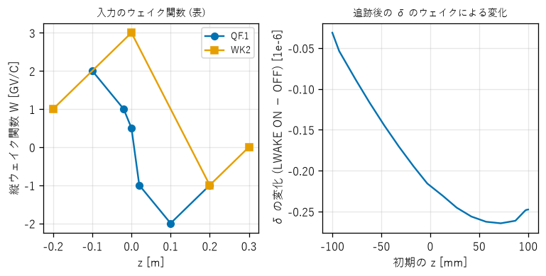

# 13. ウェイク場 (WAKE): 追跡と光学

最終更新: 2026-11-23

**この文書で分かること**: バンチ内の粒子が互いに受ける縦・横のウェイクのキックを、粒子追跡 (`TrackParticles`) と光学計算 (`CALC` / `GO`) に入れる方法、そのときの物理と式、K64 との違い、限界。
**前提**: SAD の台本 (FFS) の書き方 ([`docs/03_ffs_commands.md`](03_ffs_commands.md))、`TrackParticles` の基本 ([`docs/10_tracking.md`](10_tracking.md))。
**読む順**: 1 (何ができるか) → 2 (動く台本) → 3 (物理と式) → 5・7 (K64 との違い・限界)。実装の詳細は 8 (開発者向け)。

用語: **ウェイク関数** W(z) = 先行する電荷が距離 z だけ後ろの粒子に与えるエネルギー (縦、単位 V/C) や横キック (横、単位 V/C/m) の表。**切片 (スライス)** = z 方向にバンチを分けた小片。**TRPT** = 粒子運動の座標系 (SAD のスイッチ)。

## 1. 何ができるか

SAD の「ウェイク場」は、要素ごとに与えた縦・横のウェイク関数で、バンチ内の粒子が互いに (先行する粒子から後続の粒子へ) 受けるキックを追跡に入れる機能。次の 2 通りがある。

| 用途 | 有効にする | 効く所 |
| --- | --- | --- |
| 粒子追跡 | `TRPT; LWAKE (縦); TWAKE (横)` | `TrackParticles` だけ (tftrack.f:120 で `(TWAKE or LWAKE) and TRPT`) |
| 光学 | 上に `WAKEOPT` と `InitialOrbits` | `CALC` / `GO` (INS のみ。tffsa.f:1186 `wake = (TWAKE|LWAKE) & TRPT & WAKEOPT`) |

どちらも TRPT (粒子運動の座標系) が前提。`LWAKE`・`TWAKE`・`TRPT`・`WAKEOPT` はスイッチで、`NO…` で OFF。

使った条件: 追跡の検証はエネルギー 1.7 GeV 前後の小さなライン (INS、NORAD NOFLUC)、粒子 200〜400 個、PBUNCH=1E10〜1E12。実際のリングのウェイク関数・エネルギーでの検証はしていない (表は人工的なもの)。

## 2. 使い方 (動く SAD スクリプト)

### 2.1 追跡 (`pysad/tests/script_tests/test_wake.py` の W3_SRC)

```
MOMENTUM = 1.7GEV;
DRIFT DR = (L=1);
QUAD QF = (L=0.3 K1=0.6 DX=2e-4) QD = (L=0.3 K1=-0.5 DY=-1e-4);
BEND B = (L=1 ANGLE=0.1 E1=0.05 E2=0.05);
MARK ST = () WK2 = ();
LINE BL = (ST QF DR B DR QD DR WK2 DR B DR QF DR QD DR QF);
FFS;
USE BL;
TRPT; INS; LWAKE; TWAKE; NORAD; NOFLUC;
PBUNCH = 1E12; NBUNCH = 1;
WakeFunction[Longitudinal, "QF.1"] = {{-0.1, 2e9}, {-0.02, 1e9}, {0, 5e8}, {0.02, -1e9}, {0.1, -2e9}, {0.2, -1e9}};
WakeFunction[Transverse, "QF.1"]   = {{0, 1e12}, {0.01, 5e11}, {0.05, 1e11}, {0.2, 0}, {0.3, 0}};
WakeFunction[Longitudinal, "WK2"]  = {{-0.2, 1e9}, {0, 3e9}, {0.2, -1e9}, {0.3, 0}};
WakeFunction[Transverse, "WK2"]    = {{-0.1, 1e12}, {0.0, 3e12}, {0.1, 0}, {0.3, 0}};
n = 400;
x0  = Table[1e-3*Sin[0.37*i], {i, n}];   px0 = Table[1e-4*Cos[0.11*i], {i, n}];
y0  = Table[1e-3*Cos[0.23*i], {i, n}];   py0 = Table[1e-4*Sin[0.71*i], {i, n}];
z0  = Table[0.01*Sin[0.13*i]+1e-4*i-0.02, {i, n}];
dp0 = Table[1e-3*Cos[0.31*i], {i, n}];   fl0 = Table[1, {i, n}];
r = TrackParticles[{1, {x0, px0, y0, py0, z0, dp0, fl0}}, 17, 1];
$FORM = "16.10";
res = r[[2]];
Do[Print[k, " ", Plus@@res[[k]], " ", res[[k, 1]], " ", res[[k, 77]], " ", res[[k, 400]]], {k, 7}];
```

出力の見方: `res = r[[2]]` は追跡後の座標で、`res[[1]]`〜`res[[6]]` が x、px、y、py、z、dp (各 400 粒子の表)、`res[[7]]` が生き残りの印 (flag)。`Print` の行は、成分 k ごとに「全粒子の総和、粒子 1・77・400 の値」。ウェイクの強さは `PBUNCH` (バンチあたり粒子数) に比例して、px・py (横)、dp (縦) の差に現れる。

読み方:
- `WakeFunction[Longitudinal, 名前]` は縦 (z は m、w は V/C)、`WakeFunction[Transverse, 名前]` は横 (w は V/C/m)。表は `{{z1, w1}, ..., {zn, wn}}`、z の昇順。
- 名前は `elname` の形。同名の要素が複数あるときは `QF.1` のように番号付き (上の例は QF が 2 個あるので最初のものが `QF.1`)。パターン (`WakeFunction[Longitudinal, name_] := ...`) でもよい。
- 表が数の 2 列のリストでなければ、その要素にウェイクなし。要素に表がなくても他の要素に付ければよい。
- `PBUNCH` (バンチあたり粒子数)、`NBUNCH` (バンチ数)、`CHARGE` を使う。`TrackParticles` に渡す粒子数 NP が係数に入る。
- `TrackParticles[{1, {...}}, 17, 1]` の第 2 引数は終点の要素の位置 (要素数以下)。大きすぎると gs は `Component number must be positive` で失敗する。



図の読み方: 左は §2.1 のラインに与えた縦ウェイク関数の表 (横軸 z [m]、縦軸 W [GV/C]。青が `QF.1`、橙が `WK2`。人工的な値)。右は、z = −100〜+100 mm に等間隔に置いた 201 粒子 (他の座標はすべて 0) を、1.7 GeV のこのライン (17 要素、`PBUNCH = 1E12`、`NORAD NOFLUC`) で追跡し、`LWAKE` を ON にしたときと OFF にしたときの最終の δ の差 [1e-6]。横軸は初期の z。差は z = −100 mm で約 −0.03e-6、z = +70 mm で約 −0.26e-6 と、z によって滑らかに変わり、バンチ内の位置によって受けるエネルギー変化が違うことが分かる (縦ウェイクだけ。`TWAKE` は OFF)。

### 2.2 光学 (`test_wake_optics.py` の A1_SRC)

`InitialOrbits` で与えた複数の軌道が互いにウェイクのキックを受けるとして、`CALC` で軌道ごとの Twiss・分散・軌道を計算する。


```
(格子は 2.1 と同じ要素に WK を足したもの)
TRPT; INS; NORAD; NOFLUC;
LWAKE; TWAKE; WAKEOPT; PBUNCH=1E12; NBUNCH=1;
WakeFunction[Longitudinal, "WK"] = {{-0.2, 1e9}, {-0.05, 2e9}, {0, 3e9}, {0.05, 1e9}, {0.2, -1e9}, {0.3, 0}};
WakeFunction[Transverse, "WK"]   = {{-0.1, 1e12}, {0.0, 3e12}, {0.05, 1e12}, {0.1, 0}, {0.3, 0}};
InitialOrbits = {{1e-3,1e-4,2e-3,0,-0.05,1e-3},{-1e-3,0,1e-3,2e-4,0.05,0}};
FITP 2;
FIT $$$ DX 0 DDP 0;
CALC;
Do[Print[k, " ", Twiss["DX",k], " ", Twiss["DPX",k], " ", Twiss["DY",k], " ", Twiss["DPY",k], " ", Twiss["DZ",k], " ", Twiss["DDP",k]], {k, 1, 18}];
```

`InitialOrbits` の 1 組は中心の軌道からのずれ `{x, px, y, py, z, dp}` (6 個) か、Twiss も与える 28 個形式 (`{AX, BX, NX, AY, BY, NY, EX, EPX, EY, EPY, R1..R4, DETR, DX, DPX, DY, DPY, DZ, DDP, AZ..ZPY}`)。
`CALC` の後の `Twiss[...]` は中心の軌道の値。他の軌道の値は表示 (`DP`、`Orbit ID`、`Res.` の 3 行と軌道ごとの列) と FitValue フックで読む。

### 2.3 旧式の `WAKE` コマンド


Fortran には旧式の `WAKE` コマンド (`tfwake.f`) があるが、K64 の `tffsa.f` はこれを呼ばず、SADScript の `WAKECOMMAND[]` を評価する (`init.n` が `Packages/WAKECOMMAND.n` を AutoLoad)。
この配布には `WAKECOMMAND.n` が無い。gs で確かめた動作は、ファイルが無いと fileopen のエラーを出し、`WAKECOMMAND[]` が True にならないので行の残りを捨てる、というもの。
**k64 モード**の pysad の `_wake_cmd` は同じ経路を取る (`WAKECOMMAND.n` があればそれを評価する)。SADHelp にもない旧機能。

**v2 モード**は `tfwake.f` の構文を実装した (B66)。`WAKE` から `ENDWAKE` までの表を WakeFunction の表として登録する (CAVI だけ):

```
WAKE LONGITUDINAL RF
  -0.1   2e9          ! s [m]  w [V/C] (横 TRANSVERSE は V/C/m)
   0     5e8    0.02 -1e9
ENDWAKE;
```

- 表は行をまたいで書ける (`ENDWAKE` か `;` が来るまで続く)。1 行に何組でも、注釈 `!` 可、`ENDWAKE` の後の `;` は任意、同じ行の続き (`ENDWAKE; CALC;`) も実行する。大文字小文字・省略形 (`wake t RF`) 可。要素名はワイルドカード可 (合う CAVI すべてに登録)。値は数か式。点数の上限は無い (400 点で確認)。
- 追跡は `WakeFunction[…] = …` で同じ表を与えた場合と同じ結果 (gs の参照値と 2e-9、400 点・2 台の CAVI で 1e-12)。TRPT と LWAKE / TWAKE が ON の `TrackParticles` で効く。
- 使えない: 表の途中の `;` (エラー)、CAVI 以外の要素、k64 モード。`ENDWAKE` を書き忘れると次の `;` までを表として読んでエラーにする。
- 例 [`example/06_collective/flag_WAKE_command_table.sad`](../example/06_collective/flag_WAKE_command_table.sad)、試験 [`test_v2_C_wakecmd.py`](../pysad/tests/script_tests/test_v2_C_wakecmd.py)・[`test_v2_C2_wakecmd.py`](../pysad/tests/script_tests/test_v2_C2_wakecmd.py)。

## 3. 物理と式

### 3.1 追跡のキック (txwake.f)


- 要素 l にウェイクがあれば、要素の前に半分のキック (init=True) を、要素の後に残りの半分を与える (tturn.f:256-269, 562-575)。
  `fw = |charge| e PBUNCH NBUNCH / amass / NP × 1/2`、`NP` は TrackParticles に渡した粒子数 (flag=0 の粒子を含む)。

1. 粒子を z の昇順に並べ (`spsort`、5.3)、`txwdefslice` で z の間隔と NBUNCH から切片 (スライス) に分ける。NBUNCH=1 のときは 1 バンチを約 √np 個の切片に分ける。
2. 切片ごとに粒子数 `ws`、x・y・z の平均を取る。両端に仮の切片 (z の幅 / np だけ外側) を足す。
3. 切片の組 (n, m) について、距離 `dz = zs(m) − zs(n)` で表を線形補間し、縦は `wz(n) += W(dz) ws(m)`、横は `wx(n) += Wt(dz) xs(m)`、`wy(n) += Wt(dz) ys(m)`。dz=0 で表の最初の点が 0 以上のときは自己項に 1/2 を掛ける。
4. 各粒子は両隣の切片の値を線形補間して、`g` (dp)、`px`、`py`、`dv` を更新する。
5. 前後で z の並びを作り直すのは、前半 (init) か、前に並べたときの z の幅が 1e-5 (相対) 以上変わったときだけ。

要素のずれ DX は、要素の座標系 (x−DX) で横の wake を計算してから戻す (TENT / TEXIT)。

CAVI の中では tcav.f のとおり分けて呼ぶ: 入口のフリンジ → [wake 前半] → ドリフトと電圧キック (ndiv 分割ごとに wake) → [wake 後半] → 後半のドリフトと出口のフリンジ。dx、dy、theta は 0 を渡す。
VOLT≠0 の MULT (TRPT か RFSW のとき) も `tmultiacc` が同じ形で分割ごとに wake を呼ぶ (3.3)。

SOL の領域 (BOUND≠0 の SOL から次の BOUND≠0 の SOL まで) の内側の要素と終端の SOL は、tsol.f のとおり要素ごとに前後へ wake を与える (dx=DX、dy=DY、theta=ROTATE)。
普通の要素 (tturn.f) は dy に ROTATE を入れる癖がある (5.3)。

### 3.2 TRPT の加速 (CAVI の vnominal)


TRPT で VOLT≠0 の CAVI は、基準運動量が空洞で上がる (`vnominal = VOLT/amass |charge| sin(−PHI sign(charge))`)。
追跡では `tcav.f` のとおり、`ndiv` 分割 (重み `ws`、`dzn`)、空洞の後の `g`、`dv` の付け替え、基準運動量 (`p0`、`h0`、`crad`、`urad`) の更新をする
(`track6n.cav_full`、`emit6d._Phys.set_pgev`)。下流の要素は新しい `p0` で進む。区間 (tturn) の終わりで元の運動量に戻る (tturn.f:146)。
wake の有無によらず効く。`phis=0`、`offset=sin(dphis)` (TRPT) も入れた。位相は `(PHI + DPHI) charge` (tcav.f:33)。

### 3.3 RF のある MULT (tmulti.f の tmultiacc)


`VOLT + DVOLT ≠ 0` の MULT は、(TRPT か RFSW) のとき `tmulti1` が `tmultiacc` を呼ぶ。そうでなければ RF なしの `tmulti` (従来の `k_mult`)。
pysad は `track6n_ext.mult_full` (ANGLE=0、F1・FRINGE なしの MULT。AUTOPHI は k64 モードでは未対応、v2 モードでは対応 (5.2)):

- CAVI と同じ `ndiv` 分割と `ws` (加速があるとき)。1 分割ごとに、wake → ソレノイド・四極 (`tsolqu`、K0 と K1) → 放射 (`tradk`) → n≥2 の多極キック → `dzn` と電圧キック。
- 電圧キックの定数と式は tcav と少し違う: `oneev = 1+1e-6`、`pmin = 1e-10` での下限、`tlim = 1e4`、`v20a = v02a = v (w (1/2p0 + 1/2pe))² / 4` (`vcorr`)、`v1a = v11a = 0`。
- フリンジ (`DISFRIN=0`): 入口で `tcavfrin` → `ttfrins`、出口で `ttfrins` の逆順 → `tcavfrin(−v)`。
- vnominal≠0 (TRPT) のとき、末尾で基準運動量を `pe` に付け替える (`cav_full` と同じ)。
- MULT の DVOLT、DPHI、AUTOPHI は parser が属性に付ける。

### 3.4 光学のキック (tffswake.f、WAKEOPT)


1. 全軌道 (中心を含む) を INS で、ウェイクのある要素の入口まで伝搬する (軌道ごとに `ins_twiss`。軌道の z、δ もそのまま追う)。
2. 全軌道の z・x・y から、各軌道の dpx、dpy、ddp へのキックを与える (`wakeopt._Kicker.kick`、`tffswakekick` の直訳)。
   縦は dz = z_i − z_j で表を引く (z_i − z_j ≥ −sigg の滑らかな境界、sigg = max(1e-5, SIGZ/np/NBUNCH))、横は dz + 0.3989 sigg。
   `cp0 = |charge e PBUNCH / np / (2 gammab amass)|`、np は軌道の数 (nfam−nfam1+1)。表が同じで z の配置がほぼ同じ (0.1 sigg 以内) のとき、前の値を使い回す条件も同じ。
3. 要素を伝搬し、要素の出口でもう一度キック (要素の前後で 1 回ずつ。`txwake` の前後の半分とは違い、光学は同じ大きさを 2 回)。
4. 次のウェイクまで伝搬する。

WAKEOPT が OFF、または LWAKE・TWAKE が OFF、またはウェイクのある要素がないときは、各軌道は独立に伝搬する (qcell1 の fam=.true. と同じ。中心の入口の Twiss と、中心の入口の軌道 + ずれ)。

## 4. 要素ごとの扱いと InitialOrbits

### 4.1 追跡での要素ごとの扱い

| 要素 | 追跡での扱い (K64 のソース) | pysad |
| --- | --- | --- |
| 普通の要素 (DRIFT、QUAD、BEND、MARK など) | tturn.f が前後で半分ずつ `txwake` | `track6n.turn` が前後に呼ぶ |
| CAVI | tcav.f が中で分割 (`ndiv`) ごとに呼ぶ。入口フリンジ → wake 前半 → ドリフトと電圧キック (分割ごとに wake) → wake 後半 → 出口フリンジ。dx、dy、theta は 0 を渡す | `k_cav_in` / `k_cav_mid` / `k_cav_out`、`cav_full`。`_wake_table` は dx=dy=theta=0 |
| MULT で VOLT+DVOLT≠0 (TRPT か RFSW のとき) | `tmultiacc` が CAVI と同じ形で分割ごとに wake | `track6n_ext.mult_full` (ANGLE=0、F1・FRINGE なしの MULT)。AUTOPHI は v2 モードだけ対応 |
| MULT で VOLT=0 | 普通の要素 | 普通の要素と同じ (gs と一致を確認) |
| SOL の領域内 (BOUND≠0 の SOL から次の BOUND≠0 の SOL まで) と終端の SOL | tsol.f が要素ごとに前後へ wake (dx=DX、dy=DY、theta=ROTATE)。領域内の CAVI・VOLT≠0 の MULT は tmultiacc の中で分割ごとに wake (ewak) | `_wake_table` が `in_sol` で判別して同じ形にする。**領域内の CAVI・RF つき MULT の wake は v2 モードだけ** (k64 モードは領域内の CAVI・MULT が未対応) |
| SOL 領域の始点の SOL | 元の K64 は SIGSEGV (5.4 節) | 直した SAD と同じ動作 (普通の要素と同じ前後のキック) |
| BEAMBEAM | 要素にウェイクを付けられる | 縦・横・5 周で gs と一致 ([`docs/14_beambeam.md`](14_beambeam.md)) |

TRPT で VOLT≠0 の CAVI は、基準運動量が空洞で上がる (`vnominal`)。`cav_full` が `tcav.f` のとおり `ndiv` 分割と `p0`、`h0` の付け替えを行い、区間 (tturn) の終わりで元に戻す。wake の有無によらず効く。
光学の wake は、TRPT で加速要素があるときは未対応 (`SADError`)。

### 4.2 InitialOrbits (光学の複数軌道)


光学計算 (CALC / GO) が、中心の軌道 (idp=0) のほかに、指定した初期条件の軌道を何本か持つ仕組み (tffsa.f の `tffsinitialcond`)。
軌道は中心の軌道 (閉軌道ではなく INS の入口の軌道) からのずれで与える。6 個ならずれだけ、28 個 (`ntwissfun`) なら Twiss も与える (BX>0 のとき使う。軌道は中心の軌道に足す)。
InitialOrbits があると、オフモメンタム整合と有限振幅整合は使わない。

- n 個の軌道は idp = nfr1..nfr (0 を除く) に順に入る。nfr=(n+1)/2、nfr1=−(n/2)。0 は中心。nfam1 は n が偶数なら −nfr、奇数なら 1−nfr。
- 表示 (CALC / GO の後): `DP`、`Orbit ID` (InitialOrbits の何番目か。中心は 0)、`Res.` (軌道ごとの残差) の 3 行と、各関数の軌道ごとの値 (`tfshow.f`)。列は残差の大きいものから nn 本を選び、dp の昇順に並べる。
- `Twiss[...]` は中心の軌道の値。他の軌道の値は表と、FitValue フック (条件が FITP でその軌道に掛かるとき) で読む。

## 5. v2 と k64 の違い・K64 の癖

利用者の結果に影響する違いは 5.1 (wake の重み) と 5.2 (v2 だけで使える機能)。k64 モードは `PYSAD_COMPAT=k64`。

### 5.1 wake の重み (B84。K64 の誤り)


K64 の `tcav.f`・`tmulti.f` は `fw=fw0*(wsn+ws(n-1)*.5d0)` で、空洞が 2 つ以上に分割されると wake の蹴りの合計が (1.5n − 0.5)/n 倍になる。**k64 モードは再現し、v2 モードは台形の重み fw0·(ws(n) + ws(n−1))/2 (合計 1) にする。** 位置によらない表では、エネルギーの変化が空洞の電圧 (= 分割数) によらなくなる (20 MV の 1 分割と 200 MV の 4 分割以上で 5e-3。k64 は 1.25〜1.5 倍)。分割が 1 のときは両モードで同じ。領域の外の空洞・RF つき MULT も。

### 5.2 v2 モードだけで使える機能


- **領域内の CAVI・RF つき MULT の wake** (v2 モード): SOL 領域内の CAVI と VOLT≠0 の MULT で、tsol.f の ewak どおり tmultiacc の中で分割ごとに txwake を呼ぶ。縦の wake によるエネルギーの変化の合計が、領域の外の同じ空洞と同じ (bz → 0 で 1e-6、BZ = 1 T でも同じ)。横の蹴りの合計は 2% 以内 (分割して入るので位置の変化は少し違う)。wake が働くのは TRPT のとき (従来どおり)。横の蹴りを gs と比べてはいない。k64 モードは領域内の CAVI・MULT が未対応。
- **AUTOPHI** (v2 モード): CAVI・RF つき MULT の `AUTOPHI=1` は、空洞の位相 PHI + DPHI を設計軌道がその空洞に着く時刻 (Twiss の DZ) を基準に測る (docs/17)。k64 モードは NotImplementedError。

### 5.3 K64 の癖 (そのまま写したもの)


- 追跡では**表の最後の 1 行が使われない**。`twxiwp` の `lwl0 = (ブロック長 − 2) / 2` が行数より 1 少ない (光学の `tffswake` は `(ブロック長 − 1) / 2` で行数どおり)。
  最後の行だけ正の z に値があるような表では、その側のウェイクが消える。2 粒子の実験と、最後の行だけ変えた比較で確認した (`test_wake_last_table_row_is_unused`)。
  使う行が 2 行未満になる表は、SAD では添字 0 を読むので、pysad ではエラーにする。
- `dv` の更新で、`h1` をキック前の `1+g` から作る。そのまま写した。
- 普通の要素の wake は、`tturn.f:263-264` が `dy = ROTATE` (実際の DY は捨てる)、`theta` は未初期化の局所変数 `rot` (実測 0)。pysad は dy に ROTATE (QUAD などは属性名 `ROTATION`) を入れ、theta=0。
  ROTATE=0.3、−0.2 の QUAD で gs と一致した (`rotate_on_wake_elements`)。領域内の SOL の theta=ROTATE は、横の wake が x・y に同じ係数なので結果に効かない。
- 粒子の z の整列は `spkick.f` の `spsort` (不安定なクイックソート)。同じ z の粒子の並びが結果に出るので、`wake._spsort` に直訳した (同じ z が 5 個ずつの試験で一致、`equal_z_ordering`)。
- 光学の縦のキック (`tffswakekick`) は `ut1(mfitddp,:) = ut0(mfitddp,:) − cp0 wbuf` と配列全体への代入。`wbuf` は nfam1..nfam の np 個で、軌道の数 n が奇数だと nfam1 = 1−nfam なので、
  要素の対応が 1 つずれる (軌道 s は軌道 s+1 のキックを受ける。最後の軌道は配列の外を読むが、実測では無視できる大きさ)。pysad も同じにしている (`_Kicker.shift`)。

### 5.4 元の SAD K64 が SIGSEGV で落ちる 3 つの場合と修正

K64 のソースを `-O0 -g` で作り直し (WSL に複製)、落ちた場所を `addr2line` で特定した (`setarch -R` で PIE の基準を固定)。`-fcheck=bounds` は SAD の初期化 (`tfstk.f:487` の `klist(0)`) で落ちるため使えない。修正の差分は [`docs/history/sad_patch/wake_sigsegv_fixes.patch`](history/sad_patch/wake_sigsegv_fixes.patch)、バグ番号は B31〜B33 ([`docs/30_sad_bug_report.md`](30_sad_bug_report.md))。pysad は最初の 2 つを、直した SAD と同じ動作にしている (元の gs とは比べられない)。3 つ目は pysad が K64 の動作を再現する。


| 症状 | 落ちる場所 | 原因 | 修正 |
| --- | --- | --- | --- |
| 光学の wake で表が片方だけ | `tffswake.f:102` | `iwl` か `iwt` が 0 (表なし) でも `nlw=(ilist(1,iwl-1)-1)/2` を計算して `ilist(1,-1)` を読む | 0 のとき、もう片方の表を指すダミーを使う (キックは `iwl /= 0` で守られている) |
| SOL 領域の始点にウェイク | `tturn.f:567` → `twxiwp` | `tsol` は領域全体を進めて戻る。その間 `sol` の分岐が `aewak` を古いままにして、領域の各要素で後半キックを重ねて呼び、`nwak` が表の数を超える。始点の後半キックを `tsol` の後で呼ぶため、領域内のウェイクの `nextwake` も古いままになる | `tsol` の前に始点の後半キックと `nwak` の更新を済ませ、`aewak` を偽にする |
| TRPT で最初から LOSSAMPL の外の粒子 | `tapert.f:184` | `idtypec(l_track)` を評価するが、最初の `tapert` は要素の前 (`l_track=0`) | `l_track>0` のときだけ評価する |

3 つ目は元の SAD の別の不具合で、wake も SOL も要らない (LOSSAMPL=0.0009 で、wake なしでも落ちる)。「SOL 領域内で粒子が落ちると落ちる」のではなく、LOSSAMPL=0.0009 の台本は初期の振幅がすでに外だった。
LOSSAMPL=0.002 (領域内・後で落ちる) は元の SAD でも落ちず、pysad と 10 桁一致する。

直した SAD の結果は、pysad の追跡と一致した: SOL 領域の始点の wake (単独と、領域内の wake との併用) で 0 差、光学の縦だけの表の中心軌道で一致。
pysad はこの 2 つを、直した SAD の動作として実装している (領域の始点の SOL は普通の要素と同じ前後のキック、光学は無い表の側をキックしない)。


3 つ目 (TRPT で最初から LOSSAMPL の外にいる粒子) の追加の説明: K64 の `tapert` は落とす印に `kptbl(i,4)=l_track` を書く。`l_track` はセッション変数で、セッション最初の `TrackParticles` では 0 (CALC をしても変わらない)。最初の `tapert` では印が 0 (「生きている」) になって落ちず、座標は 3·LOSSAMPL に頭打ちされて追跡が続き、後の `tapert` で落ちる。2 回目の `TrackParticles` からは `l_track≠0` で最初の要素で落ちる。pysad は `TrackRun.l_track0`・`k_apert` の lcur==0 で再現し、gs の 1 回目・2 回目の呼び出しと直した SAD (LOSSAMPL=1e-4、3 粒子、NORAD、TRPT、2 周、15 値) と全桁一致する ([`test_small_items.py`](../pysad/tests/script_tests/test_small_items.py))。元の K64 はここで落ちるので、元の K64 に対する基準は無い。

## 6. 検証

- 追跡: 縦だけ・横だけ・両方、2 か所のウェイク、NBUNCH=3、粒子損失、ROTATE≠0、CAVI (加速あり・なし)、RF のある MULT、SOL 領域など 20 ケース以上で、K64 (gs) の出力と 10 桁一致する。
- 光学: 条件の表は文字列で完全一致、中心の軌道は相対 2e-8 以内。
- 試験 (`py -3.12 -m pytest pysad/tests/script_tests/test_wake.py pysad/tests/script_tests/test_wake_optics.py -q`) は 32 件で、SAD が無くても通る (参照値は試験に書き込み済み)。
- ケースの一覧と一致の桁は [`docs/history/13_wake_validation.md`](history/13_wake_validation.md)。

## 7. 限界・未確認


- **RAD ON の追跡**は、wake の有無によらず gs と 1e-6 程度ずれる (wake なしでも 8.9e-7)。wake とは別の TrackParticles の放射の差で、wake 自体の RAD ON での一致は確認できていない。
- 光学の中心の軌道の z は、INS の `ins_twiss` が δ の飛行時間の項 (約 δL/γ²) を足さないため、gs と 1e-14〜1e-10 ずれる (wake と無関係。DP0≠0 の INS で再現)。
- CELL (周期系) と InitialOrbits の併用、TRPT で加速要素があるときの InitialOrbits は未対応 (`SADError`)。光学の `gammab` は基準運動量で一定。
- 光学の表は軌道が多いと列を選ぶ (`nn`)。極端な軌道数は未確認。
- MULT の AUTOPHI と CAVI の AUTOPHI は、k64 モードでは `NotImplementedError`、v2 モードでは実装した (docs/17)。ANGLE≠0 の MULT (tmulta)、MULT の F1・FRINGE は両モードで未対応。
- TRPT で最初から LOSSAMPL の外にいる粒子があると、元の gs は落ちる (B33。5.4)。直した SAD との出力座標に差はない。

- `txwdefslice` で、バンチの間隔が NBUNCH を超えて空くときは Fortran が配列の外へ書く。pysad は読める値として扱うので結果が不定で、比較できない。
- 並列追跡 (NPARA) は wake があると 1 本になる (tftrack.f:133)。pysad は元から 1 本。
- 旧 WAKE コマンド (`tfwake.f`) は k64 モードでは移植していない (v2 モードは 5 節)。
- SOL 領域内の CAVI・RF つき MULT の wake は v2 モードで実装した (縦の wake によるエネルギー変化の合計が領域の外の同じ空洞と bz → 0 で 1e-6 で一致、横の蹴りの合計は 2% 以内)。**横の蹴りを gs と比べてはいない**。k64 モードでは領域内の CAVI・MULT そのものが未対応。TCAVI と wake の併用は未確認 ([`docs/19_other_elements.md`](19_other_elements.md))。
- `track6n.py` の `segment` には SOL 領域を含む区間で `NotImplementedError('wake: SOL 領域を含む区間')` を出す分岐が残るが、**当たらない防御**と確認した (2026-11-16)。Prog は SOL 領域でも 1 要素 1 kind (`compile_sol_region` が要素ごとに足す) なので、kinds の数と b-a は常に等しい。
- wake と COORD・UND・MAP の併用は確認していない。`mult_full` (RF のある MULT の wake 付き経路) は ANGLE=0 だけで、ANGLE≠0 の MULT そのものの追跡は [`docs/19_other_elements.md`](19_other_elements.md) (`multa.py`) にあるが、wake・RF との併用は未確認。
- 実際のリングのウェイク関数・エネルギーでの妥当性は未確認 (試験の表は人工的)。

## 8. 開発者向け: 実装の構成


対象: [`pysad/wake.py`](../pysad/wake.py) (K64 の `txwake.f` の直訳、`spsort` を含む)、[`pysad/ffscmd.py`](../pysad/ffscmd.py) の `_wake_table` (`tffswake.f` の `tffssetupwake`)、
[`pysad/track6n.py`](../pysad/track6n.py) の `turn` / `TrackRun.set_wake` と CAVI の分割 (`k_cav_in` / `k_cav_mid` / `k_cav_out` / `cav_full`)、
[`pysad/track6n_ext.py`](../pysad/track6n_ext.py) の `mult_full` (RF のある MULT、`tmultiacc`)、
光学の wake: [`pysad/wakeopt.py`](../pysad/wakeopt.py) (`tffswake.f` の直訳)、[`pysad/ffscmd.py`](../pysad/ffscmd.py) の `initial_orbits` / `ini_optics`、[`pysad/match6.py`](../pysad/match6.py) の `_optics_ini`、
試験 [`pysad/tests/script_tests/test_wake.py`](../pysad/tests/script_tests/test_wake.py) (23 件)、[`pysad/tests/script_tests/test_wake_optics.py`](../pysad/tests/script_tests/test_wake_optics.py) (9 件)。

実装の対応:


- `ffscmd._wake_table`: 要素ごとに `WakeFunction[Longitudinal|Transverse, 要素名]` を評価し、`{位置: (縦, 横, dx, dy, theta)}` を作る (LWAKE・TWAKE が OFF の側は None)。CAVI と VOLT≠0 の MULT は dx=dy=theta=0、SOL 領域は DX・DY・ROTATE、普通の要素は dy=ROTATE。
- `ffscmd.fn_track`: `wake_on = (LWAKE or TWAKE) and TRPT` のとき表を作り、`kick_factor` で `fw` を出して `tr.set_wake(WakeKick, 表)`。高速追跡 (TrackRun) で扱えない要素の並びなら `SADError`。
- `wake.WakeKick.apply`: txwake の本体 (numba)。`track6n.turn` が要素の前後で呼ぶ。
- 光学: `ffscmd.initial_orbits`、`ini_optics`、`_wake_opt_tables` (LWAKE/TWAKE の ON/OFF はキック側で見る) から `wakeopt.wake_orbits`。`match6._optics_ini` が InitialOrbits を使う。

- `WakeKick.apply` が `track6n.turn` から要素の前後で呼ばれる。txwake の z の整列は `wake._spsort` (K64 の不安定なクイックソートの直訳)。
- 光学では `wakeopt._Kicker.kick` が `tffswakekick` の直訳。

## 9. 関連文書

- [`docs/10_tracking.md`](10_tracking.md) (TrackParticles)、[`docs/14_beambeam.md`](14_beambeam.md) (BEAMBEAM と wake の併用)、[`docs/19_other_elements.md`](19_other_elements.md) (TCAVI)、[`docs/17_sol.md`](17_sol.md) (SOL 領域内の wake)、[`docs/29_sad_quirks.md`](29_sad_quirks.md)。
- [`docs/30_sad_bug_report.md`](30_sad_bug_report.md) (B31〜B33、B66、B84)。
- [`docs/history/work_wake.md`](history/work_wake.md): 実装記録。
- 参照: SADHelp (CERN) の WakeFunction。
