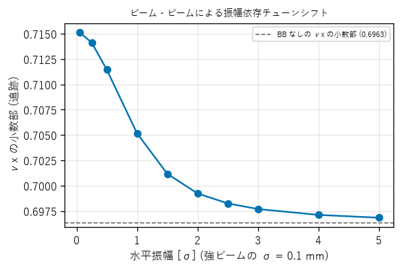

# 14. BEAM-BEAM (BEAMBEAM、BSTRL、PHOTONS、LuminosityMonitor、BBBrem、tlum)

最終更新: 2026-11-23

**この文書で分かること**: 衝突型加速器のビーム・ビーム相互作用 (強ビームが弱ビームに与えるキック) を pysad で扱う方法、物理と式、光子 (ビームストラールング) とルミノシティ、制動放射の事象生成、K64 との違い、限界。
**前提**: SAD の台本の書き方と `TrackParticles` の基本 ([`docs/10_tracking.md`](10_tracking.md))。
**読む順**: 1 (先に知っておくこと) → 2 (動く台本) → 3 (物理) → 5・7 (癖と限界)。実装の詳細は 8 (開発者向け)。

用語: **弱-強 (weak-strong)** = 固定した強ビームが、追跡する粒子 (弱ビーム) に与えるキックだけを計算するモデル。**ビームストラールング (BSTRL)** = 相手ビームの電磁場による放射。**スライス** = 強ビームを z 方向に分けた小片。

## 1. 何ができるか・先に知っておくこと

- pysad が持つのは **弱-強 (weak-strong) モデルだけ**。BEAMBEAM は「強ビーム (固定した 6 次元ガウス分布、z スライスに分ける) が、追跡する粒子 (弱ビーム) に与えるキック」である。K64 の `bbstrhl.f` の直訳。**強-強 (両ビームが互いに変形し合う自己無撞着な計算) は pysad にも、根拠にした `bbstrhl.f` の BEAMBEAM にも無い**。コードで裏を取れたのは弱-強だけで、強-強の別経路が K64 の他の部分にあるかは調べていない (未確認)。
- キックは **追跡 (TrackParticles、高速追跡 `track6n`) だけ**に効く。光学 (Twiss、CALC、Emittance、EMIT) では恒等 (4.3)。
- 使った制約: 検証台本の運動量は MOMENTUM=1.7GEV の電子 (γ は電子質量から決める)、リングは小さな四極と BEAMBEAM だけの人工の並び ([`pysad/tests/test_beambeam.py`](../pysad/tests/test_beambeam.py))。実機の衝突点 (SuperKEKB 級の β*、交差角、数百万粒子) との比較はしていない。
- SADHelp に BEAMBEAM の記述はない。根拠は K64 のソース (`bbstrhl.f`、`bbtool.f`、`matrix.f`) と gs の出力だけ。

## 2. 使い方 (動く SAD スクリプト)

### 2.1 BEAMBEAM 要素のパラメータ


```
BEAMBEAM BB = (BX=0.5 BY=0.01 EMIX=1e-8 EMIY=1e-10 SIGZ=0.005 DP=1e-3 SLICE=5 NP=1e10 XANGLE=0.01);
```

キーワードは [`pysad/beambeam.py`](../pysad/beambeam.py) の `_KEYS` (K64 `initb1.f` の ky_*_BEAM の順) で、parser が数値だけを `BeamBeam.params` (`elements.py`、Marker の子) に入れる。

| キーワード | 意味 |
| --- | --- |
| AX BX AY BY | 強ビームの IP での Twiss (α, β) |
| R1..R4 | x-y 結合の 4 つのパラメータ |
| EX EPX EY EPY, ZX ZPX ZY ZPY | 分散 (η) と z 方向の分散類 |
| EMIX EMIY | 水平・垂直のエミッタンス |
| DP, SIGZ, AZ | エネルギー広がり、バンチ長、⟨z pz⟩ 相関 (縦のエミッタンスは √(DP²SIGZ² − AZ²)。0 以下はエラー) |
| R11..R66 | 6 次元の包絡行列 (R11 R22 R33 R44 R55 R66 がすべて正のとき Twiss の入力より優先) |
| XANGLE | 交差角 [rad] |
| DX DPX DY DPY DZ | 強ビームの軌道 (オフセット) |
| SLICE | z スライス数 (0 以下で相互作用なし、最大 500) |
| NP | 強ビームの粒子数 (ce = NP·re/γ) |
| BSTRL | 1 以上でビームストラールング (3.2) |
| STURN, COUPLE | キーワードとしては読むが、pysad の計算では使っていない。K64 のソースでもキーワードの登録 (`initb1.f`) 以外に参照が無く、使われない (2026-11-16 確認) |

弱ビームの γ は MOMENTUM と電子質量から決める (K64 の bbinit。陽子でも電子質量を使うのは K64 のまま)。

### 2.2 弱-強の相互作用とビームストラールング


```
MOMENTUM = 1.7GEV;
DRIFT DR = (L=1) DR2 = (L=0.5);
QUAD QF = (L=0.3 K1=0.6) QD = (L=0.3 K1=-0.5) QX = (L=0.3 K1=0.4 ROTATE=0.2);
BEAMBEAM BB = (BX=0.5 BY=0.01 EMIX=1e-8 EMIY=1e-10 SIGZ=0.005 DP=1e-3 SLICE=5 NP=1e10);
MARK ST = ();
LINE BL = (ST QF DR BB DR2 QX DR2 QD DR);
FFS;
USE BL;
TRPT; INS; NORAD; NOFLUC;
n = 200;
x0  = Table[1e-4*Sin[0.37*i], {i, n}];
px0 = Table[1e-6*Cos[0.11*i], {i, n}];
y0  = Table[3e-6*Cos[0.23*i], {i, n}];
py0 = Table[1e-7*Sin[0.71*i], {i, n}];
z0  = Table[0.01*Sin[0.13*i]+1e-4*i-0.01, {i, n}];
dp0 = Table[1e-3*Cos[0.31*i], {i, n}];
fl0 = Table[1, {i, n}];
r = TrackParticles[{1, {x0, px0, y0, py0, z0, dp0, fl0}}, 10, 1, 5];
res = r[[2]];
Do[Print[k, " ", Plus@@res[[k]], " ", res[[k, 1]], " ", res[[k, 77]], " ", res[[k, 200]]], {k, 6}];
```

`TrackParticles[..., 10, 1, 5]` は全周 (要素 1 から 10) を 5 周。**`TrackParticles[..., 5, 1]` の 5 は終点の要素番号で、周回数ではない**。SLICE=0 にすれば相互作用が消える (`test_beambeam_has_an_effect`)。

#### ビームストラールング (試験 bs1)

7.1 の BEAMBEAM を `NP=3e11 BSTRL=1` に変え、`SeedRandom[7];` を `n = 200;` の前に置く。それ以外は同じ。粒子ごとの結果が gs と一致する (6)。

出力の見方: `Print` の行は、成分 k (1〜6 = x、px、y、py、z、dp) ごとに「全粒子の総和、粒子 1・77・200 の値」。BEAMBEAM は強ビームの電荷による非線形キックで、粒子の px・py (ビーム・ビームのキックそのもの) と、BSTRL ON では dp (光子放射によるエネルギー損失) に現れる。BEAMBEAM が無い (SLICE=0) ときとの差が相互作用の効果。


### 2.3 PHOTONS (BEAMBEAM の光子のリスト)


```
MOMENTUM = 1.7GEV;
DRIFT DR = (L=1) DR2 = (L=0.5);
QUAD QF = (L=0.3 K1=0.6) QD = (L=0.3 K1=-0.5);
BEAMBEAM BB = (BX=0.5 BY=0.01 EMIX=1e-8 EMIY=1e-10 SIGZ=0.005 DP=1e-3 SLICE=5 NP=3e11 BSTRL=1);
MARK ST = ();
LINE BL = (ST QF DR BB DR2 QD DR);
FFS;
USE BL;
TRPT; INS; RAD; FLUC; PHOTONS;
SeedRandom[7];
n = 20;
(x0 ... fl0 は 7.1 と同じ Table)
r = TrackParticles[{1, {x0, px0, y0, py0, z0, dp0, fl0}}, 7, 1];
Print["NPH ", Length[PhotonList]];
Do[Print["PA ", PhotonList[[k, 1]], " ", PhotonList[[k, 2]], " ", PhotonList[[k, 3]], " ", PhotonList[[k, 4]], " ", PhotonList[[k, 5]], " ", PhotonList[[k, 6]]], {k, Length[PhotonList]}];
```

PhotonList の各行は 12 要素 (`beambeam._photon_rows`): 1 = エネルギー [eV] (dn·運動量)、2〜4 = 位置 (グローバル gx gy gz)、5〜7 = 進行方向の単位ベクトル、8〜10 = 偏光 (ξ1 ξ2 ξ3)、11 = 粒子番号、12 = 要素番号。K64 `photons.f` の `tphotonlist` の定義と一致することを確認した (2026-11-16)。

### 2.4 LuminosityMonitor


試験の台本 (lm2。BSTRL 無し、1 周分の追跡 `TrackParticles[..., 5, 1]` なので BEAMBEAM を 1 回通り、呼び出し回数 cnt = 1):

```
MOMENTUM = 1.7GEV;
DRIFT DR = (L=1) DR2 = (L=0.5);
QUAD QF = (L=0.3 K1=0.6) QD = (L=0.3 K1=-0.5) QX = (L=0.3 K1=0.4 ROTATE=0.2);
BEAMBEAM BB = (BX=0.5 BY=0.01 EMIX=1e-8 EMIY=1e-10 SIGZ=0.005 DP=1e-3 SLICE=5 NP=1e10);
MARK ST = ();
LINE BL = (ST QF DR BB DR2 QX DR2 QD DR);
FFS;
USE BL;
TRPT; INS; NORAD; NOFLUC;
cnt = 0; tot = 0; LuminosityMonitor[x_] := (cnt = cnt + 1; tot = tot + x); n = 200;
x0  = Table[1e-4*Sin[0.37*i], {i, n}];
px0 = Table[1e-6*Cos[0.11*i], {i, n}];
y0  = Table[3e-6*Cos[0.23*i], {i, n}];
py0 = Table[1e-7*Sin[0.71*i], {i, n}];
z0  = Table[0.01*Sin[0.13*i]+1e-4*i-0.01, {i, n}];
dp0 = Table[1e-3*Cos[0.31*i], {i, n}];
fl0 = Table[1, {i, n}];
r = TrackParticles[{1, {x0, px0, y0, py0, z0, dp0, fl0}}, 5, 1];
Print["LUM ", LuminosityMonitor, " ", cnt, " ", tot];
```

gs の結果 `LUM 441603719.01268 1 441603719.01268` と相対 1e-9 で一致する (`LM2_REF`)。

### 2.5 BBBrem1 (制動放射の 1 事象)


```
FFS;
SeedRandom[3];
Do[r = BBBrem1[3e9, 1e-6]; Print["BR ", r[[1,1]], " ", r[[1,2]], " ", r[[1,3]], " ", r[[1,4]], " ", r[[2]]], {i, 6}];
Do[r = BBBrem1[1e10*i, 1e-3]; Print["BS ", r[[1,1]], " ", r[[1,2]], " ", r[[1,3]], " ", r[[1,4]], " ", r[[2]]], {i, 1, 4}];
Print["BU ", Random[]];
```

引数は (√s [eV], ds/s の下限)。戻り値は `{4 元運動量 (eV)、近似断面積}`。

## 3. 物理と式 (弱-強: bbstrhl.f)

`beambeam.setup` = bbinit、`beambeam.bb_kick` = beambeam。


`beambeam.setup` = bbinit、`beambeam.bb_kick` = beambeam。

1. **包絡**: Σ6 = HRB·E·(HRB)ᵀ (Twiss の経路。B は β・α、R は結合、H は分散、E = diag(EMIX, EMIX, EMIY, EMIY, DP·SIGZ, DP·SIGZ))。R11..R66 が全部正ならそれを使う。XANGLE ≠ 0 なら交差角の変換 C·Σ·Cᵀ を掛ける。
2. **スライスの条件付き包絡**: Σ⁻¹ の (x px y py pz) 部分を A、z との結合を b として、5 次元包絡 Σ5 = A⁻¹、z を固定したときの重心 v = −Σ5·b (z に比例)。固有値が 0 以下ならエラー。x-y 結合を消す傾き角で回す。
3. **スライスの位置**: 等確率の Gauss 分位 (`gauinv`。K64 の 6.4e-4 の近似のまま)。
4. **追跡**: 交差角・軌道の補正と傾きの回転 → 各スライスで粒子を z の差の半分 (sz = (z − zs)/2) だけ drift → `cerrf` (複素誤差関数、Bassetti-Erskine) によるキック (丸い・水平に広い・垂直に広いの 3 通りで式が違う) と pz のキック → 戻す。最後に `limitnan` (NaN は +1e4、上限 1e4、z は 1e10)。

### 3.2 BSTRL (ビームストラールング)


BSTRL ≥ 1 のとき、各スライスのキック (fx0, fy0) から曲率 ρ = |f|/dsz、放射確率 rnbs = cnbs·ρ·dsz (cnbs = 5√3·α·γ/6) を作る。`tran()` が rnbs より小さいとき 1 個の光子を放射し、光子のエネルギー cubs·ρ·exp(ξ) (cubs = 1.5·ħ·c·γ²/m_e) を δ から引く。ξ は `xx/rnbs` を K5/3 の積分の逆引き表 (`besseltab`、`mkbesseltab`) で変換して得る。

- rnbs > 0.5 は K64 が stop するので pysad も止める ("Nbs is too large")。NP を大きくし過ぎた場合など。
- 乱数は SAD と同じ LCG (`tran`)。粒子 → スライスの順に 1 回ずつ引く。SeedRandom で再現する。
- 表の定数は単精度のまま (`hbar=6.58211928e-16`、`1.1**40`、`1.02`、`5./3.`、`EPS=1e-10`)。



図の読み方: FODO リング (3 GeV。`example/00_lattice/bb_ring.sad` の `RINGB`: ORIGIN の直後に BEAMBEAM を 1 個。強ビームは IP で BX = BY = 1 m、EMIX = EMIY = 1e-8 m (σ = 0.1 mm)、NP = 1e9、SLICE = 1) で、弱ビームの 1 粒子 (y = 0) の水平振幅を変えて追跡し、3 周の座標から求めた νx の小数部 (縦軸) を振幅 [σ] (横軸) に対して描いた。灰色の破線は BEAMBEAM なしの値 0.6963 (光学計算の `CALC` には BEAMBEAM は効かない)。小振幅 (0.05σ) では 0.7151 (Δν = +0.019) だが、振幅が大きいほど強ビームの力が弱まるので Δν が小さくなり、5σ で 0.6968 になる。

## 4. 機能ごとの対応

### 4.1 PHOTONS と PhotonList (BEAMBEAM の光子だけ)


`PHOTONS` を ON にすると、BSTRL の光子が `PhotonList` に入る。PHOTONS は RAD と FLUC が必要 (無いと gs と同じメッセージ `Track::photons: PHTONS requires RAD & FULC in TrackParticles`)。光子の放射角は BEAMBEAM では曲率半径 0 (直線) なので、角度の広がりなし・偏光 (0, 0, 1) を幾何の傾き chi で回した値になる。乱数は 1 光子ごとに `tgauss` を 2 回。K64 は光子ごとに `x px y py delg` を標準出力に書き、pysad も同じ形式で出す。

**限界**: 他の要素 (四極、BEND、MULT) の光子 (K64 の `tphrec`) は含まない。BEND や ANGLE≠0 の MULT を含む並びは SADError (「BEND の光子は未対応」)。四極が光子を出す台本では、PhotonList の個数も、あとの乱数列も gs とずれる (3 周の台本で gs 43 個、pysad 12 個)。

### 4.2 LuminosityMonitor


TrackParticles が BEAMBEAM を通るたびに (BSTRL の有無によらない。`beambeam.apply` が毎回計算する)、ルミノシティの値 (Σ dLum / スライス数 / 粒子数) を渡す。

- シンボル `LuminosityMonitor` に最後の値が入る。
- 利用者が関数 `LuminosityMonitor[x_] := ...` を定義していれば、その呼び出しが呼ばれる (回数と値が gs と一致)。

### 4.3 光学 (Twiss・Emittance) での扱い


- BEAMBEAM は `Marker` の子で、Twiss・CALC の転送は恒等。K64 の qtwiss に BEAMBEAM の分岐がなく、gs も MARK と同じに扱うことを確認した。pysad の Twiss は gs と 10 桁一致 (BEND を含む 9 行の BX BY NX EX DX)。
- したがって**ビーム・ビームのチューンシフト・ダイナミックβ・ルミノシティ劣化は光学の計算に入らない**。追跡の結果 (チューンの FFT など) から利用者が見る。
- Emittance・EMIT でも BEAMBEAM は Marker 扱い (emit6d に BeamBeam の分岐は無い)。BEAMBEAM を含むリングの CALC・Emittance は gs と一致 (2026-11-16 確認: Twiss のチューン 1e-14、運動量収縮 4e-12)。
- `track6` (低速の追跡) は BEAMBEAM を扱わず NotImplementedError。SOL 領域内の BEAMBEAM も NotImplementedError (4.5)。

### 4.4 BBBrem (ビーム-ビームの制動放射)


[`pysad/bbbrem.py`](../pysad/bbbrem.py) = K64 `tbbbrem.f` (`bcube1`、`tbcube1`) の直訳 (Kleiss-Burkhardt の 1 事象生成)。`SADScript` から `BBBrem1[sqrt(s) (eV), ds/s 下限]` で呼ぶ (`sadscript.py`)。

- 戻り値は `{(-1,-1,-1,1)·p2 (eV)、近似断面積 (mbarn×1e-31)}`。事象を棄却する場合 (`temp2 < 0`) は 4 元運動量が 0、重み 0。
- 乱数は SAD の `tran()`。
- 検証: `SeedRandom[3]` のあと 6 事象 (√s = 3 GeV) と √s = 10, 20, 30, 40 GeV の 4 事象、乱数の列まで含め相対 1e-15 で gs と一致 (試験は許容 1e-11 相対)。
- パッケージ `Packages/bbbrem.n` の `BBBrem` クラスは `Parallelize`・`LBoost`・`Rot3P` を使う。pysad で `Parallelize` が動くかは確かめていない (未対応とみなす)。
- 事象を棄却する (t < tmin) 場合に K64 が出す診断の print は写していない。
- BEAMBEAM 要素や TrackParticles とは接続していない。BBBrem1 は単独の事象生成器である (BEAMBEAM の中で制動放射を引く機能は pysad に無い。K64 側の接続は調べていない)。
- 関連する `GaussianCoulomb` 系 (ガウス分布の力) は [`docs/06_sadscript_library.md`](06_sadscript_library.md)。
- 乱数は SAD の `tran()` (nran=3)。K64 の `tbbbrem.f` の `bcube1`・`tbcube1` を直訳したもの。


### 4.5 tlum / tluma (`pysad/measure.py`)


K64 `tlum.f` の直訳。ルミノシティの推定 (二つのビームの粒子数の分布の重なり) である。

- `tluma(x, y, xm, ym, sigx, sigy0, nmesh)`: x[j, i], y[j, i] (j = 0, 1 が二つのビーム、i が粒子)。粒子を (σx, σy) で規格化した格子 (中心 xm, ym、±3σ、nmesh 分割) に線形配分し、Σ bin₁·bin₂ から実効面積 `np²/Σ · σxσy·(6/nmesh)²/(4π)` を返す。σy が大きすぎるときは範囲を狭めて繰り返す。bin は real*4 (単精度の足し込みを写した)。
- `tlum(x, y, xm, ym, sigx, sigy)`: nmesh = max(int(√np), 6)。戻り値は (tlum, nmesh)。
- 検証: 同じガウス分布 2 つ (40000 粒子、σx=1e-3、σy=2e-4) で nmesh=200、`tlum/(σxσy)` が 1 から 10% 以内 (解析値との比較。[`test_measure.py`](../pysad/tests/test_measure.py))。**gs との比較は無い**: FFS の MEASURE は gs で何も出力せず、TRCOD は SIGSEGV で落ちる (docs/30 B42) ため、参照が取れない。
- FFS のコマンドとしての MEASURE・TRCOD (`tracke`、`ttinit`、`ttstat`、`trcoda`、`trackb`) は翻訳していない。tlum は pysad の Python から直接呼ぶ関数で、SAD スクリプトからは呼べない (SAD 側の入口は無い)。

## 5. v2 と k64 の違い・K64 の癖

利用者の結果に影響する違いは、傾き回転 (B34) だけ。強ビームに x-y 結合があるときだけ結果が変わる (k64 は K64 の誤りを再現して座標が潰れ、v2 は正しい回転)。


- **傾き回転 (B34)**: `sint=xangle(5)` (傾き角そのもの)、`cost=xangle(6)` (sin)。bbinit は (6)=sin、(7)=cos を書くのでずれている。強ビームに x-y 結合があると回転が直交でなくなり、座標が潰れる。
  **k64 モードは直訳で再現する (SAD のまま)。v2 モードは (cos t, sin t) の正しい回転にする** (`beambeam.apply`)。強ビームに x-y 結合 (R1..R4 か R13 など) があるときだけ結果が変わる。根拠は回転に対する共変性 (包絡を t 回した強ビームの蹴り = 粒子を −t 回し、回していない包絡で蹴り、+t 回す) で、t = 0.3 で蹴りに対する相対 1e-9 ([`test_v2_C_beambeam.py`](../pysad/tests/test_v2_C_beambeam.py) 2 件)。gs との比較は無い。確かめたのは t = 0.3 の 1 例だけで、実機の衝突点の規模では未確認。
- `cerrf` の `3.2` は単精度の定数。
- 丸いビームで x=y=0 の粒子は 0/0 → NaN → px=+1e4。
- スライスの境界 (`dsz`) はビームストラールングだけが使う。
- **TRPT の放射の分割**: gs の `ndivrad` (tffs.f) は TRPT のとき h0 を 10 倍して分割数を決める。pysad は `track6n.turn` で同じ 10 倍にして、TRPT の RAD FLUC で乱数を引く数を gs と合わせる。BEAMBEAM に限らず TRPT 全体に効く。
- SOL 領域 (SOL BOUND=1 の間) に BEAMBEAM があると **K64 が SIGSEGV で落ちる** (tsol.f:798 付近。docs/30 B35。メッセージの write を消しても落ちる。原因は未特定)。pysad は NotImplementedError にする。
- `TrackParticles[..., 5, 1]` の 5 は終点の要素番号 (周回数ではない)。
- `ndivrad` の分割数 (tffs.f): TRPT のとき `int(1+h0/100·aka·10)`、そうでなければ `int(1+h0/100·aka)`。四極 1 分割に対し gs は 4。10 倍しないと乱数を引く数が gs と違い、放射の効果が小さくてもあとの乱数列がずれる。
- 光子の放射角 (`radangle1`) は BEAMBEAM では曲率半径 0 (直線) なので、角度の広がりなし・偏光 (0, 0, 1) を、幾何の傾き chi で回した値になる。

## 6. 検証

- 弱-強の相互作用 (水平に広い・垂直に広い・丸い、交差角、軌道オフセット、分散と AZ、大振幅) は、K64 (gs) の 5 周追跡 (200 粒子) と相対 0〜2e-9 で一致する。BSTRL は `SeedRandom[7]` で乱数列まで一致 (330 粒子以下)、LuminosityMonitor と PHOTONS も一致する。
- Twiss は gs も BEAMBEAM を恒等として扱い、10 桁一致。BBBrem1 は `SeedRandom[3]` のあとの 6 事象と √s = 10〜40 GeV の 4 事象が、乱数列まで相対 1e-15 で gs と一致する。tlum は gs との比較なし (4.5)。
- 340 粒子以上の BSTRL は分布で比較した (個々の粒子は一致しない: 7)。
- 台本と一致の桁の表は [`docs/history/14_beambeam_validation.md`](history/14_beambeam_validation.md)。試験は `test_beambeam.py` (b1〜b12 の 12 本の台本)、`test_bbbrem.py`、`test_measure.py`。

## 7. 限界・未確認


- **強-強は無い** (1)。両ビームの相互変形、ビーム-ビームの寿命の自己無撞着計算はできない。
- PHOTONS は BEAMBEAM の光子だけ (4.1)。他要素の光子、BEND を含む並びは未対応。`tgauss` の Box–Muller のキャッシュが残っている場合 (利用者が GaussRandom を奇数回呼んだ後) は未対応 (2 回引く前提)。
- 340 粒子以上の BSTRL は個々の粒子が gs と一致しない。原因は未調査 (粒子が多いと gs が分けて処理し別の乱数列になる、という推測を確認していない)。
- BBCUT (旧 `bb.f` の分岐のみ。bbstrhl.f は使わない) は未実装。
- 加速のある CAVI の後で MOMENTUM が変わる場合: K64 の bbinit は更新時の MOMENTUM を使う。pysad は Prog 作成時の運動量を使う (差の大きさは未確認)。
- v2 モードの傾きの修正 (B34) は共変性の確認のみ (gs は座標が潰れるので比べられない)。
- 検証は 1.7 GeV の小さな人工リングだけ。実際の衝突型リングの規模 (高エネルギー、強い β*、1e11 級の NP での長時間追跡) での gs 比較は未確認。
- BBBrem1 の限界: 事象を棄却する (t < tmin) 場合に K64 が出す診断の print は写していない。`Packages/bbbrem.n` の `BBBrem` クラスが使う `Parallelize` が pysad で動くかは未確認 (未対応とみなす)。BBBrem は単独の事象生成器 (4.4)。tlum は gs との比較が無い (4.5)。
- Emittance の BEAMBEAM は Marker 扱いのみ (4.3。この扱いは gs と一致を確認)。
- キーワード STURN・COUPLE (BEAMBEAM): K64 のソースでキーワードの登録 (`initb1.f`) 以外に参照がなく、使われない (ソースの確認。gs での動作は試していない)。
- K64 は光子ごとに `write(*,*) x,px,y,py,delg` を標準出力に出す。pysad も同じ形式で出す。
- 検証の対象は 1.7 GeV の小さな人工リング (周長は数 m の並び) だけ。SuperKEKB 級の β*、交差角、数百万粒子の追跡との比較はしていない。

## 8. 開発者向け: 実装の構成

- 弱-強: [`pysad/beambeam.py`](../pysad/beambeam.py) (K64 の `bbstrhl.f` の beambeam・bbinit、`bbtool.f` の cerrf・gauinv、`matrix.f` の包絡行列の直訳)。キーワードは `_KEYS` (K64 `initb1.f` の ky_*_BEAM の順)、parser が数値だけを `BeamBeam.params` (`elements.py`、Marker の子) に入れる。
- 高速追跡は [`pysad/track6n.py`](../pysad/track6n.py) の `K_BB`。PHOTONS・LuminosityMonitor は [`pysad/ffscmd.py`](../pysad/ffscmd.py)。`beambeam.apply` が毎回ルミノシティを計算する。`beambeam._photon_rows` が PhotonList の行を作る。
- BBBrem: [`pysad/bbbrem.py`](../pysad/bbbrem.py)。tlum: [`pysad/measure.py`](../pysad/measure.py)。`track6` (低速) は BEAMBEAM を扱わない。
- 試験: [`pysad/tests/test_beambeam.py`](../pysad/tests/test_beambeam.py)、[`test_bbbrem.py`](../pysad/tests/test_bbbrem.py)、[`test_measure.py`](../pysad/tests/test_measure.py)、[`test_v2_C_beambeam.py`](../pysad/tests/test_v2_C_beambeam.py) (v2 の傾き回転 2 件)。
- 根拠のソース: K64 の `bbstrhl.f`、`bbtool.f`、`matrix.f`、`tbbbrem.f`、`tlum.f`、`photons.f`。SADHelp に BEAMBEAM の記述はない。

## 9. 関連文書

- [`docs/10_tracking.md`](10_tracking.md): TrackParticles
- [`docs/06_sadscript_library.md`](06_sadscript_library.md): GaussianCoulomb 系
- [`docs/13_wake.md`](13_wake.md): wake と BEAMBEAM の併用 (一致を確認)
- [`docs/30_sad_bug_report.md`](30_sad_bug_report.md): B34 (傾き)、B35 (SOL 内の SIGSEGV)、B42 (MEASURE・TRCOD)
- [`docs/history/work_beambeam.md`](history/work_beambeam.md): 実装の経緯
