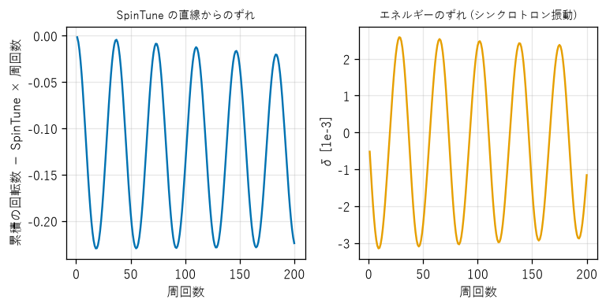

# 16. スピンと偏極 (POL)

最終更新: 2026-11-23

**この文書で分かること**: 電子リングの偏極 (Sokolov-Ternov 偏極時間、スピンチューン、偏極ベクトル、スピン歳差行列、平衡偏極度) を `POL` フラグと `Emittance[]`・`EMIT` で計算する方法と、`TrackParticles` でスピンを追跡する方法。物理と式、K64 との違い、限界。
**前提**: `Emittance[]` の基本 ([`docs/09_emittance.md`](09_emittance.md))、`TrackParticles` の基本 ([`docs/10_tracking.md`](10_tracking.md))。スピンの基礎 (Thomas-BMT 方程式、スピンチューン aγ) は既知とする。
**読む順**: 1 (何ができるか) → 2 (動く台本と結果の意味) → 3 (式) → 5 (k64 と v2 の違い。平衡偏極度は v2 でないと有限値にならない) → 7 (限界)。実装の詳細は 8 (開発者向け)。

用語: **偏極時間** = Sokolov-Ternov 効果で偏極が立ち上がる時間 [s]。**スピンチューン** = 1 周のスピン歳差の回転数 (基準値は aγ)。**偏極ベクトル (n0)** = 1 周で元に戻るスピンの軸。**srot** = スピン歳差の 1 周行列と座標微分 (3×9)。

## 1. 何ができるか


| やりたいこと | 方法 | 状態 |
|----|----|----|
| リングの偏極時間・スピンチューン・偏極ベクトル・スピン歳差行列 | `POL;` を付けて `Emittance[]` か `EMIT` | gs と一致 (6) |
| 平衡偏極度 `Polarization` | 同上 | K64 が NaN を返す (B55)。**k64 モードは NaN、v2 モードは有限値** (5.2、5.3) |
| 粒子ごとのスピン (歳差と Sokolov-Ternov の放射偏極) の追跡 | `POL; RAD;` を付けて `TrackParticles` (入力を 9〜11 列にする) | k64 モード: gs と 4e-12 以下で一致 (4.1、6)。v2 モード: 一部の歳差の式を直す・領域内や損失も扱う (5.3) |
| 放射偏極だけ切る | `NORADPOL;` (`RADPOL` の既定は ON) | 追跡の Sokolov-Ternov 項だけに効く (4.1) |

フラグの既定は `POL` が OFF、`RADPOL` が ON ([`pysad/ffscmd.py`](../pysad/ffscmd.py) の `_FLAGS_DEFAULT`、K64 の `initb1.f` の `defflg`)。SADHelp の説明は「POL が ON のとき、RADPOL は追跡で Sokolov-Ternov 効果を入れる」。
POL が OFF のとき、偏極の量は K64 も 0 のまま (`PolarizationTime`・`SpinTune`・`Polarization` は 0、`PolarizationVector` は {0,0,0}、`SpinPrecessionMatrix` は単位行列)。`NominalSpinTune` は POL に関係なく `h0·g` (g = 0.001159652181280002 は電子の異常磁気能率、tfstk.f の gspin)。
`RADPOL` が `Emittance[]` の結果に効くかは、K64 の `temit.f` が `radpol0=radpol` を保存するだけで偏極の計算に使う箇所を見つけていない。pysad は `Emittance[]` では `RADPOL` を参照しない (追跡だけ)。

## 2. 使い方の例 (動く SAD スクリプト)


### 2.1 Emittance[] の偏極の量

[`pysad/tests/script_tests/test_spin.py`](../pysad/tests/script_tests/test_spin.py) の平面リング (`PLANAR`、MOMENTUM 3 GeV、12 セル、`aγ` = 6.808) をそのまま使う。

```
MOMENTUM = 3GEV;
DRIFT D1 = (L=1) D2 = (L=0.5);
QUAD QF = (L=0.3 K1=0.7) QD = (L=0.3 K1=-0.6);
BEND B = (L=1.2 ANGLE=0.2617993877991494 E1=0.1308996938995747 E2=0.1308996938995747);
CAVI RFC = (VOLT=1.5e6 HARM=64);
MARK ST = ();
LINE CELL1 = (QF D2 B D2 QD D1);
LINE RING = (ST 12*CELL1 RFC);
FFS;
$FORM="18.14";
PageWidth = 1999;
USE RING;
CELL;
CALC;
RFSW; RAD; NOFLUC;
POL;
em = Emittance[];
Print["OUT ", {PolarizationTime, SpinTune, NominalSpinTune, Polarization, PolarizationVector}/.em];
EMIOUT; EMIT;
Exit;
```

結果 (K64 と同じ値。`test_planar_ring_matches_gs`): `PolarizationTime` = 123.8154010596169 s、`SpinTune` = 0.40407272052341、`NominalSpinTune` = 6.80814822478217、`PolarizationVector` = {0, 1, 0}、`Polarization` = NaN (5.2)。
`EMIT` を `EMIOUT` の後に書くと、スピン歳差行列 (`sx sy sz` の 3×3) と、1 周の脱偏極ベクトル (`gx gy gz` の行、(x,px,y,py,z,pz) の 6 成分) が表に出る (書式は Fortran の `1p g15.7` まで一致、`test_emit_report_and_spin_precession_matrix_match_gs`)。
`SpinPrecessionMatrix/.em` は同じ 3×3 の行列。

`POL` を `NOPOL;` に替えると `{PolarizationTime, SpinTune}` は {0, 0} (`test_pol_off_leaves_spin_outputs_zero`)。

### 2.2 TrackParticles のスピン追跡

[`pysad/tests/script_tests/test_spin_track.py`](../pysad/tests/script_tests/test_spin_track.py) の `pt1` (RAD ON・NOFLUC。平面リング + 空洞)。ビームは 9 列 `{x, px, y, py, z, dp, 角度, sy/|s|, flag}` で、10・11 列目は損失位置・損失周の予約 (4.1)。

```
(平面リングは 2.1 と同じ。RING の定義まで)
FFS;
USE RING;
CELL;
CALC;
RFSW; RAD; NOFLUC;
POL;
em = Emittance[];
Print["EM ",{SpinTune,NominalSpinTune}/.em];
x0={1e-4,0};px0={0,0};y0={0,1e-4};py0={0,0};z0={0,0};dp0={0,1e-3};
r=TrackParticles[{1, {x0,px0,y0,py0,z0,dp0,{0,0},{0.1,0.2},{1,1},{1,1}}}, 20, 1, 3];
Print["R ",Length[r]," ",Dimensions[r[[2]]]];
Print["S ",r[[2]]];
```

戻りは `{位置, {x, px, y, py, z, dp, 角度, sy/|s|, flag}}`。2 粒子 (x と y を 1e-4 ずらした 1 番目と、dp=1e-3 の 2 番目)、スピンの初期値は (角度 0, sy/|s| = 0.1) と (0, 0.2)。3 周追跡した後の 7 列目 (`atan(sz, sx)`) と 8 列目 (`sy/|s|`) が gs と 4e-12 以下で一致する (`test_planar_ring_spin_tracking_matches_gs`)。
`RAD FLUC` (乱数あり) でも一致する (`pt3`、`pt13`)。`RAD NOFLUC` を `RAD FLUC` に替え、`SeedRandom` を gs と合わせれば同じ乱数の順になる (K64 の乱数の引き順まで写した)。

そのほかの動く例: [`test_spin.py`](../pysad/tests/script_tests/test_spin.py) の `COUPLED` (縦ずれ・回転した四極・6 極・ROTATE 付き偏向のあるリング。偏極ベクトルが {-1.35e-4, 0.99954, 0.0305})、`test_mult_ring_matches_gs` (MULT)、`test_solenoid_ring_matches_gs` (SOL 領域)。
作業の経緯は [`docs/history/work_unimpl.md`](history/work_unimpl.md) (POL の節)。

結果の意味: `PolarizationTime` = 123.8 s は、このリング (3 GeV、aγ = 6.808) で偏極が 1−1/e まで立ち上がる時間。`SpinTune` = 0.404 は 1 周のスピン歳差の端数 (整数部を除く)。`PolarizationVector` = {0, 1, 0} は平面リングなのでスピンの周期解の軸が垂直 (y)。`Polarization` は k64 モードでは NaN (5.2)。v2 モードでは有限値 (92.376%、5.3)。




図の読み方: FODO リング (3 GeV、24 セル、RF 4 MV。`POL; RAD; NOFLUC`) で、水平面内に向けたスピンをもつ 1 粒子 (放射損失とつり合う同期位相の z から出発) を 200 周追跡した。右は粒子のエネルギーのずれ δ の推移で、約 36 周の周期 (νs = 0.0276) のシンクロトロン振動をする。左は、スピンの累積の回転数から SpinTune × 周回数 (`Emittance[]` の SpinTune = −0.19185) を引いた値で、δ の振動と同じ周期で約 0.1 回転の幅で揺れる。直線で近似した平均の傾きは −0.19188 回転/周で SpinTune に一致する。

## 3. 物理と K64 の式


記号は K64 (`photons.f` の `tradke`、module `tspin`) のまま。a = g = 1.15965e-3、γ = h1、`pr` = 1+δ。

### 3.1 1 ステップのスピン歳差 (tradke)

放射の 1 スライスごとに、運動量の変化 (px, py, pz の前後) からスライス内の磁場を作る。
- 磁場に比例する量 `xpx, xpy, xpz` (運動量の変化の外積) に、縦の磁場の補正 `bsir0` と SOL の `bzh` を足した `xpzb = xpz + (bsir0 + 2·bzh·al)·pr²`。
- スライス中央の運動方向 (pxh, pyh, pzh) への射影 `bp` から縦成分 bl = bp·(pxh, pyh, pzh)、横成分 bt = (xpx, xpy, xpzb)/pr² − bl。
- スピン方程式の回転ベクトル `g = (1 + aγ)·bt + (1 + a)·bl`。
- `srot` (3×9) の列 1〜3 をベクトル g のまわりに |g| 回す (Rodrigues の式、`xsincos` で 1−cos を精度良く)。列 4〜9 には座標微分 `dg` を `dg·transr` として積算する (微分は `spin.py` の `tradke_spin` で解析的に作る)。
- Sokolov-Ternov の傾き `gintd` に `(srot·ĝ)[:3]·sflc·anp·(bt·γ·p/al1)²` を足す (`sflc = 0.75·(ELRADI/FINEST)²`)。
- 最後に偏向角 `phi0` の分だけ `srot` を回す (`srot(1,:) = cp·srot(1,:) + sp·srot(3,:)`、`srot(3,:) = (-sp·srot(1,:) + srot(3,:))/cp`。2 つめは更新後の 1 行目を使う: B56)。

bt の z 成分の微分 `dbtz` は K64 のソースで `pr**2` ではなく `pr` で割っている。pysad はそのまま写している (`spin.py` の注記)。

### 3.2 座標回転と bsir0

- `tchge` / `tbrote` (ずれ・ロールのある偏向磁石の入口・出口): ROTATE に相当する回転で `srot(1:2,:)` を z 軸まわりに回し (`tchge_rotate_spin`)、ずれ・DROTATE・CHI2 は `tbrote` の微小回転 `rr` で更新する。`tbrote` の更新は列ごとに行を逐次更新する (rr·srot の行列積ではない: B56)。
- `bsir0` は縦の磁場の積分で、`tradke` の bl に入る。更新の場所は偏向磁石 (`tbendebody` の入口・出口の `bsi1·yi/rhob`、`bsi2` の項は捨てられる: B58)、`tmulke` (MULT の `Im(cx)/al`、最初のスライスで足し最後で引く。L=0 の薄い MULT では更新しない)、`tsetr0` (0 にリセット)。
- 偏向磁石の分割数は POL のとき `max(ndiv, 1 + int(max(|φ|, 1e-6)·h0·a/1e-2))` 以上になる (放射の結果も少し変わる。K64 も同じ。`dphipol = 1e-2`)。
- 傾いた四極・6 極の入口・出口の回転 (`trot33`) は、pysad が実験室座標で `tradke` を計算するので入口と出口で打ち消し、書かなくても同じ結果になる (Emittance[] の側)。追跡側は 4.1。

### 3.3 偏極ベクトルとスピンチューン (spnorm)

`temit.f` の `tecalc` の最後 (`spin.py` の `spin_results`) で、1 周の行列 `srot(:,1:3)` を次の手順で処理する。
1. 列を直交化する (2 列目を規格化、1 列目から 2 列目の成分を引いて規格化、3 列目は外積)。
2. 回転の軸 (行列の反対称部分 `(R32−R23, R13−R31, R21−R12)`) を不変軸 n の初期値にする。大きさが 1e-4 未満なら実固有値の固有ベクトルを使う。
3. `(R − 1)·δ = n − R·n` の最小ノルム解 (`tsvd`、しきい値 1e-8) で軸を補正し、規格化、成分が負側に偏れば符号を反転する。これが `PolarizationVector`。
4. 軸に垂直な基底を作り、1 周での歳差角 `smu` を `atan2(-sm, cm)` で出す。`SpinTune` = smu/2π。
5. 減衰率 `sdamp = n·gintd`。`PolarizationTime = 1/sdamp/f_rev` (f_rev = ω0/2π は周回周波数。4 の SOL の周長の癖が効く)。

### 3.4 平衡偏極度 (srequpol、spdepol)

`srequpol` は、規格化したモード座標でのビーム行列 (`beamn`)・減衰率・エミッタンス・チューンから 2 次までの摂動で脱偏極行列 `rm1` を作り (`spdepol`)、
`equpol = PST·sdamp / (sdamp − rm1[0,0])` (PST = 8√3/15 = 0.9238) を返す。`Polarization/.em` はその第 1 成分で、`Polarizations` は 3 成分 (残りは 0)。
SADHelp には `Polarization2`・`Polarization4`・`Polarization6` (2・4・6 次) もあるが、K64 のソースでは `spcalcres` を 2 次の 1 回だけ呼んでいる。pysad はそれに合わせ、`Polarization2` などの別の次数のキーは持たない (K64 のソースに `Polarization2` の文字列は見つからなかった。SADHelp にだけ記載がある。gs の `Emittance[]` も `Polarization2` を返さない (`Polarization2/.em` が未評価のまま)。pysad も同じ。2026-11-16 確認)。
`spdepol` の中で `exp(cb²−cφ)·cerfc(cb)` を作る。|cb| > 18 のとき `cerfc` が漸近式を使い、`exp(−cb²)→0` と `exp(cb²)→∞` の積が NaN になる (B55)。5.2。

### 3.5 追跡のスピン (sprot)

`photons.f` の `sprot` は、粒子ごとに 1 ステップの磁場の向き (運動量の変化 ppx, ppy, ppz と `bsi`) から同じ g を作り、スピン (sx, sy, sz) を g のまわりに回す。
RADPOL が ON で、そのステップに放射エネルギー `ucde > 0` があれば、回転の前に Sokolov-Ternov の項 `dst = (PST − s·b̂t)·CFPD·(pp·p0/γ²)²·ucde/|bt|` (CFPD = 5√3/8) を bt の向きに足す。最後に偏向角の分だけ回す (sx の更新の後の sz は更新後の sx を使う: K64 のまま)。

## 4. 要素・追跡ごとの対応

### 4.1 TrackParticles のスピン追跡


- 入力と戻り: POL が ON のとき、ビームは 9〜11 列でなければならない (それ以外は `General::wrongtype`)。7 列目は歳差の角度、8 列目は `sy/|s|`、9 列目は flag、10・11 列目は損失位置・損失周。
  粒子のスピンは (sx, sy, sz) = (st·cos 角度, sy, st·sin 角度)、st = √(1−sy²)。戻りの 7 列目は `atan(sz, sx)`、8 列目は `sy/|s|` (tftrack.f の `tfsetparticles` / `ktfresetparticles`)。POL が OFF なら 7〜9 列のまま ([`docs/10_tracking.md`](10_tracking.md))。
- 動く条件: **POL かつ RAD が ON のときだけ**。K64 は歳差を `tradk` の中で計算するので、RAD が OFF では高速追跡 (`TrackRun`) が走り、スピンは変わらないまま戻る (7・8 列は入力の値を正規化して返すだけ)。RAD が ON で POL なら `fn_track` は numba の高速追跡を使わず、`track6.py` の Python の追跡に切り替える (`ffscmd.py` が `NotImplementedError` で切り替え)。
  `RADPOL` が OFF なら Sokolov-Ternov の項だけが消え、歳差は動く。
- **損失の処理 (k64 モード)**: 高速追跡 (`TrackRun`) にしか損失の判定 (`LOSSAMPL`、`LOSSDZ`、flag) がないので、k64 モードのスピン追跡では粒子は落ちない。flag 列は入力のまま返る。10・11 列目 (損失位置・周) は更新しない。**v2 モードは track6 の経路でも落とす** (5.3)。
- `track6.py` の構成: `_Particle.s` (スピン)、`_Particle.bsi` (縦の磁場の積分)、`_sprot` (3.5)、`_tradk` の中で呼ぶ (FLUC で光子が 0 個の場合も歳差だけ呼ぶ: K64 の `tradkfn` の elseif)、`_spin_rot_z` (四極の ROTATE の chi3 回転: `tsolrot` の calpol)。
- bsi の入る場所 (K64 の対応する関数): 四極 (`tsolqur` の各スライスの両端)、BEND (`tbendcore` の入口・出口の y/rhob、K1 のある BEND は `tbendi` の各スライスの `akxn·xi·yi`)、MULT (`tmulti` の `Im(.5·cx·cx1²)/al`)、`tdrift` の ak0 付き、SOL 領域内のドリフトと四極 (`bz·al`)。

### 4.2 SOL 領域


- `Emittance[]`: SOL (BOUND≠0 の領域) を含むリングで偏極時間・スピンチューン・偏極ベクトルが gs と一致する (`emit_extra._tturne1` が `_solmap` の領域を通す。`test_solenoid_ring_matches_gs`、領域内に四極 QT を含む)。結果 (偏極時間・スピンチューン・偏極ベクトル) が一致したことだけが確認済みで、領域内の bsi の入れ方を要素ごとに分けた照合はしていない。
- **K64 は SOL (BOUND≠0) の長さを周長に入れない** (`emit6d._emit_circ`。PLANAR リングに L=0.3・L=0.6・BZ=0 の SOL を足しても、周長 45.6 のときと偏極時間が 15 桁一致)。周回周波数・`MomentumCompaction`・偏極時間に効く。pysad も同じにしてあり、追跡の `circ` も `_emit_circ` を使う。
- SOL に GEO がないと、K64 の S 座標が途切れて周長がさらに狂う (偏極時間が約半分)。pysad は再現しない (未対応)。
- TrackParticles: SOL 領域内のドリフトは gs と一致 (`pt8`、BZ=0.05、MOMENTUM 3 GeV)。
- **領域内の MULT・BEND・CAVI は k64 モードでは未対応** (Emittance・追跡とも)。v2 モードは追跡のスピンが通る (5.3。Emittance[] の POL の量は領域内だけ K64 の式のまま)。**領域内の四極のスピン追跡は gs の参照が食い違い、未照合** (7)。

### 4.3 MULT


K1・K2・K3 とずれ (DX・DY) のある MULT のリングは Emittance[] で gs と 1e-11 で一致 (`test_mult_ring_matches_gs`。K3=300 まで)。`tmulke` の `bsir0` の更新 (`kick_cx`、`_tmulte`) を写した。L=0 の薄い MULT では更新しない (0 割りになるため: `test_thin_mult_ring_spin_tune_matches_gs`)。
追跡も K1 K2 K3 の MULT と薄い MULT で 4e-12 以下 (`pt5`、`pt7`、`pt7b`)。ANGLE≠0 の MULT (`tmultae`) の POL スピンも gs と一致 (偏極時間 14 桁、スピンチューン 1e-14。偏極ベクトルは平面リングで 0,1,0。2026-11-16)。

### 4.4 空洞


偏向のない空洞は、Emittance 側で放射と偏向がないので `srot` は変わらないはず、というのがコード上の理解。`emit6d` の空洞 (`_tcave`) には `tchge_spin` の呼び出しがなく (BEND の `_tbende` だけにある)、DX・DY・ROTATE のある空洞の入口・出口の回転は `srot` に反映しない。入口と出口の回転が打ち消すので結果は同じとみられるが、ROTATE+DX+DY 付き空洞のスピンは結合リングで gs と一致 (偏極時間 13 桁、スピンチューン 1e-14、偏極ベクトル 1e-13。2026-11-16。自動試験には入れていない)。
RF 空洞を含むリングそのもの (`RFC`) は、すべての試験の例に入っていて一致している。

## 5. v2 と k64 の違い・K64 の癖

利用者の結果に影響する違い: **`Polarization` (平衡偏極度) は k64 モードで NaN、v2 モードで有限値** (5.2、5.3)。ほかに v2 は、スピンの歳差の刻みの角 (B83)、BEND の端の縦磁場 (B58)、領域内のスピン (B81・B82・B130) などを直しており、k64 は K64 のまま。以下、5.1 は K64 の癖、5.2 は k64 の NaN、5.3 は v2 モードの動作。

### 5.1 K64 の癖 (docs/30)


| 番号 | 内容 | pysad |
|----|----|----|
| B55 | `Polarization` が NaN (`spdepol` の `cerfc`) | k64: 同じ式で NaN (5.2)。v2: 有限値 (5.3) |
| B56 | `tbrote`、`serot`、`tradke` 末尾の `srot` 更新が `do concurrent` の中で行を逐次更新 (2 行目は更新後の 1 行目を使う) | k64: そのまま写す (`serot`・`tradke` 末尾・`tbrote` とも gs で確認。`tbrote` は BEND の DROTATE+DX で、偏極時間 14 桁、スピンチューン 1e-14、偏極ベクトル 1e-14 で一致)。v2: `tbrote` の更新を (I+rr)·srot の行列積にする (5.3) |
| B57 | `tadddsg` の呼び出しが dgz に dgx を渡す (結果に影響しない) | `dsg` を持たない |
| B58 | `bsi2` の項が出口で捨てられる (縦のオフセットのある BEND) | k64: 捨てる。v2: 入口・出口の縦磁場の積分を入れる (5.3) |
| SOL | SOL の長さを周長に入れない | 同じ (4.2) |

そのほか: `dbtz` の割り算 (`pr` で割る)、`sprot` の最後の `sz` 更新が更新後の `sx` を使う (K64 のまま)。

### 5.2 Polarization (平衡偏極度) が NaN になる件 (k64 モード。v2 モードは 5.3 で有限値)


B55 を参照。gs で再現し、**k64 モードの** pysad も同じ式で NaN になる。試した 8 つのリング (平面でも非平面でも) すべてで NaN。
`cb = −(e^{−cφ}−1)/a` (`a = √2·ssprd`、ssprd はスピン軌道結合 ~0.05 など) が通常 20 以上になり、漸近式の `exp(−cb²)` と `exp(cb²)` の積が 0×∞ になるため。
参考: `erfc·exp` を桁あふれしない形 (erfcx) に書き直すと有限になるが、値は 4e-7〜8e-7 (つまり 4e-5〜8e-5 %) で、92% 級の理論値からは遠く、`spdepol` の式か単位に誤りがある疑いがある (推定。K64 の式の正しさは未確認)。
**未確認**: gs で `Polarization` が有限になる例は不安定な光学の 1 つだけで、pysad はその光学の閉軌道を作れない (正規形が不安定) ので、`cerfc` の |cb| ≤ 18 側は gs で照合できていない。
実用上は `PolarizationTime` (= 1/ΣT の式で、有限で正しい) を使う。

### 5.3 v2 モードの動作 (k64 モードは 5.1・5.2 と 4 のとおり)


試験 [`test_v2_A_spin.py`](../pysad/tests/script_tests/test_v2_A_spin.py)・[`test_v2_A_tchge.py`](../pysad/tests/script_tests/test_v2_A_tchge.py) (放射・エミッタンス)、[`test_v2_C2_spin.py`](../pysad/tests/script_tests/test_v2_C2_spin.py) (スピン追跡)。記録は [`docs/history/v2_changes_A.md`](history/v2_changes_A.md)・`v2_changes_C2.md`。根拠は解析式・独立な数値計算 (Thomas-BMT 方程式の積分、モンテカルロ、FLUC つきのスピン追跡) で、gs ではない。

#### 5.3.1 Polarization (平衡偏極度) の有限値 (B55)

- **K64 の動作**: `spdepol` の `exp(cb²−cφ)·cerfc(cb)` が 0·∞ で NaN。桁あふれだけ直して有限にしても、誤差のあるリングで追跡と 3〜5 桁合わない。**誤りの位置** (B125): K64 の脱偏極率は emittance/減衰率に比例する (光子の跳びの大きさ e を 0.1 倍・10 倍にすると率が 0.1 倍・10 倍、減衰率を 0.1・0.5・2・10 倍にすると率 × 倍率がほぼ一定、`ssprd` を 1e-3〜1e3 倍にしても 4.294e-5〜4.300e-5 で動かない)。2 次の零位相の項 (`spintrm` の `cm0 = −mat/(e^{cφ} − 1)`、位相が打ち消し合う 2 次の積で cφ = −2λ のとき分母 ≈ 2λ) が、平衡のエミッタンス (すでに 1/(2λ) を含む) にさらに 1/(1 − e^{−2λ}) を掛けるため、減衰時間の逆数の分 (1/(2λ) ≈ 1000〜1700) だけ大きい。正しい率は光子の跳びの拡散 D だけで決まり減衰率に依らない。`spintrm` のガウスの項の 2π も余分 (幅 0 の極限で 2π·cm0。正しくは √π/a。2π を外しても P は 1.265e-4 → 1.359e-4 にしか変わらず、1000 倍の差の主因は二重数え)。4.2 GeV・12 MV の 12 セル FODO ([`example/16_spin_polarization/pol_sideband.sad`](../example/16_spin_polarization/pol_sideband.sad)) で K64 は P = 1.265e-4 (gs・pysad k64 が一致)、率 4.3e-5 /周で、独立な率 2.3e-8〜4.5e-8 の約 1000 倍。K64 の式の導出 (Mathematica 由来の 6 次までの展開) には戻っていないので、v2 はこの式を使わず独立な式で置き換えた (`spin_results` の `equpol_k64` に桁あふれだけ直した値を参考として残した)。
- **v2 の動作**: (1) `exp(cb²)·erfc(cb)` は Faddeeva 関数 w(i·cb) で計算する。(2) 平衡偏極度は、スピン軌道結合から脱偏極率 `rate` を求め、P = (8/5√3)·sdamp/(sdamp_rel + rate) とする (分母の緩和率 `sdamp_rel` は逆向きの BEND でも相殺しない Σ r_i (b_i·n)²。下の「逆向きの BEND」)。`rate` は、要素ごとの軌道の行列 T_i、放射の拡散行列 B_i、スピンの回転 R_i、スピン軌道結合 D_i (Emittance[] の srot) から、スピンの周期解 n(u) = n0 + N u を N_{i+1} = (R_i N_i + [n0]× D_i) T_i⁻¹ で解き、rate = ½ Σ_i tr(N⊥ B_i N⊥ᵀ) (1 周あたり) とする。Derbenev–Kondratenko の式の (11/18)|γ∂n/∂γ|² の項と同じ (`pysad/spin.py::slim_depolarization`)。
- **結果**: 平面リングで **92.376% (Sokolov–Ternov)**。誤差のあるリング (12 セルのリングに四極の縦ずれ ±3 mm、閉軌道 y 6 mm) は、FLUC つきのスピン追跡 (RAD FLUC POL、16 粒子) で測った脱偏極率と下表のとおり合う:

| エネルギー・RF | スピンチューン (端数) | 追跡で測った脱偏極率 [/周] | v2 の `depol_rate` [/周] | v2/追跡 | K64 の式 (桁あふれだけ直す) |
|---|---|---|---|---|---|
| 3 GeV、1.5 MV | 0.403 | 3.4e-11 | 5.5e-11 | 1.6 | 2.2e-5 |
| 2.903 GeV、1.5 MV (νx = 0.290 の近く) | 0.293 | 1.05e-9 | 1.28e-9 | 1.2 | 1.7e-5 |
| 4.2 GeV、12 MV | 0.236 | 4.4e-8 | 2.3e-8 | 0.53 | 4.3e-5 |

  追跡の統計は ±25% (16 粒子) で、測った 1 − ⟨S·n⟩ は (4.1 ± 0.9)e-7、(8.4 ± 2.0)e-6、(1.31 ± 0.27)e-4。平衡分布での n の広がり `spin_spread` は 3 GeV で 6.4e-6 で、追跡の 1 − ⟨S·n0⟩ (FLUC 中、平衡後) 3e-6〜1.2e-5 と合う。線形モデルのモンテカルロでは、1 − ⟨S·n(u)⟩ が 20000 周まで式の rate (8.3e-11 /周) どおり直線で増える (±2%)。5 GeV・8 MV の例は追跡で粒子がバケットから落ちて比較にならなかった (4.2 GeV・12 MV に替えた)。
- 出力: `emit6d.emittance6d(lat, p, rfsw=True, radcod=True, pol=True)['spin']` に `equpol` (v2 の偏極度)、`depol_rate` (1 周あたりの脱偏極率)、`taudep` (脱偏極時間 [s])、`spin_spread`、`spin_orbit` (入口の ∂n/∂u、3x6)、`equpol_k64` (K64 の式の参考値) が入る。SADScript の `Polarization/.em` が v2 の値になる。
- **限界 (使えない範囲・未確認)**: 側帯の項 (下の「側帯の項」) だけでは、4.2 GeV・12 MV の 12 セル FODO で FLUC つきの追跡の 0.43 倍に過小評価する (3 GeV 前後は 0.5〜1.6 倍、16 粒子、統計 ±25%、確かめたのは小さな 1 つのリング)。**クロマティックな変調 (下の「クロマティックな側帯の式」) を入れると 1.05 ± 0.16 になる**。軌道の非線形・運動論的偏極 (b·γ∂n/∂γ の項) は入れていない。高エネルギー・高 RF 電圧のリング (aγσδ/νs ≳ 0.5) では追跡で確かめる。K64 の spdepol は置き換えた (誤りの位置は B125)。POL のときは四極・MULT を k·(L/n)² ≤ 2e-3 に分割するので Emittance[] が遅くなる。`Polarization2/4/6` は実装していない。

#### 5.3.2 側帯の項・逆向きの BEND・ソレノイド・加速

試験 [`test_v2_A2_pol.py`](../pysad/tests/script_tests/test_v2_A2_pol.py)・[`test_v2_A2_spin.py`](../pysad/tests/script_tests/test_v2_A2_spin.py)・[`test_v2_B3_pol.py`](../pysad/tests/script_tests/test_v2_B3_pol.py)・[`test_v2_B3_radpol.py`](../pysad/tests/script_tests/test_v2_B3_radpol.py)・[`test_v2_E_spinsol.py`](../pysad/tests/script_tests/test_v2_E_spinsol.py)・[`test_v2_E_pol_kick.py`](../pysad/tests/script_tests/test_v2_E_pol_kick.py)・[`test_v2_D1_emit.py`](../pysad/tests/script_tests/test_v2_D1_emit.py)。例 [`example/16_spin_polarization/`](../example/16_spin_polarization/README.md) と [`example/07_spin_solenoid_special/`](../example/07_spin_solenoid_special/README.md)。

**側帯の項 (B3、B125)**: 脱偏極率 `depol_rate` に、スピンの歳差の位相の変調 (シンクロトロン振動の側帯: スピンチューンが aγ(1+δ)) を厳密に取った項を取り込む (`spin.sideband_depolarization`)。要素 i の出口の軌道 u に対し、閉軌道のスピン軸 n_i に垂直な基底 (m_i, l_i) を閉軌道の歳差 R_i で運び、α = s·(m + i l) とすると α' = e^{i p_i·u} α + g_i·u (p_i = −n_i·D_i が位相の変調、g_i = i (m_i + i l_i)·D_i が結合)。放射の跳びがないとき保存される量 α − α*(u) の不変な場 α*(u) = −Σ_{k≥0} e^{−iμk} e^{−iS_k} G·M^k u を作り、放射の跳び ξ (共分散 B_i) で偏極が ½|α*(u+ξ) − α*(u)|² だけ減るとして、脱偏極率 = ½ Σ_i ⟨G_i B_i G_i^†⟩ (u はビーム行列のガウス分布で平均。M の固有分解と Sobol 列 1024 点の準モンテカルロ)。変調を切ると線形の SLIM の式に戻る。`Emittance[]` の v2・RFSW ON で自動的に使う。戻り: `depol_rate` (側帯込み)、`depol_rate_linear` (線形)、`spin_spread_sb` (側帯込みの n の広がり。`spin_spread` は線形のまま)。`spin.SIDEBAND = False` で線形の式だけに戻る。縦の減衰が無い (RF OFF)・不安定なリングでは側帯の項を入れず線形の式を使い、`sideband_error` に理由を残す。計算時間は Sobol 1024 点で 12 セル FODO が +3 秒、大きなリング A が +15 秒 (3563 要素の鎖)。

- 根拠: (a) 変調 OFF で線形の式に 1e-5、(b) 振幅を 1/100 にした極限で線形の式に 0.6%、(c) **線形の軌道 + 厳密なスピン回転の Monte Carlo** (3000 粒子 × 30000 周): 4.2 GeV・12 MV で MC (5.01 ± 0.10)e-8 /周、側帯の式 4.46e-8 (−11%)、線形 2.32e-8 (−54%)。RF 6 MV で MC 3.83e-8、式 3.50e-8 (−9%)、24 MV で MC 5.50e-8、式 4.93e-8 (−10%)。残る −10% は結合項 b(u) の u の 2 次の項 (1 周の途中の位相の変調 × 結合) を入れていないため (推定、未確認)。
- **FLUC つきのスピン追跡との比較** (各 120 粒子の 4 本 (乱数の種 11・12・31・32) の計 480 粒子の重み付き平均。高速追跡で 8000 周かけて平衡にし、n(u) = n0 + N0 u でスピンを置いて 1500 周と 3000 周の 1 − ⟨S·n0⟩ の差から率): 4.2 GeV・12 MV で追跡 **(1.04 ± 0.16)e-7 /周**、線形の式 2.32e-8 (0.22 倍、5σ 低い)、側帯の式 4.46e-8 (**0.43 倍**、3.7σ 低い)。**v2 の `Polarization` は 4.2 GeV・12 MV で脱偏極率を追跡の約 0.4 倍に過小評価する (P を高く出す)**。
- **残りの 2 倍の原因**: 確定的な蹴りへの応答 (放射の光子 1 個 = 座標への小さな蹴り h。軌道 u の粒子と u + h ± の粒子を同じスピンから 1500 周追い、スピンチューンの線の複素振幅 (NAFF) の差から G = ∂n/∂(座標) を得る。放射の損失は消す) で、追跡のスピン軸の応答 ⟨|G|²⟩ は線形の軌道モデルの **2.07 ± 0.24 倍** (δ の応答 1.9 倍、水平 x・px 1.3 倍、垂直 py 1.0 倍。4 座標の蹴り、12 試料)。確定的な追跡で見えるので乱数の統計や FLUC の実装の問題ではない。応答の比は振幅 (特に 2σ 以上) とともに増える (δ のみ・両方の振幅: 0.95 → 1.08 → 2.10)。シンクロトロン振幅とベータトロン振幅の組み合わせが支配的で、ベータトロンだけでは効かない (1σ)。**どの非線形か (色収差・運動学的な項・RF の sin の非線形のどれか) は未分離。式には入れられなかった** (応答の比は振幅の関数で、平衡分布で平均した値が試料数・蹴りの座標の取り方で変わる)。低エネルギー (ASTRID2) では比は 1.0。ゼロ振幅の応答も追跡は線形モデルより 13% 小さい (G = 2.36 対 2.73。追跡の刻みの粗さではない。領域の外の偏向磁石の B∥ = B_y y' (K64 も追跡も入れていない) が候補で、未確認)。線形モデルでは偏向磁石の放射の脱偏極への寄与は px の蹴りが支配的 (拡散行列の px 成分は δ の 2% だが N の px 列は δ 列の 13 倍)。
- **限界の表 (v2 の Polarization の脱偏極率 / FLUC 追跡)**:

| リング・エネルギー・RF | v2 の式 | 追跡 | 比 (式/追跡) | 備考 |
|---|---|---|---|---|
| 12 セル FODO 4.2 GeV・12 MV | 側帯込み 4.46e-8 | (10.4 ± 1.6)e-8 | 0.43 |  |
| 同 4.2 GeV・6 MV / 24 MV | 7.2e-8 / 7.4e-8 (式: 側帯 + クロマティックな変調) | gs の追跡 (k64): **6 MV (1.5 ± 0.4)e-7** (2 本・各 1000 粒子。重い裾: 1 粒子が合計の 25%、中央値の粒子は 5e-8、上位 1% を除くと 8.8e-8)、**24 MV (7.12 ± 0.30)e-8** (1000 粒子) | 6 MV 0.49 ± 0.12 (裾を除くと 0.82)、24 MV **1.05 ± 0.04** |  |
| 12 セル FODO 3 GeV・1.5 MV / 2.903 GeV・1.5 MV | 6.26e-11 / 1.20e-9 | 3.4e-11 / 1.05e-9 (±22〜24%) | 1.8 / 1.14 |  |
| ASTRID2 (0.58 GeV) | 1.43e-12 | (1.7 ± 0.3)e-12 | 0.84 | 応答の比 1.0 |
| 大きなリング A (3 GeV) | 8.8e-14 | 未取得 | — | 追跡 1 粒子 1 周が 0.4 s と遅い |
| PF (2.5 GeV、四極 78 台に縦ずれ rms 0.4 mm の乱数、P_ST は式で 0.0975) | 2.33e-9 | gs の追跡 (k64、200 粒子) (2.38 ± 0.24)e-9 | **0.98 ± 0.10** |  |
| ASTRID2 (0.58 GeV、四極 24 台に縦ずれ rms 2 mm、閉軌道 y 12 mm) | 5.4e-14 | gs の追跡 (k64、40 粒子 × 18000 周): **率は 0 と区別できない**。D (1.04 ± 0.68)e-10、A・L は負 (−1.2e-10 ± 0.4e-10)。1σ の誤差が式の 700〜1250 倍で、式 (18000 周で 1e-9 の増え) は検出できない (1 − ⟨S·n0⟩ は (2〜5)e-6 で時間に対して平ら) | **評価不能** (追跡の上限 3σ で 3.1e-10 /周、式は 5.4e-14 でその 1/6000。式の確認にならない) |  |

- 側帯の項が効く目安: 変調指数 aγσδ/νs ≳ 0.3 で効き始め、0.5〜1 で線形の式の 1.5〜2.2 倍 (12 セル FODO、aγ は周回 180 度のモデルで 4.76、σδ = 1.84e-3、νs = 0.030)。低エネルギー (3 GeV 以下) や大きなリング A・PF では 1〜15% の補正 (大きなリング A の rms 0.1 mm で 1.006、PF の rms 0.4 mm で 1.014 (P = 0.068)、ASTRID2 の rms 1 mm で 1.088)。**高エネルギー・大きな RF 電圧のリングでは追跡 (FLUC) で確かめる**。
- 大きなリング A (3 GeV、周長 603 m、νs の端数 −0.19185) に鉛直の四極の縦ずれを rms 0.1 mm (60 台) 入れると P = 0.923357、脱偏極率 8.8e-14 /周 (脱偏極時間 2.3e7 s)。**rms 0.2・0.4 mm は光学が不安定** (1 周写像の x の固有値 1.20 と 0.83)。側帯の項は不安定なリングでは使わず線形の式に戻す。0.1 mm だけ意味がある。SP8 (大きなリング B、8 GeV) の POL の Emittance[] は四極 60 台に 0.1 mm の誤差で光学が不安定になり NaN (CALC も `Unstable`。NaN で打ち切り、2 秒で `depol_error = closed orbit not found (unstable optics)` つきの NaN を返す)。誤差なしと少数台の DY は 12〜13 秒で P = 0.9238・0.9177。
- 未確認・使えない: 結合項の 2 次の項 (MC に対し −10%)、νx − νy 近傍など |eig M| が 1 に近い (放射減衰が弱い) と和の項数が増え遅い (最大 3e5 項)、RFSW OFF (側帯が定義できず線形の式)、運動論的偏極、高次のスピン軌道共鳴。

**逆向きの BEND (挿入光源の極。B116)**: K64 の `Polarization` は符号つきの率 sdamp = Σ r_i (b_i·n) を緩和率に使うので、逆向きの極が相殺して ASTRID2 + MPW (11 周期、K=32.7、B0=2 T) で P = 92.376% (一定)、τ = 28842 s になる。v2 は緩和率に符号に依らない Σ r_i (b_i·n)² (`sdamp_rel`) を使う: P = (8/5√3)·sdamp/(sdamp_rel + 脱偏極率)、τ = 1/sdamp_rel/f_rev。一方向の曲げだけのリングでは sdamp と同じ (結果は変わらない)。独立な式 P = (8/5√3)⟨ρ⁻³⟩/⟨|ρ|⁻³⟩ = 0.70163、1/τ = (5√3/8) r_e ƛ_C c γ⁵⟨|ρ|⁻³⟩ → 21886 s に対し v2 P = 0.70190、τ = 21915 s (3.9e-4、1.3e-3 の差は閉軌道の曲がりと勾配)。K64 の追跡 (RADPOL) の MPW 対 MPW なしの緩和率の比 1.311 が v2 1.315・式 1.317 と 0.4% で合う。平面リング (誤差なし) の τ は大きなリング A 17983.208 s (式 17983.200)、SP8 (大きなリング B) 1061.2422 s (1061.2421)、PF 2253.985 s、ASTRID2 28814.99 s (28814.95) と 1e-6 程度で一致、P = 0.9237604。k64 は P = NaN (B55)、τ は符号つきの率のまま。未確認: n が y から傾く・非平面のリングで Σ r (b·n)² が最適か (ST の厳密式の (1 − 2/9 (n·v)²) の項を入れていない)、ずれのある MPW のリングの P・τ。

**RADPOL の緩和**: 「追跡の P=1 からの緩和が (1 − PST)/τ の 1.58 倍速い」は **K64 の誤りではない**。K64 の `sprot` の式 `dst = (PST − st)·cfpd·(p p0/h²)²·ucde/bt` は Sokolov–Ternov の率に厳密に等しい (3 GeV の 24 セル FODO で P=1 から 1 周の dP −1.87320e-10、式 −1.87318e-10 (9e-6)、P=0 から +2.26965e-9)。ASTRID2 (τ = 28815 s、1 刻みの増分 6.4e-17) の 1.58 倍は、1 刻みの緩和量が倍精度の ulp (1.1e-16) 以下で、P≈1 のとき丸めで 1.73 倍になるため (P0 = 1・0.5・0.25 からの 1 周の dP と式の比 1.578・0.934・0.979 = 丸めの量子化の予想どおり)。**低エネルギーのリングで P≈1 から RADPOL の緩和を測るときは、倍精度の丸めで ST の値が実際とずれる** (P0 ≲ 0.5 から始めるか、P=0 からの立ち上がりで測る。gs も同じ丸めを受ける)。MPW あり・なしの緩和率の比は保たれる。例 [`example/16_spin_polarization/radpol_roundoff.py`](../example/16_spin_polarization/radpol_roundoff.py)。

**傾いてずれたソレノイドの POL の量 (B130)**: v2 の Emittance[]・EMIT の POL の量 (SpinTune・n0・Polarization・脱偏極ベクトル) は、SOL 領域 (ずれ・傾き・F1 つき。領域内は DRIFT・QUAD・BEND・MULT・CAVI・RF つき MULT・SOL) で追跡と一致する。K64 の `tradke` は運動量の向きの磁場の積分 (縦磁場 bz·al、端の ψ) を z 軸の向きの磁場として足すので、運動量が z 軸から傾くと (傾いた軌道・軸を外れた粒子) (1) B⊥ に垂直成分が二重に入り、(2) δ≠0 で (1+a)B∥ の歳差が 1/(1+δ) 倍にならない。v2 は B⊥ = 向きの変化 (`asin`)、B∥ = [bz·al + (bx px + by py)·al/pz + ψ]/(1+δ) を運動量の向きに分けて足す (勾配も)。`solemit._trk` が各刻みの bz・横磁場・その勾配・端の ψ を渡す。あわせて v2 だけ: 領域内の DRIFT・QUAD の放射・スピンの刻みを bz·L/n ≤ 0.02 に、向きの変化の大きさを sin θ でなく θ に (領域の外にも効く: 平面リングで SpinTune が 2.6e-5 変わる)。根拠: 閉じた式 (領域は一様な縦磁場 bz ẑ_s なので運動量は B のまわりを回り、スピンの歳差は Ω = (1+aγ)B − (aγ−a)(B·p̂)p̂) と、傾き 1〜50 mrad・1〜3 T・0.3〜1 GeV の 5 通りで追跡と 5e-7、Emittance[] の srot は追跡と 1e-8。Thomas-BMT の数値積分 (DRIFT・BEND・QUAD (K1<0・ROTATE つき)・MULT (K0+K1、ROTATE つき)・CAVI・RF つき MULT、BZ = 2 T・0.5 GeV) と軸上のスピン回転が 3e-5、軌道座標についての微分 D が追跡 1e-6 + 1%、Emittance[] 3e-6 + 1%。リング (先頭に BZ = 2 T・0.8 m の領域、傾き 3 mrad・ずれ 2 mm / 傾き 10 mrad・ずれ 4 mm) の SpinTune = Emittance[] − 追跡の差: 小さな FODO (0.5 GeV) v2 −8e-16 / −4e-16 (K64 式 −3.8e-4 / −7.3e-4、n0 4.9e-3 / 1.4e-2 rad)、ASTRID2・MPW 入り 1e-14 以下 (K64 式 +4.1e-4 / +9.1e-4)、PF 5e-13 (K64 式 −3.9e-4 / −1.1e-3)、大きなリング A 4e-13 (K64 式 −3.8e-4 / −1.07e-3、n0 3.6e-3 / 1.2e-2 rad)。k64 は K64 の式 (`spin.SOL_BPAR = False` でも K64 の式)。条件: 1〜3 T・0.3〜3 GeV。使えない・未確認: bz ≥ 3 1/m の QUAD・MULT の D は 1e-4 台 (放射の分割が EPS 由来)、領域内の QUAD の端の ψ は追跡と同じ模型で hard edge の Bs なし (軌道が数 mm の範囲で確認、cm のずれは未確認)、領域の外の B∥ (垂直な軌道の傾きの中の偏向磁石の B_y y')。例 [`example/16_spin_polarization/spin_sol_tilt.py`](../example/16_spin_polarization/spin_sol_tilt.py)。両モードに共通する pysad 自身の不具合 3 件の修正も含む: 軌道がゼロの四極の Emittance[] (POL) のスピン軌道結合 D が 0、領域内の四極 (K1<0・ROTATE) でスピンの座標系を回さない (Emittance[]・track6。gs と全桁一致)、領域内の CAVI のスピン (v2 のみ。B131)。

**POL + TRPT + 加速**: track6 の経路 (POL + RAD) で、TRPT の SOL 領域の外の VOLT≠0 の CAVI (DX・DY・ROTATE も) を通す (`track6._tcav_acc_ens`: 高速追跡と同じ `cav_full` で全粒子の `ph` を空洞の後の基準運動量にし、以降の放射・スピンの歳差 (aγ) は新しい p0・h0 を使う)。1 GeV、扇形の偏向磁石 (θ1 = 0.3、θ2 = 0.2) の間に空洞 (VOLT = 0・0.2・0.5 GV、PHI = −π/2) を置いた輸送路で、縦向きのスピンの (sx, sz) が断熱加速の解析式 Φ = aγ1θ1 + aγ2θ2 (γ2 = γ1 + VOLT/mc²) の (sin Φ, cos Φ) と 5e-7 以内 (VOLT = 0.5 GV: Φ = 1.36163 rad、加速なしなら 1.13469 rad)。使えない: SOL 領域内の加速、RF つき MULT・TCAVI の加速、リングの何周もの TRPT (K64 の TRPT は輸送路用)、スピン追跡の損失の処理 (SADError)。k64 モードは明示のエラー。track6 の `_ndivrad` が TRPT の 10 倍を見る (POL・RADPOL・光子の追跡の TRPT の結果が gs に近い)。例 [`example/16_spin_polarization/spin_accel.py`](../example/16_spin_polarization/spin_accel.py)。
#### 5.3.3 厳密な緩和率・クロマティックな側帯・ROTATE・不安定なリング (試験 `test_v2_P1_st.py`・`test_v2_P1_pol_chrom.py`・`test_v2_P1_rev.py`)

根拠は独立な Derbenev-Kondratenko (DK) の数値積分 ([`pysad/tests/script_tests/_p1_dk.py`](../pysad/tests/script_tests/_p1_dk.py): BEND を 0.05 m の刻みに分けた追跡から、N の周期解と刻みごとの ∂n/∂δ・ρ⁻¹・b̂・v̂ を作る)・厳密な Thomas-BMT の積分・FLUC つきの追跡・モンテカルロで、gs ではない。モジュール変数 ([`pysad/spin.py`](../pysad/spin.py)) で、この節の式を切って前節の式に戻せる。

**緩和率と運動論的偏極 (B116。`spin.ST_EXACT`・`KINETIC`・`STEP_RATE`)**: 緩和率は Baier-Katkov の式の c1 の項だけで、1/τ = (5√3/8) r_e ƛ_C c γ⁵ ⟨|ρ|⁻³ (1 − 2/9 (n·v)²)⟩ (n·b の項は平衡偏極度だけを決める)。前節の Σ r (b·n)² は n ∥ b (平面リング) では同じだが、n が b に垂直 (垂直の偏向の中、水平磁場の挿入光源) では 0 になり、傾いた n では 1 − (b·n)² の分だけ過小になる。v2 は放射の刻みごとに Σ w と Σ w v̂v̂ᵀ を積算して厳密な緩和率 (`sdamp_rel`) を作る (前節の式は `sdamp_rel_b2`)。分子に運動論的偏極 −b·∂n/∂δ (`res['kinetic']`)、脱偏極率は要素の出口の N ではなく放射の刻みごとのスピン軸の場で積分する (水平磁場の MPW のように要素の中で D の n に垂直な成分が大きいとき違う。平面リングでは前節の式と同じ)。∂n/∂δ は位置と角度を固定した δ の偏微分 (SLIM の N の δ 列)。閉軌道で δ を変えたときの全微分ではない。

| リング (0.5 GeV の 12 セル FODO ほか) | τ v2 / DK | 前節の式の τ / 厳密 | P v2 / DK |
|---|---|---|---|
| 平面 (ずれなし) | 1.000002 | 1.0 | 1.000000 |
| 垂直の偏向 ±0.1 rad (b·n = 0) | 1.000001 | 1.084 | 1.0007 |
| ソレノイド BZ = 1 T・0.8 m (n が傾く) | 1.000002 | 1.031 | 0.976 |
| 四極の縦ずれ (y 6 mm の軌道) | 1.00092 | 1.0017 | 0.978 |
| ASTRID2 + MPW、ROTATE = 0.3 rad | 1.00136 | 1.0214 | 1.0053 |
| ASTRID2 + MPW、ROTATE = 90° (水平磁場) | 1.00160 | 1.316 | 0.9985 |

(0.5 GeV の垂直の偏向・ソレノイドのリングは QD = −0.55。1 周の写像の固有値 < 1 を確かめた。) 使える範囲: τ は DK の積分と 1e-5〜2e-3、P は ±1% (脱偏極率が分母の 10% 以下)。**使えない・未確認**: P の脱偏極率の部分は Emittance[] の D を使い、追跡の D と違うので (鉛直の軌道・分散の大きいリング。B136・B137: 偏向磁石の本体の B∥ の欠落と K1=0 の BEND の追跡の D の刻み依存)、脱偏極率が分母の 15% を超える (傾いた MPW・強いソレノイド) と P は 2〜3% 違う。傾いた n の大きなリングの独立な計算は未実施。運動論的偏極に使う δ 列は追跡との 13% の差を含む。

**クロマティックな側帯の式 (`spin.CHROMATIC`)**: 側帯の式 (クロマティックな変調なし) が 4.2 GeV・12 MV で追跡の 0.43 倍になる原因は、**ベータトロンのチューンの δ 依存 (クロマティシティ) がスピンの側帯の共鳴の重みを変えること**である。決定論的な蹴りへの応答 (NAFF) を、線形の軌道 + 線形のスピン (M1)・追跡 (M2)・追跡の軌道 + 線形のスピン (Mx)・線形の軌道 + 厳密なスピン (My) で比べた (f = 2・6 試料): M2/M1 2.04、Mx/M1 2.72、My/M1 0.75 (M2 と Mx の試料ごとの応答の対数比の相関 0.9994)。軌道の非線形が応答を増やし、スピンの非線形は減らす。振幅依存のスピンチューンは厳密に 0 (閉軌道上のスピンチューン aγ(1+δ) は δ の 1 次)、δ の非ガウス性 (歪度 −0.012・超過尖度 −0.08) は効かない。このリングではスピンチューンの端数 (−0.2359) が νx + 2νs に離調 0.005 まで近く、スピンの位相の変調 (aγ_eff = 4.76 /δ) とベータトロンの位相の変調 (dν/dδ = 2.66 /δ、変調指数 0.16) の差が側帯の重み (ベッセル関数) を決める。

式では、側帯の項の不変な場 α*(u) の u_k を、ベータトロンの固有モード j の位相が δ_t で変調される軌道 u_{k,j} = c_j λ_j^k exp(i ξ_j Δ_k) (ξ_j = Im[(V⁻¹ C6 V)_jj / λ_j]、C6 = 1 周の写像の δ 微分を閉軌道を分散軌道の向きにずらした中心差分 `_chromatic_matrix` で作る) に替える。

| リング・エネルギー・RF | 側帯の式 (変調なし) | v2 (クロマティックな変調込み) | 追跡 (FLUC)・MC | 式 / 追跡 (変調なし → クロマティックな変調込み) |
|---|---|---|---|---|
| 12 セル FODO 4.2 GeV・12 MV | 4.45e-8 | **1.09e-7** | FLUC (10.4 ± 1.6)e-8。MC: 線形の軌道 5.0e-8、クロマティックな軌道 1.24e-7 | 0.43 → **1.05 ± 0.16** |
| 同 4.2 GeV・6 MV / 24 MV | 3.49e-8 / 4.93e-8 | 8.03e-8 / 8.35e-8 | 未測定 (線形の軌道の MC 3.83e-8 / 5.50e-8) | — |
| 同 3 GeV・1.5 MV | 6.29e-11 | 6.17e-11 (共鳴から遠い) | FLUC 3.4e-11 (±22%) | 1.8 → 1.8 |
| 同 2.903 GeV・1.5 MV | 1.20e-9 | 1.28e-9 | FLUC 1.05e-9 (±24%) | 1.14 → 1.22 |
| ASTRID2 (0.58 GeV、νs = 0.0015) | 1.68e-12 | 1.68e-12 (K > 6e4 で自動で切る) | FLUC (1.7 ± 0.3)e-12 | 0.99 |
| PF (2.5 GeV、νs = 0.0146) | 3.51e-9 | 3.51e-9 (変調指数 0.008 < 0.03 で入れない) | 未測定 | — |
| 大きなリング A (3 GeV、νs = 0.0041、60 台 rms 0.1 mm) | 8.84e-14 | 8.84e-14 (変調指数 0.088 だが K > 6e4 と 3563 要素のため入れない) | 未測定 | — |

目安: 変調指数 (ベータトロン) ≥ 0.03 かつスピンチューンがベータトロンの側帯 νx + kνs の近く (離調 ≲ 2νs) のリングで式が 変調なしの側帯の式の 2 倍前後になる。そうでないリングは変調なしの式と ±5%。**限界**: 追跡の測定が 4.2 GeV・12 MV の 1 点 (6 MV・24 MV は FLUC のスピン追跡が 1 条件数時間で未実施。PF・A は 1 粒子 1 周 0.1〜0.4 s)。式のモード分解は決定論的な応答を M2 の 1.5 倍に見積もり、12 MV の率が追跡と合うのは、応答の過大評価と結合項 b(u) の 2 次の欠落 (MC に対し −10%) が打ち消している可能性がある。要素数 > 1200 (`CHROM_NEL`)・K > 6e4 (`CHROM_KMAX`) では入れない。6 極のあるリング (PF・A・ASTRID2) の振幅依存のチューンシフトと、6 極で補正した小さな ξ (≈ +2〜5) の模型は未検証。追跡の D と Emittance[] の D の違い (B136・B137)・B∥ の欠落は追跡と式に共通 (K64 の仕様)。

**追跡のスピンの ROTATE (B135)**: v2 の追跡 (track6) は ROTATE≠0 の BEND (K1=0・K1≠0 と ANGLE=0 の極) の座標と同じ回転をスピンに掛ける (`track6._spin_rot_cs`)。K64 は座標だけ回してスピンを回さず、厳密な Thomas-BMT の積分と 0.1 以上違った (Emittance[] の srot は正しい)。v2 は厳密な積分と 1e-9。k64 は K64 のまま。

**不安定なリング**: 1 周の写像 T + D の固有値の大きさが 1 + 1e-6 を超えるリングは **P = NaN** (`depol_error = 'unstable optics: …'`)。反ダンピングの大きなシケイン (固有値 > 1) も NaN になる。RF OFF (|eig| = 1) は側帯の式を使わず線形の式 (3 GeV の 12 セル FODO で RF ON の線形と 1.5% 一致)。反転した BEND のシケイン (+0.05, −0.10, +0.05 rad) を入れた 12 セル FODO (3 GeV)・大きなリング A・PF・ASTRID2 で P・τ は独立な式と 1e-4 以内 (大きなリング A の P は −0.105699。逆向きの曲げの寄与は緩和率には |ρ|⁻³ で足され、平衡偏極度には符号つきで入る)。

#### 5.3.4 Emittance[]・追跡のスピンの修正 (K64 の誤り)

| ID | K64 の動作 | v2 の動作 | 根拠 |
|---|---|---|---|
| B58 | BEND の端の縦磁場の積分 bsir0: 出口の項 (bsi2) が常に捨てられる、K1 の項に積分値 akx を掛ける、スピン軌道結合に端の項の y・x 依存が入らない。追跡の tbendi は y/ρ がなく k·x·y を全スライスで足す | 入口で +(y/ρ + k x y)、出口で −(y/ρ + k x y) (k = K1/L)。軌道についての微分もスピン軌道結合に入れる。追跡の tbendi も同じ | 1 要素のスピン回転が Emittance[] と追跡で一致: K1=0.3 の BEND 1.7e-6 (K64 2.0e-3)、K1=0 の BEND 7.5e-5 (K64 1.0e-3)。スピン軌道結合は追跡の差分と 2% (K64 は 1/6) |
| B64 | tmulke の bsir0 が imag(cx)/aln (次元 1/m)。四極 (tquade) は入れない。四極・MULT の分割は放射の大きさだけで決まる | ψ = Im Σ k_n z^(n+1)/(n+1)! を入口で足し出口で引く。四極は k x y。POL のときは四極・MULT を k·(L/n)² ≤ 2e-3 に分割 | MULT (K2=30) 3.1e-7 (K64 9.4e-5)、MULT (K1・K2・SK2) 3.8e-6 (3.1e-4)。四極の分割が 1 個だと歳差の微分が追跡と 50% 違い、細かくすると 2% |
| B56 | tbrote の srot の更新が行の逐次更新で行列積にならない | (I+rr)·srot | 直交性が 1e-14 で保たれ、入口と出口が互いに逆 (K64 は 1e-5 以上崩れる) |
| B39 | tradke (SOL 内) の dbeam(8) が B12 − B44 + b·B13 | B12 − B34 + b·B13 | 力学的運動量の共分散 |
| B81 | sprot の縦磁場 bsi: δ≠0 で (1+a)B∥ の歳差が 1/(1+δ) 倍にならない (δ = −5e-3、0.12 rad で 6e-4 rad)、軌道が傾くと bsi·ẑ の運動量に垂直な成分が B⊥ に二重に入る、双極 + ソレノイドは T-BMT と 3.6e-3 rad 合わない | SOL 領域と UND では、運動量の向きの磁場の積分 ∫B∥dl/(Bρ) を運動量の向きに置く | Thomas-BMT の積分 (v2 1e-7〜1e-5、K64 の式 6e-4〜4e-3) |
| B82 | 領域内の四極 (RAD): bsi を最初のスライスは半分、最後のスライスは半分で上書きするので 1 スライス分足りない。放射の基準の向きが正準運動量のまま | スライスごとに bz·aln/(1+δ)。放射の基準は力学的運動量 | 軸上の粒子のスピンの回転 (1+a) bz L: K64 は半分、v2 は 5e-15。軸外の放射損失: v2 の四極と MULT (K1) が 3e-4、K64 は 2.2 倍 |
| B83 | sprot の歳差の角が (1+aγ)·2 sin(θ/2) (刻みが粗いと θ²/24 小さい。0.26 rad の BEND を 3 刻みで 3e-4) | 厳密な θ。**すべての要素の追跡のスピンに効く** | 平面リングの 1 周の回転角 = 2π aγ (K64 の式は 4e-3 rad ずれる)。リング + ソレノイド (0.5 GeV、aγ = 1.135、1 m の 0・1・2.5 T): cos(μ/2) = cos(π aγ) cos(φ/2)、φ = (1+a) bz L と 2e-5 |

(B81〜B83 は v2 の作業で採番した K64 のバグ。docs/30。B81 の Emittance[] 側は B130)

#### 5.3.5 TrackParticles のスピン追跡 (track6 の経路。POL + RAD)

- 領域の外の要素: 上の B83 (刻みの角)、B58、B56 が入る。K1=0 の BEND の追跡のスピン (tbend + tradk) は Emittance[]・tbendi (v2) と 2.2e-5 rad 違う (放射の分割が粗く、スライスの前のエネルギーで歳差を計算する。K64 の精度の範囲で、そのままにしている)。
- **損失**: POL + RAD の TrackParticles も tapert で落ちる (最初の要素・15 要素ごと・区間の終わり。LOSSMAP の 2 行も付く。発散は例外にせず落とす)。gs: 落ちた粒子の要素 74・周 1・座標 .022037636775、生存粒子のスピンが一致 (k64 モードで 1e-12。この項目は k64 モードにもある)。MAP 要素や空間電荷が落とした粒子の要素番号は 0。
- **SOL 領域** (v2 モード): 領域内の DRIFT・QUAD・BEND・MULT・CAVI・SOL (ずれ・回転・F1 つき) で通る。Thomas-BMT の積分 dS/dl = S × [(1+aγ)B⊥ + (1+a)B∥]/|p| と 1 GeV・0.4 m (軸上と軸外、δ = ±5e-3、3 つの向き) で比べた: DRIFT 5e-7、BEND 3e-6、BEND + bz 1e-5、QUAD + bz 3e-6、MULT (K0+K1) + bz 5e-5。スピンと運動量の角 = aγ × 偏向角 (2e-4)。座標は高速追跡と 1e-10。SOL の端の回転はスピンも回す (s ← R s)。歳差は放射の刻みごとに 1 回の回転にまとめるので、一様磁場の刻みは厳密、四極・多極の中は刻みの粗さの誤差 (`EPS` を小さくすると細かくなる)。k64 モードでは領域内は DRIFT・QUAD だけ。**領域内の APERT のスピン追跡は NotImplementedError。領域内の MULT・CAVI の POL は未確認。**
- **UND** (磁場つき): 刻みごとに [写像 → 放射とスピンの歳差]。縦磁場 Bs (軸外) と、周期の途中で終わる端のポテンシャルの飛び (薄い蹴り) の歳差も入る。B = rot A の中の Thomas-BMT の積分と 2e-6 (POLE = 0.25、5、5.25、中点面の外 2〜3 mm)。k64 モードは NotImplementedError。
- **PHSROT**: 位相空間の写像 (減衰・拡散) だけで、スピンは動かさない (磁場を持たないので歳差が決まらない)。リング全体を PHSROT 1 個で表すとスピンチューンは 0 になるので、偏極の計算には使えない。
- **Emittance[]・EMIT の POL の量 (SpinTune・Polarization など) の SOL 領域の中**: k64 は K64 の式 (B81 の bsi・B130) のまま (軸上のソレノイドでは追跡と 2e-5 で合うが、ずれて傾いたソレノイドではスピンチューンで 1.5e-4〜1.1e-3、n0 の向きで 2.5e-3〜1.5e-2 rad 違う)。**v2 は修正してある** (上の「傾いてずれたソレノイドの POL の量」)。領域の外の Emittance[] のスピンチューンは k64 では B83 の分だけ追跡 (v2) と違う (平面リングで 2.8e-5。v2 は向きの変化の大きさを θ にするので 2.6e-5 変わって追跡と合う)。


## 6. 検証

- K64 (gs) との比較 (k64 モード): 平面リングの `PolarizationTime` は全桁、縦ずれ・傾き・6 極のあるリングは 13 桁、`SpinTune` は 12〜13 桁、`PolarizationVector` は 10 桁以上、追跡のスピン (7・8 列) は 4e-12 以下で一致する。MULT・SOL 領域・ANGLE≠0 の MULT・ずれのある BEND・空洞も 1 つのリングで確認した。
- 試験したリング: MOMENTUM 3 GeV 前後 (aγ = 6.8〜6.99)、縦ずれ DY 0〜2 mm、ROTATE 0〜0.03 rad、周長は十数 m〜数十 m。実機の格子での照合はしていない。
- 試験は `pytest pysad/tests/script_tests/test_spin.py pysad/tests/script_tests/test_spin_track.py` (13 件)。v2 モードの根拠は gs ではなく、解析式・独立な数値計算 (Thomas-BMT の積分、モンテカルロ、FLUC つきのスピン追跡) で、その比較は 5.3 に書いた。
- 一致の表は [`docs/history/16_spin_pol_validation.md`](history/16_spin_pol_validation.md)。

## 7. 限界・未確認


- **SOL 領域内の MULT・BEND・CAVI は k64 モードでは未対応** (v2 モードは 5.3)。BEND は K64 の `tsol.f` (`tdrift` を呼ぶ) どおりに直訳したが、gs が偏向をほぼ無視して (BZ=0.5 T の領域で ANGLE=0.1 でも位置・角度が 1e-5 しか変わらない) 合わず取り下げた。原因は未確認 ([`docs/history/work_unimpl.md`](history/work_unimpl.md))。
- **SOL (BZ≠0) 領域内の四極のスピン追跡は gs の参照が食い違い、未照合**。SOL + 四極 + RAD の追跡そのものが、保存済みの参照 (`bench_level9.sad`、2026-10-14) と現在の gs (2026-10-19 ビルド) で別の値になる (x が −0.0027867898 と −0.0014539780)。NORAD は両方で一致する。どちらが正しいかは断定できないが、2026-11-16 の切り分けでは現在の gs 側が SOL 領域内の四極 + RAD を誤って扱う疑いが強い ([`docs/17_sol.md`](17_sol.md) 7 の限界 1)。
- BEND の `F1=0.1 FRINGE=3` を RAD ON で追跡すると gs と合わない (相対 0.7)。L≠0 の CAVI に DX・DY を付けると 1e-3 ずれる。どちらもスピンなしでも出る差で、未調査。スピン追跡の一致の範囲はこの 2 つを含まない。
- K3 が強くずれの大きい MULT リング (K3=300、ずれ 1e-4) は、pysad の `CALC` の閉軌道が gs と別の解 (y = −0.033) になり、`Emittance[]` が NaN になる。gs は小さい軌道で通る。`qcod` の初期値・後退の違いの可能性があるが未解決。
- `Polarization` は k64 モードでは NaN (5.2)。v2 モードの有限値の限界は 5.3。`Polarization2/4/6` は実装していない。
- ROTATE 付き空洞の `Emittance[]` のスピン回転は照合していない (4.4)。
- 追跡は (k64 モードでは) 損失の処理なし。numba の高速追跡 (`TrackRun`) を使わないので遅い (Python の追跡)。
- `tbrote` の更新 (ずれ・DROTATE・CHI2 のある偏向磁石) は gs で確認していない (B56)。
- `Emittance[]` が SOL を含むときの偏極の量は上記の SOL の例 (四極 1 つ + ドリフト) だけ照合している。SOL の中の BEND・MULT・CAVI がないリングに限る。
- スロー経路 (`PYSAD_NO_ELKERN=1` 相当) の `_tquade` は、ずれだけで回転のない四極のヤコビアンを、ずらした後の座標で評価する (ずらす前だと POL は numba の速い経路を使えないので εy に 7e-5 の誤差が出る)。
- `MAP` のスピンは未対応 (SOL の領域内の要素は 4.2・5.3)。
- `tbrote` の微小回転も写したが、gs と未照合の部分がある (B56 の行を参照)。

## 8. 開発者向け: 実装の構成


コードは [`pysad/spin.py`](../pysad/spin.py) (tradke のスピン部、spnorm、srequpol、spdepol、tchge の回転)、[`pysad/emit6d.py`](../pysad/emit6d.py)、[`pysad/emit_extra.py`](../pysad/emit_extra.py)、[`pysad/track6.py`](../pysad/track6.py) (`_sprot`、`bsi`)、[`pysad/ffscmd.py`](../pysad/ffscmd.py) (`fn_track`)。
試験は [`pysad/tests/script_tests/test_spin.py`](../pysad/tests/script_tests/test_spin.py)、[`test_spin_track.py`](../pysad/tests/script_tests/test_spin_track.py)。参照はすべて SAD K64 の gs の出力。

- `track6.py` の構成: `_Particle.s` (スピン)、`_Particle.bsi` (縦の磁場の積分)、`_sprot` (3.5)、`_tradk` の中で呼ぶ (FLUC で光子が 0 個の場合も歳差だけ呼ぶ: K64 の `tradkfn` の elseif)、`_spin_rot_z` (四極の ROTATE の chi3 回転: `tsolrot` の calpol)。
- `Emittance[]` 側: `spin.tradke_spin` (放射 1 ステップ)、`spin.spin_results` (spnorm・srequpol・spdepol)、`emit_extra._tturne1` が SOL 領域を通す。
- フラグの既定は `ffscmd._FLAGS_DEFAULT` (K64 `initb1.f` の `defflg`)。
- 試験: [`test_spin.py`](../pysad/tests/script_tests/test_spin.py) (8)、[`test_spin_track.py`](../pysad/tests/script_tests/test_spin_track.py) (5)。v2: `test_v2_A_spin.py`・`test_v2_A_tchge.py`・`test_v2_C2_spin.py` ほか (5.3 の各節に列挙)。

## 9. 関連文書

- [`docs/17_sol.md`](17_sol.md): SOL の Twiss・Emittance・追跡
- [`docs/09_emittance.md`](09_emittance.md)、[`docs/10_tracking.md`](10_tracking.md): Emittance と TrackParticles の一般説明
- [`docs/30_sad_bug_report.md`](30_sad_bug_report.md): K64 の癖 B55〜B58 ほか
- [`docs/history/work_unimpl.md`](history/work_unimpl.md): POL・SOL・追跡の作業記録と未解決の差
- [`docs/18_radlight.md`](18_radlight.md): RADLIGHT (`TrackParticles` が軌道を返す)
