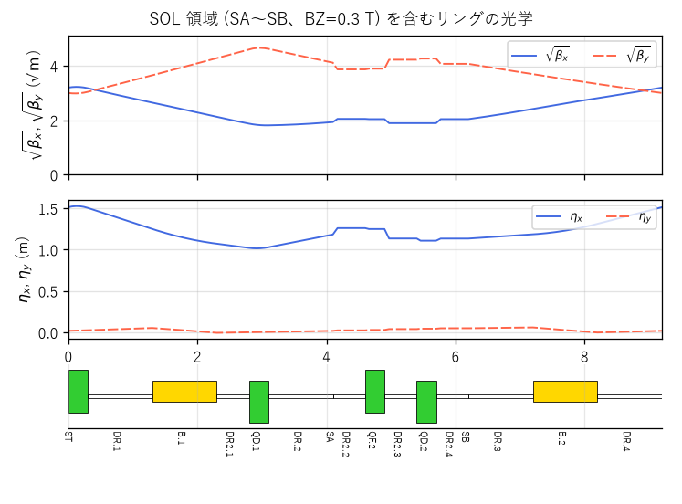

# 17. ソレノイド (SOL)

最終更新: 2026-11-23

**この文書で分かること**: ソレノイド領域 (SOL ... SOL) の置き方と、領域内で使える要素。Twiss (CALC)・Emittance[]・EMIT・追跡 (TrackParticles)・幾何 (S・GX・GZ) ・POL のスピンがそれぞれどこまで使えるか。物理、K64 の癖、k64 と v2 の違い、限界。
**前提**: SAD の台本の書き方 ([`docs/03_ffs_commands.md`](03_ffs_commands.md))、`CALC`・`Emittance[]` の基本 ([`docs/07_calc_optics.md`](07_calc_optics.md)、[`docs/09_emittance.md`](09_emittance.md))。
**読む順**: 1 (何ができるか) → 2 (領域の仕組みと最小例) → 3 (置ける要素) → 5 (k64 と v2 で領域内に置ける要素が違う) → 7 (限界)。実装の詳細は 8 (開発者向け)。

用語: **SOL 領域** = `BOUND=1` の SOL から次の `BOUND≠0` の SOL までの区間。**正準運動量** = px + (bz/2) y のように、ソレノイド内でベクトルポテンシャルを含む運動量 (力学的運動量との区別に注意)。**GEO** = SAD の幾何 (座標 S・GX・GZ) を決める印。

## 1. 何ができるか


| 機能 | 状況 | 実装 |
| --- | --- | --- |
| TrackParticles (RAD OFF/ON、FLUC) | 対応。k64 モード: DRIFT・QUAD のみ領域内に置ける。v2 モード: BEND・MULT・CAVI・APERT も (5.3) | `track6.py`、`track6n_ext.py` |
| CALC / INS の Twiss (CELL も) | 対応 | `solmap.py` |
| Emittance[] / EMIT (放射込み) | 対応 | `solemit.py` |
| 幾何 (S・GX・GZ・GCHI2・GCHI3) | 対応 (領域内に DRIFT・QUAD・SOL) | `sgeo.py` (tsgeo) |
| POL のスピン (Emittance[]・EMIT・追跡) | 対応 (k64 モード: 領域内は DRIFT・QUAD。v2 モード: 追跡のスピンは領域内の BEND・MULT・CAVI・ずれ・F1 も。Emittance[] の POL の量は k64 では領域内が K64 の式、v2 は運動量の向きで足す: B130) | [`docs/16_spin_pol.md`](16_spin_pol.md)、docs/16 の 5.3 節 |
| CALC6D、RADCOD つきの CALC | **対応 (両モード)**。k64 は gs と 1e-9 | `ffscmd._check_sol_optics`、`calc6d._turn` |
| Touschek (INTRA) との組み合わせ | **対応 (両モード)**。INTRA + SOL の Emittances は gs と εx・εy 2e-8、εz 9e-8 (相対)。TouschekLifetime は gs・pysad とも NaN (この条件で確認できず) | `touschek._tturne_intra` |
| 領域内の BEND・MULT・CAVI | k64 モード: 未対応。v2 モード: 対応 (5.3) | 5.2、5.3 |
| BOUND=0 で BZ≠0 の SOL (領域の外のソレノイド) の Twiss | 未対応 (NotImplementedError) | `solmap.annotate` |
| ずれ・傾き (DX DY DPX DPY DZ CHI) と F1 のある SOL の追跡・Twiss・Emittance[] | k64 モード: 未対応 (幾何だけ対応)。v2 モード: 対応 (5.3) | |

## 2. SOL 領域の仕組みと使い方


SAD の SOL は「ソレノイドの境界」を表す長さ 0 の要素である。

- `BOUND=1` の SOL を **対** で置く。最初の SOL から次の BOUND≠0 の SOL までが 1 つの領域。
- 領域の中は、BZ を持つソレノイド内の **正準運動量** (力学的運動量は `px + bz/2·y`、`py − bz/2·x`) で動き、横方向が結合する。
- BZ の単位は T。規格化した `bz = BZ / (p0/c)` が使われる (K64 の `tfbzs`)。BZ は領域の始端の SOL の値が領域に入り、領域内の SOL (BOUND=0、`SM = (L=0 BZ=0.8)` のような) は途中で BZ を変える。終端の SOL は BZ を 0 に戻す (pysad は終端の BZ を 0 として扱う)。
- 領域内の SOL の `DISFRIN=1` はフリンジなし。
- **GEO=1 は対の片方だけ** に付ける。両方に付けると K64 は ` Duplicated GEO of Solenoid` を出して領域を扱わない (pysad も同じ警告)。BOUND の対がないと ` Missing BOUND of Solenoid`。
- L は 0 にする (SOL 自体は長さを持たない)。領域の長さは中の DRIFT・QUAD の長さの和。

### 動く SAD スクリプト (最小例)


本文書 と [`pysad/tests/test_sol_optics.py`](../pysad/tests/test_sol_optics.py) の s1 と同じ。

```
MOMENTUM = 1.7GEV;
DRIFT DR = (L=1) DR2 = (L=0.5);
QUAD QF = (L=0.3 K1=0.3) QD = (L=0.3 K1=-0.25);
BEND B = (L=1 ANGLE=0.2);
SOL SA = (L=0 BZ=0.3 BOUND=1) SB = (L=0 BZ=0 BOUND=1);
MARK ST = ();
LINE BL = (ST QF DR B DR2 QD DR SA DR2 QF DR2 QD DR2 SB DR B DR);
FFS;
USE BL;
CELL; NORAD; NOFLUC;
CALC;
Print["TUN ", Twiss["NX", "$$$"]/(2 Pi), " ", Twiss["NY", "$$$"]/(2 Pi)];
Exit;
```

結果の意味: 1.7 GeV の電子では p0/c = 5.67 T·m なので、`BZ=0.3` T は規格化した bz = BZ/(p0/c) = 0.053 1/m の弱い場。この 1 セルのリングで (νx, νy) の端数は (0.2928, 0.1040) (k64・v2 とも同じ値)。領域の中では横方向が結合する (領域内の Twiss は正準運動量での値)。


BZ=0.3 T、1.7 GeV の領域である。ただしこの例は GEO=1 を付けていない (4 の K64 の癖。Twiss は GEO に影響されないが、S 座標を使う量は影響される)。実用では `SA = (L=0 BZ=0.3 BOUND=1 GEO=1)` とする。



図の読み方: 上の最小例のラティス (1.7 GeV、SA〜SB の間が BZ = 0.3 T の SOL 領域) の 1 周 (s = 0〜約 9.2 m) の光学。上段は √βx (青の実線)・√βy (橙の破線)、中段は ηx・ηy [m] (結合があるときの EX・EY はモード座標の分散。docs/07 §3)、下段はラティスで、SA と SB の間が SOL 領域。チューンの端数は (0.2928, 0.1040)。SOL 領域 (s ≈ 4.1〜5.8 m) の中では、曲線が階段状に描かれる (領域内の描画点の扱いは未確認)。

### 追跡と放射 + Emittance の例


`bench_level9.sad` (リング `RINGS`、2.5 GeV、`SB = (BZ=2 BOUND=1 GEO=1)`、`SE = (BZ=2 BOUND=1)`、領域内に `D1 QD`):

```
SOL   SB = (BZ=2 BOUND=1 GEO=1)  SE = (BZ=2 BOUND=1);
LINE CELLS0 = (ORG CA QF DQS SF DS B SB D1 QD SE DQS SD DS B D1);
...
USE RINGS; RFSW; CELL; CALC; emit;
NORAD;  b100 = TrackParticles[beam0, 1, 1, 100];
RAD; NOFLUC; b100 = TrackParticles[beam0, 1, 1, 100];
```

領域内の追跡は [`pysad/tests/test_track6n_ext.py`](../pysad/tests/test_track6n_ext.py) (`test_track6n_vs_track6`: SOL を含む格子で numba 版と Python 版が NORAD・RAD・FLUC とも座標 1e-13 以内、乱数の最終状態まで一致、`test_thin_mult_and_sol_not_ignored`、`test_apert_with_solenoid`)。
Emittance[] は [`pysad/tests/test_sol_emit.py`](../pysad/tests/test_sol_emit.py) (e1: 12 セルのリング、BZ=2、回転四極 QS、領域内の SOL SM、QFE の DX DY で軌道が領域を斜めに通る。RFSW)。幾何は [`test_sol_geo.py`](../pysad/tests/test_sol_geo.py)。

## 3. 領域内に置ける要素


| 要素 | 追跡・Twiss・Emittance | 備考 |
| --- | --- | --- |
| DRIFT | 対応 | bz≠0 では `tdrift_solenoid` (回転しながら進む) |
| QUAD (K1≠0) | 対応 | ずれ (DX DY)・F1・FRINGE なしの場合。ROTATE は可 |
| L=0 の要素 (MARK など) | 対応 (恒等) | |
| 領域内の SOL (BOUND=0) | 対応 | BZ の段差 (フリンジ `tsfrin`)。ずれ・回転・F1 なし |
| BEND | k64 モード: **未対応**。v2 モード: 対応 (5.3) | k64: 追跡では NotImplementedError、幾何では警告を出して直進扱い |
| MULT | k64 モード: **未対応**。v2 モード: 対応 (5.3) | k64: NotImplementedError (SADHelp は置けるとしているが k64 モードの pysad は未対応) |
| CAVI | k64 モード: **未対応**。v2 モード: 対応 (5.3) | k64: NotImplementedError |
| APERT | k64 モード: 未対応。v2 モード: 対応 (領域内の APERT で落ちる) | |
| SEXT・COORD・BEAMBEAM など上記以外 | 両モードで未対応 (v2: `SolRegionError` = K64 の tsol.f が出すはずの文 `Only DRIFT, BEND, … are supported within SOL`。K64 は SIGSEGV。B35) | |
| BEAMBEAM | 未対応 | K64 の tsol が SIGSEGV で落ちるので比較できない |

領域の外 (BZ=0) の要素は通常どおり。`bench_level9.sad` の冒頭コメントは SADHelp どおり「DRIFT・直線 BEND・QUAD・MULT」と書いているが、k64 モードで実際に動くのは上の表の範囲 (v2 モードは 5.3)。

## 4. 各機能の対応 (pysad の構成と K64 の対応)

### 4.1 追跡 (`track6.py`、`track6n_ext.py`)


K64 の `tsol.f` の直訳。`track6.py` の `_tsol_region` (Python)、`track6n_ext.py` の `compile_sol_region` と `K_SOL_FRIN`・`K_SOL_DRIFT`・`K_SOL_QUAD` (numba)。
RAD ON の四極は `tsolqur` (スライスを外側、粒子を内側、各スライスの後に全粒子 `tradk`)。スライス数は `ndiv = 1 + int(|L·hypot(K1·L/L, bz)|/eps)`、eps=0.2 (EPS 指定あり: 0.2×EPS)、RAD のときは `ndivrad` の大きい方 (上限 1000)。
numba 版で作れない要素 (領域内の BEAMBEAM など) は `NotImplementedError` で Python 版にフォールバックするが、損失の処理は Python 版にない。

### 4.2 Twiss (CALC / INS) (`solmap.py`、K64 の `tsole1`)


追跡と同じ numba カーネルを 1 粒子に使い、COD での **数値微分 (中心差分 1e-7)** を行列にする。K64 の `tsolque` の解析行列は写していない。
`CALC` のたびに `solmap.annotate` が領域内の要素に `_solmap` を付ける。領域内の Twiss の座標は領域内の正準運動量での値 (K64 の `tsole1` と同じ)。

### 4.3 Emittance[] / EMIT (`solemit.py`)


K64 の `tsole1` の放射の経路。写像は追跡カーネルの数値微分、放射は bz 付きの `emit6d._State.tradke(al, 0, bzh)`。要素ごとの対応は 本文書 の表。
`tradke` の bz 付き (正準運動量 → 力学的運動量、`bzhr0`、`dbeam` の `b=bzh/2` の項) は `perfkern.tradke_db` の `bzh`・`bzhr0` 引数。

### 4.4 CALC6D・RADCOD つきの CALC・Touschek (INTRA)

**両モードで対応** (gs に合わせた: gate なし)。SOL (BZ≠0 または BOUND≠0) を含む CALC6D と RADCOD つきの CALC は、`_check_sol_optics` が領域を annotate して通し、`calc6d._turn`・`touschek._tturne_intra` が領域内の要素 (`_solmap`) を `solemit.emit` で通す (`emit_extra` と同じ)。K64 は `qtwiss` の 4D が領域を `qsol` (`tsole1(.. enarad=.false.)`)、CALC6D が `qtwissfrac` の `tsole1(…, .true., .true.)`、INTRA の `tturne` が領域内の要素を `tsole1` で通す。
確認の例: 3 GeV、周長 45.8 m の 12 セルリング (BZ = 2 T の領域、回転四極、QFE の DX・DY) [`example/07_spin_solenoid_special/elem_SOL_calc6d_intra.sad`](../example/07_spin_solenoid_special/elem_SOL_calc6d_intra.sad) は、k64・v2 の両モードで完走する (2026-11-23 に実行して確認)。k64 モードは K64 (gs) と 1e-9 で一致 (数値は [`docs/history/17_sol_validation.md`](history/17_sol_validation.md))。v2 モードは RADCOD つきの CALC6D と INTRA の値が k64 と異なる (例: INTRA の εx は k64 で 2.706e-7、v2 で 2.787e-7。4D の CALC の νx の差は 4e-9)。差の原因は未確認 (v2 は K64 の誤りを直した動作で、違いの一覧は [`docs/28_v2_vs_k64.md`](28_v2_vs_k64.md))。
未確認: TouschekLifetime の値 (gs が NaN)、BOUND=0 の SOL (BZ≠0) の CALC (NotImplementedError)、RADTAPER + SOL、WSPAC・INTRA + SOL の併用の値。

### 4.5 幾何 (`sgeo.py`、K64 の `tsgeo.f`)


GEO≠0 の SOL (始端なら前向き、終端なら後ろ向き) の DX DY (位置) と DPX DPY (向き) から軌道を作り、領域内の DRIFT・QUAD・SOL を通して `geo`・`pos` を作る。
軌道が軸上 (DX DY DPX DPY が 0) のときは直進と同じ経路。`LINE["S"|"GX"|"GZ"|"GCHI2"|"GCHI3", k]` が gs と一致する (6)。
fit の `GX..` の解析微分 (`tdgeo`) は、k64 モードでは K64 と同じ領域の外の式 (`match6d.tdgeo_term`) で、領域内の変数の影響は入らない。v2 モードは領域内の変数を中心差分にする (5.3.3)。

`Solenoid` の DPX DPY DX DY DISFRIN DBZ を parser が読む (BZ BOUND GEO とあわせる)。`GEO` がない SOL 領域は K64 と同じ文面の警告 (` Missing GEO of Solenoid …`) を出して直進扱いにする (K64 は S 座標が途切れる: 5.2 の 2)。領域の幾何 (`tsgeo`) は DRIFT・QUAD・SOL について両モードで翻訳済み。領域内の BEND・MULT・CAVI・K1=0 の四極の軌道を追うのは v2 モードだけ。

## 5. k64 と v2 の違い・K64 の癖

利用者の結果に影響する違い: **k64 モードは領域内に DRIFT・QUAD・L=0 の要素・SOL だけ置ける (BEND・MULT・CAVI は NotImplementedError)。v2 モード (既定) は BEND・MULT・CAVI・APERT・K1=0 の四極、ずれて傾いたソレノイド (`DX DY DZ CHI1..3`・`F1`) も使える。** v2 の拡張は gs でなくローレンツ力の数値積分などで確かめた。

### 5.1 k64 と v2 の対応表


| 項目 | k64 モード | v2 モード |
| --- | --- | --- |
| 領域内の BEND | NotImplementedError (幾何は直進扱い) | 直線の座標のままの一様な双極磁場 (`ANGLE + K0`、`ROTATE + DROTATE`、RAD)。`K1`・`DX`・`DY` は NotImplementedError |
| 領域内の MULT | NotImplementedError | K0..Kn・SK0..SKn、`DX DY ROTATE`、端のフリンジ、RAD、`VOLT` (RFSW か TRPT) |
| 領域内の CAVI | NotImplementedError | `L VOLT PHI DX DY ROTATE`、端のフリンジ。TRPT の加速、wake、`AUTOPHI`。使えない: `V1 V20 V11 V02`、ANGLE≠0 の MULT |
| 領域内の APERT | NotImplementedError | 領域の外と同じ判定で落ちる |
| ずれ・傾き `DX DY DZ CHI1..3`、`F1` | 追跡・Twiss・Emittance[] は未対応 | 対応 (GEO=1 の SOL に `DX DY DPX DPY`、軸はソレノイドの軸、F1 は端の放射の長さ) |
| 領域内の K1=0 の四極・BEND・MULT・CAVI の幾何と、領域内の変数の `tdgeo` | 幾何は未対応。`tdgeo` は K64 と同じ領域の外の式 | 対応 (幾何は追跡と同じカーネル、fit の微分は中心差分) |
| CALC6D・RADCOD つきの CALC・Touschek (INTRA) | 対応 (k64 も gs と 1e-9) | 対応 (両モード同じ) |

v2 の領域内の BEND・MULT・CAVI の条件と確認の範囲: 電子、0.5〜3 GeV、bz = 0.3〜3 1/m、ローレンツ力の数値積分と 1e-14〜1e-8。gs との数値比較は無い。bz ≥ 3 1/m を超える場、領域内の MULT・CAVI の POL (Emittance[]) は確認済み (5.3 節。bz = 20 まで)。加速する CAVI の POL (Emittance[]) は未確認。領域内の四極の DX・DY (追跡・Emittance[]・幾何) は対応している (gs と全桁)。

### 5.2 K64 の癖


1. **SOL (BOUND≠0) の長さを周長に入れない**。周回周波数 (omega0)・空洞の位相・MomentumCompaction・偏極時間に効く。
   pysad は `emit6d._emit_circ` で同じにしている (追跡の `circ` もこれを使う)。PLANAR + SOL で周長 45.6 のときと偏極時間が 15 桁一致した ([`docs/history/work_unimpl.md`](history/work_unimpl.md))。
2. **GEO が無いと S 座標が途切れる**。K64 の `tsgeo` は ` Missing GEO of Solenoid` を出し、領域の S 座標がつながらない。MomentumCompaction が約 100 倍、偏極時間が約半分など、周長を使う量が狂う。
   pysad は同じ警告を出して直進扱い (つなぐ) にするので、**この狂いは再現しない**。参照の gs はすべて GEO=1 付きで作った。
3. **`tsolqur` の最後の半ステップ**: RAD ON の bz≠0 の四極では、スライスごとの `bzp = bz/(1+δ_i)` を粒子ごとに設定するが、最後の半ステップは再計算せず、**最後に `tzsetparams` を呼んだ粒子 (最後のスライスの最後の粒子) の bzp を全粒子に使う** (K64 `tsolqu.f:519-531`)。
   結果が粒子の並びに依存し、差は δ_i − δ_last に比例する。pysad の `tsolqu_bz_all` が再現している (`track6n_ext.py`)。RAD OFF の `tsolqu` は粒子ごとの値。bench_level9 の追跡で確認。
4. `dbeam(8)` が `beam(2)−beam(10)+b·beam(4)` と書かれている (力学的運動量の共分散なら `beam(9)` のはず): gs に合わせてそのまま写した ([`docs/30_sad_bug_report.md`](30_sad_bug_report.md) B39。bzh=0 では効かない。試験の ε は直しても全桁同じで、どちらが正しいかは決まらない)。
5. 領域内の軌道が 0 でも K64 は `itgetqraddiv` の下限 (pmin) で刻み数が増える。pysad も写している。
6. `tsolqum` (MULT 用) の z の dv 項は `tsolqu` と式が違う (SAD の不整合を再現。MULT の追跡の話で領域内ではない)。

### 5.3 v2 モードの SOL 領域


記録: [`docs/history/v2_changes_C.md`](history/v2_changes_C.md)・`v2_changes_C2.md`、試験 [`test_v2_C_sol.py`](../pysad/tests/test_v2_C_sol.py) (32)・[`test_v2_C2_sol.py`](../pysad/tests/test_v2_C2_sol.py) (11)・[`test_v2_C2_solrf.py`](../pysad/tests/test_v2_C2_solrf.py) (9)・[`test_v2_C2_spin.py`](../pysad/tests/test_v2_C2_spin.py) (17)。例 [`example/07_spin_solenoid_special/elem_SOL_region_elements.sad`](../example/07_spin_solenoid_special/elem_SOL_region_elements.sad)・`elem_SOL_tilt_offset.sad`・`elem_SOL_RF_TRPT.sad`・`spin_tracking_sol_und.sad`。
**根拠はローレンツ力 dp/ds = (p × B)/pz の数値積分 (scipy の solve_ivp、rtol 1e-13)・Thomas-BMT 方程式・実験室系の座標変換の合成・極限の一致で、gs との数値比較ではない** (gs は領域内の BEND の偏向をほぼ無視し、SOL + 四極 + RAD でも食い違う: 7 の 1・2)。条件: 電子、0.5・1・3 GeV、周長 91 m の FODO リングと 4〜6 m の輸送路、ソレノイド 1〜3 T (bz = 0.3〜3 1/m)、空洞 20〜200 MV (1.3 GHz)・4 MV (500 MHz)。**実機の大きなリングでは確かめていない。bz ≥ 3 1/m を超える場は未確認。**

#### 5.3.1 領域内の BEND・MULT・CAVI・APERT (B69、B35)

- **BEND**: `L`、`ANGLE + K0` (蹴りの大きさ)、`ROTATE + DROTATE` (向き)、`RAD`。**直線の座標のままの一様な双極磁場** (幾何は曲がらない。tsol.f の `tdrift(al, bzs, phiy, phix)`)。`K1`・`DX`・`DY` は NotImplementedError (四極成分は QUAD か MULT で)。
- **MULT**: K0..Kn と SK0..SKn、`DX DY ROTATE`、端のフリンジ (bz = 0 の式)、RAD、`VOLT` (RFSW か TRPT)。本体は「ソレノイド + 四極」か「ソレノイド + 双極」の厳密解 (K0 と K1 が両方あるときは四極の中心のずれとして厳密)、ほかの多極は薄い蹴り。
- **CAVI**: `L`、`VOLT`、`PHI`、`DX DY ROTATE`、端のフリンジ。Emittance[] では [ソレノイドのドリフト半分 → 薄い空洞 → 半分] に分ける。
- **APERT**: 領域の外と同じ判定で粒子が落ちる (LOSSMAP の要素は APERT)。
- 使える計算: 追跡 (高速追跡)、CALC (INS/CELL) の Twiss と閉軌道 (`solmap`: 追跡の写像の数値微分)、Emittance[]・EMIT (`solemit`)。
- 根拠の数値: ローレンツ力の積分と力学的運動量で、BEND・K0 だけの MULT 1e-14、K1 つき 1e-10、6 極・8 極・スキューは bz = 0 の MULT と同じ分割誤差 (1e-8、EPS で減る)。放射損失 (2/3) r_e γ³ (K0/L)² L が bz = 0・0.4・2 で 2e-4。bz → 0 の領域内の要素 = 領域の外の要素 (リングの Twiss・Emittance[] が 2e-7)。CALC の軌道 = 追跡 (1e-12)。bz = 3 T のリングで減衰率の和 = 2U0/E (2e-3)。
- 放射の注意 (K64 の癖。docs/30 B80): ソレノイド + 双極の中の放射 (tradk) は 1 刻みの前後の向きの変化 (弦) から損失を出すので、らせんの回転角 bz·L が大きいと小さく出る (相対 (bz·L)²/12。bz·L = 1 で 8%)。v2 の領域内の BEND・MULT は bz·L/ndiv ≤ 0.02 に刻む。
- **使えない (明確なエラー)**: `V1 V20 V11 V02` (CAVI の高次の項)、ANGLE≠0 の MULT、RF つき MULT の Emittance[] のうち bz = 0 の領域と領域の外 (従来どおり未対応)、SEXT・COORD・BEAMBEAM など (`SolRegionError`)、track6 の経路 (POL + RAD) での領域内の TRPT の加速 (v2.1.0 で領域の外の CAVI は実装したが領域内は SADError)。(CALC6D・RADCOD つきの CALC は v2.1.0 で対応。)
- **未確認**: 領域内の MULT・CAVI の POL (Emittance[])、RF つき MULT の RAD、領域内の空洞の wake の横の蹴りを gs と比べること、加速 + RAD の組み合わせ。

#### 5.3.2 領域内の空洞 (CAVI・RF つき MULT)

- **TRPT の加速**: `TRPT; RFSW;` で領域内の CAVI・VOLT≠0 の MULT が加速する。CALC (INS) の Twiss・軌道と `TrackParticles` に入る。`LINE["GAMMABETA", k]` が各位置の基準運動量。加速の後の領域の要素は、bz をその場所の運動量で規格化する (bz·p0(入口)/p0(その場所))。確かめた: 一様な縦電場 Ez = −(V/L) sin(ω(t − t_ref) + φ) と Bz の中の運動方程式を基準粒子と一緒に積分し、出口の運動量 1e-14、座標 5e-10 (20 MV)、3e-8 (200 MV: K64 の空洞の分割の精度)。CALC (TRPT) の軌道 = 追跡 (2e-9)。
- **wake**: `WakeFunction[Longitudinal|Transverse, "名前"] = {{z, w}, …}` (か旧式の `WAKE`) を領域内の CAVI・RF つき MULT に付けられる。wake が働くのは TRPT のとき。縦の wake によるエネルギー変化の合計は領域の外の同じ空洞と同じ (bz → 0 で 1e-6、BZ = 1 T でも)。横の蹴りの合計は 2% 以内 (gs との比較なし)。wake の重みの K64 の誤り (B84) は docs/13 §5.1。
- **AUTOPHI**: `CAVI … AUTOPHI=1` (MULT も)。空洞の位相 PHI + DPHI を、**設計軌道がその空洞に着く時刻** (Twiss の DZ) を基準に測る。追跡は直前の CALC の DZ を使う (CALC していなければ CALC してから)。TRPT の CALC では設計軌道がいつも公称の加速を受ける。リング (Emittance[]) では軌道が位相 PHI で通る (放射損失を補うには PHI を同期位相にする)。根拠: 設計軌道が DZ = 3 mm 早く着く輸送路で、AUTOPHI なしは DDP = 5.2e-4、ありは設計軌道の粒子の δ が 0 (CALC 1e-12、追跡 1e-9)。gs (TRPT、領域の外の空洞 2 台) の CALC の DZ・DDP と追跡が全桁一致 (v2 の定義 = K64 の TRPT の動作)。**AUTOPHI の意味は K64 のソースの読み** (SADHelp に説明がない)。リング (TRPT でない) の追跡の AUTOPHI は K64 と違う (K64 は位相の差が消える: docs/30 B85)。
- RF つき MULT の Emittance[]: bz≠0 の領域の中だけ対応 (領域内の CAVI の Emittance[] に端の RF のフリンジを足した。多極なしの RF MULT = CAVI が 1e-9、bz → 0 の領域内の CAVI = 領域の外のチューン 1e-8、K1・K2 つきは追跡の 1 周の行列の固有値とチューンが 3e-6)。

#### 5.3.3 ずれて傾いたソレノイド (`DX DY DZ CHI1..3`・`F1`)

```
SOL SA = (L=0 BZ=2 BOUND=1 GEO=1 DX=0.002 DY=-0.001 DPX=0.003 DPY=0.002 F1=0.1) SB = (L=0 BZ=0 BOUND=1 F1=0.1);
LINE … (… SA DS QS1 DV QS2 DS SB …);
```

- **GEO=1 の SOL** (領域の始端か終端のどちらか一方) に、設計軌道の位置 `DX DY` [m] と向き `DPX DPY` [rad] をソレノイドの系で書く。もう一方の SOL の DX DY DZ と両端の CHI1..3 は幾何 (tsgeo) が決める (利用者が書いた値は使わない。K64 も上書きする)。GEO が無い (か両端にある) 領域は、SOL に書いた `DX DY DZ CHI1 CHI2 CHI3` をそのまま座標変換に使う (K64 と同じ。設計軌道が閉じるかは利用者の責任)。
- 領域の中の要素 (DRIFT・QUAD・BEND・MULT・CAVI・SOL) の軸は **ソレノイドの軸**。領域の中の Twiss・軌道 (`Twiss["DX", …]`) はソレノイドの系の値。領域の外では設計軌道 = 0 のまま。領域の長さ (L の和) は軸に沿った長さで、設計軌道の行路長との差は出口の SOL の DZ に入る。
- **`F1`** (≠0) は端の放射に使う長さ。RAD のとき、端の前後の力学的運動量の向きの変化を長さ F1 の一様な偏向として放射させる (`RAD=1` を SOL に書くと放射しない)。Δδ = −(2/3) r_e γ³ (Δbz·r/2)²/F1 と、入口 1e-5、領域内の SOL・出口 1e-4、F1 を 2 倍で半分。リングの U0 の増分 (2.11 eV) が式と 2e-3。
- 追跡の入口と出口で trots (回転 + 新しい基準面までの直進 + ずれ) を行う。入口の z にも −dv·DZ を入れる (K64 は出口だけ。差は dv·DZ で 3 GeV では 1e-13 m 以下。docs/30 B86)。
- 使える: `TrackParticles` (高速追跡、POL + RAD のスピン追跡)、CALC (CELL・INS) の Twiss と軌道、Emittance[]・EMIT、幾何 (`LINE["GX"…]`)、幾何の fit、MEASURE。リング: CALC の閉軌道は領域の外で 0、中はソレノイドの系で。CALC のチューン = 追跡の 1 周の行列の固有値 (2e-7)、減衰率の和 = −2 U0/E (2e-3)、BZ → 0 なら SOL なしのリングと同じ (チューン 1e-6、ε 1e-5)。
- 根拠: 実験室系の合成 (幾何からソレノイドの面と軸を置き、[直進 → 端の蹴り → ローレンツ力の積分 → 蹴り → 直進])。ドリフトだけの領域で 2e-12、四極・BEND・MULT つきは 1e-8。設計軌道の粒子は出口で 0 (1e-13)。BZ = 0 なら入口と出口の変換が打ち消して直進と同じ (1e-14)。30 MeV (v≠c の z の項)。
- **領域の幾何 (tsgeo) と `tdgeo`**: 領域内の BEND・MULT・CAVI・K1=0 の四極も軌道を追う (追跡と同じカーネル。設計軌道の粒子が出口で 0 に戻る: 領域内に BEND + MULT で 1e-12、ほかの粒子はローレンツ力の積分と 1e-8)。fit の幾何の条件は、変数が領域の中にあると中心差分 (軌道の回転の変化が入る) で、GY・GZ が領域内の四極の K1・ドリフトの L で収束し目標に 1e-8。
- **使えない**: k64 モード (CALC6D・RADCOD つきの CALC は k64 も対応)。追跡を領域の途中から始める・途中で終える (`TrackParticles` の区間の端が領域の中: `ソレノイドの終端がない` のエラー)。領域より上流の幾何に軸まわりの回転 (GCHI3≠0) があるラティスで、追跡を先頭以外から始めた場合 (区間ごとに幾何を作るので CHI3 が入らない)。領域内の APERT のスピン追跡 (NotImplementedError)。領域内の四極の DX・DY のある POL の追跡 (track6) は NotImplementedError。領域内の光子は記録しない (乱数だけ K64 と同じに引く)。
- **未確認**: ソレノイドの軸が設計軌道と大きく (10 mrad 以上) ずれる場合、領域内の SOL (BOUND=0) にずれ・回転を書いた場合 (K64 は使わない。pysad も無視)、GEO のない領域に手で書いた CHI の符号の約束 (ソースの式どおりだが、gs と比べていない)。gs との数値比較は行っていない。

#### 5.3.4 スピン追跡と Emittance[] の POL

- スピン追跡 (`POL; RAD;`): 領域内の BEND・MULT・CAVI・SOL (ずれ・回転・F1 つき) で通る。写像は高速追跡のカーネル、放射とスピンの歳差は track6 の tradk (Python)。Thomas-BMT の積分と、DRIFT 5e-7、BEND 3e-6、BEND + bz 1e-5、QUAD + bz 3e-6、MULT (K0+K1) + bz 5e-5 (1 GeV、0.4 m)。B81〜B83 (bsi、領域内の四極の bsi と放射の基準、刻みの角) は docs/16 の 5.3 節。K64 の領域内の四極 (RAD) は、軸上の粒子のスピンの回転が (1+a) bz L の半分、軸外の放射損失が 2.2 倍になる誤りがあり、v2 は直した (k64 モードはそのまま)。
- **Emittance[]・EMIT の POL の量 (B130)**: k64 は領域の中が K64 の式のまま: 軸上のソレノイドでは追跡と 2e-5 で合うが、ずれて傾いたソレノイドではスピンチューンで 1.5e-4〜1.1e-3、n0 の向きで 2.5e-3〜1.5e-2 rad 違う (縦磁場の積分を z 軸の向きに足す)。**v2 は B⊥ と B∥ を運動量の向きに分けて足す**: SpinTune の追跡との差 1e-13〜5e-7、n0 の差 0〜1e-5 rad (傾き 3・10 mrad、ずれ 2・4 mm、BZ = 2 T・0.8 m の領域。小さな FODO・ASTRID2・MPW 入り・PF・大きなリング A)。回転した縦磁場の歳差の閉じた式と追跡が 5e-7 (傾き 1〜50 mrad・1〜3 T・0.3〜1 GeV)。領域内の DRIFT・QUAD の放射・スピンの刻みは bz·L/n ≤ 0.02 (DRIFT の刻みは追跡にも入れている: 追跡のスピンは Thomas-BMT の積分と bz = 4.5 で 2.3e-7、9 で 8.9e-7、らせんの放射損失が 1e-4)。使えない・未確認: bz ≥ 3 1/m の QUAD・MULT の D は 1e-4 台 (放射の分割が EPS 由来)、領域内の QUAD の端の ψ は追跡と同じ模型 (hard edge の Bs なし。軌道が数 mm の範囲で確認、cm のずれは未確認)、領域内の CAVI の POL (Emittance[]) は VOLT=0 だけ確認、領域の外の B∥ (垂直な軌道の傾きの中の偏向磁石の B_y y')。docs/16 の「傾いてずれたソレノイドの POL の量」。

#### 5.3.5 領域内の四極のずれ・bz ≥ 3・領域内の CAVI のスピン

試験 [`test_v2_B1_sol.py`](../pysad/tests/test_v2_B1_sol.py) (45 件)・[`test_v2_B3_geofit.py`](../pysad/tests/test_v2_B3_geofit.py)・[`test_v2_E_spinsol.py`](../pysad/tests/test_v2_E_spinsol.py)。記録 `history/v2next_B1.md`・`B3.md`・`E.md`。

- **領域内の四極の `DX`・`DY`** (両モード。gs と同じ): K64 の `tquad` は `tsolrot` で座標を (dx, dy) ずらす。ソレノイドの一様磁場のベクトルポテンシャルのゲージが変わるので正準運動量もずれる: x → x − dx、y → y − dy で px → px + (bz/2)dy、py → py − (bz/2)dx (出口は逆)。追跡のカーネル (`k_sol_quad`)・`solemit`・`sgeo` に入れた。gs と `LINE["GX"…]` が全桁一致 (領域内の DX・DY・ROTATE つきの 2 台)。**幾何の fit** (QF の DX、QD の DY で M2 の GY = 0.0008、GZ = −0.0035): gs と v2 (解析微分 `match6d.sol_dcod`: 要素の写像 c_out = F(c − t) + t、t = (DX, −(bz/2)DY, DY, (bz/2)DX) より d c_out/d DX = (I − J) ∂t/∂DX) は 2 回の Newton で収束し、QF DX = 2.78848432670e-3 (gs) / 2.78848432669e-3 (v2)、QD DY = 2.66798056318e-3 (両方)。解析微分は幾何の有限差分と 2e-3。K64 の CHI3 の微分の式は領域の終端で GCHI3 が 0 に戻される (tsgeo の `tfderotgeo`) ので幾何の変化と合わない (9e-4 を返すが幾何は動かない): CHI3 を使う fit は K64 でも収束しない (B124)。使える範囲: 領域内の四極 (K1≠0・F1=FRINGE=0)。SEXT・OCT・MULT は `_QDX_TYPES` に入れたが領域内のずれは未確認。四極の F1・FRINGE と領域内の BEND・MULT のずれは未対応。k64 モードは SOL 自体のずれ (trots) が未対応でずれた SOL の fit は使えない。例 [`example/03_matching/FFS_FIT_geometry_quad_dx.sad`](../example/03_matching/FFS_FIT_geometry_quad_dx.sad)。
- **bz ≥ 3 1/m** : 領域内の DRIFT・BEND・MULT (K0・K1・K2) の写像 (力学的運動量) がローレンツ力の積分と bz = 6・10・20 1/m で 1.2e-8 以内 (多極の分割 EPS の分)。放射損失 −(2/3) r_e γ³ (K0/L)² L が bz = 6・20 で 4e-5。**DRIFT の刻み** (v2): 領域内の DRIFT も BEND・MULT と同じく bz·al/ndiv ≤ 0.02 に刻む。1 刻みだと、軸を外れた粒子 (δ = 1e-3・−5e-3、0.4 m) のスピンが Thomas-BMT の積分と bz = 4.5 (0.1 GeV) で 1.5e-3、9 で 8.7e-3 (0.3 GeV の bz = 3 で 1.3e-4) ずれ、放射も bz = 9 で 1.7 倍外れる (`track6n_ext.k_sol_drift`・`track6._sol_drift_v2`。ndiv = 1 + int(\|bz·al\|/0.02)。刻んだ結果 2.3e-7・8.9e-7・4.5e-8、放射 1e-4)。k64 は 1 刻み (K64 のまま)。QUAD (K1 = 0.3、0.4 m) のスピンは bz = 4.5・9 で 2.0e-5・9.0e-5、MULT (K0 + K1) は 1.3e-4〜1.6e-4、BEND は 6e-7・9e-7 (放射の分割が EPS 由来で bz·al/ndiv ≤ 0.2 のため。v2 の既存の試験値を変えないため刻んでいない)。
- **POL の Emittance[] (MULT・CAVI)**: 平面リング (24 台の偏向磁石、0.5 GeV: aγ = 1.135、0.1 GeV: aγ = 0.227) の SOL 領域 (DRIFT・MULT (K1 = 0・0.05)・VOLT=0 の CAVI) の SpinTune が cos(μ/2) = cos(π ν0) cos(φ/2)、φ = (1+a) bz L と 1e-9 以内で一致 (bz = 0.6・4.5・9 1/m)。加速する CAVI の POL (Emittance[]) は未確認 (一周でエネルギーが元に戻る解析式は縦の運動を含む)。
- **加速 + RAD**: 領域内の RF つき MULT (TRPT、VOLT = 0〜100 MV、基準運動量 +0〜3.1%) の放射損失が −(2/3) r_e mc² (bz γ0² θ0)² L/E2 (θ0 = 1e-2、3 GeV、L = 0.5 m、bz = 3・9 1/m) と 1e-3 以内で一致 (加速しても損失は変わらない: 横運動量はソレノイドの縦磁場で変わらず曲率 κ ∝ p⊥/p² なので γ⁴κ² は一定)。
- **領域内の CAVI のスピン (B131)**: v2 は CAVI も放射・スピンの刻みに通す (K64 の `tsol` は CAVI を `krad = .false.` で呼ぶのでスピンが歳差しない。Thomas-BMT と 1e-9 台)。k64 は K64 のまま。
- **領域内の四極 (K1<0 の −90°、ROTATE) のスピンの座標系** (pysad の不具合。両モード): スピンの座標系を回す (track6 の `_tquad_sol`・`solemit._tquade`。K64 の `tsolrote` は `srot = rr·srot`)。k64 の Emittance[] の srot が gs と全桁一致 (BZ = 1 T、K1<0・ROTATE つきの四極)。
- **POL + TRPT の加速** (track6): SOL 領域の外の CAVI は v2 で実装。領域内は SADError (docs/16)。
#### 5.3.6 領域内の QUAD・MULT のスピンと光子 (試験 `test_v2_P4_sol_spin.py`・`test_v2_P4_sol_photons.py`)

- **領域内の QUAD・MULT のスピン (B146。v2)**: POL のとき領域内の QUAD を bz·al/ndiv ≤ 0.02 に刻む (Emittance[] の `solemit._tquade` と同じ。刻み bz·al/ndiv ≈ 0.2 だと弦の誤差で bz = 4.5・9 で 2e-5・9e-5)。端の縦磁場の積分 ψ (QUAD の k x y、MULT の k0 y + k1 x y + …) は端のフリンジを入れるとき (DISFRIN=0) だけ入れる (DISFRIN に関係なく足すと、MULT の K0 つきで 1.6e-4 ずれる)。Thomas-BMT の積分 (0.4 m、DISFRIN=1、軸上と軸を外れた粒子・3 つのスピンの向き) と bz = 0.3・3・4.5・9 1/m で **9.3e-7 以下**。D は追跡 1e-8・Emittance[] 2e-6、ASTRID2 (RF の前に BZ = 0.5 T・0.9 m の領域に QUAD・MULT) の Emittance[] の SpinTune が追跡の 1 周のスピン行列と 1.2e-7。領域内の CAVI (VOLT = 0・0.2 MV) の SpinTune は追跡と 1.6e-7 だが、位相 0 なので SpinTune がエネルギー変化にほぼ鈍い弱い試験。k64 は変えない。**未確認**: DISFRIN=0 の ψ を硬い端の B_s と軌道のフリンジ写像を合わせた厳密な基準で確かめていない、ずれ・ROTATE を持つ MULT の ψ、CAVI の加速・位相が 0 でないとき、大きなリング A・PF・8 GeV (0.1〜1 GeV・ASTRID2 までのリングで確認)。
- **領域内の光子 (B150。v2)**: RAD + FLUC + PHOTONS の TrackParticles で、領域内の DRIFT・QUAD・MULT (ANGLE=0) の光子を軌道上の位置に記録する (`track6._tsol_region_v2`)。3 GeV・BZ = 1 T の領域で、MULT (K0 = 0.01、L = 0.4 m) の放射点が放物線 x = (K0/2L) s² と 5e-7 以内、エネルギーの合計が 309 eV/粒子 (1500 粒子、古典値 285 eV、統計 8%)、RAD NOFLUC の損失が領域内と領域外 (bz = 1e-9) で 1e-17。gs は領域内の MULT・DRIFT を記録するが QUAD は記録せず (B150)、MULT の偏向をほぼ無視する (B69) ので位置・数は比べられない。k64 は K64 のまま。使える範囲: 3 GeV、bz = 0.1 1/m、傾き・ずれのない領域。**未対応・未確認**: 領域内の BEND・SEXT・OCT、傾いた・ずれた領域の光子の位置 (`geo_frac` が領域の軸の傾きで別の系になりうる)、偏光 ξ の値、大きなリング。
- **領域内の加速 (POL + TRPT)** は実装しない: 刻みごとの基準運動量 p0(s)・bz p0/p(s)・歳差の aγ(s) の作り直しが要り、RF の電場を含む運動方程式の積分の独立な基準が無い。実装するなら `sol_mult_full` の刻みで `_RadHook` が基準運動量を更新し `_tradk_sol` に p(s) を渡す。現状は明示のエラー (`test_pol_with_trpt_acceleration_is_an_explicit_error`)。


## 6. 検証

- K64 (gs) との比較 (k64 モード、領域内は DRIFT・QUAD・SOL): Twiss はチューン 1e-15、領域内の β・α・分散・結合 1e-11。Emittance[] は εx 2e-12〜4e-9、εy 4e-10〜2e-8、チューン 1e-11〜1e-13。幾何 (S・GX・GZ・GCHI2・GCHI3) は 18 要素で相対 1e-9。追跡は NORAD 5e-11 以下で、RAD は保存済みの参照に対して 1.5e-10 以下 (7 の 1 の注意)。
- 条件: GEO=1 を付けた SOL、エネルギー 1.7〜3 GeV (追跡は 2.5 GeV)、BZ 0.3〜5 T の範囲。これ以外 (低エネルギー、極端に大きい BZ) は未確認。
- v2 モードの拡張 (領域内の BEND・MULT・CAVI など) は gs との比較ではなく、ローレンツ力の数値積分・Thomas-BMT・極限の一致で確かめた (5.3)。
- 試験: `test_sol_optics.py` (4)、`test_sol_emit.py` (3)、`test_sol_geo.py`、`test_track6n_ext.py`、`test_v2_C_sol.py` ほか (5.3 に列挙)。
- 一致の表は [`docs/history/17_sol_validation.md`](history/17_sol_validation.md)。

## 7. 限界・未確認


1. **現在の gs と bench_level9 の保存値が SOL + 四極 + RAD で食い違う (どちらが正しいかは断定できないが、現在の gs が誤っている疑いが強い。ソースのどこかは未特定)**。
   `bench_level9.result` (gs、2026-10-14 の実行) の `S R T1 P1` の x は -0.0027867898 で pysad と一致する。現在の gs (2026-10-19 ビルド) は同じ入力で -0.0014539780 を返す。NORAD は両方で一致する。
   pysad は保存済みの参照 (と `tsolqur` の癖の読み) に合わせている。回帰の bench_level9 は保存値との比較で、現在の gs では一致しない。したがって **SOL (BZ≠0) 内の四極 + RAD の追跡は、現在の gs に対しては未確認**。SOL 領域内の四極のスピン追跡も同じ理由で未確認。
   **2026-11-16 の切り分け** (単一粒子の 1 周追跡、2.5 GeV、RAD NOFLUC、emit のあと、SOL の BZ を 0 から 0.01 T に変える):
   (a) 領域内がドリフトだけ (`SB D1 SE`): gs = pysad (BZ=0 も 0.01 も 9 桁以上)。
   (b) 領域内が四極 (`SB QD SE`): BZ=0 は gs = pysad。BZ=0.01 では gs が x=6.33e-4、y=−5.6e-16 (横の結合なし)、pysad は x=4.04e-4、y=1.1e-8 (連続)。
   (c) `SB D1 QD SE`、BZ=0.01: gs の結果が四極なしの `SB D1 SE` と 8 桁で一致する (x=1.194038e-4、px=−5.363477e-4)。**gs は RAD ON かつ BZ≠0 の領域内で四極の収束・発散力を入れていないように見える**。BZ=0.01 と 0.2 で gs の x はほぼ同じ (2.95e-5。BZ=0 は −2.23e-4) で、BZ に連続でない。
   (d) 現在の gs の 2 つのビルド (10-19 の Linux6 と、11-14 に -O0 で作り直した `~/sad_dbg`) は同じ値 (x=2.954816161E-5、10 桁一致) なので最適化の違いではなく、現在の K64 ソースから作った gs の振る舞い。10-15 の古い実行ファイルは symbol lookup error で動かず、保存済みの参照 (10-14) を出した版かは確認できない。
   結論: pysad が壊れているのではなく、現在の gs が SOL 領域内の四極 + RAD を物理的に誤って扱う疑いが強い (pysad は物理と保存済みの参照に合う)。ただし確証ではない。条件は 2.5 GeV、RAD NOFLUC、BZ は 0〜0.2 T の少数点のみ。
2. **領域内の BEND は k64 モードでは未対応** (v2 モードは 5.3 で実装した。ただし gs との比較ではなくローレンツ力の数値積分との一致)。K64 の `tsol.f` は双極キック付きの `tdrift(al, bzs, phiy, phix, …)` を呼ぶので直訳を試したが (`track6._tdrift_kick` を bz≠0 に一般化)、現在の gs は偏向をほぼ無視する (BZ=0.5 T の領域で ANGLE=0.1 でも位置・角度が 1e-5 しか変わらない。pysad の直訳は ANGLE × 距離だけ曲がる)。原因は未確認 (K0・ANGLE が領域内の BEND に入らない K64 側の癖かもしれない)。合わないので取り下げた。MULT・CAVI の領域内は未着手。
3. Emittance[] は SOL では `emit_extra` の規則 (Orbit・Matrix・BeamMatrices) を使わず `run_emit` の値に落ちる。EMT・TUN・ALP・COD は合うが **Stable は 0、HarmonicNumber は NaN、OneTurnTransferMatrix などの規則は出ない**。
   理由は `emit_extra`・`calc6d` が Python 版の `_tquade` を使い、軌道のある QUAD で gs と 1e-5 (ε_y 1e-4) ずれるため (SOL と無関係の既存の差。`emit6d.tturne` は gs と 1e-12)。
4. 行列が数値微分なので、解析行列の gs と 1e-10 程度の差が残る。
5. RADCOD の閉軌道探索中は K64 の `tsolque` が内部の分割の間でパラメータを固定するが、`solemit` は各スライスの δ で計算し直す (差は 1 スライスあたり 1e-9 程度で 2 次。未確認)。
6. QUAD の FRMD の向き (逆向きの LINE の `direlc<0` での入れ替え) は写していない。
7. SOL の DX DY DZ CHI1..3 と F1 は、k64 モードでは追跡 (numba・Python)・Twiss・Emittance[] で未対応 (tsconv の CHI を使う `tsrote`)。幾何だけ対応。v2 モードは 5.3。
8. 領域内の L=0 / K1=0 の四極の幾何は k64 モードでは未対応 (v2 モードは対応)。
9. k64 モードでは、領域内の MULT・BEND・CAVI の `tmulte1` は未翻訳 (NotImplementedError)。**`tsgeo` の領域幾何は DRIFT・QUAD・SOL について両モードで翻訳済み** (`sgeo.py`)。**CALC6D・Touschek (INTRA) は両モードとも対応** (4.4。ソースと、`example/07_spin_solenoid_special/elem_SOL_calc6d_intra.sad` を両モードで実行して確認した)。fit の幾何の解析微分 `tdgeo` の領域内の変数は、k64 モードでは K64 の `tdgeo` と同じ領域の外の式 (`match6d.tdgeo_term`) で、領域内の軌道の変化は入らない。v2 モードは領域内の変数に中心差分を使う (5.3.3)。
10. 上の一致の数値は、GEO=1 を付けた SOL (GEO 無しは S 座標が途切れる K64 の癖があり、pysad は再現しない。5.2)、エネルギー 1.7〜3 GeV (追跡は 2.5 GeV)、BZ は 0.3〜5 T の範囲だけで取った。これ以外 (低エネルギー、BZ が極端に大きい場合) は未確認。

11. GEO のある SOL でも、Emittance[] の周長は GEO の有無で変わらない (pysad は S 座標を途切れさせない。gs は GEO なしだと Emittance[] の αp が 100 倍以上になる)。参照の gs は GEO=1 で作った。K64 が SOL の長さを周長に入れない影響は、偏極時間で確認した。Twiss (CALC) だけの量 (チューンなど) への影響は未確認。
12. `solmap` の行列は数値微分なので、領域内の要素の Twiss の座標は領域内の正準運動量での値 (`tsole1` と同じ)。

## 8. 開発者向け: 実装の構成

- 追跡: `track6.py` の `_tsol_region` (Python)、`track6n_ext.py` の `compile_sol_region` と `K_SOL_FRIN`・`K_SOL_DRIFT`・`K_SOL_QUAD` (numba)。K64 の `tsol.f` の直訳。
- Twiss: [`pysad/solmap.py`](../pysad/solmap.py) (K64 の `tsole.f` の `tsole1`・`qsol`)。領域内の要素の写像は、追跡の numba カーネル (`K_SOL_FRIN` `K_SOL_DRIFT` `K_SOL_QUAD`) を 1 粒子に使い、COD での数値微分 (中心差分、1e-7) を行列にする。`tsolque` の解析行列は写していない。`CALC` のたびに `solmap.annotate` が領域内の要素に `_solmap` を付け、`_el_cod_step` と `transfer_matrix` (オフモーメンタム・線形の経路) が使う。
- Emittance[]・EMIT: [`pysad/solemit.py`](../pysad/solemit.py) (K64 の `tsole1` の放射の経路)。領域内の各要素を K64 の順に、写像は上と同じ追跡カーネルの数値微分、放射は bz 付きの `emit6d._State.tradke(al, 0, bzh)` で入れる。
- 幾何: [`pysad/sgeo.py`](../pysad/sgeo.py) (フリンジは `tsfrin1`、四極は `k_sol_quad` を 1 粒子に使う)。軌道が軸上のときは直進と同じ経路。

要素ごとの K64 と solemit の対応:


| 要素 | K64 | solemit |
| --- | --- | --- |
| DRIFT (bz≠0) | `tsetr0(bzs/2)` → `tdrife0` (`tsoldz`) → `tradke(al, 0, bzs/2)` | `tdrift_solenoid1` の数値微分 → `tradke` |
| QUAD | `tsolrote` → `tsetr0` → `tqfrie` → `tsetr0` → `tsolque` を `itgetqraddiv` 回 → `tqfrie` → `tsolrote` | 同じ順。`tsolque` は内部分割 (EPS×0.1) ごとに [半/全ドリフト + 本体] → `tradke` (最後以外)、最後に半ドリフト → `tradke` |
| SOL の端・領域内の SOL | `tsfrie` (F1=0 なので放射なし) | `tsfrin1` の数値微分 |

- `tradke` の bz 付き: 正準運動量 → 力学的運動量 (`px+bzh·y`、`py−bzh·x`)、前回の基準点の `bzhr0` (`_State.bzhr0`)、`tr2` と `tr1` の補正、
  `dbeam` の `b=bzh/2` の項 (`perfkern.tradke_db` の `bzh`, `bzhr0` 引数。bz=0 のときは従来と同じ)。
- K64 の `dbeam(8)` は `beam(2)-beam(10)+b*beam(4)` と書かれている (`B12 - B44 + b B13`)。力学的運動量の共分散なら `B34` のはずで、誤記に見えるが、gs と合わせるためそのまま写した (bzh=0 では効かない。`beam(9)` に直しても試験の ε は全桁同じで、どちらが正しいかは試験では決まらない。docs/30 B39)。
- 領域内の軌道が 0 でも K64 は `itgetqraddiv` の下限 (pmin) で刻み数が増える。写しているので同じ刻み数になる。

- 試験: [`test_sol_optics.py`](../pysad/tests/test_sol_optics.py)、[`test_sol_emit.py`](../pysad/tests/test_sol_emit.py)、[`test_sol_geo.py`](../pysad/tests/test_sol_geo.py)、[`test_track6n_ext.py`](../pysad/tests/test_track6n_ext.py)。

## 9. 関連文書

- [`docs/10_tracking.md`](10_tracking.md): `tsol` の追跡の式と実装の対応。
- [`docs/16_spin_pol.md`](16_spin_pol.md): POL のスピンと SOL。
- [`docs/13_wake.md`](13_wake.md): 領域内の空洞の wake。
- [`docs/30_sad_bug_report.md`](30_sad_bug_report.md): B39 (`dbeam(8)`)、B35、B69、B80 ほか。
- [`docs/history/work_unimpl.md`](history/work_unimpl.md): 未解決の差の記録。
