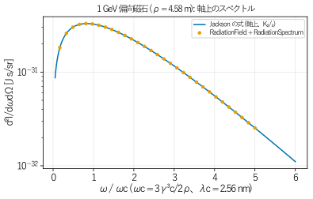

# 18. RADLIGHT と放射場 (RadiationField・RadiationSpectrum)

最終更新: 2026-11-23

**この文書で分かること**: 粒子の軌道を記録して、観測点での放射場とスペクトルを計算する一連の機能 (`RADLIGHT`、`RadiationField`、`RadiationSpectrum`) と、関連する `PHOTONS` (光子のリスト) の使い方、式、K64 との違い、限界。
**前提**: `TrackParticles` の基本 ([`docs/10_tracking.md`](10_tracking.md))、シンクロトロン放射の基礎 (Liénard-Wiechert の場)。
**読む順**: 1 (流れ) → 2 (動く台本) → 3 (式) → 5 (k64 は偏向磁石の中を記録しないので、v2 でないと意味のある場にならない) → 7 (限界)。実装の詳細は 8 (開発者向け)。

用語: **RADLIGHT** = 粒子の軌道 {t, x, y, z} を要素ごとに記録するスイッチ。**PhotonList** = 放射された光子 1 個ずつの位置・方向・偏光・エネルギーの表。**GEO 座標** = SAD の幾何の座標。

## 1. 何ができるか


流れは 3 段階である。

1. `RADLIGHT;` フラグを ON にして `TrackParticles` を呼ぶと、粒子の軌道 `{t, x, y, z}` (GEO 座標) が要素ごとに記録されて戻る。
2. `RadiationField[軌道, 観測点]` が、観測点での電場・磁場・ポインティングベクトルの時間変化を返す。
3. `RadiationSpectrum[{τ, f}, {λ1, λ2, dλ}]` が、場 f(τ) の cos・sin 積分 (スペクトルの係数) を返す。

| 機能 | 状況 | 実装 |
| --- | --- | --- |
| RADLIGHT フラグ、TrackParticles の戻り `{結果, 軌道}` | 対応。k64 モードは gs と差 0 (K64 の癖: 横方向なし・BEND の中なし)。v2 モードは 3 次元の軌道で BEND の中も記録 (5.2) | `ffscmd._RadLight`、`FFS.track_particles` 付近 |
| `RadiationField` | 対応 (gs がこのビルドで落ちるので gs 照合なし) | `radfield.radiation_field` |
| `RadiationSpectrum` | 対応 (gs と全桁一致。NPARA の fork 並列なし、逐次) | `radfield.radiation_spectrum` |
| PHOTONS と `PhotonList` | BEAMBEAM の光子に加え、**BEND・QUAD・MULT・SEXT・OCT・磁場つきドリフト・BEAMBEAM + BEND の光子** に対応 (4) | `beambeam.py`、`track6.py`、`ffscmd` |
| SOL 領域内の要素・COORD・TCAVI・MAP のあるラティスの光子 | 未対応 (SOL 領域内は、v2 が DRIFT・QUAD・MULT だけ記録する。BEND・SEXT・OCT と k64 は記録せず乱数だけ引く) | |

## 2. 使い方 (動く SAD スクリプト)

### 2.1 RADLIGHT フラグと TrackParticles の戻り


`RADLIGHT;` を ON にすると、`TrackParticles` は RAD と TRPT を ON にして追跡し (`rad = RAD or RADLIGHT`、`trpt = TRPT or RADLIGHT`)、戻りが変わる。

- 通常の戻り: `{ls または ld, {x, px, y, py, z, dp, flag}}` (flag は最後の行)。
- RADLIGHT のときの戻り: **`{{ls または ld, {x, px, y, py, z, dp, flag}}, 軌道}`**。ここで `軌道` は粒子ごとの表で、`軌道[[粒子, 1]]` が時刻の表、`[[粒子, 2]]`・`[[粒子, 3]]`・`[[粒子, 4]]` が GEO 座標の x・y・z の表。
- 従って、1 粒子の軌道は `TrackParticles[d, 10][[2, 1]]` (SAD 付属の Oide の例の使い方) で `{{t...}, {x...}, {y...}, {z...}}` になり、そのまま `RadiationField` の第 1 引数にできる。結果だけがほしいときは `[[1]]`。
- 高速追跡 (`TrackRun`) で扱えない要素の並びでは `SADError` (`RADLIGHT: この要素の並びは高速追跡 (TrackRun) で扱えない`)。

### 2.2 軌道の記録


[`pysad/tests/script_tests/test_radlight.py`](../pysad/tests/script_tests/test_radlight.py) の台本 (gs と差 0。1 GeV の電子、3 セルのリング、2 粒子、3 周)。

```
MOMENTUM = 1e9;
DRIFT D1 = (L=1) D2 = (L=0.5);
QUAD QF = (L=0.3 K1=0.7) QD = (L=0.3 K1=-0.6);
BEND B = (L=1.2 ANGLE=0.2617993877991494 E1=0.1308996938995747 E2=0.1308996938995747);
MARK ST = ();
LINE CELL1 = (QF D2 B D2 QD D1);
LINE RING = (ST 3*CELL1);
FFS;
USE RING;
CELL;
CALC;
RADLIGHT;
np=2;
x=Table[0,{7},{np}];
x[[1,2]]=1e-4;x[[3,2]]=-1e-4;x[[6,2]]=1e-3;
Do[x[[7,i]]=1,{i,np}];
d={3,x};
r=TrackParticles[d,9,1,2];
t=r[[2]];
Print["S1 ",t[[1,1]]];     (* 粒子 1 の時刻の表 *)
Print["S2 ",t[[1,2]]];     (* 粒子 1 の x の表 *)
Print["R ",r[[1,2]]];      (* 追跡の結果 *)
Exit;
```

結果の意味: `S1` は粒子 1 の記録点の時刻の表、`S2` は粒子 1 の軌道の第 2 行 (進行方向の距離。5.1 の 2)、`R` は追跡後の座標。記録点は要素ごと (BEND の中は記録されない: 5.1)。

### 2.3 放射場とスペクトル


SAD 付属の Oide の例の RADLIGHT の部分。偏向磁石を ANGLE=0 の「ステアリング」にして (K0=0.1)、BEND の中を記録しない K64 の仕様 (5.1) を避けている。

```
MOMENTUM=1e9;
scale=1e-15;
tw=1e-16;
B ANGLE 0
B K0 0.1
FindPeak[l_]:=Position[Abs[l],Max[Abs[l]]][1,1];
RADLIGHT
np=1;
x=Table[0,{7},{np}];
Do[x[7,i]=1,{i,np}];
d={1,x};
r=TrackParticles[d,10][2,1];
f=RadiationField[r,{7.9918,0.249792,0}];
p=FindPeak[-f[3]];
f[1]=f[1]-f[1,p];
s=RadiationSpectrum[{f[1],f[3]},{0.001,1,0.001}*3e-7];
```

これは格子 (USE 済み) の続きで書かれたスニペットで、1 本で完結しない。この流れ (B を `ANGLE=0 K0=0.1` の STEER にして 1 周、RADLIGHT → `RadiationField` → `FindPeak` → `RadiationSpectrum`) は pysad で最後まで通る (2026-11-16。軌道 8 点 {4,8}、f が {10,8}、ピーク位置 3、スペクトル {3,1001})。gs は `RadiationField` で SIGSEGV (B49) するので通しの比較はできない。軌道 (TrackParticles の戻り) の部分だけ gs と一致する。複数区間の軌道は 5.1 の 5 の限界に当たる。

## 3. 物理と式 (`pysad/radfield.py`)


### RadiationField[traj, obs]

`traj = {{t1..tm},{x1..xm},{y1..ym},{z1..zm}}`、`obs = {x, y, z}` (観測点、GEO 座標)。Feynman-Heaviside の式の時間領域の場
`E = (μ0 e CHARGE / 4π)(c² n/R² + R/c · d(c² n/R²)/dt + d²n/dt²)`。時間微分は自然スプライン (K64 の `spline`、y''/6) で求める。
電荷は大域変数 `CHARGE` (既定 −1)。

戻り: `{{τ..},{Ex..},{Ey..},{Ez..},{Hx..},{Hy..},{Hz..},{Sx..},{Sy..},{Sz..}}` (10 本の表。τ は遅延を補正した観測時間、H は n×E/Z0、S は E×H)。
引数は 2 個、第 1 引数は 4 本のリスト、第 2 引数は 3 成分でなければ `General::narg` / `General::wrongleng` のエラー。

### RadiationSpectrum[{τ, f}, {λ1, λ2, dλ}]

場 f(τ) を区分線形近似して cos・sin 積分を解析的に足す (`tlspect`)。k = 2π/λ を λ2 から λ1 まで `na = int((λ2−λ1)/dλ + 2.5)` 点で振り、戻りは `{{k..},{c..},{s..}}`。
スペクトル強度は `c² + s²`。K64 の `NPARA` による fork 並列は未実装 (逐次で計算)。

## 4. PHOTONS と光子


`PHOTONS;` を ON にすると、`TrackParticles` は光子のリストを作り、大域変数 `PhotonList` に入れる (K64 の `tphotonlist`)。要件と範囲は次のとおり。

- **RAD と FLUC が必要**。なければ `Track::photons:  PHTONS requires RAD & FULC in TrackParticles` (gs と同じ文面。綴りも同じ) で止まる。
- 光子の行は位置・方向・偏光・粒子番号・要素番号・エネルギー。
- **対応する要素 (両モード)**: BEND (K1=0: `tbend` の刻みごと、K1≠0: `tbendi` の刻みごと + 最後。ROTATE・DX・DY・DROTATE)、QUAD (`tquad`、`tsolqur` の刻み)、MULT (K0・K1・K2・DX・DY・ROTATE)、SEXT・OCT (DX・ROTATE)、磁場つきドリフト、BEAMBEAM (ビームストラールング)、BEAMBEAM + BEND (TRPT つきでも)。`tdusrnpl` (`tdusrn` と同じ乱数の引き方で光子ごとのエネルギーと位置も返す)・`radangle1` (放射角と偏光。`tgauss` を 2 回)・`tphrec` (放射点 xr = x − r(px − dpx r/2)al、`tphchge`・`tforbitgeo`・`tfgeofrac`) の直訳で、K64 と同じ乱数の順序・`pcvt%fr0` の進め方 (tbend.f:367、tbendi.f:141,178、tquad.f:71,108、tsolqu.f:453)。PhotonList の行 = [E (eV)、gx gy gz、ux uy uz、xi1 xi2 xi3、粒子番号、要素番号]。BEND・QUAD・MULT・SEXT・OCT があるラティスは Python の追跡 (`track6`) になり遅い (24 セルで 1 粒子 1 周 1 ms 程度)。
- **gs との照合 (k64 モード)**: 3 GeV、2 セル (K1=−0.05 の BEND に DX=1 mm・DY=−0.5 mm・DROTATE=2 mrad、ROTATE=15 度・DX・DY・DROTATE の BEND、普通の BEND、四極)、4 粒子、`SeedRandom[7]` で光子 358 個 (BEND 6 個で 62・57・67・61・40・70 と QUAD で 1) が、光子数・位置 (GX GY GZ 全桁)・方向余弦 (10 桁)・偏光 (10 桁)・粒子番号・要素番号まで一致 ([`example/07_spin_solenoid_special/flag_PHOTONS_bend.sad`](../example/07_spin_solenoid_special/flag_PHOTONS_bend.sad))。MULT・QUAD・BEND の 325 個 (K0・K1・K2・DX・DY・ROTATE つきの MULT、DX・ROTATE つきの SEXT・OCT。`flag_PHOTONS_mult.sad`) が全列一致 (E の最大 2.7e-14)。1.7 GeV・TRPT の BEAMBEAM + BEND + QUAD の 71 個 (BEAMBEAM 7、BEND 64) と追跡後の乱数の状態・座標の和まで一致 (BEAMBEAM の行の E は 2e-9。`flag_PHOTONS_beambeam_bend.sad`)。**E 列は K64 が γ でなく gammab = p/(mc) = βγ を掛ける** (相対 1/(2γ²)、3 GeV で 1.45e-8。B132) ので、k64 は p0、v2 は γ (h0) を掛ける。
- **偏光の xi1 (K64 の誤り。B123)**: `tphrec` の `c1 = (cost·ppx1 + sint·ppy1)/pp` は、すでに規格化した `ppx1 = ppx/pp`・`ppy1 = ppy/pp` をさらに pp (≈ 曲げ角、数 mrad) で割るので、K64 の xi1 は ±1 を超え 1e3〜1e6 (gs の PhotonList の 8 列目が −3735.37、−1.0015e6 など)。k64 は gs と同じ (全列一致)、**v2 は pp で割らない** (|xi1|、|xi3| ≤ 1、xi1² + xi2² + xi3² ≈ 1)。
- **解析式との照合 (v2)**: 24 セル FODO (3 GeV、ρ = 4.58 m、100 粒子 1 回通過、光子 58 221 個): 光子数 (5/(2√3)) α γ θ × 24 磁石 × 100 粒子 = 58 280 に対し −0.10% (Poisson の 1σ = 0.41%)、⟨u⟩/u_c = 8/(15√3) = 0.3079 に対し 0.3059 ± 0.0023 (u_c = (3/2) ħcγ³/ρ = 13 067 eV)、⟨u²⟩/u_c² = 11/27 = 0.4074 に対し 0.3986、スペクトル (3/(5π)) ∫_y^∞ K_{5/3} の KS 検定 (1% 点 1.63/√N) を通る、位置は円弧からの距離 2 mm 未満、方向は接線から rms 0.3〜3 /γ (u > 0.5 u_c)。SEXT (K2 = 40、DX = 1 cm: θ = ½K2 DX² = 2e-3)・OCT (K3 = 1.2e4: θ = K3 DX³/6)・MULT (K0 = 0.02) の光子数が 4σ 以内、⟨u⟩ が統計の範囲 (6000 粒子)。
- **使えない・未確認**: SOL 領域内の要素・磁場なしのドリフトの光子は記録しない (乱数だけ K64 と同じに引く。位置の情報 `tsetpcvt` を領域内の要素に足し、領域の座標系の `geo_frac` の使い方を確かめる必要)。COORD・TCAVI・MAP のあるラティスは高速追跡で、BEND があっても光子を記録しない。POL の追跡との併用は未確認。QUAD の光子の位置は gs と未照合 (BEND は全桁)。強い6 極・8 極で不安定になる条件。track6 の `_ndivrad` が TRPT の 10 倍を見る (POL・RADPOL・光子の追跡の TRPT の結果が gs に近い)。
- RADLIGHT の軌道と PhotonList は独立の機能で、RADLIGHT の軌道は光子の位置とは無関係 (放射場 `RadiationField` は軌道そのものから場を作る)。

## 5. k64 と v2 の違い・K64 の癖

利用者の結果に影響する違い: **k64 モードの軌道は BEND の中を記録せず、横方向の座標が入らない (K64 の仕様)。v2 モードは 3 次元の軌道で BEND の中も記録する。** 放射場を意味のある形で得るには v2 を使う (k64 では B を ANGLE=0 の STEER にする)。

### 5.1 K64 の癖 (tlinit / tlstore / tlresult。k64 モードの動作)


1. **BEND の中を記録しない**。記録するのは「区間 (`tturn`) の始め」と「L≠0 で型が CAVI より小さい要素 (BEND 以外) の後」だけ (K64 `tturn.f:555`)。
   `BEND` と曲げのある `MULT` (ANGLE≠0) は後も記録されないので、偏向磁石の円弧に沿った放射が軌跡の点列に入らない。意味のある放射場を得るには、Oide の例のように B を `ANGLE 0` にするなどの工夫が要る。
2. **横方向の座標が軌道に入らない**。`tlinit` が `geo0` の軸 1・2 を設定しない (common ブロックの初期値 0 のまま)。軌道に現れるのは進行方向 (geo の第 3 軸) に沿った点だけ (gs で確認)。試験の台本では 2 行目 (軌道の x) に 0.3, 0.8, 1.3 … と進行方向の距離が並び、3・4 行目 (y, z) の表はすべて 0 だった。進行方向は局所の第 3 軸で、大域では x に出る (2026-11-16 確認: `geo[0]=[[0,0,1,0],[-1,0,0,0],[0,-1,0,0]]` で局所 z 軸の大域成分は (1,0,0)。進行方向の距離は軌道の 2 行目に出る)。geo の向きが別なら出る行も変わる。
3. 位置は straight (`dphi=0`) の積み上げで、BEND で向きが変わらない。
4. 時刻は `t = gt − z/(v0·(1−dv+dvfs))`。点は粒子ごとに保持され、損失した粒子の扱いは未確認 (損失のない試験だけ)。
5. 同じ位置の点が 2 つ並ぶことがある (区間の始めの点と、直前の要素の後の点。試験の S2 で 7.8 が 2 回出る)。**複数区間 (複数周) の軌道では区間の始めの点が重なり (t が同じ点が 2 つ)、そのままでは `RadiationField` が `x must be strictly increasing sequence` で失敗する** (両モード: 完全に同じ点を除く。時刻が戻る・同じ時刻で位置が違う点は SADError)。gs は `RadiationField` が SIGSEGV するので比較できない。
6. `RadiationField` は **gs (この K64 ビルド) で SIGSEGV する** (どの引数でも。`tlcalc` の `loc_sad(ktfaddr(ka)-3,dl)` が不正な番地を指すとみられる。B49)。そのため `RadiationField` の gs 参照は取れていない。

### 5.2 v2 モードの軌道 (B65)


K64 の 5.1 の癖 1〜3 (BEND の中を記録しない、横方向の座標が入らない、BEND で向きが変わらない) は、v2 モードでは起きない。試験 [`test_v2_C_radlight.py`](../pysad/tests/script_tests/test_v2_C_radlight.py) (3 件)、例 [`example/07_spin_solenoid_special/flag_RADLIGHT_orbit_field.sad`](../example/07_spin_solenoid_special/flag_RADLIGHT_orbit_field.sad)。

- **横の軸を幾何から取る**: 軌道の x・y・z は幾何 (`LINE["GX"/"GY"/"GZ"]` と同じ GEO 座標)。振幅 0 の粒子の点は幾何と一致する (ROTATE つき・負の角を含む。1e-11)。時刻 = 行路長/(βc) (1e-9)。
- **BEND は円弧で進め、中も記録する**: tlstore の dphi≠0 の式で進め、1/γ の角度あたり `RADLIGHTDIV` 点 (既定 16) を記録する。`RADLIGHTDIV = n;` で変える。高いエネルギーでは点数が γ に比例して増える (3 GeV・0.26 rad の BEND で 2.5 万点)。曲げのある MULT は出口だけ、CAVI も記録する。
- 中の点は、状態の写しを刻んだ BEND で進めて作る (本当の追跡は要素全体を 1 回)。DX・DY・F1・FRINGE のある BEND は中の点だけ 1e-6 m 程度ずれる。
- **根拠**: 偏向磁石の放射場のピーク E = e β²/(4πε0 ρ R (1−β)²) (Liénard-Wiechert) と `RadiationField` が 0.25% (RADLIGHTDIV = 16)、5e-5 (64)。条件は 10.2 MeV (γ = 20) の電子。**gs との比較は無い** (gs は `RadiationField` で落ち、k64 モードの軌道は別物)。
- **使えない・未確認**: SOL 領域を含む区間 (SADError。両モード)、COORD による幾何の変化、曲げのある MULT の中の点 (出口だけ)。複数周の軌道の `RadiationField` は動く (重なった点を除く。k64・v2。`TrackParticles[d, 9, 1, 2]` の軌道 22 点・32814 点で場を返す)。高エネルギー・多数粒子の規模は未確認。

## 6. 検証

- 軌道の記録 (k64 モード) は K64 (gs) と差 0 (1 GeV、BEND を含む 3 セル、2 粒子、複数周)。`RadiationSpectrum` は gs と全桁一致。**`RadiationField` は gs が SIGSEGV で落ちる (B49) ので gs との比較は無い。**
- そこで `RadiationField` は独立な物理の計算と比べた (6.1)。gs の表は [`docs/history/18_radlight_validation.md`](history/18_radlight_validation.md)。

### 6.1 物理の検証 (独立な計算との比較)


注意: `RadiationField` は **gs と比べていない** (gs は SIGSEGV)。上の 6e-3 は物理の解析解との比較。**Liénard-Wiechert の厳密な数値計算と比べた** (独立な計算 [`pysad/tests/script_tests/_c3_indep.py`](../pysad/tests/script_tests/_c3_indep.py): 円弧・直線の軌道 (解析的な位置・速度・加速度) で、観測時刻 τ ごとに遅延時間 t' を `brentq` で解き、E = q/(4πε0)[(n−β)/(γ²(1−n·β)³R²) + n×((n−β)×β̇)/(c(1−n·β)³R)] を評価)。pysad の `RadiationField` は K64 の Feynman-Heaviside の式 (軌道の点列と自然スプラインの微分)。試験 [`test_v2_C3_radfield.py`](../pysad/tests/script_tests/test_v2_C3_radfield.py) (8 件)、例 [`example/07_spin_solenoid_special/fn_RadiationField_bend.sad`](../example/07_spin_solenoid_special/fn_RadiationField_bend.sad):

| 確かめたこと | 条件 | 結果 |
|---|---|---|
| 振幅・位相 (τ ごとの場の一致) | 電子 γ = 20、ρ = 1 m、弧 ±0.5 rad の接線 50 m。点 2001・4001・8001 | 主成分 (水平) の最大の差 / ピーク: 6.7e-5 → 1.7e-5 → 4.2e-6 (2 次収束)。全成分の差を全体の最大値で規格化して 2e-5 以内 (8001 点) |
| 振幅 (v2 の RADLIGHT の軌道) | 10.2 MeV、ρ = 1 m、BEND 0.4 rad、`RADLIGHTDIV` = 16・64、観測点 50 m | \|E\| の最大の差: 16 点で 2.6e-3、64 点で 1.6e-4 |
| スペクトル | 同、観測点 500 m。`RadiationSpectrum` の \|c + is\|² → d²I/dωdΩ | Jackson の式 (e²/4πε0)/(3π²c)(ωρ/c)²γ⁻⁴K²₂/₃(ωρ/3cγ³) と ω = 0.1〜2.6 ωc で 1% 以内 (実測 0.3%)。ピークの位置も ωc = 3γ³c/2ρ と一致 |
| 全エネルギー | 観測点を水平 ±0.5 rad の弧の接線方向に置き、垂直 ±0.3 rad (31 点)で ε0 c R² ∫\|E\|² dτ cosθ dθ | 偏向 1 rad あたり e²γ⁴β³/(6πε0ρ) (Larmor の式 × 弧の時間) と 1e-3 以内 (4e-4〜1e-3) |
| 複数セグメント | 直線・円弧 (+)・直線・円弧 (−) のシケイン、区間の境目の点を重ねた 6001 点 | 厳密な LW (2 つのパルス) と最大値の 1.5e-4。重なった点が除かれる |
| 1 GeV の RADLIGHT | BEND L = 1.2 m・ANGLE = 0.2618、8200 点、`RADLIGHTDIV` = 16、軸上のスペクトル、観測点 5 km (ω = 0.2〜5 ωc、λc = 2.56 nm) | Jackson の式と 4e-4 (ω によらず一定)。観測点が 50 m だと光源の大きさ ρ/γ に対し Fresnel 領域で 4.6% 小さい (物理) |

使える範囲: 電子の円運動・直線の軌道 (RADLIGHT の v2 の軌道)、点の間隔が 1/γ の角度あたり 16 点以上 (振幅 3e-3)、64 点で 2e-4。観測点はスペクトルの λ で Fraunhofer の距離 (≫ (ρ/γ)²/λ)。使えない・注意: k64 モードの軌道は BEND の中を記録しないので放射場が意味を持たない。軌道の点に位置・時刻のずれがあると、パルスの時間幅 ρ/(2γ³c) (1 GeV で 1e-18 s、位置 3e-10 m) の精度が要る (v2 の RADLIGHT の位置・時刻は 1e-13 m だが、RAD が ON のため軌道が放射で変わる (1 GeV の 1 台の偏向磁石で横方向に 8e-8 m): 同じ軌道を別の計算に渡すときは放射の効果が同じかを確認する)。



図の読み方: §6.1 の 1 GeV の BEND (L = 1.2 m、ANGLE = 0.2618、曲率半径 ρ = 4.58 m) を v2 の RADLIGHT で追跡した軌道 8200 点から、観測点 5 km (軸上) の場を `RadiationField`、スペクトルを `RadiationSpectrum` で求め、軸上の d²I/dωdΩ [J·s/sr] (縦軸、対数) を橙の点で描いた。横軸は ω/ωc (ωc = 3γ³c/2ρ、λc = 2.56 nm)。青の実線は Jackson の式 (K₂/₃ を使う)。ω = 0.2〜5 ωc で点と線の相対差は 5e-4 以内で、ピークは ω ≈ 0.8 ωc 付近にある。

## 7. 限界・未確認


- **RadiationField の gs 参照がない** (gs は SIGSEGV で落ちる。B49。引数を変えても再確認できず)。等速運動の解析解と、Liénard-Wiechert の厳密な数値 (6) との比較。K64 の式との照合は読みによる。
- **k64 モードでは BEND の中を記録しない**ので、そのままの BEND では放射場の主要な部分 (偏向の円弧) が入らない (K64 の仕様どおり。v2 モードは 5.2)。Oide の例の流れ (B を ANGLE=0、K0=0.1) は 1 周の軌道なら pysad で通る (2)。複数区間・複数周の軌道の `RadiationField` は動く (5.1 の 5)。gs は `RadiationField` で落ちるため通しの照合は無い。
- k64 モードでは横方向の座標が軌道に入らない (K64 の癖)。粒子の横位置のずれ (x、y) は軌道の x・y に反映されない (v2 モードは 5.2)。
- 損失した粒子の記録、ずれのある要素、RF 加速 (TRPT) 中の軌道の記録は未確認。試験は損失なしの条件だけ。
- `RadiationSpectrum` の NPARA の fork 並列は未実装 (逐次)。
- 試験の条件はエネルギー 1 GeV (RADLIGHT)、観測点は 1 点のみ。他のエネルギー、近接場・遠方場の使い分けは未確認。
- **SOL 領域内の光子 **: v2 は領域内の DRIFT・QUAD・MULT (ANGLE=0) の光子を軌道上の位置に記録する (docs/17 の「領域内の QUAD・MULT のスピンと光子」。3 GeV、bz = 0.1 1/m、傾き・ずれのない領域で確認)。領域内の BEND・SEXT・OCT・傾いた領域は記録しない。k64 は K64 のまま (領域内の QUAD は記録しない: B150)。
- PHOTONS の記録しない範囲は 4。`RadiationField` は Liénard-Wiechert の厳密な数値と合う (6)。gs の `RadiationField` は SIGSEGV で、ほかの引数の渡し方でも落ちる (B49。`fn_RadiationField_bend.gs.txt`)。

## 8. 開発者向け: 実装の構成

- K64 のソース: `tlinit.f` (`tlinit`、`tlstore`、`tlresult`、`tlcalc`、`tlspect`)。RADLIGHT の軌道は `tlinit` / `tlstore` / `tlresult` の直訳 (`ffscmd._RadLight`)。`RadiationField`・`RadiationSpectrum` は [`pysad/radfield.py`](../pysad/radfield.py) (`radiation_field`・`radiation_spectrum`)。
- `TrackParticles` は RADLIGHT のとき RAD・TRPT を ON にして追跡する (`rad = RAD or RADLIGHT`、`trpt = TRPT or RADLIGHT`)。`FFS.track_particles` 付近。高速追跡 (`TrackRun`) で扱えない並びは `SADError`。
- PHOTONS: `beambeam.py`、`track6.py`、`ffscmd`。tdusrnpl・radangle1・tphrec の直訳 (4)。
- v2 の軌道の独立な検証用の計算: [`pysad/tests/script_tests/_c3_indep.py`](../pysad/tests/script_tests/_c3_indep.py)。
- 試験: [`pysad/tests/script_tests/test_radlight.py`](../pysad/tests/script_tests/test_radlight.py) (1)、`test_radfield.py`、[`test_v2_C_radlight.py`](../pysad/tests/script_tests/test_v2_C_radlight.py) (3)、[`test_v2_C3_radfield.py`](../pysad/tests/script_tests/test_v2_C3_radfield.py) (8)。例 [`example/07_spin_solenoid_special/flag_RADLIGHT_orbit_field.sad`](../example/07_spin_solenoid_special/flag_RADLIGHT_orbit_field.sad)、[`example/07_spin_solenoid_special/fn_RadiationField_bend.sad`](../example/07_spin_solenoid_special/fn_RadiationField_bend.sad)。

## 9. 関連文書

- [`docs/14_beambeam.md`](14_beambeam.md): BEAMBEAM の光子 (PHOTONS)。
- [`docs/10_tracking.md`](10_tracking.md): TrackParticles、`tradk` の放射。
- [`docs/30_sad_bug_report.md`](30_sad_bug_report.md): B49 (RadiationField が gs で SIGSEGV)、B65、B123、B132、B150。
- [`docs/history/work_unimpl.md`](history/work_unimpl.md): RADLIGHT の作業記録。
