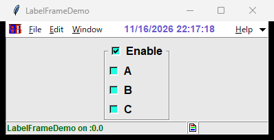

# Tcl/Tk の GUI (SAD の Tkinter.n / KBFrame.n を pysad で動かす)

この文書で分かること: SAD の GUI の台本 (窓、ボタン、入力欄、キャンバス、メニュー) を書き換えずに pysad で動かす仕組み、使い方 (環境変数)、使える部品、実装の構成、SAD の癖、確かめた範囲と限界。
前提: SADScript の基本 ([05_sadscript.md](05_sadscript.md))。Tk の知識は要らない。
読む順: 初めての人は 1 → 2 → 3 の順。実装を触る人は 4 以降。描画 (`ListPlot` など) の詳細は [21_graphics.md](21_graphics.md)。経緯は [`history/work_gui_tclbridge.md`](history/work_gui_tclbridge.md)。

用語: **Tcl/Tk** は GUI の部品と、それを動かすスクリプト言語。**tkinter** は Python が持つ Tk の窓口。**Tkinter.n / KBFrame.n** は SAD に付属する、Tk の部品を SADScript から使うためのパッケージ (`Packages/*.n`、SADScript で書かれている)。**ウィジェット** は窓の部品 (ボタンや入力欄)。**ウィジェット木** は窓の親子関係 (`winfo children` で辿れる)。**gs** は K64 (SAD のソース) から作った SAD の実行体。

## 1. 何ができるか・方針

- SAD の GUI 台本 (`w = Window[]`、`b = Button[w, Text->"Go", Command:>...]`、`KBMainFrame[...]`、`ListPlot[...]` など) が、そのまま動く。
- 方針は「GUI のコードを Python へ訳さない」こと。SAD が C / Fortran で持っているのは Tcl との接点 (`src/tfTkInter_.c`、`src/tfTclArg.f`、`src/tfXlib_.c`) だけで、`.n` のパッケージ (`Tkinter.n`、`TkinterCore.n`、`KBFrame.n`、`KBMainFrame.n`、`TabFrame.n`、`Canvas.n` ほか) は SADScript で書かれている。pysad はその接点だけを Python の tkinter (Tk 8.6) で作り、`.n` は SAD のまま pysad のインタプリタで解釈する。(リポジトリ直下 `CLAUDE.md` の「例外: GUI は書き直さず .n を解釈する」に当たる。)
- 層の構成:

```
SAD 台本 (Window[]、KBMainFrame[...]、ListPlot[...])
   │   Packages/*.n を pysad の SADScript インタプリタが解釈 (Class は sadclass.py)
   ▼
Tkinter.n / TkinterCore.n / KBFrame.n / Canvas.n   →  TclEval["..."] などの組み込み関数を呼ぶ
   ▼
pysad/tclbridge.py (Tcl/Tk の接点)、pysad/tkcanvas.py (キャンバス項目の作成)
   ▼
Python の tkinter (Tk 8.6) が窓を表示
```

対象のファイル: [`pysad/tclbridge.py`](../pysad/tclbridge.py)、[`pysad/tkcanvas.py`](../pysad/tkcanvas.py)、[`pysad/sadclass.py`](../pysad/sadclass.py)、[`pysad/sadscript.py`](../pysad/sadscript.py) / `sadlist.py` の言語機能。

## 2. 使い方

1. GUI を有効にする。**画面を勝手に開かないよう、`PYSAD_GUI=1` か `PYSAD_SAD_PACKAGES` のどちらかが無いと、GUI は何も有効にならない** (`TkWait[]` などは何もせず、`$DisplayFunction` は Identity)。`PYSAD_GUI=1` なら、pysad に同梱した SAD のコピー (`pysad/sad_copy/Packages` と `pysad/sad_copy/KBFrame`。出所は [`pysad/sad_copy/README.md`](../pysad/sad_copy/README.md)) を使うので、SAD を別に用意しなくてよい。別の SAD の `Packages` を使うときは `PYSAD_SAD_PACKAGES` にそのフォルダを指定する (最優先)。
2. 台本を `Interp` で走らせる。

```
set PYSAD_GUI=1
py -3.12 -c "from pysad.sadscript import Interp; I=Interp(); I.run(open('demo.sad').read(),'script')"
```

`Interp()` を作ると、`Tkinter.n` などの名前 (`Window`、`Button`、`KBMainFrame`、…) は `init.n` の `AutoLoad` と同じく、最初に使われたときに読み込まれる。

| 環境変数 | 意味 |
| --- | --- |
| `PYSAD_GUI` | `1` のとき、環境変数なしで同梱の SAD のコピーから GUI の接点を有効にする (`tclbridge.install` が働く)。無く `PYSAD_SAD_PACKAGES` も無ければ働かない |
| `PYSAD_SAD_PACKAGES` | 別の SAD の `Packages` (例: `<SAD のソース>/Packages`)。あれば最優先で使い、これがあるときも `tclbridge.install` が働く |
| `PYSAD_TK_NOLOOP=1` | `TkEventLoop[]` が 1 回 `update` して戻る (自動試験・ウィジェット木の比較用)。無ければ本物の mainloop (窓を閉じるまで戻らない) |
| `PYSAD_NO_DISPLAY=1` | `$DisplayFunction` を `Identity` にする。`ListPlot` などは窓を開かず `Graphics[...]` の式を返すだけ (`pkgload.py`)。Linux で `DISPLAY` が無いときも同じ |
| `PYSAD_TRACE=1` | パッケージの読み込み中に失敗した文を標準エラーに出す |
| `PYSAD_TRACE_TCL=1` | Tcl に送った命令を標準エラーに出す |

FFS から使うときは `FFS;` の後に同じ台本を書く (`run_sad_string` 経由。`ListPlot` の例は [21_graphics.md](21_graphics.md))。

## 3. 使える部品

次の表は、`Tkinter.n` の `Widgets` 一覧 (Tk の部品との対応) と、`KBFrame.n` / `TabFrame.n` の部品。

| SAD の部品 | Tk のクラス | 備考 |
| --- | --- | --- |
| `Frame`、`Window`、`LabelFrame` | Frame、Toplevel(`.`)、Labelframe | `Window[]` は最上位の窓 |
| `PanedWindow` | Panedwindow | |
| `TextLabel`、`Button`、`CheckButton`、`RadioButton` | Label、Button、Checkbutton、Radiobutton | `Command:>(...)` が押されたとき評価される |
| `MenuButton`、`Menu`、`OptionMenu` | Menubutton、Menu、optMenu.tcl | |
| `Entry`、`SpinBox` | Entry、Spinbox | `TextVariable:>変数` で変数と結ぶ |
| `ListBox` | Listbox | `ListVariable` |
| `Scale`、`ScrollBar` | Scale、Scrollbar | |
| `Canvas` | Canvas | 描画は `tkcanvas.py` ([21_graphics.md](21_graphics.md)) |
| `TextEditor`、`TextMessage` | Text、Message | |
| `Pack`、`Grid`、`Place` | 配置 | オプションは `Side`、`Fill`、`Expand`、`Row`、`Column` など |
| `KBMainFrame`、`KBFrame`、`KBSubFrame`、`KBDialogFrame`、`KBFComponentFrame`、`KBFGroup`、`KBFCheckButton`、`KBFHook`、`KBFFrameToggled`、`KBFFrameTabed`、`KBFTabFrame` ほか | 上の部品の組み合わせ | KEK の標準の枠 (メニューバー、状態行、時計) |

### 3.1 動く SAD スクリプト例

下は試験 ([`pysad/tests/script_tests/test_tclbridge.py`](../pysad/tests/script_tests/test_tclbridge.py)) にある台本。`Interp()` に `run(src, 'script')` で渡す。

簡単な部品 (4 個。Window、Button、CheckButton、TextLabel):

```
w = Window[];
b = Button[w, Text->"Hi"];
c = CheckButton[w, Text->"Chk"];
l = TextLabel[w, Text->"Lab"];
TclEval["update"];
info = TclEval["set r {}; foreach c [winfo children .] {lappend r [winfo class $c] [$c cget -text]}; return $r", String];
```
`info` は `Button Hi Checkbutton Chk Label Lab` になる (SAD の gs と一致)。

メインフレーム (メニューバー付き):

```
mf = KBMainFrame["TkTest", f, Title->"Test"];
TclEval["update"];
```
`.` の下に Menubutton 6 個 (KEK、File、Edit、Window、Task、Help)、仕切り、時計の Label ができる。

LabelFrame のラベルにチェックボタンを埋め込む入れ子の部品:

```
w = KBMainFrame["LabelFrameDemo", f, Title->"LabelFrame Demo"];
cb[0] = CheckButton[Text->"Enable", Variable:>cbv[0],
  Command:>(Scan[(cb[#][State] = If[cbv[0], "normal", "disabled"])&, Range[3]])];
cf = KBFComponentFrame[f, Add->{
  KBFHook[Command:>(cbv[0] = True)],
  KBFGroup[WidgetOption->{LabelWidget->cb[0]}],
  KBFCheckButton[Text->"A", Variable:>cbv[1], WidgetVariable:>cb[1]],
  KBFCheckButton[Text->"B", Variable:>cbv[2], WidgetVariable:>cb[2]],
  KBFCheckButton[Text->"C", Variable:>cbv[3], WidgetVariable:>cb[3]]}];
TclEval["update"];
```
Checkbutton 4 個、Labelframe 2 個、Menubutton 6 個ができる (SAD と一致)。



図の読み方: 上の台本の実行結果の窓。KBMainFrame の標準の枠 (メニューバー File・Edit・Window・Help、時計、下の状態行) の中に、ラベルがチェックボタン (Enable) になった LabelFrame と、その中の A・B・C のチェックボタンが入る。Enable がオンのとき A・B・C が使える (`KBFHook` が最初にオンにする)。時計は実行時の時刻。

描画 ([`test_plot.py`](../pysad/tests/script_tests/test_plot.py)。キャンバスに 43 項目、gs と全部一致):

```
FFS;
g=ListPlot[{1,4,9,16},PlotJoined->True];     (* 窓が開く。戻り値は Graphics[...] *)
h=Plot[Sin[x],{x,0,6}];
```

2026-11-16 に追加で動かして確かめた最小の例 (試験には入れていない。ウィジェットが作られ、`Command` が評価されるまで):

```
w = Window[];
ev = "abc";
e = Entry[w, TextVariable:>ev];
b = Button[w, Text->"Go", Command:>(n = 5)];
Scan[Pack, {e, b}];
TclEval["update"];
(* Tcl 側から押す: b を invoke すると n = 5 になった *)
```
同様に `Entry`、`ListBox`、`Scale`、`RadioButton`、`Canvas`、`TextEditor` を `Window` の下に作り `Pack` すると、`winfo children .` が `Entry Listbox Scale Radiobutton Canvas Text Button` の順に返った (エラーなし)。
ウィジェットへの操作は `TclEval["... "]` で Tk の命令を直接送る形でも、`e[Insert]={"end","XY"}` (Entry・ListBox) の形でも書く (後者は `Tkinter.n` の定義)。Insert の位置は Tcl の添字なので **小文字の `"end"`** を使う。大文字の `"End"` は gs で Tcl エラー 1501 になる。
`e=Entry[w]` のあと `e` は gs と同じく `Widget[e,Entry[w]]` を値に持ち (`Head[e]=Widget`、`w=Window[]` も同様)、`e[Insert]={"end","XY"}`・`lb[Insert]=…`・`e[Get]`・`e[Delete]` が効く (Entry の内容 abc→abcXY、Listbox 2 項目、gs と一致)。

- 仕組み (開発者向け): `DefineWidget` の `(a$_=w[opt$___])^:=(a$=w[Widget[Root$Window,Null],opt$])` が、次の規則 `(a$$_=w[Widget[master$_,_],opt$___])^:=With[{a$=a$$,…},…]` を呼ぶ入れ子になっている。このとき `With` は、呼び出し元の規則の引数 `a$` (ユーザーの `w`) を見つけ、`a$` でなく `w` を束縛しがちである。`sadscript._with` は、この探索を別の規則 (関数) の呼び出しの境界 (`boundary` の frame) で止める。探索を止めないと、本体の `a$:=Widget[a$,…]` が別の名前に付いて、ユーザーの `w` に遅延した値が付かない。
- `Canvas$Widget = c1` (`Canvas.n` の UpValue) は、左辺の記号が最初の使用で読み込みの引き金になり、UpValue の照合で、遅延した定義 (`The$CanvasObject := …`) を持つ記号を評価しない。教材の台本の `Canvas$Widget=c1` で tclerror が出ず、窓の Canvas に 114 項目 (再描画後 115) で gs と同じ。
- **残る差**: gs は `Window[]` の最初が Toplevel (`.5`) で、`.` には K64 起動時の「Return to SAD」ボタンがある。pysad は最初の `Window[]` が `.` (root) そのもの (`TkPathName[w]` が `.`、Entry は `.3`)。このためウィジェットの木に Button と Toplevel の 2 段が無く、`TextVariable` の変数名の番号 (`s6tv_8` 対 `s2tv_4`) も違う。

### 3.2 試験の台本の探し方

- [`pysad/tests/script_tests/test_tclbridge.py`](../pysad/tests/script_tests/test_tclbridge.py) (7 本): Tk の版と `$FontSystem`、簡単な部品、`KBMainFrame` のメニューバー、`KBFComponentFrame`、`Entry`・`ListBox` の Widget 値とメソッド、`Canvas$Widget` の UpValue。
- [`pysad/tests/script_tests/test_gui_lang.py`](../pysad/tests/script_tests/test_gui_lang.py) (10 本): GUI を使わない言語機能 (`Sym::tag`、`f@@[x,{1}]`、`Null[]`、`0x33`、UpValue、SubValue、Hold 属性、`Difference`、`SwitchCases`、`StringFill`、`BaseForm` など)。`PYSAD_SAD_PACKAGES` が無くても走る。
- [`pysad/tests/script_tests/test_sadclass.py`](../pysad/tests/script_tests/test_sadclass.py) (16 本): `Class` (§5)。
- [`pysad/tests/script_tests/test_plot.py`](../pysad/tests/script_tests/test_plot.py) (8 本): `ListPlot`、`OpticsPlot`、`HistoPlot`、`ListContourPlot`、`FitPlot`、`Plot`、`GeometryPlot`、`FitGaussian` のキャンバス。

## 4. 実装の構成

### 4.1 `pysad/tclbridge.py` (接点)

- `TclCreateInterp`、`Tcl` / `TclEval`、`TclSetResult`、`TclArg` / `TclArg1`、`TkEventLoop` / `TkQuitEventLoop`、`TkDefineBitmap`。Tcl のコマンド `sadeval` / `sadcommand` を tkinter の `createcommand` で登録し、Tk のイベント (ボタン、メニュー) から SAD の式を呼ぶ。
- `TclArg` は `tfTclArg.f` の `tftclarggen` と同じ規則 (規則 `a->b` はラベルと値、リストは `{}`、`Widget[...]` はパス名、`String[...]` はそのまま)。SAD が手を入れた Tk にしか無い `-scriptfont`、`-altfont`、`-altscriptfont` は標準の Tk に無いので送らない。
- 実数を Tcl に渡すときは `$FORM` に左右されず、整数なら整数 (Tk の `-width` や `after` は整数を要求する)、それ以外は最短の表記。`$FORM = "6.2"` の台本でも `1001.` にならないよう、`StandardForm` の中で評価する。
- Xlib の関数 (`XQueryTree`、`XInternAtom` など) は「他のアプリは見つからない」と答える空の実装 (Windows の tkinter には X のウィンドウ木が無い)。
- SAD の既定値: X11 のフォント名 (`$DefaultSansSerifFont` = "helvetica neue"、serif = "utopia"、fixed = "courier"、…、WSL の gs で実測)、`$FontSystem` = "X11"、`ReturnToSAD` = 0、`KBF$ConfDir` = `<SAD>/KBFrame` (`share/KBFrame` が無いソース配布のとき)。
- Windows の Tcl はまれに起動直後の初期化 (tk.tcl の探索) に失敗するので、`tkinter.Tk()` は数回やり直す。
- EPICS (`CaGet`、`CaPut`、`CaMonitor` …) と `System[]` は実行しない。サンプルを動かすときは、複製の中でこれらの呼び出しを `$off` の名前に替えて無効にする。原本は書き換えない。
- 窓の更新は `TclEval["update"]`。台本の最後の `TkEventLoop[]` は、`PYSAD_TK_NOLOOP=1` なら 1 回の `update` で戻る。

### 4.2 `pysad/tkcanvas.py` (キャンバス)

`Canvas.n` が使う `TkCanvas*` (`TkCanvasGetTypes`・`TkCanvasPointer`・`TkCanvasCreateItem(Direct)`・`TkCanvasLastItem`・`TkCanvasFindEnclosed`)、`CanvasClipLine`・`CanvasSymbolDirect` (`tfcanvasclip.f`) を実装。K64 は Tk の内部構造を C で直接たたくが、pysad は tkinter の Tcl に `create` を送る。`TkDefineBitmap` は Windows の Tcl が名前つきビットマップを登録できないので XBM ファイルに書き、`-stipple` の名前を `@ファイル` に替える。詳しくは [21_graphics.md](21_graphics.md)。

### 4.3 SADScript の言語機能 (`sadscript.py`、`sadlist.py`、`sadclass.py`)

`Tkinter.n`・`KBFrame.n` を動かすために、K64 の実測と SADHelp に合わせて次の機能を実装している。試験は [`test_gui_lang.py`](../pysad/tests/script_tests/test_gui_lang.py) と [`test_sadclass.py`](../pysad/tests/script_tests/test_sadclass.py)。

- 式: `Sym::tag`、`f@@[x, {1}]`、`Null[]` と `Null[a, b]` と `Null@@list` (引数列として展開。SAD では Sequence = Null)、`0x33`、n 項の `<=>` と `===`、空の右辺の規則 `x->`、`a@b` (クラスのメンバー参照。右は記号だけ、`x@m[args]` は `(x@m)[args]`。インスタンスでなければ `f@g[x]` = `f[g[x]]` のまま)。
- 代入: UpValue (`(w_ = f[...]) ^:= …`、Set / SetDelayed の UpValue)、SubValue (`f[a][b]`、3 段の `f[a][b][c]` まで)、`a/:f[a, x] := …` (TagSet)、`f[x] = v` の値は v、`Unevaluated$[x]` を引数にすると変数 x そのもの (名前) を渡して関数の中の `i++` や `w[i] = …` が呼び出し側の x に届く、局所変数への代入で同名の大域変数の定義を消さない。
- 評価の規則: 保持属性 (HoldAll / HoldFirst / HoldRest) の引数に対する置き換え (関数の引数・With の変数を、その時点の値で定義へ埋め込む。内側の With / Module / Function / パターン変数が同じ名前を束縛し直したときは置き換えない)、`With[{a=1; b=2, c}, …]` (宣言の中の `;`、`{c}` は現在値)、`WithPriority` / `Priority` (先頭に定義を置く)、定義の並び (リテラル > 構造パターン > 型つき Blank・Alternatives > 素の Blank の順に試す)、`And` / `Or` の短絡評価、`Hold[x]` が x を評価しない、遅延した値を持つ変数が `f[x]` の `f` に来たとき (`fr := Widget[fr, …]` の `fr[Background]`) の適用。
- パターン: 構造パターン (`wid_[master_, opt___]`、`(Rule|RuleDelayed)[Options[w], _]`)、Rule オブジェクトとの照合 (`Rule[_String, _]`)、変数が持つパターン (`Switch[val, types, …]` の types)、型つき Blank、評価されていない `{x, y}` との照合、パターンを含む規則の `ReplaceAll` (`{x_->_, y_} :> …`)。`a:>b` の b は `ReplaceAll` でも評価しない。
- 関数: `Difference`、`SwitchCases` (リスト以外の式の引数も)、`StringFill`、`Symbol`、`Second` / `Third`、`BaseForm`、`Names`、`RGBColor` (`#RRGGBB`、tfloor.f と同じ丸め)、`StandardForm[expr]` (評価の間だけ `$FORM` を既定の書式にする)、`Reverse[a->b]`、`Union` (同じ頭の式どうし)、`Extract` (規則の中)、`l[[, 2]]` (空の添字は全要素)、`DateString[]` は SAD と同じ `mm/dd/yyyy hh:mm:ss`、`ToLowerCase` / `ToUpperCase` は文字列以外をそのまま返す。
- Python の `TypeError` / `AttributeError` が組み込み関数から漏れたときは、SAD の式のエラー (`General::wrongtype`) にして止める。

## 5. Class (sadclass.py)

SADHelp の「Class」の節に沿った実装。`Class[親の列, クラス変数, インスタンス変数, メソッド…]`、`x = c[引数]` (規則 `a->1` はメンバーの初期値、他の規則は `Options`)、`Constructor` / `Destructor` (`x=.` で呼ぶ)、`x@メンバー`、`x@メソッド[引数]`、`x@メンバー = 値`、`This`、親クラスの継承 (子の同じ形の定義が親のものを置き換える)、`x = c1` の複写 (同じインスタンス)。
「メンバーが出てきたら `This@メンバー` と読む」という規則は、メンバーの記号をインスタンスごとに一意な記号 (`c$i12`) に置き換えて実現している。メソッドの本体は普通の関数として評価され、ウィジェットの生成 (`c = Canvas[...]`) や `coords[0] = …` のように記号に定義を付ける処理も、そのままインスタンスごとの記号に対して働く。
未対応: `親` メンバーの書き方、上位値 (`h_[f_[arg___], b___] ^:= g`) の形のメソッド、`Members[]` / `Parents[]` などの問い合わせ。

## 6. K64 の癖

pysad が合わせた K64 の挙動。

- SAD の Tk は改造版。`-scriptfont`・`-altfont`・`-altscriptfont` (ウィジェット全般) と、text 項目の `-usebg` は標準の Tk に無いので、pysad は送らない/落とす (文字の背景は塗らない)。
- 既定のフォント名は X11 のもの (`$DefaultSansSerifFont` = "helvetica neue" など、`$FontSystem` = "X11")。Windows の Tk と見た目が違う。
- `Tkinter.n` の `FontSubstitute$X11` に `Returun[...]` の綴りの誤りがあり、「フォント表が見つからない」ときの早期復帰が効かない (結果は変わらない)。
- SAD の `Sequence` は `Null`。`Null@@list` を引数列として展開しないと `-bg` などのオプションが消える。
- `KBMainFrame` の Menubutton は 6 個 (7 ではない)。`KBF$ConfDir` はソース配布に `share/KBFrame` が無いので `<SAD>/KBFrame` に落とす。
- ビットマップは XBM 形式の改行位置を守らないと `Image` が置換されず `DeleteImage` が再帰する。
- 値が `Null` の規則 (`Fill->Null`) は Tk の項目に渡さない。gs は既定の色 (X11 で `#000000`) になり、Windows の Tk では `SystemButtonText` になる (色の違い)。
- Tk の `create` が失敗しても SAD は `???Tkinter::tclerror: ...` のメッセージだけで `Null` を返して続ける (pysad も同じ)。

## 7. 検証と現状

基準は、WSL の SAD (gs、Tk 8.6.11 X11、WSLg の `DISPLAY=:0`) で同じ台本を走らせて取ったウィジェット木 (`winfo children` を辿った、クラス・`-text`・`-state`・`-title`) とキャンバス項目。次の表は、どの部品を実際に確かめたかを示す。

| 部品・台本 | 確かめた内容 | 結果 |
| --- | --- | --- |
| `Window`・`Button`・`CheckButton`・`TextLabel` | 木 (クラス、`-text`) | gs と一致 ([`test_tclbridge.py`](../pysad/tests/script_tests/test_tclbridge.py)) |
| `KBMainFrame` | メニューバー (Menubutton 6 個と Menu、Frame、時計の Label)、状態行、進捗表示 | 一致 |
| demo-LabelFrame (`KBFComponentFrame`、`KBFGroup`、`KBFCheckButton`) | 木 36 行 | 一致。差は時刻の文字列と、状態行の進捗表示の Label が 1 個多いこと (原因未確認) |
| demo-KBFrame1 (`KBFFrameToggled`・`KBFFrameTabed`) | 木 | **途中まで** (SAD 57 行に対し pysad 43 行)。入れ子の部品の配置 `KBF$ArrangeComponents` (`w[iwsym]` を使う親の背景の参照) で失敗 |
| `Canvas` (ListPlot・Plot・ParametricPlot・ListDensityPlot・HistoPlot・GeometryPlot) | キャンバスの全項目 (種類・座標・タグ) | gs と一致 (文字の外接矩形だけ Tk のフォントで違う)。詳細は [21_graphics.md](21_graphics.md) |
| `OpticsPlot` | 枠・矩形・線 | 一致。text は gs 58 に対し pysad 72 (12 セルの例。FODO 24 セルでは 69 対 74。フォントで `RemoveOverlap` が変わる) |
| `ListContourPlot` | 種類と数 | 一致。等高線の始点・向きは違う |
| GUI のサンプル台本 161 本 (2026-11-13) | EPICS と `System[]` を無効にした複製で実行 | Tk を開く約 50 本は最後まで走り、Tcl・pysad ともエラー無し。残り約 81 本は Tk を使わない計算の台本 |
| `Entry`・`ListBox`・`Scale`・`RadioButton`・`Canvas`・`TextEditor` (単体) | 作成し `Pack` して `update` (2026-11-16) | エラー無しで作成された (木のクラス名のみ確認) |
| `Button` の `Command` | Tcl から `invoke` | SAD の式が評価された (`n = 5`) |

試験: [`test_tclbridge.py`](../pysad/tests/script_tests/test_tclbridge.py) 7、[`test_sadclass.py`](../pysad/tests/script_tests/test_sadclass.py) 16、[`test_gui_lang.py`](../pysad/tests/script_tests/test_gui_lang.py) 10、[`test_plot.py`](../pysad/tests/script_tests/test_plot.py) 8。リポジトリ全体の試験の通しは 2552 通過・14 skip・失敗 0 (2566 件収集、2026-11-23)。gs との比較の詳細は [history/20_tcltk_gui_validation.md](history/20_tcltk_gui_validation.md)。

### 7.1 ヘッドレスでの試験の実行

1. 環境変数は要らない (試験の `conftest.py` が `PYSAD_SAD_PACKAGES` の既定を同梱のコピーにする)。別の SAD の `Packages` で試すときは `PYSAD_SAD_PACKAGES=<SAD のソース>/Packages` を設定する。
2. `py -3.12 -m pytest pysad/tests/script_tests/test_tclbridge.py pysad/tests/script_tests/test_sadclass.py pysad/tests/script_tests/test_gui_lang.py pysad/tests/script_tests/test_plot.py -q`。
   全体は `py -3.12 -m pytest pysad/tests -q` (手順は `docs/history/00_RESUME.md` §4)。

- tkinter が使えない (画面が無い) ときは GUI の試験は skip になる (環境変数が無くても、同梱のコピーで走る) (GUI を使わない言語機能の試験は常に走る)。試験の fixture は `PYSAD_TK_NOLOOP=1` を設定し、`tkinter.Tk()` が作れなければ skip する。
- Windows の Tcl はまれに起動直後に "Can't find a usable tk.tcl" で失敗するので、`tkinter.Tk()` は最大 5 回やり直す (ブリッジ側は 4 回)。
- **窓を出さずに描画だけ確かめる**: `PYSAD_NO_DISPLAY=1` で `ListPlot` などを呼ぶと `Graphics[...]` の式 (`Head` = Graphics、`Length` = 2) が返る (`test_listplot_returns_graphics_and_plot_matches_gs`)。この方式では Tk を使わない。
- **ウィジェット木で比べる**: `PYSAD_GUI=1` (または `PYSAD_SAD_PACKAGES`) を設定して台本を走らせたあと、`TclEval` で `winfo children` を再帰して、クラス・`-text`・`-state`・`-title` を書き出し、SAD (gs) の同じ台本の木と比べる。
- **キャンバスの項目で比べる**: `$c find all` と `$c type`・`$c coords`・`$c gettags` を書き出す ([`test_plot.py`](../pysad/tests/script_tests/test_plot.py) の台本)。
- **サンプル一括**: 台本の写し (EPICS と `System[]` を `$off` の名前に替えたもの) を 1 本ずつ 120 秒の制限で走らせる。
- 全体試験では GUI 系 (`test_plot`、`test_tclbridge`) が数回に 1 回、単独なら通るのに落ちることがある (Tk の窓の更新の待ち)。落ちたら単独で回し直す。

## 8. 限界・未確認

- **同梱のコピー**: 同梱の SAD のコピー (`pysad/sad_copy`) を元の SAD と比べたのは、3 つの例 (`fn_CorrectOrbit_Monitor_Steer`・`fn_CorrectLocal`・`fn_CSROYMatrix`) の出力の一致だけ。SAD の最新版との差は確認していない。GUI の接点を同梱のコピーだけ (環境変数なし、`PYSAD_GUI=1`) で動かした確認は、1 つの試験 (Tk のバージョンとフォント系の取得) だけ。

- **見た目 (色、大きさ、フォント) と操作 (ボタンを押す、メニューを開く、拡大) は SAD と比べていない。** 比べたのはウィジェット木とキャンバスの項目の座標。Windows の Tk は X11 の Tk と違う (フォント名、`-scriptfont`、`wm` の挙動、X のウィンドウ木)。表示の違いはここから出る。
- 木を gs と比べたのは、§7 の表の台本 (Window 系、KBMainFrame、demo-LabelFrame、キャンバス系)。残りのサンプルは「エラー無しで木ができた」までで、gs とは未比較。
- `Entry`・`ListBox`・`Scale`・`RadioButton`・`TextEditor`・`SpinBox`・`PanedWindow`・`OptionMenu`・`TextMessage`・`ScrollBar` は、単体の台本で gs と木を比べていない (`Entry`・`ListBox`・`Scale`・`RadioButton` の例は、メソッドの結果は gs と一致し、木は root と Toplevel の段が違う。§3.1)。`TextVariable` で結んだ変数への値の反映は確認していない。
- `TabFrame.n` の描画 (`KBFTabFrame`、`KBFToggleFrame`) は未検証。demo-KBFrame1 は入れ子の部品の配置で失敗する (`cf[13]` が未定義。原因は未解決)。
- `Class` の未対応: §5。
- キャンバス: `CanvasSymbol` (Tcl 文字列を返す版)、`Canvas3DClipTriangle`・`Canvas3DLightTriangle`・`Canvas3DProjection` (`Canvas3D.n`) は未対応。`BeamPlot` は gs が `SIGXX=0` で楕円を描かず、比べられない ([21_graphics.md](21_graphics.md))。`UseBG->True` の文字の背景は描かない。
- EPICS 関係 (`CaGet` など) と `System[]` は動かさない。
- 使った環境の制約: Windows、Python 3.12、Tk 8.6 (tkinter)。画面が無いと Tk の試験は skip になる。GUI の台本は、本物の mainloop で長く動かし続ける使い方 (ユーザーの操作に反応し続ける) は確認していない。

## 9. 関連文書

- [21_graphics.md](21_graphics.md) (描画と `tkcanvas.py`、gs との一致)
- [`history/work_gui_tclbridge.md`](history/work_gui_tclbridge.md) (実装の経緯、落とし穴、未解決)
- [05_sadscript.md](05_sadscript.md)、[29_sad_quirks.md](29_sad_quirks.md) (SADScript と K64 の癖)
- [06_sadscript_library.md](06_sadscript_library.md) (SAD パッケージ)、[15_csr.md](15_csr.md) (`CSR.n`)
- [`history/00_RESUME.md`](history/00_RESUME.md) (引き継ぎ、環境、試験の手順)
