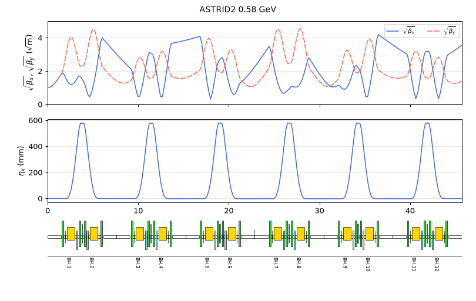
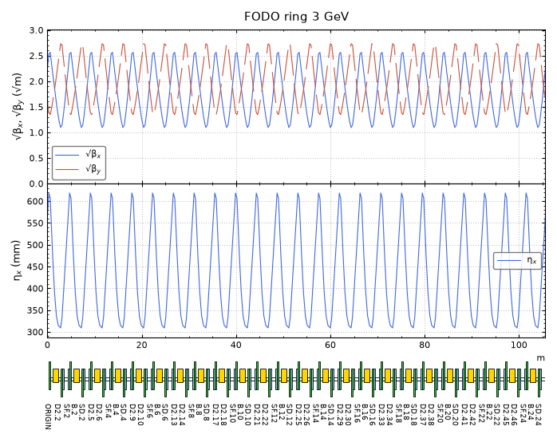

# グラフィック描画 (Plot・ListPlot・OpticsPlot ほかと Tk のキャンバス、DRAW、matplotlib)

この文書で分かること: SAD の描画関数 (`Plot`、`ListPlot`、`ListContourPlot`、`HistoPlot`、`FitPlot`、`OpticsPlot`、`LatticePlot`、`BeamPlot`、`GeometryPlot`、`FitGaussian` の `Plot->True`、`Canvas` 系) を pysad がどう動かすか、使い方の例、オプション、FFS の `DRAW` と matplotlib への出力、K64 の癖と限界。
前提: SAD の `Packages` が使えること (`PYSAD_SAD_PACKAGES`)。GUI (Tk) の土台は [20_tcltk_gui.md](20_tcltk_gui.md)。SADScript の評価器は [05_sadscript.md](05_sadscript.md)。
読む順: 1 (何ができるか) → 2 (仕組み) → 3 (動く例) → 4 (オプション)。保存・図の出力は 5 (DRAW) と 6 (matplotlib)。実装を触る人は 10。
用語: **Graphics[…]** は SAD の描画の式 (線・文字・箱の並び)。**`$DisplayFunction`** はその式を実際に描く関数 (`CanvasDrawer` = Tk のキャンバス、`Identity` = 描かず式を返す、`MatplotlibDrawer` = matplotlib)。**gs** は K64 (SAD のソース) から作った SAD の実行体。

最終更新: 2026-11-22

## 1. 何ができるか

- SAD 自身の `.n` (`Packages/ListPlot.n`、`Plots.n`、`Canvas.n`、`OpticsPlot.n`、`GeometryPlot.n`、`Fit.n`) を **書き直さず**、pysad のインタプリタで SADScript のまま実行する。
  描画の式 (`Graphics[…]`) は SAD と同じ構造で作られ、最後に `$DisplayFunction` が `CanvasDrawer` なら、`Canvas.n` が Tk の `create` を呼んで tkinter のキャンバスに描く。
- 描画の物理や座標の計算 (目盛りの選び方、格子線、`PlotInterpolate` の点列、等高線、`RemoveOverlap`) は SAD の `.n` がするので、pysad はそれが動く評価器と、
  K64 が C・Fortran で持つ Tk の組み込み関数 (`TkCanvas*`、`CanvasClipLine`、`CanvasSymbolDirect` など) だけを Python で書いた ([`pysad/tkcanvas.py`](../pysad/tkcanvas.py))。
- 対応する関数: `Plot`・`ParametricPlot`・`ListPlot`・`ListDensityPlot`・`ListContourPlot`・`HistoPlot`・`FitPlot`・`OpticsPlot`・`LatticePlot` (OpticsPlot の一部)・`GeometryPlot`・
  `BeamPlot` (動くが gs と比べられない: §8)・`FitGaussian[…, Plot->True]`・`Show`・`Graphics`。

## 2. 仕組み

```
SADScript (Plot[Sin[x],{x,0,6}] など)
   │  pysad のインタプリタ (sadscript.py ほか) が Packages/Plots.n・ListPlot.n・Canvas.n を読んで実行
   ▼
Graphics[{Line[…], Text[…], …}, オプション]      ← DisplayFunction->Identity ならここで終わり (戻り値)
   │  DisplayFunction->CanvasDrawer
   ▼
Canvas.n の描画 (座標変換、枠、目盛り、格子、文字)
   │  TkCanvasCreateItem[…] など (pysad/tkcanvas.py)
   ▼
tkinter の Tcl に  `.c create line …` を送る → キャンバス (tclbridge.py の Tk の窓)
```

- 読む場所: `PYSAD_SAD_PACKAGES` (SAD の `Packages` のフォルダ) が要る。`pkgload.py` が `init.n` と同じ自動読み込みの表を持ち、`Plot`・`ListPlot` を最初に使うときにそのファイルを読む。
- `$DisplayFunction`: Windows、または Linux で `DISPLAY` があれば `CanvasDrawer` (tkinter に描く)。画面がない環境と `PYSAD_NO_DISPLAY=1` では `Identity`
  (`Graphics[…]` の式を返すだけ)。引数の `DisplayFunction->Identity` でも同じ (`pkgload.py`)。
  環境変数 `PYSAD_DISPLAY=mpl` で `MatplotlibDrawer` (Graphics を matplotlib に描く。§6)、`tk`・`none` で `CanvasDrawer`・`Identity` に固定。
- `PYSAD_TK_NOLOOP=1`: `TkEventLoop[]` が 1 回 `update` して戻る。自動試験用 (`tclbridge.py`)。普段は窓を閉じるまでイベントを回す。
- `tkcanvas.py` の組み込み関数 (K64 の `tfTkInter_.c`・`tfcanvasclip.f` に対応。表は §10.1): `TkCanvasGetTypes`・`TkCanvasPointer`・`TkCanvasCreateItem(Direct)`・
  `TkCanvasLastItem`・`TkCanvasFindEnclosed`・`CanvasClipLine` (枠で折れ線を切る・破線に分ける)・`CanvasSymbolDirect` (点の記号)・`TkDefineBitmap`・`XListFonts`・`XGetFontPath`。
  K64 は Tk の内部構造を直接たたくが、pysad は Tcl の `create` コマンドに文字列で渡す。Windows の Tcl は名前つきビットマップを登録できないので、
  XBM ファイルに書いて `-stipple`・`-bitmap` の値を `@ファイル` に置き換える。
- `Vector`・`ReleaseVector` (`vecfn.py`): `Plots.n` の `PlotInterpolate` が使うベクトル評価。`FitGaussian` の `Plot->True` が `Plot[InverseErf[x]…]` を使うので、
  `InverseErf` などの特殊関数も Vector に入れた ([06_sadscript_library.md](06_sadscript_library.md))。
- `fitroot.py` の Plot 関係: `FitGaussian[d, opt…]` は Fit.n と同じく、`Plot->True` のとき `{sig, 平均, {…}, ChiSquare, Show[Plot(当てはめの曲線), ListPlot(ビンのデータ), opt]}` の 5 要素のリストを返す
  (内部で `Plot` と `ListPlot[…, DisplayFunction->Identity]` を評価して `Show` に渡す)。`FitPlot` は `Fit[data, fun, x, par0]` を呼ぶので、`fun`・`x`・`par0` を
  関数の引数が束縛している式に置き換える処理が `fitroot.py` にある。
- 評価器の側で描画のために gs に合わせた細目 (連鎖した比較、`With`・`Block` の局所化、`Literal`、`Override` の順、定義の特殊さの順など) は §10.2 に全部ある。

## 3. 使い方の例 (動く SADScript)

画面のある環境では、窓が開いて描かれる。`PYSAD_SAD_PACKAGES` を設定して `FFS;` から。

```
FFS;
g=ListPlot[{1,4,9,16},PlotJoined->True];       (* 折れ線。戻り値は Graphics[…] (長さ 2) *)
h=Plot[Sin[x],{x,0,6}];                          (* Plot[f,{x,xmin,xmax}]。変数名は x でなくてよい *)
k=Plot[{Sin[y],Cos[y]},{y,0,6}];                 (* 関数のリスト *)
p=ParametricPlot[{Sin[t],Cos[2*t]},{t,0,6}];
Hs=HistoPlot[Table[Sin[i*1.7]+Cos[i*0.3],{i,1,60}]];
C=ListContourPlot[Table[Sin[i/3.]*Cos[j/3.],{i,0,9},{j,0,9}]];
F=FitPlot[Table[{i,2*i+1+0.1*Sin[i*3]},{i,1,10}],a+b*x,x,{a,1},{b,1}];   (* a,b と ChiSquare が g[[1]] に入る *)
d=Table[Sqrt[2]*InverseErf[2*(i-0.5)/400-1]*0.8+0.3+0.05*Sin[i*1.3],{i,400}];
r=FitGaussian[d,Plot->True];                     (* {sig, 平均, {…}, ChiSquare, Show[…]} *)
```

リングの光学関数・配置図 (`USE`、`CELL`、`CALC` のあと):

```
MOMENTUM = 3GEV;
MARK ST=();
DRIFT D1 = (L=1) D2 = (L=0.5);
QUAD QF = (L=0.3 K1=0.7) QD = (L=0.3 K1=-0.6);
BEND B = (L=1.2 ANGLE=0.2617993877991494 E1=0.1308996938995747 E2=0.1308996938995747);
LINE CELL1 = (QF D2 B D2 QD D1);
LINE RING = (ST 12*CELL1);
FFS;
USE RING; CELL; CALC;
g=OpticsPlot[{{"BX","BY"},{"EX"}}];     (* 3 枠: BX・BY、EX、ラティス *)
q=GeometryPlot[];                        (* 平面の配置図 *)
```

画面なしで式だけを得る (自動処理・試験向け):

```
g=ListPlot[{1,4,9,16},PlotJoined->True,DisplayFunction->Identity];
Print[Head[g]," ",Length[g]];            (* Graphics 2 *)
```

BeamPlot (ビームの断面の楕円):

```
MOMENTUM = 3GEV;
(* …上と同じラティスに CAVI RFC = (VOLT=2e6 HARM=64); LINE RING = (ST 12*CELL1 RFC); … *)
FFS;
USE RING; CELL; RFSW; RAD; CODPLOT; CALC; EMIT;
g=BeamPlot["QF.5",{"X","Y"},DisplayFunction->Identity,SizeFunction->"SIG"];
```

試験の元の台本は [`pysad/tests/test_plot.py`](../pysad/tests/test_plot.py) (8 本)。
キャンバスの項目を書き出す方法 (gs と比べるのに使った) は、[`test_plot.py`](../pysad/tests/test_plot.py) の `_DUMP`: `TclEval` で全 Canvas の `find all`・`type`・`coords`・`gettags` を列挙してファイルに書く。

## 4. オプションの対応

オプションは `ListPlot.n` の定義 (`LP$def`、`Graphics$Options`) のまま pysad が評価する。pysad 側で特別に処理するものはなく、`Override[opt, 既定]` の規則どおりに効く。
次は `ListPlot.n` の既定値 (読み取った値) と、試験で動作を確認したか。

| オプション | 既定 (`ListPlot.n`) | 確認 |
|----|----|----|
| `PlotJoined` | `False` (折れ線にするとき `True`) | `ListPlot[…, PlotJoined->True]` で gs と全 43 項目一致 |
| `PlotRange` | `{Automatic,Automatic}` | `OpticsPlot` が `PlotRange :> With[…]` を使って動く。指定値を与えたときの戻りの Graphics 式は gs と文字列として完全に一致 (2026-11-16。窓の見た目ではなく式の比較) |
| `GridLines` | `{Automatic,Automatic}` | 格子線の位置は gs と一致 (`G$X1`・`G$Y1` のタグ)。`GridLines->None` と `{{1,2},{5,10}}` を与えたときの戻りの Graphics 式は gs と文字列として完全に一致 (2026-11-16。窓の見た目ではなく式の比較) |
| `AspectRatio` | `Automatic` (`BeamPlot` は `1`) | `AspectRatio->1` の戻りの Graphics 式は gs と文字列として完全に一致 (2026-11-16。窓の見た目ではなく式の比較)。`BeamPlot` は式の生成だけ。窓の見た目は未確認 |
| `Scale` | `{Linear,Linear}` | `Scale->{Linear,Linear}`以外 (`{Linear,Log}`・`{Log,Log}`) の戻りの Graphics 式は gs と文字列として完全に一致 (2026-11-16。窓の見た目ではなく式の比較)。窓の見た目は未確認 |
| `Frame`・`FrameLabel`・`FrameTicks`・`TickSize` | `True`・空・`{True,True,Ticks,Ticks}`・`Automatic` | `Frame->False` の戻りの Graphics 式は gs と文字列として完全に一致 (2026-11-16。窓の見た目ではなく式の比較)。他は既定のみ |
| `PointSymbol`・`PointSize`・`PointColor`・`PlotColor`・`Dashing`・`Thickness` | 既定は表の色・記号・破線の巡回 | ListPlot の 4 個の `oval` (記号 `CI`)。他の記号は `CanvasSymbolDirect` の実装 (○ △ □ ◇ + ×、棒) があるが gs と比べていない |
| `PlotLabel`・`Legend`・`Prolog`・`Epilog`・`Background`・`FontScale` ほか | 既定 | `PlotLabel`・`Legend`・`Prolog`・`Epilog`・`Background`・`FontScale` を与えたときの戻りの Graphics 式は gs と文字列として完全に一致 (2026-11-16。窓の見た目ではなく式の比較)。窓の見た目は未確認 |
| `DisplayFunction` | `$DisplayFunction` (遅延) | `Identity` と `CanvasDrawer` の両方を試験 |
| `RemoveOverlap` | `""` | OpticsPlot が名前の重なりを消す。文字の大きさに依存 (§9) |
| `Plot->False` | (`Plot->True` が既定) | 戻りの Graphics 式が gs と一致 (同上) |
| `Orbit`・`SizeFunction` (BeamPlot)、`DataRange` | `True`・`"SIZE"`、`Default` | §8 |

`Fill->Null` のように値が `Null` の規則は Tk の項目に渡さない (gs は既定の色を使う。線は X11 で `#000000`、Windows の Tk で `SystemButtonText`)。

## 5. DRAW (matplotlib)

FFS の `DRAW` コマンドを、Tk のキャンバスを使わず matplotlib で描く ([`pysad/draw_mpl.py`](../pysad/draw_mpl.py)。`pip install matplotlib`。無くても DRAW 以外は動き、DRAW は警告して何もしない)。

**K64 の DRAW**: `src/tffsa.f` が `System`CANVASDRAW[]` を評価し、実体は `Packages/CANVASDRAW.n` が `OpticsPlot[list, Region->{r1,r2}, Lattice->…, Names->…, GridLines->{None,Automatic}, InfoLabel->True, PlotLabel->TITLE]` を呼ぶ。`$DisplayFunction` が `CanvasDrawer` でなければ何もしない。gs は表示環境がないと何も出さず、`FFS["draw ...",12]` は内部エラー ([31_unimplemented_and_unverified.md](31_unimplemented_and_unverified.md))。

**構文** `DRAW [r1 [r2]] 関数 [関数 …] [& 関数 …] … [LAT|LATTICE|要素名];`
- r1・r2: 整数か要素名 (`LINE["POSITION"]`)。読めなければ r1=1 でその語は関数として読み、r2 の失敗は `LINE["LENGTH"]`。複数の要素に合う名前は最初の位置。
- 関数: `Twiss$Label` が空でない名前 (BX・BY・EX・EY・NX・NY・EPX・PEX・PEPX・AX・BZ・ZX・DETR・R1〜R4、R・D を付けた参照光学 (RBX・DBX …)、BMAGX、BZS・BZT・GX …、SIGX・SIZEXX など)。BX・BY・BZ は √β を描く。`&` か `&` を語に付けて (`BX&BY`) 図 (枠) を分け、縦に積んで s の軸を共有する。1 つの枠に単位の違う関数があるときは、先頭と同じ単位だけを描く (OpticsPlot::units)。
- `LAT`・`LATTICE`: ラティス図を一番下に付ける (枠の高さの 0.23 倍)。要素名 (パターン可、`b*`) を書くと、ラティス図 + その名前だけを表示 (`Names->w`)。LAT のときの名前は全要素 (`Names->"*"`) で、重なる文字は消す。それ以外の語は DRAW が読まずに次のコマンドへ返す (`DRAW BX CALC;` は CALC を実行する)。
- 単位は `Optics$Unit` と同じに振幅で選ぶ (EX は mm、位相 NX は 2π を単位に、正の関数 (BX など) は 0 から)。`TITLE` を図の題にする。
- ラティス図は OpticsPlot.n の `LatticePlot` の箱 (四極 0.8 limegreen、偏向 0.4 gold (ANGLE=0 は tomato)、6 極以上 0.6 skyblue、ドリフト 0.08 で塗りなし、MULT は TRPT で 0.5/0.8、RF 0.3 …)。これは **ラティス配置図 (長直線部を細線 0.55 pt、その他の基準軌道 1.8 pt、偏向磁石 3 pt で描く図) とは別物**で、OpticsPlot の枠の下の簡略図。
- InfoLabel: 図をクリックすると、その s の要素の入口の名前・位置・K・β・α・ν・η・η'・R を注釈に出す (OP$InfoLabel。右クリックで消す)。OpticsPlot.n の R3,4 の行は R4 を出すべきところに R2 を出している (誤記と見て R4)。Python API の `tunes=True` でチューンと周長を図に添える (SAD にない追加)。

**出力** 保存先があれば保存して表示しない: 環境変数 `PYSAD_DRAW_FILE` (拡張子 png・pdf・svg。同じ DRAW が 2 回目以降は `名前_2.png` のように番号を付け、`{n}` があれば番号に置き換える)、または SAD 側の `Draw$Option={File->"x.png"}`。保存先がなければ、対話の backend のときだけ `plt.show` (Agg など非対話では何も出さない)。`$DisplayFunction` が Identity (headless の既定) で保存先もなければ K64 と同じく何もしない。`Draw$Option` は CANVASDRAW.n と同じく最優先 (`Region`・`Lattice`・`Names`・`GridLines`・`InfoLabel`・`PlotLabel` と、pysad の拡張 `File`・`Show`・`Tunes`)。`$DisplayFunction` が CanvasDrawer か `MatplotlibDrawer` なら matplotlib で描く。対話表示した窓は、スクリプトの終了時に閉じるまで残す (`PYSAD_DRAW_BLOCK=0` で残さない)。

```python
from pysad.ffscmd import run_sad_string
from pysad import draw_mpl
ffs, I = run_sad_string(script)                     # USE・CALC まで
fig = draw_mpl.draw(ffs, "BX BY & EX LAT", region=(1, 40), save="optics.png")   # Figure を返す
```



図の読み方: `DRAW BX BY & EX B*;` で描いた ASTRID2 (0.58 GeV、周長 45.7 m) の全周 (`example/11_graphics/fn_DRAW_astrid2.sad`)。横軸は s [m]。上段は √βx (青の実線)・√βy (橙の破線) [√m]、中段は水平分散 ηx [mm]、下段はラティス (黄が偏向磁石、緑が四極、水色が 6 極) と、名前が B で始まる要素の名前。6 セルで同じ形が繰り返し、ηx は偏向磁石の組 (BH) の位置で約 580 mm、直線部では 0 になる。

**CALC していないとき**: pysad は Twiss[] と同じく先に光学を計算する。gs の `OpticsPlot` は計算していない光学の値 (0) をそのまま描く (`Twiss["BX",5]` が 0) ので、ここは gs と違う (計算してから描く方が意図に合うと判断)。USE していなければ ` ???-DRAW-Missing beamline in USE.`。

**gs との照合** (gs は画像を出せないので、描く前のデータを比べた): pysad が matplotlib に渡す点列・箱・名前は、`OpticsPlot[…, DisplayFunction->Identity]` が返す Graphics と全点一致 (1e-12 以内)、gs (WSL) の Graphics とも FODO と ASTRID2 全周で 1.7e-13 以内で一致した。試験 `test_v25_draw_mpl.py`。詳細は [history/21_graphics_validation.md](history/21_graphics_validation.md)。例: [`example/11_graphics/fn_DRAW.md`](../example/11_graphics/fn_DRAW.md)。

**未確認・限界**: 色・線の太さ・文字の大きさの見た目は Tk の窓と比べていない (比べたのはデータ)。文字の重なり消し (`RemoveOverlap`) は Tk のフォントの代わりに s 軸上の間隔で決めるので、gs の窓で残る名前とは違う。`PEX` などは pysad の `Twiss["PEX"]` (現状は EX と同じ値) をそのまま描く。SIG・SIZE の関数は EMIT 後の値。SADScript の `OpticsPlot[…]` の Graphics 自体を matplotlib に流すのは §6 の `MatplotlibDrawer` (DRAW は `draw_mpl` が自前でデータを組む)。対話表示の窓・クリックの InfoLabel は Agg では動かせず、手では確認していない (イベント処理の関数 `element_info` の文字だけ試験)。ラティス図の Element$Height は K64 の型の番号に従い、SOL (20) は 0.08 の細い箱になる。

## 6. MatplotlibDrawer: Graphics を matplotlib に描く `$DisplayFunction`

`Plot`・`ListPlot`・`HistoPlot`・`ListContourPlot`・`OpticsPlot`・`GeometryPlot` などが作る `Graphics[…]` を、Tk のキャンバスでなく matplotlib に描く出口 ([`pysad/mpl_display.py`](../pysad/mpl_display.py)。matplotlib は遅延 import で、無ければ警告するだけで評価は続く)。§5 の `DRAW` は OpticsPlot 相当のデータを自前で組むが、こちらは SAD 自身の `.n` (ListPlot.n・Plots.n・OpticsPlot.n・GeometryPlot.n) が作った `Graphics[…]` をそのまま描く。評価器・`.n` は変えていない。

**仕組み** `ListPlot.n` の `Show1$` が `$DisplayFunction` を `df[opt, list, init, w, rect, last, ini]` の形で呼ぶ (K64 では `CanvasDrawer`)。pysad は同じ引数を受ける組み込み関数 `MatplotlibDrawer` を持つ。`opt` の `PlotRange`・`DataRange`・`Scale`・`GridLines`・`FrameTicks` などは `Show1$` が決めた値。`Rectangle[min, max, Graphics[…]]` (OpticsPlot の枠) は、`Canvas.n` と同じく `Show1$[False, {min,max}, …]` を呼んで入れ子の枠を作る (`Position->Right[]`・`Left[]`・`Above[]`・`Below[]` も `RectPosition` どおり)。枠の位置は `Canvas.n` の `MakeWindow` の移植 (キャンバス 13 × 10 インチ、窓の原点 {2, 1.8}、幅 9.6、縦横比 `GoldenRatio`、`AspectRatio`・`PlotRegion`・`rect` に従う)、軸の範囲は `FrameRange` の移植 (`PlotRange->Automatic` は `DataRange` の外に 7% の余白、Log は log10 で 7%)。

**切替**

| 方法 | 内容 |
|----|----|
| 環境変数 `PYSAD_DISPLAY=mpl` (または `matplotlib`) | `$DisplayFunction` を `MatplotlibDrawer` にする (`tk` = `CanvasDrawer`、`none` = `Identity`。未設定は §2 のとおり) |
| SADScript で `$DisplayFunction=MatplotlibDrawer;` | 環境変数なしでも切り替わる |
| `Plot[…, DisplayFunction->MatplotlibDrawer]`、`Show[g, DisplayFunction->MatplotlibDrawer]` | その 1 回だけ。`DisplayFunction->Identity` で作った `g` をあとから描くのにも使う |
| Python `mpl_display.render(I, g, save="x.png")` | Graphics の式 `g` を描いて Figure を返す (`mpl_display.last_figure()` は最後に描いた Figure) |

**出力** 環境変数 `PYSAD_DISPLAY_FILE` (拡張子 png・pdf・svg。同じ名前の 2 回目以降は `名前_2.png` のように番号を付け、`{n}` があれば番号に置き換える。DRAW の `PYSAD_DRAW_FILE` と同じ流儀で、番号の数え方も `draw_mpl` と共通)、または SAD 側の大域変数 `MatplotlibDrawer$Option={File->"x.png", Show->True, DPI->120}` (最優先。保存先のフォルダは作る。dpi の既定は環境変数 `PYSAD_DISPLAY_DPI` か 100)。保存先がなければ、対話の backend のときだけ `plt.show` (Agg など非対話では何も出さない)。保存は `bbox_inches="tight"` で、キャンバスの余白は切る。**`ListPlot.n` 自身が `Show` を 2 回呼ぶ** (ファイルの中でブロックが重複している) ので、直前と全く同じ内容の `Show` が続いたときは出力を 1 つにまとめる (同じ式を 2 回続けて描いても 1 枚。`mpl_display.render` は常に描く)。



図の読み方: `OpticsPlot` が作る Graphics を `MatplotlibDrawer` で描いた FODO リング (3 GeV、24 セル、周長 105.6 m) の全周 (`example/11_graphics/fn_OpticsPlot_mpl.sad`)。横軸は s [m]。上段は √βx・√βy [√m]、下段は水平分散 ηx [mm] で、24 セルが同じ形で繰り返す (√βx は 1.1〜2.6、ηx は約 310〜620 mm)。一番下にラティスと要素名が付く。

**対応する要素とオプション**

| 要素・オプション | 扱い |
|----|----|
| `Line` | 折れ線 (`PlotColor`・`Thickness` (1 px = 0.8 pt)・`Dashing` (`{1}` = 実線、実数 d = {d, d/3}、リストはインチ)・`Clip`・`Plot->True` の点・`PlotJoined->True/False/Step` と `StepRatio`・`Legend`)。4 列 {x,y,dx,dy} は誤差棒 (`ErrorBarColor`・`ErrorBarTickSize`・`ErrorBarThickness`) |
| `Point` | 記号つきの点 (`PointSymbol` の `CI`・`LT`・`RT`・`DT`・`UT`・`SQ`・`DI`・`PL`・`TI` と `1O` 系、`PointSize`・`PointColor`・`PointBorderColor`) |
| `Rectangle` | 箱 (`FillColor` が文字列なら塗る、`PlotColor` が枠線、`""` は枠線なし)。中に `Graphics` を持つものは入れ子の枠 |
| `Polygon`・`Circle` | 多角形 (`FillColor`・`PlotColor`・`Thickness`・`Dashing`・`PlotJoined`)、楕円 (データ座標の半径) |
| `Text` | 位置は `Scaled` (データ座標)・`WindowScaled`・`RectScaled`・`CanvasScaled`・数 (キャンバスのインチ)。`Anchor`・`TextAlign` (Tk の anchor: n・s・e・w・c・ne・nw・se・sw)・`TextRotate`・`Rotation`・`TextSize`・`PlotColor`・`Justify`・`Clip`・`Tags`。SAD の文字の書式 (`` `f ``=ギリシャ、`` `d ``=下付き、`` `u ``=上付き、`` `n ``) は mathtext に |
| 色 | Tk の名前 (`dodger blue`・`tomato3` (X11 の 1〜4 = 明るさ 100・93.2・80.4・54.5%)・`gray40`・`#rrggbb`・`SystemButtonText`)。評価されていない `PlotColorDefault[…]` (OpticsPlot) は `Plot$DefaultColor` の表から枠の中の順に選ぶ |
| `PlotRange`・`DataRange`・`Scale`・`AspectRatio`・`PlotRegion` | `Canvas.n` の `OverrideOptions`・`FrameRange`・`MakeWindow` どおり (`PlotRange` は `Automatic`・`{y1,y2}`・`{{x1,x2},{y1,y2}}`・`{x範囲, Automatic}` など。`Scale` は Linear・Log) |
| `Frame`・`FrameTicks`・`TickSize`・`FrameColor`・`TickColor`・`Background` | `Frame->False` は枠・目盛り・格子なし。`FrameTicks` は `{下,左,上,右}` で `True` = 線と文字、`Ticks` = 線だけ、`False` = なし (下の辺の線は Canvas.n どおり常に引く)。目盛りは内向き。枠をまたいで重なる目盛りの文字は後の方を消す |
| `GridLines` | `Automatic`・`Major` = 主目盛りの点線 + 原点の線、`Minor`・`All`・`Both`・`Axis`・`Axis[x…]`・`None`。**拡張**: 位置のリスト `{{1,2},{5,10}}` はその位置に線を引く (`Canvas.n` の `DrawGrid` は何も描かない) |
| `FrameLabel`・`FrameUnitLabel`・`PlotLabel`・`Legend`・`LegendBG` | `FrameLabel` は `{下,左,上,右}` (文字の書式つき)。`FrameUnitLabel` は下 (x) の単位だけ。`PlotLabel` は一番上の枠の上。凡例は枠ごと (同じ名前が続けば 1 つ)、位置は matplotlib の `best` |
| `FontScale`・`TickFontScale`・`FrameFontScale`・`LegendFontScale`・`TitleFontScale` | 文字の大きさに掛ける |
| `RemoveOverlap` | `Canvas.n` の `Remove$Overlap` と同じ手順 (その `Tags` の文字を書いた順に、残した文字の外接矩形の和に重なるものを消す)。外接矩形は matplotlib のフォントなので、Tk の窓で残る名前とは違う (OpticsPlot の名前) |
| `Axes` (拡張) | `Canvas.n` にない。`Frame->False` のときだけ、原点を通る軸の線を引く |

**未対応 (警告して飛ばす。同じ種類の警告は 1 回)** `Hook[…]` (対話の束縛。InfoLabel など。黙って飛ばす)、`Arrow`・`ArrowShape` (線だけ描く)、`UseBG->True` の文字の背景、`TextFont` (フォントの名前・書体)、`MeshStyle` の stipple の模様 (塗りつぶしだけ)、`FrameTicks` の `{Ticks, 関数}` (目盛りの文字を関数で与える形。線だけ)、`FrameUnitLabel` の左 (y) 側、`Scale->Date`・`Date` の目盛り (Linear で描く)、`Text` の位置 `LeftTags`・`RightTags`・`AboveTags`・`BelowTags` (Tk の外接矩形が要る)、`Rectangle` の `Position->` の `Right`・`Left`・`Above`・`Below` 以外、3 列の誤差棒、`PointSymbol->Bar` の基線 `Offset` (0 からの垂線で近似)、`Initialize->False`・`Frame` (前の図に重ねる・再描画。新しい Figure を作る)、`Canvas3D`・`ListPlot3D` 系、`CanvasSymbol`、未知の要素 `Foo[…]` と文字列・数が要素の位置に来たもの、解釈できない色名 (黒にする)。マウス操作 (拡大・凡例の移動・InfoLabel のクリック) は無い。

**照合** Tk の窓と画像で比べたものはない。試験 [`test_v241_mpl_display.py`](../pysad/tests/test_v241_mpl_display.py) (32 件、Agg、Tk 不要) は、`Graphics[…]` の `Line`・`Rectangle`・`Text` の個数と座標が matplotlib 側のデータ (`Line2D`・`Patch`・`Text`) と一致することを数値で確かめる: `Plot[Sin[x],{x,0,6}]` (505 点が 1e-12 以内、軸の範囲が `DataRange` の 7% の余白と `PlotRange`)、`ListPlot` (折れ線・点・誤差棒・Step・Log・`PlotRange`・`GridLines`・`Frame`・`FrameTicks`・`FrameLabel`・凡例)、`HistoPlot` (箱の数)、`OpticsPlot` (3 本の線が全点 1e-12 以内、箱 192 個の座標、名前は Graphics の `Text` の順序つきの部分列で、残った名前は互いに重ならない、枠の積み方・x 範囲)、`GeometryPlot` (線 1 本 + 多角形 73 個)、手で組んだ `Graphics` (各要素の色・太さ・破線・文字の揃え・回転・クリップ)。ほかに切替、保存 (png・pdf・svg の先頭のバイト、2 回目以降の番号)、matplotlib が無いとき、未対応の警告。例は [`example/11_graphics/fn_OpticsPlot_mpl.md`](../example/11_graphics/fn_OpticsPlot_mpl.md)。

**未確認・限界** 色・線の太さ・文字の大きさの見た目は Tk の窓と比べていない (線の太さ 1 px = 0.8 pt、破線の長さ、文字の大きさ 8.5 pt × `TextSize` は目で決めた近似。キャンバス 13 × 10 インチを 0.65 倍して図にする)。`OpticsPlot` の実ラティス (大きなリング) と `BeamPlot`・`FitPlot`・`ListDensityPlot` は描いて見ていない (要素は上の表の範囲)。対話の backend の窓 (`plt.show`) は手で確認していない (Agg で保存と図のデータだけ)。PDF・SVG は保存できることだけ確認 (見た目は PNG のみ目で見た)。目盛りの位置と文字は matplotlib の自動で、`Canvas.n` の `AutoTick` とは違う (指数の表記も matplotlib 流)。凡例の位置は `Canvas.n` の `AdjustLegend` とは違う。`PYSAD_DISPLAY=mpl` のとき `DRAW` は §5 のまま (保存先は `PYSAD_DRAW_FILE`)。gs は表示環境がないので `Graphics[…]` の式の一致 (§5) までが gs との比較で、描いた図は比べられない。

## 7. 検証

方法: gs (WSLg の X11) と pysad で同じ台本を動かし、キャンバスの全項目の種類・座標・タグ、`Graphics[…]` の式を比べた。Tk のフォントが違うので文字の外接矩形だけは一致しない。結果の要約:

- `ListPlot`・`Plot`・`ListDensityPlot`・`HistoPlot`・`FitPlot` (当てはめ値は相対 1e-8)・`FitGaussian`・`GeometryPlot` は、キャンバスの項目が gs と一致 (`ListPlot[{1,4,9,16}, PlotJoined->True]` は 43 項目)。`ListContourPlot` は種類と数が一致し、等高線の始点・向きだけ違う (§8)。
- `OpticsPlot` は枠・矩形・線が一致し、text 項目は pysad が 5〜14 個多い (文字の大きさによる名前の間引きの違い。§9)。
- オプション付きの戻りの Graphics 式は gs と文字列として一致 (§4 の表)。
- 試験: [`pysad/tests/test_plot.py`](../pysad/tests/test_plot.py) (8 本)、[`test_evalfixes.py`](../pysad/tests/test_evalfixes.py)、[`test_v25_draw_mpl.py`](../pysad/tests/test_v25_draw_mpl.py)、[`test_v241_mpl_display.py`](../pysad/tests/test_v241_mpl_display.py)。Tk を使う試験は `PYSAD_SAD_PACKAGES` と tkinter が要る (なければ skip)。全試験を回すと数回に 1 回、単独では通るのに落ちることがある (Tk の窓の更新の待ち)。落ちたら `py -3.12 -m pytest pysad/tests/test_plot.py -q` で単独に回して確かめる。
- 回帰 (`run_regression.py`) は描画を含まない (描画は pytest だけ)。
- 比べていないもの: 色・フォント・大きさ・見た目、クリック・拡大などの操作、実画面のスクリーンショットの比較。値の一致は「キャンバスの項目の座標とタグ」まで。
- 項目ごとの比較表は [history/21_graphics_validation.md](history/21_graphics_validation.md)。


## 8. K64 の癖

- **BeamPlot は gs の `SIG*`・`SIZE*` が 0 で、比較できない**。`CALC` のみ、`EMIT`、`Emittance[]`、`EMITX=…; EMITY=…; SIGE=…` を与えた場合の
  どれでも、gs の `LINE["SIZEXX","QF.5"]`・`LINE["SIGXX","QF.5"]` などが 0 を返す。このため `BeamPlot` の楕円の半径が 0 になり、
  gs が返す `Graphics` の線は `{座標, NaN}` の列 (`EMIT` や `Emittance[]` のあとは 33 点が `{-10.864…, NaN}`) で、描いても意味のある形にならない。
  pysad は、`EMIT` のあとは値を返す (`SIGXX` = 2.03e-6、`SIGYY` = 7.1e-9。gs は 0) ので、**結果が gs と食い違う**。どちらが正しいかは確認していない
  (K64 の `LINE["SIG…"]` の仕様か、この gs のビルド 2026-10-19 の不具合かは未確認)。
  また `EMIT` なしでは、pysad は `???Set: list assignment length mismatch` を出して `BeamPlot` が戻らない (gs は NaN の線を含む `Graphics` を返す)。この差は直していない。
- gs は X11 の `-usebg` を持つ改造版の Tk を使う。標準の Tk にない `-usebg` は pysad が落とす (文字の背景は塗らない)。
- `Tkinter.n` の `FontSubstitute$X11` に `Returun[…]` の綴りの誤りがあり、フォント表がないときの早期復帰が効かない (結果は変わらない)。
- 線の既定色は、gs の X11 では `#000000`、Windows の Tk では `SystemButtonText`。比較では「同じ」とみなした。
- 既定の `$HaveLaTeX` は `""` (LaTeX がなければ gs も同じ)。
- `?名前` (Definition) の定義の順は K64 がハッシュ表の順で、再現できない (等高線の始点・向きの差の原因)。
- `Packages/CSR.n` は読み込め、`CSR[]` のメンバーの値は gs と一致する。`MakeZL` などの流れは `CSRInit` (2 次元 Poisson) と `CSRMatrix` mode 1000 ([15_csr.md](15_csr.md)) で動き、3 周波数の ZL の表が gs と相対 1e-10 以内で一致する (試験は `PYSAD_SLOW=1` の `test_csr_makezl_matches_gs`、約 7 分)。`ScanTrack`・`OYStability` などは未照合。

## 9. 未対応・限界・未確認

- 未対応: `CanvasSymbol` (Tcl 文字列を返す版。`CanvasSymbolDirect` は実装)、`Canvas3DClipTriangle`・`Canvas3DLightTriangle`・`Canvas3DProjection` (`Canvas3D.n`)、
  `UseBG->True` の文字の背景 (描かない)。
- 未確認: `BeamPlot` の描画 (上記)、`LatticePlot` を単独で呼ぶ使い方 (`OpticsPlot` の 3 枠目として動くことだけ確認)、上記の各オプションを窓に描いたときの見た目 (式は gs と一致するが、描画は未確認)、
  `CanvasCM.n`・`CANVASDRAW.n`、`TabFrame.n` の描画、色・フォント・大きさの見た目、マウス操作。
- gs の実動作に合わせた細目 (2026-11-17): `ParametricPlot[…,{t,0,2*Pi}]` のように範囲に Pi などの定数式を書いても `x_Real` に照合する (HoldAll の引数の定数式 (Pi・E・Degree と数値関数) は値で照合する)。
  曲線のリスト `ParametricPlot[{{…},{…}},…]` は List (曲線数+1 要素) を返す (保持引数位置の `Evaluate[…]` を評価)。`ListContourPlot` (MeshRange つきの SADHelp の例を含む) は Graphics を返し、窓への描画で Tcl エラーが出ない
  (`_?(…)` の検査の中のエラーは不一致として扱う)。`PointSymbol` の名前の文字は、`{"CI","CL"}//""` がリストを `{"CI","CL"}` の形の文字列にする (gs と同じ) ことで一致し、Canvas の項目は gs と同じ 30。
  `OpticsPlot` に自前のデータ (`{{{line1},{line2},…, 選択肢}}`。x は要素番号) を渡せる (定義の順に合わせた規則の優先順位と `MapThread` の非リスト要素の繰り返しを SAD と同じに扱う)。
  `Canvas$Widget = c1` を使う台本の窓は gs と同じ 114 項目 (再描画後 115)。
- `OpticsPlot` の text 項目の数の差 (FODO 24 セルの例で gs 69、pysad 74) は、文字の大きさ (Tk のフォントの違い) による `RemoveOverlap` の結果。直せないので未対応として残す。
- `Options[g]` の差: gs は Graphics の全オプションを返し、pysad は `{}` を返す (差が残る)。
- 文字の数と外接矩形は Tk のフォントで決まるので、`OpticsPlot` の text 項目の数は gs と一致しない (pysad は +5〜14)。枠・矩形・線は一致する。
- 比較したのは 3 GeV の 12 セルの小さなリング (E1=E2=θ/2 の BEND を持つ FODO) と、数値の列だけ。実ラティスの `OpticsPlot` は比べていない。
- 描画の窓は tkinter。Windows のほかは試していない (gs の比較は WSLg の X11)。
- GUI の試験は全体実行で不安定なことがある (§7)。環境変数がないと skip になるので、評価器を変えたら `PYSAD_SAD_PACKAGES` を付けて試験を回すこと。

## 10. 実装の細目 (開発者向け)

### 10.1 Tk のキャンバスの組み込み関数 (`tkcanvas.py`)

K64 は C (`tfTkInter_.c`) と Fortran (`tfcanvasclip.f`) で Tk の内部を直接たたく。pysad は tkinter の Tcl に `create` を送る。

| 関数 | 内容 |
|----|----|
| `TkCanvasGetTypes`・`TkCanvasPointer`・`TkCanvasLastItem`・`TkCanvasFindEnclosed` | 項目の種類名の表、キャンバスの識別子 (パス名)、最後の項目、矩形に入る項目 |
| `TkCanvasCreateItem`・`TkCanvasCreateItemDirect` | 項目を作る。`Fill->"red"` などの規則は `TkOptionLabel` で option 名にする |
| `CanvasClipLine` | 枠で折れ線を切り取り、破線に分ける (`tfcanvasclip`) |
| `CanvasSymbolDirect` | 点の記号 (○ △ □ ◇ + ×、棒) を描く |
| `TkDefineBitmap` | Windows の Tcl は名前つきビットマップを登録できないので XBM ファイルに書き、`-stipple`・`-bitmap` の名前を `@ファイル` に置き換える |
| `XListFonts`・`XGetFontPath` | gs を X で動かして得た組み込みフォント 6 個 (`{"built-ins"}`) |
| `Vector`・`ReleaseVector` (vecfn.py) | ベクトル評価。`Plots.n` の `PlotInterpolate` が使う |

未対応: `CanvasSymbol` (Tcl 文字列を返す版)、`Canvas3DClipTriangle`・`Canvas3DLightTriangle`・`Canvas3DProjection` (Canvas3D.n)。

### 10.2 描画を動かすために gs に合わせた SADScript の評価


どれも gs で同じ式を実行して比べた (試験は [`test_evalfixes.py`](../pysad/tests/test_evalfixes.py))。

- 連鎖した比較 `a<x<b`、`a==b==c` (連鎖全体を評価する。左から 2 つずつ評価すると範囲外でも真になる)。
- `Map`・`Table`・`MapThread`・`/.` の結果の `Null[]` (空の Sequence) は取り除き、`Null[a,b]` は a, b を並べる。
- `StringPosition[s, {"x","+"}]`・`"a"|"b"` (選択肢を与えた順に、重なる一致も数える)、`Thread[{a,{1,2}}]` (リストでない要素を繰り返す)、
  `ReplacePart[l, 0, {,2}]`・`Extract[l, {,2}]` (空の位置は「全部」)。
- `With[{f[x_] := …}, …]` は関数の定義 (クラスの中ではメソッド)。`With[{x}, …]` の x は局所変数ではなく「今の値を埋め込む」指定。
- 関数の引数 `z_` が記号 `x` に束縛されているとき、本体の `Block[{z}]`・`Module[{z}]`・`With[{z = …}]` は x を局所にする (SAD は引数を本体へ文字どおり代入する)。
  そのとき引数の式 `Sin[x]` の x にも効くよう、関数の中の `With` の内側では引数の式を評価し直す。
- `Literal[x]` は x そのもの (評価も改名もしない)。`Extract[メンバー, {1}, Unevaluated$]` は評価しないメンバー自身で、`CanvasW[Create$Line] = …` は
  `CanvasWidget[Create$Line] = …` と同じ。クラスの中の `Class@メンバー` で改名後の名前も引ける。
- リテラルだけの選択肢 (`""|" "`) を引数にもつ定義は、一般の定義より先に試す。
- 定義の本体へ引数の値を埋め込むとき、定義自身のパターン変数 (`f[x_] := …` の x) は外側の同名の値に置き換えない。別の関数の呼び出しの引数は見ない。
- 評価が `FromDate[]`・`MapAt[f, a->b, {2}]` に対応 (GUI の試験は環境変数がないと skip になるので、壊れても気づきにくい)。
- OpticsPlot.n を動かすための対応 (どれも gs と比べた。試験は [`test_evalfixes.py`](../pysad/tests/test_evalfixes.py)):
  - `` `X``・`` System`X``・`` Global`X`` は、`Begin[…]` で文脈を作らない限り大域の `X` (OpticsPlot.n は `` `OpticsPlot=System`OpticsPlot=OPlot$@OpticsPlot``)。
  - Module の局所変数への `h := Sqrt[Abs[#]]&` と `h[4]` (遅延した純関数の適用)、大域の `fun := …&` の `fun[4]`。
  - `SetAttributes[f, HoldNone]` は `HoldAll` などを外す。
  - `MapAt[f, v, {,,1}]` の空の位置、`Override[…]` の結果は左辺の標準順 (文字列、続いて記号を大小無視、同じなら小文字が先)。
  - `opt:((_Rule|_RuleDelayed)...)` は要素がすべて規則のときだけ合う (1 つでも規則でない要素があれば合わない)。同じ特殊さの定義は、クラスの中でも書いた順に試す
    (親子のクラスでは子が先)。`__`・`___` は Blank を並べた定義よりわずかに一般的 (`OpticsList[__]={}` は後の定義が先)。
  - `G[x_] = Round[{H[x], x}*3]` のように右辺を評価した値のリストが x を含むとき、呼び出しで x を置き換える (Canvas.n の `CoordLimited`)。
  - `PlotRange :> With[…]` の遅延規則の右辺にも、外側の `With[{s1, leng}, …]` の値を埋め込む。`With[{c := X}, f[c] = …]` (クラスの中) は左辺にも埋め込む。
    値がクラスのメンバー (`PlotColorDefault[$DisplayFunction]`) を使う `With` の宣言は、クラスの定義時に評価せず、インスタンスのメソッドの実行時に評価する。
  - `ListPlot.n` の読み込みの途中で `Tkinter.n` が読まれても、外側の「組み込みと同名の定義を捨てる」処理が `Options[Window]` などを消さない。
  - 既定の `$HaveLaTeX` は `""` (gs も LaTeX がなければ `""`)。`PkgConfig.n` は最初に使うときに読む。
  - K64 の Tk (改造版) の text 項目だけが持つ `-usebg` は、標準の Tk にないので落とす (文字の背景は塗らない)。
- ListContourPlot・HistoPlot・FitPlot (Plots.n) を動かすための対応 (gs と比べた。試験は [`test_evalfixes.py`](../pysad/tests/test_evalfixes.py)・[`test_plot.py`](../pysad/tests/test_plot.py)):
  - `Block[{mesh}, mesh[x_] := …]` は、入るとき局所にした記号の関数定義を退避して空にし、出るとき戻す (色目盛りの ListDensityPlot が同じ Block を入れ子で使う)。
  - `?名前` (Definition) は `Hold[{名前:=名前, 定義 …}]` を返す。`Extract[…, {…,0,…}]`・`Part[…,0]` は式の頭部。`contl[k][x] =.` は添字つきの定義だけを消す。
    K64 は定義をハッシュ表の順に返す (再現できない) ので、pysad は書いた順の逆 (具体的な定義、続いてパターンの定義 `contl[_][_]`)。
    等高線の線は gs と同じ曲線だが、始点・向きが違う。
  - `MinMax[ref, ll]` は全引数。`Apply[f, l, {1}]` で f が `Null[]` を返した要素は取り除く。
  - 定義の特殊さ: パターンの中のリテラル (`{Default, y_}`) は `{x_, y_}` より特殊、完全にリテラルのリスト (`{Automatic, Automatic}`) は一部だけリテラルの
    パターン (`{Automatic, r2_}`) より特殊。`Right[sep_:0]` のように Optional を引数にもつパターンは引数の数が変わる。
  - `Module[{vars}, {init}, body]` (本体が 2 つ以上) は順に評価して最後の値。HoldRest の `par0__` は使うときに呼び出し側の環境で 1 つずつ評価する。
    `Fit[data, fun, x, par0]` の `fun`・`x`・`par0` は、関数の引数が束縛している式・記号・列に置き換える。
- Plot・ParametricPlot を x 以外の変数名 (`Plot[Sin[t], {t,0,6}]`) や関数のリスト (`Plot[{Sin[y], Cos[y]}, {y,0,6}]`) で動かすための対応
  (`x` 以外の名前でも動く): HoldAll の関数の `x_Symbol` は `Held[y]` に束縛されるので、`Block[{x}]` はその記号 y を局所にする。
  `x_List` は保持された (評価前の) `{…}` にも合う。`Hold[Sin[y]] /. Hold -> Null` は `Null[Sin[y]]` = Sin[y]。
  関数の中の `With[{z = …}]` は `Hold[Sin[y]]` の中の記号にも値を埋め込む。gs と比べて ListDensityPlot (全項目一致)・Plot・ParametricPlot・Plot[リスト] も全項目一致。
- GeometryPlot (`GeometryPlot.n`) を動かすための対応: `LINE["L$SUM", i]`・`LINE["ANGLE$SUM", i]`・`Element["ANGLE$SUM", name]` (tffs.f の tfkeyv:
  `KEY$SUM` は KEY の値で、実数のリストならその和。pysad は SPLIT を持たないので値そのもの)、記号の直後の `(` は積 (`s2(_Real|_String)`)、
  `Fill->Null` などの値が Null の規則は Tk の項目に渡さない (gs は既定の色: 線は X11 で `#000000`、Windows の Tk で `SystemButtonText`)。
  12 セルのリングの `GeometryPlot[]` は gs と項目の種類・数 (line 74、polygon 37)・座標が同じ (線の既定色だけ Tk の違い)。
- `pkgload.py` の「組み込みと同名の定義を捨てる」処理は、GUI のパッケージ (`Window`・`Canvas` …) の定義を捨てない (FFS ドライバ経由でも GUI が動く)。

## 11. 関連文書

- [20_tcltk_gui.md](20_tcltk_gui.md): GUI (Tkinter.n・KBFrame.n) を tkinter で動かす仕組み (描画の土台)
- [06_sadscript_library.md](06_sadscript_library.md): `Fit`・特殊関数 (`FitPlot`・`FitGaussian` が使う)
- [05_sadscript.md](05_sadscript.md): SADScript の評価器
- [29_sad_quirks.md](29_sad_quirks.md): SAD の癖
- [`history/work_unimpl.md`](history/work_unimpl.md): 未対応・未解決の最新の記録
