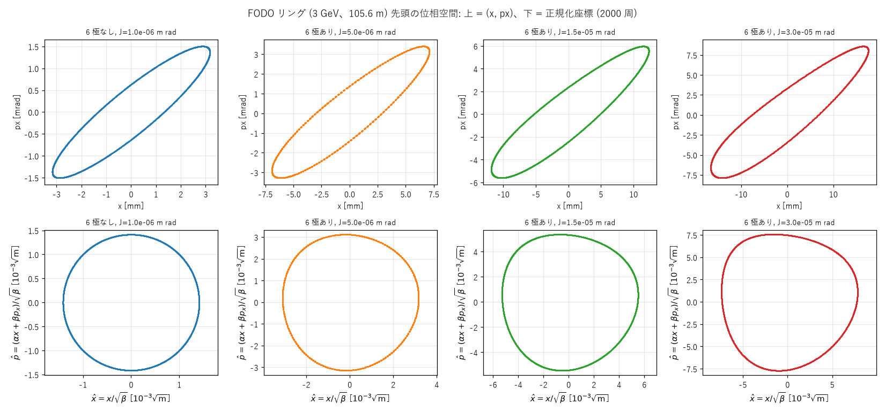
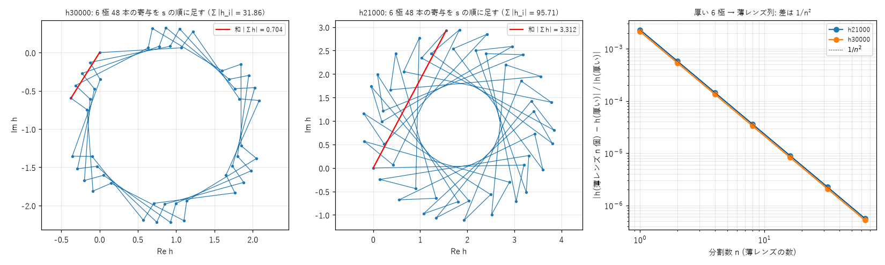
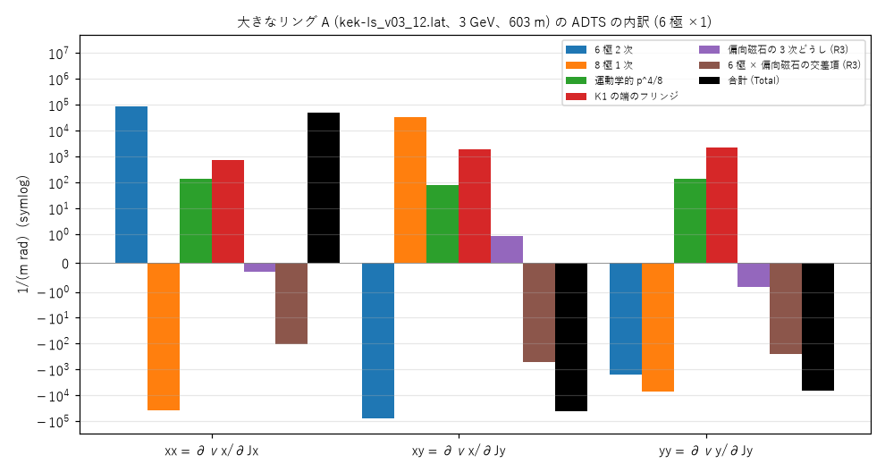
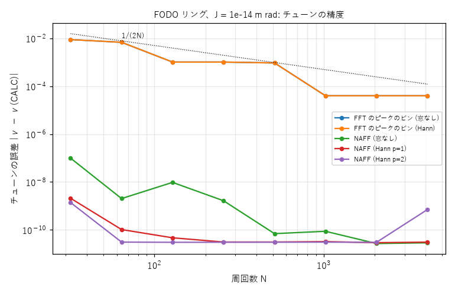
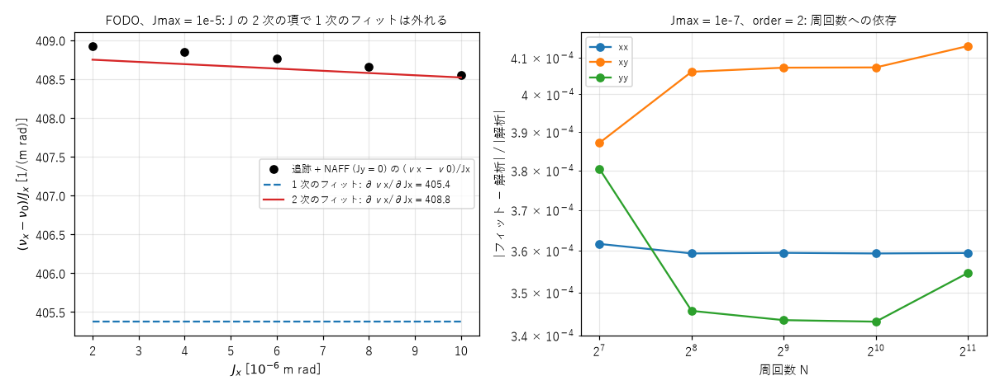
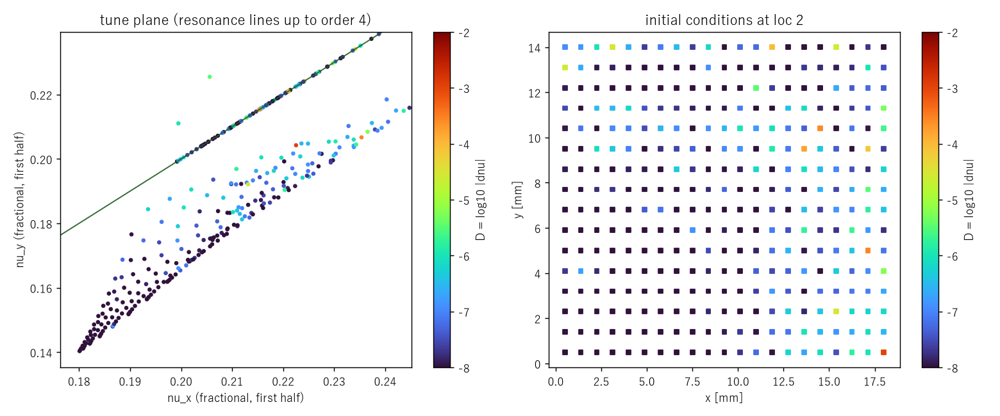
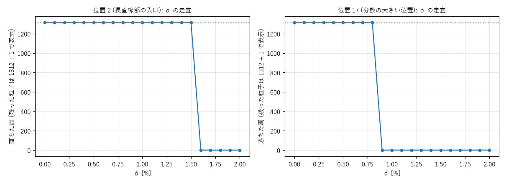

# 入門: 振幅依存チューンシフト (ADTS)・共鳴駆動項 (RDT)・周波数マップ・局所運動量アクセプタンス (LMA) を、何をどうやって求めたか

この文書で分かること: 6 極などの非線形磁場が粒子の運動に与える影響 (共鳴の駆動、振幅に依るチューンのずれ、周波数マップ、運動量アクセプタンス) を、pysad で何をどう計算し、何と比べたか。式の意味、方法の考え方、実際に走らせた数値例を順に説明します。
前提: ベータトロン振動、Twiss パラメータ、チューン、クロマティシティの基礎。SAD や pysad の使い方は §8 の例で分かります。
読む順: §1 (全体像) → §2〜§5 (理論と解析式) → §6〜§7 (追跡との比較と結果) → §8 (手を動かす)。略語・記号は §9 の用語集。

加速器の基礎 (ベータトロン振動、Twiss パラメータ、チューン、クロマティシティ) は知っているが、ADTS や RDT の理論と、pysad で何をどう計算して何と比べたかを順に知りたい読者向けの入門です。
詳しい仕様・検証は [docs/26](26_frequency_map_lma.md) (周波数マップ・LMA) と [docs/25](25_resonance_terms_adts.md) (RDT・ADTS・クロマティシティ)、台本ごとの数値は [example/14_nonlinear_dynamics/adts_rdt/ADTS_summary.md](../example/14_nonlinear_dynamics/adts_rdt/ADTS_summary.md) にあります。この文書は、それらを読む前の地図と、式の意味・方法の考え方・実際に走らせた数値例です。

- **解析式の位置づけ**: 解析式は、摂動論の定義された次数と、入れた効果の範囲で原理的に作ります。追跡 (全非線形) とは入れている効果が違うので、厳密な一致は目的ではなく、追跡に合わせるための補正項・当てはめは足していません。この文書と docs/25 は、各式について「入れている効果と次数」「入れていない効果」「差の原因」を書き、追跡との一致の数値は検証の結果として載せます。追跡から係数を取り出す唯一の部分 (偏向磁石の生成関数) は、写像の 2 次のテイラー係数が生成関数を一意に決める、という原理に基づきます ([docs/25 §8.1](25_resonance_terms_adts.md))。差の主因は docs/25 §11.9。
- 数値は、出力ファイルから転記したものか、この文書のために実際に走らせて得た値です (走らせた条件は各節と §8)。推測の数値は書いていません。
- 追跡の条件の共通部分: 互換モード k64 (gs と同じ追跡。ただし §6(c)(d)・§8(4) の周波数マップと LMA は v2)、RF 空洞は止める (`rfsw=False`)、放射なし、結合・誤差なし、δ = 0、リング先頭から出発。
- 例に使うラティス: FODO ([`example/00_lattice/FODO_ring.sad`](../example/00_lattice/FODO_ring.sad)、24 セル、3 GeV、周長 105.600 m、νx = 6.696329、νy = 4.906056。6 極 SF・SD の K2L = 4, −6 [1/m²] を文字列で入れる。元のファイルは K2 = 0)、ASTRID2 ([`example/astrid/lattice/ASTRID2_v01_01.sad`](../example/astrid/lattice/ASTRID2_v01_01.sad)、0.58 GeV、45.704 m、νx = 5.179990、νy = 2.140178)、大きなリング A ([`pysad/tests/kek-ls_v03_12.lat`](../pysad/tests/kek-ls_v03_12.lat)、3 GeV、603.12 m、νx = 47.580034、νy = 17.620044。KEK-LS は ESRF 型の HMBA (Hybrid Multi-Bend Achromat) で、ESRF の Pantaleo Raimondi 氏と Simone Liuzzo 氏の協力で設計した。)。FODO の 6 極の強さは玩具の値で、実機の設計値ではありません。
- 図と数値を作ったスクリプトは `example/14_nonlinear_dynamics/primer/primer_*.py` (図は同じ名前の `.png`)。リポジトリ直下から `py -3.12 example/14_nonlinear_dynamics/primer/primer_xxx.py` で走ります。**標準出力をファイルにリダイレクトするときは環境変数 `PYTHONUTF8=1` が要ります** (無いと日本語が文字化けします。数値は同じ。PowerShell なら `$env:PYTHONUTF8 = "1"`)。
- 記号: J は作用 (単位 m rad)、$\partial\nu/\partial J$ の単位は 1/(m rad)、`xx` = $\partial\nu_x/\partial J_x$、`xy` = $\partial\nu_x/\partial J_y$ (= $\partial\nu_y/\partial J_x$)、`yy` = $\partial\nu_y/\partial J_y$。

## 目次

1. [何を求めるか (全体像)](#1-何を求めるか-全体像)
2. [基礎: 位相空間と作用・角変数](#2-基礎-位相空間と作用角変数)
3. [ハミルトニアンと摂動](#3-ハミルトニアンと摂動)
4. [RDT の解析式と、厚い 6 極・薄レンズ](#4-rdt-の解析式と厚い-6-極薄レンズ)
5. [ADTS の解析式](#5-adts-の解析式)
6. [追跡 + FFT で求める方法](#6-追跡--fft-で求める方法)
7. [解析と追跡の比較](#7-解析と追跡の比較)
8. [手を動かす](#8-手を動かす)
9. [用語集と参考文献](#9-用語集と参考文献)

---

## 1. 何を求めるか (全体像)

リングの粒子が長く回り続けられるか (寿命・ダイナミックアパーチャ・入射効率) は、非線形な磁場 (主に 6 極) が作る運動で決まります。それを 5 つの量で見ます。

| 量 | 何の量か | 何のために要るか | pysad の対応 |
|---|---|---|---|
| **周波数マップ** | 初期条件 (x, y、または δ) の格子ごとに、前半と後半の周回でチューンがどれだけ変わるか。$D = \log_{10}\sqrt{\Delta\nu_x^2+\Delta\nu_y^2}$ | ダイナミックアパーチャの内部構造 (どの共鳴線が効いているか) を、長い追跡なしに見る。入射効率・ビームの生き残りの見当 | `pysad.freqmap.frequency_map`、台本 `FrequencyMap[]`、[docs/26](26_frequency_map_lma.md) §3、例 `example/14_nonlinear_dynamics/frequency_map/fmap_*` |
| **局所運動量アクセプタンス (LMA)** | リングの位置 s ごとに、失われずに周回できる運動量のずれの範囲 $\delta_+(s)$・$\delta_-(s)$ | Touschek 寿命 (散乱された粒子が受容の外に出るか) を位置ごとに正しく見積もる。一様な受容の仮定より現実的 | `pysad.lma.momentum_acceptance`、台本 `MomentumAcceptance[]`・`TouschekLifetimeLMA[]`、[docs/26](26_frequency_map_lma.md) §4、例 `example/15_lma_touschek/lma/lma_*` |
| **共鳴駆動項 (RDT)** | 非線形磁場が各共鳴をどれだけ強く駆動するか。ハミルトニアンの係数 $h_{jklmp}$ | どの 6 極が、どの共鳴 (3νx、νx−2νy など) を励起するかの定量。6 極の配置の最適化、ダイナミックアパーチャの制限の原因探し | `pysad.resdrive.resonance_terms`、台本 `ResonanceDrivingTerms[]`、[docs/25](25_resonance_terms_adts.md) §2、例 [`example/14_nonlinear_dynamics/adts_rdt/fn_ResonanceDrivingTerms_fodo.sad`](../example/14_nonlinear_dynamics/adts_rdt/fn_ResonanceDrivingTerms_fodo.sad) |
| **振幅依存チューンシフト (ADTS)** | 振幅 (作用 J) が大きい粒子のチューンのずれ $\partial\nu/\partial J$ | 振幅が大きくなるとチューンが動いて共鳴線にぶつかる。ダイナミックアパーチャと入射効率の目安。周波数マップの色の理由 | `pysad.resdrive.adts`、台本 `AmplitudeTuneShift[]`、[docs/25](25_resonance_terms_adts.md) §2・§7・§8、例 `example/14_nonlinear_dynamics/adts_rdt/adts_*`・`adts_bend_*` |
| **クロマティシティ** | チューンの運動量依存 $\xi = \partial\nu/\partial\delta$ (と高次) | 運動量のずれた粒子が共鳴線に当たらないように。ビームの不安定性の抑制 (頭尾不安定性)、Touschek 寿命、運動量アクセプタンス | `pysad.resdrive.chromaticity_numeric`・`chromaticity_sextupole`、台本 `ChromaticityTerms[]`、[docs/25](25_resonance_terms_adts.md) §4 |

関係は次のとおりです。

- 6 極は (1 次の) 共鳴を駆動する (RDT) と同時に、2 次の効果で振幅によるチューンのずれ (ADTS) を作る。δ との結合 (分散のあるところの 6 極) はクロマティシティを作る。ADTS と δ 依存は、どちらも「J と δ の多項式で書いたチューン」の係数です。
- ADTS が大きいと、振幅が増すにつれチューンが大きく動く。動いた先に共鳴線があると、周波数マップの D が大きくなる (拡散する)。つまり、**周波数マップが「結果の地図」、RDT と ADTS が「原因の係数」** です。
- LMA は位置ごとの δ の限界を追跡で直接求める。δ の限界は、クロマティシティ・非線形な δ 依存・RF バケット・アパーチャで決まる。

pysad の機能の範囲: K64 (gs) には周波数マップ・LMA・RDT・ADTS の機能がなく (K64 の TRACK の Fourier 解析はあるが FFS から使えない)、すべて pysad のみの新機能です。追跡自体は K64 と一致するように作ってあり (docs/26 §5)、ADTS の基準値は追跡 (gs と一致) です。

---

## 2. 基礎: 位相空間と作用・角変数

水平方向の線形な運動は、リング上の 1 点で (x, px) 平面の楕円を描きます。Twiss パラメータ (α, β) で正規化した座標

$$\hat x=\frac{x}{\sqrt\beta},\qquad \hat p=\frac{\alpha x+\beta p_x}{\sqrt\beta}$$

を使うと、軌跡は円になります。pysad (と SAD) の向きの規則で、作用 J と角度 φ を次のように定めます。

$$\hat x=\sqrt{2J}\cos\phi,\qquad \hat p=-\sqrt{2J}\sin\phi,\qquad \phi_n=\phi_0+2\pi\nu n\quad(n:\text{周回数})$$

すなわち

$$x=\sqrt{2J\beta}\cos\phi,\qquad p_x=-\sqrt{\frac{2J}{\beta}}\,(\sin\phi+\alpha\cos\phi)$$

- **J の定義と単位**: $J=\dfrac{\hat x^2+\hat p^2}{2}=\dfrac{\gamma x^2+2\alpha x p_x+\beta p_x^2}{2}$ (γ = (1+α²)/β)。単位は m rad (エミッタンス ε と同じ次元。「1 粒子のエミッタンス」の半分、ε = 2J、とも言えます)。J は線形な運動では保存し、位相空間の円の面積の $1/2\pi$ です。
- 最大振幅は $x_{\max}=\sqrt{2J\beta_x}$。FODO のリング先頭 ($\beta_x$ = 5.0252 m、$\alpha_x$ = −2.1663) で J = 1e-6 m rad なら 3.170 mm です (図を作る `primer_phase_space.py` の出力)。
- チューン ν は 1 周で φ が進む量 / 2π。**非線形があると ν が J の関数になる** (ADTS)。作用 J は保存しなくなり、角度に依存して振動する (RDT)。



図: FODO リング (3 GeV、105.6 m、24 セル) のリング先頭の 1 粒子の軌跡 (2000 周)。上段 = (x, px) で楕円、下段 = 正規化座標。左端 = 6 極なし、J = 1e-6 m rad (x の最大 3.170 mm、px の最大 1.505 mrad、円の半径の最大/最小 = 1.0006)。
右 3 つ = 6 極あり (K2L = 4, −6)、J = 5e-6、1.5e-5、3e-5 m rad: 円が三角形にゆがむ (半径の最大/最小 = 1.076、1.136、1.199)。三角形は 3 次のハミルトニアン (6 極) が作る形で、h30000 (3νx の共鳴) と h21000 の効果です (§4)。
NAFF のチューン (符号つき端数。0.696329 − 1 = −0.303671): 線形 −0.303671 に対し、6 極なし J = 1e-6 で −0.303596 (運動学的な項と四極の端のフリンジによる ADTS で 7.5e-5 動く。§5)、6 極あり J = 5e-6、1.5e-5、3e-5 で −0.301677、−0.297801、−0.292146。
(`py -3.12 example/14_nonlinear_dynamics/primer/primer_phase_space.py`、初回は numba のキャッシュを含めて約 40 s)

---

## 3. ハミルトニアンと摂動

### 3.1 複素変数

(x̂, p̂) から複素変数を作ります。結合定数 $h_{jklmp}$ との紛れを避けるため、文献で $h_x^\pm$ と書かれることが多いこの変数を、ここでは $\zeta$ と書きます。

$$\zeta_x^{\pm}=\hat x\mp i\hat p=\sqrt{2J_x}\,e^{\pm i\phi_x}\qquad(y\ \text{も同様})$$

(pysad の追跡と NAFF が使う信号 $z=\hat x-i\hat p$ は $\zeta^+$ です。位相が $2\pi\nu n$ で進み ν > 0 になります。) 線形な運動では $\zeta^\pm$ は 1 周ごとに $e^{\pm 2\pi i\nu}$ 倍されるだけです。

### 3.2 線形 + 非線形の摂動

s 方向のハミルトニアン (パラキシャル。docs/25 §2) は、線形な部分 (チューン) と非線形な摂動の和です。

$$H=\underbrace{\nu_x J_x+\nu_y J_y}_{\text{線形 (周で平均)}}+\underbrace{H_3+H_4+\cdots}_{\text{非線形}}$$

6 極 (K2) の 3 次の項は $H_3=\dfrac{K_2}{6}(x^3-3xy^2)$ (K2L の薄いレンズでは s の δ 関数)、8 極 (K3) の 4 次の項は $H_4=\dfrac{K_3}{24}(x^4-6x^2y^2+y^4)$ です。偏向磁石・四極の端部・運動学的な項 $(p_x^2+p_y^2)^2/8$ などもこの形の多項式の項を作ります (§5)。

非線形な項があっても、小振幅で摂動が小さければ、**座標変換 (Lie 変換) で非線形な項の大部分を消せます**。Lie 変換は、あるハミルトニアン (生成関数) $f$ の流れ $e^{:f:}$ で座標を変える方法で、1 次の摂動 ($H_3$ のうち共鳴していない項) は $f_3$ で消え、2 次では $f_3$ どうしの括弧積が $J^2$ に比例する項を残します。残った平均化したハミルトニアン $K(J)$ から

$$\nu_x=\frac{1}{2\pi}\frac{\partial K}{\partial J_x}\ \ \text{(1 周のハミルトニアンの場合)}$$

のようにチューンの J 依存 (ADTS) が出ます。

### 3.3 1 周のハミルトニアンと $h_{jklmp}$

3 次の項 $H_3$ を、リング全体で足して $\zeta^\pm$ と δ の単項式に展開すると、次の形になります (docs/25 §2)。

$$H_3=\sum h_{jklmp}\,(2J_x)^{\frac{j+k}{2}}(2J_y)^{\frac{l+m}{2}}\,\delta^{p}\,e^{\,i[(j-k)\phi_x+(l-m)\phi_y]}
=\sum h_{jklmp}\,(\zeta_x^+)^j(\zeta_x^-)^k(\zeta_y^+)^l(\zeta_y^-)^m\,\delta^p$$

j, k は $\zeta_x^+$, $\zeta_x^-$ のべき、l, m は $\zeta_y^\pm$ のべき、p は δ のべきです。この単項式は角度に $e^{i[(j-k)\phi_x+(l-m)\phi_y]}$ で依存するので、**$(j-k)\nu_x+(l-m)\nu_y$ が整数に近いとき、その項は 1 周ごとに位相がそろって効き続けます (共鳴)**。$h_{kjmlp}=\bar h_{jklmp}$ なので、独立なのは半分です。

| $h_{jklmp}$ | 関わる共鳴・量 | 何を引き起こすか |
|---|---|---|
| h30000 | $3\nu_x$ = 整数 | 3 次共鳴。位相空間に三角形の島を作る。大振幅で粒子を失う |
| h21000 | $\nu_x$ = 整数 | 水平の 1 次の位相空間のゆがみ (三角形)。ADTS の主要な部分 (調和 k = (1, 0)) |
| h10110 | $\nu_x$ = 整数 (y の振幅に依存) | 水平のゆがみが y の振幅 $J_y$ で変わる。xy の結合的な非線形 |
| h10020 | $\nu_x-2\nu_y$ = 整数 | 差の 3 次共鳴 (x と y の間でエネルギーが移る) |
| h10200 | $\nu_x+2\nu_y$ = 整数 | 和の 3 次共鳴 (不安定になりうる) |
| h11001 | $J_x\delta$ の項 | 水平のクロマティシティ $\xi_x=h_{11001}/\pi$ (6 極の 1 次) |
| h00111 | $J_y\delta$ の項 | 垂直のクロマティシティ $\xi_y=h_{00111}/\pi$ |
| h20001・h00201 | $e^{\pm2i\phi}\delta$ | クロマティックなベータ関数の変調 (δ に依るベータの位相の 2 倍の変調) |
| h10002 | $\zeta_x^+\delta^2$ | 2 次の分散 (x に δ² で効く) |

h30000 と h21000 を比べると、h30000 は $e^{3i\phi_x}$ なので $3\nu_x$ が整数のとき、h21000 は $e^{i\phi_x}$ なので $\nu_x$ が整数のときだけ共鳴ですが、チューンが整数から遠くても、h21000 などは 2 次の摂動 (ADTS) とチューンの位相空間のゆがみを作ります。

作動点の「整数・半整数・3 次までの共鳴線」までの距離は、`resonance_terms` の結果の表に必ず出ます (docs/25 §5)。

### 3.4 4 次の項 $h_{jklm}$ と「6 極の 2 次」

3 次の項 $h_{jklmp}$ は 6 極の**強さの 1 乗**で効く 1 周のハミルトニアンの項です。強さの **2 乗**で効く項は 4 次 ($j+k+l+m=4$) で、$h_{22000},h_{11110},h_{00220}$ (振幅依存チューンシフト) のほか、非対角の項が共鳴を駆動します。

| $h_{jklm}$ | 共鳴 |
|---|---|
| h22000・h11110・h00220 | ADTS (対角。共鳴ではない) |
| h31000・h13000 | $2\nu_x$ = 整数 (半整数) |
| h40000 | $4\nu_x$ = 整数 |
| h20020・h02002 など | $2\nu_x-2\nu_y$ = 整数 ($\nu_x-\nu_y$ = 半整数・整数。**$\nu_x-\nu_y$ そのもの ($h_{2101}$ など、y の奇数べき) は上下対称な磁石では駆動されない**) |
| h20200 | $2\nu_x+2\nu_y$ |
| h00400・h00310 | $4\nu_y$・$2\nu_y$ |

求め方は 3 次と同じ「式 → 積分 → 和」です。1 周の写像を Lie 代数で $M=R\,e^{:F:}$、$F=-h_3-h_4-\cdots$ と書き、素子ごとのハミルトニアン $H(s)$ (相互作用表示) の時間順序つきの指数を Magnus 展開すると、

$$h_3=\int H_3\,ds,\qquad h_4=\underbrace{\int H_4\,ds}_{\text{8 極・運動学・端のフリンジ…}}+\underbrace{\tfrac12\sum_{s_l>s_e}\{H_3(s_l),H_3(s_e)\}\,ds_l\,ds_e}_{\text{3 次の項どうし (6 極の 2 次)}}$$

($\{\ ,\ \}$ はポアソン括弧。複素変数では $\{\zeta^a\bar\zeta^b,\zeta^c\bar\zeta^d\}=2i(ad-bc)\zeta^{a+c-1}\bar\zeta^{b+d-1}$)。後ろの項は「後の素子 − 前の素子」の順序つきの対の和なので、素子の並びが効きます (1 次は並びによらず足すだけ)。厚い 6 極の内部の対 ($s_1>s_2$ が同じ素子) は閉じた式で積分します (docs/25 §10.2)。
ADTS の $\partial\nu/\partial J$ は、この対角の項 $h_{22000}$ などから $4h_{22000}/\pi$ ($\nu_x$ の $J_x$ 依存) と書け、さらに 3 次の項の非共鳴の摂動 (正規形の補正、$\cot\pi x_k\,|h_{3,k}|^2$ の型) を足したものが `adts()` と一致します (docs/25 §10.4、1e-15)。

使い方: `resonance_terms(lat, ['h22000','h31000'])` (4 次の名前は自動で 4 次の計算に回る。`order2=True` が既定)。

---

## 4. RDT の解析式と、厚い 6 極・薄レンズ

### 4.1 薄い 6 極の式の導き方

薄い 6 極 (積分値 K2L、位置 $s_n$) の 3 次のハミルトニアンは $\dfrac{K_2L}{6}(x^3-3xy^2)\,\delta(s-s_n)$ です。そこでの水平座標は、位相の進み $\mu_x$ (リング先頭が基準) と $\beta_x$ から

$$x=\frac{1}{2}\left(w_x\zeta_x^++\bar w_x\zeta_x^-\right),\qquad w_x=\sqrt{\beta_x}\,e^{i\mu_x}\qquad(y\ \text{も同様に}\ w_y)$$

と書けるので、$x^3$ を展開すると

$$x^3=\frac18\left(w_x^3(\zeta_x^+)^3+3w_x^2\bar w_x(\zeta_x^+)^2\zeta_x^-+3w_x\bar w_x^2\zeta_x^+(\zeta_x^-)^2+\bar w_x^3(\zeta_x^-)^3\right)$$

です。ここから係数を読むだけで、リング全体の薄い 6 極の和として、docs/25 と同じ式が出ます (pysad の符号と規格化 = H の係数そのもの)。

$$h_{30000}=\frac{1}{48}\sum_n K_2L_n\,\beta_{x,n}^{3/2}\,e^{3i\mu_{x,n}},\qquad
h_{21000}=\frac{1}{16}\sum_n K_2L_n\,\beta_{x,n}^{3/2}\,e^{i\mu_{x,n}}$$

$$h_{10110}=-\frac18\sum_n K_2L_n\,\beta_{x,n}^{1/2}\beta_{y,n}\,e^{i\mu_{x,n}},\qquad
h_{10020}=-\frac1{16}\sum_n K_2L_n\,\beta_{x,n}^{1/2}\beta_{y,n}\,e^{i(\mu_{x,n}-2\mu_{y,n})},\qquad
h_{10200}=-\frac1{16}\sum_n K_2L_n\,\beta_{x,n}^{1/2}\beta_{y,n}\,e^{i(\mu_{x,n}+2\mu_{y,n})}$$

(h30000 の係数は $\frac{K_2L}{6}\cdot\frac18=\frac{K_2L}{48}$、h21000 は $\frac{K_2L}{6}\cdot\frac38=\frac{K_2L}{16}$、y を含む項は $-3xy^2\cdot\frac{K_2L}{6}=-\frac{K_2L}{2}xy^2$ から。)
分散のある 6 極では $x\to x+\eta_x\delta$ とすると、$\frac{K_2L}{2}\eta_x\delta\,x^2$ の項が残り、$\langle x^2\rangle=\beta_xJ_x$ なので

$$h_{11001}=\frac14\sum_n K_2L_n\,\eta_{x,n}\beta_{x,n},\qquad h_{00111}=-\frac14\sum_n K_2L_n\,\eta_{x,n}\beta_{y,n}$$

が出て、$\nu=\dfrac1{2\pi}\dfrac{\partial H}{\partial J}$ からクロマティシティ $\xi=h/\pi$ (6 極の 1 次の寄与。FODO で $\xi_x$ = 17.4741、$\xi_y$ = 16.6062、[docs/25](25_resonance_terms_adts.md) §6 と §8 の記述、例 `fn_ResonanceDrivingTerms_fodo.sad` の `SextupolePart`) になります。

**符号の注意**: 文献 (Bengtsson 型) の式は符号を反転して定義されることが多く、pysad の h は文献の h の −1 倍です (FODO で比 −1.00000000、虚部 1e-14 以下。[`example/14_nonlinear_dynamics/adts_rdt/ADTS_summary_rdt_check.py`](../example/14_nonlinear_dynamics/adts_rdt/ADTS_summary_rdt_check.py)、[ADTS_summary.md](../example/14_nonlinear_dynamics/adts_rdt/ADTS_summary.md) §6.5(b))。規格化 ($1/(j!k!l!m!)$ の因子) と位相の定義は一致しました。ただし文献の原文は未読で、h30000 以外の式の形は記憶に基づきます。

### 4.2 6 極の寄与の和: 打ち消し

h は 6 極 1 本ずつの寄与 (複素数、位相 $e^{i\mu}$ を持つ) の和です。FODO の 48 本の 6 極 (SF 24 本、SD 24 本) で、s の順に足した軌跡を描くと:



図 (左・中): h30000 は Σ|h_i| = 31.861 に対し |Σ h_i| = 0.7035 (Σ h_i = −0.373134 − 0.596393i)、h21000 は Σ|h_i| = 95.711 に対し |Σ h_i| = 3.3122 (1.550963 + 2.926637i)。位相が回って打ち消し合うので、和は個々の寄与の 1/45 程度 (h30000)、1/29 (h21000) になります。
6 極の配置の最適化 (「6 極の位相進みを選んで h を打ち消す」) は、この打ち消しを使います。FODO の 24 セルは周期的なので、3νx = 20.089、νx = 6.696 が整数から離れているとき、同じ位相の寄与が集まらず、和が小さくなります (`resonance_terms` の `per_element` が 6 極ごとの寄与)。

### 4.3 厚い 6 極と薄レンズとの関係

実際の 6 極は長さ L を持ちます (FODO は 0.2 m)。pysad (`method='analytic'`) は、素子の中の $w(s)$ と $\eta(s)$ を線形な転送行列で求め、$\int_0^L w^j\bar w^k\cdots ds$ を**厳密に**積分します。素子の中は 6 極の場合ドリフトなので $w$ は s の 1 次式で、積分は閉じた形になります。

- **薄レンズ極限**: K2L を一定にして L → 0 にすると厚い式は薄レンズの式に一致します (L = 2e-5 で差 1e-4 の程度、L に比例して 0 に近づく。[`example/14_nonlinear_dynamics/adts_rdt/rdt_thick_thin.py`](../example/14_nonlinear_dynamics/adts_rdt/rdt_thick_thin.py))。
- **n 分割での収束**: 厚い 6 極を n 個の薄レンズ (各区間の中央に K2L/n) に分けた列の h は、n を 2 倍にするごとに厚い式との差が 1/4 になります。FODO の h21000・h30000 で、n = 1、2、4、…、64 の相対差は h21000: 2.308e-3、5.770e-4、1.443e-4、3.606e-5、9.016e-6、2.254e-6、5.635e-7 (比はどれも 4.00)、h30000: 2.131e-3 … 5.202e-7 (比 4.00)。図の右。これは薄レンズ列の「中点則」の誤差が $1/n^2$ だからです。
- つまり**薄レンズ (トラッキングの MULT) と厚い 6 極 (SEXT) のどちらも同じ入口で扱え、違いは 1/n² の高次の項**です。n = 1 (6 極の中央に薄レンズ 1 個) でも h21000 で 0.23% の差です。

(`py -3.12 example/14_nonlinear_dynamics/primer/primer_rdt.py`、約 2.4 s。FODO、3 GeV、105.6 m、位相の基準はリング先頭、δ = 0)

---

## 5. ADTS の解析式

### 5.1 なぜ 6 極の 1 次ではチューンシフトが出ず、2 次になるか

ADTS は、J のべきで $\nu=\nu_0+\dfrac{\partial\nu}{\partial J}J+\cdots$ と書いたときの 1 次の係数で、ハミルトニアンの $J^2$ の項 ($K=\tfrac12\sum c_{ab}J_aJ_b$ の形) から出ます。

**1 次の摂動 (周で平均した $H_3$)**: 3 次のハミルトニアンの各項は $e^{i[(j-k)\phi_x+(l-m)\phi_y]}$ の位相を持ちます。平均して残るのは位相が消える項 ($j=k$ かつ $l=m$) だけですが、3 次の項は $j+k+l+m=3$ (奇数) なので、**j = k かつ l = m にはなれず、平均は必ず 0 です**。平均が 0 でも、位相空間は変形します (図の三角形) が、チューンは変わりません。

物理の言葉では、6 極の力は $\Delta p\propto x^2$ で、x と −x で同じ向きに働きます。チューンを変えるのは「x に比例する力」(実効的な四極) ですが、$x^2$ の力を位相 φ で平均しても x に比例する成分は残りません (位相空間が三角形にゆがむだけです)。チューンのずれが振幅の 2 乗 (J の 1 次) で出るには 4 次の項が要り、6 極 1 つでは作れない、ということです。

**2 次の摂動 (6 極 × 6 極)**: 6 極のキックで粒子が少し動き (位相空間のゆがみ = 1 次の効果)、その動いた先でもう一度 6 極のキックを受けると、$x^2\to(x+\delta x)^2\ni 2x\,\delta x$、$\delta x\propto x^2$ から $x^3$ の力、つまり**実効的な8 極 (振幅 J に比例した四極の強さ) として効きます**。次数は 4 次 ($J^2$ の項) になり、ADTS が出ます。ゆがみ $\delta x$ は 6 極の強さに比例し、力も 6 極の強さに比例するので、**ADTS (6 極) は強さの 2 乗に比例**します。一方、8 極 (4 次の項) は 1 次の摂動で、強さの 1 乗に比例します。

数値で確かめます (FODO、3 GeV、105.6 m、強さ K2L = λ(4, −6))。

| λ | 解析の 6 極 2 次 (xx, xy, yy) [1/(m rad)] | λ = 1 に対する比 |
|---|---|---|
| 0.5 | 80.852, −118.506, 124.018 | 0.25 |
| 1 | 323.410, −474.023, 496.072 | 1 |
| 2 | 1293.638, −1896.092, 1984.287 | 4 |
| −1 | 323.410, −474.023, 496.072 | 1 (符号を反転しても同じ) |

追跡 + NAFF + フィットの直接の ADTS (強さを変えない方法。§6(a)、Jmax = 1e-7、1024 周、order = 2) を λ = +1、−1、0 で求めると、

| | xx | xy | yy |
|---|---|---|---|
| f(+1) | 408.990 | −412.737 | 519.946 |
| f(−1) | 387.121 | −398.960 | 619.460 |
| f(0) | 74.610 | 68.182 | 73.570 |
| 偶数部 C = (f(+1)+f(−1)−2f(0))/2 | 323.446 | −474.030 | 496.133 |
| 解析の 6 極 2 次 | 323.410 | −474.023 | 496.072 |
| 奇数部 (f(+1)−f(−1))/2 | 10.935 | −6.888 | −49.757 |
| 解析の交差項 (6 極 × 偏向磁石) | 10.935 | −6.888 | −49.757 |

偶数部が 6 極 2 次 (差 1e-4、1.5e-5、1.2e-4)、奇数部が 6 極 × 偏向磁石の交差項 (差 0.001 未満) に一致します ([`example/14_nonlinear_dynamics/primer/primer_sext_even_odd.py`](../example/14_nonlinear_dynamics/primer/primer_sext_even_odd.py)、約 7 s)。**偶数部だけを取り出す比較が 6 極の 2 次だけを検証する、という方法の仕組み** がこれです。

### 5.2 2 次の摂動の式 (6 極 × 6 極)

周期的な時間 $\theta=2\pi s/C$ を持つ $H=Q\cdot J+V(J,\phi,\theta)$ の 2 次の平均化ハミルトニアンは (docs/25 §2、1 次元の静的な 3 次の非調和振動子で Landau の $\delta\omega=-\tfrac5{12}\alpha^2a^2/\omega^3$ と一致することを確認した式)

$$K_2(J)=-\frac12\sum_{(\mathbf k,n)\neq0}\frac{\mathbf k\cdot\nabla_J\,|V_{\mathbf kn}(J)|^2}{\mathbf k\cdot\mathbf Q+n}$$

です。k = (kx, ky) は 3 次の項の調和 (3,0)、(1,0)、(1,±2) とその符号反転で、分母 $\mathbf k\cdot\mathbf Q+n$ は**共鳴の分母**です。n について足し、素子の位置の対 (s₁, s₂) の和にすると、分母は $\sin\pi x_{\mathbf k}$ ($x_{\mathbf k}=\mathbf k\cdot\mathbf Q$) になります (docs/25 §2 の $S_\mathbf k$)。**3νx、νx±2νy、νx が整数に近いと ADTS は発散**します (その共鳴の近くでは 1 次の摂動が使えません)。

調和ごとの寄与の例 (FODO、6 極 2 次の xx; $\pm\mathbf k$ の両方を足すので表の値は 2 倍): k = (3, 0) の 3νx の項が +315.927 (×2)、k = (1, 0) の νx の項が −154.222 (×2)。合計 xx = 2 × (315.927 − 154.222) = 323.41。xy は k = (1, 0)、(1, ±2) の寄与 (−419.309、+340.889、−158.591 の ×2) の和 −474.023 です (`a.by_harmonic`、§8(2))。

### 5.3 8 極の 1 次

$H_4=\dfrac{K_3L}{24}x^4\,\delta(s-s_n)$ の $\phi$ 平均は、$\langle x^4\rangle=\tfrac38(2J\beta)^2$ から $\dfrac{K_3L}{16}\beta^2J^2$ なので、$\nu=\dfrac1{2\pi}\dfrac{\partial K}{\partial J}$ から

$$\frac{\partial\nu_x}{\partial J_x}=\sum\frac{K_3L\,\beta_x^2}{16\pi},\qquad
\frac{\partial\nu_x}{\partial J_y}=-\sum\frac{K_3L\,\beta_x\beta_y}{8\pi},\qquad
\frac{\partial\nu_y}{\partial J_y}=\sum\frac{K_3L\,\beta_y^2}{16\pi}$$

となります。数値例: FODO のリング先頭に薄い 8 極 (K3L = 1e4 [1/m³]、6 極なし) を 1 個置く。式 (βx = 5.0252 m、βy = 2.5577 m) = 5023.822、−5113.935、1301.416。pysad の解析 `adts().octu` は同じ値 (差 5e-16)。追跡 + NAFF + フィット (8 極あり − なし、Jmax = 1e-7、1024 周) は 5023.450、−5113.991、1301.455 で、式との差 −7.4e-5、−1.1e-5、3.0e-5 ([`example/14_nonlinear_dynamics/primer/primer_octupole.py`](../example/14_nonlinear_dynamics/primer/primer_octupole.py)、約 6 s)。

### 5.4 運動学的な項と四極の端部のフリンジ (1 次)

6 極でない非線形な項も、1 次の摂動で ADTS を作ります (docs/25 §2)。

- **運動学的な項**: ドリフトのハミルトニアン $-\sqrt{1-p^2}$ の 4 次 $H_4=(p_x^2+p_y^2)^2/8$。$\gamma=(1+\alpha^2)/\beta$ として $\partial\nu_x/\partial J_x=\dfrac{3}{16\pi}\oint\gamma_x^2\,ds$、$\partial\nu_x/\partial J_y=\dfrac1{8\pi}\oint\gamma_x\gamma_y\,ds$、$\partial\nu_y/\partial J_y=\dfrac3{16\pi}\oint\gamma_y^2\,ds$。
- **四極端部のフリンジ**: K64 の既定 (DISFRIN = 0、FRINGE = 0) で、四極と K1 ≠ 0 の偏向磁石の端に Lee-Whiting の非線形フリンジが入ります。端での 3 次のハミルトニアン $H_f=\sigma\dfrac{K_1}{12}\left[(x^3+3xy^2)p_x-(y^3+3x^2y)p_y\right]\delta(s-s_\text{端})$ (σ = +1 入口、−1 出口) から、$\partial\nu_x/\partial J_x=-\dfrac1{8\pi}\sum\sigma K_1\alpha_x\beta_x$ など。α・β は端での値。この「端」は 3 次の項ですが、**この項は 4 次の項 ($x^3p_x$ など) なので、1 次の摂動で効きます** (K64 の写像の端の項の係数は docs/25 §2)。

### 5.5 偏向磁石の 3 次の項と 6 極との交差項

偏向磁石は 3 次の項 (曲率 $\tfrac h2x(p_x^2+p_y^2)$、硬い端 $\pm\tfrac h2p_xy^2$、複合機能の本体 $\tfrac{K_1h}6x^3$、E1・E2 ≠ 0 の端) を持ちます。3 次なので 6 極と同様に 2 次の摂動で ADTS を作ります。

- **偏向磁石の 3 次どうしの対** (`.bend`): 6 極の強さに依らない。
- **6 極 × 偏向磁石の交差項** (`.cross`): 6 極の強さに**比例** (§5.1 の奇数部)。6 極の 3 次と偏向磁石の 3 次の積は 4 次になるので、1 つの強さの 1 乗の ADTS が出ます。

係数は、K64 の追跡の 1 要素の写像から数値的に取り出します ([`pysad/bendnl.py`](../pysad/bendnl.py)、docs/25 §8)。偏向磁石を 入口の端・本体の n 分割・出口の端に分け、写像の 2 次の部分から Lie 生成関数 (3 次の同次式) を求め、6 極と同じ形の単項式の振幅にして 2 次の式に渡します。

#### 5.5.1 偏向磁石の項は何をどう求めたか (原理)

偏向磁石の項を「追跡の写像から取り出す」のは、次の 5 つの理由で、解析式の積分と同じものです (詳細・係数の比較表: docs/25 §8.1)。
1. **シンプレクティックな写像**は $M=R\,e^{:f_3:}e^{:f_4:}\cdots$ と書けます ($:f:g=\{f,g\}$)。$e^{:f_3:}x_i=x_i+\{f_3,x_i\}+\cdots$ なので、写像の **2 次のテイラー係数が $\{f_3,x_i\}$ の偏微分そのもの**で、3 次の同次式 $f_3$ はそこから一意に決まります。
2. 偏向磁石を「入口の端・$n$ スライス (既定 16)・出口の端」に分けると、各スライスは恒等に近いので、生成関数 = **スライスのハミルトニアン × 長さ** (刻みの 1 次まで。$n$ を 2 倍にすると誤差は 1/4)。
3. 取り出した生成関数は、解析式 $\tfrac h2 ds\,x(p_x^2+p_y^2)$、端 $\pm\tfrac h2p_xy^2$、複合機能の本体 $\tfrac{K_1h}{6}ds\,x^3$ と一致します (E=0 の端 1e-16、スライス 1e-5〜7e-4。E1・E2≠0 の端は解析式との比較なし)。
4. 各スライスの生成関数を、6 極の薄い kick と同じ形で、要素内部の線形光学 (位相進み) で調和 $\zeta^j\bar\zeta^kv^l\bar v^m$ の成分に分解して全周で足します。
5. 1 周の追跡の写像との比較は、4 の足し合わせの検証。偏向磁石の写像が物理として正しいかは 3 の一致で確かめます。K64 の複合機能の本体に $xy^2$ の項が無いことは、Maxwell の方程式からの導出と食い違います (要判断)。


### 5.6 各項の大きさの目安

大きなリング A (`kek-ls_v03_12.lat`、3 GeV、603.12 m、νx = 47.580034、νy = 17.620044、6 極の強さ ×1)。出力 [`example/14_nonlinear_dynamics/adts_rdt/adts_bend_scan_kekls.pysad.txt`](../example/14_nonlinear_dynamics/adts_rdt/adts_bend_scan_kekls.pysad.txt) の転記、単位 1/(m rad)、(xx, xy, yy):

| 項 | xx | xy | yy |
|---|---|---|---|
| 6 極 2 次 | 86841.040 | −75099.423 | −1609.718 |
| 8 極 1 次 | −36904.888 | 32479.718 | −7154.011 |
| 運動学的 $p^4/8$ | 134.425 | 78.280 | 142.149 |
| K1 の端のフリンジ | 736.739 | 1987.573 | 2326.378 |
| 偏向磁石の 3 次どうし | −0.305 | 0.937 | −0.842 |
| 6 極 × 偏向磁石の交差項 | −104.498 | −496.521 | −248.931 |
| **解析の合計** | **50702.514** | **−41049.437** | **−6544.975** |
| 追跡 (pysad k64、直接のフィット) | 50709.537 | −41042.451 | −6527.834 |
| 相対差 (解析 − 追跡)/\|追跡\| | −1.39e-4 | −1.70e-4 | −2.63e-3 |



目安: 6 極と 8 極が主要で (数万)、運動学・K1 の端のフリンジが 1〜3 桁小さく (数百〜数千)、偏向磁石の項は小さい (交差項 ~100〜500、3 次どうし ~1)。ただし yy は 6 極と 8 極が打ち消し合って −5500 程度まで小さくなるので、小さな項の寄与が相対的に大きく効きます (yy で運動学・フリンジを入れる前の差は −34%、入れると +3.6%、偏向磁石の項を入れると −0.26%、§7)。J の大きさの感覚として、x = 5 mm・βx = 5 m の粒子は $J=x^2/2\beta$ = 2.5e-6 m rad で、xx = 5.07e4 の 1 次の外挿は 0.13 のチューンのずれを与えます (小振幅の外挿の概算。J の 2 次以降は含まない)。**実際には小さな J で外挿した値なので、ここまで大きな振幅では周波数マップや追跡で確かめます**。

---

## 6. 追跡 + FFT で求める方法

解析式を使わず、**粒子を追跡して信号からチューンを取り出す** 方法です。解析式の検証の基準にもなり、解析式が使えない場合 (大振幅、共鳴線の近く) にも使えます。

### 6(a) ADTS: 追跡 + NAFF + 多項式フィット

手順 ([`pysad/adtsdirect.py`](../pysad/adtsdirect.py)、docs/25 §7):

1. **J の格子**を作る: Jx, Jy ∈ {0, 1/5, …, 1}·Jmax (Jx = Jy = 0 を除く 35 点)。各点に初期位相 φ と φ + π の 2 粒子 (**±位相の対**) で 70 粒子。初期条件は §2 の式で (x, px, y, py) にします。
2. **強さを変えずに** 1024 周追跡する (RF 止め、放射なし、δ = 0、リング先頭から)。1 周ごとの (x, px, y, py) を記録。
3. 各粒子の信号 $z=\hat x-i\hat p$ (x と y それぞれ) の**チューンを NAFF で求める** (下)。±対のチューンを平均する (座標の符号を反転した 2 粒子の平均は、振幅の奇数次 $J^{3/2}$ の項を消す)。
4. $\nu_x$ (Jx > 0 の点)、$\nu_y$ (Jy > 0 の点) を J の全次数 ≤ order の多項式 (既定 order = 2: $\nu_0+c_{10}J_x+c_{01}J_y+c_{20}J_x^2+c_{11}J_xJ_y+c_{02}J_y^2$) で最小二乗フィットし、$\partial\nu_x/\partial J_x=c_{10}$ などを取る。

**NAFF** (Numerical Analysis of Fundamental Frequencies、Laskar): 信号に窓をかけて、**窓つきの内積** $\langle z,e^{2\pi i\nu n}\rangle=\frac1N\sum_n w_n z_n e^{-2\pi i\nu n}$ の絶対値が最大になる ν を、FFT で粗く探したあと Brent 法で連続的に求めます ([`pysad/naff.py`](../pysad/naff.py))。

**NAFF は一般的な手法の名前で、pysad 固有の名前ではない**: Python の用語でも、pysad が付けた名前でもない。天体力学の J. Laskar が、太陽系の惑星軌道の長期の安定性を調べるために作った周波数解析 (準周期運動の基本周波数を数値的に精密に求める方法。1990 年前後から) で、数学的には、窓つきの内積の最大化による準周期信号の周波数分解である。加速器では、Laskar とその共同者が 1990 年代に周波数マップ解析としてビームの力学に持ち込み、その後、放射光リングの設計で広く使われている (ESRF、SOLEIL、Diamond など)。pysad の `pysad/naff.py` はこの手法の実装で、ファイル名は手法の名前をそのまま付けたもの。(歴史・採用先は記憶に基づく。原論文の確認はしていない)

- **Hann 窓** $w\propto(1+\cos\pi t)^p$ ($t\in[-1,1]$、既定 p = 1): 窓なし (矩形) の FFT は有限長の信号の両端の不連続でスペクトルが裾を引き、ピークの位置が隣の周波数成分 (6 極の強制振動の線など) に引かれてずれます。Hann 窓は両端を滑らかに 0 にして、裾を小さくします。
- **補間**: FFT のピークのビンは周波数の分解能 1/N の格子の上にしか値を取れません (誤差 ~ 1/(2N))。NAFF は内積の最大を連続的に探すので、格子の間も求まります。
- 精度: 窓なしの FFT のビンは 1/N の程度。NAFF は、Hann 窓 (p = 1) で N が大きいほど急速に良くなる (Laskar の結果として誤差が $N^{-4}$ の程度、記憶に基づく)。下の実測で確かめた。



図・表: FODO リング、J = 1e-14 m rad (ADTS によるずれ ~ 4e-12 は無視)、基準は CALC の線形のチューン (端数 −0.303671059)。チューンの誤差 |ν − ν_CALC|:

| 方法 | N = 32 | 64 | 128 | 256 | 512 | 1024 | 2048 | 4096 |
|---|---|---|---|---|---|---|---|---|
| FFT のピークのビン (窓なし) | 8.83e-3 | 6.80e-3 | 1.02e-3 | 1.02e-3 | 9.37e-4 | 3.99e-5 | 3.99e-5 | 3.99e-5 |
| NAFF (窓なし) | 9.88e-8 | 2.03e-9 | 9.62e-9 | 1.65e-9 | 6.96e-11 | 8.73e-11 | 2.69e-11 | 2.89e-11 |
| NAFF (Hann p=1) | 2.08e-9 | 1.03e-10 | 4.67e-11 | 3.11e-11 | 3.11e-11 | 3.24e-11 | 2.92e-11 | 3.08e-11 |
| NAFF (Hann p=2) | 1.38e-9 | 3.09e-11 | 3.03e-11 | 3.04e-11 | 3.05e-11 | 3.07e-11 | 3.01e-11 | 7.05e-10 |

読み方: NAFF は FFT のビンより 5〜8 桁正確。**3e-11 の床は NAFF の限界ではなく、基準 (CALC のチューン) と追跡の差** で、この図ではこれ以下は分解できません。Hann p = 2 の N = 4096 の 7.05e-10 は原因を調べていません。(FFT の「Hann」の行は窓なしの行と同じ値になりました。ピークのビンは窓で変わらなかったため。表では省略。[`example/14_nonlinear_dynamics/primer/primer_naff.py`](../example/14_nonlinear_dynamics/primer/primer_naff.py)、約 4 s)

**周数と精度・フィットの次数・J の範囲** (FODO、[`example/14_nonlinear_dynamics/primer/primer_adts_fit.py`](../example/14_nonlinear_dynamics/primer/primer_adts_fit.py)、約 12 s。解析の合計 `adts().total` = 408.843、−412.905、519.767 に対する (フィット − 解析)/|解析|):

| Jmax | order | xx | xy | yy |
|---|---|---|---|---|
| 1e-7 | 1 | +0.03% | +0.06% | +0.06% |
| 1e-7 | 2 | +0.04% | +0.04% | +0.03% |
| 1e-6 | 1 | −0.06% | +0.26% | +0.34% |
| 1e-6 | 2 | +0.03% | +0.04% | +0.03% |
| 1e-5 | 1 | −0.85% | +2.30% | +3.06% |
| 1e-5 | 2 | −0.01% | +0.03% | +0.04% |
| 1e-5 | 3 | +0.03% | +0.04% | +0.03% |

- **J の範囲とフィットの次数**: Jmax が大きいと J の 2 次の項が効くので、order = 1 は外れます (Jmax = 1e-5 で 2〜3%)。order ≥ 2 なら Jmax を 100 倍にしても変わりません。ただし Jmax が大きすぎる (共鳴線の近く、粒子が不安定になる) 領域では多項式で表せなくなります。
- **周数 N**: Jmax = 1e-7、order = 2 で、N = 128〜2048 の相対差は +0.036〜0.041% の範囲 (どれも同じ値の 3 桁目まで)。雑音のない追跡では N = 128 でも足ります。実際の目安は docs/25 §7: N = 128〜4096 で 1e-3 以内。**周数を増やすより、フィットの次数と J の範囲、±対の使用の方が効く** のが実測でした。
- **±位相の対**: 初期位相を対にしないと 0.2〜1.6% ずれる (docs/25 §7)。
- 図 (`primer_adts_fit.png`) の左: Jy = 0 の点の $(\nu_x-\nu_0)/J_x$。2 次のフィット (赤) は $c_{10}+c_{20}J_x$ の直線で点の傾向を追い、1 次のフィット (青、405.4) は全点 (Jy > 0 を含む) の 2 次元のフィットなので、Jy = 0 の線上の点の外挿とは別の値を取ります。右: 周数への依存 (Jmax = 1e-7)。



### 6(b) RDT: 追跡からの求め方と、pysad で実装済みの範囲

追跡から RDT を求める方法は、大きく 3 つあります。

1. **1 周の写像のフィット**: 1 周の写像を、座標の多項式の写像 (または生成関数 $\sum h\,(\ldots)$) としてフィットし、係数から $h_{jklmp}$ を読む。1 周の作用の変化は $\Delta J_x=-\partial G/\partial\phi_x$ (G は 1 次の生成関数。docs/25 §2)。
2. **共鳴線の近くの固定点の振幅**: $3\nu_x$ が整数に近いとき、3 周の写像の周期点 (固定点) の振幅 J が $2\pi(\varepsilon+aJ)=\mp6|h_{30000}|\sqrt{2J}$ を満たす (ε = νx − 20/3、a = ∂νx/∂Jx)。固定点の位置から $|h_{30000}|$ を逆算できる。
3. **スペクトルの線の振幅と位相** (Bartolini・Schmidt の方法): ターンごとのデータ (x̂ − ip̂) のスペクトルには、$(1-j+k)\nu_x+(m-l)\nu_y$ の周波数 (基本波の周りの線) に、$h_{jklm}$ に比例した振幅と位相の線が現れる。線の振幅と位相から $h_{jklm}$ を求める (式の細部は記憶に基づく。この文書では導出も実装もしていません)。

**pysad での状況** (docs/25 と ADTS_summary.md の記述):

| 方法 | 状況 |
|---|---|
| 解析式 (§4) | 実装済み (`resonance_terms`)。全 3 次の項 + δ の項。偏向磁石の 3 次の項も入る (`bend_cubic=True` が既定。運動学的な項・端部のフリンジは 4 次の項で、3 次の h には入らない) |
| 1 周の写像との照合 (方法 1 の検証側) | 実装済みの試験 `test_rdt_vs_one_turn_map`: FODO で 6 極の強さ ±1 の 1 周の ΔJ の差の半分と、h の全 56 項から計算した $-\partial G/\partial\phi$ が 0.5% 以内 (1 件目 3.0895e-12 対 3.1055e-12、2 件目 3.8206e-12 対 3.8211e-12)。ただしフィットで h を取り出す機能ではない |
| 共鳴線の近くの固定点 (方法 2 の検証側) | `example/14_nonlinear_dynamics/adts_rdt/adts_checks.py resonance`: FODO の 3νx で、周期点の J の最小・最大を h30000 と ADTS から予測し 0.15〜1.3% で一致。**1 本の共鳴線 (3νx) だけ** |
| スペクトルの線から h を求める (方法 3) | **未実装・未確認** (pysad では実装していません) |
| ASTRID2・大きなリング A の RDT と追跡の照合 | 追跡の 1 周の写像の 2 次のテイラー展開 (`rdttrack.py`) との照合は FODO・ASTRID2・大きなリング A ほか 6 リングで確認 (§7.1。docs/25 §9)。1 周の ΔJ・共鳴線の近くの固定点との照合は FODO だけで、ASTRID2・大きなリング A は**未確認** |

この表は docs/25 と ADTS_summary.md の記述に基づきます。RDT の検証が増えたときは、そちらの記述が優先です。

### 6(c) 周波数マップ

(docs/26 §3、[`pysad/freqmap.py`](../pysad/freqmap.py))

1. **格子の初期条件**: 1 つの位置 loc (例: 長直線部の入口) の閉軌道に、x・y (px = py = 0、z = 0) と δ の格子点を足す。x–y 格子、x–δ、y–δ。
2. **追跡** nturn 周 (放射・RF なし)。位置 loc の (x, px, y, py) を周ごとに記録。
3. 前半 (nturn/2 周) と後半の各面の信号 $z=\hat x-i\hat p$ に NAFF (Hann 窓) をかけ、チューン $\nu^{(1)}$、$\nu^{(2)}$ を求める。
4. **拡散指標**
$$D=\log_{10}\sqrt{(\nu_x^{(2)}-\nu_x^{(1)})^2+(\nu_y^{(2)}-\nu_y^{(1)})^2}$$
を各点で出す。**運動が規則的 (準周期) ならチューンは前半と後半で変わらず D は小さい (線形で約 −11、NAFF の精度で決まる)。カオス的な運動は 2 つの半分でチューンが変わり、D は大きい**。実用上 D < −6 を規則的とみなす。粒子が途中で失われた点は D = nan (図では黒い ×)。

**色の読み方**: 図 (左) はチューン平面 ($\nu_x^{(1)}$, $\nu_y^{(1)}$) に点を置いて D で色づけし、次数 4 以下の共鳴線 ($m\nu_x+n\nu_y=p$) を重ねたもの。右は初期条件の平面 (x, y) を D で色づけ。紺 (D ~ −8) は規則的、緑〜黄 (D > −5) はカオス的。**D の大きい点が共鳴線の上に並べば、その共鳴が拡散の原因** です。

ASTRID2 の例 (位置 2、41 × 31 = 1271 点、x = 0.5〜18 mm、y = 0.5〜14 mm、1024 周、RFSW・RAD OFF、δ = 0、NAFF Hann。docs/26 §3.4): 失われた点 0、D の範囲 −11.37〜−1.44。D > −4 の 16 点のうち 8 点は νx − νy = 3 (差の共鳴)、6 点は 5νy = 11、1 点は 4νy = 9、1 点は 4νx = 21。次数 4 以下の共鳴線から 0.003 以内の点で D > −5 の割合は、それより遠い点の 2.7 倍。大きなリング A では 1.9 倍 (465 点が失われる)。個々の線が D を決める強さの定量的な確認は RDT の仕事です。出力は [fmap_astrid2.png](../example/14_nonlinear_dynamics/frequency_map/fmap_astrid2.png)・[fmap_kekls.png](../example/14_nonlinear_dynamics/frequency_map/fmap_kekls.png)。
**周波数マップの注意**: 結合が強いと x・y を別々に NAFF で解析する前提が崩れます (誤差・結合のあるリングは未確認)。共鳴線の上で島に捕らえられた粒子は D が小さい (規則的) ことがあります。



図: §8(4) で走らせた小さな格子 (21 × 16 = 336 点、1024 周)。D の範囲 −10.72〜−1.44、D < −6 は 311 点、D > −4 は 5 点 (現行の 41 × 31 の表の 1 つおきの部分格子から数えた値)。左のチューン平面で、νx − νy = 3 の線 (左上の直線) に沿って点が並ぶ。

### 6(d) LMA: 二分法と RF バケット

(docs/26 §4、[`pysad/lma.py`](../pysad/lma.py))

位置 loc の閉軌道に δ = ±Δ を足した粒子を、放射・RF つきで追跡し、失われない Δ の限界を求めます。

1. Δ = 0 と Δ = dpmax·k/ncoarse (k = 1..12) の粒子を同時に追跡する。外向きに最初に失われた点を挟む区間 (残った最大の lo、失われた最小の hi) を作る。
2. 区間を nsub + 1 等分した nsub 点 (既定 3。nsub = 1 なら普通の二分法) を追跡し、区間を狭める。hi − lo ≤ tol (既定 1e-4) まで繰り返す。結果は lo。

**失われる条件**: |x|、|y| > LOSSAMPL (正方形のアパーチャ)、APERT 要素、|z| がバケットの長さの半分を超える (RF バケットから出た粒子)。損失の理由は `aper`・`rf`・`sat` で記録する。
**周回数**: シンクロトロン振動の 1 周期**以上** (既定 2 周期 = ceil(2/νs))。バケットの外へ出る粒子は位相の滑りが始まるまで時間がかかるので、周回数が短いと δ の限界を大きく見積もります (ASTRID2 は νs = 0.00152 で 1312 周)。
**1 セルで足りる条件 (周期性)**: リングが同じセルの n 回の繰り返し (ASTRID2 は 6 セル、大きなリング A は 20 セル、FODO は 24 セル) で、誤差・結合がなければ、最初の 1 セルの位置だけ求めればよい。`find_periodicity` が確かめる。別のセルの同じ位置との差は最大 2.6e-5 (ASTRID2)・4.9e-5 (大きなリング A) で、二分の幅 tol = 1e-4 以下 (docs/26 §5)。ただし RF 空洞が 1 か所なので RF の位置の違いは無視している。



図: ASTRID2 (0.58 GeV、RFSW・RAD ON、FLUC なし、LOSSAMPL = ±10 mm、check_every = 1、バケット判定 |z| < 1.5407 m、1312 周)、位置 2 (長直線部の入口) と位置 17 (分散の大きい位置) で δ = 0〜2% を 0.1% 刻みに追跡した結果。δ ≤ 1.5% (位置 2)・0.8% (位置 17) は 1312 周残り、それより大きい δ は 1 周目に落ちる。LMA の二分法はこの「残る」と「落ちる」の境界を 1e-4 の幅まで狭める。
最初に落ちた粒子 (位置 2、δ = 1.6%): 落ちた周 1、x = 10.01 mm、z = −0.004 m。位置 17 (δ = 0.9%): 落ちた周 1、x = 10.16 mm、z = −0.003 m。**どちらも 1 周目に分散の大きい位置で ±10 mm のアパーチャに当たって落ちる**ので、この例の限界は RF バケット (δ_rf = 1.6176%) ではなくアパーチャで決まる、というのが `momentum_acceptance` の損失の理由 (`aper`) の結果です (§8(4))。位置 2 の δ+ = 1.5981% は δ_rf の 0.988 倍で、バケットとほぼ同じ値なのは偶然に近いと考えられます (docs/26 §5 は位置 2 を RF が限界としている。この記述との差は調べていません)。

---

## 7. 解析と追跡の比較

### 7.1 何を何と比べたか

| 比較 | 解析 | 追跡 (基準) | 対象 |
|---|---|---|---|
| 6 極 2 次 (偶数部 C) | `adts().sext` | 強さ ×(+1, −1, 0) の追跡の偶数部 (pysad k64 と gs) | FODO、ASTRID2、大きなリング A |
| 8 極 1 次 | `adts().octu` | 強さ ×(±1) の追跡の差 B | 大きなリング A (8 極あり)、§5.3 の FODO + 薄い 8 極 |
| 合計 (全部入り) | `adts().total` | 強さを変えない追跡 + NAFF + フィット (§6(a)) (pysad k64 と gs) | FODO、ASTRID2、ASTRID2 MPW、大きなリング A |
| 6 極の強さの走査 | `adts().total` (λ = 0.5〜2) | 同上 | 3 リング |
| RDT | `resonance_terms` | 1 周の ΔJ、共鳴線の近くの固定点、追跡の 1 周の写像の 2 次のテイラー展開 (`rdttrack.py`、6 極の分は 1e-6 以内、偏向磁石の項つきの全体は 1e-8〜4e-7)、3νx の近くの不動点の J(φ) の 3φ 成分から |h30000| (0.1〜0.6%)、gs の 1 周の写像 | FODO・FODO 長方形・非対称・ASTRID2・ASTRID2 MPW・大きなリング A (1 周の ΔJ・共鳴線の近くの固定点の照合は FODO のみ) |
| 共鳴駆動項の符号・規格化 | `resonance_terms` | 文献型の薄い 6 極の式 | FODO (5 項) |
| クロマティシティ | h11001/π、h00111/π | CALC の 6 極あり − なし | 3 リング |

### 7.2 結果

**6 極 2 次 (偶数部 C との相対差、docs/25 §6)**: FODO で 4e-5・7e-6・2e-4 以内、ASTRID2 (J = 2e-8) で 1.5e-3・1.1e-3・1.7e-3 以内、大きなリング A で 6 極 2e-5・3e-5・1e-3、8 極 4e-6・8e-6・2e-5。K64 (gs) の追跡の C も解析と同程度の差です。
**合計 (§5.6)**: 解析の合計 − 追跡 (`example/14_nonlinear_dynamics/adts_rdt/adts_bend_scan_*`、docs/25 §8)

| リング | 差 xx, xy, yy |
|---|---|
| FODO (3 GeV、105.6 m) | −0.04%, −0.04%, −0.03% |
| ASTRID2 (0.58 GeV、45.7 m) | −0.24%, −0.08%, −0.19% |
| 大きなリング A (3 GeV、603 m) | −0.014%, −0.017%, −0.26% |

### 7.3 差が出たときの原因

どの段階で差が縮んだかを、大きなリング A の yy (最も差が大きかった成分) で追うと、解析に何を足したかの意味がわかります。

| 解析に入れた項 | 差 xx, xy, yy (大きなリング A) |
|---|---|
| 6 極 2 次 + 8 極 1 次 だけ | +1.5%, −3.7%, **−34%** |
| + 運動学的な項 + K1 の端のフリンジ | +0.19%, +1.2%, +3.6% |
| + 偏向磁石の 3 次どうし + 6 極との交差項 | −0.014%, −0.017%, −0.26% |

- **偶数次の比較の限界**: 偶数部 C の比較は 6 極 2 次しか検証できません。6 極に依らない項 (運動学・端のフリンジ・8 極) と、奇数次の交差項は C で消えるからです。実際の強さの追跡 (§6(a) の直接のフィット) は全部入りなので、足りない項があれば差として出ます。
- **運動学的な項と四極端部のフリンジ**: 6 極に依らず、yy のように 6 極と 8 極が打ち消し合う成分では相対的に大きい (大きなリング A の yy: −34% → +3.6%)。
- **偏向磁石の 3 次の項と交差項**: 曲率 $\tfrac h2x(p_x^2+p_y^2)$ と硬い端 $\pm\tfrac h2p_xy^2$ が 6 極と交差して ADTS を作る (奇数部)。FODO では合計の差が −0.04%、−0.04%、−0.03%。偏向角に比例して効き、ASTRID2 (30° の複合機能偏向磁石) では −0.24%、−0.08%、−0.19%。
- **残る差**: 6 極に依らない定数 (追跡 − 解析: FODO 0.1〜0.2、ASTRID2 1.1・1.1・2.6、大きなリング A 7.0・6.9・17 [1/(m rad)])。四極本体と K1 つき偏向磁石の本体の 4 次の項と推定しているが、**未解決**。§5.1 の FODO の f(0) の差 (0.111、0.175、0.117) がこれです。
- **gs の RFSW の落とし穴**: gs の台本は FFS に入ると RFSW が ON で、RF つきのラティスでは空洞が 1 周内の z に応じて δ を与え、「自然クロマティシティ × δ(J)」の偽の ADTS が入ります。ASTRID2 の 6 極なしの ADTS は gs の RFSW ON で 94.9、`NORFSW;` で 83.2020 (pysad 83.2020)。大きなリング A の 6 極なしは RFSW ON で 35320 になり、`NORFSW;` で 877.9 (pysad 877)。**gs の TrackParticles で ADTS を求めるときは台本に `NORFSW;` を入れる** (docs/25 §5、[`example/14_nonlinear_dynamics/adts_rdt/adts_gs_norfsw.md`](../example/14_nonlinear_dynamics/adts_rdt/adts_gs_norfsw.md))。

### 7.4 ここまでで確認できたこと

- 6 極 2 次・8 極 1 次の解析式が、追跡 (pysad k64 と gs) と FODO・ASTRID2・大きなリング A で 1e-3 前後以内で一致する (偶数部)。
- 運動学・端部のフリンジ・偏向磁石の 3 次の項を入れた合計の解析が、強さを変えない追跡の直接のフィットと 0.01〜0.26% (6 極 ×1) で一致する。強さ 0.5〜2 倍でも 0.003〜0.7%。
- 6 極 2 次が強さの 2 乗に、交差項が 1 乗に比例する (§5.1)。
- 厚い 6 極の解析が薄レンズ列に 1/n² で収束する (§4.3)。
- RDT の符号・規格化・位相: FODO で、文献型の薄い 6 極の式との比 −1 (文献が符号を反転した定義)、1 周の ΔJ との 0.5% 以内の一致、3νx の共鳴線の近くの固定点の振幅との 0.15〜1.3% の一致。
- 周波数マップと LMA の追跡・損失判定は K64 (gs) と一致する (docs/26 §5)。

### 7.5 未確認・限界

- **RDT の追跡との照合の範囲**: 追跡の 1 周の写像の 2 次のテイラー展開との照合 (`rdttrack.py`) は FODO・ASTRID2・大きなリング A など 6 リングで行った (§7.1)。1 周の ΔJ との照合と共鳴線の近くの検証は FODO だけ (共鳴線の近くは 1 本 (3νx、y = 0) だけ)。`resonance_terms` の 3 次の h は、6 極に加えて偏向磁石の 3 次の項を入れている (`bend_cubic=True` が既定)。運動学的な項と端部のフリンジは 4 次の項として別に扱う (§3.4)。δ の項 (p > 0) の検証は h11001・h00111 とクロマティシティの比較にとどまる。スペクトルの線から h を求める方法は未実装 (§6(b))。
- **解析に入っていない項**: 6 極に依らない 4 次の定数 (上)、端の 4 次の項、6 極 × 8 極・8 極の 2 次 (小さな J では無視できると確認)、10 極以上。δ ≠ 0 の偏向磁石の項と K0 ≠ 0 の偏向磁石 (挿入光源) の内部は入っている (§7.6)。ROTATE した偏向磁石・四極は、結合した光学の模型に自動で切り替えて扱う (docs/25 §14。結合なしの解析式には入らない)。
- **δ ≠ 0**: ADTS の δ 微分 ∂(ADTS)/∂δ の解析は、追跡の kick の強さが δ に依らないことに合わせてある (§7.6)。精密版 (`fourth='r6'`・`optics='tracked'`) は xx・xy で 0.3% 以内 (yy は 28% 外れ、原因は未特定)、既定 (`fourth='r3'`) は 4 次の積分器の分の 1e-3 台の違いが微分で数十%に増える (docs/25 §11.4)。δ 微分は追跡の写像の数値の正規形 (`nform.adts_delta_derivative(method='nform')`) が追跡と最もよく合う (§7.6)。$\partial^2\nu/\partial\delta^2$ の解析式は無い (数値微分のみ)。
- **結合・誤差**: 解析式 (docs/25 §2〜§11) は誤差なし・結合なし (ROTATE した磁石は上のとおり結合した模型で扱う)。ASTRID2 の追跡 1 例で、結合・閉軌道 mm 級の誤差で 10〜40% 動く。周波数マップと LMA を誤差つきのリングで確かめた範囲は docs/26 の §1・§9.4・§10.1・§11。
- **v2 モードの追跡**: 偏向磁石の 3 次の項の検証は k64 の追跡とだけ。
- **gs**: `NORFSW;` の追跡だけ。
- 周波数マップ・LMA は FLUC (量子励起) つきの二分法は確率的になる。確かめていない。
- 文献との照合は薄い 6 極の式と記憶 (論文の原文は未読)。


### 7.6 δ≠0・MPW・偏向磁石の生成関数・4 次の項 (式・表は docs/25 §11)

- **MPW (K0≠0 の偏向磁石 = 挿入光源)**: 磁石の内部で閉軌道が ±0.032 rad 傾くので、原点のまわりでなく**その軌道のまわりのテイラー展開**で偏向磁石の項を取り出す。h の 3 次 2.5e-9、4 次 2.6e-6、ξy のずれ 3.5e-4。ADTS の λ=2 の yy の −0.5% は物理でなく、追跡側のフィット (4νy が整数 9 に近く J² の項が大きい) の偏りで、Jmax を小さくする・order 3 にすると解析に収束する。
- **δ ≠ 0**: ① 追跡の kick (6 極・四極・端のフリンジ) は p0 で規格化した場の強さで δ に依らない (解析は 1/(1+δ) 倍しない。K64 の追跡と pysad の追跡が一致。ただし四極端部のフリンジは K64 の追跡では K1/(1+δ) に比例し、解析の ADTS と §7.7 の正規形で規約が違う: docs/25 §11.4 の注意) ② 偏向磁石・四極・ドリフトの項を δ の閉軌道のまわりで入れる (精密版 `fourth='r6'`) ③ 追跡の写像から作る光学 (`optics='tracked'`、精密版のオプション。既定は CALC の δ の光学で、CALC は 2 次の分散などを入れていない)。①は既定にも入る。ASTRID2 の ∂(ADTS)/∂δ の解析/追跡: 精密版 1.000・0.997・1.29、既定 (r3・CALC) 0.96・0.85・1.97 (差は 4 次の項の積分器・δ の光学の効果。δ 微分は数値の正規形を使う)。
- **偏向磁石の生成関数の解析式**: 比べるのは 1 個のスライスの係数でなく全体の和 (積分)。E=0 の本体 (h/2)x(px²+py²) + (K1h/6)x³ の積分と、**E1・E2≠0 の端の閉形式** が、取り出した値と K1=0 で 1.6e-8。スライス数への依存は精密版 (`fourth='r6'`) の 4 次の項で消える。
- **非対角の調和の正規形の補正**: 3 次の項の非共鳴の摂動 (W = h/(1 − e^{iφ})、F4' = F4 + ½{R⁻¹W, W}) は 35 調和を扱う (`rdt2nd.nf_correction_h4`)。独立な数値のリー変換と 1.2e-8 で一致。周波数マップの共鳴線の予想に使う。
- **`adts()` の 4 次の項**: 既定は物理的な項だけ (`fourth='r3'`: 運動学的な項・四極端部のフリンジ・偏向磁石の 3 次の項の対)。精密版のオプション `fourth='r6'` は、K64 の四極の積分器の台形則と、偏向磁石の 4 次の項 (要素の写像から取り出す) を足す。この分は数値積分器の端数 (0.1〜0.3%) で、物理の項ではないので既定に入れない。追跡との差は r3 で 2.4e-3 以下 (KEK-LS は 2.6e-3)、r6 で 1e-4 台 (KEK-LS は 1e-5 以下)。差の原因は、入れていない積分器・偏向磁石の 4 次の項の違い。

### 7.7 J²・δ 依存: 1 周の写像のべき級数と正規形 (式・表は [docs/25 §13](25_resonance_terms_adts.md))

ADTS は ν を J のべきに展開した 1 次の係数でした。振幅が大きくなると J² の項 $\nu = \nu_0 + c_{10} J + c_{20} J^2 + \dots$ が効き、エネルギーがずれると ξ (δ の 1 次) とその高次、さらに**振幅と δ の交差項** (ADTS が δ で変わる: $\partial(\partial\nu/\partial J)/\partial\delta$) が出ます。`pysad.ampnf` は、これらを**全部まとめて、J と δ のべき級数の係数**として求めます。

**考え方 (式の導出ではなく、何をしているか)**
1. 1 周の写像を、座標 $(x, p_x, y, p_y)$ と δ の多項式 (べき級数。TPSA) として**厳密に**作ります。各素子 (ドリフト・四極・偏向磁石・薄い 6 極の kick) の写像を、多項式の合成で次々にかけていくだけです。近似は「次数 D で打ち切る」ことだけです (D = 5 で J²・ξ4 まで、D = 7 で J²δ まで)。δ は動かない 5 番目の座標として扱います。
2. 1 周の写像の線形の部分は、複素の座標 $\zeta = \sqrt{2J}\,e^{i\phi}$ で $\zeta \to e^{i\mu}\zeta$ と対角になります。非線形の項を**次数の低い方から順に、座標変換で消します** (Birkhoff の正規形)。消せない項 (共鳴の項) は、$\zeta(\zeta\bar\zeta)^a(\ldots)\delta^p$ の形 (位相をずらさない項) だけ残ります。残った係数が、そのまま ν の J・δ の依存です: $\nu = \nu_0 + \frac{1}{2\pi}\,\mathrm{Im}\,\log(1 + c(2J_x, 2J_y, \delta))$。
3. δ の 1 次の単項式 (分散による閉軌道のずれ) も、同じ変換で消えます。だから「閉軌道が δ でずれる」「ベータ関数が変わる」を別に扱う必要はありません。

**ADTS (J¹) との関係**: J¹ の係数は 6 極の 2 次 (K2²) と 8 極の 1 次だけで決まるので、§5 の解析式と**同じ値**になります (厚い 6 極の分割数 n で 1/n² で収束する。FODO で 5.4e-3 → 2.1e-5)。J² は 6 極の 4 次 (K2⁴)・K2² K3・K3² で、解析式は無く、この方法で出ます。

**入れる効果は段階的** (`bend_cubic`・`kin`・`fringe`): まず線形 + 6 極・8 極だけ。偏向磁石の曲率の項 (δ ≠ 0 の ξ に効く。入れないと 6 極なしの FODO の ξ が h11001/π ずれる)、運動学的な項、四極のフリンジ (強さは K1/(1+δ)) を足すと、実際の追跡に近づきます。

**使い方**
```python
from pysad import ampnf as A
r = A.amplitude_tune(lat, D=5, nslice=8, bend_cubic=True, kin=True, fringe=True)
r.adts, r.adts2, r.chrom(0, 2), r.adts_delta(0, 1, 0, 1)    # J¹、J²、ξ2、∂(∂νx/∂Jx)/∂δ
```
SAD の台本からは `NormalFormTune[Order->5]` (pysad のみ)。

**追跡と比べるときの注意**: 追跡の初期条件の J (Twiss から作る) は、正規形の J と $O(\sqrt{J})$ 違います (6 極の駆動項による)。そのまま追跡して J² の係数をフィットすると、$c_{10}$ に J の補正が混ざって J² が偏ります。比べるときは、追跡の初期座標を正規形の J に直してから級数を評価します (`ampnf.nf_action`)。

**確かめたこと**: 同じ模型の追跡 + NAFF と 1e-9、実際の追跡 (pysad k64) と FODO で |Δν| が 1.2e-6 以下 (J 〜 3e-6、δ = 0・±1e-3)、ASTRID2 で δ=0 が 2.7e-8。J² の寄与は FODO で J = 3e-6 のとき 3e-6〜7e-6 あり、J¹ だけの予想より 1 桁よく合います。

**限界**: 級数は小振幅の展開です (収束半径は最寄りの共鳴までの距離で決まる)。共鳴の島にロックされた点 (ASTRID2 の νx − νy = 3 など) は表せません。周波数マップの共鳴線の予想の判別力は、J² を入れても上がりませんでした (原因は ν(J) でなく、次数 5 以上の共鳴・島の重なり。docs/25 §13.3・§12.7)。K0≠0・ROTATE の偏向磁石・結合・誤差は入っていません。

### 7.8 J の次数ごとの誤差と、1 本の共鳴の島 (式・表は [docs/25 §15](25_resonance_terms_adts.md))

**J の次数**: ν(J) の級数に J¹ だけ、J² まで、J³ までを入れて追跡のチューンと比べると (`r.nu(plane, jx, jy, 0.0, jorder=1, 2, 3)`)、FODO で J = 1.6e-5 のとき x の誤差は 1.5e-5 → 2.4e-6 → 4.3e-7 と減ります。小さい J では、J の次数を上げても **J に比例して残る誤差** (FODO で J = 5e-7 のとき 1e-7) があり、これは J の次数でなく、入れていない効果 (K64 の積分器の台形則など) です。次数を上げて減る誤差と、減らない誤差を分けて読みます。

**島**: 共鳴 nν = p の近くでは、ν(J) の級数でなく島を考えます。1 周の写像の正規形で、その共鳴の項だけを消さずに残すと、残った係数 r が駆動項になり、振り子の Hamiltonian $H = H_0(J) + A\cos(n\theta + \psi)$ の島の半幅が $\Delta J = 2\sqrt{A/|H_0''|}$ (H0'' = 2π n² ∂ν/∂J) で出ます。固定点の作用 J_r は $n\,\nu(J_r) = p$ を ν(J) の級数 (J²・J³ を含む) で解きます。6 次の共鳴では、追跡の固定点の作用と 0.04〜1.5%、島の端と 0.3〜1.3% で合いました。4 次・5 次は島が広く (J_r の 30% 以上)、振り子の式は外れます。**リングの対称性が禁止する共鳴 (24 セルの対称なリングで 24 の倍数でない nν = p) は、実際には島を作りませんが、この式は有限の幅を返します**。先に対称性を確かめます。

---

## 8. 手を動かす

リポジトリ直下から、FODO リング (3 GeV、105.6 m、νx = 6.696329、νy = 4.906056、6 極 K2L = 4, −6)。環境: Windows 11、`py -3.12`、標準出力をファイルに保存するときは `PYTHONUTF8=1`。以下の出力は、この文書を書くとき**実際に走らせた**ものの抜粋です (保存済みの出力を上書きしないよう、リポジトリの複製の中で走らせました)。

### (1) SAD の台本から `ResonanceDrivingTerms[]`・`AmplitudeTuneShift[]` を呼ぶ

```
py -3.12 run_sad.py example/14_nonlinear_dynamics/adts_rdt/fn_ResonanceDrivingTerms_fodo.sad
```

所要 2〜3 s。台本は ([fn_ResonanceDrivingTerms_fodo.sad](../example/14_nonlinear_dynamics/adts_rdt/fn_ResonanceDrivingTerms_fodo.sad)) `USE RING; CELL; CALC;` のあと、

```
Print["RDT (10 terms, analytic) ", ResonanceDrivingTerms[]];
Print["ADTS analytic ", AmplitudeTuneShift[]];
Print["Chromaticity ", ChromaticityTerms[Order->3]];
```

出力の抜粋:

```
Tunes {6.696328940901378,4.906056039867344}
RDT (10 terms, analytic) {H21000->{1.5706241292652283,2.9850247983282827},H30000->{-.3850394387965681,-.6027201349970481},
 H10110->{-6.412333051320502,.2688106096320233},H10020->{.9714038682928976,-1.6035064109350226},H10200->{-4.92887970930164,
 1.9946587505184086},H11001->{55.97952719830794,0},H00111->{51.809101166882854,0}, ...}
ADTS analytic {DNuxDJx->323.4095528400353,DNuxDJy->-474.02292360407733,DNuyDJy->496.0718422940281,Sextupole->{323.4095528400353,...},
 Octupole->{0,0,0},Kinematic->{5.844231179464936,3.1451306948124906,3.946943686060339},QuadFringe->{68.68399470654634,64.90011153131417,69.05522654003687},
 BendFourth->{0,0,0},BendCubic->{-.02916996921787335,-.03887774344711087,.45064950756070865},
 SextBendCross->{10.934584976065123,-6.888165689618708,-49.75733449353007},Rotate->{0,0,0},
 Total->{408.84319373289384,-412.9047248110165,519.7673275341559}}
Chromaticity {Tunes->{...},D1->{9.964996021578989,10.034538084734756},D2->{15.621300231930958,-30.39558765372867},D3->{-591.0135798260136,-75.25494470613256},
 SextupolePart->{17.474138094093412,16.60621161749629},NaturalPart->{-7.853727094766365,-6.449679948983227},BendPart->{.3446988370224021,-.11486252178130671}}
```

読み方: `H21000->{実部, 虚部}` (偏向磁石の 3 次の項を含む。6 極だけの値は `bend_cubic=False` で、H21000 は 1.5509626+2.9266373i)。`DNuxDJx` などは 6 極 2 次 + 8 極 1 次だけ、`Total` が全部入り (単位 1/(m rad))。`Chromaticity` の `D1` は $\partial\nu/\partial\delta$ (CALC の数値微分)、`SextupolePart` は 6 極の 1 次の寄与 $h/\pi$、`NaturalPart` は 6 極なしの自然クロマティシティ、`BendPart` は偏向磁石の曲率の項の寄与。

### (2) Python の API (`pysad.resdrive`) で内訳を見る

```python
from pysad import resdrive as R, compat
from pysad.parser import load_sad_string
compat.set_mode('k64')
src = open('example/00_lattice/FODO_ring.sad', encoding='utf-8').read()
src = src.replace('SF = (L=0.2 K2=0) SD = (L=0.2 K2=0)', 'SF = (L=0.2 K2=4) SD = (L=0.2 K2=-6)')
lat = load_sad_string(src).build_lattice('RING')
print(R.resonance_terms(lat))         # h の表 (作動点・共鳴線までの距離つき)。偏向磁石の 3 次の項つき (bend_cubic=False で 6 極のみ。h21000 = 1.550963+2.926637i)
a = R.adts(lat)
a.sext, a.kin, a.fringe, a.bend, a.cross, a.total     # dict {'xx','xy','yy'}
a.by_harmonic                                         # 調和 k = (kx, ky) ごとの 6 極 2 次への寄与
```

出力 (抜粋、単位 1/(m rad)、(xx, xy, yy)):

```
共鳴駆動項 h_jklmp  (H の係数、(2J)^(1/2 次数) で規格化; 条件: analytic、δ=0、基準位置 リング先頭)
  作動点 νx=6.696329 νy=4.906056; 整数・半整数共鳴までの距離: x 0.3037/0.1963  y 0.0939/0.0939
  h21000    1.570624e+00 +2.985025e+00 i   |h| = 3.373015e+00
  h30000   -3.850394e-01 -6.027201e-01 i   |h| = 7.152111e-01
  ...
6 極 2 次 (323.410, -474.023, 496.072)    運動学 (5.844, 3.145, 3.947)    フリンジ (68.684, 64.900, 69.055)
偏向 3 次 (-0.029, -0.039, 0.451)         交差項 (10.935, -6.888, -49.757)   合計 (408.843, -412.905, 519.767)
```

内訳の意味は §5.4〜§5.5、h の意味は §3.3。h の位相の基準はリング先頭 (`ref=i` で変更)。**素子ごとの寄与** は `r.per_element`・`r.elem_names` (§4.2 の図)。

### (3) 追跡 + NAFF で ADTS を求めて解析と比べる

```
py -3.12 example/14_nonlinear_dynamics/adts_rdt/adts_direct.py pysad fodo
```

所要 13 s (追跡 1 s)。**このスクリプトは出力ファイルを [`example/14_nonlinear_dynamics/adts_rdt/`](../example/14_nonlinear_dynamics/adts_rdt/) に上書きします** (保存済みの出力を残すなら、複製したフォルダで走らせるか、走らせたあとで `git checkout` で戻す)。出力の抜粋 (このスクリプトの「解析 合計」は、運動学的な項とフリンジだけの値 (`bend_cubic=False`)):

```
リング fodo: p=3 GeV/c、周長 105.600 m、νx=6.696329 νy=4.906056、k64 の追跡 (rfsw=False、放射なし、δ=0)、J の格子 Jmax=1.0e-07 (6×6、±位相の対 = 70 粒子)、1024 周、NAFF Hann p=1、order=2
解析 6 極 2 次   xx= 323.40955  xy=-474.02292  yy= 496.07184
解析 合計        xx= 397.93778  xy=-405.97768  yy= 569.07401
追跡 (pysad k64) の直接のフィット  xx= 408.99009  xy=-412.73654  yy= 519.94569
   解析の全部入り に対する相対差: xx=2.78e-02 xy=-1.66e-02 yy=-8.63e-02
```

偏向磁石の項を入れた解析の合計 (既定) は `adts().total` = 408.843、−412.905、519.767 で、追跡 408.990、−412.737、519.946 との相対差は (追跡 − 解析)/|解析| = +0.036%、+0.041%、+0.034% (§6(a) の表の order = 2、Jmax = 1e-7 の行 +0.04%、+0.04%、+0.03%)。上の「解析 合計」は偏向磁石の項が入っていない値なので xx +2.8%、yy −8.6% 外れます。
入門用に J の範囲・フィット次数・周数を変えた実験は:

```
py -3.12 example/14_nonlinear_dynamics/primer/primer_adts_fit.py        # 約 12 s。表は §6(a)、図は primer_adts_fit.png
py -3.12 example/14_nonlinear_dynamics/primer/primer_sext_even_odd.py   # 約 7 s。§5.1 の表 (λ = +1, −1, 0)
py -3.12 example/14_nonlinear_dynamics/primer/primer_octupole.py        # 約 6 s。§5.3
```

### (4) 周波数マップと LMA を ASTRID2 で

```
py -3.12 example/14_nonlinear_dynamics/primer/primer_fmap_lma.py scan   # 約 44 s (δ の走査。図 primer_lma_scan.png)
py -3.12 example/14_nonlinear_dynamics/primer/primer_fmap_lma.py lma    # 約 94 s (2 並列)
py -3.12 example/14_nonlinear_dynamics/primer/primer_fmap_lma.py fmap   # 約 88 s (1 プロセス)
```

`all` で 3 つ続けて走る (合計約 4 分)。ASTRID2 (0.58 GeV、45.704 m、`ASTRID2_v01_01.sad`)、v2 モード。LMA は RFSW・RAD ON (FLUC なし)、LOSSAMPL = ±10 mm、check_every = 1、周回数 1312、バケット判定 ON、最初のセル (セル長 7.6174 m、6 セルで全部同じ) の 1 m 以上の間隔の 6 位置、tol = 1e-4。周波数マップは位置 2、x = 0.5〜18 mm (21 点) × y = 0.5〜14 mm (16 点)、1024 周、RFSW・RAD OFF、δ = 0。出力 (抜粋):

```
周期: セルの数 6、セルの長さ 7.6174 m、全部同じ: True
LMA: 94 s、追跡した粒子 258、周回数 1312、バケット δ_rf = 1.6176%
  loc      s[m] name        dp+[%]    dp-[%]  損失の理由 (+, −)
    2     0.000 D14837      1.5981   -1.6086  aper, aper
    3     1.484 PM          1.5981   -1.6086  aper, aper
   11     2.974 D0190       0.8293   -0.8556  aper, aper
   20     4.004 QF2         0.8293   -0.8556  aper, aper
   25     5.494 D0180       1.5981   -1.6086  aper, aper
   33     7.617 MKE         1.5981   -1.6086  aper, aper

ASTRID2 作動点 νx = 5.179990、νy = 2.140178
  difference order 2: 1 νx + -1 νy = 3 (次数 2)、距離 0.0282
  integer order 1: 1 νx + 0 νy = 5 (次数 1)、距離 0.1800
  half-integer order 2: 2 νx + 0 νy = 10 (次数 2)、距離 0.1800
周波数マップ: 336 点 × 1024 周、88 s
失われた点 0、D の範囲 -10.72 〜 -1.44、D > −4 の点 5、D < −6 の点 311 (規則的)
```

出力は `example/14_nonlinear_dynamics/primer/primer_lma_astrid2.{png,table.txt}`、`primer_fmap_astrid2.{png,table.txt}`、`primer_lma_scan.png`。読み方: LMA は分散の大きい位置 (s = 3〜4 m) で ±0.83〜0.86%、それ以外で ±1.6% (RF バケットの高さ 1.6176% に近い)。作動点の整数 (0.18)・半整数 (0.18) の共鳴は遠く、最も近い低次の線は νx − νy = 3 (0.028) です。**この小さな格子は入門用で、点が少ないので D > −4 は 5 点しかありません。docs/26 の結果 (41 × 31 = 1271 点、305〜315 s、LMA 25 位置 364 s) は `fmap_ring.py astrid2`・`lma_ring.py astrid2` が作ります。** SAD の台本からは [`example/14_nonlinear_dynamics/frequency_map/fn_FrequencyMap_MomentumAcceptance.sad`](../example/14_nonlinear_dynamics/frequency_map/fn_FrequencyMap_MomentumAcceptance.sad) (`FrequencyMap[]`・`MomentumAcceptance[]`。この文書では走らせていません)。
gs は使っていません。gs で比べるときは台本に `NORFSW;`、timeout を長めに (1800 s)、1 本ずつ走らせ、終了後に WSL で `ps` により sad1.exe が残っていないか確認します。

---

## 9. 用語集と参考文献

### 用語集

| 用語 | 意味 |
|---|---|
| ADTS (振幅依存チューンシフト) | 作用 J に依るチューンのずれ $\partial\nu/\partial J$。単位 1/(m rad)。`xx`・`xy`・`yy` |
| RDT (共鳴駆動項) | 非線形磁場が共鳴を駆動する強さ。ハミルトニアンの係数 $h_{jklmp}$ |
| NAFF | 信号に窓をかけ、窓つきの内積の最大を連続的に探してチューン (周波数) を高精度に求める方法 (Laskar) |
| J (作用) | $J=(\hat x^2+\hat p^2)/2$。単位 m rad。線形では保存 |
| φ (角度) | 位相。$\phi_n=\phi_0+2\pi\nu n$ |
| $\zeta^\pm$ | 複素変数 $\sqrt{2J}e^{\pm i\phi}=\hat x\mp i\hat p$ (文献では $h^\pm$) |
| $h_{jklmp}$ | 3 次のハミルトニアンの $(\zeta_x^+)^j(\zeta_x^-)^k(\zeta_y^+)^l(\zeta_y^-)^m\delta^p$ の係数 (pysad は H の係数そのもので、文献と符号が反転) |
| Lie 変換 | 生成関数の流れ $e^{:f:}$ による正準変換。摂動の高次を系統的に扱う |
| クロマティシティ ξ | $\partial\nu/\partial\delta$ |
| 周波数マップ | 初期条件の格子ごとのチューンの拡散 D の地図 |
| D | $\log_{10}\sqrt{\Delta\nu_x^2+\Delta\nu_y^2}$ (前半・後半の差) |
| LMA | 局所運動量アクセプタンス。位置 s ごとの δ の限界 $\delta_\pm(s)$ |
| RF バケット | RF が粒子を捕らえる (z, δ) の領域。高さ $\delta_{rf}$ |
| 共鳴の条件 | $(j-k)\nu_x+(l-m)\nu_y$ = 整数 |
| `NORFSW;` | SAD の FFS で RF 空洞の働きを止める。gs で ADTS を求めるときに要る |

### 参考文献

確認できたもの (検索で存在を確認。内容の細部は未照合):

- R. Bartolini and F. Schmidt, "Normal Form via Tracking or Beam Data", Part. Accel. 59, 93 (1998). 追跡やビームデータの周波数解析からハミルトニアンの係数を求める方法。(書誌は検索結果の記載による。CERN の記録の報告書番号は LHC-Project-Report-132。SL/Note 97-62 という番号は確認できませんでした。)
- J. Bengtsson, "The Sextupole Scheme for the Swiss Light Source (SLS): An Analytic Approach", SLS Note 9/97 (PSI、1997 年 3 月)。6 極による共鳴駆動項・ADTS の解析式 ([PDF](https://www.classe.cornell.edu/~critten/chessu/ms_sextupoles/sls0997.pdf))。§4 の薄い 6 極の式の符号の比較に使った文献はこの系統ですが、**原文は読んでいません** (式の形は記憶による)。

記憶に基づく (未確認。書誌の細部が違うかもしれません):

- A. J. Dragt and J. M. Finn, "Lie series and invariant functions for analytic symplectic maps", J. Math. Phys. 17, 2215 (1976)。Lie 変換。
- J. Laskar, "Frequency analysis for multi-dimensional systems", Physica D 67, 257 (1993)、および J. Laskar, C. Froeschlé, A. Celletti, Physica D 56, 253 (1992)。NAFF と周波数マップ。
- J. Laskar, Icarus 88, 266 (1990)。NAFF の原型 (太陽系の安定性)。
- J. Laskar and D. Robin, Part. Accel. 54, 183 (1996)。加速器への周波数解析の適用。
- A. W. Chao, "Physics of Collective Beam Instabilities in High Energy Accelerators" (Wiley, 1993)。クロマティシティの一般論 (この文書は直接は使っていません)。
- Touschek 寿命の局所運動量アクセプタンスへの依存は、SAD の Touschek の実装と docs/26 §4.4 を参照。

pysad 内の関連文書: [docs/31](31_unimplemented_and_unverified.md) (未対応・未確認の一覧)、[docs/28](28_v2_vs_k64.md) (v2 と k64 の違い)、[docs/26](26_frequency_map_lma.md)、[docs/25](25_resonance_terms_adts.md)、[ADTS_summary.md](../example/14_nonlinear_dynamics/adts_rdt/ADTS_summary.md)、[adts_bend_cubic.md](../example/14_nonlinear_dynamics/adts_rdt/adts_bend_cubic.md)、[fmap_basic.md](../example/14_nonlinear_dynamics/frequency_map/fmap_basic.md)、[example/14_nonlinear_dynamics/README.md](../example/14_nonlinear_dynamics/README.md) (J²・δ 依存の例)、[v24_A.md](history/v24_A.md) (記録)。
