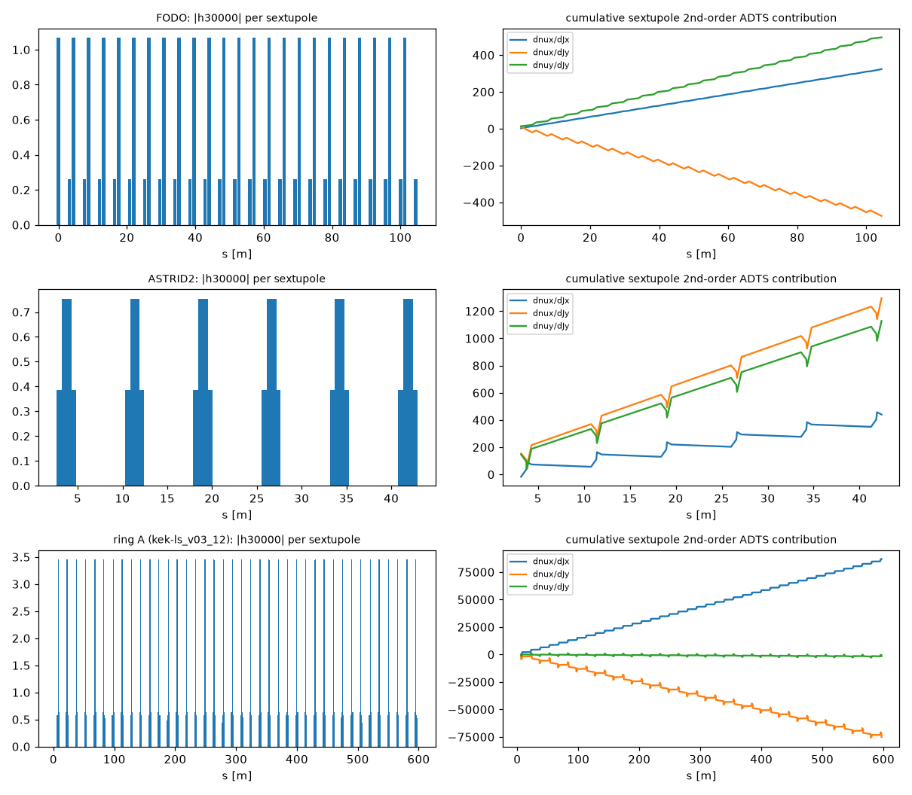

# 6 極による共鳴駆動項・振幅依存チューンシフト・クロマティシティ (`pysad/resdrive.py` ほか)

この文書で分かること: リングの線形光学と 6 極・8 極の強さから、共鳴駆動項 (RDT)・振幅依存チューンシフト (ADTS)・クロマティシティを**解析式**で求める方法 (使い方、式、近似の次数、入れている効果と入れていない効果)、追跡との照合の結果、周波数マップの共鳴線の予想、J² と δ に依るチューンの級数、ROTATE した磁石・K0≠0 の磁石の扱い。
前提: ベータトロン振動・Twiss パラメータ・チューンの基礎。何をどう求めて何と比べたかの流れは、先に [docs/24 (入門、図入り)](24_adts_rdt_primer.md) を読むと分かりやすい。周波数マップと局所運動量アクセプタンス (LMA) は [docs/26](26_frequency_map_lma.md) (Touschek のバンチ内の δ は §4.4)。
読む順: §1 (使い方) → §2 (記号と式) → §5 (使える範囲) → 結果を知りたい節 (§6〜§9 の検証、§11 δ≠0、§13 J²、§14 ROTATE)。式の導出の細部は §8〜§10。

用語: **RDT (共鳴駆動項)** は非線形磁場が各共鳴をどれだけ強く駆動するかを表すハミルトニアンの係数 h。**ADTS** は振幅 (作用 J) に依るチューンのずれ ∂ν/∂J。**クロマティシティ ξ** は ∂ν/∂δ (δ は運動量のずれ)。**NAFF** は追跡データからチューンを高精度に求める周波数解析。**正規形** は 1 周の写像を座標変換で簡単な形に直す方法 (消せない項だけが残り、ν の J・δ 依存を与える)。**gs** は K64 (SAD のソース) から作った SAD の実行体。**v2 / k64** は pysad の既定動作と、`PYSAD_COMPAT=k64` で選ぶ K64 と同じ動作。

次の表は、この文書で使う主な記号。

| 記号・名前 | 意味 | 単位・備考 |
|---|---|---|
| J (Jx, Jy) | 作用。x = √(2Jβ) cos φ | m rad |
| φ (φx, φy) | 角度 (位相) | rad |
| ν、Q (νx, νy) | ベータトロンチューン | — |
| δ | 運動量のずれ (ΔP/P0) | — |
| w_x(s) | √βx e^{i(μx(s) − μ_ref)}。素子の中の光学の複素振幅 | √m |
| η、η' | 分散とその傾き | m、— |
| K2L、K3L | 6 極・8 極の積分強さ (薄レンズはこの値、厚い素子は長さで割った密度 c_n を使う) | 1/m²、1/m³ |
| h_jklmp | 共鳴駆動項。j, k, l, m は x⁺, x⁻, y⁺, y⁻ のべき、p は δ のべき。名前は `h21000` など | (2J)^(次数/2) で規格化。符号は H の係数そのもの |
| ∂ν/∂J (`xx`, `xy`, `yy`) | ADTS: xx = ∂νx/∂Jx、xy = ∂νx/∂Jy (= ∂νy/∂Jx)、yy = ∂νy/∂Jy | 1/(m rad) |
| ξ | クロマティシティ ∂ν/∂δ (D1)、2 次 D2、3 次 D3 | — |
| `adts()` の内訳 | `.sext` 6 極の 2 次、`.octu` 8 極の 1 次、`.kin` 運動学的な項、`.fringe` 四極端部のフリンジ、`.bend`・`.cross` 偏向磁石の 3 次の項と 6 極との交差項、`.rotate` ロールした磁石の分、`.total` 合計 | 1/(m rad) |
| `bend_cubic` | 偏向磁石の 3 次の項を入れるか (既定 True) | |
| `fourth` | `adts()` の 4 次の項の扱い。`'r3'` (既定、物理的な項だけ)、`'r6'` (積分器の端数を含む精密版) | |
| `optics` | δ≠0 の光学。`'calc'` (既定)、`'tracked'` (追跡の写像から作る) | |
| D | 周波数マップの拡散指標 ([docs/26](26_frequency_map_lma.md)) | — |

**解析式の位置づけ**: 解析式は、摂動論の定義された次数と、入れた効果の範囲で原理的に作る。この文書は、各式について「入れている効果と次数」「入れていない効果」「追跡との差の原因」を書く。追跡 (全非線形) とは入れている効果が違うので、厳密な一致は目的ではなく、追跡に合わせるための補正項・当てはめは足していない。追跡との一致の数値は、入れた効果と次数の検証の結果である。追跡から係数を取り出す唯一の部分 (偏向磁石の生成関数、`bendnl.py`) の原理は §8.1 (写像の 2 次のテイラー係数が生成関数を一意に決める)。差の主因の一覧は §11.9。

K64 にない機能。リングの線形光学 (CALC の Twiss) と、6 極 (SEXT、K2≠0 の MULT) と 8 極 (OCT、K3≠0 の MULT) の強さから、
(1) 共鳴駆動項 h_jklmp (6 極の 1 次)、(2) 振幅依存チューンシフト ADTS (6 極の 2 次 + 8 極の 1 次)、(3) クロマティシティ (数値微分と 6 極の 1 次の寄与) を、
**厚いレンズの解析式** と**数値積分**の両方で求める。長さ 0 の素子 (薄レンズ) も同じ入口で扱う。SAD の台本からは FFS の関数、Python からは `pysad.resdrive`。

## 1. 使い方

SAD の台本 (FFS。`USE`・`CALC` のあと)。例は [`example/14_nonlinear_dynamics/adts_rdt/fn_ResonanceDrivingTerms_fodo.sad`](../example/14_nonlinear_dynamics/adts_rdt/fn_ResonanceDrivingTerms_fodo.sad)。

| 関数 | 引数 (規則) | 戻り |
|---|---|---|
| `ResonanceDrivingTerms[]` | `Terms->{"h21000","h30000",...}` (省略で下の 10 個)、`Method->"Analytic"` か `"Numeric"`、`Slices->n` (数値積分の分割数、既定 8)、`BendCubic->True|False` (偏向磁石の 3 次の項を足す、既定 True)、`BendSlices->n` (既定 16) | `{H21000->{Re,Im}, ...}` |
| `AmplitudeTuneShift[]` | `Method->`、`Slices->`、`BendCubic->True|False` (偏向磁石の 3 次の項、既定 True)、`BendSlices->n` (偏向磁石の分割、既定 16) | `{DNuxDJx->, DNuxDJy->, DNuyDJy->, Sextupole->{xx,xy,yy}, Octupole->{xx,xy,yy}, Kinematic->{xx,xy,yy}, QuadFringe->{xx,xy,yy}, BendCubic->{xx,xy,yy}, SextBendCross->{xx,xy,yy}, Total->{xx,xy,yy}}` (単位 1/(m rad)。`DNu…` は 6 極 + 8 極、`Total` は運動学的な項・四極の端部のフリンジ・偏向磁石の 3 次どうし・6 極との交差項を足した全部入り、§2・§8) |
| `ChromaticityTerms[]` | `Order->n` (既定 3)、`DeltaMax->` (既定 2e-3)、`Method->`、`Slices->` | `{Tunes->{νx,νy}, D1->{∂ν/∂δ}, D2->{∂²ν/∂δ²}, ..., SextupolePart->{ξx, ξy}, NaturalPart->{ξx, ξy}, BendPart->{ξx, ξy}}` (自然クロマティシティの解析式と、偏向磁石の 3 次の項の分散による分) |

Python (`from pysad import resdrive as R`)。`lat` は `Lattice` (`parser.load_sad_file(...).build_lattice('RING')`)。

```python
r = R.resonance_terms(lat, terms=R.DEFAULT_TERMS, method='analytic', nslice=8, delta=0.0, ref=None, bend_cubic=True, bend_nslice=16)
r.total['h21000']                  # 複素数 (全周の和 = r.total_sext + r.total_bend。bend_cubic=False で 6 極だけ)
r.per_element[:, r.names.index('h30000')]   # 要素ごとの寄与 (6 極と偏向磁石、s の順)。r.elem_names, r.elem_idx, r.elem_s
print(r)                           # 表 (作動点の確認、警告つき)
a = R.adts(lat, method='analytic', nslice=8, delta=0.0, include_octupole=True)
a.sext, a.octu, a.dnux_dJx, a.dnux_dJy, a.dnuy_dJy    # 6 極 2 次・8 極 1 次・合計
a.per_element      # (3, 6 極の数): 要素ごとの寄与 (xx, xy, yy)。合計が a.sext
a.by_harmonic      # 共鳴の調和 k = (kx, ky) ごとの寄与
R.chromaticity_numeric(lat, order=3, dmax=2e-3)      # CALC の δ 依存の多項式フィット: {'nu0','d1','d2','d3'}
R.chromaticity_sextupole(lat)                        # (h11001/π, h00111/π) 6 極のみ
R.chromaticity_natural(lat); R.chromaticity_bend(lat)    # 自然クロマティシティの解析式、偏向磁石の 3 次の項の分散による分 (h11001/π・h00111/π の偏向磁石の分)
R.slice_thin(lat, n)                                 # 厚い SEXT を n 個の薄い MULT 列にした Lattice (検証用)
R.adts_tracking(lat.elements, momentum_eV, ((αx,βx),(αy,βy)), jref=(jx, jy))   # 追跡と NAFF による基準値
# 運動学・端部のフリンジ (adts の .kin・.fringe・.total)、追跡 + NAFF + フィットの直接の ADTS (pysad/adtsdirect.py)
R.kinematic_adts(lat); R.quad_fringe_adts(lat.elements, lat.twiss_table())     # {'xx','xy','yy'}
from pysad import adtsdirect as D
r = D.direct_adts(lat, momentum_eV, jmax, delta=0.0, order=2, nturn=1024)      # r['xx'], r['xy_mean'], r['yy']、r['fitx']['c'] (係数)
D.paraxial_tracker(lat, nslice=40, bend_cubic=False, bend_edge=False)           # 解析と同じ模型の追跡 (検証用)
# 偏向磁石の 3 次の項 (§8)
a = R.adts(lat, bend_cubic=True, bend_nslice=16)    # 既定 True。a.bend (偏向磁石の 3 次どうし)、a.cross (6 極との交差項)、a.total に足す。bend_cubic=False で偏向磁石の 3 次の項を入れない値
from pysad import bendnl as B
B.bend_decomposition(bend_element, nslice=16)         # 入口の端・スライス・出口の端のリー生成関数 f_e1・f_b・f_e2 と線形写像 R_e1・R_h・R_b・R_e2 (生成される分散 d_h・d_b)
# 共鳴駆動項の偏向磁石の項と、追跡からの取り出し (§9)
r = R.resonance_terms(lat, terms)                  # 既定で偏向磁石の 3 次の項を足す (r.total_sext・r.total_bend)。δ≠0 でも δ の閉軌道のまわりの p=0 の項を入れる
from pysad import rdttrack as T
rm = T.ring_map(lat.elements, momentum_eV, lat.twiss_table()[0], amp=1e-5)   # 1 周の写像の 2 次のテイラー展開 (正規化座標)
T.rdt_from_map(rm)                                 # 追跡から取り出した h_jklm (p=0。6 極 + 偏向磁石の全体)
T.delta_quadratic_total(lat.elements, p, row0)     # δ の 1 次の項 (自然な項を含む全体)
```

素子のリストだけを渡すときは `rows=` (Twiss の行) も渡す。`delta≠0` ならそのエネルギーの CALC (DP0 = δ) の光学を使う (§5)。
`ref=i` で位相の基準位置を素子 i の入口にする (既定はリング先頭)。h の位相だけが変わる。

## 2. 記号と式

座標は設計軌道まわり (x, px, y, py)、s 方向のハミルトニアン (パラキシャル)

  H = ½(px² + py²) + (線形) + Σ_n (1/(n+1)!) Re[ c_n (x + iy)^(n+1) ],  c_n = K_n + i S_n (n = 2 が 6 極、n = 3 が 8 極)

c_n は SAD の `KnL` (積分値、`SEXT` の `K2`・`OCT` の `K3`、MULT の `K2`・`K3`、スキューは `SK2`・`SK3`) を素子の長さで割った密度。薄レンズは積分値そのもの。
この符号は pysad の追跡の kick と一致する (Δpx = −(K2L/2)(x² − y²)、Δpy = +K2L·xy。試験 `test_tilted_and_skew_sextupole_kick_convention`)。回転 (`ROTATE`) は c_n → c_n e^{+i(n+1)θ} (追跡と確認済み)。

アクション・角度: x = √(2Jx) Re[w_x e^{iφx}]、w_x(s) = √βx e^{i(μx(s) − μ_ref)} (y も同様)。分散は x → x + ηx δ (垂直分散なし)。J は x = √(2Jβ) cos φ のアクション (ε に相当、単位 m rad)。

**共鳴駆動項**: H の 3 次の部分を (x⁺, x⁻, y⁺, y⁻, δ) の単項式に展開し、

  H₃ = Σ h_jklmp (2Jx)^((j+k)/2) (2Jy)^((l+m)/2) δ^p exp{ i[(j−k)φx + (l−m)φy] }

の係数 h_jklmp (j, k, l, m は x⁺, x⁻, y⁺, y⁻ のべき、p は δ のべき) を全周で足したもの:

  h_jklmp = Σ_素子 c_jklmp ∫₀^L w_x^j w̄_x^k w_y^l w̄_y^m η^p ds   (係数 c_jklmp は H の多項式の係数に二項係数と 2^−(j+k+l+m) をかけたもの)

**偏向磁石の項**: `bend_cubic=True` (既定) で、偏向磁石の 3 次の項 (曲率 (h/2)x(px²+py²)・硬い端 ±(h/2)px y²・複合機能の本体 (K1 h/6)x³・E1/E2≠0 の端。K64 の追跡の写像から取り出す `bendnl.py`) の寄与 `.total_bend` を足す。δ の項 (p ≥ 1) は偏向磁石の分散による軌道のずれ x → x + ηδ、px → px + η'δ の展開 (η・η' は入口の Twiss と、スライスの線形写像と生成された分散で伝播)。j+k+l+m+p = 3 の項だけが 0 でない。運動学的な項 p⁴/8・四極端部のフリンジは 4 次のハミルトニアンなので h の 3 次 (p=0) と δ の 1 次の 2 次形式には入らない。

h_kjmlp = h̄_jklmp。名前は `h21000` = (j,k,l,m,p) = (2,1,0,0,0) など。既定の 10 項: h21000、h30000、h10110、h10020、h10200 (幾何学的な項)、h11001・h00111 (クロマティシティ)、h20001・h00201 (クロマティックなベータ関数の変調)、h10002 (2 次の分散)。
共鳴の条件: h_jklmp は (j−k)νx + (l−m)νy = 整数 の共鳴 (30000 は 3νx、21000 は νx、10110 は νx、10020 は νx−2νy、10200 は νx+2νy)。
**符号と規格化は H の係数そのもの** (文献の h_jklm は定義によって符号と因子 −1/(j!k!l!m!) が違うことがある。pysad の h = −(Bengtsson 型の文献の h)、因子と位相の定義は一致: §7)。`ref=i` は全要素の位相の基準を変えるだけ (h × 位相)。素子 i から始めた 1 周の写像の h は、i より前の要素の位相に 1 周分の e^{2πi((j−k)νx+(l−m)νy)} がつく (§9)。
1 周の写像の 1 次の生成関数が G = Σ h (…) なので、1 周の J の変化は ΔJx = −∂G/∂φx (試験 `test_rdt_vs_one_turn_map` が追跡と照合する)。
ξ との関係: ξx(6 極の 1 次) = h11001/π = (1/4π)Σ K2L ηx βx、ξy(6 極の 1 次) = h00111/π = −(1/4π)Σ K2L ηx βy。

**ADTS**: 周期的な時間 (θ = 2πs/C) をもつ H = Q·J + V(J, φ, θ) の 2 次の平均化ハミルトニアン (Lie 変換。1 次元の静的な 3 次の非調和振動子で Landau の δω = −(5/12)α²a²/ω³ と一致することを確認した式)

  K₂(J) = −½ Σ_(k,n)≠0  [ k·∇_J |V_kn(J)|² ] / (k·Q + n)

を、θ のフーリエ和 Σ_n e^{inΔ}/(x+n) = π e^{ix(π−Δ)}/sin πx で閉じた形にする。k = (kx, ky) は 3 次の項の調和 (3,0)、(1,0)、(1,±2) とその符号反転、x_k = k·Q:

  S_k = (1/(4π sin πx_k)) ∬ ds₁ ds₂ F_q(s₁) F̄_q'(s₂) [ e^{−iπx_k} (s₁ > s₂) + e^{+iπx_k} (s₁ < s₂) ]

F_q(s) は調和 k に属する単項式 q の H の密度 × w の積 (J のべき (2J)^(p/2) → J^(p/2) の 2^(p/2) を含む)。K₂ = −½ Σ_k Σ_(q,q') D S_k、D は k·∇_J を J の単項式にかけたもの。
∂ν/∂J = ∂²K/∂J∂J。素子の対の項は累積和 (O(素子数)) で、素子内の 2 重積分は解析式 (または数値積分) で足す。
**8 極**は 1 次: K₁ = (1/2π) ∮ ⟨H₄⟩ ds。薄い 8 極で ∂νx/∂Jx = Σ K3L βx²/(16π)、∂νx/∂Jy = −Σ K3L βxβy/(8π)、∂νy/∂Jy = Σ K3L βy²/(16π)。
共鳴の調和の分母 sin πx_k が 0 (3νx、νx±2νy、νx が整数) に近いと ADTS が発散する。作動点の確認は `working_point_check` と結果の表に出る。

**運動学的な項と端部のフリンジ (1 次)**: 運動学的な項 H4 = (px²+py²)²/8 (ドリフトの −√(1−p²) の 4 次) から、γ = (1+α²)/β として ∂νx/∂Jx = (3/16π)∮γx² ds、∂νx/∂Jy = (1/8π)∮γxγy ds、∂νy/∂Jy = (3/16π)∮γy² ds (`kinematic_adts`。素子内の γ は線形の転送行列で伝播して Simpson 則)。
四極と K1≠0 の偏向磁石の端には、K64 の既定 (DISFRIN=0、FRINGE=0 なら入口・出口とも) で Lee-Whiting の非線形フリンジ (`ttfrin4`) が入る。この写像の 3 次の項は H_f = σ (K1/12)[(x³+3xy²)px − (y³+3x²y)py] δ(s−s端) (σ = +1 入口、−1 出口、K1 は符号つき [1/m²]) の流れで、
∂νx/∂Jx = −(1/8π) Σ σ K1 αx βx、∂νx/∂Jy = (1/8π) Σ σ K1 (αy βx − αx βy)、∂νy/∂Jy = (1/8π) Σ σ K1 αy βy (α・β は端の値。`quad_fringe_adts`)。F1・F2 (線形のフリンジ) は入れない (警告)。
**偏向磁石の 3 次の項 (2 次)**: 偏向磁石の曲率の項 H3 = (h/2) x (px²+py²)、硬い端 ±(h/2) px y² (入口 +、出口 −)、複合機能の本体の (K1 h/6) x³、E1・E2≠0 の端の 3 次の項は、6 極と同じ 3 次のハミルトニアンの単項式として 2 次の摂動の式 (上の S_k) に入る。偏向磁石の 3 次どうしの対 `.bend` と 6 極との交差項 `.cross` (6 極の強さに比例) を足す。係数は K64 の追跡の写像から取り出す (§8)。
`adts()` の結果: `.sext`・`.octu`・`.kin`・`.fringe`・`.bend`・`.cross`、合計 `.total` (`.total_xx` など。6 つの和、`bend_cubic=False` で `.bend`・`.cross` は 0)。`.dnux_dJx` などは 6 極 + 8 極。`.bend4` (偏向磁石の 4 次の項。`fourth='r6'` の精密版のときだけ入る。既定の `fourth='r3'` では 0)。δ≠0 は、既定では CALC の δ の光学のまわりで 6 極・8 極・運動学的な項 (1/(1+δ)³)・フリンジ・偏向磁石の 3 次の項を入れる (6 極・四極の kick の強さと四極端部のフリンジは δ に依らないとして扱う。フリンジの規約は §11.4 の注意)。軌道のずれた四極・ドリフトの 3 次の項 (`other_atoms`)・8 極のフィードダウンも既定で入る。偏向磁石の項を δ の閉軌道のまわりで取り出すこと (`fourth='r6'`) と、追跡の閉軌道・ヤコビ行列から作る光学 (`optics='tracked'`) は精密版のオプション (§11.4・§11.6)。

## 3. 厚いレンズと薄レンズ

素子の中の w(s)、η(s) は素子の入口の Twiss と素子内の線形の転送行列で決まる。SEXT・K1=0 の MULT・OCT の内部はドリフト (w は s の 1 次式、η も 1 次式)、K1≠0 の厚い MULT は cos/sin か cosh/sinh (指数の和)。
- `method='analytic'` (既定): w^j w̄^k w_y^l w̄_y^m η^p と、その原始関数を多項式・指数の和 Σ c sⁿ e^{λs} で表し、**厳密に** 積分する。素子内の二重積分 ∬_(s₁>s₂) も厳密。
- `method='numeric'`: 素子を `nslice` 等分して中点で評価する (= nslice 個の薄レンズ列。素子内の対は同じ中点に 1/2 の重み)。nslice → ∞ で解析式に 1/nslice² で収束する。
- 薄レンズ (L = 0、`MULT` の `K2`・`SEXT L=0`): 積分を素子の位置での値に置き換える (強さは積分値)。素子内の対の項は ½ a ā (kernel cos πx)。
  厚い式で L → 0 (K2L 一定) にした極限と一致する (試験 `test_thick_to_thin_limit_and_convergence`、[`example/14_nonlinear_dynamics/adts_rdt/rdt_thick_thin.py`](../example/14_nonlinear_dynamics/adts_rdt/rdt_thick_thin.py) の表: L = 2e-5 で薄レンズとの差 1e-4 の程度、L に比例して 0 に近づく)。
  `slice_thin(lat, n)` が作る n 分割した薄レンズ列 (n = 1…64) と厚い式の差は n を 2 倍にするごとに 1/4 (比 3.99〜4.00)。
- |κL| < 1e-3 の K1 は光学の内部ではドリフトとして扱う (誤差 ~ (κL)²)。



図の読み方: 上から FODO (3 GeV、周長 105.6 m)、ASTRID2 (0.58 GeV、45.7 m)、大きなリング A (3 GeV、603 m)。左は 6 極ごとの 3 次の共鳴駆動項の大きさ |h30000| (横軸 s [m])。右は 6 極の 2 次の ADTS への寄与を s に沿って足し上げた曲線 (dνx/dJx 青、dνx/dJy 橙、dνy/dJy 緑。単位は 1/(m rad)。運動学・偏向磁石の項は含まない)。右端の値が 6 極による ADTS で、FODO は 3 成分とも ±数百、ASTRID2 は 400〜1300、大きなリングは dνx/dJx が約 +9e4、dνx/dJy が約 −7e4 (値は図からの概数)。曲線が 6 極の位置ごとに階段状に伸びるので、どの 6 極が ADTS を作っているかが分かる。

## 4. クロマティシティ

`chromaticity_numeric`: CALC (4 次元の閉軌道 + 光学) を δ の Chebyshev 節点 (±dmax、2·order+3 点) で計算し、チューンを次数 order+2 の多項式にフィットして ∂ⁿν/∂δⁿ (n!×係数) を返す。
閉軌道のずれ・6 極のフィードダウン・高次を含む (全部入りの値)。`chromaticity_sextupole`: 6 極の 1 次の寄与 (h11001/π、h00111/π) で、6 極の強さを 0 にした場合との CALC の差と一致する (試験 `test_chromaticity_sextupole_part`、2e-3 以内)。
∂²ν/∂δ² などの解析式 (6 極の 2 次・2 次の分散・ベータ関数の δ 依存) は入れていない (数値微分のみ)。`adts(lat, delta=δ)` を δ = ±δ₀ で呼ぶと ∂(∂ν/∂J)/∂δ が出る。

## 5. 使える範囲・条件・近似の次数

- 近似の次数: 共鳴駆動項は 6 極 (と 8 極 4 次の項を h の定義には入れず ADTS だけ) の **1 次** (4 次の h と 6 極の 2 次は §10)。ADTS は 6 極の 2 次 (対の項) + 8 極の 1 次。6 極×8 極や 8 極の 2 次、10 極以上は入れない (警告)。
- 運動学的な項 p⁴/8 と四極 (K1 つき偏向磁石) の端部の非線形のフリンジ (K64 の既定 ON) の 1 次の ADTS は `.kin`・`.fringe` に、偏向磁石の 3 次の項 (曲率 (h/2)x(px²+py²)・硬い端 ±(h/2)px y²・複合機能の本体・E1/E2≠0 の端) の 2 次の対の項と 6 極との交差項は `.bend`・`.cross` に入っている (§2・§8)。いずれも `.total` に入る。
  **入っていない**: 6 極に依らない 4 次の定数のずれ (四極本体・K1 つき偏向磁石の本体の 4 次の項。ASTRID2 で 1.1・1.1・2.6、大きなリング A で 7.0・6.9・17、FODO で 0.1〜0.2 [1/(m rad)]。ADTS の 0.02〜1.3%、§8)、端の 4 次の項 (ROTATE した偏向磁石・四極は結合した光学で通す: §14。δ≠0 の偏向磁石の 3 次の項と K0≠0 の偏向磁石の内部は入れている: §11)。共鳴駆動項 h は偏向磁石の 3 次の項を入れている (§9。`bend_cubic=False` で 6 極の h のみ)。K0≠0 の偏向磁石 (挿入光源) の内部と δ≠0 の偏向磁石の項も入っている (§11)。ROTATE した偏向磁石・四極は結合した光学の模型 (§14) に自動で切り替わる。結合なしの解析式の経路では、4 次の h の δ の項 (h21001 など) は入れていない (0 を返す。結合した経路 §14.5 は扱う)。
  6 極 2 次の比較は 6 極の強さを +1, −1, 0 倍した追跡の偶数次の差 C = (f(1)+f(−1)−2f(0))/2 で、この C は 6 極 2 次だけを取り出す (交差項と偏向磁石などの項が消える)。直接の比較 (§7・§8) は強さを変えない。
- 横方向の結合・垂直分散は入れない (`rows` の R 行列と ety が 1e-6 を超えると警告)。誤差なしの設計光学を想定 (DX・DY の素子は警告)。
- δ = 0 の光学。`delta≠0` の既定は CALC のオフモメンタム光学 (`optics='calc'`)。追跡の写像から作る光学は `optics='tracked'` (精密版のオプション。§11.1)。閉軌道のずれによる 8 極→6 極のフィードダウン (K2 = K3·x0) は入れている。6 極の強さは δ に依らない (§11.4)。h の δ の項 (p>0) は δ = 0 の分散で定義。
- RF・シンクロトロン振動・放射なし。`J` は x = √(2Jβ) cos φ。**gs の TrackParticles で比べるときは台本に `NORFSW;` を入れる**: FFS に入ると RFSW は ON なので、RF つきのラティスでは空洞が 1 周内の z に応じて δ を与え、自然クロマティシティ × δ(J) の偽の ADTS が入る (周数にも依る)。pysad の追跡は `rfsw=False`。振幅が大きい (J の 2 次以降が効く) 領域は対象外 (追跡との比較は小振幅の外挿)。
- 整数・半整数共鳴: 作動点の整数・半整数と 3 次までの共鳴線までの距離を結果に出す。k·Q が整数に近いと ADTS は発散 (sin πx_k → 0、1e-9 未満は項を飛ばして警告)。h は共鳴の近くでも定義されるが、1 次の摂動は共鳴の近くでは使えない。
- 4 次 (OCT)・MULT の K3 は ADTS の 1 次のみ (h は 3 次の項だけ)。MULT の `K0`・`SK1`・`ANGLE` は光学の内部に入れていない (警告)。10 極 (DECA) 以上は無視 (警告)。
- 数値積分は SEXT の内部の位相進みを中点で見るだけ (nslice 等分)。|κL| ≥ 1e-3 の四極成分つき MULT は解析で厳密、数値積分でも厳密な転送行列。

## 6. 検証

追跡の基準は NAFF のチューン (1024 周、RF・放射なし、リング先頭から)。ADTS は、Jx・Jy を同程度にした 4 粒子の中心差分を振幅 b と 2b で作り J の 1 次の補正を外挿。
6 極の 2 次の項は、6 極の強さを +1、−1、0 倍した追跡の偶数次 C = (f(+1) + f(−1) − 2f(0))/2 (6 極の 1 次 × 偏向磁石・端部との交差項と、6 極以外の非線形を消す)。
- 小さな FODO (3 GeV、105.6 m、νx = 6.696329、νy = 4.906056、SF・SD の K2L = 4, −6): 解析 (323.410、−474.023、496.072 [1/(m rad)]) と pysad の追跡 (k64) の C が 4e-5・7e-6・2e-4 以内。 K64 (gs) の追跡の C とも一致する。
- ASTRID2 (0.58 GeV、45.7 m、νx = 5.179990、νy = 2.140178): 解析と pysad の追跡の C が 1.5e-3・1.1e-3・1.7e-3 以内 (J = 2e-8。J → 0 で解析値に近づく: J = 2e-9 で 5e-4)。K64 (gs) の追跡の C とも同じ水準で一致する (台本に `NORFSW;` が要る。§5)。
- 大きなリング A (kek-ls_v03_12.lat、3 GeV、603 m、νx = 47.580034、νy = 17.620044、J = 2e-10): 6 極 2 次 (86841、−75099、−1610) と 8 極 1 次 (−36905、32480、−7154) が pysad の追跡の C・B と 2e-5・3e-5・1e-3 (6 極)、4e-6・8e-6・2e-5 (8 極)。 K64 (gs) の追跡とも一致する。
- 共鳴駆動項 (全 3 次の項 + δ の項、6 極の分) は 1 周の ΔJ の追跡 (6 極の強さ ±1 の差) と 0.5% 以内 (FODO、小振幅の外挿の誤差)。1 周の写像の 2 次のテイラー展開 (追跡) と 6 リングで 1e-6〜1e-7 以内、偏向磁石の項を入れた全体も追跡と 1e-8 (FODO・ASTRID2)〜4e-7 (大きなリング A) 以内 (§9)。
- 厚い解析と数値積分: FODO で 1e-5 (nslice=16)、四極成分つき MULT で 1e-4 以内 (nslice=60)。薄レンズ列 n 分割との差は 1/n²。
- 未確認: 結合・誤差のあるリングの解析 (追跡で 1 例だけ)、∂²ν/∂δ² の解析式、δ≠0 の ADTS の δ 微分の解析式の yy (xx・xy は 0.3% 以内、§11.4)、6 極に依らない 4 次の項 (§8)、端の 4 次の項、h の δ≠0 の偏向磁石の項・4 次以上の h・K0≠0 の偏向磁石の内部 (§9)。v2 モードの追跡との照合は ADTS では未実施、h は FODO・ASTRID2 で実施 (§9)。6 極 × 偏向磁石の曲率・硬い端・E1/E2 の交差項は入れていて、追跡と 0.01〜0.7% で一致した (§8)。文献との符号・規格化の照合と共鳴線の近傍の応答は §7 で確認した。


## 7. 直接の検証: 実際の強さの追跡 + NAFF + 多項式フィット

方法 ([`pysad/adtsdirect.py`](../pysad/adtsdirect.py)): J の格子 (Jx, Jy ∈ {0, 1/5, …, 1}·Jmax、35 点 × (φ, φ+π) の対 = 70 粒子) を**強さを変えずに**追跡し (pysad k64 または gs の `NORFSW;`、1024 周、RF 止め・放射なし・δ=0)、各粒子の NAFF (Hann p=1、線形のチューン ± 0.02 を探す) のチューンを ±対で平均し、νx (Jx>0 の点)・νy (Jy>0 の点) を J の全次数 ≤ 2 の多項式でフィットして ∂νx/∂Jx、∂νx/∂Jy、∂νy/∂Jx、∂νy/∂Jy を取る。J は x = √(2Jβ) cos φ (m rad)。`direct_adts(lat, momentum_eV, jmax, delta=0, order=2, nturn=1024)`。
結果 [1/(m rad)] (xx, xy, yy。解析の合計 = 6 極 2 次 + 8 極 1 次 + 運動学的 + 端部のフリンジ。**偏向磁石の 3 次の項を入れない値 (`bend_cubic=False`)**。入れた場合の表は §8):

| リング | 解析の合計 | 追跡 (pysad k64 = gs) | 相対差 |
|---|---|---|---|
| FODO (3 GeV、105.6 m、K2L = 4, −6) | 397.94, −405.98, 569.07 | 408.99, −412.74, 519.95 | +2.8%, −1.7%, −8.6% |
| ASTRID2 (0.58 GeV、45.7 m) | 522.48, 1504.32, 1388.64 | 470.96, 1304.81, 1485.80 | −9.9%, −13%, +7.0% |
| ASTRID2 MPW | 522.45, 1737.43, 1578.19 | 470.96, 1509.42, 1712.28 | −9.9%, −13%, +8.5% |
| 大きなリング A (kek-ls_v03_12.lat、3 GeV、603 m) | 50807.3, −40553.9, −6295.2 | 50709.5, −41042.5, −6527.8 | −0.19%, −1.2%, −3.7% |

K64 (gs) の直接のフィットは pysad と 1e-10 以内 (ASTRID2 MPW は 1e-5)。運動学・フリンジを含まない (6 極 2 次 + 8 極 1 次) との差は FODO +26%・−13%・+5%、ASTRID2 +7%・+1%・−24%、大きなリング A +1.5%・−3.7%・−34%。
- フィットの次数・J の範囲: order=2 以上なら Jmax を 1/100 にしても 1e-3 以内で変わらない。order=1 は Jmax が大きいと J の 2 次で外れる (FODO Jmax = 1e-5 で 1〜3%、ASTRID2 2e-6 で約 10%)。NAFF は周数 128〜4096、窓 p=1〜4、先頭の周の捨て方、探索幅で 1e-3 以内。**初期位相は ±対にしないと 0.2〜1.6% ずれる**。
- 解析の 6 極 2 次 + 8 極 1 次は、同じ模型 (線形行列 + 薄い 6 極・8 極) の追跡のフィットと FODO 3e-5・ASTRID2 7e-5・大きなリング A 1.3e-3 で一致し、8 極の強さの走査の傾きが解析の 8 極 1 次と 2e-6〜2e-5 で一致 (大きなリング A、8 極 8 倍でも)。8 極の 2 次・6 極 × 8 極は ADTS の J 依存 (J² の係数 ~1e10) として現れ、J ~ 1e-9 で 1e-3 未満。
- 運動学・フリンジの確認: 6 極・8 極なしの追跡との差は FODO 0.1〜0.8%、大きなリング A 0.4〜0.8%、ASTRID2 は 1.2%・12%・9% (30° の複合機能偏向磁石。K1 の端と曲率の項)。フリンジを切った追跡 (DISFRIN=1) は運動学的な項と一致 (yy が 6% 残る)。
- **運動学・フリンジだけの解析に残る差の原因 (偏向磁石の 3 次の項で扱う、§8)**: 6 極の強さに奇数次の交差項 6 極 × (偏向磁石本体の曲率 (h/2) x (px²+py²) + 硬い端の ±(h/2) px y²)。FODO (セクター型) で、線形行列 + 薄い 6 極にこの 2 項を足した追跡 (`paraxial_tracker(bend_cubic=True, bend_edge=True)`) が K64 の追跡の奇数次 (13.09, −6.77, −51.64) を (13.09, −6.77, −51.63) で再現した。偏向角に比例。ASTRID2 は K1 の端との交差項も加わる。
- δ: 微小振幅のチューンの δ 依存は CALC (`chromaticity_numeric`) と ∂ν/∂δ・∂²ν/∂δ² で 0.1〜0.3% (絶対差 ∂ν/∂δ 0.002〜0.03)。6 極の 1 次の ξ = h/π は CALC の 6 極あり − なしと 0.02〜0.4%。δ≠0 の追跡の ADTS と `adts(delta=δ)` の差は δ=0 の差とほぼ同じ定数のずれだが、**δ 微分 ∂(ADTS)/∂δ の解析/追跡の比は §11.4 の表**: δ 微分が要るときは追跡か数値の正規形 (§11.4) で求める。
- 文献との照合 (符号・規格化): Bengtsson 型の薄い 6 極の式 h21000 = −(1/16)ΣK2L βx^{3/2} e^{iμx}、h30000 = −(1/48)ΣK2L βx^{3/2} e^{3iμx}、h10110 = (1/8)ΣK2L βx^{1/2}βy e^{iμx}、h10020・h10200 = (1/16)ΣK2L βx^{1/2}βy e^{i(μx∓2μy)} と、`resonance_terms` の 5 項は FODO で**比がちょうど −1 (6e-7 以内)**。pysad の h は H の係数そのもの (H = +K2/6 (x³ − 3xy²)) で、文献の h は符号を反転した定義 (著者によって符号の定義が違う)。因子 1/(j!k!l!m!) と位相の定義は一致。
- 共鳴線の近く: FODO の νx を 20/3 の近くに動かし (ε = −3e-4〜−2e-3)、3 周写像の周期点 (Newton 法) の振幅 J の最小・最大を h30000 と ADTS (追跡の値) から予測 (2π(ε + aJ) = ∓6|h30000|√(2J)) と 0.15〜1.3% で一致 (解析の a を使うと a の 2.8% の誤差で 1.5〜3%)。
- 結合・誤差 (ASTRID2、追跡): 四極の回転 rms 0.3〜3 mrad で xx が −2〜−5%、6 極の DX・DY 0.1 mm で 0.2%、0.5 mm で +37%・−22%、四極 + 6 極の DX・DY 0.1 mm (閉軌道 mm) で +26%・−14%。解析は誤差なしの値のまま。
- 挿入光源 (ASTRID2 MPW): MPW の線形の光学は CALC で取り込まれ、MPW の内部の非線形は 2〜3% の差になる。

## 8. 偏向磁石の 3 次の項

**何を入れたか**: 偏向磁石の曲率の項 H3 = (h/2) x (px²+py²)、硬い端 ±(h/2) px y² (入口 +、出口 −、K64 は E=0 でも持つ)、複合機能の本体の (K1 h/6) x³、E1・E2≠0 の端の 3 次の項を、6 極と同じ 3 次の単項式の振幅として 2 次の摂動 (§2 の S_k) に入れる。偏向磁石の 3 次どうしの対 `.bend` と、6 極との交差項 `.cross` (6 極の強さに**比例**) が `.total` に足される。`adts(bend_cubic=True)` (既定)、台本 `AmplitudeTuneShift[BendCubic->True|False, BendSlices->n]`。
**方法** ([`pysad/bendnl.py`](../pysad/bendnl.py)): 追跡 (k64 または v2 の現在のモード) の 1 要素の写像 M(z) = R z + T(z,z) の 2 次の部分 T を数値的に取り出し (±z の平均の Richardson 外挿)、kick の生成関数 f (3 次の同次式) を ∇f = −S τ、f = (1/3) z·∇f (S = [[0,1],[−1,0]]、τ = kick の 2 次の部分) で求め、素子内の位置の w = (wx, wpx, wy, wpy) (w = √β e^{iμ}、wp = (i−α)/√β e^{iμ}) で角度・作用の単項式 z^j z̄^k v^l v̄^m の振幅 A_jklm にして 6 極の厚い要素の `a_all` と同じ規格化 (2^{3/2}) で `_second_order` に渡す。
偏向磁石は 入口の端 → nslice 個の等分の本体 (中央の座標、O(ds²)) → 出口の端 に分ける。K64 の硬いフリンジ (Maxwell の項 A_in: Δx = y²/(2ρ)、Δpy = −px y/ρ) は隣り合う部分偏向磁石で打ち消すので、長さ L/n・E=0 の偏向磁石 S = A_out ∘ B ∘ A_in から本体 B = A_in ∘ S ∘ A_out、端は極薄い (1e-8 m) 偏向磁石 elem から Edge(E1) = A_in ∘ elem(E1)、Edge(E2) = elem(E2) ∘ A_out と取る。n 個の部分偏向磁石の連続は 1 つの偏向磁石と 1e-9 (相対) で一致する。K1≠0 の偏向磁石は DISFRIN=1 で硬い端のフリンジも切れる (K64 の tbendi)。
**式との一致**: E=0・K1=0 でスライスの f = (h/2) ds (x px² + x py²) (1e-4)、端 = ±(h/2) px y² (1e-9)。K1≠0 は (h/2) x (px²+py²) + (K1 h/6) x³。取り出しは素子の種類ごとに 1 回 (キャッシュ)、大きなリング A で `adts()` 約 3 秒。nslice への収束は 2 倍ごとに 1/4 (既定 16 で誤差 1e-5 未満)。

**検証** (pysad k64 の追跡の直接のフィットとの相対差 (解析 − 追跡)/追跡、70 粒子、1024 周、RF 止め・放射なし・δ=0・閉軌道 0、NAFF Hann p=1、order=2、Jmax = FODO 1e-7・ASTRID2 2e-8・大きなリング A 2e-10)。
6 極の強さ ×1 [1/(m rad)] (xx, xy, yy):

| リング | 解析 (偏向磁石の 3 次の項あり) | 追跡 | 差 | `bend_cubic=False` の差 |
|---|---|---|---|---|
| FODO (3 GeV、105.6 m、K2L = 4, −6、E1=E2=0.0343 rad) | 408.84, −412.90, 519.77 | 408.99, −412.74, 519.95 | −0.04%, −0.04%, −0.03% | −2.7%, +1.6%, +9.5% |
| FODO 長方形 (E1=E2=ANGLE/2) | 297.59, −334.88, 392.73 | 297.50, −334.77, 392.56 | +0.03%, −0.03%, +0.05% | −2.0%, +2.1%, +11.7% |
| FODO E1=0.8·ANGLE、E2=−0.3·ANGLE | 304.92, −436.86, 478.94 | 304.64, −437.02, 479.05 | +0.09%, +0.04%, −0.02% | −2.0%, +1.5%, +9.5% |
| ASTRID2 (0.58 GeV、45.7 m、30° の複合機能偏向磁石) | 469.82, 1303.74, 1482.98 | 470.96, 1304.81, 1485.80 | −0.24%, −0.08%, −0.19% | +10.9%, +15.3%, −6.5% |
| ASTRID2 MPW | 469.80, 1508.15, 1708.53 | 470.96, 1509.42, 1712.28 | −0.25%, −0.08%, −0.22% | +10.9%, +15.1%, −7.8% |
| 大きなリング A (kek-ls_v03_12.lat、3 GeV、603 m) | 50702.5, −41049.4, −6545.0 | 50709.5, −41042.5, −6527.8 | −0.014%, −0.017%, −0.26% | +0.19%, +1.2%, +3.6% |

6 極の強さの走査 (λ = 0, 0.5, 1, 2 倍。K2 を λ 倍、8 極は変えない): λ=0.5〜2 の全リングで 0.003〜0.7% (`bend_cubic=False` では最大 +20%)。λ=0 (6 極なし) は FODO 0.15〜0.26%、大きなリング A 0.02〜0.37%、ASTRID2 −1.3%・−0.47%・−1.1% (`bend_cubic=False` では xy −10.9%、yy +9.5%)。交差項は λ に厳密に比例、偏向磁石の 3 次どうしは λ に依らない。
内訳: ASTRID2 (6 極 ×1) は 6 極 2 次 440.30, 1294.57, 1127.55 + 運動学 14.80, 12.75, 29.37 + K1 の端 67.37, 197.01, 231.73 + 偏向磁石の 3 次どうし −0.12, +24.59, −25.09 + 交差項 −52.54, −225.17, +119.42。FODO の交差項 +10.93, −6.89, −49.76 (偏向磁石の 3 次どうし −0.03, −0.04, +0.45)。大きなリング A の交差項 −104.5, −496.5, −248.9 (3 次どうし −0.30, +0.94, −0.84)。
K64 (gs、`NORFSW;`) の追跡との確認 (ASTRID2 ×0.5、FODO ×2、大きなリング A ×2) も、pysad の追跡と 1e-9 以内で一致し、解析との差は上と同じ水準 (内訳は [history/25_resonance_terms_adts_validation.md](history/25_resonance_terms_adts_validation.md))。

**残る差**: 6 極の強さに依らない定数 (追跡 − 解析: FODO 0.1〜0.2、ASTRID2 1.1・1.1・2.6、大きなリング A 7.0・6.9・17 [1/(m rad)])。四極本体と K1 つき偏向磁石の本体の 4 次の項と推定 (6 極・偏向磁石・フリンジなしの FODO の yy の残りと同じ)。主な原因は K64 の四極の積分器の台形則 (§10.2)。ASTRID2 で ADTS の 0.1〜0.24% (6 極 ×1、6 極なしは 0.5〜1.3%)、大きなリング A で yy の 0.15〜0.37% (xx・xy は 0.02% 以下)。
**限界・未確認**: この節の取り出し (結合なしの解析式の経路) は ROTATE・ROTATION≠0 の偏向磁石を扱わない (警告。ロールした BEND・QUAD がある lat は、`resonance_terms`・`adts` が結合した光学の模型 §14 に自動で切り替える)。δ≠0 と K0≠0 の偏向磁石 (挿入光源) は入れている (§11)。F1・F2・FRINGE の指定は引き継がない。検証は k64 の追跡 (gs と一致するモード) とだけで、v2 モードの追跡のフィットは未確認 (取り出しは現在のモードの追跡から行う)。端の 4 次と大きな端角 (E > 0.3 rad) は未確認。
**K1 の定義 (B160)**: K64 の K1≠0 の偏向磁石の本体の 3 次の項は (h/2) x (px²+py²) + (K1 h/6) x³ で x y² の項がない。これは K1 が B' 一様ではなく曲線座標の勾配 (1 + hx)∂b/∂x が一様な定義 (B'' = −h B') だからで、B' 一様の定義 (K1 h x³/3 − K1 h x y²/2) とは K2 = +hK1 の 6 極の差がある (docs/29 A59、`history/v23_U1.md`)。誤りではない。ADTS・RDT は K64 の追跡と同じ定義で比べている。


### 8.1 原理: 偏向磁石の 3 次の生成関数を追跡の写像から取り出すこと

(a) **なぜ 2 次のテイラー係数から生成関数が決まるか**。偏向磁石 (端を含む) の 1 要素の写像はシンプレクティックなので、線形部分 $R$ を括り出して $M=R\,e^{:f_3:}e^{:f_4:}\cdots$ (Dragt–Finn) と書ける。$:f:g=\{f,g\}$ (ポアソン括弧)。$e^{:f_3:}x_i=x_i+\{f_3,x_i\}+\dots$ なので、$N=R^{-1}M$ の 2 次のテイラー係数 $\tau_i(z)$ は $\tau=-S\nabla f_3$ ($S$ は $J$ 行列、docs の `cubic_from_kick`) そのもの。逆に $f_3$ は 3 次の同次式で $f_3=\tfrac13 z\cdot\nabla f_3$ (オイラーの定理) なので、$\tau$ から**一意に**決まる (取り出した $\tau$ がハミルトン的であること = 可積分条件は `f4_from_map3` の `symp` と同じ形で確認できる)。
(b) **スライス**。偏向磁石を「入口の端・$n$ 個のスライス (既定 16)・出口の端」に分ける。各スライスは恒等に近い ($\propto ds$) ので、その生成関数はスライスのハミルトニアン $\times$ 長さに等しい (刻みの 1 次まで。$n$ を 2 倍にすると誤差は 1/4)。端は長さのない要素なので、そのまま生成関数。
(c) **取り出した生成関数 = 解析式**。次の式と一致することで、取り出しが解析式の積分と同じものであることを確かめている (試験 `test_v23_R3_bend_cubic.py::test_sector_bend_generator_is_curvature_and_hard_edge_terms`・`test_combined_function_body_cubic_is_k1_h_x3_over_6`、表は下):

| 式 | 内容 |
|---|---|
| (式 1) | スライス: $f_b=ds\,[\tfrac h2\,x(p_x^2+p_y^2)+\tfrac{K_1h}6x^3]$ ($h=\text{ANGLE}/L$) |
| (式 2) | 硬い端 (Maxwell、E=0): $f_{e1}=+\tfrac h2p_xy^2$、$f_{e2}=-\tfrac h2p_xy^2$ |
| (式 3) | E1・E2 ≠ 0 の端 (楔の幾何 + Maxwell): **解析式は入れていない**。取り出した係数だけ |

$\;$取り出した係数と解析式の比較 ([`example/14_nonlinear_dynamics/adts_rdt/bend_generators.py`](../example/14_nonlinear_dynamics/adts_rdt/bend_generators.py)、出力 `bend_generators.out.txt`。条件: pysad k64 の追跡、スライス 16、運動量 3 GeV、`extract_map` の有限差分 振幅 5e-3・hlin=1e-4):

| 偏向磁石 | 項 | 取り出し | 解析 | 相対差 |
|---|---|---|---|---|
| FODO (L=1.2 m、ANGLE=0.2618 rad、K1=0、E=0) | (式 1) $x p_x^2$ | 8.180592e-3 | 8.181231e-3 | 7.8e-5 |
| 〃 | (式 1) $x p_y^2$ | 8.181140e-3 | 8.181231e-3 | 1.1e-5 |
| 〃 | (式 1) $x^3$ (解析 0) | 8.7e-9 | 0 | (成分 $(h/2)ds$ の 1e-6) |
| 〃 | (式 2) 入口・出口 $\pm p_xy^2$ | ±1.090831e-1 | ±1.090831e-1 | 1.3e-16 |
| ASTRID2 (L=0.85 m、ANGLE=0.5236 rad、K1=−1.678、E=0) | (式 1) $x p_x^2$ | 1.637353e-2 | 1.636247e-2 | 6.8e-4 |
| 〃 | (式 1) $x p_y^2$ | 1.635850e-2 | 1.636247e-2 | 2.4e-4 |
| 〃 | (式 1) $x^3$ | −9.150862e-3 | −9.153165e-3 | 2.5e-4 |
| 〃 | (式 2) 入口・出口 | ±3.079994e-1 | ±3.079994e-1 | 0 |
| FODO (E1=0.8·ANGLE、E2=−0.3·ANGLE) | (式 1) | 上と同じ | 上と同じ | 上と同じ |
| 〃 | (式 3) 入口 $p_xy^2$ ほか | 1.140e-1 (ほか $xyp_y$ 9.9e-3、$x^2p_x$ −4.9e-3) | なし | — |

(式 1) の差 1e-5〜7e-4 は、スライスの有限の長さ ($O(ds^2)$) と、写像の 2 次の係数を有限差分で取るときの誤差。E=0 の端 (式 2) は 1e-16 で一致。(式 3) の E1・E2 ≠ 0 の端の閉形式は導いてある (§11.3: 取り出しと 1.6e-8)。(式 1) の差は 1 個のスライスの中央の座標の係数と連続の式の比較なので O(ds²) で当然。そのため E1・E2 ≠ 0 の偏向磁石の 3 次の項の原理上の確認は、「追跡の写像から取り出したものを使う」ことと、「1 周の追跡との比較 (§9 で FODO 長方形・非対称が 5e-9)」に頼っている。
(d) **調和への分解**。取り出した各スライス (と端) の生成関数を、位置の $w=(w_x,w_{p_x},w_y,w_{p_y})$ (線形光学で伝播した位相進みを含む) で $\zeta^j\bar\zeta^kv^l\bar v^m$ の単項式の振幅にして、6 極の薄い kick と同じ形で全周で足す (`bendnl.harmonic_amplitudes`)。
(e) **何を確かめているか**。1 周の追跡の写像との比較 (§9、§10) は (d) の足し合わせ (位相、分散のずれ、2 次の摂動の和) の検証。偏向磁石の写像が物理として正しいかは (c) の一致で確かめる。K1≠0 の偏向磁石の本体に $xy^2$ の項がないこと ((式 1) には $x^3$ だけで $xy^2$ が無い。上の表で ASTRID2 の「そのほかの係数」の最大は 1.3e-5 = $(h/2)ds$ の 8e-4) は、B' 一様の定義の導出 ($K_1h\,x^3/3-K_1h\,xy^2/2$) と違うが、K64 の K1 が $(1+hx)\,\partial b/\partial x$ 一様の定義だからで誤りではない (docs/29 A59。$K_2=+hK_1$ の 6 極の差)。K64 の追跡と同じ定義で比べている。

## 9. 共鳴駆動項の追跡による検証と、偏向磁石の 3 次の項

**何を確かめたか**: `resonance_terms` の h_jklmp (6 極の 1 次) が、追跡から取り出した値と合うか。追跡 = pysad k64 (gs と 1e-9 で一致。gs の 1 周の写像からも取り出して確認)、RF・放射なし、結合なし、閉軌道のまわり、リング先頭が位相の基準。

**方法 (a) 1 周の写像の 2 次のテイラー展開** ([`pysad/rdttrack.py`](../pysad/rdttrack.py)): 1 周の追跡の写像 M(z) = R z + T(z, z) の 2 次の部分 T は、各要素の kick の 2 次の部分の和そのもの (kick の積は 3 次以上)。正規化座標 (x/√β, (αx + βpx)/√β) で T を ±z の平均の有限差分 (Richardson、振幅 1e-5 √m、誤差 ~ 振幅⁴) で取り出し、kick の生成関数 f_eff (∇f = −S R⁻¹T) の単項式 ζ^j ζ̄^k v^l v̄^m (ζ = x_n − i p_n、v = y_n − i q_n) の係数が全周の和 h_jklm に等しい (1 次の摂動で厳密)。**6 極の分は強さ ×1 − ×0**、×0 が偏向磁石 (とその他の 2 次の kick)。δ の項 (p=1) は閉軌道のヤコビ行列の δ 微分 (R0⁻¹ ∂J/∂δ = S Q、g2 = ½ zᵀQz。全体 = 自然なクロマティックな項 + 6 極 + 偏向磁石)、h10002 (p=2) は 2 次の閉軌道。
**方法 (b) 共鳴線の近くの不動点**: νx を 3νx = n + 3ε にし、3 周写像の不動点を Newton 法で探す。1 周の生成関数 G = 2π[νJ + aJ²/2] + 2|h30000|(2J)^{3/2} cos(3φ + θ) (a は共鳴の特異部分 −12|h30000|²/(π² ε) を引いた ∂νx/∂Jx)。

**結果 1: 6 極の分は追跡と 1e-6 以内で一致** (FODO・FODO 長方形・非対称・ASTRID2・ASTRID2 MPW・大きなリング A。h21000・h30000・h10110・h10020・h10200、δ の項 h11001・h00111・h20001・h00201・h10002 とも最悪 2.3e-7)。符号・位相・厚いレンズの積分・規格化は正しい。薄い 6 極の δ の項の閉じた式 (H = (K2L/6)(x³ − 3xy²)、x → x + ηδ から: h11001 = ¼ΣK2L ηβx、h00111 = −¼ΣK2L ηβy、h20001 = ⅛ΣK2L ηβx e^{2iμx}、h00201 = −⅛ΣK2L ηβy e^{2iμy}、h10002 = ¼ΣK2L η²√βx e^{iμx}) と `resonance_terms` は 1e-14 で一致 (文献の式との照合は**記憶に基づく**もので、文献は未確認。ξ = h11001/π は標準的な式)。

**結果 2: 偏向磁石の 3 次の項は h の 0.005〜22% (6 極のみの解析と追跡 (×1) の差)** で、入れた (`bend_cubic=True`、既定):
| リング | h21000 | h30000 | h10110 | h10020 | h10200 |
|---|---|---|---|---|---|
| FODO (3 GeV、105.6 m) | 1.83% → 5e-10 | 1.89% → 1.5e-9 | 1.97% → 5e-10 | 3.37% → 6e-10 | 1.39% → 5e-10 |
| ASTRID2 (0.58 GeV、45.7 m) | 5.22% → 6e-10 | 10.5% → 2e-9 | 3.61% → 4e-11 | 10.7% → 5e-11 | 0.77% → 2e-9 |
| ASTRID2 MPW | 5.22% → 2e-9 | 10.5% → 9e-10 | 3.34% → 8e-10 | 22.4% → 2.5e-9 | 1.51% → 5.5e-10 |
| 大きなリング A (kek-ls_v03_12.lat、3 GeV、603 m) | 0.054% → 4e-7 | 0.26% → 3e-7 | 0.17% → 3e-7 | 0.31% → 2e-7 | 0.0045% → 8e-8 |
(|解析 − 追跡|/|追跡|、6 極のみ → 6 極 + 偏向磁石。FODO 長方形・非対称も同じ水準 (1.3〜3.1% → 5e-9 以内)。MPW は K0≠0 の偏向磁石の内部も入れて 5e-9 以下: §11.2。)
四極端部のフリンジと運動学的な項 p⁴/8 は 4 次のハミルトニアンで h の 3 次の項に効かない (追跡の全体 − 解析 (6 極 + 偏向磁石) が 1e-9)。

**結果 3: 自然クロマティシティとの関係 (δ の項の偏向磁石の分)**: 追跡の写像だけでは、偏向磁石の分散による軌道のずれの分 (p ≥ 1) を自然なクロマティックな項と分離できないので、CALC の ξ (6 極なし) で検証した。ξ_nat = −(1/4π)∮(K1 + h²)βx ds + (1/4π)Σ_端 h tanE βx (x)、ξ_nat,y = +(1/4π)∮K1 βy ds − (1/4π)Σ_端 h tanE βy (y) (`chromaticity_natural`。弱収束 h² は x だけ。E は端の角 [rad]) に、偏向磁石の分 (`chromaticity_bend` = h11001/π・h00111/π の偏向磁石の分) を足すと CALC の ξ に一致する:
| リング | CALC ξx, ξy | 自然 | 偏向磁石の分 | CALC − 解析 |
|---|---|---|---|---|
| FODO | −7.5121, −6.5645 | −7.8537, −6.4497 | +0.3447, −0.1149 | −3.1e-3, +2.0e-5 |
| ASTRID2 | −6.2181, −11.8060 | −6.2995, −8.2932 | +0.0809, −3.5132 | +6.2e-4, +3.1e-4 |
| 大きなリング A | −64.2437, −53.0748 | −64.2683, −52.8803 | +0.0247, −0.1945 | +1.4e-5, +5.7e-5 |
偏向磁石の分を入れないと FODO で 0.34・0.11、ASTRID2 で 0.08・3.5 ずれる (複合機能偏向磁石の曲率の項 × 分散)。ASTRID2 MPW の ξy は、K0≠0 の偏向磁石の内部を入れて CALC との差が 3.5e-4 (§11.2)。δ の項の偏向磁石の分の h20001・h00201・h10002 は、扇型 (E=0) の偏向磁石の独立な積分 (曲率の項と硬い端、分散ベクトルは cos/sin の解析式) と 2e-3〜5e-3 で一致 (追跡の写像から取り出した原子の和。追跡との直接の確認ではない)。

**結果 4: 3νx 共鳴線の近くの不動点** (`rdt_tracking.py res`): リングが k 回対称で 3νx = n が k の倍数でないとき (FODO は 24 セル)、共鳴は駆動されず (h30000 ∝ ε)、3 周写像の不動点は 6 点でなく曲線になる。曲線 J(φ) の 3φ 成分 (k = 1〜6 の高調波でフィット) は、正規形の 1 次のリー変換から 振幅 2|h| u0/(π a) (u0 = √(2J0))、位相 arg h30000 (+3π|ε|): 求めた |h30000| の解析 (6 極 + 偏向磁石) との差 (括弧は 6 極のみ): FODO −0.07〜−0.10% (+1.6%)、ASTRID2 −0.2〜−0.4% (+8%)、大きなリング A −0.1〜−0.6% (偏向磁石の分は 0.25% で区別できない)。(ε = −2e-3〜−2e-4)。**§7 の「周期点の J の最小・最大」の検証は曲線の幅と中心の一致で、|h30000| への感度は弱い** (最小・最大は他の高調波も入る)。非対称なリングの共鳴 (6 つの不動点) と MPW は検証していない (MPW は不動点が 6 個で J の最小・最大が予測と 0.7〜3.3%)。
**K64 (gs)**: gs の 1 周の追跡 72 点 (`NORFSW;`) から取り出した h も pysad k64 と 6e-10 以内で一致する (FODO・ASTRID2・大きなリング A)。

**注意 (`ref`)**: `ref=i` は全要素の位相の基準を変えるだけ。素子 i から始めた 1 周の写像の h は、i より前の要素の位相に 1 周分の e^{2πi((j−k)νx+(l−m)νy)} がつく。
**限界・未確認**: δ≠0 の h の p≥1 の項、p=2 と h20001・h00201 の偏向磁石の分の追跡との直接の確認 (自然な項と分離できない)、4 次以上の h (h21001・h22000 など)、結合・垂直分散・誤差、端の 4 次と大きな端角 (E > 0.3 rad)、ξ の 2 次以降の解析式 (6 極の 2 次: ASTRID2 で ξ に 0.02〜0.03)、スペクトルの線 (NAFF) からの h の取り出し。

## 10. 4 次の共鳴駆動項 (6 極の 2 次を含む) と数値の正規形

### 10.1 何を求めるか・使い方

リング先頭を基準にした 1 周の写像の 4 次の生成関数の係数 $h_{jklm}$ ($j+k+l+m=4$、$p=0$。35 項、$h_{kjml}=\bar h_{jklm}$)。ADTS の対角 ($h_{22000},h_{11110},h_{00220}$) のほか、$\nu_x-\nu_y$ (実際には $2\nu_x-2\nu_y$)・$4\nu_x$・$4\nu_y$・$\nu_x\pm3\nu_y$・$2\nu_x\pm2\nu_y$・$2\nu_x$・$2\nu_y$ などの非対角の項を含む。

```python
from pysad import resdrive as R, rdt2nd as Q
r = R.resonance_terms(lat, ['h21000', 'h22000', 'h31000', 'h20020'])      # 4 次の名前 (j+k+l+m=4、p=0) は自動で rdt4 に回る。order2=True が既定
r.total['h31000'], r.rdt4.parts['sext2']                                  # 内訳: 'sext2' 6 極どうし、'bend2' 偏向磁石の 3 次どうし、'cross' 6 極 × 偏向磁石、'octupole'、'kinematic'、'fringe'、'bend4'
r4 = Q.rdt4(lat, order2=True, octupole=True, kinematic=True, fringe=True, bend=True, bend4=True, bend_nslice=16)   # 各項の切り替え。.total['h22000']、.total_arr (35 成分)、.h3 (3 次の全周の和)
a, r4 = Q.adts_from_rdt4(lat)                                             # h の対角 + 正規形の補正 = ∂ν/∂J ({'xx','xy','yy'})
```

台本: `ResonanceDrivingTerms[Terms->{"h22000","h31000"}, Order2->True]` (`Order2->False` は 4 次のハミルトニアンの 1 次だけ)。
**既定は `order2=True`**: FODO で h22000 が追跡 313.05 に対し、`order2=False` は 58.6 (2 次を入れないと 5 分の 1)、`True` は 313.03。

### 10.2 式の導出

座標は正規化座標 $(x_n,p_n)$ (リング先頭の Twiss)、$\zeta=x_n-ip_n=\sqrt{2J_x}e^{i\phi_x}$、$v=\sqrt{2J_y}e^{i\phi_y}$。$\{\zeta,\bar\zeta\}=2i$ (同様に $v$) なので、

$$\{\zeta^a\bar\zeta^b,\ \zeta^c\bar\zeta^d\}=2i\,(ad-bc)\,\zeta^{a+c-1}\bar\zeta^{b+d-1}\qquad(v\text{ も同様}).$$

素子の位置 $s$ の座標は $x=\tfrac12(w_x(s)\zeta+\bar w_x(s)\bar\zeta)$ ($w=\sqrt\beta e^{i\mu}$、$p_x=\tfrac12(w_x'\zeta+\text{c.c.})$)。相互作用表示 ($\zeta$ が一定になる座標) のハミルトニアン $H(s)=H_3+H_4+\cdots$ の流れは $dz/ds=\{z,H\}$。関数 $g$ に対して 1 周の写像は $g\circ\Phi=T\exp\!\left[\int(-:H(s):)ds\right]g$ (早い $s$ が左)。Magnus 展開 ($e^Ae^B=e^{A+B+\frac12[A,B]+\cdots}$、$[:a:,:b:]=:\{a,b\}:$) で

$$g\circ\Phi=e^{:F:}g,\qquad F=-h_3-h_4-\cdots,$$
$$h_3=\int H_3\,ds,\qquad \boxed{h_4=\int H_4\,ds+\tfrac12\sum_{s_l>s_e}\{H_3(s_l),H_3(s_e)\}\,ds_l\,ds_e}$$

($\mathrm{BCH}$ の $[f_3,f_4]$ は 5 次なので 4 次には出ない)。右辺第 2 項が「6 極の 2 次」。$H_3(s)=\sum_q c_q\,\mathrm{mono}_q(s)$ (単項式 $\mathrm{mono}_q=w_x^j\bar w_x^k w_y^l\bar w_y^m$ の係数 $c_q$ は多項式の係数に $\binom{}{}$ と $2^{-(j+k+l+m)}$) として、括弧は単項式の表で閉じる (35 成分):

$$\tfrac12\sum_{s_l>s_e}\{H_3(s_l),H_3(s_e)\}=\tfrac12\sum_{q,q'}\Big[\sum_{l>e}A_q(l)A_{q'}(e)+\sum_u\iint_{s_1>s_2\in u}F_q(s_1)F_{q'}(s_2)\Big]\{\zeta^q,\zeta^{q'}\},$$

$A_q(u)=\int_uF_q$ は要素 $u$ の $\int H_3$ の単項式の係数。積分の解き方は 3 次の h と同じ (§3): 厚い 6 極 (ドリフト) と K1≠0 の MULT は $\int w\bar w\cdots ds$ と素子内の 2 重積分 $\iint_{s_1>s_2}$ を指数・多項式の和で**厳密に積分** (`elem_integrals`・`elem_pair_integrals`)、薄い要素は素子内の対が反対称で消える (同じ位置の対は $\tfrac12 A_qA_{q'}$ で括弧に入れると 0)。2 つの要素の対は累積和 (O(素子数))。偏向磁石は 3 次の薄い kick の列 (原子、§8.1) にして同じ式に入れる (6 極との交差項 `cross`)。

**4 次のハミルトニアンの 1 次**: 
- 8 極 (K3≠0): $H_4=\tfrac{K_3}{24}\mathrm{Re}(x+iy)^4$、$h_{jklm}=\sum c_{jklm}\int w^j\bar w^k\cdots ds$ (§2、`octupole_h4`)。
- 運動学的な項: $H_4=\tfrac18(p_x^2+p_y^2)^2$、$p_x=\tfrac12(w_x'\zeta+\text{c.c.})$ の単項式に展開して $\int ds$ (`kinematic_h4`。素子内の $w'$ は線形の転送行列、Gauss–Legendre 8 点)。**四極は K64 の積分器の台形則 (下)**。
- 四極・K1 つき偏向磁石の端の非線形フリンジ (Lee–Whiting、K64 既定 ON): $H_f=\sigma\tfrac{K_1}{12}\big[(x^3+3xy^2)p_x-(y^3+3x^2y)p_y\big]\delta(s-s_e)$ ($\sigma=+1$ 入口、$-1$ 出口)。端の $w,w'$ で単項式にする (`fringe_h4`)。四極 1 個の写像との一致は 1e-9 (下)。
- 偏向磁石の 4 次の項 (運動学・端の楔・K1 の本体と端・積分器): 要素 1 個の追跡の写像の 3 次のテイラー展開から Dragt–Finn の $f_4$ を取り出し、内部の 3 次どうしの対 ($\tfrac12\sum\{H_3,H_3\}$、原子の列) を引いた残りを入口の $w$ の単項式にする (`bend_h4_extracted`、§8.1 と同じ原理: 要素の写像から取り出す)。E=0・K1=0 の扇型では運動学的な項の厳密な積分と 2% 以内 (試験 `test_sector_bend_fourth_order_remainder_is_kinematic_and_edges`)。`bend4=False` で運動学的な項だけを解析式で入れる。

**K64 の四極の積分器**: 四極の本体 (`tsolqu`) は分割数 $n_d=1+\mathrm{int}(L\cdot K_1L/0.2)$ の (厳密な線形写像 + 運動学的な補正のドリフト $x\mathrel{+}=p_x(1/p_z-1)ds$) の列で、補正のドリフトは両端に半分ずつ、内部に $n_d-1$ 個。つまり $\int H_4 ds$ の**台形則** (節点 $n_d+1$ 個、誤差 $\propto ds^2$)。`kinematic_h4(quad_rule='k64')` (既定) がこれをそのまま使う (四極 1 個 L=0.3 m・K1=2 ($n_d=1$) の写像と 1e-9 で一致)。`'exact'` は厳密な積分で、K64 の追跡との差が $ds^2$ のぶん (この例で h22000 が 5%) 出る。§8 の「6 極に依らない 4 次の定数」の主な原因はこれ (FODO で ADTS の 0.15 [1/(m rad)]、ASTRID2 で 1.1)。K64 の厚い 6 極 (`tthin`) も 4 次の対称積分器で、連続の厚いレンズの式との差は FODO で $h$ の 1e-4 (薄いレンズの列にすると 1e-7 で一致)。

### 10.3 実装した項の式と関数の対応

| 項 | 式 | 関数 (`pysad/`) |
|---|---|---|
| 6 極の 1 次 ($h_3$) | $h_{jklmp}=c_{jklmp}\int w_x^j\bar w_x^k w_y^l\bar w_y^m\eta^p ds$ (§2・§3) | `resdrive.elem_integrals`・`resonance_terms` |
| 6 極の 2 次 ($h_4$ の 6 極どうし) | $\tfrac12\sum_{s_l>s_e}\{H_3,H_3\}$ (上) | `rdt2nd.sext_units`・`omega2_from_units` |
| 偏向磁石の 3 次 (曲率・端・K1 本体・E1/E2) | (式 1)(式 2)(式 3)、追跡の写像から (§8.1) | `bendnl.bend_decomposition`・`rdt2nd.bend_units`・`resdrive.bend_rdt` |
| 偏向磁石 × 偏向磁石、6 極 × 偏向磁石 (2 次) | 同じ括弧 (原子の列) | `rdt2nd.omega2_from_units` (`bend2`・`cross`) |
| 偏向磁石の δ の項 (p≥1) | $x\to x+\eta\delta$ の展開 | `bendnl.harmonic_amplitudes_shift`・`resdrive.bend_rdt` |
| 8 極 | $H_4=\tfrac{K_3}{24}\mathrm{Re}(x+iy)^4$ | `rdt2nd.octupole_h4`・`resdrive.adts` |
| 運動学的な項 | $\tfrac18(p_x^2+p_y^2)^2$ | `rdt2nd.kinematic_h4`・`resdrive.kinematic_adts` |
| 四極端部のフリンジ | $H_f$ (上) | `rdt2nd.fringe_h4`・`resdrive.quad_fringe_adts` |
| 偏向磁石の 4 次 (運動学・楔・端・積分器) | 要素の写像から | `rdt2nd.bend_h4_extracted`・`rdttrack.element_h4` |
| 3 次の非共鳴の摂動 (正規形の補正) | §10.4 | `rdt2nd.nf_correction` |
| ADTS (2 次の摂動の閉形式) | §2 の $S_k$ | `resdrive._second_order`・`adts` |

### 10.4 ADTS との関係 (整合性の確認)

写像の対角部分 ($h_{22000}$ など) は $\partial\nu_x/\partial J_x=4h_{22000}/\pi$、$\partial\nu_x/\partial J_y=2h_{11110}/\pi$、$\partial\nu_y/\partial J_y=4h_{00220}/\pi$ ($K=h/(2\pi)\cdot(2J)^2$、$\nu=\nu_0+\partial K/\partial J$)。ただし 1 周の写像の $f_4$ は 3 次の非共鳴の項を消す正規形の変換前の値で、ADTS (`adts()`、§2 の $S_k$) との差は、$S_k=-\tfrac{i}{2\pi}P_>+\tfrac{e^{i\pi x_k}}{4\pi\sin\pi x_k}T$ ($P_>=\sum_{s_1>s_2}F_q\bar F_{q'}$ = Magnus の第 2 項、$T=(\sum F_q)(\sum\bar F_{q'})$ = 全周の和の積) の第 2 項:

$$K\ni-\tfrac12\sum_k\sum_{q,q'}(k\cdot\nabla_J)[\ldots]\;\frac{\cot\pi x_k+i}{4\pi}\,T_{qq'},\qquad x_k=k\cdot Q.$$

`rdt2nd.nf_correction(h3, νx, νy)` がこれ。**写像の対角部分 + 補正 = `adts()` の 6 極 2 次 + 偏向磁石の 3 次 + 交差項が 1e-15 (相対) で一致**する (FODO・ASTRID2・ASTRID2 MPW・大きなリング A、`rdt4_adts_*.pysad.txt`、試験 `test_adts_identity_map_plus_normal_form_correction`)。

### 10.5 検証: 解析 対 追跡の 3 次のテイラー展開 (Dragt–Finn の $f_4$)

追跡: 1 周の写像 $M(z)=Rz+T(z,z)+T_3(z,z,z)+\cdots$ (正規化座標) を取り、$N=R^{-1}M$ の 3 次の係数が $S\nabla h_4+\tfrac12(u\cdot\nabla)u$ ($u=R^{-1}T=S\nabla h_3$) なので、$v=\tau_3-\tfrac12(u\cdot\nabla)u$ から $\nabla h_4=-Sv$、$h_4=\tfrac14z\cdot\nabla h_4$ (`rdttrack.f4_from_map3`)。$T_3$ は方向 48 本の奇関数の差分 $T_3(v)=[8(o(2a)-2o(a))-(o(3a)-3o(a))]/(24a^3)$ ($o(a)=\tfrac12(f(av)-f(-av))$、線形項は差で厳密に消え、$a^5$ の項も消える。誤差 $\sim a^4T_7$) を 3 次の同次式に最小二乗フィット (`ring_map3`)。$a$ = FODO・ASTRID2 1e-4 √m、大きなリング A 1e-5 √m (1e-4 だと 7 次の項で 1e-3 外れる)。$\nabla h_4$ の可積分条件の残差 (写像が 4 次までシンプレクティック) は 1e-9〜3e-6。

最大相対差 (|h| が最大の項の 1e-3 倍以上の 35 項中 15〜19 個。6 極の強さ ×0・×0.5・×1・×2。pysad k64、RF・放射なし、δ=0、閉軌道 0)。×0 は偏向磁石の 4 次の項を要素の写像から取っているので、この列は四極の運動学・フリンジ・配置の検証:

| リング | ×0 | ×0.5 | ×1 | ×2 | λ の 2 次の依存 (追跡の予測誤差 | 解析) |
|---|---|---|---|---|---|
| FODO (3 GeV、105.6 m) | 2.8e-8 | 1.1e-4 | 1.3e-4 | 1.4e-4 | 9.5e-6 | 9e-14 |
| FODO 長方形 | 1.8e-7 | 1.1e-4 | 1.5e-4 | 1.6e-4 | 1.5e-6 | 5e-14 |
| FODO 非対称 | 7.0e-8 | 8.8e-5 | 1.2e-4 | 1.3e-4 | 6.3e-7 | 5e-14 |
| ASTRID2 (0.58 GeV、45.7 m) | 2.8e-8 | 1.7e-4 | 1.2e-3 | 1.3e-3 | 3.9e-5 | 3e-14 |
| ASTRID2 MPW | 2.6e-6 | 7.8e-4 | 1.8e-4 | 2.4e-4 | 1.0e-5 | 8e-15 |
| 大きなリング A (kek-ls_v03_12.lat、3 GeV、603 m) | 2.8e-8 | 3.9e-6 | 5.3e-6 | 4.5e-6 | 2.1e-6 | 1e-13 |

- 薄いレンズの列にした FODO (6 極を 4 分割した薄レンズ列) では ×1 で **2e-6 以内** (試験 `test_thin_sextupoles_second_order_matches_tracking`): 解析の枠組み (括弧、順序つきの和、6 極 × 偏向磁石、原子の列) は 1e-7 で追跡と一致する。
- 厚い 6 極の 1e-4 (FODO・ASTRID2) の原因は K64 の厚い 6 極の積分器 (上)。大きなリング A は 5e-6。
- ASTRID2 MPW の ×0 の 2.6e-6 は、K0≠0 の偏向磁石の内部の 4 次の項を入れた結果 (§11.2)。
- λ 依存: 解析は λ の厳密な 2 次式 (予測誤差 1e-13)。追跡は 1e-5〜4e-5 (積分器の 3 次以上の λ)。
- K64 (gs) の 1 周の追跡 (360 点、`NORFSW;`) から取り出した $h_4$ も pysad k64 と 2e-8 以内で一致する (FODO・ASTRID2)。
- ADTS: 全部入りの h の対角 + 補正 (`adts_from_rdt4`) と直接の追跡 (追跡 + NAFF) の相対差は、FODO (`adts().total` の既定: −3.6e-4・+4.1e-4・−3.4e-4) → −8.8e-5・−1.7e-5・−1.2e-4、ASTRID2 (`adts().total` の既定: −2.4e-3・−8.2e-4・−1.9e-3) → −5.8e-5・+2.0e-5・−1.8e-4、ASTRID2 MPW (`adts().total` の既定: −2.5e-3・−8.4e-4・−2.2e-3) → −1.0e-4・−9.0e-5・−4.6e-4、大きなリング A (`adts().total` の既定: −1.4e-4・+1.7e-4・+2.6e-3) → **−6.9e-7・+1.8e-6・+8.3e-6**。`adts()` の既定は括弧の中の値 (四極の台形則と偏向磁石の 4 次の項は入らない)。

### 10.6 数値の正規形 (`pysad/nform.py`) の範囲

追跡の 1 周の写像の 3 次のテイラー展開から $h_3$・$h_4$ を数値で取り出し、$\partial\nu/\partial J=4h_{22000}/\pi+$補正 を作る (`nform.adts_from_map`)。偏向磁石・端・8 極・運動学的な項・積分器の誤差が追跡の写像に自動で入る。**直接の追跡 (NAFF) と FODO・ASTRID2・大きなリング A で 1e-7〜2e-6、ASTRID2 MPW で 4e-5〜3e-4** (`normal_form_numeric.out.txt`)。解析式 (§10.5) との差 (1e-4) の分だけ解析より追跡に近い。
**未実装 (設計)** ((1) の $J^2$ の項は §13 の `ampnf` で実装している (模型の写像を TPSA で厳密に作る方法)。以下は設計): (1) $J^2$ の項 ($\partial^2\nu/\partial J^2$): 5 次までの写像 ($T_5$ の取り出しは $a^7$ を消す 4 点の差分で同様) から $f_5,f_6$ を同じ Dragt–Finn の手順で取り、正規形の変換 $g_3,g_4$ を反復して 6 次のハミルトニアンの対角部分を求める (3 次の項どうしの 4 次の摂動を含む 3 回の括弧)。(2) 大振幅 (KEK-LS で線形の ADTS が外れる領域) の改善: 写像の多項式 (7 次程度) は大振幅で収束半径に近づき、取り出しの振幅 $a$ との兼ね合いで丸め誤差 ($1/a^{n-1}$) が増える。実装していないので、大振幅の改善は**未確認**。

### 10.7 周波数マップの共鳴線の予想 (`fmapres.second_order_terms`・`ResonancePredictor.from_lattice(order2=True)`)

4 次の $h$ を調和 $(j-k,l-m)$ ごとにまとめて、1 次の項と同じ振り子の式 (docs/26 §3.5) で島の領域を作る。ASTRID2 (保存済みの周波数マップ、41×31、1024 周、D > −5 の 49 点) では、1 次の項だけの予想は領域が格子に入らず (cov 0、面積 0)、**2 次を入れると 2νx−2νy (νx−νy = 3) と 4νy の領域が入り、D > −5 の点の 55% が領域に入る (面積 31%、領域をずらした対照 32±15%、p = 0.11)**: 26 点が νx−νy = 3 の線のそばにある (docs/26 の観察と一致) が、この線の帯は格子の 30% を占める (作動点の νx−νy = 3.04 に近く、ADTS の差 $G_0=-655$ が小さく帯が広い) ので、対照より有意に多いとは言えない。
詳細は `example/14_nonlinear_dynamics/frequency_map/fmap_rdt4_*.out.txt`、`FMAP_summary.md` の該当の節。限界は下。

### 10.8 限界・未確認

- 4 次の $h$ は**写像の係数** (非共鳴の項を消す前)。ADTS (対角) は補正を `nf_correction` で足すが、**非対角の調和 (2νx−2νy など) の補正は `nf_correction_h4` で入れている** (§11.5)。
- 結合なしの経路では、δ≠0・$p\ge1$ の 4 次の項 ($h_{21001}$ など)、ref≠None、結合・垂直分散・誤差、ROTATE した偏向磁石 (K0≠0 の偏向磁石 = 挿入光源の内部は入れている: §11.2)、5 次以上の項は入れていない。ROTATE した磁石・結合・δ≠0・ref の 4 次の h は、結合した経路 (§14.5) で扱う。
- 偏向磁石の 4 次の項と E1・E2 ≠ 0 の端の 3 次の項は追跡の写像から取り出したもの (§8.1)。E1・E2 ≠ 0 の端の 3 次の生成関数の閉形式は導いてある (§11.3)。
- 追跡との差 1e-4 (FODO・ASTRID2) は K64 の厚い 6 極の積分器 (連続の式でなく刻み) の差。薄いレンズの列では 1e-7。
- 取り出しの振幅 $a$ は大きなリングで 1e-5 √m (1e-4 では 7 次の項で 1e-3 外れる)。


## 11. K0≠0 の偏向磁石・δ≠0 の ADTS・偏向磁石の閉形式・非対角の正規形の補正・4 次の項の精密版

この節は次の 5 項目 (a) K0≠0 の偏向磁石 (挿入光源 = MPW) の項、(b) δ≠0 の ADTS (kick の強さの δ 依存と、δ の閉軌道のまわりの項)、(c) 偏向磁石の生成関数の閉形式、(d) 非対角の調和の正規形の補正、(e) 4 次の項の積分器の分 (`fourth='r6'` の精密版)、について、解析式に入れた効果と、原因の切り分けを書く。追跡との比較は、入れた効果の検証の結果であって、追跡に合わせて項を足したのではない (追跡から係数を取り出すのは偏向磁石の生成関数だけで、その原理は §8.1。写像の 2 次のテイラー係数が生成関数を一意に決める)。台本・コマンド・出力は [`example/14_nonlinear_dynamics/adts_rdt/adts_exact.py`](../example/14_nonlinear_dynamics/adts_rdt/adts_exact.py) (`mpw`・`delta <ring>`・`bend`・`nf`・`adts`) と `adts_exact_*.out.txt`、試験は [`pysad/tests/script_tests/test_v23_R6_bend_orbit.py`](../pysad/tests/script_tests/test_v23_R6_bend_orbit.py)。

### 11.1 API

```python
R.adts(lat, delta=0.0, fourth=None, optics=None)   # fourth='r3' (既定: 物理的な項だけ) / 'r6' (精密版。四極の積分器の台形則と偏向磁石の 4 次の項を足す)、optics='calc' (既定: CALC の δ の光学) / 'tracked' (追跡から作る光学)。a.bend4 (r6 のときの偏向磁石の 4 次の項)。台本: AmplitudeTuneShift[Fourth->"r6"] (出力に BendFourth->)
from pysad import bendnl as B, rdt2nd as Q, rdttrack as T, nform
B.bend_atoms_orbit(el, row_in, row_out, monos, nslice=16, delta=0.0)   # 閉軌道・δ のまわりで取り出した偏向磁石 (K0≠0 を含む) の原子
B.bend_atoms_auto(...)            # K0≠0・δ≠0・閉軌道がずれた磁石だけ bend_atoms_orbit、それ以外は bend_atoms (原点のまわりの分解。同じ値)
B.other_atoms(el, row_in, row_out, monos, delta=d)   # δ≠0 の四極・ドリフト・6 極の本体の運動学的な項 (軌道の傾きによる 3 次の項)
B.element_delta_terms(el, row_in, row_out)           # K0≠0 の偏向磁石の δ の項 (p=1 の 2 次形式、p=2 の 1 次) を要素の追跡から
B.bend_edge_generators(el); B.bend_analytic_h3(el, row_in, row_out, monos)   # (c) 閉形式
T.tracked_rows(lat.elements, p, delta, base_rows)    # 追跡の写像から作る δ の閉軌道・Twiss (CALC の代わり。optics='tracked')
nform.adts_at_delta(lat, p, delta); nform.adts_delta_derivative(lat, p, 2e-3, method='analytic' or 'nform')   # (b)
Q.nf_correction_h4(h3, qx, qy); Q.rdt4_normal_form(lat)   # (d) 4 次の全 35 調和の正規形の補正 (fmapres が使う)
Q.fourth_order_adts(elements, rows, bend_units, ...)      # (e) 4 次の項の ADTS (kin・fringe・bend4。fourth='r6' の精密版)
```

### 11.2 (a) MPW: 原因と対処

**3 つの点**。(i) K0≠0 の偏向磁石 (`ANGLE=0`、`tsteer`。ASTRID2 の `BMPW*` 23 台、L = 0.04375・0.0875 m、K0 = ±0.032・±0.064 rad) の 3 次・4 次の項と δ の項を入れる必要がある。(ii) これらの磁石の内部では閉軌道が ±0.032 rad 傾く (入口 x = −0.70 mm、px = ±0.032) ので、原点 (z=0) のまわりで取り出す分解 (A_in の解析式は原点のまわりだけ) は使えない。(iii) λ=2 の ADTS の yy の −0.58% は物理の欠落ではなく**追跡側のフィットの偏り**: MPW は νy = 2.2492 で 4νy = 8.997 が整数 9 に近く (ε = −3e-3)、J² の項が大きいので、Jmax = 2e-8・order 2 のフィットが偏る。Jmax を小さくするか order 3 にすると、解析 (rdt4 の経路) に収束する (追跡の yy: Jmax 2e-8・order 2 で 5724.1 (解析 5693.7 との差 −5.3e-3) → Jmax 1e-8 で 5702.6 (−1.6e-3) → 5e-9 で 5696.5 (−4.9e-4) → Jmax 1e-8・order 3 で 5692.0 (+2.9e-4))。

**方法**: 偏向磁石の分解は、各原子の位置の**閉軌道 z_k (δ のエネルギー) のまわりのテイラー展開**で行う (`bendnl.orbit_decomposition`)。スライス = E=0 の部分偏向磁石 (長さ L/n、ANGLE・K0 も 1/n) の写像そのもの (S(z_k + ζ) − S(z_k) の 2 次のテイラー展開)。硬い端 (Maxwell) の対は S の内部に入っている (S = A⁻¹BA = exp(ds·Ĥ)、Ĥ は定数のハミルトニアン) ので、A_in の解析式が要らない。端の薄い kick は E1≠0 の極薄い偏向磁石 (ε = 1e-8 m) の写像 (全体の写像と厳密に一致)。原点・δ=0・K0=0 では 原点のまわりの分解と原子の和が 1e-14 で一致 (試験)。4 次の項は `rdttrack.element_h4(el, orbit=, delta=)` (出口の軌道は要素の写像から)。δ の項 (p=1, 2) は `bendnl.element_delta_terms`: ヤコビ行列の δ 微分 (展開の中心は 1 次の分散の軌道) から g2 = ½ζᵀQζ (R⁻¹X = SQ)、2 次の閉軌道からのずれの kick から g1。**スロープ座標 x' = px/(1+δ) で測る** (自然クロマティシティの解析式の K1/(1+δ) と同じ規約。追跡の px は正準運動量で、ドリフトの 1/(1+δ) が入るので、この変換をしないと全素子の和が CALC の ξ と合わない。変換すると全素子の和が CALC と 4e-7・3e-5 で合い、四極 1 個の値は解析式と 4e-7 で合う)。

**結果 (MPW、`adts_exact_mpw.out.txt`)**: h の 3 次の項 (6 極 ×1) の |解析 − 追跡|/|追跡|: h10020 2.5e-9、h10200 5.5e-10 (5 項とも 5e-9 以下)。4 次の項 (6 極 ×0、|h| の大きい 19 項の最大): 2.6e-6 (×1: 2.0e-4、K64 の厚い 6 極の積分器の分)。クロマティシティ (6 極 ×0): CALC − 解析 = (+6.2e-4, +3.5e-4) (ASTRID2 の 6.2e-4・3.1e-4 と同じ水準)。ADTS (λ=1): 精密版 `fourth='r6'` (rdt4 の経路、(e)) は −1.0e-4・−5.3e-5・−4.7e-4、既定の `fourth='r3'` は −2.4e-3・−8.4e-4・−2.2e-3。

### 11.3 (c) 偏向磁石の生成関数の解析式 (E1・E2≠0 の端の閉形式を含む)

§8.1 の表の「取り出した係数と解析式が FODO で 1e-5〜8e-5、ASTRID2 で 2e-4〜7e-4」は、**スライスの中央の座標で表した 1 個のスライスの係数**と連続の式 ((h/2) ds) の比較である。スライスの生成関数は区間の積分を中央の座標に引き戻したもの (T が 1 次の摂動で厳密な積分なので、スライスの和は n に依らない: 原子の和は n = 2〜128 で 1e-8 以内) なので、1 個のスライスの係数は連続の式と O(ds²) 違って当然で、不一致ではない。比べるべき量は**全体の和 (積分)** で、次の閉形式と比べる (`bendnl.bend_analytic_h3`):

- 本体 (連続極限): H_B3 = (h/2) x (px² + py²) + (K1 h/6) x³ (h = ANGLE/L)。素子内の w(s) は厳密な線形の転送行列 (Gauss 16 点)。K1 の偏向磁石に x y² の項は無い (K64 の写像。Maxwell の導出との食い違い。'lin' では変わる: §11.7)。
- 端 (E=0: ±(h/2) px y²)。**E≠0 の端の閉形式を導いた** (t = tan E。K64 の `tbendcore` の端の式を 2 次まで展開した係数を、5 組の (E1, E2, h) の追跡から取り出した値で確認): 入口 f_e1 = (h/2)sec²E1 · px y² + h t² · x y py − (h t²/2) · x² px − (h² t³/2) · x y² − (h² t³/6) · x³、出口 f_e2 = −(h/2)sec²E2 · px y² − h t² · x y py + (h t²/2) · x² px − (h² t/2) · x y² + (h² t³/3) · x³。線形の端 (px += h tanE·x、py −= h tanE·y) の後の w で本体を積分する。

| リング・磁石 | K1 | E1, E2 | 解析 − 取り出し (h の 20 項の最大、相対) |
|---|---|---|---|
| FODO B | 0 | 0.0343, 0.0343 | 1.6e-8 |
| FODO 長方形 | 0 | 0.131, 0.131 | 1.8e-8 |
| FODO 非対称 | 0 | 0.209, −0.0785 | 1.6e-8 |
| ASTRID2 BH | −1.678 | 0, 0 | 1.8e-6 |
| KEK-LS (K1=0 の 10 種) | 0 | 0, 0 | 3e-9 |
| KEK-LS BPI6・BPI7 | −2.26・−1.99 | 0, 0 | 9.3e-5・3.1e-4 |

K1=0 の 1e-8 は取り出しの極薄い偏向磁石 (1e-8 m) の分で、目標の 1e-8 に届く。K1≠0 の差 (2e-6〜3e-4) は、本体の係数の h/2・K1h/6 に対する 1e-4 程度の差 (係数そのものは n=128 の極限で 1e-5 で一致) で、K64 の `tbendi` の積分器と連続の式の差と見られる (K1 の大きな短い磁石ほど大きい。積分器の式との照合はしていない)。

**スライス数への依存**: 既定 (`fourth='r3'`) の合計は O(1/n²) (FODO・ASTRID2 で n=4 と 64 の差 1e-6〜6e-5)。精密版 (`fourth='r6'`) は 4 次の項を要素 1 個の写像から取り出して内部の 3 次どうしの対の項 (原子の数 n に依る) を引くので、合計の n 依存は 1e-11 (FODO)・4e-8 (ASTRID2) まで小さい (`adts_exact_bend.out.txt`)。

### 11.4 (b) δ≠0 の ADTS と δ 微分

**4 つの点** (ASTRID2、δ = ±0.002、`adts_exact_delta_astrid.out.txt`):
① **6 極・四極の kick の強さは δ に依らない** (1/(1+δ) 倍にするのは誤り)。追跡の kick は p0 で規格化した場の強さそのもので δ に依らない (薄い 6 極・四極の写像は δ に依らない。δ = ±0.01 の 1 周で K64 の追跡と 4e-16 で一致)。1/(1+δ) は px をスロープ x' で測るときの規約。運動学的な項 p⁴/8 は /(1+δ)³ (厳密)。四極端部のフリンジは、この節の解析式の ADTS (`.fringe`) では δ に依らない値を使う。ただし K64 の追跡のフリンジ (`tqfrie`) は位置の kick が K1/(1+δ) に比例し、§13 の正規形の模型 (`ampnf`) はこの 1/(1+δ) を入れて ξ3 が CALC と合う。つまり 2 つの経路で規約が違う (未解決)。フリンジ成分は ADTS の 13〜17% (FODO) なので、δ = 0.002 での 0.2% の違いは ADTS の最大 3e-4 程度で、この節の 4e-3 の一致では区別できない。
② 偏向磁石の 3 次の項 (曲率・端・本体) と 4 次の項は δ≠0 でも入れる。既定は原点のまわりの 3 次の項の対 (CALC の δ の光学)、精密版 (`fourth='r6'`) は閉軌道・δ のまわりで取り出す (`bend_atoms_orbit`、`element_h4(delta=)`)。
③ 傾いた・ずれた軌道 (px0 = η'δ、x0 = ηδ) のまわりで運動学的な項 p⁴/8・四極端部のフリンジを展開すると、四極・ドリフト・6 極の本体にも 3 次の項が出る (`other_atoms`)。軌道がずれた 6 極は内部で K1 = K2 x0 の四極 (フィードダウン) として働き素子内の w が変わる (`collect_nonlinear`)。素子内のドリフトは x += px s/(1+δ) (有効長 L/(1+δ))。軌道がずれた **8 極のフィードダウン** K2 = K3·x0 (H4 = (K3/24)(x⁴ − 6x²y² + y⁴) を x → x0 + x で展開した 3 次の項) も入れた (KEK-LS には 8 極 320 台があり、δ = −0.002 の ADTS の追跡との差は 1.8e-5・6.6e-5・3.7e-4)。
④ CALC の δ の光学は 2 次の分散・6 極の 2 次のクロマティシティを含まない (ASTRID2 の δ = 0.002 で CALC と追跡のチューンが 5e-5〜8e-5 違う)。追跡の写像から作る光学 (`tracked_rows`、`optics='tracked'`) は精密版のオプションで、既定は CALC の光学 (CALC が入れていない効果)。

**結果** (`adts_exact_delta_*.out.txt`。δ = ±0.002、(解析 − 追跡)/追跡。「精密版」= `fourth='r6'`・`optics='tracked'`、「既定」= `fourth='r3'`・CALC の光学):

| リング | 精密版の ADTS (xx / xy / yy) | 既定の ADTS (xx / xy / yy) | ∂(ADTS)/∂δ の解析/追跡 (精密版) | 同 (既定) | 同 (数値の正規形) |
|---|---|---|---|---|---|
| ASTRID2 | −9e-5…−9e-5 / +2e-5…−5e-5 / +3e-4…−7e-4 | −1.5e-3…−3.4e-3 / +8e-4…−2.5e-3 / −2e-4…−3.7e-3 | 1.000・0.997・1.285 | 0.962・0.847・1.971 | 1.003・0.999・1.050 |
| FODO | 9e-4 以下 | −1.2e-3…+4.5e-4 / +2e-4…+7e-4 / +3e-4…−1.0e-3 | 1.049・0.794・1.045 | 1.051・0.850・1.077 | 1.000・1.001・1.000 |
| KEK-LS (大きなリング A) | −1.8e-5…+1.1e-5 / −7.8e-5…+6.6e-5 / −4.0e-4…+3.7e-4 | −1.5e-4…−1.4e-4 / +1.3e-4…+2.3e-4 / +2.7e-3 | 1.000・1.001・1.004 | 1.000・1.000・1.003 | 1.000・1.000・1.000 |

数値の正規形 (追跡の写像の h3・h4 を δ の閉軌道のまわりで取り出す `nform.adts_at_delta`) は ADTS が追跡と 2e-6 (δ=0)〜1e-4 (δ = ±0.002、KEK-LS・FODO は 2e-6 以下)。

**既定と精密版の違い** (差の主因): 既定の ADTS (δ=0 も同じ) の追跡との差 (ASTRID2 で 2.4e-3、KEK-LS の yy で 2.6e-3) は、入れていない 4 次の項 (K64 の四極の積分器の台形則と偏向磁石の 4 次の項。`fourth='r6'` で入れると 1e-4 以下に下がる) による。δ 微分は 2 つの δ の差を取るので、この 1e-3 台の違いが ∂(ADTS)/∂δ で数十%に増幅される (ASTRID2 の yy: 追跡 −1314、精密版 −1688、既定 −2590)。精密版の yy の残り 28% は、6 極の 5000 台の 2 つの項の差なので 1e-4 の誤差で外れる (原因は未特定。候補: 6 極の 4 次の項の δ 依存、厚い 6 極の積分器)。
**選び方**: δ 微分が要るときは数値の正規形 (`adts_delta_derivative(method='nform')`、数秒) を使う。解析式 (`method='analytic'`) は ADTS の値の見積もり (既定で 4e-3 以内) と、KEK-LS の微分 (3e-3 以内) に使える。

### 11.5 (d) 非対角の調和の正規形の補正

写像 M = R e^{:F:} (F = F3 + F4。F3 = −h3 の符号の規約) で、F3 の非共鳴の項を正準変換 e^{:W:} (W の各調和 q = ζ^j ζ̄^k v^l v̄^m: W_q = h_q/(1 − e^{iφ_q})、φ_q = 2π[(j−k)νx + (l−m)νy]) で消すと、BCH から **F4' = F4 + ½{R⁻¹W, W}** (R⁻¹W_q = W_q e^{iφ_q}。{ , } は §10.2 のポアソン括弧)。対角 (h22000・h11110・h00220) の実部の 4/π・2/π・4/π 倍は `nf_correction` と 1e-14 で一致する (対角の補正 `nf_correction` の一般化)。非対角の調和 (h31000・h20110・h40000 など = 周波数マップの共鳴線の駆動項) は、k·ν が整数に近い共鳴線の近くで F4' が実効的な駆動項になる。

**独立な検証**: 2 つの薄い 6 極 + 回転の 1 周写像 (νx = 0.2137、νy = 0.3319) で、W のハミルトン流 (RK4) で写像を共役変換して 3 次の項が 1e-9 以下に消えることを確認し、変換後の写像の 4 次の項 (追跡の 3 次のテイラー展開から) を全 35 調和で F4 + 補正と比べて 1.2e-8 以内 (補正の最大は 1.04、補正なしの F4 とは 0.9 違う)。符号の取り違え (W の分母の e^{±iφ}、R⁻¹ か R、全体の符号) 8 通りのうち一致するのはこの 1 通り (と等価な 1 通り) だけ (分母 e^{−iφ} の形は対角では同じ値だが非対角で 0.7 違う)。使い方: `Q.rdt4_normal_form(lat)` (35 調和の dict と RDT4Result)、`Q.nf_correction_h4(h3, qx, qy)` (h3 は `rdt4(...).h3`)。k·ν が整数 (共鳴) の調和の W は 0 とする (発散を避ける) ので、共鳴線の上では使えない。

### 11.6 (e) `adts()` の 4 次の項: 既定 (`fourth='r3'`) と精密版 (`fourth='r6'`)

既定の `fourth='r3'` は物理的な項だけ: 運動学的な項 p⁴/8 (四極は厳密な積分)、四極・K1≠0 の偏向磁石の端のフリンジ、偏向磁石の 3 次の項の対。精密版のオプション `fourth='r6'` は、四極本体の運動学的な項を K64 の積分器の台形則 (`kinematic_h4(quad_rule='k64')`) にし、K0≠0 を含む偏向磁石の 4 次の項を要素の写像から取り出した全部 (運動学・端・K1 の端のフリンジ・積分器の誤差) にする。この分は数値積分器の端数 (0.1〜0.3%) で、物理の項ではないので既定に入れない。精密版の `.total` は rdt4 + 正規形の補正 (`adts_from_rdt4`) と 1e-12 で一致する。追跡との差 (`adts_exact_adts.out.txt`、6 極 ×1、(解析 − 追跡)/追跡 の xx, xy, yy):

| リング | 既定 (`fourth='r3'`) | 精密版 (`fourth='r6'`) |
|---|---|---|
| FODO | −3.6e-4, +4.1e-4, −3.4e-4 | −8.8e-5, −1.7e-5, −1.2e-4 |
| ASTRID2 | −2.4e-3, −8.2e-4, −1.9e-3 | −5.8e-5, +2.0e-5, −1.8e-4 |
| ASTRID2 MPW | −2.4e-3, −8.4e-4, −2.2e-3 | −1.0e-4, −5.3e-5, −4.7e-4 |
| KEK-LS (大きなリング A) | −1.4e-4, +1.7e-4, +2.6e-3 | −6.9e-7, +1.8e-6, +8.3e-6 |

既定の差の原因は、入れていない 4 次の積分器の分 (精密版で入れると下がることで切り分けた)。偏向磁石の 3 次の項の対は、内部の対の項の分け方がスライスの分解に依る (原点のまわりの分解と、閉軌道のまわりの分解で、K1≠0 の偏向磁石の合計が 1〜2% 違う。精密版は取り出した 4 次の項で補うので同じ値になる)。そこで既定では、δ≠0 の偏向磁石も原点のまわりの分解を使い (δ の閉軌道のずれの効果は入らない)、K0≠0 の磁石だけ閉軌道のまわりの分解を使う (`bendnl.bend_atoms_auto(policy='k0')`)。閉軌道に CALC 由来の 1e-10 の雑音が残っても、経路が切り替わらない (しきい値 `bendnl.ORBIT_TOL = 1e-8`)。

### 11.7 BEND の K1 の定義 (`compat.set_bend_k1_def('log'|'lin')`、v2 のみ)

`bendnl` は追跡の写像から係数を取り出すので 'lin' に自動で追従する ('lin' ではスライスの x³ が K1h/3、x y² が −K1h/2 になる)。キャッシュのキー `_mode_key()` に K1 の定義と B161 の dk の修正 (`compat.bend_dk_fix()`) を入れてあるので、'log' から 'lin' に切り替えても古い値は返らない。ASTRID2 で、'log'・'lin' とも h の 3 次は追跡の写像と 1e-8、4 次の対角は 5e-4 以内 (試験 `test_k1_definition_log_and_lin`)。

### 11.8 限界・未確認

- δ 微分の解析式の yy (上)、∂²ν/∂δ² の解析式、δ≠0 の h の p≥1 の項。
- 偏向磁石の閉形式 (K1≠0 の本体) の 1e-4 の差の原因 (K64 の積分器と推定。照合は未実施)。端の閉形式は K1=0 の 5 組の (E, h) だけで確認 (K1≠0 かつ E≠0 は未確認)。
- K0≠0 の偏向磁石に E1・E2≠0 がある場合・ANGLE≠0 かつ K0≠0 の偏向磁石は**確認している** (h が追跡の写像と 5e-7 以下 (K1=0)・9e-5 (K1=0.1)、`test_v24_A2_k0_bend.py`)。**K0≠0 の偏向磁石に ROTATE がある場合 (傾けた挿入光源の磁石) は入っている**: 結合した光学の模型 (ampnf) が K0≠0 の磁石を閉じた式の TPSA 評価で扱う (§14.4)。
- 非対角の補正は 3 次どうしの 1 次の効果だけ (4 次どうし・3 次の 3 乗はない)。共鳴線の上・近くでは使えない。
- δ≠0 の `other_atoms` は四極を分割しない (端のフリンジが両端にあるため)。ドリフトは 2 分割。MULT の K1 つきの内部の光学は K1/(1+δ) の近似。大きなリング (KEK-LS) の δ≠0 の解析は 25 秒程度かかる (3563 素子の追跡の光学)。

### 11.9 追跡との差の主因

| 量 | 追跡との差 | 主因 | 確かめ方 |
|---|---|---|---|
| ADTS (6 極 ×1、既定 `fourth='r3'`、δ=0) | FODO 4e-4、ASTRID2 2.4e-3、KEK-LS yy 2.6e-3 | 入れていない 4 次の積分器の分 (K64 の四極の台形則、偏向磁石の 4 次の項) | `fourth='r6'` で入れると 1e-4 以下 (KEK-LS 1e-5 以下) |
| ADTS (薄レンズ列の FODO) | 2e-6 | (小さい。積分器の差が無い) | §10.5 |
| ADTS (厚い 6 極、精密版) | 1e-4 | K64 の厚い 6 極の積分器 (連続の式でなく刻み) | 薄レンズの列にすると消える |
| ADTS の δ 微分 (既定) | ASTRID2 で 4〜97% | δ=0 の差 (上) を 2 点の差で増幅 | 数値の正規形が 1.003・0.999・1.050 |
| ADTS の δ 微分 (精密版、ASTRID2 yy) | 28% | **未特定** (6 極の 5000 台の 2 項の差。候補: 6 極の 4 次の項の δ 依存、厚い 6 極の積分器) | — |
| ADTS (MPW、λ=2、yy) | −0.5% | 追跡側のフィットの偏り (4νy = 8.997 が整数 9 の近く) | Jmax を小さくする・order 3 で解析に収束 |
| 偏向磁石の本体の閉形式 (K1≠0) | 1e-4〜3e-4 | K64 の `tbendi` の積分器と連続の式の差と推定 | 積分器の式との照合は**未実施** |
| ADTS の 6 極に依らない 4 次の定数 (ASTRID2 で 1.1・1.1・2.6 [1/(m rad)]) | §8 の「残る差」 | K64 の四極の積分器 (∫p⁴/8 の台形則) | `kinematic_h4(quad_rule='k64')` で再現 |
| 周波数マップの共鳴線の予想 | 大振幅で外れる | 線形の ADTS の ν(J) だけを入れている (高次の ADTS を入れていない) | §12.7 |

ADTS の解析式 (物理的な項だけの既定 `fourth='r3'`) は、追跡の 1 周の写像の数値の正規形と、6 極に依らない定数 (xx・xy で約 10、yy で約 26 [1/(m rad)]) だけ違う (v07_14 の6 極 32 組で確認、運動学・フリンジ・偏向磁石の 4 次の項の扱いの違い。[`example/ddba/v07_14/sextupole/README.md`](../example/ddba/v07_14/sextupole/README.md))。

## 12. 周波数マップの共鳴線の予想 (`pysad/fmappred.py`)

### 12.1 方針と使い方

予想は**摂動論の定義された次数だけ**から作る: 駆動項は 3 次の $h$ と 4 次の $h$ (非共鳴の 3 次の補正つき)、振幅依存のチューンは ADTS ($\partial\nu/\partial J$ の 1 次)、島の幅は振り子の式。**周波数マップ (追跡) に合うような当てはめの項・経験的な重みは足さない**。予想が外れる条件 (5 次以上、共鳴の重なり、大振幅、$J^2$ の項) は外れる理由と範囲を §12.6・§12.7 に書く (それが結果)。

```python
from pysad.fmapres import ResonancePredictor
pr = ResonancePredictor.from_lattice(lat, loc, rows, model='s3')      # = fmappred.ResonancePredictorS3.from_lattice (δ = 0 だけ)
m = pr.predict(r.x, r.y)       # any (位相つき)・envelope (|Δ0| < W)・score・n_env・reliability (0/1/2)・by_harmonic {a: trapped, envelope, delta0, W, G0, V, score}
pr.warnings_for(m)             # 予想全体の警告
from pysad import fmappred as FP
FP.evaluate_prediction(r, m)   # cov・面積・ずらしの対照 + AUC・順位相関・上位 10%・振幅だけの AUC・偏相関
```

`nu=(νx, νy)` に追跡のチューンを渡すと ν(J) をそれにする (**診断**。ν(J) の誤差の効果を測るためで、予想ではない)。`adts()` は `fourth='r3'`・`optics='calc'` を明示して呼ぶ (既定の変更に左右されない)。

### 12.2 駆動項 (a)

調和 $\mathbf a=(j-k,\,l-m)$ ごとに $F_{\mathbf a}(\mathbf J)=\sum_q h_q\,(2J_x)^{(j+k)/2}(2J_y)^{(l+m)/2}$。$h_q$ は
- 3 次 ($j+k+l+m=3$): `resonance_terms` の $h_{jklm0}$ (6 極 + 偏向磁石の 3 次)。
- 4 次 ($=4$): `rdt2nd.rdt4` (8 極 + 運動学 + 端 + 偏向磁石の 4 次 + 6 極・偏向磁石の 3 次どうしの Magnus の 2 次の項) に、非共鳴の 3 次の摂動の補正 `nf_correction_h4` ($F_4'=F_4+\tfrac12\{R^{-1}W,W\}$、§11.5) を足したもの。補正は 3 次の項 $h_3$ と作動点のチューン (または `nf_local=True` で初期条件ごとの ν(J)。診断用) で決まる。

**3 次と 4 次は同じ調和に同居しない**: 調和の $a_1+a_2$ の偶奇が項の次数 $j+k+l+m$ の偶奇と同じなので、奇数次 (3, 5) と偶数次 (4, 6) は別の調和に出る。「1 次の項と 2 次の項の結合」は、同じ調和の足し算ではなく、**3 次どうしの 2 次の効果** ($F_4$ の Magnus の項と $F_4'$ の補正) として入る。5 次 ($J^{5/2}$、3 次と同じ調和) と 6 次 ($J^3$) の駆動項は**入っていない** (解析式がなく、追跡の写像の 4 次・5 次のテイラー展開 `ring_map3` の拡張が要る。§12.7)。

### 12.3 島の幅 (c) の導出

1 周の写像を作用・角度で $H=2\pi\left[\mathbf Q\cdot\mathbf J+\tfrac12\mathbf J A\mathbf J\right]+V$、$V=2\,\mathrm{Re}\sum_{\mathbf a}F_{\mathbf a}e^{i\mathbf a\cdot\boldsymbol\phi}$ と書く ($h_{kjml}=\bar h_{jklm}$ なので代表の調和の $2\mathrm{Re}$)。調和 $\mathbf a=g(m_0,n_0)$ ($g=\gcd$) について、共鳴の方向の作用 $I$ と保存量 $K$ ($J_x=m_0I+uK$、$J_y=n_0I+vK$、$m_0v-n_0u=1$) に変換し、角度 $\psi=m_0\phi_x+n_0\phi_y$ を取ると
$$H=2\pi\int\Delta_0(I)\,dI+2|F|\cos(g\psi+\arg F),\qquad\Delta_0=m_0\nu_x(\mathbf J)+n_0\nu_y(\mathbf J)-p/g .$$
共鳴の近くで $\Delta_0\simeq G_0(I-I_r)$、$G_0=(m_0,n_0)\,\partial\nu/\partial\mathbf J\,(m_0,n_0)^{\mathsf T}$ ($J$ ごとに評価)。$\delta=I-I_r$ とすると振り子 $H=\pi G_0\delta^2+V\cos(g\psi+\arg F)$ ($V=2|F|$) で、セパラトリクスの上のエネルギーは $|V|$ (位相の最良の点) なので半幅は $\pi|G_0|\delta^2=2V$ から $\delta_{\max}=\sqrt{2V/(\pi|G_0|)}$ ($g$ に依らない。$\cos$ の引数の $g$ は周期だけを変える)。チューン平面の幅 ($\Delta_0$ の単位) は
$$W=|G_0|\,\delta_{\max}=\sqrt{\frac{2|G_0|\,V}{\pi}},$$
位相つきの捕捉条件は $\pi\Delta_0^2/|G_0|<V\,(1-\mathrm{sgn}(G_0)\cos\theta)$ ($\theta=\mathbf a\cdot\boldsymbol\phi_0+\arg F$、$\phi_0$ は初期条件の角度)。1 次の項だけの予想 (docs/26 §3.5) と同じ式で、(i) $G_0$ を ADTS の行列から計算 (係数の取り違えがないこと: FODO の 3νx の島の位置・捕捉の位相を 1 次の項だけの予想の追跡の試験が確認、本試験 `test_predict_matches_s1_for_first_order_only`)、(ii) 4 次の $F$ に補正 $F_4'$ を入れる点が違う。**連続のスコア** $s=\max_{\mathbf a}\log_{10}(W_{\mathbf a}/|\Delta_{0,\mathbf a}|)$ ($\ge0$ で包絡の中) は評価用 (§12.4)。
V は初期条件の $J$ で評価する (島が $J$ に比べて小さいときの近似)。

### 12.4 評価の方法 (`fmappred.evaluate_prediction`・`score_stats`)

D > thr の点が領域に入る割合 cov・面積・領域を格子の上でずらした対照 に加えて、スコア $s$ について AUC (D > thr を正例)、D との Spearman の順位相関、上位 10% の点の D > thr の割合と D の中央値、**振幅だけのスコア** (規格化した $\sqrt{J_x/J_{x,\max}+J_y/J_{y,\max}}$) の AUC (D は振幅とともに増えるので、これを超えないと予想の判別力とは言えない)、振幅の順位を除いた偏相関、振幅の 3 層ごとの AUC。D を使わない検証として、**チューンの固着** (予想の島の中の点の測ったチューンが線に寄っているか、外側の輪と比べる)。これらは予想の道具が何を入れ何を入れていないかを測る指標で、数字を上げるために何かを足すことはしない。

### 12.5 信頼度のフラグ (e)

点ごと `reliability` (0 = 信頼できない、1 = 注意、2 = 信頼できる)。基準:
1. 線形の移動 $|\nu_{lin}(J)-\nu_0|$ > 0.02 → 注意、> 0.05 → 信頼できない ($J^2$ の項は §13 の `ampnf` にある。この目安は線形の ADTS の ν(J) 用)。
2. 包絡に入る調和が 2 つ以上 (共鳴の重なり = カオス) → 信頼できない。
3. 点の ν(J) から次数 5・6 の共鳴線 (駆動項が入っていない) までの距離 < 0.003 → 注意。
4. 作動点が 1 次の RDT の共鳴線の 0.01 以内 → 全点 注意 (正規形の補正の分母 $1-e^{i\phi}$ が小さく補正が使えない)。
予想全体の警告 `warnings_for(m)`: 上の 4 と、「信頼できない」が 3 割を超える、ν(J) が線形だけ、ほぼ全域が注意以下。基準の値 (0.02・0.05・0.003・0.01) は**経験則で、当てはめてはいない** (D から決めていない)。

### 12.6 結果 (保存済みの周波数マップ 41×31、1024 周、D > −5 を正例。詳細は `FMAP_summary.md` §13)

| リング | D>−5 | 1 次の項のみ: cov / area | 2 次の項まで: cov / area | 2 次の項 + 非共鳴の補正: cov / area | 対照 | この予想の AUC | 振幅だけの AUC | 振幅を除いた偏相関 |
|---|---|---|---|---|---|---|---|---|
| FODO (3νx 付近) | 44 | 1.00 / 0.35 | 1.00 / 0.35 | 1.00 / 0.35 | 0.37±0.36 | 0.94 | 0.42 | +0.62 |
| ASTRID2 | 49 | 0.04 / 0.02 | 0.41 / 0.25 | 0.45 / 0.25 | 0.25±0.17 (p 0.20) | 0.68 | 0.79 | −0.19 |
| KEK-LS (大きなリング A) | 112 | 0.32 / 0.17 | 0.69 / 0.56 | 0.66 / 0.49 | 0.65±0.10 (p 0.44) | 0.60 | 0.77 | +0.09 |
| ASTRID2 MPW | 96 (生き残り 321 点) | 0.21 / 0.11 | 0.40 / 0.16 | 0.33 / 0.14 | 0.68±0.20 (ずらしは不適切) | 0.79 | 0.73 | +0.46 |

(ν(J) は解析の線形の ADTS。1 次の項のみ・2 次の項までの行は同じ点の同じ計算。)
- **非共鳴の補正の効果は小さい**: ASTRID2 の AUC は補正なし 0.679・あり 0.682、KEK-LS 0.577 → 0.599、MPW 0.783 → 0.788、FODO は 3 次の共鳴 (補正が入らない調和) なので変わらない。(2,0) など非対角の駆動項そのものは補正で 1.5 倍以上変わる (試験)。
- **ASTRID2・KEK-LS は判別力がない**: AUC が振幅だけの AUC (ASTRID2 0.79、KEK-LS 0.77) より低く、振幅の層の中では AUC 0.35〜0.45 (中・大振幅)。FODO と MPW は層の中でも 0.7〜0.96。
- **島そのものは当たっている**: 予想した 2νx−2νy (νx−νy=3) の島の中の点は、測ったチューンが線に固着している (ASTRID2 0.93、外側の輪 0.21、KEK-LS 1.00 対 0.77、MPW の 2νx+2νy 0.66 対 0.00)。ただし島の中は規則的で D が小さく、D > −5 の点は島の縁・重なりの領域にある。つまり**「島の位置と幅」は予想できるが、「D が大きい (カオス的な) 点」は島の位置だけでは決まらない**。
- 包絡に入る調和の数が増えると D > −5 の割合が上がる (KEK-LS 0 個 0.09 → 1 個 0.18 → 3 個 0.31、MPW 0.20 → 0.82/0.52、ASTRID2 0.03 → 0.08/0.06/0.06、FODO 0.00 → 0.10)。

### 12.7 限界: 予想できる条件・できない条件

- **予想できる**: 小振幅で、低次 (3・4 次) の駆動項が主因の共鳴 (FODO の 3νx、MPW の生き残り領域)。島の位置・幅 (チューンの固着) は ASTRID2・KEK-LS でも 4 次の 2νx−2νy で確認できた。
- **できない (理由)**:
  1. **次数 5 以上の共鳴**: 駆動項の解析式が無い。ASTRID2 の D > −5 の点の最寄りの線は 4 次以下 53% (すべて νx−νy=3)、5 次 31%、6 次 4%、近くない 12%。5 次の線への近さは D を区別しない (D > −5 の 0.31 に対し全点 0.34)。MPW は 4 次以下の線の近くに入る D > −5 の点が 32% で、46% はどの線にも近くない。
  2. **共鳴の重なり**: 島の幅 W が線の間隔と同程度 (ASTRID2 の 2νx−2νy で W = 0.044、νx−νy=3 の線の近傍の格子の 30%) で、振り子の式 (孤立した共鳴) が使えない。n_env ≥ 2 は信頼できないとする。
  3. **大振幅**: 線形の ADTS の ν(J) が外れる (KEK-LS: 解析と追跡のチューンの差の中央値 0.089、小振幅の 1/3 でも 0.027。ASTRID2 0.011)。追跡のチューンを与える診断では FODO の AUC 0.94 → 0.99 に上がる (ν(J) が主な誤差) が、ASTRID2 (0.68 → 0.64)・KEK-LS (0.60 → 0.46) は上がらない: ν(J) を直しても判別力は出ない。$J^2$ の項は §13 (`ampnf`) に入れてある: ASTRID2 の格子の ν(J) の誤差は J¹ だけのとき 9.5e-5〜1.3e-2、J² まで入れて 1/2〜1/7 に減るが、**ν(J) を完全に直した診断 (追跡のチューン) でも ASTRID2・KEK-LS の AUC は上がらない (上の通り) ので、J² で予想の判別力は出ない**。原因は ν(J) ではなく、次数 5 以上の共鳴・共鳴の重なり・D の確率的な大きさ (上の 1・2・4)。追跡に合わせた当てはめの項は方針で足さない。
  4. **D の大きさ (カオス) の予想**: 島の位置・幅は摂動論で、D の大小は島の縁・重なりの確率的な現象。島の幅から D を決める式は入れていない。
  5. δ ≠ 0 (x–δ・y–δ の周波数マップ) は未対応 (4 次の h が δ = 0 だけ)。
- 数値の正規形で次数 5・6 の駆動項を取る可能性: `ring_map3` は 3 次のテイラー展開 (4 次の生成関数 f4) まで。5 次の生成関数には 4 次のテイラー展開 $T_4$ (差分の取り出しは 7 次以上の項と丸め誤差の兼ね合いで、3 次より悪い) と Dragt–Finn の次の段が要る。**未実装・未確認**。

## 13. 振幅・δ に依るチューンのべき級数: J² の項・δ 依存・交差項 (`pysad/ampnf.py`)

§2〜§11 の解析式は ADTS (∂ν/∂J、J の 1 次) と ξ (δ の 1 次) までである。この節は **ν_x(Jx, Jy, δ)・ν_y(Jx, Jy, δ) を J・δ のべき級数 Σ c_abp Jx^a Jy^b δ^p として、a・b・p の全部の係数**を、1 周の写像のべき級数 (TPSA) の Birkhoff の正規形で求める。

```python
from pysad import ampnf as A
r = A.amplitude_tune(lat, D=5, nslice=8, bend_cubic=True, kin=True, fringe=True, nslice_bend=8)   # D = 写像の次数 (5〜7)
r.adts            # J¹ (∂νx/∂Jx = c_100 など)、r.adts2 = J² の係数 {x20, x11, x02, y20, y11, y02} [1/(m rad)²] (ν = … + c_20 Jx² + c_11 Jx Jy + c_02 Jy²)
r.chrom(0, p)     # ∂ᵖνx/∂δᵖ (p! c_00p)、r.adts_delta(0, 1, 0, p) = ∂ᵖ(∂νx/∂Jx)/∂δᵖ (交差項)
r.nu(0, jx, jy, delta)   # 級数の値、r.min_den (共鳴の最小の分母)、r.near (近い共鳴の項)
A.nf_action(r, (x, px, y, py), delta)    # 物理の初期座標 → 正規形のアクション (追跡のチューンと比べるとき必要)
A.model_tune(lat, jx, jy, delta, nfres=r, ...)   # 同じ模型の数値の追跡 + NAFF (検証用)
A.tracked_adts(lat, r)                           # pysad の実際の追跡 + NAFF の J¹ の ADTS (検証用。結合した光学でも使える)
```

### 13.1 何を入れたか (摂動論の次数)

**方法**: 模型の 1 周の写像を (ζx, ζ̄x, ζy, ζ̄y, δ) の 5 変数の全次数 D までのべき級数で厳密に作る (近似は次数の切り捨てだけ)。ζ = √(2J) e^{iφ} (Twiss で正規化、リング先頭)。δ は動かない 5 番目の変数 (固有値 1)。
次に写像の近恒等変換 z = w + φ_n(w) を次数 n = 1, 2, …, D で、共鳴でない単項式 (λ^α ≠ λ_i) を消すように作る (Birkhoff の正規形、φ_{i,α} = R_{i,α}/(λ^α − λ_i)、R = [G∘T − T∘G′]_n)。**n = 1 の δ の単項式 (分散による閉軌道のずれ) もこの変換で消える**ので、閉軌道の δ 依存・ベータ関数の変調は別扱いが要らない。
残る共鳴の項 ζ_x (ζxζ̄x)^a (ζyζ̄y)^b δ^p の係数から ν = ν0 + Im log(1 + c(2Jx, 2Jy, δ))/2π を級数にする。

| 次数 D | 正しく入る係数 (2a + 2b + p ≤ D − 1) | 強さのべき |
|---|---|---|
| 3〜4 | J¹ (a+b=1)、ξ1・ξ2 (p ≤ 2)、J δ (D ≥ 4) | J¹: 6 極 K2² と 8 極 K3、ξ_p: 6 極の p 次まで |
| 5 | **J² (a+b=2)**、J δ²、ξ1〜ξ4 | J²: 6 極 K2⁴・K2² K3・K3² |
| 6〜7 | J² δ、J δ³、… | |

1 周の写像の次数 D は、ハミルトニアンの (x, px, y, py, δ の合計) D+1 次までの項を厳密に含む。

**模型 (入れている効果)**: 線形の素子 (DRIFT・QUAD・セクター型 BEND (E1・E2 つき)) は H = (px² + py²)/(2(1+δ)) + ((K1 + h²) x² − K1 y²)/2 − hδ x の厳密な転送行列 (複素 δ の円周上の値からの Cauchy の公式で δ のべきに展開)。薄い・厚い (nslice 分割) 6 極・8 極の kick (強さは δ に依らない)。
オプションで、**偏向磁石の曲率の 3 次の項** (`bend_cubic=True`: H3 = (1+δ)(h x/2) u + K1 の 3 次の項 ('log' が既定、`compat.set_bend_k1_def('lin')` で 'lin')、E1・E2≠0 の端の 3 次の生成関数 `bendnl.bend_edge_generators`)、**運動学的な項** (`kin=True`: H_kin = (1+δ) Σ_{k≥2} c_k u^k、u = (px²+py²)/(1+δ)²、−√(1−u) の展開。ドリフト・四極・偏向磁石・6 極のドリフト部)、**四極と K1≠0 の偏向磁石の端の Lee–Whiting のフリンジ** (`fringe=True`、§2)。
これらの非線形の項は、ハミルトン流を Lie 級数 exp(ds {·, H}) で厳密に (次数 D まで) 求め、薄い区間に分けた Strang 分割で線形の部分と組み合わせる (分割数 `nslice` (6 極)・`nslice_bend`・`nslice_quad`、誤差 O(1/n²))。

### 13.2 検証

1. **J¹ は解析式 (§2) に収束する**: 6 極・8 極だけの模型の J¹ は `resdrive.adts` の 6 極 2 次 + 8 極 1 次に、厚い 6 極の分割数 n で 1/n² で収束 (FODO、n = 4・8・16・32・64 で xx の相対差 5.4e-3・1.4e-3・3.4e-4・8.5e-5・2.1e-5。比 4.0)。**J¹ には 6 極の 2 次の項だけが入る** (強さのべきで厳密) ので、J¹ が合うことは、模型・正規形の式・符号の検証になる。
2. **同じ模型の追跡と 1e-9〜1e-10 で一致**: FODO、6 極 K2 = 4・−6、D = 7、初期条件は正規形の座標 (T で物理の座標に戻したもの)。(Jx, Jy, δ) = (5e-7, 5e-7, 0)、(2e-6, 2e-6, ±1e-3)、(1e-6, 3e-6, −5e-4) などの 8 点で、追跡 + NAFF の ν と級数の差が 2e-12〜1e-9 (J¹ と ξ だけの予想は 1e-6〜1e-5 外れる。J²・Jδ・δ² の項が要る)。偏向磁石の曲率の項つき (D = 5) は 1e-7 (D = 5 の打ち切り)、D = 7 では 1e-9。
   **追跡の初期条件の J は正規形の J と O(√J) 違う** (6 極の駆動項による)。Twiss の J から出発した追跡のフィットで J² の係数を取ると、c_10 × (J の補正の 2 次) の分だけ偏る。比較は初期条件を `nf_action` で正規形の J に直す。
3. **実際の追跡 (pysad k64 の全非線形・全素子) との比較** ([`example/14_nonlinear_dynamics/normal_form/ampnf_vs_tracking.py`](../example/14_nonlinear_dynamics/normal_form/ampnf_vs_tracking.py)、[`ampnf_vs_tracking_fodo.out.txt`](../example/14_nonlinear_dynamics/normal_form/ampnf_vs_tracking_fodo.out.txt)・[`ampnf_vs_tracking_astrid.out.txt`](../example/14_nonlinear_dynamics/normal_form/ampnf_vs_tracking_astrid.out.txt))。模型 = bend_cubic + kin + fringe。追跡の NAFF (1024 周、RF・放射なし)、δ = 0・±1e-3。Δν = ν(追跡) − ν(級数):

| リング | 条件 | J (m rad) | **この級数との差 \|Δν\|** |
|---|---|---|---|
| FODO (3 GeV、24 セル、6 極 K2 = 4・−6、D = 6) | δ = 0 | 2e-7〜3e-6 | **6e-8〜1.2e-6** |
| 同 | δ = ±1e-3 | 同 | **4e-8〜1.1e-6** |
| ASTRID2 (0.58 GeV、45.7 m、D = 6) | δ = 0 | 2e-9〜3e-8 | **2e-9〜2.7e-8** |
| 同 | δ = ±1e-3 | 同 | **1.7e-6〜4.5e-6** |

   J² の寄与は FODO で J = 3e-6 のとき 3e-6〜7e-6 (x・y。残差 1.2e-6 以下より大きい)。曲率の項 (bend_cubic) を入れない模型は δ = ±1e-3 で ν が FODO で 3.5e-4、ASTRID2 の y で 3.5e-3 外れる (ξ の偏向磁石の分、§9)。

4. **J¹ は `adts().total` と 0.1% 以内** (運動学・フリンジ・偏向磁石の対の項を全部入れた物理の和): FODO (6 極なし) xx・xy・yy = 74.404・67.962・73.407 (級数) と 74.499・68.006・73.453 (解析) で 1.3e-3・6.5e-4・6.3e-4。ASTRID2 (6 極つき) 470.19・1304.43・1485.28 と 469.82・1303.74・1482.98 (r3)・470.93・1304.84・1485.53 (r6) で 8e-4・5e-4・1.5e-3 (対 r3)。残りは K64 の四極の積分器の台形則 (§10) など数値の積分器の分 (入れていない)。
5. **ξ**: FODO (6 極なし) ξ1 = −7.5122・−6.5646 が CALC (−7.5121・−6.5645) と 7e-5。ξ2 = 40.82・25.07 (CALC 40.83・25.56。x 3e-4、y 2%)、ξ3 = −216.6・−59.3 (CALC −216.7・−60.7。x 6e-4、y 2.3%)。曲率の項 (bend_cubic) を入れないと ξ1 が h11001/π・h00111/π の偏向磁石の分 (+0.345・−0.115) ずれ、端部のフリンジを入れないと ξ2 が 40% (x)・35% (y) ずれる (フリンジの寄与 +16・+8。運動学的な項は +0.65・+0.18)。**この模型の端部のフリンジの強さは K1/(1+δ) で (K64 の追跡の `tqfrie` と同じ。§11.4 の注意)、ξ3 は CALC に合う (δ に依らないと x で 22% ずれる)**: Lee–Whiting の生成関数はスロープ x' = px/(1+δ) で書かれる量 ((x³+3xy²) x' − (y³+3x²y) y') で、K1/(1+δ) になる。(§11.4 の「端部のフリンジも δ に依らない」は、薄い 6 極・四極の kick には正しいが、フリンジの 3 次の項には当てはまらない。ADTS の δ 微分への影響は 0.2% × 68 [1/(m rad)] で ASTRID2 の許容 (1e-3) より小さく、§11.4 の結果は変わらない)。

### 13.3 入れていない効果・差の原因

- **誤差、10 極以上**: 模型に入れていない。**K0≠0 の偏向磁石は入っている** (§14.4。K1≠0 かつ K0≠0 も `tbendi` の積分器の TPSA 評価で入る。ANGLE=0 の K1≠0 かつ K0≠0 は未対応)。**ROTATE した偏向磁石・四極と結合した光学は入っている** (§14)。
- **偏向磁石の K1 の 4 次以上の項と、四極の積分器の台形則 (K64 の `tquad` の ∫p⁴/8)**: 入れていない。J¹ で 0.1% 台、ξ2 で数 %。
- **大振幅**: 級数は小振幅の展開で、収束半径は最寄りの共鳴の分母 (`r.min_den`) で決まる (FODO 0.06〜0.1、ASTRID2 0.002)。ASTRID2 の周波数マップの格子 (J = 1e-7〜5e-5 m rad) では、小さい振幅の層で |Δν| の中央値が J² を入れて 1/6〜1/7 (νx 2.2e-4 → 3.6e-5、νy 9.5e-5 → 1.3e-5)、中・大の層では 1/2〜1/7 に減るが 1.6e-4〜7.0e-3 残る ([`nu_of_J_fmap_grid_astrid2.out.txt`](../example/14_nonlinear_dynamics/normal_form/nu_of_J_fmap_grid_astrid2.out.txt)、D = 6)。大振幅で正規形の逆変換 (T の反復) が収束しない点がある (D = 6 で 904 / 1271 点、D = 8 で 790 点が収束)。**次数を上げても νy は改善しない**: D = 8 (J³・J⁴ まで、[`nu_of_J_fmap_grid_astrid2_D8.out.txt`](../example/14_nonlinear_dynamics/normal_form/nu_of_J_fmap_grid_astrid2_D8.out.txt)、377 秒、収束した点の集合は D = 6 と違う) の |Δν| の中央値は、νx が小・中・大の層で 3.1e-6・3.6e-4・2.4e-3 (D = 6 の 1/12・1/4・1/3) と減るが、νy は 5.3e-6・2.8e-4・2.3e-3 (D = 6 は 1.3e-5・1.6e-4・1.8e-3) で、小の層だけ減り中・大の層では減らない。原因は最小の分母の項ではなく、差の共鳴 νx − νy = 3 の島にロックされた点 (下の「ASTRID2 の大振幅で νy が改善しない原因」)。大振幅では共鳴の島の正規形が要る (§12.7)。
- **共鳴の近く**: 共鳴の分母 |λ^α − λ_i| が小さい項があると係数が大きくなる (`r.near` に出す)。共鳴線の上 (整数・半整数・3 次の線) では使えない。
- **計算量**: FODO (24 セル) D = 5 で 3〜8 秒 (bend_cubic・kin・fringe つき)、D = 7 で 100 秒。ASTRID2 (200 要素) D = 5・6 で 7・22〜32 秒。**大きなリング (KEK-LS、`kek-ls_v03_12.lat`、3 GeV、603 m、3563 要素) は D = 5 の全部入り (6 極 4 分割・偏向磁石 4 分割・四極 2 分割) で 104 秒** (v2 モード、[`example/14_nonlinear_dynamics/normal_form/ampnf_kekls.py`](../example/14_nonlinear_dynamics/normal_form/ampnf_kekls.py)、[`ampnf_kekls.out.txt`](../example/14_nonlinear_dynamics/normal_form/ampnf_kekls.out.txt))。
- **大きなリング (KEK-LS) の全部入り (D = 5)**: J¹ = 50714・−41044・−6523 [1/(m rad)] が `adts().total` (50703・−41049・−6545) と 2.4e-4・1.2e-4・3.3e-3。J² の係数 (νx: 9.4e9・3.8e10・2.0e10、νy: 2.0e10・4.1e10・5.9e9 [1/(m rad)²])。ξ1 = (−0.0589, 0.0563) が CALC (−0.0613, 0.0539) と 0.0024、ξ2 = (368.6, 194.0) が CALC (368.4, 194.3) と 5e-4・1.4e-3、ξ3 = (−6280, −3474) が CALC (−6282, −3476) と 4e-4・5e-4。最小の共鳴の分母 0.124 (作動点 (0.580, 0.620) は ASTRID2 より共鳴から遠い)。
- **ASTRID2 の大振幅で νy が D = 8 でも改善しない原因 (特定)**: 級数の最小の共鳴の分母は 0.00199 の項 (ζ̄x³ ζ̄y² などの 5 次の写像の項。6 次の和の共鳴 4νx + 2νy = 25 に作動点から 3.2e-4) だったが、**これは原因ではない**: 分母 0.01 未満の項を消さずに残して級数から外しても (`skip_den=0.01`) |Δν| は D = 6・D = 8 とも変わらない (D = 8 の中の層で νy 3.34e-4 のまま。[`nu_of_J_fmap_grid_astrid2_D8_skip.out.txt`](../example/14_nonlinear_dynamics/normal_form/nu_of_J_fmap_grid_astrid2_D8_skip.out.txt)。この 1 本は、積分器を変える前の周波数マップの表を読んだ結果で、現行の表では取り直していない (未確認))。原因は**差の共鳴 νx − νy = 3 (作動点から 0.04) の島にロックされた点**: 追跡のチューンが |νx − νy − 3| < 0.002 の 45 点は |Δν| の中央値が νx 2.6e-2・νy 2.5e-3 で、それ以外の 834 点 (νx 9.4e-4・νy 1.4e-4) の 10 倍以上 (D = 6)。この共鳴の分母は |λ^α − λ_i| = 0.25 で、べき級数の正規形は島の中 (ロックしたチューン) を表せない (共鳴を残した正規形が要る)。
- **KEK-LS (D = 5、[`nu_of_J_fmap_grid_kekls.out.txt`](../example/14_nonlinear_dynamics/normal_form/nu_of_J_fmap_grid_kekls.out.txt)) との比較と、ロックした点の識別**: KEK-LS の周波数マップ (位置 3) の ν(J) の |Δν| の中央値 (規則的な点、J¹ のみ → J² まで) は、小振幅の層で νx 2.2e-3 → 9.8e-5・νy 2.2e-3 → 5.1e-5、中の層で 1.6e-2 → 8.4e-3・1.8e-2 → 4.8e-3、大の層 (J 〜2.8e-6) は νx が改善せず (3.4e-2 → 5.4e-2)、νy は 5.0e-2 → 1.3e-2。差の共鳴 (ASTRID2 νx−νy=3、KEK-LS νx−νy=30、ともに作動点から 0.040) にロックした点を、級数のチューンの共鳴までの距離で識別する AUC は ASTRID2 0.68 → 0.74、KEK-LS 0.60 → 0.67 (J² まで) で、振幅 J だけのスコア (0.98・0.81) に及ばない。島の位置の予想には使えない (ロックした点で級数のチューンが 2e-2 外れる。島の位置・幅は §12 の駆動項からの島の幅の方法で扱う)。

## 14. ROTATE した偏向磁石・四極と結合した光学 (`pysad/ampnf.py`・`resdrive.py`)

ROTATE (ロール角 θ) した偏向磁石は垂直分散と横方向の結合を作る。resdrive の解析式 (§2〜§11) は結合なしの光学を前提にするので。ROTATE した磁石は、結合した光学の固有モード (4×4) の正規形を通して RDT・ADTS に入れる。

### 14.1 方法 (入れている効果と次数)

- **傾いた磁石の写像は共役**: ROTATE した素子の写像 = R⁻¹ ∘ (傾けない素子の写像) ∘ R。R は座標 (x, px, y, py) の回転 (素子座標 = R · 実験室座標、x' = cosθ x − sinθ y。K64 の `tchge` と同じ向き。pysad の追跡のヤコビ行列と 2e-15 で一致)。線形の部分 (垂直分散を含む δ の級数)・曲率の 3 次の項・端の生成関数・運動学・フリンジはすべて傾けない座標で作ってから共役にするので、**θ の全次数**が入る (摂動展開ではない)。ampnf の `build_ops` が ROTATE・ROTATION のある BEND・QUAD・SEXT・OCT を ('rot', θ)・素子・('rot', −θ) に展開する。
- **正規形は 4×4 の固有モード**: 1 周の線形写像 A の固有ベクトルから、ē^T S e = 2i (正のクレイン符号) に規格化したモード e₁・e₂ を作り、物理座標 = [Re e₁, Im e₁, Re e₂, Im e₂] · (x̂, p̂, ŷ, q̂)、ζ = x̂ − i p̂ とする (`ampnf.linear_modes`。結合がなければTwiss の正規化と同じ式)。ν(Jx, Jy, δ) の級数 (`amplitude_tune`)・`nf_action`・`initial_from_nf`・`model_tune` はこの正規化で動く。J は結合したモードのアクション (結合がなければ Twiss の J)。
- **共鳴駆動項 (`ampnf.rdt_series`)**: 1 周の写像の 2 次の部分 (6 極と偏向磁石の 3 次の項の kick の和) から、`rdttrack` と同じ手順 (kick の生成関数 → 角度・作用の調和) で h_jklmp を出す。3 次 (p=0) の 20 項、δ の項 (p=1 の 8 項と h10002) は閉軌道のまわりのヤコビ行列の δ 微分と 2 次の閉軌道から。添字はモード (ζ₁ = 水平的、ζ₂ = 垂直的) の単項式。結合のあるリングでは **スキューの項** (h10101、h10011、h20010 など。θ=0 では 0) が現れる。`resonance_terms(lat)` はロールした BEND・QUAD があれば自動でこの経路 (`coupled=None`。`coupled=False` で §2〜§11 の経路)。3 次・δ の項だけ、δ=0・ref=None だけ。要素ごとの内訳はない。
- **ADTS**: `adts(lat)` はロールした BEND・QUAD があれば、ロールを外した lat の解析式 (§2〜§11) に、**模型 (ampnf、D=3) の J¹ のロールあり − ロールなしの差** `.rotate` を足す (`rolls=None` が既定、`rolls=False` で §2〜§11 の経路)。同じ模型で差をとるので、6 極の厚みの分割や積分器の分は消える。ADTS は θ → −θ・y → −y の鏡映で不変なので **θ の偶関数** で、傾きの効果の主要項は θ² (1 次の項はない。スキューの h は θ の 1 次)。台本 `AmplitudeTuneShift[]` は `Rotate->{xx, xy, yy}` を返す。

### 14.2 検証

| 基準 | 条件 | 結果 |
|---|---|---|
| 同じ模型の追跡 + NAFF | FODO (3 GeV、24 セル、6 極 K2 = 4・−6)、1 台を 50 mrad 傾ける (結合 9e-3、垂直分散あり)、D = 5、J = 1e-6 | ν の差 3e-8 以内 (D=5 の打ち切り) |
| pysad の実際の追跡 + NAFF (全素子・全非線形) | 同上 | 3e-6 以内 (ロールなしの FODO の §13.2 の水準 1.2e-6) |
| 追跡の 1 周の写像の 2 次のテイラー展開 (結合したモードの正規化、`rdttrack`) | 同上、h 3 次 20 項 + δ の 9 項 | 6e-4 以内 (ロールなしと同じ水準 3.3e-4 = 厚い 6 極の分割と写像の取り出し)。スキューの項 (h10101 ほか) は 1e-5 以内。ロールの有無で差の水準は変わらない |
| 摂動の次数 | θ = 0.025 と 0.05 | スキューの h の比 2.00 (1 次)、h30000 の変化の比 4.0 (2 次)、`.rotate` (θ = 0.05 と 0.1、全 24 台) の比 3.7〜4.3 (θ²) |
| ADTS: 追跡 + NAFF のフィット | 全 24 台を 0.1 rad 傾ける (結合 0.03)。解析 total = ロールなしの解析式 + `.rotate` | ampnf D=5 と 5e-4、追跡と 1.5e-3 以内。`.rotate` を足さない値は xx で 2.7e-3 外れる (θ = 0.3 では `.rotate` = xx −9.4、xy +12、yy −4.0 [1/(m rad)]。ADTS の 2.3%・3.0%・0.8%) |
| 逆曲げ (θ = π の全次数) | ROTATE = π の磁石 = ANGLE を負にした磁石 (SAD の E1・E2 は曲げの向きに対する相対で符号そのまま)、2 台 | 模型の ν0・J¹・ξ が 1e-9 以内で一致。`adts().total` (ロールの項つき) が ANGLE < 0 の解析式 (ロールなし) と 1e-3 以内。`.rotate` は yy で +8.5 (1.6%) で、入れないと逆曲げの ROTATE = π の磁石の ADTS が 1.6% 違う |
| 傾けた 6 極・四極 | SF を 0.3 rad (ROTATE)、QF を 50 mrad | 6 極: J¹ が adts().total と 2e-3、傾けると ADTS が 2% 以上変わる。四極 (結合): 追跡と 3e-6 以内 |

実機規模の例は ASTRID2 (0.58 GeV、45.7 m、複合機能 BEND) で、全 BEND の ROTATE を 1・5・20 mrad にした `example/14_nonlinear_dynamics/normal_form/rotated_bend_astrid.out.txt` (`rotated_bend.py astrid`)。傾きの分 `.rotate` は θ² で増え (θ² あたり xx −1.5e4、xy −9e4、yy −1e5 [1/(m rad)]。1 mrad で xx −0.015・xy −0.09・yy −0.10、5 mrad で −0.38・−2.2・−2.5、20 mrad で −6.1・−35・−43、結合 |A12| は 0.0036・0.018・0.068)、スキューの h は θ の 1 次 (h10101 の |h| が 5.3e-2・0.27・1.05)。追跡との差 (解析 total − 追跡 + NAFF のフィット) は 20 mrad で 1e-3・1.4e-4・2.3e-3 (`.rotate` を入れない値は 1.2%・2.7%・2.8%)。**1・5 mrad では `.rotate` (ADTS の 0.003〜0.2%) がロールなしの部分の差 (r3 と追跡の差 2.4e-3 程度、§11.9) と追跡のフィットの雑音より小さく、追跡で確かめられない** (差は −2.4e-3〜−3.2e-3 で、入れない値と同じ水準)。傾きの効果が検証できるのは θ が数 10 mrad 以上、または 1 台だけ大きく傾けた場合 (FODO の 0.1 rad × 24 台)。

### 14.3 入れていない効果・差の原因

- 模型は 6 極・8 極・偏向磁石の曲率・端・運動学・フリンジ (§13.1 と同じ。K64 の四極の積分器の台形則・K1 の偏向磁石の 4 次以上は入れていない)。ADTS の `.rotate` はこの模型の差なので、傾きによる ADTS の変化 (結合した光学の効果) だけを足す。ロールなしの部分の追跡との差の原因は §11.9 のまま。
- **共鳴の近く**: 結合した光学の差の共鳴 νx − νy = 整数に近いと、固有モードの正規化・正規形の分母が小さくなる (`r.min_den`、`linear_modes` はクレイン符号が 2 つに分かれないと例外)。この線の上では使えない (§13.3 と同じ)。
- 共鳴駆動項の 4 次 (`h22000` など)・δ≠0 の h・`ref`≠None・`adts(delta≠0)` のロールの項は、結合した経路で扱う (§14.5)。
- DX・DY (据え付けのずれ)・DROTATE≠0 は `ampnf_coupled.py` で扱う (共鳴駆動項 `resonance_terms` と ADTS の `.rotate`。§14.5)。`ampnf.py` 自体は DX・DY を扱わない (`ampnf.amplitude_tune` は DX・DY を黙って無視、DROTATE は `NotImplementedError`)。

### 14.4 K0≠0 の偏向磁石 (挿入光源・逆曲げ・MPW・傾けた MPW) (`pysad/ampnf_k0.py`)

K0≠0 の偏向磁石は磁石の内部の軌道 x0(s) が基準から外れ (K0 の双極子による軌道)、出口が原点でない (写像に定数項がある)。原点のまわりの展開 (§13.1 の曲率 3 次・端の生成関数) は使えないので、**K64 の追跡の閉じた式 (または積分器) を軌道のまわりで TPSA の演算で評価する**。

**方法 (入れている効果と次数)**:
- ANGLE≠0・K1 = 0 は K64 の `tbendcore1` (扇形の厳密な写像 + 楔 E1・E2 + 硬い端の Maxwell の項 + F1・FB1・FB2 のフリンジ)、ANGLE≠0・K1≠0 は `tbendi` (K64 の数値積分器そのものを TPSA で評価。スライス ndiv = 1 + |ANGLE|/1e-3、Lee–Whiting のフリンジ・K1 の定義 'log'/'lin'・v2 の厳密な端)、ANGLE = 0 は `k_steer` (直線の座標系の磁石の曲がる軌道 + 楔 + Maxwell + F1)。L = 0 のステアリングは正準運動量で −K0 の kick。式の中の sqrt・1/x・asin は、定数部分 a0 (磁石の入口の軌道) のまわりの厳密な級数 (`ampnf_k0.TP`)。入力の級数は軌道を定数項に持ち、出力の定数項が出口の軌道。**積分器の評価以外に、スライス分割・Lie 級数の打ち切り・数値の積分はなく、近似は次数 D の切り捨てだけ**。曲率・運動学 (全次数)・端・δ の全次数の依存が入る。ANGLE = 0 の `k_steer` の u・w は K64 が 2 つの枝を使い分ける (数値の安定のため。同じ関数) ので、pxi + pxf = 0 (3 極の中央の極) で 0/0 にならない枝に固定した。
- **オプション**: `bend_cubic`・`kin`・`fringe` のどれかが True なら全部入り (上の写像)、**3 つとも False なら入口の軌道のまわりの 1 次 (軌道 + ヤコビ行列。δ の依存は全次数。`ampnf_k0.linearize`) だけ**。線形の光学 (ν0) は全部入りと同じで、磁石自身の非線形が落ちる (`resonance_terms` の `.total_sext` と `.total_bend` の分離はこれで成り立つ)。**3 つのオプションを K0≠0 の磁石に個別に効かせることはできない** (閉じた式は曲率・運動学・楔・硬い端が分けられない。§15.4)。代わりに `k0_nonlinear=True|False` で、K0≠0 の磁石の非線形を他の素子のオプションと独立に入れる・落とす (`None` = 上の規則)。
- **据え付け**: ROTATE・ROTATION は §14.1 の R⁻¹ ∘ 磁石 ∘ R (全次数の θ)。ANGLE≠0 は DX・DY・DROTATE・CHI2 も K64 の `tbshift`・`tbrot` の式 (TPSA 版) で磁石の内部で扱う。ANGLE = 0 は `tent`・`texit` なので ('shift')・('rot') に展開する (DX・DY・ROTATE・DROTATE。CHI2 は `tsteer` が使わない)。ROTATE = π は K0・ANGLE の符号を反転した磁石と同じ (E1・E2 は曲げの向きに対する相対)。
- **場が 0 (ANGLE + K0 = 0)**: K64 の式は phib = 0 で割る (追跡は NaN)。自由な直進 + 座標系の回転で一意なので phib → 0 の極限 (phib = 1e-9 ANGLE) で入れる。
- 1 周の写像は 2 段: 第 1 段で物理座標の写像から閉軌道 c (不動点。`res['orbit']`) とヤコビ行列を求め (K0 の列が局所のバンプなら c = 0)、第 2 段で c を定数項に入れた状態から全素子を通す。`resonance_terms` (結合した経路)・`adts` の `.rotate` に傾けた K0≠0 の磁石が自動で入る。ロールを外した K0≠0 の `adts`・`resonance_terms` は §11.8 の解析式のまま。

**検証** (3 極の挿入光源つき FODO、K0 = a(1, −2, 1) rad、a = 0.06 で軌道の振幅 1.1e-2 m、D = 5、k64):

| 基準 | 結果 |
|---|---|
| 素子 1 台の写像 (追跡の素子の写像、入口の軌道・δ≠0・E1/E2・ANGLE=0/≠0・K1≠0・F1・据え付け・k64/v2) | 1e-13 以内 (実測 1e-16 以下) |
| **独立な運動方程式の数値積分** (実験室の直交座標、Maxwell を満たす端の幅 w の場。`k0_independent_flow.py`) | 水平面 (硬い端の極限) 1e-12 以内、4 次元 (Maxwell の項) の差が w に比例して 0 に向かう (w = 4e-3 → 1e-3 で 1.1e-8 → 2.8e-9)。K64 の式に物理的な誤りなし (K1 = 0) |
| 同じ模型の追跡 + NAFF | ν 3e-9〜7e-9 |
| pysad の実際の追跡 + NAFF (J = 1e-6〜2e-6、δ = 0・±1e-3) | ロールなし・0.2 rad 傾けた (結合 0.05) とも νx 7e-7 以下 (δ=±1e-3 の 1 点 3.6e-6)・νy 3.7e-6 以下。K1≠0・DX/DY/DROTATE・F1 つきも 6e-6 以内 |
| ADTS J¹ (追跡のフィット) | 級数 xx 8e-6・xy 2e-4・yy 1.7e-3、`adts().total` (傾けた磁石の `.rotate` 込み) 3e-3 以内 (`.rotate` yy −8.9 〜 −10.1 = 1.5% を入れないと 1.6% 外れる) |
| h (追跡の 1 周の写像の 2 次のテイラー展開) | D = 3 で 1.3e-3 (h10002)・D = 5 で 3.5e-5。**原因は D = 3 の打ち切り** (軌道の傾き p0 ~ 0.06 による運動学の 4 次のハミルトニアンのフィードダウンが D = 3 の表に入らない。K0 = 0 の同じリングの水準 3.4e-5) |
| K0 → 0 | K0 = 0 の模型 (§13.1) と ν0 7e-8、J¹ 5e-5、ξ1 6e-5 (相対) |
| ROTATE = π と符号反転 | ν0 1e-8、J¹ 1e-6 (相対) で一致 |
| 摂動の次数 | ν0・ADTS の変化 ∝ K0² (比 0.25)、スキューの h ∝ θ、ADTS の傾きの分 ∝ θ² |
| **実機規模**: ASTRID2 (0.58 GeV、45.7 m) + 2 T MPW (K0 = ±0.064 rad の 23 極) | D = 5 が 10 s。ν(J) が追跡と 1e-8 以内、J¹ が追跡のフィットと 7e-4 以下、`adts().total` が 2.4e-3 以内。20 mrad 傾けても同じ水準 |
| **実機規模**: KEK-LS (3 GeV、603 m、3563 要素) + 1 セルに MPW (K0 = ±0.00875 rad の 23 極) | D = 5 が 144 s。ν(J, δ) が追跡と 9.4e-7 以内、J¹ が追跡のフィットと 2.2e-3 以内、`adts().total` が 5.9e-3 (yy) 以内 |

**入れていない効果・未確認**:
- ANGLE=0 で K1≠0 かつ K0≠0 の F1・FB1・FB2 (K64 の `tmulti`。gs が SIGSEGV で基準なし)、放射: `NotImplementedError` (ANGLE≠0 の K1≠0 かつ K0≠0 の F1・FB は `tbendi` の fb の項を入れた。追跡と 1e-16。独立な基準は双極子のフリンジ B145 のみで、K1 の勾配のフリンジ長は K64 の模型にない) (`resonance_terms`・`adts` は飛ばして警告)。ANGLE = 0 の CHI2 は K64 の追跡が使わないので無視 (警告)。
- **ANGLE = 0 で K1≠0 かつ K0≠0 (直線の双極子 + 四極。K64 の `tmulti`、gs は SIGSEGV で基準なし)** は、厳密な Hamiltonian を対称な 4 次の分割 (TPSA、24 スライス) で積分して入れる (Lee–Whiting の四極のフリンジと双極子の Maxwell の端つき)。独立な運動方程式の積分 (四極 + 双極子の Maxwell を満たす端の場) と端の幅 w に対して w² で収束し、**pysad の `tmulti` の追跡が 4e-7〜1.6e-5 外れている** (積分器の精度。ampnf と追跡の ν の差 3e-5 はこれ)。
- 閉軌道が磁石の外に漏れる場合 (ANGLE≠0 かつ K0≠0 の列) の δ の項の h: 基準の `rdttrack.tracked_rdt_table` は δ = 0 の閉軌道を展開の中心にし、D = 5 の ampnf の h (3 次 20 項 + δ 9 項) が追跡の表と 1.2e-4 以内。
- 垂直 (水平) のチューンが整数に近い (最小の分母 0.03〜0.13) と δ の依存の次数の打ち切りが効く (a = 0.075: δ = ±1e-3 で 4e-5〜1e-4、`mpw_edge` は D = 5 で 1.7e-5 → D = 7 で 2e-6)。D を上げる。K0≠0 の磁石があって D < 4 だと、運動学の 4 次のフィードダウンが落ちる警告を出す。
- 独立な運動方程式の基準: K1 = 0 の磁石 (全 4 次元)、K1≠0 の曲がった磁石の本体 (水平面 y = 0、フリンジなし。'log'・'lin' の K1 の定義とも 1e-9 以内。K64 の `tbendi` の積分器と K1 の定義は正しい)、**K1≠0 の曲がった磁石の全 4 次元・端つき** (多極展開の端 (Lee–Whiting の前提) + Maxwell を満たす場。E なしの K0=0・≠0 と ASTRID2 の BH が w² で一致、E≠0 は v2 の 'face' で一致し、K64 の既定の 'radial' は E≠0・K1≠0・K0≠0 で 3.5e-7 に止まる (面の取り方の選択))、ANGLE = 0 の K1≠0 (全 4 次元、端つき)。 K64 の `tsteer` (ANGLE = 0) の楔は薄い蹴りの近似 (3e-7。v2 は B221 で厳密な鎖になり独立な基準と 5e-13)、k64 モードは出口の楔を入れない (B140。独立な基準との差 9e-5)。ampnf は追跡と同じ式 (k64・v2 とも)。
- `tbendi` の `xsxkx` の符号 (akxsq < 0 の枝が極限と逆。行路 z だけ、~1e-9 m) は docs/30 の B250 (v2 で修正)。ASTRID2 の δ = ±1e-3 の ν の差 1e-5 は、偏向磁石の分割数 (nslice_bend = 4 → 16 で 3e-7・3e-6) による模型の分割の誤差。

### 14.5 4 次の h・δ≠0・ref・据え付けのずれ (DX・DY・DZ・DROTATE) (`pysad/ampnf_coupled.py`)

```python
from pysad import resdrive as R, ampnf_coupled as C
r = R.resonance_terms(lat, ['h30000', 'h22000', 'h31000'], delta=1e-3, ref=30)   # ロール・ずれのある lat。4 次の名前・δ・ref が使える (結合した経路)
rm = C.taylor_map(lat, delta=0.0, start=None, D=None)      # 閉軌道のまわりの 1 周の写像 (正規化座標、結合したモード) の R・T (2 次)・T3 (3 次)。rm.orbit = 閉軌道
C.rdt3(rm), C.rdt4(rm)[0]                                  # h3 (20 項)・h4 (35 項)
a = R.adts(lat, delta=1e-3)                                # a.rotate: 傾き・ずれ・DROTATE による J¹ の変化 (δ 依存つき)
r = C.amplitude_tune_ext(lat)                              # 閉軌道 ≠ 0 のリングの ν(J, δ) の級数 (ampnf.amplitude_tune の閉軌道版)
```

**方法 (入れている効果と次数)**: 模型 (§13.1 と同じ。6 極・8 極・偏向磁石の曲率・端・運動学・フリンジ・線形の厳密な転送行列) の 1 周の写像を、(x, px, y, py, δ) の 5 変数のべき級数 (TPSA) で**閉軌道から出発して**作る (閉軌道は模型の数値の追跡の Newton 法)。閉軌道のまわりの 1 周の線形写像から 4×4 の固有モードを作り、正規化座標の写像 R + T + T3 にして、`rdttrack` と同じ手順 (3 次は kick の生成関数、4 次は Dragt–Finn の f4: 写像 = e^{−:h3 + h4:}) で h3・h4 を出す。
- **4 次**: h4 = 8 極の 1 次 + 運動学 + フリンジ + 3 次の項どうしの 2 次 (6 極・偏向磁石の曲率・端の Magnus の第 2 項)。写像の h (非共鳴の項を消す前、§10 と同じ定義)。**入っていない**: 偏向磁石の K1 の 4 次以上。四極の運動学は既定で厳密な積分 (K64 の積分器の台形則は `quad_rule='k64'` で入れられる。比較用)。運動学・フリンジ・偏向磁石の 4 次のハミルトニアンは TPSA の次数 D に入らないと消える (D=3 では 0)。3 次の写像 T3 に入る最小の次数が D=4 なので既定は D=4 (δ≠0 は D=6)。
- **δ≠0**: δ のべき級数 (全次数 D の打ち切り) を δ0 で評価し、δ0 の閉軌道 (分散による軌道のずれを含む) のまわりで展開し直す。T3 の δ^p の係数は p ≤ D−4 まで正しい (誤差 O(δ^(D−3)))。
- **ref**: resdrive の ref と同じ定義 (位相の基準)。ref の素子の入口でのモードの位相進み ψ_k (結合がなければ Floquet の μ) で h に exp(−i[(j−k)ψ1 + (l−m)ψ2]) を掛ける (|h| は変わらない)。別の量として `taylor_map(start=)` は 1 周の写像の始点を動かす (始点に依って非共鳴の h の大きさが変わる)。
- **DX・DY・DZ・DROTATE**: SAD の tchge (回転 → y のずれ → tbrote: x のずれ・ドリフト・DROTATE の 3 次元の回転) の入口・出口をそのまま TPSA にした。出口の (dx1, dz1) の符号は幾何として正しい符号に固定 (K64 の追跡 tbshift も同じ符号で、v2・k64 どちらの追跡とも 1e-11〜1e-13。K64 の CALC・Emittance の tchge の出口は逆符号 = K64 の誤りで、v2 は修正済み。`docs/history/v24_H.md`)。SAD の tchge が DROTATE を使うのは ANGLE≠0 の BEND だけ。
- **ADTS**: `adts().rotate` は、δ≠0 では J¹ の δ 依存 (ν の級数 D=5 の c_(a,b),p δ^p、p ≤ 2) で評価する。DX・DY・DROTATE のある lat は `amplitude_tune_ext` (閉軌道のまわりの正規形) で J¹ を作り、ロール・ずれのない lat との差を取る。`.rotate` の D は 4 (D=3 では運動学・フリンジが TPSA の次数に入らず、傾きとの交差が落ちる)。

**検証** ([`coupled_h4_fodo.out.txt`](../example/14_nonlinear_dynamics/normal_form/coupled_h4_fodo.out.txt)・[`coupled_h4_astrid.out.txt`](../example/14_nonlinear_dynamics/normal_form/coupled_h4_astrid.out.txt))。基準は追跡の 1 周の写像の 3 次までのテイラー展開 (`rdttrack.ring_map3`、閉軌道は追跡で求める) の h3・h4 と、追跡 + NAFF。最大の項に対する相対差:

| 条件 | 閉軌道 (追跡との差) | h3 | h4 |
|---|---|---|---|
| FODO、ROTATE 1 台 50 mrad (結合 0.009) | 0 | 6.8e-6 | 3.8e-4 |
| 同、δ = ±1e-3 (D=5) | 5.7e-4 m (3e-10) | 1.7e-5・1.9e-5 | 5.0e-4・2.9e-4 |
| 同、DX・DY (四極 3・6 極 2・BEND 1 台) | 4.4e-4 m (1e-10) | 1.7e-5 | 3.9e-4 |
| 同、BEND の DROTATE 3 台 (結合 0.14) | 2.0e-3 m (7.7e-9) | 1.2e-4 | 6.0e-4 |
| 同、DX・DY + DROTATE + δ = 5e-4 (結合 0.24) | 2.2e-3 m (1.3e-8) | 1.8e-4 | 8.4e-4 |
| ASTRID2、全 BEND の ROTATE 20 mrad (結合 0.068) | 0 | 3.0e-4 | 2.4e-4 |
| 同、δ = ±1e-3・DX・DY | 7e-5〜7e-4 m (1e-8) | 2.9e-4〜3.0e-4 | 1.7e-4〜4.1e-4 |
| 同、DROTATE 3 台 (結合 0.70、閉軌道 4.9 mm) | 4.9e-3 m (5.8e-7) | 1.9e-3 | 4.4e-3 |

- 要素 1 個の写像 (tchge の入口・出口) は追跡と 2e-10 (v2・k64 とも)。3 次の h は`rdt_series` と 2e-13、傾けない lat は解析式 (rdt2nd) と h3 1e-5・h4 1e-4〜4e-4、ref は結合なしの `resonance_terms(ref=)` と 1e-5 (位相込み)。
- **h4 は ampnf の正規形と同じ量**: 模型の h3・h4 から作る ADTS (対角 + 3 次の非共鳴の補正) が ampnf の正規形 (D=5) の J¹ と 1e-13 (FODO)・2e-15 (ASTRID2)。追跡 + NAFF とは 2.8e-4・3.5e-4・1.2e-4 (FODO)、3.0e-4・4.8e-4・5.1e-4 (ASTRID2)。閉軌道 ≠ 0 でも h の ADTS と `amplitude_tune_ext` が 1e-7 で一致。
- 摂動の次数: スキューの h4 は θ の 1 次 (比 2.00)、ADTS の傾きの分は θ² (4 倍)、閉軌道は DX の 1 次 (2 倍)。
- **h4 の追跡との差の原因** (傾けない FODO): 厚い 6 極を連続に近く (nslice=64) して四極の運動学を K64 の台形則 (`quad_rule='k64'`) にすると差が 5.6e-4 → 7e-5 に縮む。主因は K64 の四極の運動学の台形則で、残りが K64 の厚い 6 極の積分器 (§10.5)。台形則は数値積分器の誤差で物理ではないので既定は厳密な積分。

**限界・差の原因**: 閉軌道が数 mm・結合が 0.7 以上 (ASTRID2 の DROTATE) では h の差が 2e-3〜4e-3 に広がる (展開の次数・差の共鳴 νx − νy = 3 の近く)。閉軌道 ≠ 0 の ADTS の追跡 + NAFF のフィットは**定数項 ν(0) − ν0 を自由に入れる** (`ampnf_coupled.tracked_adts_fit`)。入れないと模型と追跡の線形のチューンの差 5e-7〜1e-6 が J¹ に δν/J として入り、J が小さいほど悪化する (FODO の J = 3e-8 で 2〜6%、3e-7 で 0.1〜0.5%)。定数項つきで J = 3e-8〜1e-7 が 0.05〜0.15%、推奨は J = 1e-7・a, b ∈ {1,2,3}・1024 周 (`docs/history/v24_H.md`)。δ の項 (p ≥ 1、h10002) は δ=0・ref=None・ずれなしだけ (定義が閉軌道 0 のまわりの δ の微分のため。δ の微分は `taylor_map(delta=)` の中心差分で別の量として作れる)。ADTS の追跡との差は、ずれ・DROTATE のない lat は §14.2 のまま。


## 15. J の高次・5・6 次の共鳴の駆動項と島・K0≠0 の磁石の非線形の切り替え (`pysad/ampnf_ext.py`・`ampnf.py`)

§13 の限界 (J²、5 次以上、島、K0≠0 の磁石のオプション) のうち、**できた部分**と**できない部分**。方針は §13 と同じ: 摂動論の定義された次数と入れた効果の範囲で原理的に組み、追跡に合わせる項は足さない。差は効果・次数の違いとして説明する。

### 15.1 結論

| 項目 | 結果 |
|---|---|
| J² の ADTS (∂²ν/∂J²) | **§13 で入っている** (D ≥ 5 で J²、D ≥ 7 で J³、一般に D ≥ 2k+1 で J^k)。この節の API: `r.nu(plane, jx, jy, δ, jorder=)` (a+b ≤ jorder の項だけの級数。次数の違いの比較用)、`r.d2nu(plane)` (∂²ν/∂Ji∂Jj の 2×2 行列) |
| 5・6 次の共鳴の駆動項 | `ampnf_ext.drive_table(res)`: 純粋な n 次の共鳴 (nν_x または nν_y = 整数、n = 3〜6) の駆動項の係数 r を表にする (n 次の共鳴は写像の次数 n−1 の単項式 ζ̄^(n−1)、H の n 次なので D ≥ n−1。5 次は D ≥ 4、6 次は D ≥ 5)。**写像の単項式の係数**で、Hamiltonian の h_jklm (§2・§10) と同じ量ではない (低い次数の非共鳴の項の変換との合成を含む = 3 次・4 次の項の積を含む)。解析式 `resonance_terms`・`rdt2nd` は 3・4 次のまま |
| 追跡の ν(J) との比較 | FODO・ASTRID2・KEK-LS で次数ごと (J¹・J²・J³) の誤差を数値で示した (§15.2) |
| 島 (1 本の共鳴の包絡) | **書けた** (`island_theory`): 共鳴の単項式を 1 本だけ消さずに残した正規形から、固定点の作用と島の半幅 (振り子の式)。結合なし 1 自由度の 6 次で追跡と固定点の作用 0.04〜1.5%・島の端 0.3〜1.3% (§15.3)。5 次・4 次は島が広く (J_r の 30% 以上) 振り子の式が外れる。2 自由度の和・差の共鳴の式は実装したが追跡で確かめていない |
| K0≠0 の磁石のオプション | **個別には効かせられない** (§15.4)。代わりに `k0_nonlinear=True|False` で、K0≠0 の磁石の非線形を他の素子のオプションと独立に入れる・落とす |

### 15.2 追跡との比較: ν(J) の J の次数ごとの誤差

(Jx, Jy) = (J, J/2)、位相 (0.3, 0.9)、δ = 0。追跡は pysad (k64、RF・放射なし、1024 周、NAFF Hann p=1)、初期座標は正規形の J から作る (`ampnf.initial_from_nf`。Twiss の J から出発すると O(√J) ずれて級数と対応しない)。級数は bend_cubic・kin・fringe つき。Δν = ν(追跡) − ν(級数の J の次数まで)。基準の gs (SAD の TrackParticles、NORFSW、同じ初期座標、各リング 3 点) の ν は pysad の追跡と **2.6e-11 以下**で一致する (FODO 1.9e-11、ASTRID2 2.7e-12、KEK-LS 2.6e-11)。スクリプト `example/14_nonlinear_dynamics/normal_form/nu_of_J_orders.py`、結果 `nu_of_J_orders_fodo.out.txt`・`nu_of_J_orders_astrid.out.txt`・`nu_of_J_orders_kekls.out.txt`。

| リング (D) | J [m rad] | 面 | Δν (J¹ のみ) | Δν (J² まで) | Δν (J³ まで) |
|---|---|---|---|---|---|
| FODO (3 GeV、105.6 m、6 極 K2L = 4・−6、D = 7、νx・νy = 0.69633・0.90606) | 5e-7 | x | −1.4e-7 | −1.3e-7 | −1.3e-7 |
| | | y | −3.7e-8 | −2.9e-7 | −2.9e-7 |
| | 2e-6 | x | −6.8e-7 | −4.8e-7 | −4.7e-7 |
| | | y | +3.0e-6 | −1.1e-6 | −1.1e-6 |
| | 8e-6 | x | −4.6e-6 | −1.5e-6 | −1.2e-6 |
| | | y | +6.1e-5 | −4.7e-6 | −3.6e-6 |
| | 1.6e-5 | x | −1.5e-5 | −2.4e-6 | −4.3e-7 |
| | | y | +2.5e-4 | −1.4e-5 | −4.6e-6 |
| ASTRID2 (0.58 GeV、45.7 m、D = 7、最小の分母 0.002) | 1e-8 | x | +1.1e-8 | +9.6e-9 | +9.6e-9 |
| | | y | +7.3e-9 | +6.4e-9 | +6.4e-9 |
| | 1.6e-7 | x | +4.8e-7 | +1.5e-7 | +1.5e-7 |
| | | y | +3.3e-7 | +1.0e-7 | +1.0e-7 |
| | 6.4e-7 | x | +5.9e-6 | +7.2e-7 | +6.3e-7 |
| | | y | +4.1e-6 | +4.9e-7 | +4.5e-7 |
| KEK-LS (大きなリング A、3 GeV、603 m、D = 5、νx・νy = 0.580034・0.620044) | 2e-8 | x | +1.3e-5 | −6.8e-8 | (D < 7) |
| | | y | +1.7e-5 | +2.3e-9 | |
| | 1.6e-7 | x | +8.8e-4 | +1.9e-5 | |
| | | y | +1.1e-3 | +1.5e-6 | |
| | 3.2e-7 | x | +4.0e-3 | +5.2e-4 | |
| | | y | +4.4e-3 | +2.6e-5 | |
| | 6.4e-7 | x | +4.5e-3 | −9.3e-3 | |

読み方 (次数の違いと入れていない効果による差):
- **J¹ のみの誤差は J² に比例して増え、J² の項で 1/3〜1/20 になる**: FODO の J = 1.6e-5 で x 1.5e-5 → 2.4e-6 (J² の項の大きさ 1.3e-5)、y 2.5e-4 → 1.4e-5。KEK-LS の J = 1.6e-7 で x 8.8e-4 → 1.9e-5。J³ の項は FODO で効き (x 2.4e-6 → 4.3e-7、y 1.4e-5 → 4.6e-6)、ASTRID2 は J = 6.4e-7 で 12% 減るだけ。
- **J² まで入れても、小さい J で J に比例して残る誤差がある** (FODO の x で J = 5e-7 のとき −1.3e-7、ASTRID2 で J = 1e-8 のとき +1e-8)。J の次数を上げても減らないので、J¹ の係数の不足 (相対 6e-4〜2e-3) = **入れていない効果**: K64 の四極の本体の積分器の台形則 (§10・§13.3)・厚い 6 極の積分器・K1 の偏向磁石の 4 次以上。J³ まで入れた FODO の J = 1.6e-5 の y の残り 4.6e-6 も、この J に比例する分と J⁴ の混ざったもの (分離していない)。
- **KEK-LS は J = 3.2e-7 まで J² が効き、6.4e-7 で崩れる**: このとき νx = νy = 0.6039 で、差の共鳴 νx − νy = 30 (整数部 47 − 17) の上にあり (ASTRID2 と同じ型。§13.3)、べき級数の正規形の範囲外。ASTRID2 は最小の分母 0.002 の 6 次の和の共鳴 (4νx + 2νy = 25) が近く、J の次数を上げて改善する範囲が狭い。
- 級数が使える範囲の目安 (この点列、残りの誤差): FODO は J ≲ 1.6e-5 (J³ で 4e-7〜5e-6)、ASTRID2 は J ≲ 6e-7 (J² で 5e-7〜7e-7)、KEK-LS は J ≲ 3e-7 (J² で 3e-5〜5e-4)。この外は共鳴の島 (§15.3) を考える。

### 15.3 島: 1 本の共鳴の包絡の理論 (`ampnf_ext.island_theory`・`resonance_normal_form`・`track_island`)

**方法 (入れている効果と次数)**:
1. 1 周の写像のべき級数の正規形 (§13.1) を、共鳴の単項式 α (方程式 ζ' = λζ + r ζ^α。結合なしの純粋な n 次の共鳴 nν_x = p は ζ̄^(n−1)) だけ消さずに残して作る (`ampnf.normal_form(keep=)`、`resonance_normal_form`)。残した係数 r が駆動項 (低い次数の非共鳴の項の変換を含む。線形のチューンでの値)。ν(J) は他の全ての非共鳴の項から、J²・J³ を含む級数 (D 次)。
2. 共鳴のベクトル k (ζ_x ζ^α の位相 e^{i k·θ}: k = (a − b − 1, c − d))。固定点の作用 J_r は k·ν(J_r) = p を級数で解く。
3. 1 周の写像 ζ' = λ(J)ζ + rζ^α の作用の増分 ΔJ_x = (s²/2) Δ|ζ̃|² = k_x A sin ψ の振幅から、Hamiltonian H = H0(J) + A cos(k·θ + ψ) (H0' = 2πν(J)) の A を出す。M = kᵀ(2π ∂ν/∂J)k から島の半幅 (k の方向の作用) ΔJ = 2|k|√(A/|M|)。1 自由度では ΔJ = 2√(K/(2π|k||ν'|))、K は 1 周の作用の増分の振幅。J_lo・J_hi = J_r ∓ ΔJ。

入れていない効果: 他の共鳴との重なり (カオス層)、駆動項の J 依存 ((ζζ̄)^m 倍の補正の項)、島の非対称 (H0'' の項。ν(J) の J²・J³ は固定点の作用 J_r には入る)、δ ≠ 0、2 本目以降の共鳴。

**重要な前提: リングの対称性で禁止された共鳴は島を作らない**。24 セルの対称な FODO では nνx = p は p が 24 の倍数でないと禁止され、追跡の n 周の写像は J_r の円周上で恒等写像のまま (1 周の作用の変化 ΔJ < 1e-12、周期 4 の固定点が円周上に連続して見つかる)。`island_theory` の r は線形のチューンでの写像の係数で、対称性による相殺 (共鳴で 0 になる和) を振幅依存のチューンで評価し直さないため、**禁止の共鳴にも有限の島の幅を返す** (FODO 24 セル、4νx = 3: 理論は J_r = 9.3e-6 に半幅 1.3e-6 の島を返す。固定点の作用は追跡と 0.02% で一致するが島はない。6νx = 5 は |r| = 5.6e-12 で、非周期の配置の 5.3e-8 の 1e-4 倍)。**対称性のある lat では、禁止の共鳴かどうかを先に確認する** (`drive_table` の |r| が、対称性を破った lat より桁違いに小さければ禁止)。以下の比較は、24 セルのうち 12 セル (AABABBABAABBBAABABBAABBA) だけに 6 極 (K2 = 4・−6) を置いて対称性を破った FODO。

**比較** (水平面、y = py = 0、δ = 0、k64 の追跡、D = 6、`example/14_nonlinear_dynamics/normal_form/island_vs_tracking.py`、結果 `island_vs_tracking_fodo.out.txt`)。追跡は、周期 n の固定点 (n 周の写像の不動点を Newton 法で探し、n 周のヤコビ行列の跡 |tr| < 2 を O、> 2 を X) と、X から不安定多様体の方向にずらして追跡した点 (分離線) の正規形の作用の範囲 [J_min, J_max]。δν = p/n − νx (共鳴の下側)。理論の J_lo・J_hi と追跡の J_min・J_max の比を書く。

| n | δν | 理論の J_r | 理論 / 追跡 (J_r。O・X の平均) | 理論の半幅 / J_r | 追跡の半幅 / 理論の半幅 | J_lo・J_hi の 理論 / 追跡 | 振り子の近似 |
|---|---|---|---|---|---|---|---|
| 6 | 0.001 | 7.95e-7 | 1.0004 | 5.8% | 1.012 | 0.997・0.996 | OK |
| 6 | 0.002 | 1.58e-6 | 1.0012 | 8.2% | 1.021 | 0.996・0.993 | OK |
| 6 | 0.004 | 3.12e-6 | 1.0044 | 11.4% | 1.033 | 0.994・0.989 | OK |
| 6 | 0.008 | 6.12e-6 | 1.0152 | 15.9% | 1.028 | 0.993・0.987 | OK |
| 5 | 0.001 | 1.19e-6 | 0.982 | 29.8% | 1.317 | 0.914・0.836 | 境界 |
| 5 | 0.002 | 2.43e-6 | 0.958 | 35.9% | 2.374 | 0.877・0.558 | 外れる |
| 5 | 0.004 | 5.01e-6 | 0.872 | 43.9% | 1.496 | 0.818・0.720 | 外れる |
| 5 | 0.008 | 1.08e-5 | (O の作用が求まらない) | 56.0% | 1.524 | 0.702・0.669 | 外れる |
| 4 | 0.004 | 4.06e-6 | (O が見つからない) | 96.2% | (分離線が脱出) | 0.080・0.801 | 外れる |

- **6 次 (n = 6) は固定点の作用が追跡と 0.04〜1.5%、島の端 J_lo・J_hi が 0.3〜1.3%、島の幅が 1〜3% で合う** (島の相対幅 6〜16%、δν = 0.001〜0.008)。駆動項 |r| は 5.2e-8〜5.6e-8 でほぼ一定。
- **5 次は島が広く (半幅が J_r の 30〜56%)、振り子の式は幅を 1.3〜2.4 倍小さく見積もる (5 次の δν = 0.002 の 2.4 倍は分離線が大振幅の領域に伸びた点を含み、外れ値に近い)**。原因: (a) 島が広く、駆動項の J 依存と ν(J) の J² 以上 (x20 = −2.8e6) の非対称の項が効く、(b) 5 次の駆動項は |r| = 2.5e-6 で 6 次の 50 倍 (6 極の 2 次の項の積が 5 次に大きく効く) で相対幅が大きい。**4 次は理論の半幅が J_r の 96% で追跡と合わない** (O が見つからず分離線が脱出する。振り子の近似の外)。`island_theory` の `pendulum_ok` (半幅/J_r < 0.3) が False になって警告する。
- 追跡で島を測る方法 (`track_island`) は、X の不安定な固有値が 1 に近い (弱い共鳴の細い島) と分離線をたどるのに数千周かかる (X の固有値から周数を決める)。

### 15.4 K0≠0 の磁石のオプション (`k0_nonlinear`)

K0≠0 の偏向磁石の写像は K64 の追跡の閉じた式 (§14.4) で、曲率 (h x p²)・運動学 (p⁴ 以上)・楔 (E1・E2)・硬い端の Maxwell の項・フリンジが**ひとつの式の中で分けられない**。これらは磁石の内部の軌道 x0(s) のまわりの展開で、軌道の傾き (K0 の双極子) とのフィードダウンで互いに混じる (K0 = 0 の模型では原点のまわりの Hamiltonian の項として分けられるが、軌道が原点から離れた磁石では項の分け方が展開の選び方に依存する)。分けて入れるには磁石を局所の軌道のまわりの Hamiltonian として導き直す必要があり (原点まわりの取り出しは成り立たない。§14.4)、**実装しない**。`bend_cubic`・`kin`・`fringe` は K0≠0 の磁石には個別には効かず、3 つとも False なら 1 次、1 つでも True なら全部入り。

その代わりに **`k0_nonlinear`** がある (`amplitude_tune`・`one_turn_series`・`build_ops`): `None` (既定) は上の規則、`True` は他のオプションに依らず K0≠0 の磁石を全部入り、`False` は 1 次 (軌道 + ヤコビ行列。ν0 は同じ)。K0=0 の素子のオプションと K0≠0 の磁石の非線形が独立に切れ、磁石自身の非線形の寄与が分けて見える。**数値** (3 極の挿入光源つき FODO、K0 = 0.06・−0.12・0.06 rad、D = 4、bend_cubic・kin・fringe つき、`example/14_nonlinear_dynamics/normal_form/k0_ampnf.py` の `build(a=0.06)`): 磁石自身の非線形の J¹ への寄与は xx +0.07・xy +0.13・yy +0.12 [1/(m rad)] (全体 409・−429・615 の 0.02%) で、ν0 は 1e-12 で同じ。試験 (`test_options_linear_k0_magnet_and_nonlinear_difference`) の「全部切ると yy で −58 (10%)」は K0=0 の素子 (FODO の偏向磁石など) の曲率・運動学・フリンジが落ちた分で、K0≠0 の磁石の分ではない。`DX`・`DY`・`DROTATE` のある lat (`ampnf_coupled` の経路) では `k0_nonlinear` は未対応 (`NotImplementedError`)。

### 15.5 限界・未確認

- 島の検証は結合なし 1 自由度の水平面だけ (純粋な x の共鳴)。垂直面は式が対称で `plane=1` で動くが追跡で確かめていない。2 自由度の和・差の共鳴 (k の成分が両方 0 でない) は `island_theory` が一般の k で動く式を持つが、追跡 (4 次元の固定点・1 パラメータの族) と比べていない。
- 島の理論が使える範囲: 島の相対幅 (半幅/J_r) が 30% 以下 (6 次の FODO で 6〜16%)。それ以上 (FODO の 5 次・4 次) は幅の桁の目安。リングの対称性で禁止された共鳴は先に除く (§15.3)。ASTRID2・KEK-LS の島は比べていない (純粋な水平・垂直の共鳴が作る範囲の振幅にない、または差の共鳴の島で 2 自由度の式が要る。§13.3)。
- 駆動項は線形のチューンでの写像の係数 (最低次の 1 つの単項式)。共鳴の J 依存・島の非対称・共鳴の重なり・カオス層は入れていない。D ≥ n−1 が要る (6 次は D ≥ 5)。n ≥ 7 は試験していない。
- J の高次の比較は FODO・ASTRID2・KEK-LS の 1 つの点列 ((J, J/2)、位相 1 通り、δ = 0) だけ。KEK-LS は D = 5 (J³ なし)。J の次数を上げても J に比例する誤差 (K64 の積分器など、入れていない効果) は減らない。
- `drive_table` の r は ζ̃ の規格化 (`res['s']` = 3e-4) の写像の係数で、文献の h_jklm とは規格化・次数の定義が違う。
- K0≠0 の磁石の `bend_cubic`・`kin`・`fringe` の個別の選択は不可 (§15.4)。
- 解析式 (`resdrive`・`rdt2nd`) は 3・4 次のまま。`sxtopt` の目的関数は変えていない (J² を入れた 6 極の最適化は試していない)。

## 関連文書と各節の詳しい記録

- 入門: [docs/24](24_adts_rdt_primer.md)。周波数マップ・LMA: [docs/26](26_frequency_map_lma.md)。未対応・未確認の一覧: [docs/31](31_unimplemented_and_unverified.md)。v2 と k64 の違い: [docs/28](28_v2_vs_k64.md)。K64 のバグ目録: [docs/30](30_sad_bug_report.md)。K1 の暗黙の定義 (B160): [docs/29](29_sad_quirks.md) A59。
- 各節の台本・出力・試験の記録 (作業の経過を含む。`docs/history/` と `example/` にある):

| 節 | 記録 |
|---|---|
| §6 | `docs/history/v23_Q2.md`、`example/14_nonlinear_dynamics/adts_rdt/rdt_adts_basic.md` |
| §7 | `docs/history/v23_R2.md`、`example/14_nonlinear_dynamics/adts_rdt/adts_direct.md` |
| §8 | `docs/history/v23_R3.md`、`example/14_nonlinear_dynamics/adts_rdt/adts_bend_cubic.md` |
| §9 | `docs/history/v23_R4.md`、`example/14_nonlinear_dynamics/adts_rdt/rdt_tracking.md` |
| §10 | `docs/history/v23_R5.md`、`example/14_nonlinear_dynamics/adts_rdt/rdt4_normal_form.md` |
| §11 | `docs/history/v23_R6.md`、`example/14_nonlinear_dynamics/adts_rdt/adts_exact_terms.md` |
| §12 | `docs/history/v23_S3.md`、`example/14_nonlinear_dynamics/frequency_map/fmap_resonance_lines.md` |
| §13 | `docs/history/v24_A.md`、`example/14_nonlinear_dynamics/normal_form/ampnf_vs_tracking*` |
| §14 | `docs/history/v24_F.md`、`example/14_nonlinear_dynamics/normal_form/rotated_bend*` |
| §14.2 | `example/14_nonlinear_dynamics/normal_form/rotated_bend_*.out.txt` |
| §14.4 | `docs/history/v24_G.md`、`example/14_nonlinear_dynamics/normal_form/k0_*.py` |
| §14.5 | `docs/history/v24_H.md`、`example/14_nonlinear_dynamics/normal_form/coupled_h4*` |
| §15 | `example/14_nonlinear_dynamics/normal_form/nu_of_J_orders*` |
