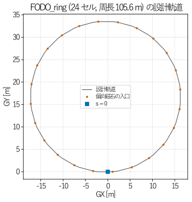

# FFS_ORG (幾何座標の原点 ORG)
種別: FFS コマンド。フォルダ: 01_lattice_elements。ラティス: `00_lattice/FODO_ring.sad` (24 セル、周長 105.6 m、15 度の偏向 × 24)。エネルギー 3 GeV。

## 何を見る例か
`ORG 位置 dgx dgy dgz dchi1 dchi2 dchi3`: 幾何 (設計軌道の座標 GX GY GZ と向き CHI) の原点を、`位置` から相対的にずらして設定する。位置を省いた `ORG;` で元に戻す。`CALC` で幾何が再計算されて反映される。

## スクリプト
```
USE RING; CELL; CALC;
Print["B.2 entrance GX GZ CHI2 = ", LINE["GX","B.2"], " ", LINE["GZ","B.2"], " ", LINE["GCHI2","B.2"]];
ORG B.1 0 0 0 0 0 0;   CALC;      ! B.1 の入口を原点にする
Print["after ORG B.1: B.2 GX GZ CHI2 = ", ...];
ORG;   CALC;                      ! 元に戻す
```

## 結果の読み方 (gs)
- 元の幾何: B.1 入口の GX=1.1 m、B.2 入口の GX = 5.377302 m (リングを 1 セル進んだ位置)。リングの終端は GX ≈ 0 (閉じる)。
- `ORG B.1 0 0 0 0 0 0` のあと: B.1 入口が GX=0 になり、B.2 入口は 5.377302 − 1.1 = 4.277302。
- `ORG;` で 5.377302 に戻る。



`FODO_ring` (24 セル) の設計軌道を GX (横軸) と GY (縦軸) [m] で描いた水平面の平面図。オレンジの点が偏向磁石 24 台の入口で、15° ずつ曲がって閉じた周長 105.6 m のリングになる。青い四角が出発点 (s = 0)。このラティスは水平面の偏向だけなので GZ は常に 0。

## 物理・解析式
ρ = L/θ = 4.5837 m。B.1 入口 (GX=1.1) から、偏向 (弦の x 成分 $\rho\sin\theta$)、続く 3.2 m の直線部が角度 θ=15° で進むので
$$GX(B.2)=1.1+\rho\sin\theta+3.2\cos\theta$$

| 量 | 式の値 | gs | pysad |
|---|---|---|---|
| GX(B.2 入口) | 5.3773 | 5.3773 | 5.3773 |
| ORG B.1 のあと GX(B.2) | 4.2773 | 4.2773 | 4.2773 |
| リング終端 GX (閉じる) | 0 | -4.880e-15 | -2.220e-15 |

(リング終端の GX は 1e-15 の雑音で、gs と pysad で値が違うのは雑音の差)

## gs と pysad の比較
全桁一致 (`ORG` の設定・解除とも)。

## 未確認・限界
- 原点を回転 (`dchi1 dchi2 dchi3`) や上下 (`dgy`) でずらした場合は未確認。MARK の `GEO` キーワードによる原点指定は別の話。
- SOL 内の幾何は 07_spin_solenoid_special の例で扱う。
