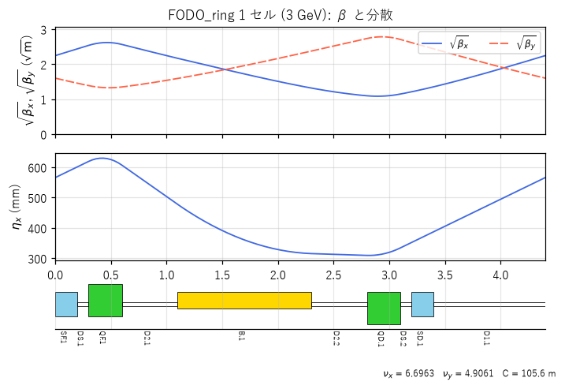

# 01 ラティスと要素定義

要素 (DRIFT MARK QUAD BEND SEXT.. MULT CAVI APERT COORD)、LINE の定義と USE、FFS の要素・ライン操作コマンドと関数。ラティスは `00_lattice/FODO_ring.sad` (24 セル、3 GeV、周長 105.6 m) か、要素の効果が分かるように作った短い輸送路・小さなリング (ファイル内に定義)。

各例は 4 ファイル: `NAME.sad` (スクリプト)、`NAME.gs.txt` (gs の画面表示)、`NAME.pysad.txt` (pysad の画面表示)、`NAME.md` (説明)。
走らせ方: `py -3.12 example/tools/run_example.py example/01_lattice_elements/NAME.sad`。凡例: ○ 一致 (表示の桁・書式の差は除く)、△ 差あり (内容を `.md` に書いた)、× gs 失敗、× pysad 未対応。

この節の多くの例が使う `00_lattice/FODO_ring.sad` (3 GeV、24 セル、周長 105.6 m) の 1 セル分の光学。上段は √βx (実線)・√βy (破線) [√m]、中段は水平分散 ηx [mm]、下段は磁石の配置 (SF・QF・B・QD・SD) で、横軸は 1 セルの始点からの距離 [m]。βx は 1.17〜6.85 m、βy は 1.75〜7.74 m、ηx は 309〜630 mm の範囲で、リング全体のチューンは (νx, νy) = (6.6963, 4.9061)。

| ファイル | 内容 | gs と pysad |
|---|---|---|
| [elem_DRIFT_MARK](elem_DRIFT_MARK.md) | DRIFT と MARK (初期 Twiss)。ドリフトの β(s) | ○ |
| [elem_QUAD](elem_QUAD.md) | QUAD。転送行列と β の変換、薄レンズ | ○ |
| [elem_BEND](elem_BEND.md) | BEND の ANGLE・E1・E2・FRINGE。セクター型と長方形、分散 | ○ |
| [elem_SEXT_OCT_DECA_DODECA](elem_SEXT_OCT_DECA_DODECA.md) | SEXT OCT DECA DODECA。線形には効かない。6 極の chromaticity 寄与 | ○ |
| [elem_MULT](elem_MULT.md) | MULT。QUAD+BEND と同じチューン | ○ |
| [elem_CAVI](elem_CAVI.md) | CAVI。Emittance[] のシンクロトロンチューンと νs の式 | ○ (`TYPE RF` の HARM/FREQ 表示のみ違う) |
| [elem_APERT](elem_APERT.md) | APERT。追跡での開口 (flag) | ○ (`TYPE` の種別表示だけ違う) |
| [elem_COORD](elem_COORD.md) | COORD。軌道と幾何の変換 | ○ |
| [elem_LINE](elem_LINE.md) | LINE の定義 (n*、-、入れ子) | ○ |
| [FFS_USE_EXPAND](FFS_USE_EXPAND.md) | USE・EXPAND・NOEXPAND。成分ごとのずれが残る/消える | ○ |
| [FFS_SPLIT](FFS_SPLIT.md) | SPLIT は gs で obsolete。MARK の OFFSET で要素の中点 | △ (SPLIT はどちらも動かない。`LINE["S",小数]` が不一致) |
| [FFS_RENUMBER](FFS_RENUMBER.md) | RENUMBER (成分番号の振り直し) | ○ |
| [FFS_TYPE_ATTRIBUTE](FFS_TYPE_ATTRIBUTE.md) | TYPE と ATTRIBUTE | ○ (表示の差のみ) |
| [FFS_ORG](FFS_ORG.md) | ORG (幾何の原点)。GX の解析値 | ○ |
| [FFS_REVERSE](FFS_REVERSE.md) | REVERSE。K64 では光学の表示に効かない | ○ (両者とも変化なし) |
| [FFS_VISIT](FFS_VISIT.md) | VISIT と BYE。1 セルのチューン = リング/24 | ○ |
| [fn_Element_SetElement](fn_Element_SetElement.md) | Element と SetElement | ○ |
| [fn_LINE](fn_LINE.md) | LINE 関数 (NAME POSITION S ELEMENT MULT GEO …) | ○ |
| [FFS_wildcards](FFS_wildcards.md) | 名前のパターン (* % {} {^} |) | ○ |
| [FFS_small_options](FFS_small_options.sad) | MAIN の `OFF RFSW`、`INDEX` 属性、`MON`、`ORG` の負数、`NOKEEPEXP`、MOMENTUM 未設定の警告。小さな試験用リング (周長 7 m。MOMENTUM をわざと書かず 30 GeV で追跡し警告が出る) | pysad v2 の出力だけ (gs の出力は未取得) |
| [elem_UND](elem_UND.sad) | UND の磁場 `FBX`。リングにアンジュレータ (1 m、20 周期、1.8 T) を入れる。垂直チューンのずれ、放射損失の増分が解析式 (2/3) r_e γ³ (F0²/2) L E と 0.04% で一致、減衰率の和 = 2 U0/E。`SLICE` は `POLE` の 20 倍以上にする | v2 のみ (K64 に無い機能。k64 モードでは動かない) |
| [elem_PHSROT](elem_PHSROT.sad) | PHSROT。リング 1 周を位相の回転・減衰・拡散で表す。CALC の Twiss・チューンが入力どおり、Emittance[] が b/(2d − d²)、FLUC つきの追跡の分布がそれに合う (1000 粒子で 5〜10%、2 万粒子で 1%) | v2 のみ (K64 に無い機能) |
| [syntax_MAIN_assign](syntax_MAIN_assign.sad) | MAIN の代入 (式・単位・関数) と `FFS USE RING;`。代入は後の要素定義と FFS 部の両方で使える | ○ (gs の出力と全行同じ。互換モードによらない) |
| [syntax_MAIN_expression](syntax_MAIN_expression.sad) | MAIN の要素定義の式 (`ANGLE=PI/8`、`SIN(0.1)`、`2*PI/16`、`45 DEG`、前に代入した変数と関数、`1/0` は Infinity) | ○ (13 個の ANGLE ほか全値が gs と一致。v2・k64 とも) |
| [FFS_USE_after_EMIT](FFS_USE_after_EMIT.sad) | EMIT (Emittance[]・CALC6D) のあとの USE。K64 の trf0 (同期位置の時間) は大域変数で、USE では 0 に戻らない | ○ (gs と全桁一致。A の値は v2 が 1e-4 違う: 端の角の補正) |
| [elem_BEND_F1_adjacent](elem_BEND_F1_adjacent.sad) | BEND の F1・FRINGE + RAD の追跡。隣り合う BEND (E1・E2 つき、F1=0.1 FRINGE=3) は、繋がっていない端にだけ F1 の断片を入れる | ○ (v2 は gs と 1e-4 以内: 端の角の補正が入る。k64 モードは 1e-6) |
| [elem_CAVI_offset](elem_CAVI_offset.sad) | CAVI の DX・DY・ROTATE と V1・V20・V11・V02 の追跡 (3 GeV、12 セル FODO、1.5 MV) | ○ (k64 モードは全桁一致。v2 は 1e-4 以内) |
| [elem_BEND_DX_offset](elem_BEND_DX_offset.sad) | ずれた BEND (矩形磁石 1 台を DX=2 mm) の CALC と追跡。弦に垂直な平行移動は矩形磁石の光学を変えない | △ (k64・gs の CALC は出口のドリフトが逆向きでチューンが 2.7e-5 動く。v2 は動かない) |
| [elem_BEND_steer_F1](elem_BEND_steer_F1.sad) | ANGLE=0 の BEND (補正磁石) の F1・FB1・FB2・FRINGE・AE1・AE2 の Emittance[] と CALC | ○ (k64 モードは全桁一致 (表示 10 桁)。v2 は端の角の行路の補正 (B108) で U0・減衰が少し違う) |
| [elem_BEND_steer_F1_track](elem_BEND_steer_F1_track.sad) | 補正磁石の F1・FB1・FB2・FRINGE・AE1・AE2 の TrackParticles (3 粒子 3 周、NORAD と RAD) | ○ (k64 モードは全桁一致。v2 は RAD で AE の行路の補正 (B108) だけ違う) |
| [elem_BEND_steer_AE2_tune](elem_BEND_steer_AE2_tune.sad) | 追跡は AE2 を FB2≠0 のときだけ入れる (K64 の不整合)。追跡のチューンで見る | △ (k64 モードは全桁一致 (追跡のチューン 0.1340952)。v2 は AE2 を常に入れる (0.1338835)) |
| [elem_BEND_steer_F1_maxwell_ramp](elem_BEND_steer_F1_maxwell_ramp.py) | 補正磁石の F1 (端の磁場が直線で立ち上がる長さ) の追跡を、x 方向に一様な Maxwell 場の端の厳密な運動と比べる。鉛直の収束 (fb1+fb2)/(6ρ²)、fb1=fb2 の x・px、放射の積分 (結果は `.out.txt`) | gs は使わない (v2・k64 とも同じ値) |
| [elem_BEND_steer_AE_poles](elem_BEND_steer_AE_poles.py) | ANGLE=0 の BEND (補正磁石・挿入光源の極) の端の角 AE1・AE2 と放射減衰の分配 Jx (B108)。AE なしとの差 dJx の表 (約 2 分。結果は `.out.txt`) | gs は使わない |
| [elem_AE_exact_geometry](elem_AE_exact_geometry.py) | 端の角 AE1・AE2 のある極 (MULT・K1≠0・BEND) の ΔJx を、厳密な幾何 + ロビンソンの定理と比べる (数分。結果は `.out.txt`)。v2 の比は 1.03〜1.04 (Emittance[]・追跡)、k64 は約 2 倍。残る 2.7% は未解決 | gs は使わない |
| [elem_BEND_K1_edge](elem_BEND_K1_edge.py) | K1≠0 の BEND の CALC と追跡の写像を、独立な厳密な写像 (ローレンツ力の積分) と比べる表 (結果は `.out.txt`)。差の原因は K64 の追跡の薄い端 | gs は使わない |
| [elem_BEND_K1_face](elem_BEND_K1_face.py) | K1≠0 の BEND の端の模型 (オプション `face`: 双極磁場は端面から、四極磁場は半径方向の入口・出口の面から)。CALC・追跡が厳密な写像と 1e-10〜1e-12 (それぞれの模型。結果は `.out.txt`) | gs は使わない (v2 だけのオプション) |
| [elem_MULT_F1](elem_MULT_F1.sad) | MULT の F1・F2・F1K1F・F1K1B・FRINGE と、K0 つきの FB1・FB2 の Emittance[] と CALC (QF・QD を MULT に替えた 12 セル FODO) | ○ (k64 モードは全桁一致 (表示 10 桁)) |
| [elem_MULT_F1_AE_track](elem_MULT_F1_AE_track.sad) | MULT の F1・F2・FB1・FB2・FRINGE・AE1・AE2・ROTATE・DX の TrackParticles (3 粒子 3 周、NORAD と RAD) | ○ (k64 モードは全桁一致 (表示 10 桁)) |
| [elem_MULT_AE_emittance](elem_MULT_AE_emittance.sad) | MULT の端の角 AE1・AE2 の CALC・Emittance[] (K0 = ±0.01 rad、AE1 = AE2 = 0.3。減衰が反転する (Jx < 0) リング) | △ (k64 モードは全桁一致。v2 は出口の端の蹴りの位置と行路 (B108) が違い、Jx などが k64 と違う) |
| [elem_BEND_steer_ring_a](elem_BEND_steer_ring_a.py) | 大きなリング A (kek-ls_v03_12.lat、3 GeV、603 m) の先頭に補正磁石 2 台 (K0 = ±5e-4 rad、L = 0.2 m)。gs の出力は `elem_BEND_steer_ring_a_ra1`〜`ra3.gs.txt` (結果は `.out.txt`) | k64 モードの追跡・CALC・Emittance[] は gs と一致。v2 は追跡のチューンと CALC のチューンが一致 |

上の表のうち、拡張子つきのリンクの行 (`.sad`・`.py`) は説明の `.md` を持たない。内容と結果の要点は表と、台本・スクリプトの先頭のコメントに書いた。`.py` の例は、リポジトリ直下から `py -3.12 example/01_lattice_elements/NAME.py` で走らせる (出力は `NAME.out.txt`)。gs と同じ動作で走らせるときは `PYSAD_COMPAT=k64`。

リングの BEND (`E1=E2=0.1309`) は SAD では ANGLE に対する**比**と読まれるので長方形ではない。`elem_BEND` は E1=E2=0.5 で長方形にした。

文法の細部 (MAIN の `ANGLE=式` の評価など。`E=0.5;` のとき `ANGLE=E` は .5、`Pi=3;` のとき `Pi/10` は .3、`Degree=0.1;` は .1、`A=2;` のとき `A*0.1` は .2、`1+` は 1、`2*3+` は 1、`3 DEG`・`PI/10` は正しい値、`45DEG`・`SIN[0.1]`・`pi/10`・`ZZZ*2` は構文エラー) は、gs で 1 式ずつ別の台本にして実測した結果で、試験 `pysad/tests/script_tests/test_v2_P5_syntax.py` の表にある。
`elem_BEND_steer_*`・`elem_MULT_*` の gs の値は、試験 (`test_v2_P3_f1.py`・`test_v2_P3_ae.py`) が使う値 (`pysad/tests/script_tests/_p3_gsdata.py`) と同じ台本から取った。
