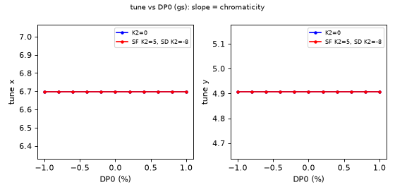

# FFS_CHROMATICITY (CHROMATICITY: クロマティシティ)
種別: FFS コマンド。フォルダ: 02_optics_cod。ラティス: `00_lattice/FODO_ring.sad`。エネルギー 3 GeV。フラグ: CELL。特殊変数: `DP0` (設計運動量のずれ)。

## 何を見る例か
`CHRO` (略 `CHROMATICITY`) は、四極と6 極のクロマティシティへの寄与を 1 要素ずつ、最後に合計を表示する。**偏向磁石 (BEND) は数えない**簡易式。
実際のクロマティシティは、`DP0` を ±1e-4 ずらして `CALC` し、チューンの差から $\xi=\Delta\nu/\Delta\delta$ を求めて確かめる (こちらが「真値」)。6 極 (SF K2=5、SD K2=-8) を入れた場合も同様に見る。

## スクリプト
```
USE RING; CELL; CALC;   CHRO;
DP0 = 1E-4;  CALC;  nxp = Twiss["NX","$$$"]/2/Pi; ...      DP0 = -1E-4; CALC; ...
Print["xi (finite diff)  : ", (nxp-nxm)/(2*dd), " ", (nyp-nym)/(2*dd)];
DP0 = 0;   SF K2 5; SD K2 -8;   CALC;   CHRO;   (同じ有限差分)
```
`DP0` は CALC の運動量のずれ (relative: δ)。`CHRO` の表は 1 要素 1 行 × 24 セルで 97 行ある (`.gs.txt` 参照)。

## 結果の読み方
- `CHRO` の最後の行 `TOTAL`: K2=0 のとき x: -95.721、y: -79.585。6 極を入れたあとは x: 171.732、y: 208.797。
- `tune at DP0=...` の 3 行と `xi (finite diff)` の行。

## 物理・解析式
SAD の `CHRO` の値は **$4\pi\xi$ の寄与の和** ($\xi_x=-\frac1{4\pi}\oint(K_1-K_2\eta_x)\beta_x ds$、$\xi_y=+\frac1{4\pi}\oint(K_1-K_2\eta_x)\beta_y ds$、$K_1,K_2$ は SAD の積分強度を長さで割った密度):
$$\xi_x=-\frac{1}{4\pi}\oint\beta_x K_1\,ds\ \ (+\ \text{6 極}\ \tfrac1{4\pi}\oint\beta_x\eta K_2\,ds),\qquad \xi_y=+\frac{1}{4\pi}\oint\beta_y K_1\,ds\ (-\ \text{6 極})$$
β と η の周期解に沿った積分は、FODO リングの 2x2 行列を 200 分割して計算した (`tools/ana_fodo_ring.py`)。

| 量 | 式の値 | gs | pysad |
|---|---|---|---|
| CHRO TOTAL x (K2=0) = Σ -(K1/L)∫β ds | -95.7205 | -95.721 | -95.721 |
| CHRO TOTAL y (K2=0) | -79.5848 | -79.585 | -79.585 |
| CHRO TOTAL x (K2=5,-8) | 171.509 | 171.732 | 171.732 |
| CHRO TOTAL y (K2=5,-8) | 209.507 | 208.797 | 208.797 |
| ξx = TOTAL/4π (K2=0) | -7.6172 | -7.61724 | -7.61724 |
| ξy = TOTAL/4π (K2=0) | -6.33316 | -6.33317 | -6.33317 |
| ξx (有限差分、K2=0) | (別の式なし) | -7.51214 | -7.51214 |
| ξy (有限差分、K2=0) | (別の式なし) | -6.56452 | -6.56452 |
| ξx (有限差分、K2=5,-8) |  | 13.7562 | 13.7562 |
| ξy (有限差分、K2=5,-8) |  | 16.4313 | 16.4313 |

読み取れること:
- **四極の積分** (表の 1・2 行目) は gs の `CHRO` と 4〜6 桁で合う (式の値は -95.7205 / -79.5848)。
- 6 極の寄与だけの差 (有限差分 (K2=5,-8) − 有限差分 (K2=0)) は x: 21.2683、y: 22.9958 で、`CHRO` の6 極の寄与 /4π (x: 21.2832、y: 22.9487) と 0.5 % 以内で合う (式 21.2655、23.0052)。
- **K2=0 の有限差分 (-7.512, -6.565) は `CHRO` /4π (-7.617, -6.333) と違う**: 差 +0.105 (x)、-0.231 (y) は `CHRO` が数えない偏向磁石 (弱収束と辺の収束の分散・軌道の項) の分。この差を解析式で再現するところまでは行っていない (単純な 3x3 行列の δ 依存の模型では -8.19 (x) となり合わなかった)。


(図は gs で DP0=-1%〜+1% を 0.2% 刻みに走らせた結果。傾き = chromaticity。6 極を入れると傾きが負から正に変わる。作成: `Do[DP0 = d; CALC; Print[...], {d,...}]` の出力を matplotlib で描画。)

## gs と pysad の比較
全桁一致 (`CHRO` の表 97 行 ×2、チューン、有限差分)。

## 未確認・限界
- 偏向磁石の寄与を解析式で説明していない (上記)。
- DP0 ±1e-4 の 2 点差分 (中心差分) なので、2 次のクロマティシティ ($\xi^{(2)}$) は図の曲がりでしか見ていない。
- 結合や垂直分散があるときは `CHRO` の式が使えない (SADHelp)。
