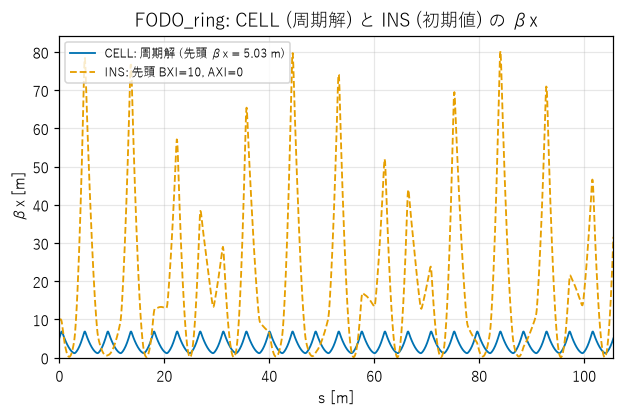

# flag_CELL_INS (CELL と INS)
種別: フラグ。フォルダ: 02_optics_cod。ラティス: `00_lattice/FODO_ring.sad`。エネルギー 3 GeV。

## 何を見る例か
- `CELL` (既定は INS): リングの**周期解**を使う。閉軌道と周期 Twiss を求め、ライン先頭の MARK の値は結果として更新される。
- `INS` (CELL の反意語): ラインを輸送路として扱い、**先頭 MARK の初期値** (`AXI BXI AYI BYI EXI EPXI …` で設定) から伝搬する。
周期解を初期値に与えた INS の結果が CELL と一致すること、初期値を (BX=10 などに) 変えると光学が変わることを見る。`CELL` に戻せば元の周期解。

## スクリプト
```
USE RING; CELL; CALC;     (周期解の BX AX BY AY EX EPX を読む)
INS;   BXI bx0; AXI ax0; BYI by0; AYI ay0; EXI ex0; EPXI epx0;   CALC;
BXI 10; AXI 0; BYI 10; AYI 0; EXI 0; EPXI 0;   CALC;
CELL;  CALC;
```
`BXI 値` は「先頭の MARK の入射 BX」を設定する FFS コマンド (`関数名I`: SADHelp の matching-function-commands (3))。

## 結果の読み方
- CELL: 末端 (`$$$`) の BX AX が先頭と同じ (5.02518, -2.1663)、チューン 6.696329。
- 周期解の初期値 BX AX BY AY EX EPX = (5.02518, -2.1663, 2.55766, 1.20763, 0.565228, 0.178139)。
- INS (周期解を初期値): 末端の BX AX が CELL と同じ (リング 1 周で元に戻る)。
- INS (BX=10, AX=0, …): 末端の BX=31.6069、AX=-19.4439、位置 100 の BX=9.09224。
- `CELL` に戻すと周期解が戻る。



横軸はリングに沿った距離 s [m]、縦軸は βx [m]。青の実線は CELL の周期解で、1 セル (4.4 m) ごとに 1.2〜6.8 m を繰り返す。橙の破線は INS で先頭の初期値を BXI=10、AXI=0 にした場合で、周期解と合っていないため β が大きく振れ、リング 1 周の末端で βx = 31.6 m になる (本文の値)。

## 物理・解析式
初期値 $(\beta_0,\alpha_0)=(10,0)$ から 24 セルを通した $\beta=M_{11}^2\beta_0-2M_{11}M_{12}\alpha_0+M_{12}^2\gamma_0$ (2x2 行列の積):
| 量 | 式の値 | gs | pysad |
|---|---|---|---|
| BX(周期初期値) 末端 | 5.02518 | 5.02518 | 5.02518 |
| BX(BX=10) 末端 | 31.6069 | 31.6069 | 31.6069 |
| BX(BX=10) 位置 100 (= 先頭から 97 要素) | 9.09224 | 9.09224 | 9.09224 |

(位置 100 は ORIGIN・RF の 2 要素のあとの 98 番目の要素の入口で、その手前に 97 要素 (セル 1〜9 の 90 要素 + セル 10 の 7 要素) ある。)

## gs と pysad の比較
全桁一致。

## 未確認・限界
- INS で周期的でない初期値を与えたときの安定性判定 (`Unstable`) の出力は未確認。INS のリングの追跡・Emittance[] は docs/ に別の照合がある。
- 先頭 MARK に EX・EPX・DX・DPX (軌道) を与える効果 (分散の伝搬) は EXI EPXI の初期値だけ確認した。
