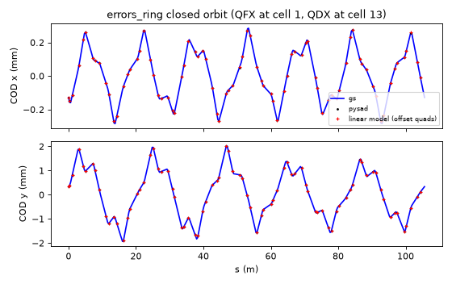

# flag_COD (閉軌道 COD)
種別: フラグ。フォルダ: 02_optics_cod。ラティス: **`00_lattice/errors_ring.sad`** (今回新規。`FODO_ring.sad` と同じ光学・24 セル・周長 105.6 m で、セル 1 の QF に `DX=+0.1 mm DY=-0.2 mm`、セル 13 の QD に `DY=+0.3 mm` のずれを入れた。乱数なし)。エネルギー 3 GeV。フラグ: CELL、COD。

## 何を見る例か
`COD` フラグ (既定 ON) のとき、`CALC` は閉軌道を探して、その軌道のまわりで Twiss を求める (OFF にすると軌道を求めない)。
ずれのある四極が 2 台あるリングの閉軌道を求め、Twiss の `DX DPX DY DPY` (軌道: 位置と角度) で読む。解析 (2x2 行列で、ずれた四極を $x_{\rm out}=M(x_{\rm in}-d)+d$ として 1 周の周期条件 $x=Mx+c$ を解く) と照合する。

## スクリプト
```
USE RING; CELL; CALC;
pq = LINE["POSITION","QDX"];   ps = {1, 5, 6, 50, pq, pq+1, 200};
Print["COD DX = ", Twiss["DX",ps]];   Print["COD DY = ", Twiss["DY",ps]];
Print["max |DX| max |DY| = ", Max[Abs[Twiss["DX"]]], " ", Max[Abs[Twiss["DY"]]]];
NOCOD;  CALC;  ...      COD;  CALC;  ...
```

## 結果の読み方
- 閉軌道の位置は `DX`/`DY` [m]、角度は `DPX`/`DPY`。表は「その要素の入口」の値。
- ずれが 0.1〜0.3 mm でも、軌道は DY で **最大 2 mm** まで増幅される (QDX 付近で約 1.6 mm) (最大 |DY| = 0.002016 m、|DX| = 2.850e-04 m)。
- 軌道があるのでチューンが設計値 (6.696329, 4.906056) から少しずれる: (6.69635, 4.906095) (BEND を軌道が斜めに通る効果と思われる、解析の 2x2 行列では出ない 2e-5 のずれ)。

## 物理・解析式
ずれ $d$ の四極 (積分強度 $K_1$) は、平行移動して通ることで実効的に $\Delta x'=K_1 d$ のキックを与える。1 周の閉軌道は
$$x(s_0)=\frac{\sqrt{\beta(s)\beta(s_0)}}{2\sin\pi\nu}\,\theta\cos\bigl(|\psi(s)-\psi(s_0)|-\pi\nu\bigr)$$
の重ね合わせ (θ=K1 d。QFX: x 方向 θ=0.7×1e-4、y 方向 -0.7×2e-4; QDX: y 方向 -0.6×3e-4 の符号付き)。ここでは同等のことを厳密に (厚い四極、BEND の辺の収束を含む 2x2 行列の積) 計算した (`tools/ana_fodo_ring.py` の `errors_ring_cod`)。

| 位置 (要素番号) | DX 式 [m] | DX gs | DX pysad | DY 式 [m] | DY gs | DY pysad |
|---|---|---|---|---|---|---|
| 1 | -1.286e-04 | -1.284e-04 | -1.284e-04 | 3.354e-04 | 3.354e-04 | 3.354e-04 |
| 5 | -1.580e-04 | -1.577e-04 | -1.577e-04 | 3.894e-04 | 3.895e-04 | 3.895e-04 |
| 6 | -1.597e-04 | -1.595e-04 | -1.595e-04 | 5.083e-04 | 5.084e-04 | 5.084e-04 |
| 50 | 1.211e-04 | 1.210e-04 | 1.210e-04 | 1.271e-04 | 1.270e-04 | 1.270e-04 |
| 129 | 7.605e-05 | 7.595e-05 | 7.595e-05 | -0.00155861 | -0.001559 | -0.001559 |
| 130 | 5.245e-05 | 5.235e-05 | 5.235e-05 | -0.0015665 | -0.001567 | -0.001567 |
| 200 | 8.386e-05 | 8.378e-05 | 8.378e-05 | 0.00146965 | 0.00147 | 0.00147 |

最大の差は DX で約 0.2 % (BEND の辺や軌道の傾きの 2 次効果)、DY で 0.01 % 以下。


(gs の `Twiss["DX", i]`、`Twiss["DY", i]` を全要素で読み、pysad (黒点)、2x2 行列の模型 (赤い +) と重ねた。作成: `Do` で全要素を出力し matplotlib で描画。)

## gs と pysad の比較
**一致。** 全要素の軌道が全桁で一致 (表のとおり)。

## 未確認・限界
- **`NOCOD` にしても Twiss の `DX`/`DY` は変わらない** (gs・pysad とも `NOCOD; CALC;` の前後で同じ値)。このスクリプトの範囲では COD フラグの OFF の効き方を確認できていない (SADHelp には「COD OFF で閉軌道を求めない」とは書かれていない。docs/03 の表のとおりの意味かは未確認)。
- 軌道の傾き・RF・放射 (RADCOD: 放射損失を入れた閉軌道) は扱っていない。
- 結合 (ROTATE のある四極) があるときの軌道は未確認。
