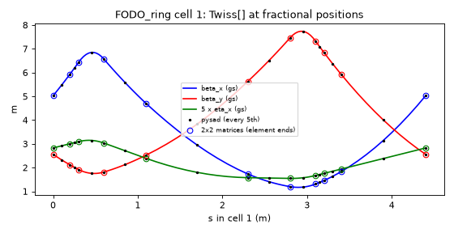

# fn_Twiss (Twiss 関数)
種別: SADScript 関数。フォルダ: 02_optics_cod。ラティス: `00_lattice/FODO_ring.sad`。エネルギー 3 GeV。フラグ: CELL。

## 何を見る例か
`Twiss[関数名, 位置]`: 直前の `CALC`/`GO` で求めた光学関数を返す。位置は要素名・番号・リスト・小数 (要素の途中を補間)・パターン。位置を省くと全位置のリスト。
関数名: `AX BX NX AY BY NY EX EPX EY EPY R1…R4 DETR DX DPX DY DPY …` (位相 NX NY は [rad]。DX DPX DY DPY は**軌道**、分散は EX EPX EY EPY)、`"ALL"` (28 個のリスト)、`PEX` (物理座標の分散)、`GMX` (γx)、`"LENGTH"`、`"GAMMA"`、先頭に `R` (参照) / `D` (参照との差、FFS_REFERENCE) を付けたもの。

## スクリプト
```
Print["BX at QF.1, QD.1, B.1        = ", Twiss["BX",{"QF.1","QD.1","B.1"}]];
Print["BX at 5 (QF.1), 5.5, 6 (D2.1) = ", Twiss["BX",{5,5.5,6}]];
Print["ALL at ORIGIN                = ", Twiss["ALL","ORIGIN"]];
Print["GMX at QF.1 (=(1+AX^2)/BX)   = ", Twiss["GMX","QF.1"], " ", (1+Twiss["AX","QF.1"]^2)/Twiss["BX","QF.1"]];
Print["max BX max BY = ", Max[Twiss["BX"]], " ", Max[Twiss["BY"]]];
```

## 結果の読み方
- `Twiss["BX", ...]` は**要素の入口**の値。小数の位置 (5.5) は QF.1 の中点で、5〜6 の間で補間される (中点の BX は極大 6.846)。
- `ALL` は 28 個のリスト (AX BX GMX? NX …。SADHelp の並び)。`PEX` (QF.1 で 0.618669) は物理座標 (β·分散の変換前) の分散。
- `Twiss["BX"]` (位置なし) は 243 個のリストで、`Max` で最大値 (BX 6.566、BY 7.466)。

## 物理・解析式
QF.1 の入口、B.1 の入口、QD.1 の入口の BX、B.1 入口の分散を、周期解から 2x2・3x3 行列で伝搬して計算した:
| 量 | 式の値 | gs | pysad |
|---|---|---|---|
| BX(QF.1 入口) | 6.42693 | 6.42693 | 6.42693 |
| BX(QD.1 入口) | 1.19744 | 1.19744 | 1.19744 |
| BX(B.1 入口) | 4.69262 | 4.69262 | 4.69262 |
| EX(B.1 入口) | 0.477274 | 0.477274 | 0.477274 |
| EPX(B.1 入口) | -0.25831 | -0.25831 | -0.25831 |
| GMX(QF.1) = (1+α²)/β | 1.13287 | 1.13287 | 1.13287 |
| BX 最大 | 6.56601 | 6.56601 | 6.56601 |

(`GMX` の式の値は `(1+AX^2)/BX` を SAD 内で計算した値)


(gs の `Twiss["BX", 要素番号+小数]` を 0.1 刻みで 100 点読み、pysad (黒点)、2x2 行列の要素端の値 (白丸) と重ねた。作成: SAD スクリプトの `Do` で出力した値を matplotlib で描画。)

## gs と pysad の比較
値はすべて一致 (全桁)。2026-11-17: `Twiss["LENGTH"]` (成分数。引数を付けると `General::narg`)、`Twiss["GAMMA",1]`・`"GAMMABETA"`・`"S"`・`"SIZE…"` (LINE と同じ値) に対応した。光学関数でない名前は `General::wrongval:  #1 (NAME) is must be to be name of optical function` (gs と同じ)。

## 未確認・限界
- `DBX` `RBX` (REFERENCE が必要) は FFS_REFERENCE。`BMAGX`、`SIG...` (EMIT が必要) は未確認。
- 結合のあるリングの R1〜R4、DETR は結合のない光学なので 1e-16 の雑音 (表の値は 0 を意味する)。
