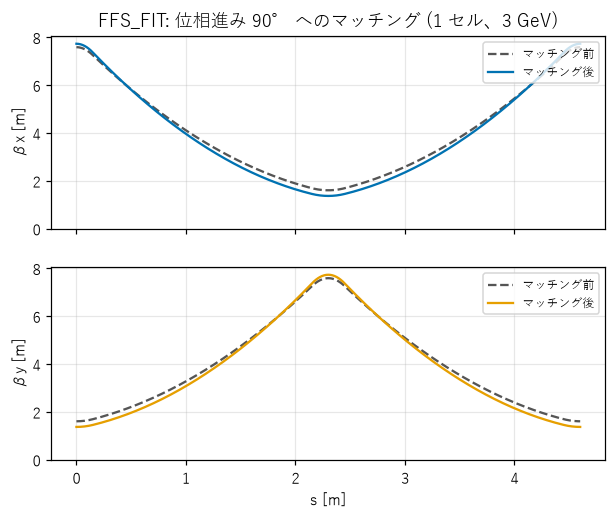

# FFS_FIT (FIT・FREE・GO・SHOW・VARIABLES: 基本のマッチング)
種別: FFS コマンド群。フォルダ: 03_matching。ラティス: 1 セルの対称 FODO (半分の QF `QFH` (L=0.15) + ドリフト 2 m + QD (L=0.3) + ドリフト 2 m + 半分の QF。ファイル内、`00_lattice` ではなく解析解のために別に作った)。エネルギー 3 GeV。フラグ: CELL。

## 何を見る例か
1 セルの FODO で位相進みを 90 度 (チューン 0.25) にする最小のマッチング。
- `FREE 要素` : 変数にする要素を指定 (既定キーワード: 四極なら K1)。
- `FIT 位置;` と `関数 目標値 …;` : マッチング条件 (`NX 0.25 NY 0.25` はその位置の位相進み = 2π×0.25)。
- `SHOW` : 現在の条件の表、`VARIABLES` : 変数の表 (Now・Previous・Saved・限界)。
- `GO` : マッチング実行。
解析解は薄レンズの式で書ける (下記)。

## スクリプト
```
DRIFT DD = (L=2.0);   QUAD QFH = (L=0.15 K1=0.3) QD = (L=0.3 K1=-0.6);   MARK ORIGIN = ();
LINE C = (ORIGIN QFH DD QD DD QFH);
FFS;
USE C; CELL; CALC;
FREE QFH QD;        FIT $$$;      NX 0.25 NY 0.25;       SHOW;   VARIABLES;
GO;                 SHOW;   VARIABLES;
```
`FIT $$$;` は条件を付ける位置をラインの末尾にする。`NX 0.25 NY 0.25;` で位相進みの目標を与える (`NX` などの「関数 目標値 [点数]」の組)。

## 結果の読み方
- 最初の `CALC`: 初期のセルの位相進み = (0.22911, 0.22911) (QFH=0.3, QD=-0.6)。
- `SHOW`: `FIT $$$ NX .250000000 1 ! * 6.283185307` (関数 NX、目標、点数 1、スケール 2π)。
- `GO`: ` 2 0 3.38E-05 (NEWTON) …` の反復の行と `Matched. ( 3.58E-11 )`。
- `VARIABLES`: GO 後の `Now` = QFH K1 = 0.321805、QD K1 = -0.643611 (QFH は半分の磁石 2 個の片方)。



横軸は 1 セルの始点からの距離 s [m]、縦軸は上が βx、下が βy [m]。破線がマッチング前 (QFH の K1 = 0.3、QD の K1 = -0.6。位相進み 0.229)、実線が後 (K1 = 0.321805 と -0.643611。位相進み 0.25)。βx は QF の位置 (両端) で大きく QD の位置 (中央) で小さく、βy は逆になる。最小の β は 1.60 m から 1.37 m に、最大は 7.59 m から 7.73 m に変わる。

## 物理・解析式
対称 FODO のセルでは $\cos\mu=\tfrac12{\rm tr}M$。$\mu=90^\circ$ は ${\rm tr}M=0$。厚いレンズを正確に解く式は 2x2 行列の積 (`tools/ana_fodo_ring.py` の `quad`・`drift`) で書け、薄レンズでは ($L_c$=QF-QD 間の中心距離 2.3 m、f=焦点距離)
$$\sin\frac{\mu}{2}=\frac{L_c}{2f},\quad f=\frac{L_c}{2\sin45^\circ}=1.62635\ \text{m},\ K_1^{\rm int}=1/f=0.614875;\qquad \beta_{\max,\min}=\frac{L(1\pm\sin\frac\mu2)}{\sin\mu},\ L=4.6\ \text{m}$$
| 量 | 式の値 (厚いレンズ 2x2) | gs | pysad | 薄レンズ |
|---|---|---|---|---|
| QFH の K1 (半分) | 0.321805 | 0.321805 | 0.321805 | 0.307438 |
| QD の K1 | -0.643609 | -0.643611 | -0.643611 | -0.614875 |
| BX (QF 中心) | 7.7303 | 7.73031 | 7.73031 | 7.85269 |
| BY (QF 中心) | 1.36769 | 1.36768 | 1.36768 | 1.34731 |
| 初期の位相進み x (QFH=0.3) | 0.22911 | 0.22911 | 0.22911 |  |

厚いレンズの正確な解と gs は 6 桁以上で一致。薄レンズの式は K1 が厚いレンズの解より 4.5 % ほど小さく (厚さ 0.3 m の分)、β は 1.6 % 以内の目安にしかならない。

## gs と pysad の比較
全桁一致 (K1 の最終値、β、`Matched` の残差、`SHOW`)。**差は `VARIABLES` の `Saved` 列だけ**: GO のあと gs の Saved は元の値 (0.3, -0.6) のまま (SAVE していないため)、pysad は新しい値に更新する (△ 表示のみ)。

## 未確認・限界
- NX=0.25 は 0.250001 で止まる (残差 3.6e-11 の収束判定)。
- 薄レンズ近似は解析解の目安 (上記の差)。非対称セル、リング全体のマッチングは FFS_REJECT 以降。
- `FIT` で位置を 2 点 (`FIT QF QD`) にした相対マッチング、`NXM` (最大値 FIT)、`@` (MARK の保存値、pysad 未対応) は未確認。
