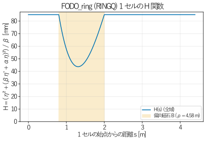

# FFS RADINT
種別: FFS コマンド / フォルダ: 04_emittance_radiation / ラティス: `00_lattice/FODO_ring_V4MV.sad` (FODO_ring と同じ磁石列、RF 電圧だけ 4 MV。QF から始まる `RINGQ` を使う)。3 GeV、周長 105.6 m、24 セル、RF 500 MHz / フラグ: RFSW, RAD (EMIT の後に RADINT)。

## 何を見る例か
`RADINT;` は、放射積分 $I_1\ldots I_5$、$U_0$、減衰時間、$\epsilon_x$、$\sigma_\delta$、$\nu_s$、色収差を表示する。$I_1\ldots I_5$ を自前で積分した値と比べる。

## ラティスについて
- `FODO_ring.sad` の RF は 1.5 MV で、エネルギー損失 $U_0=1.563$ MV より小さく、バケットがない (同期位置 dz=150 mm、$\nu_s$ 虚数)。そこで RF 電圧を 4 MV にした `FODO_ring_V4MV.sad` を追加した。
- RADINT は先頭の要素が SEXT (L=0.2, K2=0) だと `DL=0. IN TCAL` で I2・I3・I5 が NaN になる (gs も pysad も同じ)。そのため先頭が QF の `RINGQ = (ORIGIN RF 24*CELLQ)` を使う (磁石の並びは同じ、位相だけ違う)。
- SAD の BEND の `E1`, `E2` は ANGLE に対する比なので、端の角は $\epsilon=E1\cdot\text{ANGLE}=0.0343$ rad (θ/2 ではない)。四極の `K1` は積分強度 (k=K1/L)。

## スクリプト
```
USE RINGQ;  CELL;  CALCULATE;
RFSW;  RAD;  EMIT;
RADINT;
```

## 結果の読み方 (gs)
| 行 | 値 |
|---|---|
| I1X | 2.337645 |
| I2 | 1.370778 |
| I3 | 0.2990575 |
| I4U | 0.08023724 (I4V は 1e-32 の雑音) |
| I5U | 0.01736053 |
| ENERGY LOSS PER TURN (kV) | 1563 |
| DU = 1 - I4U/I2 | 0.94146592 |
| DAMPING TIME (msec) U / V / E | 1.436 / 1.352 / 0.6568 |
| ENERGY SPREAD (SIG) DE/E | 1.1831E-03 |
| EMITTANCE U | 1.7767E-07 |
| NU-S | 0.027596 |
| NATURAL BUNCH LENGTH (mm) | 15.950562 |
| BUCKET HIGHT | 0.010045 |
| LINEAR CHROMATICITY GX / GY | -2.705921 / -2.347256 |



横軸は `RINGQ` の 1 セルの始点 (QF の入口) からの距離 s [m]、縦軸は分散関数 H = (η² + (βη' + αη)²)/β [mm]。橙の帯が偏向磁石 B (ρ = 4.58 m、1.2 m) で、I5 は帯の内側の H/ρ³ だけを周回で積分した量。H は四極とドリフトでは一定 (約 85 mm) で、偏向磁石の中で 44〜85 mm まで下がる。この点列から台形則で求めた 24 セルの I5 は 0.017361 で、表の I5U = 0.01736053 と合う。

## 物理・解析式
式は FFS_EMITTANCE.md と同じ。曲率が一様な偏向だけなので $I_2=2\pi/\rho=1.370778$、$I_3=2\pi/\rho^2=0.299058$ ($\rho=L/\theta=1.2/0.261799=4.5837$ m)。gs・pysad・自前の積分がすべて 7 桁で一致した。

| 量 | 自前の積分 | RADINT gs | RADINT pysad |
|---|---|---|---|
| $I_1$ | 2.337646 | 2.337645 | 2.337645 |
| $I_2$ | 1.370778 | 1.370778 | 1.370778 |
| $I_3$ | 0.2990575 | 0.2990575 | 0.2990575 |
| $I_4$ (端 係数 -1) | 0.08023729 | 0.08023724 | 0.08023724 |
| $I_5$ | 0.01736058 | 0.01736053 | 0.01736053 |

$I_4$ の端の項の係数 (-1 か -2) と EMIT との関係は FFS_EMITTANCE.md。色収差 $\xi=-\frac1{4\pi}\oint\beta K ds$ は RADINT の BEND 成分を含まないので、ここでは値の表示だけ (docs/29 C20)。

## gs と pysad の比較
**v2 と k64 の違い**: `.pysad.txt` は既定の v2 モードの出力。v2 は `Emittance[]`・EMIT・追跡の Jx の端の項 (B75) と `MomentumCompaction` (B77) を K64 のバグに依らず正しい式で計算するので、この例の pysad の値のうち εx (約 2.4% 大きい)・εz・減衰率の X と Z・σδ・バンチ長・α・バケット高さ・放射によるチューンシフトが gs と違う。以下の表と本文の「pysad」の値と「一致」の判定は `PYSAD_COMPAT=k64` での結果 (2026-11-17 に確認)。gs と同じ値が要るときは `PYSAD_COMPAT=k64` を付ける。

○ 一致 (表示 7 桁)。差は $I_{1Y}, I_{4V}, I_{5V}$ など 0 同然の V 面の量だけ (gs 1e-33〜1e-49、pysad 0)。

## 未確認・限界
- 先頭が SEXT のラティスでは NaN になる (gs も pysad も同じ。`RINGQ` で回避)。
- RADINT は結合 (R マトリクス) 込みの計算だが、この例は平面リングなので V 面の量は 0。
- SOL は含まれない (RADINT の仕様)。
- $I_4$ の端の項の扱いは FFS_EMITTANCE.md の通り未確認。
