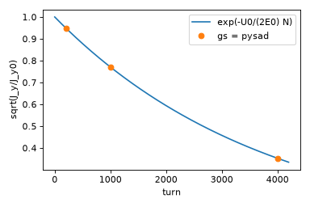

# flag_RAD_FLUC
フラグ・05_tracking・ラティス `00_lattice/FODO_ring_V4MV.sad` (RF 4 MV: 3 GeV の $U_0=1.563$ MV を補える)・`RFSW; RAD; FLUC`・`NPARA=1`

## 何を見る例か
追跡での放射 (`RAD`) と量子ゆらぎ (`FLUC`)。(1) `RAD NOFLUC`: 決定論的な放射減衰 (垂直振動の振幅が $e^{-\alpha_y N}$ で減る)。(2) `RAD FLUC`: 零から始めたビームがゆらぎで広がる (シンクロトロン・ベータトロン振動の平衡へ向かう)。乱数は `SeedRandom[17]` で固定し、`NPARA=1` を入れて gs と pysad の乱数列を揃える (既定の 4 は fork で乱数列が分かれる)。

## スクリプト
```
RFSW; RAD; NOFLUC;
em = Emittance[];                 ! RF 同期位相・減衰率・平衡値 (EMITX など) を決める
NPARA = 1;
! (1) 垂直 y0=1e-3 m を 200, 1000, 4000 周 (RAD NOFLUC)
r = TrackParticles[{1, beam}, 1, 1, nt][[2]];  inv = g0 y^2 + 2 a0 y py + b0 py^2
! (2) FLUC; SeedRandom[17]; 200 粒子 (すべて原点) を 500 周
r = TrackParticles[{1, beam}, 1, 1, 500][[2]];  rms[dp], rms[x], rms[z]
```
- `Emittance[]` の戻り `em` から `EnergyLossU0`、`DampingRate`、`MomentumSpread`、`Emittances`、`BunchLength` を読む。
- `FLUC` は追跡 (と放射) の量子ゆらぎ。`RAD` だけのときは減衰だけ。

## 結果の読み方
- `U0`、`DampingRate`: $U_0=1563265.71$ eV、$\{\alpha_x,\alpha_y,\alpha_z\}=\{-2.5139,-2.6056,-5.2997\}\times10^{-4}$ (1 周あたり。符号は SAD の慣習で減衰が負)。
- `NOFLUC nt=...  sqrt(inv/inv0)`: 垂直不変量の平方根の比 (振幅の減衰)。
- `FLUC nt=500 np=200`: 500 周後の rms $dp$、rms $x$、rms $z$。



## 物理・解析式
放射減衰 (垂直): $\alpha_y=U_0/(2E_0)$ (垂直振動では、放射で運動量の全体が $\delta E/E$ ずつ失われ、RF は縦方向の運動量しか戻さないので、$y'$ だけが減る。分散がない垂直面)。$\sqrt{J_y/J_{y0}}=e^{-\alpha_yN}$。
量子ゆらぎで零から広がるとき: エミッタンス・エネルギー広がりは減衰率 $\alpha_i$ の 2 倍の時定数で平衡に向かう。

$$\sigma_\delta^2(N)=\sigma_{\delta,eq}^2\left(1-e^{-2\alpha_zN}\right),\quad \sigma_x^2(N)=\varepsilon_{x,eq}\beta_x\left(1-e^{-2\alpha_xN}\right)+\eta_x^2\sigma_\delta^2(N)$$

| 量 | 式 | gs | pysad |
|---|---|---|---|
| $\alpha_y=U_0/2E_0$ | 2.60544e-4 | 2.60559e-4 (DampingRate) | 同左 |
| $\sqrt{J_y/J_{y0}}$ (200 周) | 0.94923 | 0.94954 | 0.94954 |
| 同 (1000 周) | 0.77063 | 0.77086 | 0.77086 |
| 同 (4000 周) | 0.35269 | 0.35278 | 0.35278 |
| rms $\delta$ (500 周、$\sigma_\delta^{eq}=1.1914\times10^{-3}$) | $7.64\times10^{-4}$ | $8.07\times10^{-4}$ | $8.07\times10^{-4}$ |
| rms $z$ ($\sigma_z^{eq}=16.06$ mm) | 10.30 mm | 9.90 mm | 9.90 mm |
| rms $x$ ($\varepsilon_x=1.7358\times10^{-7}$、$\beta_x=5.0252$、$\eta_x=0.5652$) | $6.17\times10^{-4}$ | $6.11\times10^{-4}$ | $6.11\times10^{-4}$ |

減衰は式と $3\times10^{-4}$ 以内 (有限の振幅での運動と $\alpha_y$ の端数による)。ゆらぎの表は 200 粒子の統計誤差 ($1/\sqrt{2\cdot200}\approx5\%$) の範囲で一致する。

## gs と pysad の比較
○ 一致。`U0` 以下の全行が印字桁まで同じ (乱数を固定した FLUC を含む。`Emittances` の垂直成分だけは数値雑音 $10^{-38}$ と 0 の違い)。

## 未確認・限界
- 3 GeV、RF 4 MV (実際の $U_0$ を補う電圧)、200 粒子 × 500 周。平衡に達する長さ ($1/(2\alpha)\approx2000$ 周) には届かない短い追跡 (「零から広がる」途中を見た)。
- `NPARA` の既定 (4) のときは gs は fork で乱数が分かれ、pysad の乱数とは一致しない。
- PHOTONS (光子のリスト) は pysad が BEAMBEAM の分だけ対応。BEND の光子は未対応。
