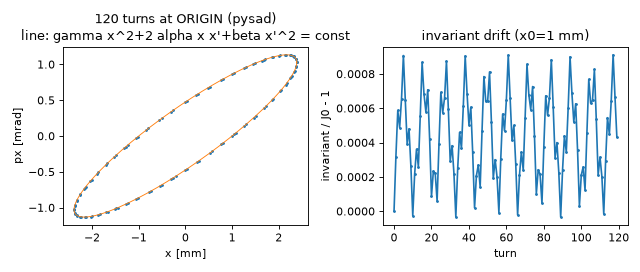

# fn_TrackParticles
種別: 関数 / フォルダ: 05_tracking / ラティス: `00_lattice/FODO_ring.sad` (24 セル、3 GeV、周長 105.6 m、Qx=6.696329、Qy=4.906056) / フラグ: `NORFSW NORAD NOFLUC` (4 次元的なベータトロン振動だけ)

## 何を見る例か
`TrackParticles[{位置, ビーム}, 終点, 開始周, 終了周]` の基本の使い方。(1) 1 周、(2) N 周を一度に、(3) 1 周ごとに戻り値を次の入力にして座標を取り出す、の 3 通りを小振幅粒子で行い、結果を転送行列と不変量 $\gamma x^2+2\alpha xx'+\beta x'^2$ で説明する。損失の扱いは [fn_TrackParticles_loss](fn_TrackParticles_loss.md) を参照。

## スクリプト
全文は `fn_TrackParticles.sad`。要点だけ。

```
USE RING; CELL; CALC;
NORFSW; NORAD; NOFLUC;              ! RF なし (z は毎周 0)、放射なし
beam = {{x0},{xp0},{0},{0},{0},{0},{1}};   ! {x, px, y, py, z, dp, flag}。各成分は粒子数の長さのリスト
r1 = TrackParticles[{1, beam}];            ! 1 周。戻り値は {終端の位置, ビーム}
rN = TrackParticles[{1, beam}, 1, 1, 10];  ! 10 周を一度に
Do[ rr = TrackParticles[{1, b}, 1, n, n]; b = rr[[2]]; ... , {n, 1, 20}];  ! 1 周ごと
```
- ビームは `{x, px/p0, y, py/p0, z, dp/p0, flag}` の 7 本のリスト (粒子ごとに 1 要素)。flag は 1 が生存、0 が損失。
- 戻り値は `{位置, ビーム}`。1 周追跡して終端に着くと位置は `NLAT+1 = 243` になる (ラインは `ORIGIN RF 24*CELL` で 242 要素)。
- 第 3、4 引数は開始周と終了周。同じ値を渡せば 1 周だけ追跡され、戻り値を次の入力に使えば周ごとの座標が取れる。

## 結果の読み方
`.gs.txt` / `.pysad.txt` の各行。

| 行 | 内容 |
|---|---|
| `Twiss at ORIGIN` | CALC が出した ORIGIN での $\alpha_x=-2.1663$、$\beta_x=5.0252$、$\nu_x=6.696329$ |
| `1 turn: pos=243 x=1.7134e-5 px=1.0691e-5` | $x_0=10\,\mu$m、$p_x=0$ から 1 周した座標 |
| `10 turns:` | 10 周を一度に追跡した座標 |
| `turn k x px inv` | 周ごとの座標と不変量 (4 周おきに表示) |
| `cos(mu)`、`1-nu_frac(mu)` | 3 周の座標から求めた $\cos\mu$ とチューンの小数部 |



図は pysad の出力 (初期振幅 $x_0=1$ mm で 120 周、ORIGIN での $(x,p_x)$) から matplotlib で描いたもの (gs の画面表示は撮れない)。

## 物理・解析式
振幅が小さければ 1 周は線形写像 $\begin{pmatrix}x\\p_x\end{pmatrix}_{n+1}=M\begin{pmatrix}x\\p_x\end{pmatrix}_n$ で、$M$ は要素ごとの行列の積。ドリフト $\begin{pmatrix}1&L\\0&1\end{pmatrix}$、厚い四極 $\begin{pmatrix}\cos\phi&\sin\phi/\sqrt K\\-\sqrt K\sin\phi&\cos\phi\end{pmatrix}$ ($\phi=\sqrt K L$、$K=K1/L$。SAD の `K1` は積分強度)、偏向は扇形の本体と入口・出口のエッジの積を使う。
Twiss パラメータで書くと

$$M=\begin{pmatrix}\cos\mu+\alpha\sin\mu&\beta\sin\mu\\-\gamma\sin\mu&\cos\mu-\alpha\sin\mu\end{pmatrix},\qquad \cos\mu=\tfrac12\mathrm{tr}M,$$

3 周の座標から $x_{n+1}+x_{n-1}=2\cos\mu\,x_n$ が成り立つ (チューンの小数部を出す式)。不変量 $J=\gamma x^2+2\alpha xx'+\beta x'^2$ は 1 周ごとに保存する。

**偏向磁石の端の角度**: `FODO_ring.sad` の `E1=E2=0.1309` を、SAD は「ANGLE に対する比」として読む (端の角度 $e=E1\cdot\mathrm{ANGLE}=0.03427$ rad。ANGLE/2 の長方形偏向ではない)。この $e$ で、水平は $\begin{pmatrix}1&0\\+\tan e/\rho&1\end{pmatrix}$ (発散)、垂直は $\begin{pmatrix}1&0\\-\tan e/\rho&1\end{pmatrix}$ (収束) のエッジを置いた行列の積が、CALC のチューン・β・α と 10 桁で一致した (下表、Python で計算)。

| 量 | 行列の積 (式) | gs | pysad |
|---|---|---|---|
| $\nu_x$ の小数部 | 0.6963289409 | 0.696329 | 0.696329 |
| $\beta_x$(ORIGIN) | 5.0251849075 | 5.025185 | 5.025185 |
| $\alpha_x$(ORIGIN) | −2.1663048773 | −2.166305 | −2.166305 |
| 1 周後の $x$ ($x_0=10^{-5}$) | 1.7134209e-5 | 1.7134198e-5 | 1.7134198e-5 |
| 1 周後の $p_x$ | 1.0690618e-5 | 1.0690626e-5 | 1.0690626e-5 |
| 10 周後の $x$ | 1.4687755e-5 | 1.4687778e-5 | 1.4687778e-5 |
| 20 周後の $x$ | 1.8597524e-5 | 1.8597570e-5 | 1.8597570e-5 |
| $\cos\mu$ (3 周から) | −0.3308699 | −0.3308714 | −0.3308714 |
| 不変量 $J_0=\gamma_0x_0^2$ | 1.1328691e-10 | 1.1328691e-10 (turn 0) | 同左 |

追跡が線形の行列からわずかに外れる (相対 $10^{-6}$ 程度) のは、SAD の追跡が近軸近似ではなく、厳密なドリフトとエッジの非線形項を持つため。不変量の周ごとの変動は $7\times10^{-6}$ 以下 (表示した 6 周で最大 $1.1328767\times10^{-10}$)。

## gs と pysad の比較
○ 一致。画面表示の全 11 行が、印字桁 (11 桁) まで同じ。

## 未確認・限界
- 使った条件: 3 GeV、周長 105.6 m、`NORFSW NORAD NOFLUC`、振幅 $10\,\mu$m (線形の範囲)。大振幅や分散を持つ粒子 ($dp\ne0$) は見ていない。
- 行列の式のエッジの符号と角度 ($e=E1\cdot$ANGLE) は、チューンと β が合うように選んだもの (SAD のソースでの確認はしていない)。他のラティスに使うときは再確認が要る。
