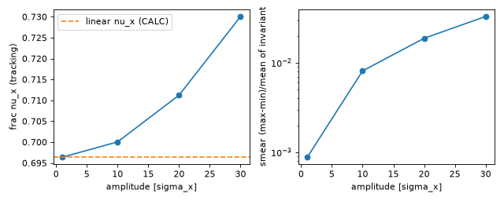

# multi-turn-tracking
種別: SADHelp の項目 (多周回追跡) / フォルダ: 05_tracking / ラティス: `00_lattice/FODO_ring_V4MV.sad` (RF 4 MV、3 GeV) / フラグ: `RFSW; RAD; EMIT; NORAD; NORFSW`

## 何を見る例か
SADHelp の multi-turn-tracking の項目。多周回追跡 (`TrackParticles`、`DynamicApertureSurvey`) は閉軌道・規格化座標・平衡エミッタンスを使うので、先に `EMIT` (または `Emittance[]`) を 1 回実行する。ここでは、EMIT で得た `EMITX` を使い、水平 $n\sigma$ ($\sigma=\sqrt{\mathrm{EMITX}\,\beta_x}$) の粒子を 200 周追跡する。毎周の規格化座標から、位相の進み (チューン) と不変量のばらつき (smear) を出す。振幅を大きくするとチューンが変わる (振幅依存性) ことを見る。

## スクリプト
```
RFSW; RAD; NOFLUC;
EMIT;                       ! EMITX, EMITY, SIGE が決まる
NORAD; NORFSW;              ! 追跡は放射・RF なし
x0 = nsig*Sqrt[EMITX*bx];  b = {{x0},{0},{0},{0},{0},{0},{1}};
Do[ X = b[[1,1]]/Sqrt[bx]; P = (ax b[[1,1]] + bx b[[2,1]])/Sqrt[bx];   ! 規格化座標
    ph = Append[ph, ArcTan[X, -P]]; inv = Append[inv, X^2+P^2];
    b = TrackParticles[{1, b}, 1, n, n][[2]], {n,1,200}];
nu = Mean[Mod[dph, 2 Pi]]/(2 Pi)        ! 1 周の位相の進み / 2 pi
smear = (Max[inv]-Min[inv])/Mean[inv]
```
MAIN レベルの `TRACK USE=… NX=… NY=…` 文 (`ActTra.f`) は K64 では動かない (docs/08 §8) ので、同じ手順を SADScript で書いた。

## 結果の読み方
`amp=n sigma (x0=...) nu_x(tracking)=... smear=...` の各行。EMITX=1.7358e-7、$\nu_x$(CALC)=6.696329。

| 振幅 | $x_0$ [mm] | $\nu_x$ の小数部 (追跡) | smear |
|---|---|---|---|
| 1σ | 0.934 | 0.696366 | $8.8\times10^{-4}$ |
| 10σ | 9.34 | 0.700032 | 0.0081 |
| 20σ | 18.7 | 0.711219 | 0.0188 |
| 30σ | 28.0 | 0.730067 | 0.0330 |



## 物理・解析式
小振幅の極限ではチューンは線形の値 $\nu_x=0.6963289$ (行列の積でも 0.6963289409。[fn_TrackParticles](fn_TrackParticles.md))。振幅 $a$ が大きいとき、運動学の非線形 (厳密なドリフト) による振幅依存チューンシフトは 2 次 $\Delta\nu=\kappa a^2$ になる。1σ の値から $\kappa=3.7\times10^{-5}/\sigma^2$ を決めると、他の振幅は次のとおり (式は $\kappa a^2$)。

| 振幅 | $\Delta\nu$ (式 $\kappa a^2$) | $\Delta\nu$ (追跡) |
|---|---|---|
| 10σ | 0.00371 | 0.00370 |
| 20σ | 0.01484 | 0.01489 |
| 30σ | 0.03339 | 0.03374 |

(1σ の追跡値 0.696366−0.696329=$3.7\times10^{-5}$ から $\kappa$ を決め、10σ の値は $\kappa\times100$ と比べた。10σ で 0.00370 と一致するので、2 次の依存性が確認できる。20σ・30σ は 4 次以上の項のため、式と 0.3%、1% ずれる。) smear は振幅に比例してほぼ線形に増える (解析式は用意していない)。

## gs と pysad の比較
○ 一致 (全 5 行が印字桁まで同じ)。

## 未確認・限界
- 3 GeV、$\sigma_x$ は EMIT の $\varepsilon_x$ と ORIGIN の $\beta_x$ から計算、200 周、$dp=0$、垂直振幅なし。
- 規格化座標は分散を含まない粒子 ($dp=0$) の前提。
- smear・チューンは自分で定義した量で、MAIN の `TRACK` の smear・tune (FFT) とは定義が違う。
