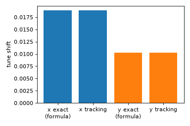

# elem_BEAMBEAM
要素・06_collective・ラティス `00_lattice/bb_ring.sad` (新規: FODO_ring の ORIGIN の直後に BEAMBEAM `BB` を置いた RINGB)、3 GeV、`NORFSW NORAD NOFLUC`

## 何を見る例か
BEAMBEAM は「ガウス分布の強いビームが、追跡する弱いビームの粒子に与える横方向のキック」を表す (弱-強モデル)。キックは追跡 (`TrackParticles`) にだけ効き、光学 (Twiss、`CALC`) には効かない。ここでは小振幅粒子で、キックの傾きとビーム・ビームによるチューンシフトを、式と照合する。

## スクリプト
```
BEAMBEAM BB = (BX=1 BY=1 EMIX=1E-8 EMIY=1E-8 SIGZ=1E-3 DP=1E-3 SLICE=1 NP=1E9);
LINE RINGB = (ORIGIN BB RF 24*CELL);
```
- `BX BY` と `EMIX EMIY` は強ビームの IP でのβとエミッタンス: $\sigma_x=\sqrt{EMIX\cdot BX}=10^{-4}$ m、$\sigma_y=10^{-4}$ m。`SIGZ` と `DP` は縦の大きさ、`SLICE` は z スライス数 (1 = 薄いレンズ)、`NP` は強ビームの粒子数 ($10^9$)。
- 弱ビームの γ は MOMENTUM (3 GeV の電子) から決まる ($\gamma=5870.85$)。SADHelp には BEAMBEAM の記述がなく、根拠は K64 の `bbstrhl.f` (`docs/37_beambeam_guide.md`)。
- チューンは、小振幅 ($a=10^{-6}$ m = 0.01σ) の粒子の 3 周分の座標から $\cos\mu=(x_{n+1}+x_{n-1})/(2x_n)$ で求める ([fn_TrackParticles](../05_tracking/fn_TrackParticles.md))。

## 結果の読み方
| 行 | gs | pysad |
|---|---|---|
| ring only の NX / NY (CALC) | 6.69632894 / 4.90605604 | 同左 |
| BB なし 追跡のチューン (小数部) x, y | 0.69632892, 0.90605676 | 同左 |
| BB あり CALC の NX / NY | 6.69632894 / 4.90605604 (変わらない) | 同左 |
| BB あり 追跡のチューン x, y | 0.71517466, 0.91632651 | 同左 |
| BB 1 個を通った小振幅のキック $p_x/x$、$p_y/y$ | −0.04799642、−0.04799642 | 同左 |



## 物理・解析式
丸いビーム ($\sigma_x=\sigma_y=\sigma$) の小振幅での線形キック (Bassetti-Erskine の小振幅極限):

$$\Delta p_x=-\frac{2N r_e}{\gamma}\,\frac{x}{\sigma_x(\sigma_x+\sigma_y)}=-\frac{N r_e}{\gamma\sigma^2}\,x\equiv-k\,x,\qquad k=\frac{N r_e}{\gamma\sigma^2}.$$

1 周の行列 $M$ に薄い集束レンズ $\begin{pmatrix}1&0\\-k&1\end{pmatrix}$ を掛けるので、$\cos\mu'=\cos\mu-\tfrac{k\beta}{2}\sin\mu$ ($\beta$ は BB の位置のリングのβ)。$k\beta\ll1$ なら $\Delta\nu\simeq k\beta/4\pi$ (ビーム・ビームパラメータ $\xi=k\beta/4\pi$)。

| 量 | 式 | gs | pysad |
|---|---|---|---|
| $k$ ($N=10^9$、$\sigma=10^{-4}$、$\gamma=5870.85$) | 0.0479988 | 0.0479964 (小振幅 $a=0.01\sigma$ で 5e-5 の補正) | 同左 |
| $\Delta\nu_x$ (行列の式、$\beta_x=5.0252$) | 0.0188475 | 0.0188457 | 同左 |
| $\Delta\nu_y$ (行列の式、$\beta_y=2.5577$) | 0.0102710 | 0.0102698 | 同左 |
| ($\Delta\nu\simeq k\beta/4\pi$ の近似式: x, y) | 0.01919, 0.00977 | — | — |

厳密な行列の式は追跡と $10^{-4}$ 以内で一致する。$k\beta/4\pi$ の近似は $k\beta=0.24$ が小さくないので 2〜5% ずれる。

## gs と pysad の比較
○ 一致 (全 5 行が印字桁まで同じ)。

## 未確認・限界
- 弱-強モデル (1 スライス、$N=10^9$) の小振幅だけ。大振幅の非線形キックと z スライス (`SLICE>1`)、交差角 `XANGLE`、ビームストラールング `BSTRL`、強-強は見ていない (pysad は強-強を持たない)。
- 強ビームの β が BX=1 m、σz が 1 mm と短いので、砂時計効果は無視した。
- キックは追跡だけに効き、`CALC` のチューンは変わらない (表の 2 段目と 3 段目)。実際のチューンは追跡から見る。
