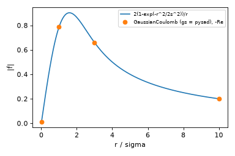

# fn_GaussianCoulomb と fn_BBBrem1
関数・06_collective・ラティスなし (関数値だけ)。参考: `docs/30_gaussiancoulomb_bbbrem.md`

## 何を見る例か
`GaussianCoulomb[x, y, sigx, sigy]` は大きさ $(\sigma_x,\sigma_y)$ の 2 次元ガウス分布が点 $(x,y)$ に作る力 $f_x+if_y$ (ビーム・ビームの Bassetti-Erskine の力。複素数で、虚部が 0 なら実数)。`GaussianCoulombU` はポテンシャル、`GaussianCoulombFitted` は力・ポテンシャル・勾配の補間版。`BBBrem1[sqrt(s), ds/s]` は、ビーム・ビーム制動放射の 1 事象 (4 元運動量と近似断面積) を乱数で生成する。

## スクリプト
```
GaussianCoulomb[xx, 0, 1, 1]               ! 丸いビームの x 軸上 (xx = 0.01, 1, 3, 10)
GaussianCoulomb[0.01, 0, 2, 1]             ! 平たいビーム (sigx=2 sigy=1)
GaussianCoulomb[1, 1, 1, 1]
GaussianCoulombU[1, 0, 1, 1]; GaussianCoulombFitted[1, 0, 1, 1]
SeedRandom[3]; BBBrem1[2*3e9, 1e-3]         ! 3 事象
```

## 結果の読み方
- `GaussianCoulomb` は符号が負 (力の向きは原点向き: 収束)。値は全て同じ規約で、解析式と比べる (下表)。
- `GaussianCoulombFitted` は $\{f_x,f_y,U,f_{xx},f_{yy},f_{xy}\}=\{-0.78690,0,0.44384,-0.42542,-0.80998,0\}$。
- `BBBrem1` は `{{px,py,pz,E}, 近似断面積}`: 3 事象で 4 元運動量は違い (E=1.2808e9, 2.9932e9, 2.6009e9 eV)、近似断面積 $6.8699894\times10^{-29}$ は同じ。



## 物理・解析式
丸いビーム ($\sigma_x=\sigma_y=\sigma$、$r=\sqrt{x^2+y^2}$) の力は

$$f_r=-\frac{2}{r}\left(1-e^{-r^2/2\sigma^2}\right),\qquad f_x=f_r\frac{x}{r},\ f_y=f_r\frac{y}{r},$$

平たいビームの小振幅の極限は $f_x=-\dfrac{2x}{\sigma_x(\sigma_x+\sigma_y)}$、$f_y=-\dfrac{2y}{\sigma_y(\sigma_x+\sigma_y)}$。ポテンシャルは丸いビームで $U(r)=\mathrm{Ein}(r^2/2\sigma^2)$ ($\mathrm{Ein}(t)=\int_0^t(1-e^{-s})/s\,ds$)、$f_r=-dU/dr$ の符号規約。

| 入力 | 式 | gs = pysad |
|---|---|---|
| $x=0.01$ (丸い、σ=1) | −0.0099997500 | −0.0099997500 |
| $x=1$ | −0.7869386806 | −0.7869386806 |
| $x=3$ | −0.6592606690 | −0.6592606690 |
| $x=10$ | −0.2 | −0.2000000000 |
| 平たい (σx=2、σy=1): $x=0.01$ | −0.0033333333 | −0.0033333102 |
| 同: $y=0.01$ (虚部) | −0.0066666667 | −0.0066665185 |
| $(1,1)$、σ=1 ($f_x=f_y=-(1-e^{-1})$) | −0.6321205588 −0.6321205588 i | −0.6321205588 −0.6321205588 i |
| $U(1,0)$ (σ=1) | Ein(0.5)=0.4438421 | 0.4438420791 |

平たいビームの小振幅の値の差 ($10^{-5}$ 台) は、式が $x\to0$ の極限で、$x=0.01$ の高次項があるため。

`BBBrem1` には解析式を用意していない (乱数の事象。docs/30 に、`SeedRandom[3]` からの 6 事象が相対 $10^{-15}$ で gs と一致という記録がある)。

## gs と pysad の比較
○ 一致 (全 15 行が印字桁まで同じ。BBBrem1 の 3 事象の 4 元運動量と断面積を含む)。

## 未確認・限界
- `BBBrem1` の戻りの 4 元運動量がどの粒子のものか (光子か、散乱電子か) と、第 2 引数 `ds/s` の意味は、SADHelp とソース (`tbbbrem.f`) の記述を精読していない。値の再現性 (SeedRandom 固定で gs と一致) だけを確認した。
- `GaussianCoulombFitted` の第 2 成分は 0 の丸め誤差 (gs は $1.1\times10^{-16}$、pysad は $7\times10^{-18}$) で、桁の差は雑音。
- 点は軸上と対角の少数だけ (docs/30 の検証は 15 点)。
