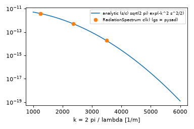

# flag_RADLIGHT、fn_RadiationField、fn_RadiationSpectrum
種別: フラグと関数 / フォルダ: 07_spin_solenoid_special / ラティス: `00_lattice/radlight_line.sad` (新規。1 GeV の短い直線 `UND`。偏向は `ANGLE=0 K0=±0.1` のステアリング型) / フラグ: `RADLIGHT`。参考: `docs/18_radlight.md`

## 何を見る例か
粒子の軌道から放射場とスペクトルを計算する一連の機能。(1) `RADLIGHT` を ON にして `TrackParticles` を呼ぶと、軌道 `{t, x, y, z}` が記録されて戻る。(2) `RadiationField[軌道, 観測点]` は観測点での電磁場の時間変化。(3) `RadiationSpectrum[{τ, f}, {λ1, λ2, dλ}]` は場の cos・sin 積分 (スペクトル)。`RadiationSpectrum` はガウスパルスの解析的なフーリエ変換と照合する。

## スクリプト
```
USE UND; INS; NOFLUC;
RADLIGHT;                          ! RAD と TRPT も ON になる
x = Table[0, {7}, {np}];  Do[x[[7,i]] = 1, {i, np}];       ! np=1 (原点の 1 粒子)
res = TrackParticles[{1, x}, 14];
traj = res[[2,1]];                  ! {{t..},{x..},{y..},{z..}} (粒子 1)
sp = RadiationSpectrum[{tau, f}, {1e-3, 5e-3, 5e-4}];      ! 波長 1〜5 mm
fld = RadiationField[traj, {20, 0.1, 0}];                   ! gs はここで落ちる
```
- RADLIGHT のときの戻りは `{{位置, 座標}, 軌道}` (2 要素)。`軌道[[粒子, 1..4]]` が $t,x,y,z$ の表。
- `RadiationSpectrum` の $\tau$ は時間 [s]、$\lambda$ は波長 [m]、位相は $2\pi c\tau/\lambda$。戻りは `{{k..},{c..},{s..}}` (波数 $k=2\pi/\lambda$、cos 積分と sin 積分)。

## 結果の読み方
- 軌道は 11 点 (記録するのは区間の始めと BEND 以外の要素の後だけ: K64 の癖)。時刻 $t$ = 0, 1.0007e-9, 2.6685e-9, …, 1.7582e-8 s、進行方向の距離 $x$ = 0, 0.3, 0.8, 1.3, 1.6, 2.6, 2.9, 3.4, 3.9, 4.2, 5.2 m (横の座標は軌道に入らない)。`t(end)*c = 5.27 m` はライン長 14 m より短い (BEND 内・後が記録されないため)。
- `spectrum dims={3, 10}`: $k$、$c$、$s$ の 3 本、波長の点数 $\mathrm{int}((\lambda_2-\lambda_1)/d\lambda+2.5)=10$。

## 物理・解析式
ガウスパルス $f=\exp\left(-(c\tau)^2/2s^2\right)$ ($s=1$ mm) の cos・sin 積分は

$$c(k)=\int f\cos(kc\tau)\,d\tau=\frac{s}{c}\sqrt{2\pi}\,e^{-k^2s^2/2},\qquad s(k)=0\ (\text{偶関数}).$$



| $\lambda$ [mm] | $k$ [1/m] | 式 $c(k)$ | gs | pysad |
|---|---|---|---|---|
| 5.000 | 1256.64 | $3.79633\times10^{-12}$ | $3.79585\times10^{-12}$ | $3.79585\times10^{-12}$ |
| 2.647 | 2373.65 | $4.99824\times10^{-13}$ | $5.00126\times10^{-13}$ | $5.00126\times10^{-13}$ |
| 1.800 | 3490.66 | $1.88971\times10^{-14}$ | $1.90935\times10^{-14}$ | $1.90935\times10^{-14}$ |
| 1.364 | 4607.67 | $2.05\times10^{-16}$ | $-1.32\times10^{-16}$ | $-1.32\times10^{-16}$ |

差は、場を 401 点の区分線形で近似する離散化誤差で、ピーク値 ($c(k)\sim4\times10^{-12}$) の $10^{-4}$ 程度 (絶対で $10^{-16}$ 台)。高周波側ではこの絶対誤差の床に達する。$s(k)$ は $10^{-29}$ 〜 $10^{-31}$ (0)。

## gs と pysad の比較
- 軌道の記録 (`RADLIGHT`)、`RadiationSpectrum`: ○ 一致 (軌道の点列、スペクトルの $k$、$c$ が同じ)。**ただし v2 (既定) では軌道の点列が gs と違う** (2026-11-17 確認): v2 は BEND の中も円弧で進めて記録する (B65。1/γ の角度あたり `RADLIGHTDIV` 点、既定 16) ので、軌道の点は 13 点 (k64 は 11 点)、`t(end)*c` は 7.67 m (k64 は 5.27 m)、`RadiationField` の戻りの寸法は {10,13} (k64 は {10,11}) になる。K64 は BEND の中を記録しない。`PYSAD_COMPAT=k64` では 11 点で gs と一致。`.pysad.txt` は v2 の出力。以下の「11 点」は k64 の値。
- `RadiationField`: × **gs が `Program received signal SIGSEGV` で落ちる** (K64 の既知の不具合 B49。引数を変えても落ちる)。pysad は動き、戻りの寸法は $\{10,11\}$ (τ、E、H、S の 10 本 × 11 点)。そのため `RadiationField` の値は gs と比べられない。

## 未確認・限界
- `RadiationField` の値の検証は、等速直線運動の Liénard-Wiechert の解 (docs/18 の試験、相対 6e-3) だけ。この例の軌道 (BEND 内が記録されない 11 点) の場の値は式と比べていない。
- 軌道に横方向の座標が入らない (K64 の癖) ので、放射場の物理的な意味は限定的。複数周の軌道 (時刻が重なる) は pysad の `RadiationField` が失敗する (docs/18 §5.1)。
- 1 GeV、粒子 1 個、観測点 1 点。PHOTONS (光子リスト) は BEAMBEAM の分だけ pysad 対応で、この例では使っていない。
