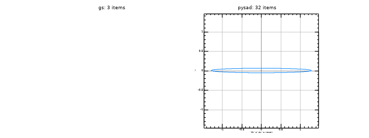

# fn_BeamPlot (BeamPlot)

種別: 関数 (描画)・フォルダ 11_graphics・ラティス FODO_ring (24 セル、3 GeV、周長 105.6 m)・`RFSW; RAD; CODPLOT; CALC; EMIT`。**gs と pysad が食い違う**

## 何を見る例か
`BeamPlot[loc, {ax,ay}, options]` でビーム楕円を描く。事前に `CODPLOT; EMIT` などでビームの大きさを計算しておく。`QF.5` の位置の $(x,y)$ 楕円を描く。

## スクリプト
```
USE RING; CELL; RFSW; RAD; CODPLOT; CALC; EMIT;
Print["SIGXX(QF.5)=",LINE["SIGXX","QF.5"],"  SIZEXX=",LINE["SIZEXX","QF.5"]];
g=BeamPlot["QF.5",{"X","Y"},SizeFunction->"SIG"];
```

## 結果の読み方
`SIGXX(QF.5)=` が gs は 0、pysad は 1.657e-6。`Head=List Length=4`。窓: pysad は枠の中に細い横長の楕円 ($x$ の大きさが $y$ よりずっと大きい)、gs は枠だけ (楕円なし、Canvas は 3 項目)。

## 図


左が gs、右が pysad。どちらも Tk の Canvas の項目 (線・四角・文字など) を Tcl で書き出し、`example/tools/canvas_render.py` で matplotlib に描き直した図 (色・フォント・文字の大きさは実際の窓とは違う)。
**gs の窓の画面そのものは撮れない** (gs は WSLg の X11 に窓を開く。`winfo ismapped` は 1 で窓は出ているが、WSL に xwd・import が無く、Windows 側の画面切り取りも使えなかった)。
pysad の側の保存の仕方: 台本の `Exit;` の前に、全 Canvas の `find all`・`type`・`coords`・`itemcget` を Tcl の `TclEval[...]` でファイルに書き出す文を足し (`canvas_render.py` の `DUMP`)、それを読んで描く。
元の `.sad` は書き換えない。項目の数は図の題に出している。

## gs と pysad の比較
- **×/△ 食い違い**: gs の `LINE["SIGXX",...]`・`SIZEXX` は 0 のまま (EMIT のあとでも)、そのため楕円の半径が 0 になり、gs は楕円を描かない。pysad は `EMIT` の結果から $\sigma_{xx}$ を作り、楕円を描く。docs/42 §6 の既知の差と同じ (どちらが正しいかは未確認。K64 の仕様か、この gs ビルドの不具合かは不明)。
- 画面にエラーは出ず、gs・pysad とも最後まで走る。
- 楕円の大きさ (pysad の $\sigma_{xx}=1.657\times10^{-6}\ \mathrm{m^2}$ が $\varepsilon\beta+\eta^2\sigma_\delta^2$ と合うか) は確かめていない。

## 未確認・限界
色・フォント・大きさの見た目、クリックなどの操作は比べていない (docs/42 §7)。比べたのは Canvas の項目の種類・数 (図の題)。`Orbit`・`DataRange`・他の軸の組 ({"PX","X"} など) は試していない。
