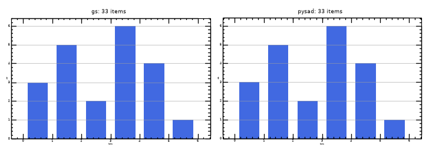

# fn_ColumnPlot (ColumnPlot)

種別: 関数 (描画)・フォルダ 11_graphics・ラティスなし。pysad で未確認だったもの

## 何を見る例か
`ColumnPlot[data]` の棒グラフ (1 次元ベクトルなら単純な棒グラフ)。`HistoPlot` が内部で使っている。

## スクリプト
```
d={3,5,2,6,4,1};
g=ColumnPlot[d,FrameLabel->{"bin","count"}];
```

## 結果の読み方
`Head=Graphics Length=2`。窓に 6 本の棒。

## 図


左が gs、右が pysad。どちらも Tk の Canvas の項目 (線・四角・文字など) を Tcl で書き出し、`example/tools/canvas_render.py` で matplotlib に描き直した図 (色・フォント・文字の大きさは実際の窓とは違う)。
**gs の窓の画面そのものは撮れない** (gs は WSLg の X11 に窓を開く。`winfo ismapped` は 1 で窓は出ているが、WSL に xwd・import が無く、Windows 側の画面切り取りも使えなかった)。
pysad の側の保存の仕方: 台本の `Exit;` の前に、全 Canvas の `find all`・`type`・`coords`・`itemcget` を Tcl の `TclEval[...]` でファイルに書き出す文を足し (`canvas_render.py` の `DUMP`)、それを読んで描く。
元の `.sad` は書き換えない。項目の数は図の題に出している。

## gs と pysad の比較
- **動くことを確認した** (pysad で未確認だった関数)。エラーなし、Canvas は 33 項目ずつで同数 (○)。

## 未確認・限界
色・フォント・大きさの見た目、クリックなどの操作は比べていない (docs/21 §9)。比べたのは Canvas の項目の種類・数 (図の題)。2 次元・3 次元データ (複数列・積み上げ)、`ColumnOffset` は試していない。
