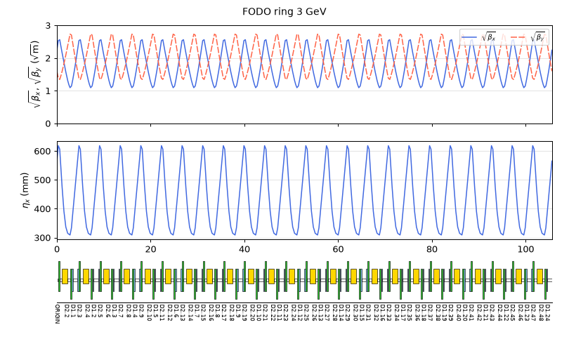
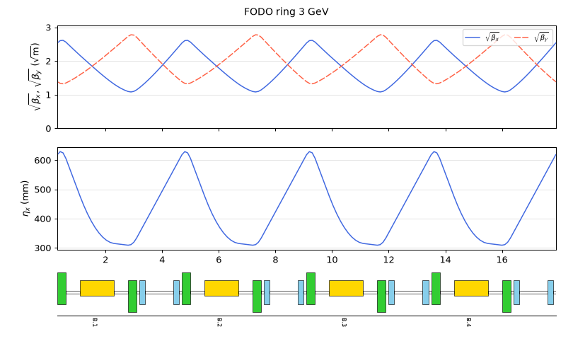
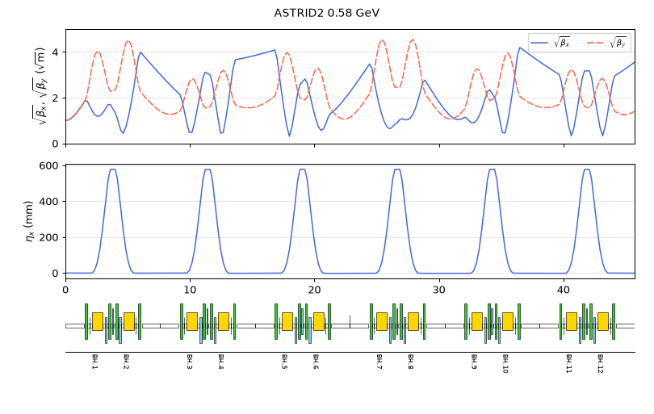

# fn_DRAW (FFS の DRAW、matplotlib)

種別: FFS コマンド (描画、v2.4.1)・フォルダ 11_graphics。ラティスは FODO_ring (24 セル、3 GeV、周長 105.6 m) と ASTRID2 (0.58 GeV、周長 45.7 m)。`CALC` のみ。
**gs は表示環境がなく DRAW の図を作れない** (`.gs.txt` は無い)。

## 何を見る例か
K64 の `DRAW` は `Packages/CANVASDRAW.n` が `OpticsPlot` を呼び、`$DisplayFunction` が Tk のときだけ描く。pysad は v2.4.1 から matplotlib で描く (`pysad/draw_mpl.py`)。
`DRAW BX BY & EX LAT;` は √βx・√βy (1 枠目)、ηx (2 枠目)、その下にラティス図。`DRAW QF.1 QF.5 BX BY & EX B*;` は QF.1 から QF.5 までの領域で、ラティス図に名前が `B` で始まる要素だけ。

## スクリプト
`fn_DRAW.sad` (FODO)・`fn_DRAW_astrid2.sad`。保存先は環境変数で指定して走らせる (相対パスは実行したフォルダ基準):
```
set PYSAD_DRAW_FILE=fn_DRAW_plot.png
py -3.12 run_sad.py fn_DRAW.sad
```
2 回目の DRAW は `fn_DRAW_plot_2.png` に番号が付く (上書きしない)。台本の `Draw$Option={File->"x.png"}` でも指定できる。保存先なしで対話の backend なら `plt.show`。
```
USE RING; CELL; CALC;
TITLE="FODO ring 3 GeV";
DRAW BX BY & EX LAT;
DRAW QF.1 QF.5 BX BY & EX B*;
```

## 図




## gs との照合 (描く前のデータ)
画像は gs から取れないので、`OpticsPlot[…, DisplayFunction->Identity]` が返す Graphics の `Line` (点列)・`Rectangle` (ラティスの箱)・`Text` (名前) を gs と pysad で書き出し、matplotlib に渡すデータと比べた (`pysad/tests/test_v25_draw_mpl.py`、参照は `pysad/tests/scripts/v25_draw_gs_*.gs.txt`)。
- FODO (6 セル、領域 3〜20、名前 `B*`): 3 本の折れ線 138 点ずつ、箱 17、名前 3 が一致 (点列の相対差は 1e-13 以下)。
- ASTRID2 全周 (名前 `*`): 3 本の折れ線 296 点ずつ、箱 139、名前 199 が一致 (点列の最大の相対差 1.7e-13)。
- このほか pysad 自身の Graphics と、領域 (番号・要素名・周回をまたぐ)・名前のパターンを変えた 5 通りで全点一致。

## 未確認・限界
色・線の太さ・文字の大きさは Tk の窓と比べていない。名前の重なり消し (`RemoveOverlap`) は文字の大きさでなく s 軸の間隔で決める (gs の窓で残る名前とは違う)。窓での対話表示とクリックの InfoLabel は Agg の試験では動かせず、手で確認していない。
CALC していないときは pysad が先に光学を計算する (gs の OpticsPlot は 0 を描く)。`OpticsPlot[…]` の Graphics 自体を matplotlib に流す選択肢は未実装。
