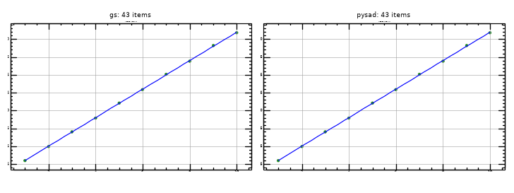

# fn_FitPlot (FitPlot)

種別: 関数 (描画)・フォルダ 11_graphics・ラティスなし

## 何を見る例か
`FitPlot[data, fun, var, {par,ini}, ...]` は `Fit` で当てはめ、データの点・当てはめ曲線・結果の文字を一度に描く。fn_Fit_FitGaussian_FitEmit と同じデータ ($y=2x+1+0.1\sin3x$)。

## スクリプト
```
dat=Table[{i,2*i+1+0.1*Sin[i*3]},{i,1,10}];
g=FitPlot[dat,a+b*x,x,{a,1},{b,1}];     (* g[[1]] に a,b と ChiSquare *)
```

## 結果の読み方
`Head=List Length=2`。`R:a`・`R:b` は `g[[1]]` の当てはめ値。窓の下の枠に関数と結果 (`FunctionLabel`・`ResultLabel`) が出る。

## 図


左が gs、右が pysad。どちらも Tk の Canvas の項目 (線・四角・文字など) を Tcl で書き出し、`example/tools/canvas_render.py` で matplotlib に描き直した図 (色・フォント・文字の大きさは実際の窓とは違う)。
**gs の窓の画面そのものは撮れない** (gs は WSLg の X11 に窓を開く。`winfo ismapped` は 1 で窓は出ているが、WSL に xwd・import が無く、Windows 側の画面切り取りも使えなかった)。
pysad の側の保存の仕方: 台本の `Exit;` の前に、全 Canvas の `find all`・`type`・`coords`・`itemcget` を Tcl の `TclEval[...]` でファイルに書き出す文を足し (`canvas_render.py` の `DUMP`)、それを読んで描く。
元の `.sad` は書き換えない。項目の数は図の題に出している。

## 物理・解析式
参照値は fn_Fit_FitGaussian_FitEmit と同じ最小二乗。

## gs と pysad の比較
| 項目 | 最小二乗 (numpy) | gs | pysad | gs の相対差 | pysad の相対差 (参照値が 0 の行は絶対差) |
|---|---|---|---|---|---|
| $a$ | 1.0132993837 | 1.0132993837 | 1.0132993864 | 2.3e-12 | 2.7e-09 |
| $b$ | 1.99673824342 | 1.9967382434 | 1.9967382425 | 1.0e-11 | 4.6e-10 |

- Canvas は 43 項目ずつで同数 (○)。$a$・$b$ は pysad で $10^{-9}$ 程度の差 (pysad は数値微分、docs/33)。

## 未確認・限界
色・フォント・大きさの見た目、クリックなどの操作は比べていない (docs/42 §7)。比べたのは Canvas の項目の種類・数 (図の題)。
