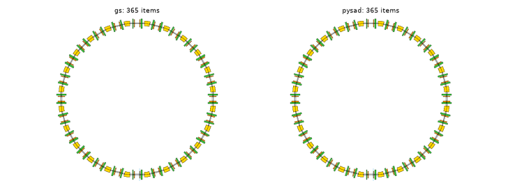

# fn_GeometryPlot (GeometryPlot)

種別: 関数 (描画)・フォルダ 11_graphics・ラティス FODO_ring (24 セル、3 GeV、周長 105.6 m)

## 何を見る例か
`GeometryPlot[]` でリングの平面の配置図 (基準軌道の線と磁石の多角形) を描く。24 セル × 15 度で円になる。

## スクリプト
```
USE RING; CELL; CALC;
g=GeometryPlot[];
```

## 結果の読み方
`Head=Graphics Length=2`。窓にリングが 1 周の閉じた図形 (偏向磁石の多角形が円周上) として出る。

## 図


左が gs、右が pysad。どちらも Tk の Canvas の項目 (線・四角・文字など) を Tcl で書き出し、`example/tools/canvas_render.py` で matplotlib に描き直した図 (色・フォント・文字の大きさは実際の窓とは違う)。
**gs の窓の画面そのものは撮れない** (gs は WSLg の X11 に窓を開く。`winfo ismapped` は 1 で窓は出ているが、WSL に xwd・import が無く、Windows 側の画面切り取りも使えなかった)。
pysad の側の保存の仕方: 台本の `Exit;` の前に、全 Canvas の `find all`・`type`・`coords`・`itemcget` を Tcl の `TclEval[...]` でファイルに書き出す文を足し (`canvas_render.py` の `DUMP`)、それを読んで描く。
元の `.sad` は書き換えない。項目の数は図の題に出している。

## gs と pysad の比較
- Canvas は 365 項目ずつで同数 (○)。

## 未確認・限界
色・フォント・大きさの見た目、クリックなどの操作は比べていない (docs/42 §7)。比べたのは Canvas の項目の種類・数 (図の題)。`Region`・`Names` オプションは試していない。長直線部を細線にするなどのラティス配置図の作図の約束は、この例では適用していない。
