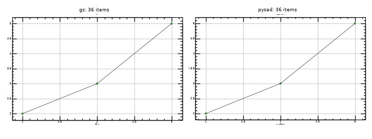

# fn_LaTeX (LaTeX の文字列)

種別: 描画の機能 (LaTeX)・フォルダ 11_graphics・ラティスなし。pysad で未確認だったもの

## 何を見る例か
文字列が `"\\@"` で始まると、枠のラベル・`PlotLabel`・`Text` が LaTeX として解釈される (pdflatex と ImageMagick が要る)。この環境で動くかを確かめる。`$HaveLaTeX` は LaTeX の場所を持つ変数。

## スクリプト
```
Print["HaveLaTeX=[",$HaveLaTeX,"]"];
g=ListPlot[{{1,2},{2,3},{3,5}},PlotJoined->True,FrameLabel->{"\\@$x$","\\@$\\sin\\theta$"},PlotLabel->"\\@$\\int_0^1 x^2dx$"];
```

## 結果の読み方
`HaveLaTeX=[]` (空): gs でも pysad でも LaTeX が見つからず無効。`Head=Graphics Length=2`。ラベルは `\@$x$` のような生の文字列のまま描かれる。

## 図


左が gs、右が pysad。どちらも Tk の Canvas の項目 (線・四角・文字など) を Tcl で書き出し、`example/tools/canvas_render.py` で matplotlib に描き直した図 (色・フォント・文字の大きさは実際の窓とは違う)。
**gs の窓の画面そのものは撮れない** (gs は WSLg の X11 に窓を開く。`winfo ismapped` は 1 で窓は出ているが、WSL に xwd・import が無く、Windows 側の画面切り取りも使えなかった)。
pysad の側の保存の仕方: 台本の `Exit;` の前に、全 Canvas の `find all`・`type`・`coords`・`itemcget` を Tcl の `TclEval[...]` でファイルに書き出す文を足し (`canvas_render.py` の `DUMP`)、それを読んで描く。
元の `.sad` は書き換えない。項目の数は図の題に出している。

## gs と pysad の比較
- gs・pysad とも `$HaveLaTeX` は空で、LaTeX の描画は行われない。Canvas は 36 項目ずつで同数 (○。ただし LaTeX が無効の状態での一致)。

## 未確認・限界
**LaTeX が入った環境の動作は未確認** (pdflatex・ImageMagick の `convert` が WSL に無い。Windows の `convert` は別物)。pysad が LaTeX を画像にして Canvas に貼る部分 (`TkPhotoPutBlock` など) は未確認。
