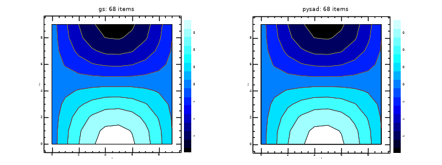

# fn_ListContourPlot (ListContourPlot)

種別: 関数 (描画)・フォルダ 11_graphics・ラティスなし

## 何を見る例か
2 次元リスト $z_{ij}=\sin(i/3)\cos(j/3)$ ($10\times10$) の等高線を描く。オプション `Contours->8`、`MeshRange`。SADHelp の例はデータが違うので fn_ListContourPlot_SADHelp に分けた。

## スクリプト
```
table=Table[Sin[i/3.]*Cos[j/3.],{i,0,9},{j,0,9}];
g=ListContourPlot[table,Contours->8,FrameLabel->{"i","j"}];
g2=ListContourPlot[table,Contours->8,MeshRange->{{0,9},{0,9}},FrameLabel->{"i","j"}];
```

## 結果の読み方
`dims={10,10}`、`Head=Graphics Length=2` が 2 回。等高線・色の帯・色目盛りが窓に出る。

## 図


左が gs、右が pysad。どちらも Tk の Canvas の項目 (線・四角・文字など) を Tcl で書き出し、`example/tools/canvas_render.py` で matplotlib に描き直した図 (色・フォント・文字の大きさは実際の窓とは違う)。
**gs の窓の画面そのものは撮れない** (gs は WSLg の X11 に窓を開く。`winfo ismapped` は 1 で窓は出ているが、WSL に xwd・import が無く、Windows 側の画面切り取りも使えなかった)。
pysad の側の保存の仕方: 台本の `Exit;` の前に、全 Canvas の `find all`・`type`・`coords`・`itemcget` を Tcl の `TclEval[...]` でファイルに書き出す文を足し (`canvas_render.py` の `DUMP`)、それを読んで描く。
元の `.sad` は書き換えない。項目の数は図の題に出している。

## gs と pysad の比較
- **○ 一致 (2026-11-17 に修正)**: gs・pysad とも Tcl エラーなし、`Graphics` を返し、Canvas は 68 項目 (rectangle 20、polygon 8、line 21、text 19) で同数。
- 以前の pysad は、2 つ目 (`MeshRange` つき) の描画中に `tagOrId "1" doesn't match any items` / `.1r.2b lower ...` の Tcl エラー (`Tkinter::tclerror: 1501`) を 9 回出した。原因は `TkCanvasLastItem`: K64 では Tk の `nextId-1` (`delete all` のあとも id は続く) だが、pysad は `find all` の最大値を返したので、再描画で全項目を消した直後は 0 になり、Canvas.n の `StartID=CanvasLastID+1` が古い 1 のままで `lower 85 1` (BelowFrame の矩形を枠の下へ) が存在しない項目 1 を指した。Canvas ごとに見た最大の id を覚えるようにした (試験 `test_tkcanvaslastitem_keeps_counting_after_delete_all`)。

## 未確認・限界
色・フォント・大きさの見た目、クリックなどの操作は比べていない (docs/42 §7)。比べたのは Canvas の項目の種類・数 (図の題)。等高線の始点・向きは gs と pysad で違いうる (docs/42 §5)。`ColorFunction`・`Smoothing` は試していない。
