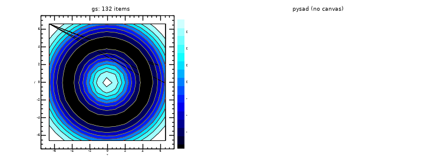

# fn_ListContourPlot_SADHelp (ListContourPlot の SADHelp の例)

種別: 関数 (描画)・フォルダ 11_graphics・ラティスなし。**pysad は失敗する**

## 何を見る例か
SADHelp の ListContourPlot の例のデータ $z=\cos\sqrt{(x^2+y^2)/2}$ (軸は不等間隔の `xr`・`yr`、$20\times20$) と `MeshRange->{xr,yr}`。

## スクリプト
```
xr0=0;xr=Table[xr0+=Sin[i*Pi/21],{i,20}];xr-=(xr[[1]]+xr[[-1]])/2;  yr=xr;
table=Outer[Cos[Sqrt[(#^2+#2^2)/2]]&,xr,yr];
g=ListContourPlot[table,MeshRange->{xr,yr},AspectRatio->1,Contours->8,FrameLabel->{"x","y"}];
```

## 結果の読み方
gs: `Head=Graphics Length=2`、窓に等高線 (図の左、132 項目)。pysad: `???General::index: Index out of range in Second` で `g` が代入されず (`Head=Symbol`)、窓は出ない。

## 図


左が gs、右が pysad。どちらも Tk の Canvas の項目 (線・四角・文字など) を Tcl で書き出し、`example/tools/canvas_render.py` で matplotlib に描き直した図 (色・フォント・文字の大きさは実際の窓とは違う)。
**gs の窓の画面そのものは撮れない** (gs は WSLg の X11 に窓を開く。`winfo ismapped` は 1 で窓は出ているが、WSL に xwd・import が無く、Windows 側の画面切り取りも使えなかった)。
pysad の側の保存の仕方: 台本の `Exit;` の前に、全 Canvas の `find all`・`type`・`coords`・`itemcget` を Tcl の `TclEval[...]` でファイルに書き出す文を足し (`canvas_render.py` の `DUMP`)、それを読んで描く。
元の `.sad` は書き換えない。項目の数は図の題に出している。

## gs と pysad の比較
- **○ 一致 (2026-11-17 に修正)**: gs・pysad とも `Head=Graphics Length=2`、Canvas は 132 項目 (rectangle 20、polygon 28、line 61、text 23) で同数。
- 以前の pysad は `Index out of range in Second` で失敗した。等高線の入れ子を調べる `Position[ls[[k]],_?(CP$Inside[u1,Second[#]]&),1,1]` は、level 1 の検査で頭部 `List` にも `Second[#]` をかける。gs はこの検査の中のエラー (`Second[List]`) を不一致として黙って続けるが、pysad は文ごと落とした。パターンの検査 (`_?(…)`) の中のエラーは不一致として扱うようにした (試験 `test_pattern_test_error_is_mismatch_and_listcontourplot_sadhelp_data`)。fn_ListContourPlot のデータで動いていたのは、等高線が入れ子にならず検査が頭部に届かなかったため。

## 未確認・限界
`Packages/ListPlot.n` の等高線の部分 (`Second` を呼ぶ箇所) を調べていない。図の右 (pysad) は空。
