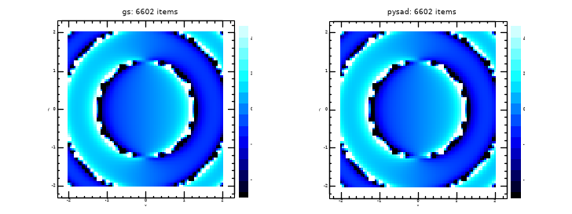

# fn_ListDensityPlot (ListDensityPlot)

種別: 関数 (描画)・フォルダ 11_graphics・ラティスなし

## 何を見る例か
2 次元リストの濃淡図。SADHelp の例 $\sin x/\cos(x^2+y^2)$ ($41\times41$)、`PlotRange->{-5,5}`、`MeshRange->{{-2,2},{-2,2}}`。

## スクリプト
```
data=Table[Sin[x]/Cos[x^2+y^2],{x,-2,2,0.1},{y,-2,2,0.1}];
g=ListDensityPlot[data,PlotRange->{-5,5},MeshRange->{{-2,2},{-2,2}},FrameLabel->{"x","y"}];
```

## 結果の読み方
`dims={41,41}`、`Head=Graphics Length=2`。窓に濃淡と色目盛り。

## 図


左が gs、右が pysad。どちらも Tk の Canvas の項目 (線・四角・文字など) を Tcl で書き出し、`example/tools/canvas_render.py` で matplotlib に描き直した図 (色・フォント・文字の大きさは実際の窓とは違う)。
**gs の窓の画面そのものは撮れない** (gs は WSLg の X11 に窓を開く。`winfo ismapped` は 1 で窓は出ているが、WSL に xwd・import が無く、Windows 側の画面切り取りも使えなかった)。
pysad の側の保存の仕方: 台本の `Exit;` の前に、全 Canvas の `find all`・`type`・`coords`・`itemcget` を Tcl の `TclEval[...]` でファイルに書き出す文を足し (`canvas_render.py` の `DUMP`)、それを読んで描く。
元の `.sad` は書き換えない。項目の数は図の題に出している。

## gs と pysad の比較
- エラーなし。Canvas の項目 6602 個 (1681 セルの四角など) が gs・pysad で同数 (○)。

## 未確認・限界
色・フォント・大きさの見た目、クリックなどの操作は比べていない (docs/40 §7)。比べたのは Canvas の項目の種類・数 (図の題)。 セルの色の値は比べていない。
