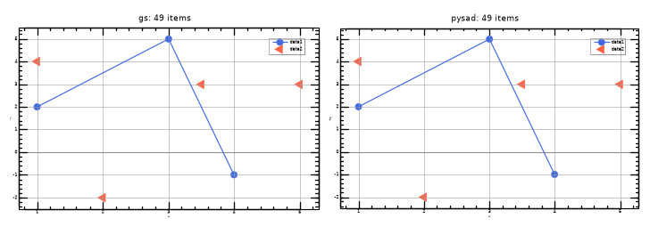

# fn_ListPlot (ListPlot)

種別: 関数 (描画)・フォルダ 11_graphics・ラティスなし

## 何を見る例か
`ListPlot[data, options]` で点・折れ線を描く。SADHelp の例: 2 組のデータ (1 組は折れ線 `PlotJoined`、1 組は点)、凡例、枠のラベル。別に、$y$ の誤差棒 ($\{x,y,dy\}$) の例もある。

## スクリプト
```
g=ListPlot[{data1,data2},PlotJoined->{True,False},Thickness->2,PointSize->2,
  FrameLabel->{"x","y"},Legend->{"data1","data2"}];
e=ListPlot[{{1,2,.5},{2,3,.4},{3,5,.8},{4,4,.3}},FrameLabel->{"x","y +- dy"},DisplayFunction->Identity];
```

## 結果の読み方
`Head=List Length=2` (2 組のデータ)、`errbar Head=Graphics`。窓に折れ線と点が描かれる。

## 図


左が gs、右が pysad。どちらも Tk の Canvas の項目 (線・四角・文字など) を Tcl で書き出し、`example/tools/canvas_render.py` で matplotlib に描き直した図 (色・フォント・文字の大きさは実際の窓とは違う)。
**gs の窓の画面そのものは撮れない** (gs は WSLg の X11 に窓を開く。`winfo ismapped` は 1 で窓は出ているが、WSL に xwd・import が無く、Windows 側の画面切り取りも使えなかった)。
pysad の側の保存の仕方: 台本の `Exit;` の前に、全 Canvas の `find all`・`type`・`coords`・`itemcget` を Tcl の `TclEval[...]` でファイルに書き出す文を足し (`canvas_render.py` の `DUMP`)、それを読んで描く。
元の `.sad` は書き換えない。項目の数は図の題に出している。

## gs と pysad の比較
- gs・pysad で戻り値の形が同じ。Canvas の項目 49 個ずつ (○)。

## 未確認・限界
色・フォント・大きさの見た目、クリックなどの操作は比べていない (docs/21 §9)。比べたのは Canvas の項目の種類・数 (図の題)。`PlotJoined->Step`・対数軸は試していない。
