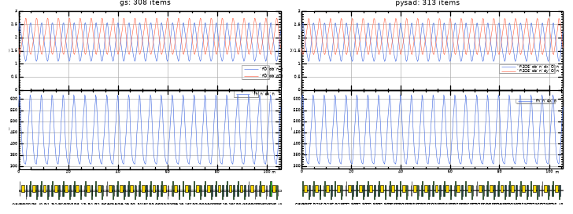

# fn_OpticsPlot (OpticsPlot)

種別: 関数 (描画)・フォルダ 11_graphics・ラティス FODO_ring (24 セル、3 GeV、周長 105.6 m、RF なし扱いの CALC)

## 何を見る例か
`OpticsPlot[{{"BX","BY"},{"EX"}}]` でリング 1 周のベータ関数 ($\beta_x,\beta_y$)、分散 $\eta_x$、その下にラティスの配置 (磁石の箱と名前) を描く。

## スクリプト
```
USE RING; CELL; CALC;
g=OpticsPlot[{{"BX","BY"},{"EX"}}];        (* 3 枠: BX・BY、EX、ラティス *)
```

## 結果の読み方
`NX=6.6963289409` (チューンの確認)、`Head=Graphics Length=2`。窓は 3 枠で、上が $\beta_x$・$\beta_y$ (24 周期)、中が $\eta_x$、下に磁石 (青の四極、黄の偏向、…) と名前。

## 図


左が gs、右が pysad。どちらも Tk の Canvas の項目 (線・四角・文字など) を Tcl で書き出し、`example/tools/canvas_render.py` で matplotlib に描き直した図 (色・フォント・文字の大きさは実際の窓とは違う)。
**gs の窓の画面そのものは撮れない** (gs は WSLg の X11 に窓を開く。`winfo ismapped` は 1 で窓は出ているが、WSL に xwd・import が無く、Windows 側の画面切り取りも使えなかった)。
pysad の側の保存の仕方: 台本の `Exit;` の前に、全 Canvas の `find all`・`type`・`coords`・`itemcget` を Tcl の `TclEval[...]` でファイルに書き出す文を足し (`canvas_render.py` の `DUMP`)、それを読んで描く。
元の `.sad` は書き換えない。項目の数は図の題に出している。

## gs と pysad の比較
- gs・pysad で `NX` と戻り値の形が同じ。Canvas の項目は gs 308、pysad 313 (5 個差。2026-11-17 に再確認: text が gs 69、pysad 74 で、rectangle 196・line 43 は同数。文字の大きさの違いによる名前の重なり消し `RemoveOverlap` の結果で、docs/40 §5 と同じ原因 (△、枠・線・矩形は同数))。

## 未確認・限界
色・フォント・大きさの見た目、クリックなどの操作は比べていない (docs/40 §7)。比べたのは Canvas の項目の種類・数 (図の題)。 実ラティスの `OpticsPlot` は比べていない。`Region`・`Names`・ユーザー関数の描画は試していない。
