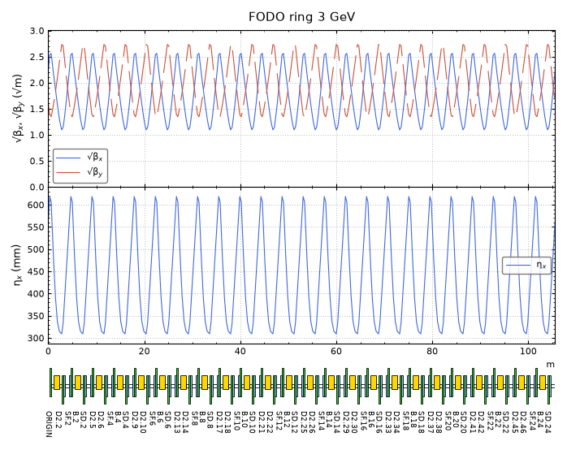
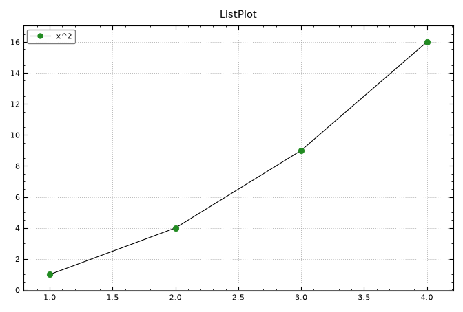

# fn_OpticsPlot_mpl (`$DisplayFunction=MatplotlibDrawer;`、matplotlib)

種別: 関数 (描画)・フォルダ 11_graphics・v2.4.1 の新機能 (pysad のみ)。ラティスは FODO_ring (24 セル、3 GeV、周長 105.6 m、`fn_OpticsPlot` と同じ)。
**gs には `MatplotlibDrawer` が無く、この台本は gs では走らない** (`.gs.txt` は無い)。

## 何を見る例か
`fn_OpticsPlot` と同じ `OpticsPlot[{{"BX","BY"},{"EX"}}]` を、Tk の窓でなく matplotlib で PNG に描く。`Plot[Sin[x],{x,0,6}]` と `ListPlot` も同じ出口で描く。
SAD の `ListPlot.n`・`Plots.n`・`OpticsPlot.n` が作る `Graphics[…]` を、`Show1$` が `$DisplayFunction` に渡す引数 (`opt`・要素のリスト・`rect` …) のまま受けて描くので、これらの `.n` も評価器も変えていない (`pysad/mpl_display.py`、解説は [docs/42 §7c](../../docs/42_graphics_guide.md))。

## スクリプト
`fn_OpticsPlot_mpl.sad`。環境変数なしで、台本の中で切り替える:
```
FFS;
$DisplayFunction=MatplotlibDrawer;
MatplotlibDrawer$Option={File->"fn_OpticsPlot_mpl_plot.png"};   ! 2 枚目以降は _plot_2.png のように番号が付く
USE RING; CELL; CALC;
g=OpticsPlot[{{"BX","BY"},{"EX"}},PlotLabel->"FODO ring 3 GeV"];
h=Plot[Sin[x],{x,0,6},FrameLabel->{"x","sin x"}];
k=ListPlot[{{1,1},{2,4},{3,9},{4,16}},PlotJoined->True,Legend->"x^2",PlotLabel->"ListPlot"];
```
台本を書き換えずに、環境変数だけで切り替えることもできる (相対パスは実行したフォルダ基準):
```
set PYSAD_DISPLAY=mpl
set PYSAD_DISPLAY_FILE=out.png
py -3.12 run_sad.py lattice.sad script.sad
```
実行は `cd example/11_graphics` して `py -3.12 ../../run_sad.py fn_OpticsPlot_mpl.sad` (`PYSAD_SAD_PACKAGES` が要る)。出力は `fn_OpticsPlot_mpl.pysad.txt`。

## 図

![Plot[Sin[x],{x,0,6}] (matplotlib)](fn_OpticsPlot_mpl_plot_2.png)


1 枚目は 3 枠 (上から √βx・√βy、ηx (mm)、ラティスの磁石の箱と名前) と題。名前は重なるものを消す (`RemoveOverlap`)。枠の位置は `Canvas.n` の `MakeWindow`、軸の範囲は `FrameRange` の移植。

## 確かめたこと (試験 `pysad/tests/test_v241_mpl_display.py`、Agg)
- `Graphics[…]` の `Line` の点列が matplotlib の `Line2D` と全点一致 (`Plot[Sin[x],{x,0,6}]` の 505 点は 1e-12 以内、`OpticsPlot` の 3 本も)。
- `OpticsPlot` のラティスの箱 192 個が `Rectangle` の座標と一致。名前は `Graphics` の `Text` の順序つきの部分列で、残った名前は互いに重ならない。
- 枠は上から BX・BY、EX、ラティスの順で、x の範囲 (-0.001 から周長 + 0.001) と窓の左右が同じ。凡例・軸の文字 (`η$_{x}$ (mm)` など) も一致。
- `ListPlot.n` 自身が `Show` を 2 回呼ぶ (ファイルの中でブロックが重複している) ので、続く同じ内容は 1 枚にまとめる。この台本は `Plot` と `ListPlot` で各 1 枚。

## 未確認・限界
- 色・線の太さ・破線の長さ・文字の大きさの見た目は Tk の窓と比べていない (`fn_OpticsPlot.md` の図は Tk のキャンバスの項目を matplotlib で描き直したもので、別物)。線の太さ 1 px = 0.8 pt などは目で決めた近似。
- 目盛りの位置と文字、凡例の位置は matplotlib の自動で、`Canvas.n` の `AutoTick`・`AdjustLegend` とは違う。名前の重なり消しは matplotlib のフォントの外接矩形で決めるので、Tk の窓で残る名前とは違う。
- 未対応の要素 (`Arrow`・`UseBG`・`TextFont`・`Scale->Date`・`LeftTags` を使う文字の位置・`Initialize->False`・3D など) は警告して飛ばす。一覧は docs/42 §7c と docs/46。`Hook[…]` (InfoLabel のクリック) とマウス操作は無い。
- 対話の backend の窓 (`plt.show`) は手で確認していない。実ラティスの `OpticsPlot` と `BeamPlot` は描いて見ていない。
