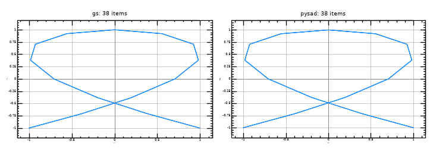

# fn_ParametricPlot (ParametricPlot)

種別: 関数 (描画)・フォルダ 11_graphics・ラティスなし

## 何を見る例か
`ParametricPlot[{fx,fy}, {t,t0,t1}]`。A は SADHelp の例 (楕円 4 本、範囲 `{t,0,2*Pi}`、`Legend`)。B は範囲を数値 `6.283185307` にしたリサジュー図形 $(\sin3t,\cos2t)$。

## スクリプト
```
ga=ParametricPlot[{{2*Cos[t],2*Sin[t]},{2*Cos[t],Sin[t]},{Cos[t],2*Sin[t]},{Cos[t],Sin[t]}},{t,0,2*Pi},Legend->"Expressions"];
gb=ParametricPlot[{Sin[3*t],Cos[2*t]},{t,0,6.283185307},FrameLabel->{"x","y"}];
```

## 結果の読み方
gs・pysad とも `A Head=List Length=5`、`B Head=Graphics Length=2`。修正前の pysad は A で `???Part: index 1 out of range (length 0)` が出て `A Head=Symbol` (描かれない) だった。

## 図


左が gs、右が pysad。どちらも Tk の Canvas の項目 (線・四角・文字など) を Tcl で書き出し、`example/tools/canvas_render.py` で matplotlib に描き直した図 (色・フォント・文字の大きさは実際の窓とは違う)。
**gs の窓の画面そのものは撮れない** (gs は WSLg の X11 に窓を開く。`winfo ismapped` は 1 で窓は出ているが、WSL に xwd・import が無く、Windows 側の画面切り取りも使えなかった)。
pysad の側の保存の仕方: 台本の `Exit;` の前に、全 Canvas の `find all`・`type`・`coords`・`itemcget` を Tcl の `TclEval[...]` でファイルに書き出す文を足し (`canvas_render.py` の `DUMP`)、それを読んで描く。
元の `.sad` は書き換えない。項目の数は図の題に出している。

## gs と pysad の比較
- **○ A も B も一致 (2026-11-17 に修正)**。A (範囲に `Pi` を含む曲線のリスト) は gs・pysad とも `List`、長さ 5、B は `Graphics`、長さ 2。Canvas は gs・pysad とも 38 項目 (rectangle 1、line 21、text 16)。
- 以前の pysad は範囲に `Pi` を含むと `ParametricPlot` が評価されず式のまま残った。`ParametricPlot` は HoldAll で、`{t,0,2*Pi}` の `2*Pi` が `xmax_Real` に照合しなかったため。gs は定数式 (Pi・E・Degree と数値関数だけの式) を値で照合するので、pysad もそうした。曲線のリストは `Evaluate[ReleaseHold[a]]` を保持引数の位置で評価する必要もあった (試験 `test_parametricplot_pi_in_range_and_curve_list_like_gs`)。
- 図 (`fn_ParametricPlot_plot.png`) は 2026-11-16 のもの (A が描けなかった時点)。

## 未確認・限界
色・フォント・大きさの見た目、クリックなどの操作は比べていない (docs/42 §7)。比べたのは Canvas の項目の種類・数 (図の題)。
