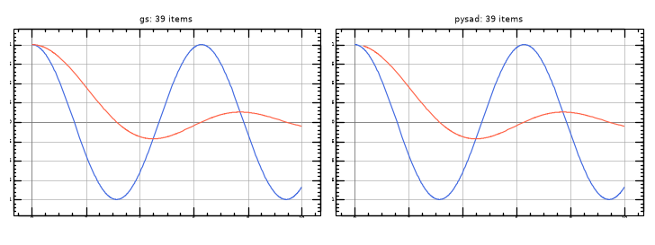

# fn_Plot (Plot)

種別: 関数 (描画)・フォルダ 11_graphics・ラティスなし

## 何を見る例か
`Plot[fun, {x,xmin,xmax}, options]` で関数のグラフを描く。SADHelp の例 ($\cos x$ と $\sin x/x$)。`ff[0]=1` を定義して $x=0$ の $0/0$ を避けている。`DisplayFunction->Identity` なら窓を開かず `Graphics[...]` の式だけを返す。

## スクリプト
```
ff[x_]:=Sin[x]/x;  ff[0]=1;
g=Plot[{Cos[x],ff[x]},{x,0,10},Thickness->2];           (* 関数 2 本 → 戻り値は List (長さ 3) *)
h=Plot[Sin[x],{x,0,6},DisplayFunction->Identity];       (* 窓なし → Graphics (長さ 2) *)
Update[];
```

## 結果の読み方
標準出力は `Head=List Length=3` (2 本の関数を描くと各曲線の Graphics をまとめたリスト)、`R:cos5` (関数値の確認)、`Head=Graphics Length=2` だけ。グラフそのものは Tk の窓に出て、標準出力には出ない (`.gs.txt` には起動表示と台本の echo だけ)。

## 図


左が gs、右が pysad。どちらも Tk の Canvas の項目 (線・四角・文字など) を Tcl で書き出し、`example/tools/canvas_render.py` で matplotlib に描き直した図 (色・フォント・文字の大きさは実際の窓とは違う)。
**gs の窓の画面そのものは撮れない** (gs は WSLg の X11 に窓を開く。`winfo ismapped` は 1 で窓は出ているが、WSL に xwd・import が無く、Windows 側の画面切り取りも使えなかった)。
pysad の側の保存の仕方: 台本の `Exit;` の前に、全 Canvas の `find all`・`type`・`coords`・`itemcget` を Tcl の `TclEval[...]` でファイルに書き出す文を足し (`canvas_render.py` の `DUMP`)、それを読んで描く。
元の `.sad` は書き換えない。項目の数は図の題に出している。

## gs と pysad の比較
- gs・pysad とも `List 3`、`Graphics 2`、`cos5=.2836621855`。エラーなし。Canvas の項目は 39 個ずつで同数 (○)。図の曲線も同じ。
- gs は窓を開いた (`winfo ismapped`=1)。

## 未確認・限界
色・フォント・大きさの見た目、クリックなどの操作は比べていない (docs/21 §9)。比べたのは Canvas の項目の種類・数 (図の題)。`PlotPoints`・`MaxBend` などのオプションは試していない。
