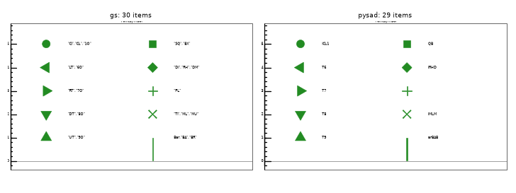

# fn_PointSymbol (PointSymbol)

種別: 描画のオプション・機能 (PointSymbol)・フォルダ 11_graphics・ラティスなし。

## 何を見る例か
`Point[..., PointSymbol->"CI"]` などの記号の一覧 (SADHelp の例)。丸、左右・上下の三角、四角、ひし形、+、×、棒 (`Bar`) を 2 列に並べ、右に記号の名前の文字を置く。

## スクリプト
```
sym={{"CI","CL","1O"},{"LT","6O"},{"RT","7O"},{"DT","8O"},{"UT","9O"},{"SQ","BX"},{"DI","RH","DM"},{"PL"},{"TI","ML","MU"},{Bar,"BA","BR"}};
g=Show[Graphics[Join[Table[Point[{...},PointSymbol->sym[[k]][[1]],PointSize->3],{k,Length[sym]}],
  Table[Text[{(sym[[k]]//"")[2,-2],{Scaled[...],Scaled[...]}}],{k,Length[sym]}]], FrameLabel->..., DataRange->...]];
```

## 結果の読み方
`Head=List`。窓に 10 個の記号と名前が並ぶ。

## 図


左が gs、右が pysad。どちらも Tk の Canvas の項目 (線・四角・文字など) を Tcl で書き出し、`example/tools/canvas_render.py` で matplotlib に描き直した図 (色・フォント・文字の大きさは実際の窓とは違う)。
**gs の窓の画面そのものは撮れない** (gs は WSLg の X11 に窓を開く。`winfo ismapped` は 1 で窓は出ているが、WSL に xwd・import が無く、Windows 側の画面切り取りも使えなかった)。
pysad の側の保存の仕方: 台本の `Exit;` の前に、全 Canvas の `find all`・`type`・`coords`・`itemcget` を Tcl の `TclEval[...]` でファイルに書き出す文を足し (`canvas_render.py` の `DUMP`)、それを読んで描く。
元の `.sad` は書き換えない。項目の数は図の題に出している。

## gs と pysad の比較
- **○ 一致**。記号の図形 (10 個) も名前の文字も gs と同じで、Canvas の項目は gs・pysad とも 30 (rectangle 2、line 2、text 17、oval 1、polygon 8)。
- 台本の `(sym[[k]]//"")[2,-2]` の `//` は StringJoin で、gs はリストを連結せず `{"CI","CL","1O"}` の形の文字列にする (StringJoin[{"a","b"}] が `{"a","b"}`)。pysad も gs に合わせて要素を連結しない (連結すると `CICL1O` になり、名前の文字が `KL1`、`T6` のように崩れる。試験 `test_stringjoin_does_not_concatenate_lists_like_gs`)。
- 図 (`fn_PointSymbol_plot.png`) の右 (pysad) の名前の文字は崩れたまま (名前の文字が崩れた状態の図)。

## 未確認・限界
色・フォント・大きさの見た目、クリックなどの操作は比べていない (docs/21 §9)。比べたのは Canvas の項目の種類・数 (図の題)。塗りつぶし・色は比べていない。
