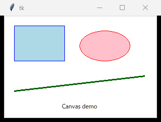

# fn_Canvas (Canvas)

種別: GUI (Packages/Tkinter.n の Canvas)・フォルダ 12_gui_tkinter・ラティスなし

## 何を見る例か
`Canvas[w, Width->, Height->, Background->]` を作り、Tk の `create` 命令 (四角・楕円・線・文字) を `TclEval` で送って絵を描く。`find all`・`type`・`bbox` で項目を調べる。描画関数 (`Plot` など) が内部で使う仕組みと同じ (docs/37)。

## スクリプト
```
c=Canvas[w,Width->300,Height->200,Background->"white",Side->"top"];
TclEval["set cv [lindex [ff . Canvas] 0]"];
TclEval["$cv create rectangle 20 20 120 90 -fill lightblue -outline blue"];   (* 楕円・線・文字も同様 *)
```

## 結果の読み方
`items=4`、`types=rectangle oval line text`、`bbox oval=149 29 251 91` (楕円 2 番目の項目の外接矩形)。窓には水色の四角、ピンクの楕円、緑の太い斜線、「Canvas demo」の文字が出る。

## 画面 (pysad の窓)


`example/tools/gui_shot.py` で、pysad が開いたルート窓を `PrintWindow` で切り取った (画面の切り取り `ImageGrab` は使えない環境だったため)。窓の枠は Windows の Tk のもの。
**gs の窓は撮れていない**: gs は WSLg (X11) に窓を開く (`winfo ismapped`=1)。WSL に撮る道具 (xwd・import) が無い。見た目の比較は、部品の木 (標準出力の `tree:`) で代えている。

## gs と pysad の比較
- 3 行とも gs と pysad で一致 (○)。窓の見た目は pysad の分だけ撮った。
- **窓の親が違う (pysad の既知の差、docs/41 §3.1・§8)**: gs では `Window[]` が Toplevel を作り、部品はその下に並ぶ (ルート `.` の下には「Return to SAD」ボタンと Toplevel)。pysad では `Window[]` が別の窓を作らず、部品がルート窓 `.` の直下に並ぶ。`tree:` の行のインデントの差はこのため。

## 未確認・限界
Windows の Tk 8.6 の見た目 (フォント・色・枠) と X11 の Tk は違う。実際の mainloop で操作し続ける使い方 (ユーザーの操作への反応) は確認していない (台本は `update` で窓を作り、Tcl の `invoke` で操作を模している)。 項目の色・太さは比べていない。
