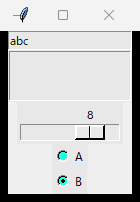

# fn_Entry_ListBox_Scale (Entry・ListBox・Scale・RadioButton)

種別: GUI (Packages/Tkinter.n)・フォルダ 12_gui_tkinter・ラティスなし。pysad でも動く (2026-11-17 に修正。親の違いが残る)

## 何を見る例か
入力欄 (`Entry`、`TextVariable` で SAD の変数 `ev` に結ぶ)、一覧 (`ListBox`)、スライダ (`Scale`、`Variable`)、ラジオボタン 2 個 (`RadioButton`、`Value` と `Variable`)。ウィジェットのメソッド `e[Insert]={"end","XY"}` も試す。

## スクリプト
```
e=Entry[w,TextVariable:>ev,Width->20,Side->"top"];     lb=ListBox[w,Height->3,Side->"top"];
s=Scale[w,From->0,To->10,Orient->"horizontal",Variable:>sv,Side->"top"];
r1=RadioButton[w,Text->"A",Value->1,Variable:>rv,Side->"top"];   r2=RadioButton[w,Text->"B",Value->2,Variable:>rv,Side->"top"];
e[Insert]={"end","XY"};   lb[Insert]={"end","item1"};   lb[Insert]={"end","item2"};
```
`Insert` の位置は Tcl の添字なので小文字の `"end"` (大文字 `"End"` は gs で Tcl エラー 1501)。

## 結果の読み方
`entry=` は Entry の中身 (`ev="abc"` が入る)、`entry after Insert=` は `e[Insert]` のあと、`listbox size=` は ListBox の項目数、`rv=`・`sv=` はラジオボタン B を押し Scale を 8 にしたあとの変数。

## 画面 (pysad の窓)


`example/tools/gui_shot.py` で、pysad が開いたルート窓を `PrintWindow` で切り取った (画面の切り取り `ImageGrab` は使えない環境だったため)。窓の枠は Windows の Tk のもの。
**gs の窓は撮れていない**: gs は WSLg (X11) に窓を開く (`winfo ismapped`=1)。WSL に撮る道具 (xwd・import) が無い。見た目の比較は、部品の木 (標準出力の `tree:`) で代えている。

## gs と pysad の比較
- 変数との結びつき (`entry=abc`、`rv=2`、`sv=8`) は gs・pysad で一致 (○)。
- **○ メソッドも一致 (2026-11-17 に修正)**: `e[Insert]={"end","XY"}` で Entry が `abcXY`、`lb[Insert]` 2 回で ListBox が 2 項目、`Head[e]` は `Widget` で gs と同じ。以前は `Head[e]` が `Symbol` で `e[...]` が何も呼ばなかった (`Tkinter.n` の入れ子の規則で `With` が呼び出し元の引数名 (ユーザーの `w`) を見て、`a$:=Widget[a$,…]` が別名に付いていた。docs/20、試験 `test_widget_values_and_methods_like_gs`)。
- **窓の親が違う (pysad の既知の差、docs/39 §3.1・§8)**: gs では `Window[]` が Toplevel を作り、部品はその下に並ぶ (ルート `.` の下には「Return to SAD」ボタンと Toplevel)。pysad では `Window[]` が別の窓を作らず、部品がルート窓 `.` の直下に並ぶ。`tree:` の行のインデントの差はこのため。
- **`Head[w]`・`Head[b]`**: gs・pysad とも `Widget` (○)。`tree:` の `Entry s6tv_8` (gs) と `Entry s2tv_4` (pysad) の番号の差は、gs が起動時に「Return to SAD」ボタンなどのウィジェットを先に作っていることによる (表示の番号の差)。

## 未確認・限界
Windows の Tk 8.6 の見た目 (フォント・色・枠) と X11 の Tk は違う。実際の mainloop で操作し続ける使い方 (ユーザーの操作への反応) は確認していない (台本は `update` で窓を作り、Tcl の `invoke` で操作を模している)。 `SpinBox`・`OptionMenu`・`ScrollBar`・`TextEditor` は例にしていない。
