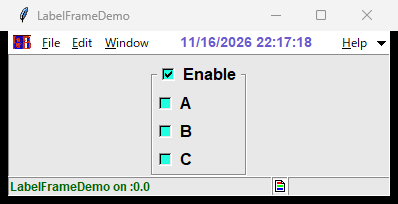

# fn_KBMainFrame_KBFComponentFrame (KBFrame.n の主窓と部品の枠)

種別: GUI (Packages/KBFrame.n)・フォルダ 12_gui_tkinter・ラティスなし

## 何を見る例か
KEK の標準の窓の枠 `KBMainFrame` (メニューバー KEK・File・Edit・Window・Task・Help、時計、状態行) の中に、`KBFComponentFrame` で枠付きのチェックボタンの組 (`KBFGroup` のラベルにチェックボタン「Enable」、中に `KBFCheckButton` A・B・C) を置く。「Enable」で A〜C の有効・無効が切り替わる。

## スクリプト
```
w = KBMainFrame["LabelFrameDemo", f, Title->"LabelFrame Demo"];
cb[0] = CheckButton[Text->"Enable", Variable:>cbv[0], Command:>(Scan[(cb[#][State] = If[cbv[0],"normal","disabled"])&, Range[3]])];
cf = KBFComponentFrame[f, Add->{KBFHook[...], KBFGroup[WidgetOption->{LabelWidget->cb[0]}],
  KBFCheckButton[Text->"A", Variable:>cbv[1], WidgetVariable:>cb[1]], ... B, C }];
```
`KBMainFrame` の引数は `KBMainFrame[名前, 枠の変数, Title->...]`。(`TkinterCore.n` の Tcl の準備は `Tkinter.n`・`KBFrame.n` が先に読み込む。)

## 結果の読み方
Menubutton・Checkbutton・Labelframe の数を数えて出す。窓の画面: 上端にメニューバーと時計 (日時の表示)、中央に「Enable」を見出しにした枠、その中に A・B・C のチェックボタン、下端に状態行 (「LabelFrameDemo on :0.0」)。

## 画面 (pysad の窓)


`example/tools/gui_shot.py` で、pysad が開いたルート窓を `PrintWindow` で切り取った (画面の切り取り `ImageGrab` は使えない環境だったため)。窓の枠は Windows の Tk のもの。
**gs の窓は撮れていない**: gs は WSLg (X11) に窓を開く (`winfo ismapped`=1)。WSL に撮る道具 (xwd・import) が無い。見た目の比較は、部品の木 (標準出力の `tree:`) で代えている。

## gs と pysad の比較
- Menubutton 6、Checkbutton 4、Labelframe 2 が gs・pysad で一致 (○)。docs/39 の記録 (木 36 行が一致、差は時刻と状態行の Label 1 個) と同じ範囲の確認。
- **窓の親が違う (pysad の既知の差、docs/39 §3.1・§8)**: gs では `Window[]` が Toplevel を作り、部品はその下に並ぶ (ルート `.` の下には「Return to SAD」ボタンと Toplevel)。pysad では `Window[]` が別の窓を作らず、部品がルート窓 `.` の直下に並ぶ。`tree:` の行のインデントの差はこのため。

## 未確認・限界
Windows の Tk 8.6 の見た目 (フォント・色・枠) と X11 の Tk は違う。実際の mainloop で操作し続ける使い方 (ユーザーの操作への反応) は確認していない (台本は `update` で窓を作り、Tcl の `invoke` で操作を模している)。 `KBFFrameToggled`・`KBFFrameTabed` (demo-KBFrame1) は pysad で途中までしか動かない (docs/39 §8) ので例にしていない。
