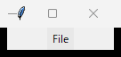

# fn_Menu_MenuButton (MenuButton・Menu)

種別: GUI (Packages/Tkinter.n)・フォルダ 12_gui_tkinter・ラティスなし

## 何を見る例か
メニューボタン (`MenuButton`、「File」) にメニュー (`Menu`) を付け、エントリ (`Button`、`Separator`) を `Add->{...}` で与える。エントリを `invoke` すると `Command` が評価される。

## スクリプト
```
mb=MenuButton[w,Text->"File",Side->"top"];
m=Menu[mb,Add->{Button[Text->"Open",Command:>(fl="open")],Button[Text->"Save",Command:>(fl="save")],Separator[],Button[Text->"Quit",Command:>(fl="quit")]}];
TclEval["$mn invoke 1"];      (* 2 番目のエントリ「Save」を選ぶ *)
```

## 結果の読み方
`last index=3` (エントリは 0〜3 の 4 つ)、`labels=Open Save - Quit` (`-` は区切り線)、`fl=save` (「Save」の `Command` が評価された)。窓には「File」ボタンだけが見える (メニューは押したときだけ開く)。

## 画面 (pysad の窓)


`example/tools/gui_shot.py` で、pysad が開いたルート窓を `PrintWindow` で切り取った (画面の切り取り `ImageGrab` は使えない環境だったため)。窓の枠は Windows の Tk のもの。
**gs の窓は撮れていない**: gs は WSLg (X11) に窓を開く (`winfo ismapped`=1)。WSL に撮る道具 (xwd・import) が無い。見た目の比較は、部品の木 (標準出力の `tree:`) で代えている。

## gs と pysad の比較
- `labels=`・`fl=save` は gs と pysad で一致 (○)。
- **窓の親が違う (pysad の既知の差、docs/20 §3.1・§8)**: gs では `Window[]` が Toplevel を作り、部品はその下に並ぶ (ルート `.` の下には「Return to SAD」ボタンと Toplevel)。Menu が Menubutton の下に入る段は gs と同じ (`Menubutton File;   Menu`)。差は、pysad では `Window[]` が別の窓を作らず、部品がルート窓 `.` の直下に並ぶ。`tree:` の行のインデントの差はこのため。

## 未確認・限界
Windows の Tk 8.6 の見た目 (フォント・色・枠) と X11 の Tk は違う。実際の mainloop で操作し続ける使い方 (ユーザーの操作への反応) は確認していない (台本は `update` で窓を作り、Tcl の `invoke` で操作を模している)。 メニューを実際に開いた画面 (ポップアップ) は撮っていない。`CheckButton`・`Cascade` のエントリは試していない。
