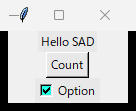

# fn_Window_Button_TextLabel (Window・TextLabel・Button・CheckButton)

種別: GUI (Packages/Tkinter.n)・フォルダ 12_gui_tkinter・ラティスなし

## 何を見る例か
最小の窓の例。最上位の窓 `Window[]` に、文字 (`TextLabel`)、ボタン (`Button`、押すと `Command` を評価)、チェックボタン (`CheckButton`、`Variable` に結ぶ) を縦に並べる。画面表示が主役。

## スクリプト
```
w=Window[];
l=TextLabel[w,Text->"Hello SAD",Side->"top"];
b=Button[w,Text->"Count",Command:>(n=n+1),Side->"top"];
c=CheckButton[w,Text->"Option",Variable:>ck,Side->"top"];
TclEval["update"];                 (* 窓を描く *)
TclEval["foreach c [ff . Button] {$c invoke; $c invoke}"];   (* ボタンを 2 回押す *)
```
`Side->"top"` は `Pack` のオプションで、作ると同時に配置される。補助の Tcl 手続き (部品の木を出すもの、クラスで部品を探すもの) は、台本の先頭で定義している。

## 結果の読み方
`tree:` の行が部品の木 (クラスと `-text`、`;` 区切り)。`n=2` はボタンを 2 回 `invoke` した結果 (`Command:>(n=n+1)` が 2 回評価された)、`ck=1` はチェックボタンを 1 回押した結果 (`Variable:>ck` が 1)。
窓には「Hello SAD」のラベル、「Count」ボタン、「Option」のチェックボタンが縦に並ぶ (下の画面)。

## 画面 (pysad の窓)


`example/tools/gui_shot.py` で、pysad が開いたルート窓を `PrintWindow` で切り取った (画面の切り取り `ImageGrab` は使えない環境だったため)。窓の枠は Windows の Tk のもの。
**gs の窓は撮れていない**: gs は WSLg (X11) に窓を開く (`winfo ismapped`=1)。WSL に撮る道具 (xwd・import) が無い。見た目の比較は、部品の木 (標準出力の `tree:`) で代えている。

## gs と pysad の比較
- 動作の結果 (`n=2`、`ck=1`) は gs と pysad で一致 (○)。部品の種類・文字も同じ。
- **窓の親が違う (pysad の既知の差、docs/20 §3.1・§8)**: gs では `Window[]` が Toplevel を作り、部品はその下に並ぶ (ルート `.` の下には「Return to SAD」ボタンと Toplevel)。pysad では `Window[]` が別の窓を作らず、部品がルート窓 `.` の直下に並ぶ。`tree:` の行のインデントの差はこのため。
- **`Head[w]`・`Head[b]`**: gs・pysad とも `Widget` (○。`Tkinter.n` の入れ子の規則で `With` が呼び出し元の引数名を見ると別名に付く。docs/20)。

## 未確認・限界
Windows の Tk 8.6 の見た目 (フォント・色・枠) と X11 の Tk は違う。実際の mainloop で操作し続ける使い方 (ユーザーの操作への反応) は確認していない (台本は `update` で窓を作り、Tcl の `invoke` で操作を模している)。
