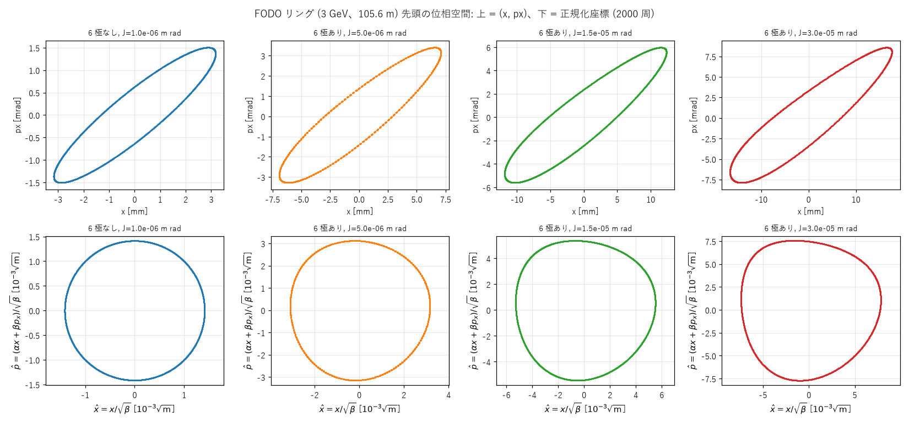
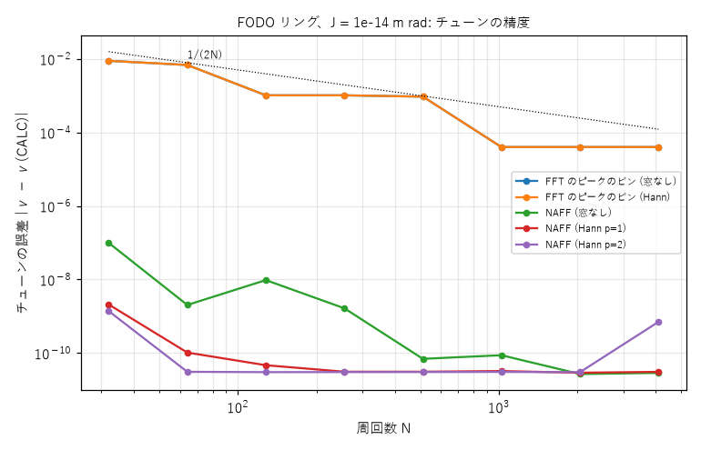
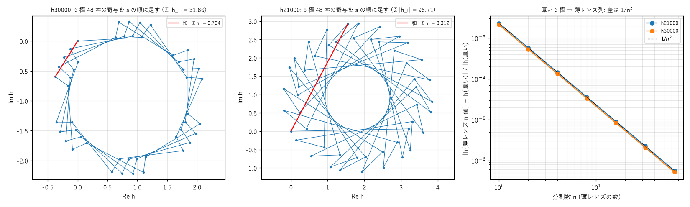
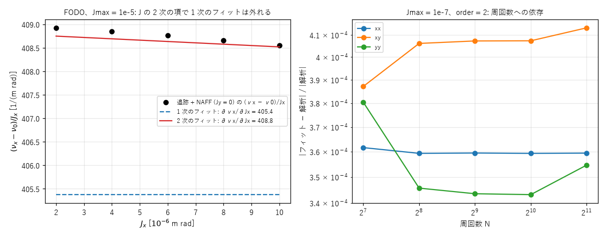
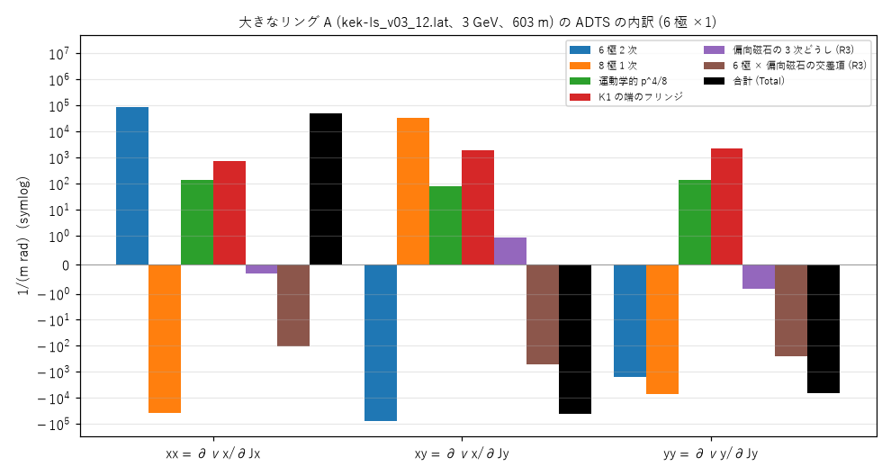
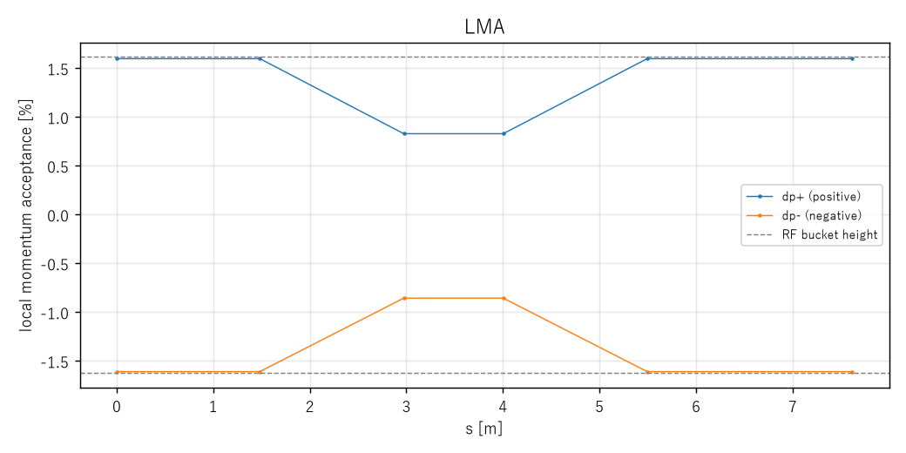
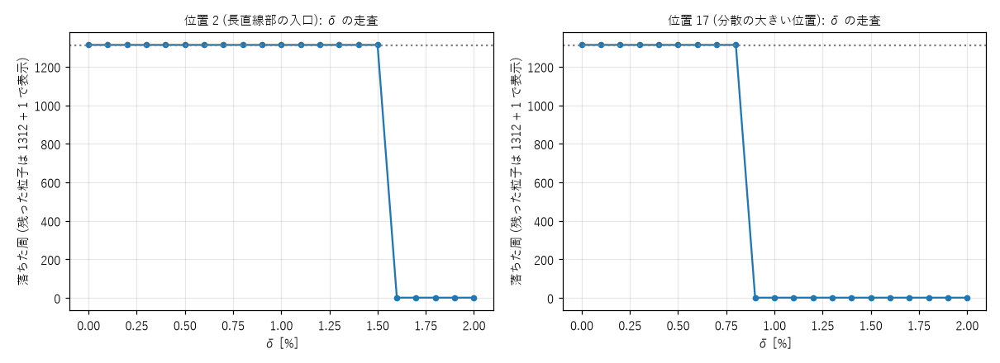
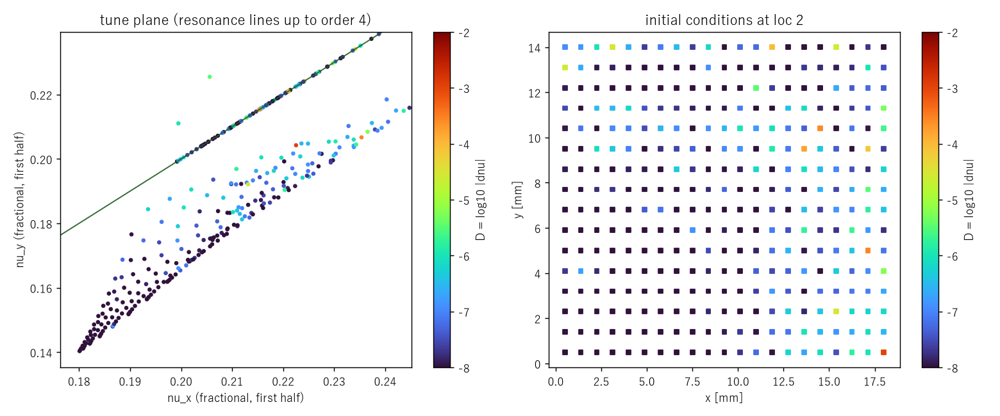

# 14_nonlinear_dynamics: 非線形ダイナミクスの例

**この文書で分かること**: 非線形磁石 (6 極・8 極・偏向磁石の高次の項) がチューンと粒子の運動に及ぼす効果を、pysad の解析式と追跡で求める例の集まり。何がどのフォルダにあるか、各例が何を示し、結果が何を意味するかの要点を載せる。
**前提**: 加速器物理 (ベータ関数、チューン、6 極による色収差補正、共鳴) を知っていること。pysad・SAD の使い方は知らなくてよい (各例のコマンドはそのまま実行できる形で書いてある)。
**読む順**: 初めての人は `primer/` の入門の図 (`docs/24_adts_rdt_primer.md` が説明する) → `adts_rdt/rdt_adts_basic.md` → 関心のある例。

## 構成

| フォルダ | 内容 | 文書 |
|---|---|---|
| `adts_rdt/` | 6 極・8 極の共鳴駆動項 (RDT)・振幅依存チューンシフト (ADTS)。解析式と追跡 + NAFF の照合、偏向磁石の 3 次の項、4 次の RDT、精密版 | `adts_rdt/ADTS_summary.md` (全体のまとめ)、`rdt_adts_basic.md`・`adts_direct.md`・`adts_bend_cubic.md`・`rdt_tracking.md`・`rdt4_normal_form.md`・`adts_exact_terms.md`・`adts_gs_norfsw.md` |
| `normal_form/` | 1 周の写像の正規形 (`pysad/ampnf.py`): ν(J, δ) の級数、K0≠0 の偏向磁石、結合した経路、ν(J) の次数、共鳴の島 | この README の表 |
| `frequency_map/` | 周波数マップ (チューン拡散 D の地図)、共鳴線の予想、信頼性の確認 | [`frequency_map/README.md`](frequency_map/README.md) |
| `primer/` | 入門の図とそのスクリプト (`primer_*`。`docs/24_adts_rdt_primer.md` が参照) | この README の表 |

用語 (初出): **ADTS** = 振幅 (アクション J) が増えるとチューンが変わる量 ∂ν/∂J。**RDT** (共鳴駆動項) = 非線形磁石が共鳴をどれだけ駆動するか。**NAFF** = 追跡したチューンを高精度で求める周波数解析。**正規形** = 1 周の写像を、振幅に依らない回転と小さな補正に直す表現 (`ampnf` は、そのべき級数)。J の単位は m rad、ADTS の単位は 1/(m rad)。

## 共通の条件

- 例のリング: 小さな FODO (`example/00_lattice/FODO_ring.sad`、3 GeV、105.6 m、24 セル、SF・SD の K2L = 4, −6)、ASTRID2 (`example/astrid/lattice/ASTRID2_v01_01.sad`、0.58 GeV、45.7 m)、大きなリング A (`pysad/tests/kek-ls_v03_12.lat`、3 GeV、603 m)。例ごとの追加のラティスは各表に書く。
- 追跡は RF 空洞を止め、放射なし、結合なし (結合を扱う例は明記)。
- 追跡は互換モード k64 (gs と同じ式) で保存した例が多く、解析式 (四極本体の積分器の台形則など) も k64 の追跡と比べている。`PYSAD_COMPAT=k64` で同じ出力が再現できる。既定の v2 は四極の積分器が異なり、`adts_bend.py scan fodo` (FODO、6 極 ×1) の追跡の ADTS は k64 に対し 5e-4 (相対) 違った (xx 408.793 対 408.990、yy 519.677 対 519.946。解析との比較の結論 (どの項が効くか) を変える大きさではないが、数値は一致しない)。v2 で取り直した例はこの 1 本だけ (末尾の「未確認」)。
- スクリプトは、出力ファイルをスクリプトと同じフォルダに上書きする。保存済みの出力を残すなら、複製して走らせる。
- 追跡の例は数十秒〜数十分かかるものがある (各例の所要は表のとおり)。

## adts_rdt

台本ごとの式・条件・数値は `adts_rdt/ADTS_summary.md`。各文書の分担は次のとおり。

| 文書 | 示すこと |
|---|---|
| `rdt_adts_basic.md` | 3 つのリングの RDT・ADTS・クロマティシティの解析値。6 極 2 次の ADTS は追跡 + NAFF と FODO で 3〜4 桁、ASTRID2 で 0.2%、大きなリング A で 1e-4 程度一致する |
| `adts_gs_norfsw.md` | gs で ADTS を追跡で求めるときに `NORFSW;` が必要な理由 (RF つきでは偽の ADTS が入る) |
| `adts_direct.md` | 実際の強さの追跡 + NAFF + 多項式フィットで ADTS を直接求めた値と、偏向磁石の 3 次なしの解析との差 (FODO で 3〜9%、ASTRID2 で 7〜13%) |
| `adts_bend_cubic.md` | 偏向磁石の 3 次の項を入れると差が 0.3% 以内に縮む。残る差は 6 極に依らない 4 次の定数 |
| `rdt_tracking.md` | RDT の解析式と、追跡の 1 周の写像から取り出した値の比較 (偏向磁石つきで FODO 1.5e-9、大きなリング A 4e-7) |
| `rdt4_normal_form.md` | 4 次の RDT・偏向磁石の生成関数・数値の正規形と、追跡との比較 |
| `adts_exact_terms.md` | K0≠0 の偏向磁石・δ≠0・閉形式・非対角の補正を入れた精密版の表 |

### adts_rdt の台本・出力の対応

| 台本 | 出力 | 内容 |
|---|---|---|
| `fn_ResonanceDrivingTerms_fodo.sad` | `.pysad.txt` | SAD の台本から `ResonanceDrivingTerms[]`・`AmplitudeTuneShift[]`・`ChromaticityTerms[]` を呼ぶ (pysad のみの関数) |
| `rdt_rings.py` | `rdt_rings.pysad.txt`・`rdt_rings_elements.png` | 3 リングの RDT・ADTS・クロマティシティ |
| `rdt_thick_thin.py` | `.pysad.txt` | 厚い 6 極と薄レンズ列の収束 (n を倍にすると差が 1/4) |
| `ADTS_summary_rdt_check.py` | 標準出力 | 文献型の 6 極の RDT の式との照合 (比 −1、位相一致) |
| `adts_tracking.py` | `adts_tracking_{fodo,astrid,kekls}.pysad.txt` | 追跡 + NAFF の ADTS と解析 |
| `adts_gs.py` | `adts_gs_*.txt` | gs の追跡の ADTS (検証用) |
| `adts_direct.py`・`adts_checks.py` | `adts_direct_*`・`adts_{octupole,ablate,delta,resonance,coupling}_*` | 直接のフィット、8 極の走査、端部・K1 を切った追跡との比較、δ 依存、共鳴の近くの不動点、結合の影響 |
| `adts_bend.py` | `adts_bend_scan_*`・`adts_bend_conv_*`・`adts_bend_gs_*`・`adts_bend.png`・`adts_bend_scan.png` | 偏向磁石の 3 次の項の走査、分割数への収束 |
| `rdt_tracking.py`・`rdt_gs_map.py` | `rdt_{table,chrom,res}_*`・`rdt_thin_fodo.pysad.txt`・`rdt_gs_map_*.gs.txt`・`rdt_table.png` | RDT・クロマティシティ・共鳴線近くの周期点 |
| `rdt4_tracking.py`・`rdt4_gs_map.py`・`bend_generators.py`・`normal_form_numeric.py` | `rdt4_*`・`bend_generators.out.txt`・`normal_form_numeric.out.txt`・`rdt4_table.png` | 4 次の RDT、偏向磁石の生成関数、数値の正規形 |
| `adts_exact.py` | `adts_exact_*.out.txt`・`adts_exact_delta_*.track.json` | MPW・δ≠0・閉形式・非対角補正・`adts()` の 4 次の項 |

## normal_form

`pysad/ampnf.py` (1 周の写像のべき級数の正規形) で ν(Jx, Jy, δ) を級数にし、追跡の NAFF と比べる例。J¹ は ADTS、J² 以降は ADTS より高次の振幅依存。単位は J が m rad、ADTS が 1/(m rad)。

| 台本 | 出力 | 何を示すか・結果の要点 |
|---|---|---|
| `ampnf_vs_tracking.py fodo\|astrid` | `ampnf_vs_tracking_{fodo,astrid}.out.txt` | 級数と追跡の ν の差。FODO の J¹ は ampnf (409.2, −412.6, 520.9) と `adts().total` (408.8, −412.9, 519.8)、ASTRID2 は (470.2, 1304.4, 1485.3) と (469.8, 1303.7, 1483.0)。J² を入れると小〜中振幅の差が縮む。ASTRID2 は δ = ±1e-3 で最小の共鳴の分母が 0.002 と小さく、差が大きい |
| `ampnf_kekls.py [D]` | `ampnf_kekls.out.txt` | 大きなリング A の全部入り (D = 5、約 100 s)。ν0 = (0.580, 0.620)、J¹ = (50714, −41044, −6523) で `adts().total` の (50702.5, −41049.4, −6545.0) と近い |
| `rotated_bend.py fodo\|astrid` | `rotated_bend_{fodo,astrid}.out.txt` | ROTATE (ロール) した偏向磁石を入れた ADTS。FODO で全偏向磁石を θ = 0.2 rad 傾けると結合した光学になり、傾きの分を入れた解析と追跡の差は 6e-4 以内 (入れないと 1.4e-2) |
| `coupled_h4.py fodo\|astrid` | `coupled_h4_{fodo,astrid}.out.txt` | 結合した光学・δ≠0・DX/DY/DROTATE で、3・4 次の RDT と正規形 ADTS を追跡の写像と比較。FODO の傾き 50 mrad で、正規形と追跡 + NAFF の ADTS の差は 3.5e-4 以内 (**v2 モード**で実行) |
| `k0_ampnf.py [mpw\|mpw_big\|mpw_ang\|mpw_edge\|tilt\|pi\|pi_neg]` | `k0_ampnf.out.txt` | K0≠0 の偏向磁石 (3 極の挿入光源) つき FODO の ν(J, δ)・ADTS・RDT。mpw で J¹ = (409.3, −429.4, 615.2)、追跡との差は ν で 4e-6 以内。`mpw_big` は νy = 0.953 が整数に近く、保存した出力はこの変種で計算が止まっている (未確認の項を参照) |
| `k0_bend_check.py [variant]` | (標準出力。試験 `test_v24_A2_k0_bend` が使う) | K0≠0 の偏向磁石に E1・E2・ANGLE・ROTATE がある場合の、解析式 (h・ξ・ADTS) と追跡の写像の照合 (variant: ang0, ang, edge, edgeasym, k1 ほか。省略すると全部) |
| `k0_independent_flow.py` | `k0_independent_flow.out.txt` | K64 の K0≠0 の偏向磁石の追跡の式を、運動方程式の独立な数値積分と比べる (端の幅 w → 0 で収束) |
| `k0_real_scale.py [astrid\|astrid_tilt\|kekls] [D]` | `k0_real_scale.out.txt` | 実機規模 (ASTRID2 + 2 T の MPW 23 極、KEK-LS + 23 極 MPW) の ν(J, δ)・ADTS。ASTRID2 + MPW で J¹ = (470.1, 1508.9, 1710.9)、追跡のフィットは (470.9, 1509.3, 1711.3) |
| `nu_of_J_fmap_grid.py astrid2\|kekls [D]` | `nu_of_J_fmap_grid_{astrid2,astrid2_D8,astrid2_D8_skip,kekls}.out.txt` | 周波数マップの各点のチューン (`../frequency_map/fmap_*.table.txt`) を ν(J) の級数と比べ、J² を入れた効果を見る (ASTRID2 の規則的な点で、差の中央値が J¹ のみの 0.42 倍 (νx)・0.19 倍 (νy))。共鳴 4νx + 2νy = 25 までの距離と差の順位相関は 0.84・0.73 |
| `nu_of_J_orders.py fodo\|astrid\|kekls [--gs] [--D 7]` | `nu_of_J_orders_{fodo,astrid,kekls}.out.txt` | ν(J) の級数の J の次数 (J¹・J²・J³) ごとの誤差。FODO の J = 4e-6 で、νy の誤差は J¹ の 1.4e-5 が J² で 2.2e-6 に縮む。大きなリング A (J = 2e-8) は J¹ の 1.3e-5 が J² で 1e-7 以下 |
| `island_vs_tracking.py [n:dnu ...]` | `island_vs_tracking_fodo.out.txt` | 1 本の共鳴 (nνx = p、n = 4〜6) の島の半幅を、正規形から作った理論と追跡で比べる。n = 6、δν = 0.001 で半幅の理論/追跡 = 0.99 (追跡/理論 1.012)。24 セルのうち 12 セルだけ 6 極を置いた非周期の配置 (24 回対称だと島ができないため) |

`nu_of_J_fmap_grid_*.out.txt` は、`_D8_skip` 以外は `../frequency_map/` の現在の表から作った (`_D8_skip` は未確認の項を参照)。

## primer

入門 (`docs/24_adts_rdt_primer.md`) の図と、その図を作るスクリプト。共通部分は `primer_common.py` (FODO リング、k64 の追跡、RF なし)。

| スクリプト | 出力 | 内容 |
|---|---|---|
| `primer_phase_space.py` | `primer_phase_space.png` | FODO の 1 粒子の位相空間 (x, px) と正規化座標 |
| `primer_naff.py` | `primer_naff.png` | NAFF と単純な FFT のチューン精度 |
| `primer_rdt.py` | `primer_rdt.png` | 共鳴駆動項 h を 6 極 1 本ずつの寄与の和として複素平面に描く。厚い 6 極 → 薄いレンズ列の収束 |
| `primer_sext_even_odd.py` | (標準出力) | 6 極は 1 次ではチューンシフトを出さず、2 次 (強さの 2 乗) で出る |
| `primer_octupole.py` | (標準出力) | 薄い 8 極の 1 次の ADTS の式 ∂νx/∂Jx = K3L βx²/(16π) などの確認 |
| `primer_adts_fit.py` | `primer_adts_fit.png` | 追跡 + NAFF + 多項式フィットで ADTS を求める手順 (約 1 分) |
| `primer_breakdown.py` | `primer_breakdown.png` | 大きなリング A の ADTS の内訳 (`../adts_rdt/adts_bend_scan_kekls.pysad.txt` を読む) |
| `primer_fmap_lma.py scan\|lma\|fmap\|all` | `primer_lma_scan.png`・`primer_lma_astrid2.{png,table.txt}`・`primer_fmap_astrid2.{png,table.txt}` | ASTRID2 の LMA (局所運動量アクセプタンス) と周波数マップを入門用に小さい格子で |

### primer の図

FODO リング (3 GeV、105.6 m) の先頭で、1 粒子を 2000 周追跡した位相空間。上段は (x [mm]、px [mrad])、下段は β と α で割った正規化座標。6 極なしで J = 1e-6 m rad の粒子 (左端) は正規化座標でほぼ円を描く。6 極ありで J を 5e-6、1.5e-5、3.0e-5 m rad と増やすと、円が三角形にゆがむ。これが 6 極による非線形な効果である。

横軸は周回数 N、縦軸は線形計算のチューンとの差 |ν − ν(CALC)| (J = 1e-14 m rad の粒子)。FFT のピークのビンは N を増やしても 1/(2N) より速くは良くならず、N = 2048 でも 4e-5 程度。NAFF は窓なしでも N = 32 で 1e-7、Hann 窓つきなら N = 64 以上で約 3e-11 まで求まる。

左の 2 枚は、共鳴駆動項 h30000 と h21000 を、6 極 48 本の寄与 (複素数) を s の順に足していく軌跡で描いたもの (横軸 Re h、縦軸 Im h)。赤い線が総和で、寄与の絶対値の和 (31.86、95.71) に比べ、h30000 は 0.704 まで相殺する。右は、厚い 6 極を薄いレンズ n 個に分けたときの h の差で、分割数 n に対して 1/n² で小さくなる。

左は FODO で Jx を 2〜10 × 10⁻⁶ m rad に変えたときの (νx − ν0)/Jx [1/(m rad)] (黒点) と、1 次 (破線、∂νx/∂Jx = 405.4) と 2 次 (実線、408.8) の多項式フィット。Jmax = 1e-5 では 1 次のフィットが外れ、2 次のフィットが点に合う。右は Jmax = 1e-7 の 2 次フィットを解析値と比べた相対差 (xx、xy、yy) で、周回数 128〜2048 に対し約 3.4〜4.1e-4。

大きなリング A (3 GeV、603 m) の ADTS (xx、xy、yy) を、項ごとに分けた棒グラフ (縦軸は 1/(m rad) の symlog、6 極は強さ ×1)。黒が合計で、6 極の 2 次 (青) と 8 極の 1 次 (橙) が符号違いで大きく打ち消し合い、合計 (黒) は、たとえば xx で個々の項の半分程度 (約 5 × 10⁴) になる。

ASTRID2 の標準セルの 5 つの位置での局所運動量アクセプタンス (横軸 s [m]、縦軸 δ [%]。上が δ+、下が δ−、破線が RF バケットの高さ)。直線部では RF バケットの高さの 1.60% まで届き、分散の大きい 2 台の偏向磁石の間の位置では δ+ = 0.83% に下がる。

LMA の求め方の例。1 つの位置から δ を 0〜2% で振って追跡し、落ちた周 (縦軸。残った粒子は 1312 + 1 で表示) を見る。長直線部の入口 (左) は δ = 1.5% まで残り 1.6% で落ち、分散の大きい位置 (右) は 0.8% まで残り 0.9% で落ちる。

ASTRID2 の位置 2 の周波数マップ。左はチューン面 (νx、νy の小数部。直線は共鳴線)、右は初期条件の格子 (x [mm]、y [mm]) で、色は D = log10 |Δν|。D が大きい (赤い) 点は、共鳴線の上と大振幅 (右上・右下) に出る。

## 検証

解析式と追跡 (pysad k64 = gs と同じ式) は、各文書の数値のとおり一致する。gs (SAD 本家) の追跡とも、`NORFSW;` の条件で 1e-4 以内 (ADTS)・1e-9 (RDT の取り出し) で一致する。互換モード k64 は `PYSAD_COMPAT=k64` で選ぶ。

## 未確認・限界

- 追跡の出力は互換モード k64 で保存してあり、既定の v2 で取り直したのは `nu_of_J_fmap_grid_{astrid2,astrid2_D8,kekls}.out.txt` (v2 で計算するスクリプト) だけ。k64 と v2 の追跡の差は、FODO の `adts_bend.py scan` で 5e-4 (相対) だった。他の長い出力 (数十分〜数時間) は取り直していない。取り直したら数値は変わりうる (差の大きさは例による。未確認)。
- `nu_of_J_fmap_grid_astrid2_D8_skip.out.txt` は、取り直していない (共鳴に近い項を残す引数 `skip_den` の値が記録に残っておらず、同じ条件を再現できない)。この出力は、`frequency_map/` の現行の表ではなく、旧い (2 次の積分器で作った) 周波数マップの表を読んだ結果。ほかの 3 本 (D = 6・8、KEK-LS) は現行の表で取り直した (中央値が 10〜15% 動いた)。
- `normal_form/k0_ampnf.out.txt` は、変種 `mpw_big` で線形の計算が失敗した記録 (traceback) を含む。
- 出力の表の見出しや JSON のキーに、解析式の種類を表す内部の符号 (R2・R3 など。偏向磁石の 3 次なし・ありの意味) が残っている。数値ファイルなので書き換えていない。
- 解析式の限界 (K0≠0 の偏向磁石の内部の一部、結合・垂直分散・誤差、4 次以上の項、J² の正規形の大振幅) は `adts_rdt/ADTS_summary.md` §0.3 と `docs/25_resonance_terms_adts.md`。
