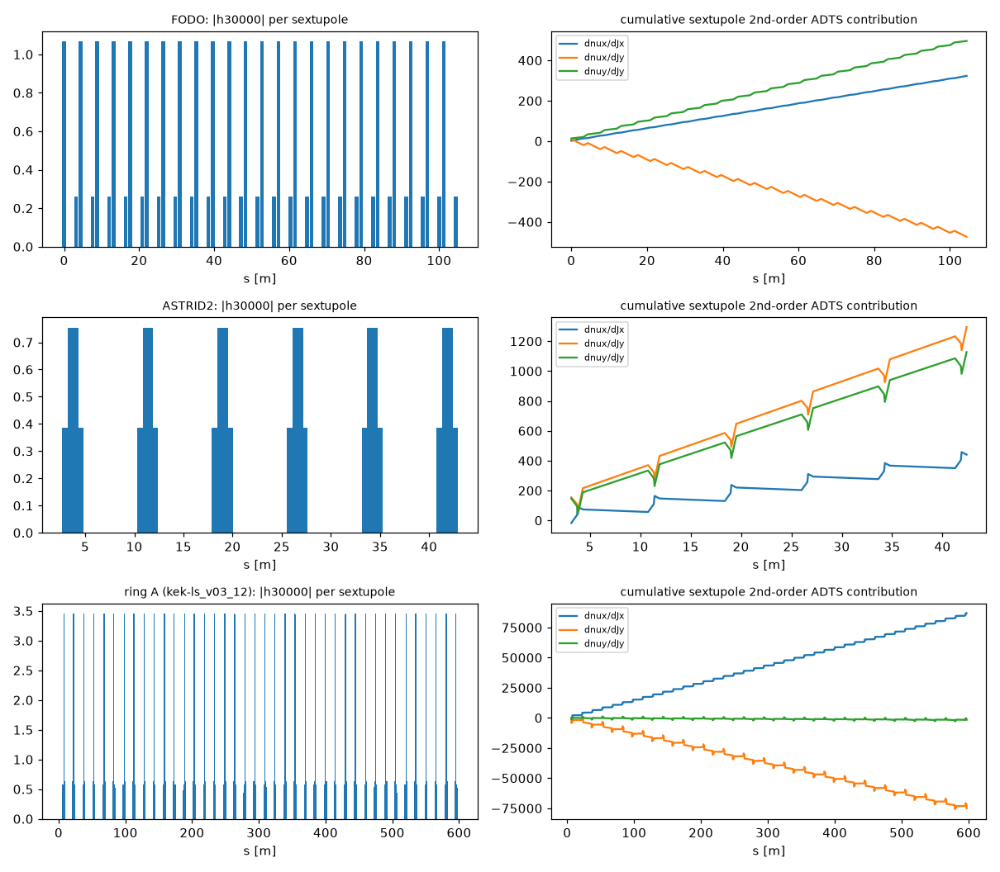
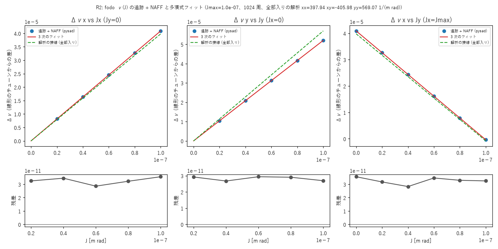
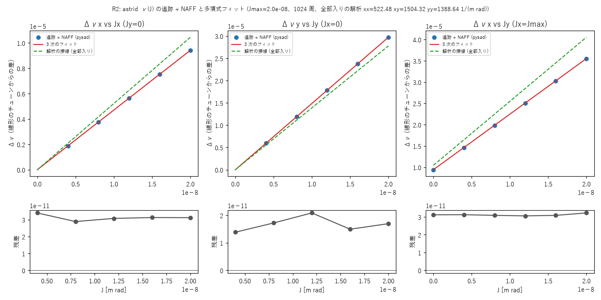
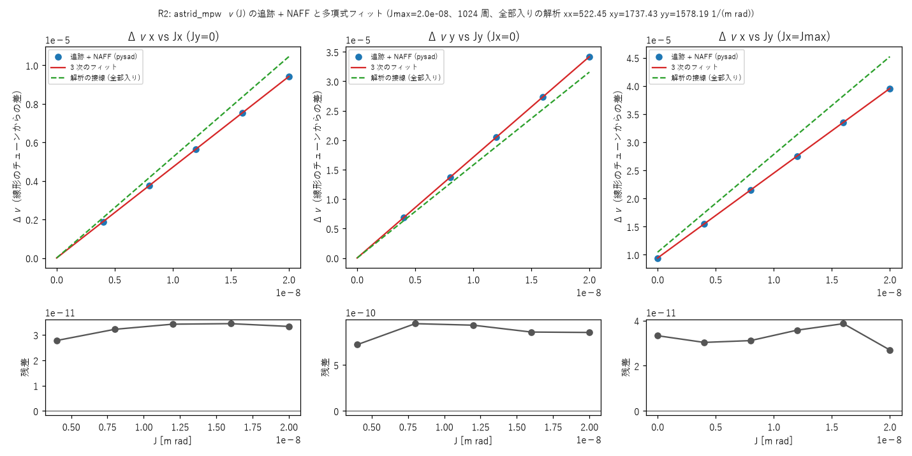
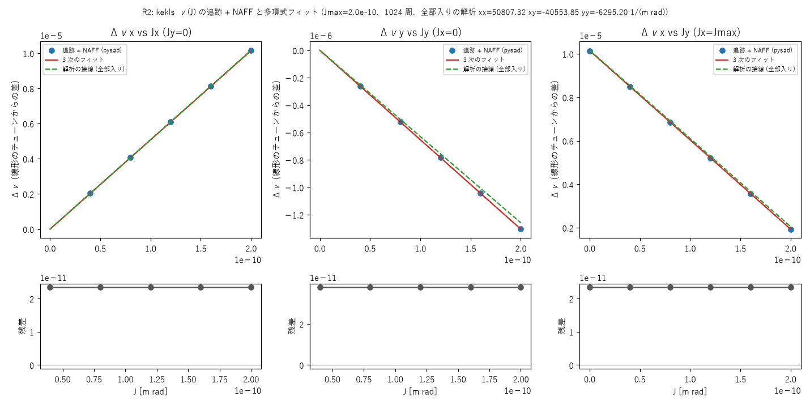
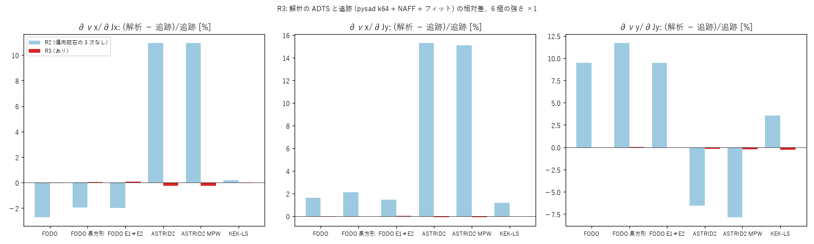
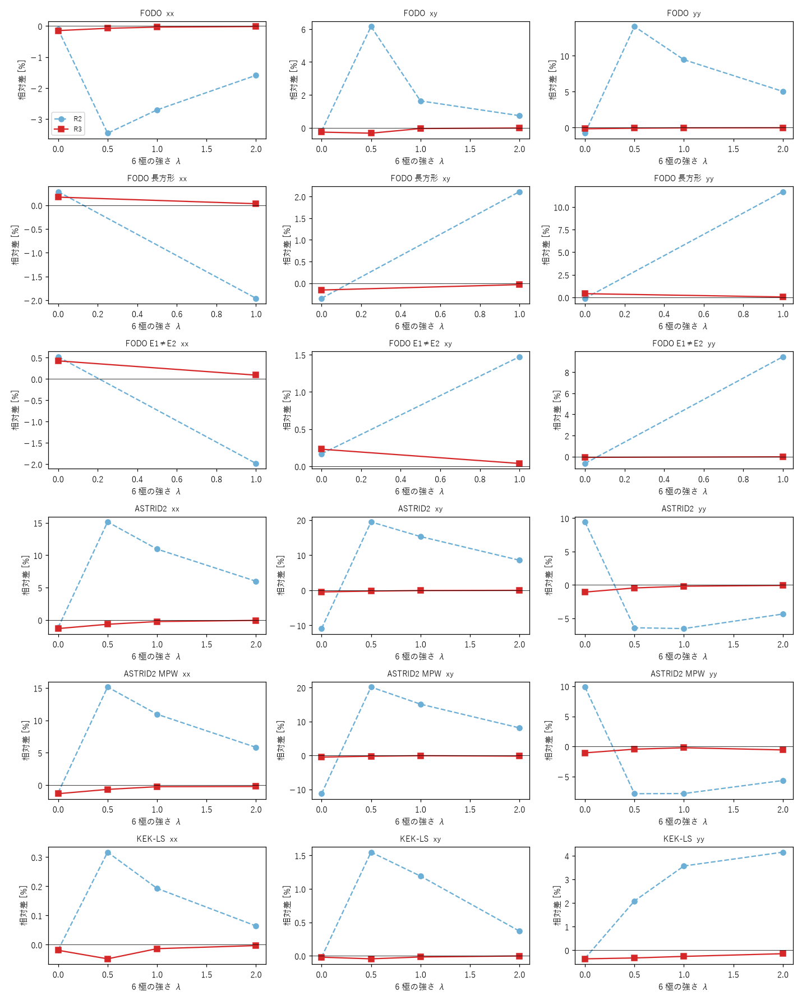
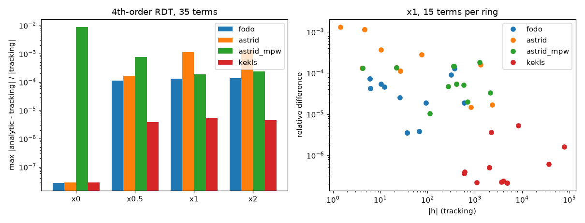

# ADTS・共鳴駆動項 (RDT) の例のまとめ: 台本ごとの「コマンド・解析式・解析の数値・追跡 + FFT (NAFF) の数値・比較」

`example/14_nonlinear_dynamics/adts_rdt/` の ADTS (振幅依存チューンシフト) と共鳴駆動項 (RDT) の台本・スクリプトを、台本ごとに同じ 7 つの節で並べたものです (目的、使うファイルとコマンド、解析式、解析の結果、追跡 + NAFF の数値、比較、出力と図)。
解説は [`docs/25_resonance_terms_adts.md`](../../../docs/25_resonance_terms_adts.md)、索引は [`rdt_adts_basic.md`](rdt_adts_basic.md)・[`adts_gs_norfsw.md`](adts_gs_norfsw.md)・[`adts_direct.md`](adts_direct.md)・[`adts_bend_cubic.md`](adts_bend_cubic.md)。
**数値は同じフォルダの出力ファイルから転記したもの** (一部は下の「確認の状況」の再実行で一致を確かめた)。

**この文書で分かること**: ADTS・RDT の解析式 (`pysad/resdrive.py`) を、台本ごとに、何を比べ、どんな条件で、解析と追跡 + NAFF がどこまで一致するかを数字つきで示す。
**前提**: 加速器物理 (ベータ関数・チューン・6 極) の知識。pysad の使い方は知らなくてよい (コマンドは各節にそのまま書いてある)。
**読む順**: §0 (全体の表・条件・限界) → 関心のある節 (§1〜§13)。まず入門の `rdt_adts_basic.md` を読むと用語が分かる。

## 0. 全体

### 0.1 対応表 (台本 → 何を比べるか → 主な結果 → 節)

(差は特に断らない限り (解析 − 追跡)/|追跡|。J の単位はアクション [m rad]、ADTS の単位は 1/(m rad)。)

| 台本・スクリプト | 何を比べるか | 主な結果の 1 行 | 節 |
|---|---|---|---|
| `fn_ResonanceDrivingTerms_fodo.sad` | SAD の台本から `ResonanceDrivingTerms[]`・`AmplitudeTuneShift[]`・`ChromaticityTerms[]` を呼ぶ。厚い解析式と数値積分 (16 分割) | FODO の 6 極 2 次 (323.41, −474.02, 496.07)。数値積分との差 0.03〜0.07% (RDT は 1e-5) | [§1](#1-fn_resonancedrivingterms_fodosad-sad-の台本から解析式を呼ぶ) |
| `adts_tracking.py` | 解析の 6 極 2 次・8 極 1 次と、pysad (k64) の追跡 + NAFF (6 極の強さ ×(+1, −1, 0) の偶数次 C、8 極 ×(±1) の B) | C は解析と FODO 4e-5・7e-6・2e-4、ASTRID2 1.5e-3・1.1e-3・1.8e-3、kek-ls_v03_12.lat 2e-5・3e-5・1e-3 | [§2](#2-adts_trackingpy-pysad-の追跡--naff) |
| `adts_gs.py` | 同じ C・B を gs (SAD K64) の `TrackParticles` で (`NORFSW;`) | gs の C は pysad の追跡と 6〜8 桁で一致 (FODO、ASTRID2、kek-ls_v03_12.lat) | [§3](#3-adts_gspy-gs-sad-k64-の追跡) |
| `rdt_thick_thin.py` | 厚い 6 極の解析式と、n 分割の薄レンズ列・数値積分の差 | n を 2 倍にすると差が 1/4 (比 3.987→4.000)。n = 64 で ADTS xx が 6.8e-3 | [§4](#4-rdt_thick_thinpy-厚い-6-極と薄レンズ列の収束) |
| `rdt_rings.py` | 3 つのリング (FODO、ASTRID2、kek-ls_v03_12.lat) の RDT 10 項・ADTS・クロマティシティ・作動点 | 数値の一覧 (追跡との比較は §2・§3・§8) | [§5](#5-rdt_ringspy-3-つのリングの一覧) |
| RDT: `fn_ResonanceDrivingTerms_fodo.sad`、`adts_checks.py resonance`、`ADTS_summary_rdt_check.py` | RDT の検証: 1 周の ΔJ、文献の式、共鳴線の近くの周期点、δ の項 (クロマティシティ) | ΔJ と −∂G/∂φ が 0.5% 以内。文献型の式との比 −1.000000 (6e-7 以内)。周期点の振幅 0.15〜1.3% | [§6](#6-共鳴駆動項-rdt) |
| `adts_gs_*` (`adts_gs.py` の `NORFSW;`) | gs の RFSW ON と OFF の ADTS | RFSW ON だと空洞が偽の ADTS を作る (kek-ls_v03_12.lat、6 極なし: 35320 対 877.86)。`NORFSW;` で一致 | [§7](#7-gs-の-rfsw-の扱い) |
| `adts_direct.py` | 実際の強さの追跡 + NAFF + 多項式フィット (pysad と gs) と、運動学・端部のフリンジまで入れた解析 (偏向磁石の 3 次なし) | 解析 (偏向磁石の 3 次なし) の差 FODO −2.7%・+1.6%・+9.5%、ASTRID2 +10.9%・+15.3%・−6.5%、kek-ls_v03_12.lat +0.19%・+1.2%・+3.6% | [§8](#8-adts_directpy-実際の強さの追跡--naff--多項式フィット) |
| `adts_checks.py` | 8 極・端部を切る・δ・共鳴線の近く・結合の追跡 | 8 極 1 次の傾きが解析と 2e-6〜2e-5。δ 微分 ∂(ADTS)/∂δ は解析が 5〜590% 外れる。結合・誤差で 10〜40% 動く | [§9](#9-adts_checkspy-未確認の追及) |
| `adts_bend.py` | 偏向磁石の 3 次の項 (曲率・硬い端・複合機能・E1/E2) と 6 極との交差項を入れた解析 (偏向磁石の 3 次あり) と追跡。6 極の強さの走査、分割数への収束、gs | 解析 (偏向磁石の 3 次あり) の差 FODO −0.04%、ASTRID2 −0.24%・−0.08%・−0.19%、kek-ls_v03_12.lat −0.014%・−0.017%・−0.26%。残りは 6 極に依らない定数 | [§10](#10-adts_bendpy-偏向磁石の-3-次の項を入れた解析と追跡) |

### 0.2 使った条件の共通部分

| 項目 | 内容 |
|---|---|
| ラティス | `example/00_lattice/FODO_ring.sad` (FODO、24 セル、3 GeV、105.6 m、νx = 6.696329、νy = 4.906056。SF・SD は L = 0.2 m、K2 = 4, −6 (SAD の積分値、元のファイルは K2 = 0 なので文字列で上書き)、偏向磁石 B は ANGLE = 15° で E1 = E2 = 0.1309 (SAD では ANGLE に対する比、角度では 0.0343 rad))。`example/astrid/lattice/ASTRID2_v01_01.sad` (ASTRID2、0.58 GeV、45.7 m、νx = 5.179990、νy = 2.140178、30° の複合機能偏向磁石)。`example/astrid/lattice/ASTRID2_v01_02_id.sad` の `RINGMPW` (ASTRID2 MPW)。`pysad/tests/kek-ls_v03_12.lat` (3 GeV、603.12 m、3563 要素、νx = 47.580034、νy = 17.620044)。いずれも誤差なし |
| 追跡 (pysad) | 互換モード k64 (gs と同じ追跡)、RF 空洞は止める (`rfsw=False`)、放射なし、結合なし、δ = 0 (δ の節を除く)、閉軌道 0、リング先頭から、**1024 周** |
| 追跡 (gs) | SAD K64 (WSL、2026-11-19 の 10-19 ビルド)、台本に `NORFSW;` (理由は §7)、1 周ずつ回して z を 0 に戻す、放射なし、1024 周 |
| J の定義 | x = √(2Jx βx) cos φx、px = −√(2Jx/βx)(sin φx + αx cos φx)、y も同様。リング先頭の Twiss、単位 m rad |
| NAFF | Laskar の Hann 窓 (p = 1)、線形のチューン ± 0.02 を探す (`adts_*`・`adts_bend_*` のスクリプトの設定。`rdt_*`・`adts_gs_*` の追跡は `pysad/naff.py` の既定で、窓・探索幅の値は記録に書いていない) |
| J の格子 (`adts_*`・`adts_bend_*`) | Jx, Jy ∈ {0, 1/5, …, 1}·Jmax の 35 点 ((0,0) を除く) × (φ, φ+π) の対 = 70 粒子。Jmax = FODO 1e-7、ASTRID2 2e-8、kek-ls_v03_12.lat 2e-10。±対のチューンの平均を使う |
| フィット (`adts_*`・`adts_bend_*`) | νx (Jx > 0 の点)、νy (Jy > 0 の点) を全次数 ≤ 2 の多項式でフィット (order = 2)。∂νx/∂Jx = c10、∂νx/∂Jy = c01、∂νy/∂Jx、∂νy/∂Jy。xy は ∂νx/∂Jy と ∂νy/∂Jx の平均 |
| `adts_tracking.py` の J の格子 | 基準 (b, b)、b = 1·jref と 2·jref。Jx を b ± b/2、Jy を b ± b/2 と動かした 8 粒子の中心差分 f(s) を q = 2f(1) − f(2) で外挿。jref は FODO・ASTRID2 2e-8、kek-ls_v03_12.lat 2e-10 (出力の「J の基準」) |
| 解析 | `pysad/resdrive.py`。δ = 0 の設計光学 (`CALC` の Twiss)、結合・垂直分散なし、厚いレンズの解析式 (`Method->"Analytic"`)、偏向磁石の分割 16 (偏向磁石の 3 次の項) |
| 使った制約条件 | エネルギー・周長は上のとおり。磁場上限の制約はなし (既存のラティスをそのまま使用)。K2 の強さは各リングの設計値 (FODO は玩具の強さ K2 = 4, −6) |

### 0.3 未確認・限界のまとめ

- **解析に入っていない項**: 6 極に依らない 4 次の定数 (四極本体・K1 つき偏向磁石の本体の 4 次の項。追跡 − 解析 (偏向磁石の 3 次あり、既定): FODO 0.1〜0.2、ASTRID2 1.1・1.1・2.6、kek-ls_v03_12.lat 7.0・6.9・17 [1/(m rad)]。既定の解析では**未解決**。精密版 (`fourth='r6'`) では §12.6 のとおり解消する)、端の 4 次の項、6 極 × 8 極と 8 極の 2 次 (小さな J では無視できると確認: §9.1)、10 極以上、δ ≠ 0 の偏向磁石の 3 次の項、K0 ≠ 0 の偏向磁石 (挿入光源) の内部、ROTATE した偏向磁石。
- **δ ≠ 0**: ∂(ADTS)/∂δ は解析が 5〜590% 外れる (§9.5)。追跡で求めること。∂²ν/∂δ² の解析式は無い。
- **結合・誤差**: 解析は誤差なし・結合なしの値のみ。追跡の 1 例 (ASTRID2) で、結合・閉軌道 mm 級の誤差では 10〜40% 動く (§9.5)。
- **gs**: NORFSW の追跡だけ。RFSW ON の追跡は ADTS の基準値に使えない (§7)。gs の他のビルドは未確認。
- **v2 モードの追跡**: 偏向磁石の 3 次の項は追跡の写像から取り出すので、検証は k64 の追跡とだけ。v2 モードの追跡のフィットは未確認。
- **RDT の検証は FODO だけ** (追跡との照合 (1 周の ΔJ、周期点)、文献型の式との照合)。ASTRID2・kek-ls_v03_12.lat の RDT の追跡との照合は**未確認**。RDT には偏向磁石の項・運動学的な項が入っていない (6 極の 1 次の項のみ)。δ の項 (p > 0) の検証はクロマティシティとの比較 (h11001・h00111 だけ) にとどまる。詳しくは §6.7。
- 文献との符号・規格化の照合は記憶と APS の技術メモの h30000 の式との比較で、論文の原文は読んでいない。
- 誤差の目安: 小さい数の引き算 (yy など) は相対差が大きく出る。ASTRID2 MPW の λ = 2 は追跡のフィットの J の高次が混ざる。

### 0.4 確認の状況 (実際に走らせたコマンド)

下のコマンドのうち、次を実際に走らせて出力が文書の数値と一致することを確かめた (Windows、`py -3.12`、リポジトリ直下から。`PYTHONUTF8=1` を付けないと標準出力をファイルにリダイレクトしたとき日本語が文字化けする。数値は同じ)。

| コマンド | 所要 | 結果 |
|---|---|---|
| `py -3.12 run_sad.py example/14_nonlinear_dynamics/adts_rdt/fn_ResonanceDrivingTerms_fodo.sad` | 3.4 s | 保存済み `fn_ResonanceDrivingTerms_fodo.pysad.txt` と RDT・ADTS(6 極)・クロマティシティが一致。台本は `Kinematic`・`QuadFringe`・`BendCubic`・`SextBendCross`・`Total` も出す (保存済みの出力ファイルは 6 極 2 次までで、これらを含まない。§1.4 に全部を載せた) |
| `py -3.12 example/14_nonlinear_dynamics/adts_rdt/rdt_thick_thin.py` | 7.5 s | 一致 |
| `py -3.12 example/14_nonlinear_dynamics/adts_rdt/adts_tracking.py fodo` | 4.8 s | 一致 |
| `py -3.12 example/14_nonlinear_dynamics/adts_rdt/adts_tracking.py astrid` | 9.6 s | 一致 (経過時間以外) |
| `py -3.12 example/14_nonlinear_dynamics/adts_rdt/rdt_rings.py` | 11.6 s | 一致。各リングに運動学・フリンジ・偏向磁石の 3 次の合計 (偏向磁石の 3 次なし・あり) の 2 行も出す (保存済みの出力ファイルにはない) |
| `py -3.12 example/14_nonlinear_dynamics/adts_rdt/adts_direct.py pysad fodo` | 12.5 s | 一致 (`--study` なし) |
| `py -3.12 example/14_nonlinear_dynamics/adts_rdt/adts_checks.py resonance` | 23.5 s | 一致 |
| `py -3.12 example/14_nonlinear_dynamics/adts_rdt/adts_checks.py ablate fodo` | 8.9 s | 一致 |
| `py -3.12 example/14_nonlinear_dynamics/adts_rdt/adts_checks.py delta fodo` | 12.0 s | 一致 |
| `py -3.12 example/14_nonlinear_dynamics/adts_rdt/adts_bend.py scan fodo --lams 1` | 3.0 s | λ = 1 の内訳・追跡・相対差が一致 |
| `py -3.12 example/14_nonlinear_dynamics/adts_rdt/adts_bend.py conv fodo` | 2.3 s | 一致 (経過時間以外) |
| `py -3.12 -m pytest pysad/tests/script_tests/test_v23_Q2_resdrive.py -q -k rdt_vs_one_turn` | 1.8 s | 1 件通過 |
| `py -3.12 example/14_nonlinear_dynamics/adts_rdt/ADTS_summary_rdt_check.py` | 数 s | §6.5 の表 |

走らせていない (出力ファイルの転記): `adts_tracking.py kekls` (約 70 s)、gs を使うもの (`adts_gs.py`、`adts_direct.py gs`、`adts_bend.py gs`。各 105〜115 s)、`adts_direct.py pysad` の `--study`、`adts_checks.py` の `octupole`・`coupling` と kek-ls_v03_12.lat・ASTRID2 の `ablate`・`delta`、`adts_bend.py scan` の kek-ls_v03_12.lat (1 λ あたり約 40 s)。
**注意**: `adts_direct.py`・`adts_checks.py`・`adts_bend.py` は出力ファイルを `example/14_nonlinear_dynamics/adts_rdt/` に上書きする (`adts_bend.py scan` は `--lams` を絞ると `adts_bend_scan_*` が絞った内容で上書きされる)。保存済みの出力を残したいときは、走らせたあとで `git checkout` で戻すか、複製したフォルダで走らせる。

---

## 1. `fn_ResonanceDrivingTerms_fodo.sad`: SAD の台本から解析式を呼ぶ

### 1.1 目的

pysad の FFS の関数 3 つ (K64 の gs にはない) を SAD の台本から呼ぶ最小の例。FODO リング (6 極 SF・SD) の共鳴駆動項 (RDT) 10 項、ADTS (6 極の 2 次 + 8 極の 1 次 + 運動学・フリンジ・偏向磁石の 3 次)、クロマティシティを出し、厚い解析式と数値積分 (16 分割) を比べる。RDT の検証は §6。

### 1.2 使うファイルとコマンド

- 台本: [`fn_ResonanceDrivingTerms_fodo.sad`](fn_ResonanceDrivingTerms_fodo.sad) (ラティスは `example/00_lattice/FODO_ring.sad` と同じ内容を台本の中に持ち、SEXT `SF`・`SD` の K2 = 4, −6 を入れてある。`MOMENTUM = 3GEV;`、`USE RING; CELL; CALC;` のあと関数を呼ぶ)。保存済みの出力: [`fn_ResonanceDrivingTerms_fodo.pysad.txt`](fn_ResonanceDrivingTerms_fodo.pysad.txt)。

```
py -3.12 run_sad.py example/14_nonlinear_dynamics/adts_rdt/fn_ResonanceDrivingTerms_fodo.sad
```

所要約 3 s。gs では動かない (K64 にない関数)。台本の関数と引数: `ResonanceDrivingTerms[Terms->{"h21000",...}, Method->"Analytic"|"Numeric", Slices->n]`、`AmplitudeTuneShift[Method->, Slices->, BendCubic->True|False, BendSlices->n]`、`ChromaticityTerms[Order->n, DeltaMax->]` (docs/25 §1)。

### 1.3 解析式

ここは `AmplitudeTuneShift[]` の式。RDT の式は §6.3。

座標は設計軌道まわり (x, px, y, py)、s 方向のパラキシャルなハミルトニアン

$$H=\tfrac12(p_x^2+p_y^2)+(\text{線形})+\sum_{n}\frac{1}{(n+1)!}\,\mathrm{Re}\!\left[c_n\,(x+iy)^{n+1}\right],\qquad c_n=K_n+iS_n$$

(n = 2 が 6 極、n = 3 が 8 極。$K_n$ は SAD の `KnL` を素子の長さで割った密度、薄レンズは積分値)。アクション・角度は

$$x=\sqrt{2J_x}\,\mathrm{Re}\!\left[w_x e^{i\phi_x}\right],\quad w_x(s)=\sqrt{\beta_x}\,e^{i(\mu_x(s)-\mu_\mathrm{ref})}$$

(y も同様。J は x = √(2Jβ) cos φ のアクション、単位 m rad)。ADTS は

$$\nu_x=\nu_{x0}+\frac{\partial\nu_x}{\partial J_x}J_x+\frac{\partial\nu_x}{\partial J_y}J_y+\cdots,\qquad \nu_y=\nu_{y0}+\frac{\partial\nu_y}{\partial J_x}J_x+\frac{\partial\nu_y}{\partial J_y}J_y+\cdots$$

の係数 (単位 1/(m rad)、`xx` = ∂νx/∂Jx、`xy` = ∂νx/∂Jy = ∂νy/∂Jx、`yy` = ∂νy/∂Jy)。

**6 極の 2 次**: 周期的な時間 θ = 2πs/C をもつ H = Q·J + V(J, φ, θ) の 2 次の平均化ハミルトニアン (Lie 変換)

$$K_2(J)=-\frac12\sum_{(\mathbf k,n)\ne0}\frac{\mathbf k\cdot\nabla_J\,|V_{\mathbf kn}(J)|^2}{\mathbf k\cdot\mathbf Q+n}$$

を、θ のフーリエ和 $\sum_n e^{in\Delta}/(x+n)=\pi e^{ix(\pi-\Delta)}/\sin\pi x$ で閉じた形にする。$\mathbf k=(k_x,k_y)$ は 3 次の項の調和 (3,0)、(1,0)、(1,±2) とその符号反転、$x_\mathbf k=\mathbf k\cdot\mathbf Q$:

$$S_\mathbf k=\frac{1}{4\pi\sin\pi x_\mathbf k}\iint ds_1\,ds_2\;F_q(s_1)\,\bar F_{q'}(s_2)\left[e^{-i\pi x_\mathbf k}\,(s_1>s_2)+e^{+i\pi x_\mathbf k}\,(s_1<s_2)\right]$$

$F_q(s)$ は調和 $\mathbf k$ に属する単項式 q の H の密度 × w の積。$K_2=-\tfrac12\sum_\mathbf k\sum_{q,q'}D\,S_\mathbf k$、$\partial\nu/\partial J=\partial^2K/\partial J\,\partial J$。素子の対の項は累積和、素子内の 2 重積分は解析式 (厚いレンズ) で足す。$\sin\pi x_\mathbf k\to0$ (3νx、νx±2νy、νx が整数) に近いと発散する。

**8 極の 1 次**: $K_1=\frac1{2\pi}\oint\langle H_4\rangle ds$。薄い 8 極で

$$\frac{\partial\nu_x}{\partial J_x}=\sum\frac{K_3L\,\beta_x^2}{16\pi},\quad \frac{\partial\nu_x}{\partial J_y}=-\sum\frac{K_3L\,\beta_x\beta_y}{8\pi},\quad \frac{\partial\nu_y}{\partial J_y}=\sum\frac{K_3L\,\beta_y^2}{16\pi}$$

**運動学的な項 (p⁴/8)**: $H_4=(p_x^2+p_y^2)^2/8$。$\gamma=(1+\alpha^2)/\beta$ として

$$\frac{\partial\nu_x}{\partial J_x}=\frac{3}{16\pi}\oint\gamma_x^2ds,\quad \frac{\partial\nu_x}{\partial J_y}=\frac1{8\pi}\oint\gamma_x\gamma_y\,ds,\quad \frac{\partial\nu_y}{\partial J_y}=\frac{3}{16\pi}\oint\gamma_y^2ds$$

**K1 の端のフリンジ** (K64 の既定 DISFRIN=0 で四極・K1 ≠ 0 の偏向磁石の端に入る Lee-Whiting の非線形フリンジ): 端の 3 次のハミルトニアン $H_f=\sigma\frac{K_1}{12}\left[(x^3+3xy^2)p_x-(y^3+3x^2y)p_y\right]\delta(s-s_\mathrm{端})$ (σ = +1 入口、−1 出口、K1 は符号つき [1/m²]) から

$$\frac{\partial\nu_x}{\partial J_x}=-\frac1{8\pi}\sum\sigma K_1\alpha_x\beta_x,\quad \frac{\partial\nu_x}{\partial J_y}=\frac1{8\pi}\sum\sigma K_1(\alpha_y\beta_x-\alpha_x\beta_y),\quad \frac{\partial\nu_y}{\partial J_y}=\frac1{8\pi}\sum\sigma K_1\alpha_y\beta_y$$

(α・β は端の値)。

**偏向磁石の 3 次の項**: 曲率の項 $(h/2)\,x\,(p_x^2+p_y^2)$、硬い端 $\pm(h/2)\,p_x y^2$ (入口 +、出口 −)、複合機能の本体 $(K_1h/6)x^3$、E1・E2 ≠ 0 の端の 3 次の項を 6 極と同じ 3 次の単項式として上の 2 次の式 $S_\mathbf k$ に入れ、偏向磁石どうしの対 (`BendCubic`) と 6 極との交差項 (`SextBendCross`、6 極の強さに比例) を足す。係数は K64 の追跡の写像から取り出す (docs/25 §8)。

**合計**: `Total` = 6 極 2 次 + 8 極 1 次 + 運動学 + K1 の端のフリンジ + 偏向磁石の 3 次どうし + 交差項。`DNuxDJx->` などは 6 極 + 8 極だけ。

### 1.4 解析の結果

単位 1/(m rad)、(xx, xy, yy)。FODO (K2 = 4, −6)。出力 `fn_ResonanceDrivingTerms_fodo.pysad.txt` (保存済み。6 極 2 次まで) と、同じ台本の内訳つきの出力:

| 項 | 解析式 (厚い) | 数値積分 (16 分割) |
|---|---|---|
| 6 極 2 次 | 323.4096, −474.0229, 496.0718 | 323.5192, −473.9367, 496.3610 |
| 8 極 1 次 | 0, 0, 0 | 0, 0, 0 |
| 運動学的 p⁴/8 | 5.8442, 3.1451, 3.9469 | 同じ |
| K1 の端のフリンジ | 68.6840, 64.9001, 69.0552 | 同じ |
| 偏向磁石の 3 次どうし | −0.0292, −0.0389, 0.4506 | 同じ |
| 6 極 × 偏向磁石の交差項 | 10.9346, −6.8882, −49.7573 | 10.9346, −6.8880, −49.7576 |
| **合計 (`Total`)** | **408.8432, −412.9047, 519.7673** | 408.9528, −412.8184, 520.0562 |

クロマティシティ (`ChromaticityTerms[Order->3]`): Tunes (6.696329, 4.906056)、∂ν/∂δ = (9.9650, 10.0345)、∂²ν/∂δ² = (15.635, −30.392)、∂³ν/∂δ³ = (−579.97, −77.87)、6 極の 1 次の寄与 ξ = (17.4741, 16.6062)。

### 1.5 追跡 + FFT (NAFF) の数値

この台本は解析式だけ。追跡との比較は §2 (6 極 2 次)、§8・§10 (合計)。FODO の追跡の合計は (408.9901, −412.7365, 519.9457) (§8)。

### 1.6 比較

- 数値積分 (nslice = 16) − 厚い解析 (6 極 2 次): (+0.1096, +0.0862, +0.2892) = 0.034%・0.018%・0.058%。n を 2 倍にすると 1/4 (§4)。
- 解析の合計 `Total` − 追跡 (§8): (−0.147, −0.168, −0.178) = −0.036%・−0.041%・−0.034% (§10)。

### 1.7 出力ファイルと図

[`fn_ResonanceDrivingTerms_fodo.pysad.txt`](fn_ResonanceDrivingTerms_fodo.pysad.txt) (保存済み。`Kinematic` 以降の戻り値は含まない)。図なし。

---

## 2. `adts_tracking.py`: pysad の追跡 + NAFF

### 2.1 目的

解析の 6 極の 2 次と 8 極の 1 次を、追跡 (k64) + NAFF から**間接的に**取り出した値と比べる。6 極の強さを ×(+1, −1, 0) にした偶数次の差 C が、6 極の 1 次 × 偏向磁石・端部の交差項と 6 極以外の非線形を消して「6 極の 2 次」だけを取り出す。8 極は ×(±1) の差の半分 B で 1 次を取り出す。

### 2.2 使うファイルとコマンド

[`adts_tracking.py`](adts_tracking.py) (内部で `adts_gs.py` の `read_ring` を使う)。ラティス: FODO (K2 = 4, −6 に上書き)、ASTRID2、kek-ls_v03_12.lat。

```
py -3.12 example/14_nonlinear_dynamics/adts_rdt/adts_tracking.py fodo
py -3.12 example/14_nonlinear_dynamics/adts_rdt/adts_tracking.py astrid
py -3.12 example/14_nonlinear_dynamics/adts_rdt/adts_tracking.py kekls
```

所要: fodo 約 5 s、astrid 約 10 s、kekls 約 70 s。出力は標準出力 (保存済みは `adts_tracking_{fodo,astrid,kekls}.pysad.txt`)。

### 2.3 解析式

$$C=\tfrac12\left[f(\lambda{=}1)+f(\lambda{=}-1)-2f(\lambda{=}0)\right],\qquad B=\tfrac12\left[f(\mu{=}1)-f(\mu{=}-1)\right]$$

λ は 6 極の K2 の倍率、μ は 8 極の K3 の倍率、f は追跡で求めた ADTS。f は NAFF のチューンから、基準 (b, b) のまわりで Jx を b ± b/2 (Jy = b)、Jy を b ± b/2 (Jx = b) と動かした 8 粒子の中心差分 $f(s)=\partial\nu/\partial J|_{(b,b)}$ (b = s·jref、s = 1, 2) を作り、$q=2f(1)-f(2)$ で J の 1 次の補正を消す。比べる解析の値は

- 6 極の 2 次: §1.3 の $K_2$ (厚い解析式、`adts().sext`)。λ について偶数次なので C と対応する。
- 8 極の 1 次: §1.3 の $\sum K_3L\,\beta^2/16\pi$ など (`adts().octu`)。

(C は 6 極の強さの 2 乗に比例し、運動学・フリンジ・偏向磁石の項は λ に依らない項 (λ⁰) か奇数次 (交差項) なので消える。λ⁰ の項は f(0) に、交差項は f(1) − f(−1) に入る。)

### 2.4 解析の結果

[1/(m rad)]、(xx, xy, yy)。J の基準: FODO 2e-8、ASTRID2 2e-8、kek-ls_v03_12.lat 2e-10。

| リング | 6 極 2 次 (解析) | 8 極 1 次 (解析) |
|---|---|---|
| FODO | 323.40955, −474.02292, 496.07184 | 0, 0, 0 |
| ASTRID2 | 440.30494, 1294.56546, 1127.54673 | 0, 0, 0 |
| kek-ls_v03_12.lat | 86841.04004, −75099.42346, −1609.71838 | −36904.88825, 32479.71840, −7154.01105 |

(この比較の解析 (`adts().sext`・`adts().octu`) には運動学・フリンジなどは含めない。それらは λ に依らないか奇数次で C・B から消える。)

### 2.5 追跡 + FFT (NAFF) の数値

設定: pysad k64、RF なし、放射なし、δ = 0、リング先頭、1024 周、位相 φ = 0 の 8 粒子 (b と 2b) × 条件の数 (FODO・ASTRID2 は (λ, μ) = (1, 1)、(−1, 1)、(0, 1) の 3 条件、kek-ls_v03_12.lat は (0, −1) も入れた 4 条件)、NAFF は `pysad/naff.py` の既定。フィットの残差は無い (中心差分と外挿)。

| リング | C (追跡) | B (追跡) | 参考: f(0, 1) (6 極なし) | 全部入り f(1, 1) |
|---|---|---|---|---|
| FODO | 323.42179, −474.02638, 495.95714 | — | 74.6095, 68.18581, 73.57395 | 407.93623, −413.68459, 521.20672 |
| ASTRID2 | 440.96987, 1295.99717, 1125.57118 | — | 83.20202, 235.51295, 238.57491 | 469.83806, 1299.93168, 1484.98060 |
| kek-ls_v03_12.lat | 86842.39052, −75097.42693, −1607.92195 | −36905.02720, 32479.96964, −7154.16083 | −36027.17141, 34553.67599, −4669.39804 | 50953.86922, −40855.90553, −6475.06511 |

(経過時間は FODO 3 s、ASTRID2 8 s、kek-ls_v03_12.lat 70 s。)

### 2.6 比較

差 = 追跡 − 解析 (絶対、[1/(m rad)]) と (解析 − 追跡)/|追跡|。

| 量 | 差 (xx, xy, yy) | 相対差 (解析 − 追跡)/|追跡| |
|---|---|---|
| FODO の C | +0.012, −0.004, −0.115 | −0.0038%, +0.0007%, +0.023% |
| ASTRID2 の C | +0.665, +1.432, −1.976 | −0.15%, −0.11%, +0.18% |
| kek-ls_v03_12.lat の C | +1.350, +1.997, +1.796 | −0.0016%, −0.0027%, −0.11% |
| kek-ls_v03_12.lat の B (8 極) | −0.139, +0.251, −0.150 | +0.0004%, −0.0008%, +0.0021% |

出力の「差/|解析|」と符号の向きが違う (出力は (追跡 − 解析)/|解析|)。ASTRID2 の 1e-3 の差は J = 2e-8 での J の 2 次以降の寄与で、J → 0 で近づく (J = 2e-9 で 5e-4。。
**残る限界**: 「全部入り」の追跡 (6 極 ×1) と解析の 6 極 2 次 + 8 極 1 次の和 (kek-ls_v03_12.lat: 50953.9 対 49936.2、xx) は大きく違う。これは運動学・フリンジ・偏向磁石の項が解析に入っていないため (§8・§10 で入れて比べる)。

### 2.7 出力ファイルと図

[`adts_tracking_fodo.pysad.txt`](adts_tracking_fodo.pysad.txt)、[`adts_tracking_astrid.pysad.txt`](adts_tracking_astrid.pysad.txt)、[`adts_tracking_kekls.pysad.txt`](adts_tracking_kekls.pysad.txt)。図なし。

---

## 3. `adts_gs.py`: gs (SAD K64) の追跡

### 3.1 目的

§2 と同じ C・B を gs (SAD の K64) の `TrackParticles` で求め、解析・pysad の追跡と比べる。pysad の追跡が K64 と同じ結果を出すことの確認も兼ねる。

### 3.2 使うファイルとコマンド

[`adts_gs.py`](adts_gs.py) (WSL の gs を使う。台本を自動生成し、timeout 1800 s で走らせ、終了後に `sad1.exe` の残りを確認する)。

```
py -3.12 example/14_nonlinear_dynamics/adts_rdt/adts_gs.py fodo --turns 1024
py -3.12 example/14_nonlinear_dynamics/adts_rdt/adts_gs.py astrid --turns 1024
py -3.12 example/14_nonlinear_dynamics/adts_rdt/adts_gs.py kekls --turns 1024
py -3.12 example/14_nonlinear_dynamics/adts_rdt/adts_gs.py kekls --cases 1:0,-1:0,0:0 --turns 1024
```

(4 行目は 8 極を切った kek-ls_v03_12.lat。`--cases λ:μ,...`、`--jb J` で J の基準、`--rfsw` で RFSW ON (対照実験)。) 所要: ASTRID2 約 20 s (adts_gs_norfsw の記載)。**この文書では走らせていない** (出力ファイルの転記)。出力は標準出力で、保存済みは `adts_gs_*_norfsw.txt` (§7)。ラティスの 6 極・8 極の強さは台本の K2・K3 の文字列を λ・μ 倍する。

### 3.3 解析式

§2.3 と同じ (C・B の定義と解析の比べ先)。gs 側の追加の条件: 台本に `NORFSW;` を入れる (§7 の理由)、粒子は 1 周ずつ回して z を 0 に戻す (空洞を止めているので実質は無関係)。

### 3.4 解析の結果

§2.4 と同じ。

### 3.5 追跡 + FFT (NAFF) の数値

gs `NORFSW;`、1024 周、8 粒子 × 3〜4 条件、NAFF は `pysad/naff.py` (座標列を gs から取り込む)。得られる C・B・全部入りの f(1, 1) は §2.5 の pysad の追跡の値と同じで、8 極を切った kek-ls_v03_12.lat (`kekls_oct0`) も同様。gs の値そのもの (リングごとの C・B・f) は出力 `adts_gs_*_norfsw.txt` (§3.7) にある。

### 3.6 検証

- gs の C は pysad の追跡 (k64) の C と、FODO・ASTRID2 で表示桁 (1e-5) まで、kek-ls_v03_12.lat で 1e-5 以下で一致する。8 極 1 次の B (kek-ls_v03_12.lat) は 1e-4 以下で一致する。
- 解析との差は §2.6 の pysad の追跡との差と同じ。
- `NORFSW;` を入れないと ASTRID2・kek-ls_v03_12.lat は食い違う (出力 `adts_gs_*.txt`、§7)。FODO は空洞なしなので `NORFSW;` の有無によらず一致する。

### 3.7 出力ファイルと図

`NORFSW;` あり (RF なし): [`adts_gs_fodo_norfsw.txt`](adts_gs_fodo_norfsw.txt)、[`adts_gs_astrid_norfsw.txt`](adts_gs_astrid_norfsw.txt)、[`adts_gs_kekls_norfsw.txt`](adts_gs_kekls_norfsw.txt)、[`adts_gs_kekls_oct0_norfsw.txt`](adts_gs_kekls_oct0_norfsw.txt)。`NORFSW;` なし (RFSW ON のまま。ASTRID2・kek-ls_v03_12.lat は×0・×−1 が食い違う): [`adts_gs_fodo.txt`](adts_gs_fodo.txt)、[`adts_gs_astrid.txt`](adts_gs_astrid.txt)、[`adts_gs_kekls.txt`](adts_gs_kekls.txt)、[`adts_gs_kekls_oct0.txt`](adts_gs_kekls_oct0.txt)。図なし。

---

## 4. `rdt_thick_thin.py`: 厚い 6 極と薄レンズ列の収束

### 4.1 目的

厚い 6 極 (L = 0.2 m) の解析式が、n 分割した薄レンズ列の式と数値積分に 1/n² で収束すること、長さ → 0 (K2L 一定) の極限が薄レンズと一致することを示す。

### 4.2 使うファイルとコマンド

[`rdt_thick_thin.py`](rdt_thick_thin.py) (FODO、`SF`・`SD` の K2 = 4, −6)。互換モード v2 (解析機能なのでモードによらない)。

```
py -3.12 example/14_nonlinear_dynamics/adts_rdt/rdt_thick_thin.py
```

所要約 8 s。標準出力 (保存済み [`rdt_thick_thin.pysad.txt`](rdt_thick_thin.pysad.txt))。Windows でリダイレクトするときは `PYTHONUTF8=1` を付ける。

### 4.3 解析式

素子の中の w(s)、η(s) は素子の入口の Twiss と線形の転送行列で決まる。SEXT の内部はドリフトなので w は s の 1 次式。

- `method='analytic'`: $w_x^j\bar w_x^k w_y^l\bar w_y^m\eta^p$ とその原始関数を多項式 × 指数の和 $\sum c\,s^n e^{\lambda s}$ で表して**厳密に**積分 (素子内の二重積分 $\iint_{s_1>s_2}$ も厳密)。
- `method='numeric'`: 素子を nslice 等分して中点で評価 (= nslice 個の薄レンズ列。素子内の対は同じ中点に 1/2 の重み)。
- 薄レンズ (L = 0): 積分を素子の位置での値に置き換え、素子内の対の項は $\tfrac12 a\bar a$ (カーネルは $\cos\pi x$)。
- `slice_thin(lat, n)`: 厚い SEXT を n 個の薄い MULT (K2L/n) と半分ずつのドリフトの列に置き換える。n → ∞ で $\Delta=O(1/n^2)$。

### 4.4 解析の結果

厚い式の ADTS (6 極 2 次): xx = 323.409553、xy = −474.022924、yy = 496.071842 [1/(m rad)]。

### 4.5 追跡 + FFT (NAFF) の数値

追跡なし (解析同士の比較)。

### 4.6 比較

ADTS の差 (分割 − 厚い解析)。slice (薄レンズ列を解析式で) と numeric (同じ素子を n 中点で数値積分) は同じ値:

| n | xx | xy | yy | 比 (xx、前の n / この n) |
|---|---|---|---|---|
| 1 | 2.793403e+01 | 2.217876e+01 | 7.382036e+01 | — |
| 2 | 7.006653e+00 | 5.522873e+00 | 1.849461e+01 | 3.987 |
| 4 | 1.753112e+00 | 1.379356e+00 | 4.626125e+00 | 3.997 |
| 8 | 4.383684e-01 | 3.447538e-01 | 1.156686e+00 | 3.999 |
| 16 | 1.095978e-01 | 8.618312e-02 | 2.891811e-01 | 4.000 |
| 32 | 2.739980e-02 | 2.154545e-02 | 7.229587e-02 | 4.000 |
| 64 | 6.849971e-03 | 5.386341e-03 | 1.807401e-02 | 4.000 |

RDT の差 |h(薄レンズ n 分割) − h(厚い解析)| (全周の和、抜粋。全 10 項は `rdt_thick_thin.pysad.txt`):

| n | h21000 | h30000 | h10110 | h11001 | h00111 |
|---|---|---|---|---|---|
| 1 | 7.65e-03 | 1.50e-03 | 9.67e-03 | 2.83e-02 | 6.74e-02 |
| 4 | 4.78e-04 | 9.37e-05 | 6.04e-04 | 1.77e-03 | 4.21e-03 |
| 16 | 2.99e-05 | 5.86e-06 | 3.78e-05 | 1.10e-04 | 2.63e-04 |
| 64 | 1.87e-06 | 3.66e-07 | 2.36e-06 | 6.90e-06 | 1.65e-05 |

長さ → 0 の極限 (K2 の積分値 0.8, −1.2 を一定にして L を小さくした厚い式の ADTS xx と、L = 0 の MULT の xx = 3.68442207): 厚い − 薄 (xx) = L = 0.2: +9.25、0.02: +0.387、0.002: +3.57e-2、2e-4: +3.55e-3、2e-5: +3.54e-4 (L に比例して 0 に近づく)。薄レンズの xy・yy = −27.90023004・17.22913896。

### 4.7 出力ファイルと図

[`rdt_thick_thin.pysad.txt`](rdt_thick_thin.pysad.txt)。図なし。

---

## 5. `rdt_rings.py`: 3 つのリングの一覧

### 5.1 目的

3 つのリング (FODO、ASTRID2、kek-ls_v03_12.lat) の RDT 10 項、ADTS (6 極・8 極、調和ごと)、クロマティシティ、作動点の確認 (整数・半整数・3 次までの共鳴線までの距離) を一覧にする。数値積分 (nslice = 16) との照合つき。

### 5.2 使うファイルとコマンド

[`rdt_rings.py`](rdt_rings.py)。

```
py -3.12 example/14_nonlinear_dynamics/adts_rdt/rdt_rings.py
```

所要約 12 s。標準出力 (保存済み [`rdt_rings.pysad.txt`](rdt_rings.pysad.txt))、図 `rdt_rings_elements.png`。各リングに運動学・フリンジ・偏向磁石の 3 次の合計 (偏向磁石の 3 次なし・あり) の 2 行も出す (保存済みにはない)。

### 5.3 解析式

RDT は §6.3、ADTS は §1.3。調和ごとの寄与は §1.3 の $S_\mathbf k$ の k 別の和。クロマティシティ: 数値微分 (`chromaticity_numeric`: CALC を δ の Chebyshev 節点 (±dmax、2·order+3 点) で計算し、チューンを次数 order+2 の多項式でフィット) と、6 極の 1 次の寄与

$$\xi_x^{(\text{sext})}=\frac{h_{11001}}{\pi}=\frac1{4\pi}\sum K_2L\,\eta_x\beta_x,\qquad \xi_y^{(\text{sext})}=\frac{h_{00111}}{\pi}=-\frac1{4\pi}\sum K_2L\,\eta_x\beta_y$$

### 5.4 解析の結果

作動点 (νx, νy) と、最も近い共鳴線 (3 次まで): FODO (6.696329, 4.906056)、3νx まで 0.0890、整数・半整数まで x 0.1963・y 0.0939。ASTRID2 (5.179990, 2.140178)、νx − νy まで 0.0398。kek-ls_v03_12.lat (47.580034, 17.620044)、νx − νy まで 0.0400、半整数まで x 0.0800・y 0.1200。

RDT |h| (基準位置はリング先頭、厚い解析、δ = 0):

| 項 | FODO | ASTRID2 | kek-ls_v03_12.lat |
|---|---|---|---|
| h21000 | 3.3122 | 2.9324 | 10.1814 |
| h30000 | 0.7035 | 0.9888 | 17.7644 |
| h10110 | 6.4558 | 11.1260 | 36.3576 |
| h10020 | 1.8604 | 3.2240 | 22.7536 |
| h10200 | 5.2911 | 3.2367 | 44.6542 |
| h11001 | 54.8966 | 19.6081 | 201.6420 |
| h00111 | 52.1700 | 37.1985 | 166.9154 |
| h20001 | 1.9307 | 2.2072 | 3.4687 |
| h00201 | 1.2208 | 2.7833 | 1.9670 |
| h10002 | 0.8271 | 1.6065 | 0.0775 |

(複素数の値は `rdt_rings.pysad.txt`。数値積分 (nslice = 16) との最大 |Δh|/|h|: 9.0e-6、5.4e-5、6.7e-7。)

ADTS [1/(m rad)] (xx, xy, yy):

| リング | 6 極 2 次 (解析) | 8 極 1 次 (解析) | 数値積分 16 分割 (6 極) |
|---|---|---|---|
| FODO | 323.4096, −474.0229, 496.0718 | 0, 0, 0 | 323.5192, −473.9367, 496.3610 |
| ASTRID2 | 440.3049, 1294.565, 1127.547 | 0, 0, 0 | 440.3704, 1294.717, 1128.052 |
| kek-ls_v03_12.lat | 86841.04, −75099.42, −1609.718 | −36904.89, 32479.72, −7154.011 | 86841.91, −75099.05, −1608.181 |

調和ごとの寄与 (6 極、xx, xy, yy) の FODO: k = (1,−2): 0, −158.59, 79.295。k = (1,0): −154.22, −419.31, −1.7037。k = (1,2): 0, 340.89, 170.44。k = (3,0): 315.93, 0, 0 (合計は 6 極 2 次)。

クロマティシティ (CALC の δ = ±2e-3 のフィット、6 極の 1 次の寄与):

| リング | ∂ν/∂δ | ∂²ν/∂δ² | 6 極の 1 次 (ξx, ξy) |
|---|---|---|---|
| FODO | 9.9650, 10.0345 | 15.64, −30.39 | 17.4741, 16.6062 |
| ASTRID2 | −0.0002, −0.0003 | 76.25, 88.22 | 6.2414, 11.8407 |
| kek-ls_v03_12.lat | −0.0613, 0.0539 | 368.39, 194.26 | 64.1846, 53.1308 |

ADTS の δ 依存 (6 極 2 次、δ = ±1e-3 の光学の差分 ∂(ADTS)/∂δ、xx・xy・yy): FODO 2553.7, 2493.4, −2911.7。ASTRID2 5494.7, 2010.7, −5131.8。kek-ls_v03_12.lat 3.306e6, 3.019e6, 6.119e5。

運動学 + K1 の端 + 偏向磁石の 3 次 + 交差項を足した合計 (`Total`): FODO (408.8432, −412.9047, 519.7673)、ASTRID2 (469.8249, 1303.739, 1482.980)、kek-ls_v03_12.lat (50702.51, −41049.44, −6544.975)。

### 5.5 追跡 + FFT (NAFF) の数値

この台本は追跡しない。追跡の値は §2・§3 (6 極 2 次の C)、§8・§10 (合計)。

### 5.6 比較

- RDT・ADTS の数値積分との照合は上の表 (FODO 6 極 2 次の差 0.03〜0.06%、数値積分は 16 分割)。
- ξ の 6 極の寄与は CALC の「6 極あり − なし」と 0.02〜0.4% で一致 (§6.6)。
- 追跡との比較は他の節。

### 5.7 出力ファイルと図

[`rdt_rings.pysad.txt`](rdt_rings.pysad.txt)、[`rdt_rings_elements.png`](rdt_rings_elements.png) (|h30000| と ADTS の累積寄与)。



---

## 6. 共鳴駆動項 (RDT)

対象: [`fn_ResonanceDrivingTerms_fodo.sad`](fn_ResonanceDrivingTerms_fodo.sad) (SAD の台本から `ResonanceDrivingTerms[]`)、[`adts_checks.py`](adts_checks.py) の `resonance` (共鳴線の近くの追跡)、[`ADTS_summary_rdt_check.py`](ADTS_summary_rdt_check.py) (文献型の式との比)。1 周の ΔJ との照合は試験 `test_rdt_vs_one_turn_map`。

### 6.1 目的

6 極の 1 次の共鳴駆動項 h_jklmp (3 次のハミルトニアンの各単項式の係数) を解析式で求め、(a) 1 周の写像の ΔJ (追跡)、(b) 文献の薄い 6 極の式、(c) 共鳴線の近くの周期点の振幅 (追跡)、(d) δ の項 (クロマティシティ) と比べて、符号・規格化・位相が正しいことを確かめる。FODO だけを追跡で確かめた (§6.7)。

### 6.2 使うファイルとコマンド

```
py -3.12 run_sad.py example/14_nonlinear_dynamics/adts_rdt/fn_ResonanceDrivingTerms_fodo.sad
py -3.12 -m pytest pysad/tests/script_tests/test_v23_Q2_resdrive.py -q -k rdt_vs_one_turn
py -3.12 example/14_nonlinear_dynamics/adts_rdt/ADTS_summary_rdt_check.py
py -3.12 example/14_nonlinear_dynamics/adts_rdt/adts_checks.py resonance
py -3.12 example/14_nonlinear_dynamics/adts_rdt/adts_checks.py delta fodo
```

所要: 3 s、2 s、数 s、24 s、12 s。いずれも実際に走らせて保存済みの出力と一致を確認した (§0.4)。`resonance` は FODO 固定 (`K1` を調整して νx を 20/3 の近くに動かす)。`delta` は `fodo|astrid|kekls` (ASTRID2・kek-ls_v03_12.lat の出力 `adts_delta_*.pysad.txt` は転記)。Python から: `from pysad import resdrive as R; R.resonance_terms(lat, terms=R.DEFAULT_TERMS)`。

### 6.3 解析式

H の 3 次の部分を (x⁺, x⁻, y⁺, y⁻, δ) の単項式に展開し、

$$H_3=\sum h_{jklmp}\,(2J_x)^{(j+k)/2}(2J_y)^{(l+m)/2}\,\delta^{p}\,\exp\{i[(j-k)\phi_x+(l-m)\phi_y]\}$$

$$h_{jklmp}=\sum_{\text{素子}}c_{jklmp}\int_0^{L}w_x^{\,j}\,\bar w_x^{\,k}\,w_y^{\,l}\,\bar w_y^{\,m}\,\eta^{p}\,ds,\qquad h_{kjmlp}=\bar h_{jklmp}$$

係数 $c_{jklmp}$ は 6 極のハミルトニアン $\tfrac{1}{3!}\mathrm{Re}[c_2(x+iy)^3]$ (K2 > 0 で $H=\tfrac{K_2}{6}(x^3-3xy^2)$) の多項式の係数に二項係数と $2^{-(j+k+l+m)}$ をかけたもの。$w=\sqrt\beta\,e^{i(\mu-\mu_\mathrm{ref})}$、η は分散 (x → x + ηδ)。名前は (j, k, l, m, p) の並び (`h21000` = (2,1,0,0,0))。既定の 10 項: h21000、h30000、h10110、h10020、h10200 (幾何学的な項)、h11001・h00111 (クロマティシティ)、h20001・h00201 (クロマティックなベータ関数の変調)、h10002 (2 次の分散)。

共鳴の条件: $h_{jklmp}$ は $(j-k)\nu_x+(l-m)\nu_y=\text{整数}$ の共鳴を駆動する。h30000 は 3νx、h21000 と h10110 は νx、h10020 は νx − 2νy、h10200 は νx + 2νy、h11001・h00111 はクロマティシティ (δ との結合)。

**薄い 6 極の式** (K2L = 積分値、和は全 6 極、位相の基準はリング先頭。長さ 0 のレンズ)。pysad の符号と規格化 (H の係数そのもの) で:

$$h_{21000}=+\frac1{16}\sum K_2L\,\beta_x^{3/2}e^{i\mu_x},\qquad h_{30000}=+\frac1{48}\sum K_2L\,\beta_x^{3/2}e^{3i\mu_x}$$

$$h_{10110}=-\frac18\sum K_2L\,\beta_x^{1/2}\beta_y\,e^{i\mu_x},\qquad h_{10020}=-\frac1{16}\sum K_2L\,\beta_x^{1/2}\beta_y\,e^{i(\mu_x-2\mu_y)},\qquad h_{10200}=-\frac1{16}\sum K_2L\,\beta_x^{1/2}\beta_y\,e^{i(\mu_x+2\mu_y)}$$

$$h_{11001}=+\frac14\sum K_2L\,\eta_x\beta_x,\qquad h_{00111}=-\frac14\sum K_2L\,\eta_x\beta_y\qquad(\xi=h/\pi)$$

文献 (Bengtsson 型) の式は符号が逆 (h21000 = −(1/16)ΣK2L βx^{3/2} e^{iμx} など) で、pysad の h = −(文献) (§6.5)。h11001・h00111 の式は上の ξ との関係から (ξx = h11001/π = (1/4π)ΣK2L ηx βx)、数値で FODO の h11001/π = 17.4741 と CALC の 6 極の寄与が一致 (§6.6)。厚い 6 極は素子内を厳密に積分する (§4.3)。

**1 周の写像との関係**: 1 周の写像の 1 次の生成関数が $G=\sum h\,(\cdots)$ で、1 周の作用の変化は $\Delta J_x=-\partial G/\partial\phi_x$、$\Delta J_y=-\partial G/\partial\phi_y$。

$$\Delta J_x=-\mathrm{Re}\!\left[\,i\sum (j-k)\,h_{jklmp}\,(2J_x)^{(j+k)/2}(2J_y)^{(l+m)/2}\delta^p e^{i[(j-k)\phi_x+(l-m)\phi_y]}\right]$$

**共鳴線の近くの周期点** (3νx = 整数 + 3ε、a = ∂νx/∂Jx): 3 周写像の周期点の振幅は

$$2\pi(\varepsilon+aJ)=\mp 6\,|h_{30000}|\sqrt{2J}$$

を満たす (ε = νx − 20/3、y = 0 の運動)。ε < 0 では J_res = −ε/a > 0 のまわりに 2 つの解 (J の最小・最大) があり、ε > 0 (a > 0) では原点だけ。

### 6.4 解析の結果

FODO (3 GeV、K2 = 4, −6、厚い解析、δ = 0、基準位置リング先頭)。`fn_ResonanceDrivingTerms_fodo.pysad.txt` の複素数 (実部, 虚部):

| 項 | 解析 (厚い) | |h| |
|---|---|---|
| h21000 | 1.550963, 2.926637 | 3.3122 |
| h30000 | −0.373134, −0.596393 | 0.7035 |
| h10110 | −6.454027, 0.149524 | 6.4558 |
| h10020 | 1.015811, −1.558544 | 1.8604 |
| h10200 | −4.930051, 1.921007 | 5.2911 |
| h11001 | 54.89662, 0 | 54.897 |
| h00111 | 52.16995, 0 | 52.170 |
| h20001 | 1.614676, −1.058490 | 1.9307 |
| h00201 | −1.100287, −0.528889 | 1.2208 |
| h10002 | 0.448861, 0.694707 | 0.8271 |

(台本は 16 桁、`rdt_rings.pysad.txt` は 7 桁で出す。数値積分 16 分割の h21000 = 1.550947, 2.926612、h30000 = −0.373139, −0.596389、h11001 = 54.8965 (差は 1e-5 程度)。)
ASTRID2・kek-ls_v03_12.lat の 10 項は §5.4 (|h|) と `rdt_rings.pysad.txt` (複素数)。作動点の整数・半整数・3 次までの共鳴線までの距離も同じファイル。

### 6.5 追跡 + FFT (NAFF) の数値 (RDT の検証)

**(a) 1 周の ΔJ との照合** (試験 `test_rdt_vs_one_turn_map`、FODO、pysad k64 の 1 周の追跡。NAFF は使わない): 初期値 Jx = 1e-9、Jy = 2e-9、φx = 0.7、φy = 1.9、δ = 1e-4。6 極の強さ ±1 の ΔJ の差の半分 (1 次の部分) を追跡で求め、h の全 3 次の項 (j+k+l+m+p = 3 の 56 個、δ のべきを含む) から −∂G/∂φ を計算して比べる。記録 (`docs/history/v23_Q2.md`) の値 (ΔJx と ΔJy の 2 成分、追跡 対 解析の順):

| 成分 | 追跡 | −∂G/∂φ (解析) | 差 |
|---|---|---|---|
| 1 件目 | 3.0895e-12 | 3.1055e-12 | 0.5% |
| 2 件目 | 3.8206e-12 | 3.8211e-12 | 0.01% |

試験は 2% の許容で通る (1 件通過を確認)。小振幅の外挿の誤差を含む。

**(b) 文献の薄い 6 極の式との比** (`ADTS_summary_rdt_check.py`、FODO の 6 極を L = 0 の薄レンズにして Bengtsson 型の式と `resonance_terms` を比べる。48 台):

| 項 | pysad `resonance_terms` | 文献型の式 | 比 (pysad / 文献) |
|---|---|---|---|
| h21000 | +0.056626392, +1.779416328 | −0.056626392, −1.779416328 | −1.00000000 |
| h30000 | +1.380668936, −0.829977398 | −1.380668936, +0.829977398 | −1.00000000 |
| h10110 | −3.766375655, −1.595620619 | +3.766375655, +1.595620619 | −1.00000000 |
| h10020 | −2.060251752, −5.919974887 | +2.060251752, +5.919974887 | −1.00000000 |
| h10200 | +0.118997257, +1.894669078 | −0.118997257, −1.894669078 | −1.00000000 |

(比の虚部は 1e-14 以下。比は −1.000000 ± 6e-7 で位相も一致する。上の薄レンズでの検算は 1e-13 まで一致する。薄レンズなのは、厚い 6 極と薄レンズの式の差を除くため。)
pysad の h は H の係数そのもの (H = +K2/6 (x³ − 3xy²))、文献の h は符号を反転した定義。h30000 の係数と符号は APS の技術メモが Bengtsson の式として −(1/24) b3L β^{3/2} e^{3iμ} (b3 = K2/2) と書いているのと合う。それ以外の 4 項の式の形は記憶による (論文の原文は未読)。

**(c) 共鳴線の近くの周期点** (`adts_checks.py resonance`、`adts_resonance.pysad.txt`): FODO (K2 = 4, −6) の QF の K1 を調整して νx = 20/3 + ε とし (ε = νx − 20/3 の値は表)、y = 0 の運動の 3 周写像の周期点 (24 通りの位相から Newton 法) の J の最小・最大を、(6.3) の式で予測して比べる。追跡 = pysad k64 (RF なし、放射なし)。a = ADTS の xx (追跡のフィットの値 a(追跡) = 392.7〜394.8、解析 a(解析) = 382.4〜384.3)。予測の列は a(追跡) を使った J の (最小, 最大):

| ε | \|h30000\| | 予測 (a(追跡)) | 追跡の周期点 J の最小・最大 | 差 (最小, 最大) |
|---|---|---|---|---|
| −3e-4 | 0.00709 | 7.4083e-7, 7.8325e-7 | 7.4193e-7, 7.8557e-7 | 0.15%, 0.30% |
| −6e-4 | 0.01417 | 1.4633e-6, 1.5831e-6 | 1.4693e-6, 1.5931e-6 | 0.41%, 0.63% |
| −1e-3 | 0.02361 | 2.4190e-6, 2.6780e-6 | 2.4264e-6, 2.6938e-6 | 0.31%, 0.59% |
| −2e-3 | 0.04719 | 4.7396e-6, 5.4725e-6 | 4.7799e-6, 5.5432e-6 | 0.85%, 1.3% |
| +3e-4・+6e-4・+1e-3・+2e-3 | 0.0071〜0.047 | (解なし) | 原点だけ (J = 0) | 一致 |

a に解析の値 (全部入りの合計) を使うと予測が 1.5〜3% ずれる (a が追跡より 2.8% 小さいため。例 ε = −3e-4: 7.6105e-7, 8.0524e-7)。**周期点の J の分裂幅は h30000 の大きさ |h30000| を通じて 3% 以内で追跡と合う**。

**(d) δ の項 (p > 0): クロマティシティとの比較だけ** (`adts_checks.py delta`、`adts_delta_{fodo,astrid,kekls}.pysad.txt`): 微小振幅 (J = 1e-12) の追跡 + NAFF のチューンの δ 依存と、CALC の数値微分・6 極の 1 次の ξ = h/π を比べる (δ = ±0.002 (kek-ls_v03_12.lat は ±0.001) の Chebyshev 節点 11 点、次数 5 の多項式)。∂ν/∂δ・∂²ν/∂δ² (x・y):

| リング | 追跡 ∂ν/∂δ | CALC ∂ν/∂δ | 追跡 ∂²ν/∂δ² | CALC ∂²ν/∂δ² |
|---|---|---|---|---|
| FODO | 9.9620, 10.0417 | 9.9650, 10.0345 | 15.695, −30.344 | 15.639, −30.383 |
| ASTRID2 | 0.02337, 0.03462 | −0.00021, −0.00028 | 77.122, 91.992 | 76.254, 88.215 |
| kek-ls_v03_12.lat | −0.05901, 0.05603 | −0.06129, 0.05401 | 368.497, 194.388 | 368.234, 193.978 |

6 極の 1 次の ξ = h/π (FODO 17.47414, 16.60621) と、6 極を 0 にした CALC との差 (17.47714, 16.59906): 0.02% (FODO)、ASTRID2 6.24144, 11.84066 対 6.21786, 11.80576 (0.4%)、kek-ls_v03_12.lat 64.18465, 53.13081 対 64.18234, 53.12873 (0.004%)。

### 6.6 比較

| 比較 | 結果 | 備考 |
|---|---|---|
| 1 周の ΔJ 対 −∂G/∂φ (FODO、全 56 項 + δ) | 0.5% 以内 (試験の許容 2%) | 小振幅の外挿の誤差。h の位相・符号・δ のべき・規格化の総合の確認 |
| 文献型の薄い 6 極の式 (FODO、5 項) | 比 −1 (虚部 1e-14。厚い 6 極の式との比較では 6e-7) | 符号は文献と逆の定義。規格化と位相は一致 |
| 共鳴線の近く (FODO、周期点の J) | 0.15〜1.3% (a に追跡の値) | h30000 の大きさが 3% 以内。a の解析値で 1.5〜3% |
| ξ の 6 極の 1 次 (h11001, h00111)/π と CALC の 6 極あり − なし | 0.02% (FODO)、0.4% (ASTRID2)、0.004% (kek-ls_v03_12.lat) | δ の項で確かめたのはこの 2 項だけ |
| 追跡の ∂ν/∂δ・∂²ν/∂δ² と CALC | ∂ν/∂δ の絶対差 0.002〜0.03、∂²ν/∂δ² 0.1〜4% | RDT ではなく CALC の δ 依存の確認 |
| 厚い解析と数値積分 (RDT の 10 項) | 最大 |Δh|/|h|: FODO 9.0e-6、ASTRID2 5.4e-5、kek-ls_v03_12.lat 6.7e-7 (16 分割) | §4 で 1/n² の収束 |

### 6.7 未確認・限界 (RDT)

- **追跡で確かめたのは FODO だけ** (1 周の ΔJ、共鳴線の近くの周期点、文献型の式)。**ASTRID2・kek-ls_v03_12.lat の RDT は追跡との照合を行っていない** (数値積分との照合と、δ の項 h11001・h00111 の CALC との比較のみ)。
- **RDT には 6 極の 1 次の項だけが入っている**: 偏向磁石の項 (曲率 (h/2)x(px²+py²)、硬い端、複合機能の本体、E1/E2 の端) も運動学的な項 p⁴/8 も入っていない (ADTS には入れているが、h には入れない)。K1 の端のフリンジも入っていない。FODO の追跡で 0.5% 以内に合ったのは、6 極の強さ ±1 の**差の半分**を使って奇数次 (6 極の 1 次) だけを取り出した比較だからで、6 極に依らない偏向磁石・運動学の項は差で消えている。実際の強さの追跡の ΔJ には、偏向磁石の 3 次の項 (曲率の強い ASTRID2 など) が加わる。
- **δ の項 (p > 0) の検証は、クロマティシティ (h11001・h00111) との比較にとどまる**。h20001・h00201・h10002 などの δ の項を、δ ≠ 0 の追跡の ΔJ と比べるのは (a) の 1 件 (δ = 1e-4、FODO の全 56 項の和として) だけで、項ごとの分離は未確認。
- 文献の式との比較は薄レンズの式 (記憶と APS のメモの h30000)。論文の原文は未読。h11001・h00111 の文献の式は上の ξ との関係から (記憶ではない) 導いた。
- 共鳴線の近くの検証は y = 0 の 3νx の 1 本だけ (FODO)。他の共鳴線 (νx ± 2νy、νx − νy など) は未確認。1 次の摂動は共鳴線の近くでは使えない (ADTS は sin πx → 0 で発散。h は定義されるが 1 次の近似)。
- 結合・誤差つきのリング、10 極以上、6 極 × 8 極は RDT に入れていない。

### 6.8 出力ファイルと図

[`fn_ResonanceDrivingTerms_fodo.pysad.txt`](fn_ResonanceDrivingTerms_fodo.pysad.txt)、[`rdt_rings.pysad.txt`](rdt_rings.pysad.txt)、[`adts_resonance.pysad.txt`](adts_resonance.pysad.txt)、[`adts_delta_fodo.pysad.txt`](adts_delta_fodo.pysad.txt)、[`adts_delta_astrid.pysad.txt`](adts_delta_astrid.pysad.txt)、[`adts_delta_kekls.pysad.txt`](adts_delta_kekls.pysad.txt)、[`ADTS_summary_rdt_check.py`](ADTS_summary_rdt_check.py)。図: |h30000| の累積寄与は `rdt_rings_elements.png` (§5.7)。

---

## 7. gs の RFSW の扱い

### 7.1 目的

ASTRID2・kek-ls_v03_12.lat で、6 極の強さを ×0・×−1 にした gs の ADTS が `NORFSW;` なしでは pysad (k64)・解析と食い違う (6 極 ×1 と FODO は一致) 原因を示し、`NORFSW;` が要る理由を、RFSW ON と OFF の数値で見せる。

### 7.2 使うファイルとコマンド

[`adts_gs.py`](adts_gs.py) (既定で `NORFSW;`、`--rfsw` で RFSW ON のまま)。[`adts_gs_norfsw.md`](adts_gs_norfsw.md)。

```
py -3.12 example/14_nonlinear_dynamics/adts_rdt/adts_gs.py astrid --turns 1024
py -3.12 example/14_nonlinear_dynamics/adts_rdt/adts_gs.py astrid --turns 1024 --rfsw
py -3.12 example/14_nonlinear_dynamics/adts_rdt/adts_gs.py astrid --turns 512 --rfsw --cases 0:1
py -3.12 example/14_nonlinear_dynamics/adts_rdt/adts_gs.py kekls --turns 1024 --cases 1:0,-1:0,0:0
py -3.12 example/14_nonlinear_dynamics/adts_rdt/adts_gs.py kekls --turns 1024 --cases 1:0,-1:0,0:0 --rfsw
```

(`--cases λ:μ`。gs は WSL、各数十 s〜約 2 分、`sad1.exe` の残りを確認する。**走らせていない**: 出力ファイル `adts_gs_*` の転記。)

### 7.3 解析式 (原因の説明)

FFS に入ると RFSW は ON に強制される (`track.f`)。したがって台本の `TrackParticles` は RF つきのラティスで空洞を働かせる (RFSW OFF のときだけ空洞は t = 0、z = 0 に固定される)。1 周のあいだの z (横方向の振幅による経路長の変化、∝ J) に応じて空洞が δ を与え、δ は戻さないので周を重ねて蓄積する。δ をもつ粒子のチューンは

$$\nu(\delta)=\nu_0+\xi\,\delta+\tfrac12\xi_2\,\delta^2+\cdots$$

なので、δ(J) の分が (自然クロマティシティ ξ) × ∂δ/∂J の**偽の ADTS** になる。ASTRID2 は V = 50 kV、104.95 MHz で、1 周目に δ ≈ −3e-9 (x = 1 mm)。6 極 ×1 は補正済みでクロマティシティがほぼ 0 なので見えず、×0・×−1 (自然クロマティシティが 1〜2 倍) で大きく食い違う。FODO は空洞なし。

### 7.4 解析の結果

解析 (§2.4): 6 極 2 次 ASTRID2 440.30494, 1294.56546, 1127.54673、kek-ls_v03_12.lat 86841.04004, −75099.42346, −1609.71838。ADTS の基準値には §8 の追跡を使う。

### 7.5 追跡 + FFT (NAFF) の数値

gs、1024 周、6 極 ×0 (6 極なし) の ADTS (xx, xy, yy) [1/(m rad)]:

| 条件 | RFSW ON | `NORFSW;` (RF なし) |
|---|---|---|
| ASTRID2、×0 | 94.861447, 257.642491, 280.591272 | 83.20202, 235.512949, 238.574908 |
| kek-ls_v03_12.lat (8 極なし)、×0 | 35319.615068, 30503.035385, 25971.823883 | 877.855962, 2073.706458, 2484.774057 |

(「RFSW ON」は `adts_gs_*.txt` と `adts_gs_*_rfsw*.txt`、「`NORFSW;`」は `adts_gs_*_norfsw.txt`。)6 極 ×1 は両方でほぼ同じ (ASTRID2 の xx = 469.838)。RFSW ON の ×0 の値は周数に依る (ASTRID2 の xx は 512 周で 89.08、1024 周で 94.86。kek-ls_v03_12.lat は 19106 と 35320) ことが、RF ON のときの偽の ADTS の目印になる。×−1 と C の gs の値の全表は出力ファイル (§7.7)。

### 7.6 比較

- RFSW ON と OFF の差: ASTRID2 の ×0 で xx +11.7 (94.86 対 83.20、+14%)、kek-ls_v03_12.lat の ×0 で 35320 対 878 (40 倍)。
- `NORFSW;` なし (RFSW ON) の ASTRID2 の C は解析より 2〜4% 大きい。
- **限界**: RF ON の ADTS はシンクロトロン振動の位相と周数に依るので ADTS の基準値には使えない。一致を確かめたのは k64、δ = 0 の初期条件、RF なし。食い違いは**K64 の誤りでも pysad の誤りでもなく、台本に `NORFSW;` を入れないこと**による。
- 検証: `NORFSW;` の gs と pysad (k64、RF なし) の ×0 は ASTRID2 で 2e-8 以内で一致し、pysad の `rfsw=True` と gs の既定 (RFSW ON) も 512 周で 7e-17 で一致する (pysad の RF の追跡は gs と同じ)。

### 7.7 出力ファイルと図

[`adts_gs_astrid_norfsw.txt`](adts_gs_astrid_norfsw.txt)、[`adts_gs_astrid_rfsw.txt`](adts_gs_astrid_rfsw.txt)、[`adts_gs_astrid_rfsw_512.txt`](adts_gs_astrid_rfsw_512.txt)、[`adts_gs_fodo_norfsw.txt`](adts_gs_fodo_norfsw.txt)、[`adts_gs_kekls_norfsw.txt`](adts_gs_kekls_norfsw.txt)、[`adts_gs_kekls_oct0_norfsw.txt`](adts_gs_kekls_oct0_norfsw.txt)、[`adts_gs_kekls_oct0_rfsw.txt`](adts_gs_kekls_oct0_rfsw.txt)、[`adts_gs_kekls_oct0_rfsw_512.txt`](adts_gs_kekls_oct0_rfsw_512.txt)。図なし。

---

## 8. `adts_direct.py`: 実際の強さの追跡 + NAFF + 多項式フィット

### 8.1 目的

§2 の C は 6 極の強さを変えた間接的な比較である。ここでは**強さを変えず**実際の強さのまま追跡して、チューンを J の多項式でフィットし ADTS を直接求め、解析の合計と比べる。運動学的な項と K1 の端のフリンジを入れた解析が対象 (偏向磁石の 3 次の項は入れない、`bend_cubic=False`)。FODO、ASTRID2、ASTRID2 MPW、kek-ls_v03_12.lat、pysad と gs。

### 8.2 使うファイルとコマンド

[`adts_direct.py`](adts_direct.py)。

```
py -3.12 example/14_nonlinear_dynamics/adts_rdt/adts_direct.py pysad fodo
py -3.12 example/14_nonlinear_dynamics/adts_rdt/adts_direct.py pysad fodo --study
py -3.12 example/14_nonlinear_dynamics/adts_rdt/adts_direct.py pysad astrid
py -3.12 example/14_nonlinear_dynamics/adts_rdt/adts_direct.py pysad astrid_mpw
py -3.12 example/14_nonlinear_dynamics/adts_rdt/adts_direct.py pysad kekls
py -3.12 example/14_nonlinear_dynamics/adts_rdt/adts_direct.py gs fodo
py -3.12 example/14_nonlinear_dynamics/adts_rdt/adts_direct.py gs astrid
py -3.12 example/14_nonlinear_dynamics/adts_rdt/adts_direct.py gs astrid_mpw
py -3.12 example/14_nonlinear_dynamics/adts_rdt/adts_direct.py gs kekls
py -3.12 example/14_nonlinear_dynamics/adts_rdt/adts_direct.py plot fodo
```

所要 (pysad): fodo 約 13 s (実測。`--study` なしの 1024 周)、`--study` を付けると 4096 周の全部入りを含め長くなる (出力の記録: 全部入りの追跡 4096 周で fodo 5 s、astrid 72 s、astrid_mpw 78 s、kekls 138 s)。gs は 105〜112 s (70 粒子 × 1024 周)。gs は timeout 1800 s、**1 本ずつ**、終了後に `sad1.exe` の残りを確認する。`--jmax J`、`--turns N` も可。pysad の fodo (`--study` なし) だけ実際に走らせて一致を確認した (§0.4)。

### 8.3 解析式

比べる解析値は `adts()` の `bend_cubic=False` の合計:

$$\left(\frac{\partial\nu}{\partial J}\right)_{\text{3 次なし}}=\underbrace{K_2^{(\text{sext})}}_{\text{6 極 2 次}}+\underbrace{K_1^{(\text{oct})}}_{\text{8 極 1 次}}+\underbrace{(\text{p⁴/8})}_{\text{運動学}}+\underbrace{(\text{K1 の端のフリンジ})}_{\text{§1.3}}$$

各項の式は §1.3。追跡側のフィット式:

$$\nu_x(J_x,J_y)=\nu_{x0}+\sum_{1\le a+b\le N}c^{(x)}_{ab}J_x^aJ_y^b,\qquad \frac{\partial\nu_x}{\partial J_x}=c^{(x)}_{10},\ \frac{\partial\nu_x}{\partial J_y}=c^{(x)}_{01}$$

(N = order = 2、νy も同様。±対 (φ, φ+π) のチューンの平均で J の奇数次 (J^{3/2}。J の定義が軌道の歪みでずれる分) を消す。)

### 8.4 解析の結果 (偏向磁石の 3 次なし、[1/(m rad)]、(xx, xy, yy))

| リング | 6 極 2 次 | 8 極 1 次 | 運動学 p⁴/8 | K1 の端のフリンジ | 合計 |
|---|---|---|---|---|---|
| FODO | 323.40955, −474.02292, 496.07184 | 0 | 5.84423, 3.14513, 3.94694 | 68.68399, 64.90011, 69.05523 | 397.93778, −405.97768, 569.07401 |
| ASTRID2 | 440.30494, 1294.56546, 1127.54673 | 0 | 14.80072, 12.74523, 29.36657 | 67.37267, 197.00669, 231.72838 | 522.47833, 1504.31739, 1388.64168 |
| ASTRID2 MPW | 440.28082, 1519.80561, 1273.85908 | 0 | 14.80026, 13.20841, 34.31842 | 67.37226, 204.41246, 270.01397 | 522.45334, 1737.42649, 1578.19147 |
| kek-ls_v03_12.lat | 86841.04004, −75099.42346, −1609.71838 | −36904.88825, 32479.71840, −7154.01105 | 134.42482, 78.27963, 142.14923 | 736.73893, 1987.57262, 2326.37840 | 50807.31553, −40553.85281, −6295.20180 |

(ASTRID2 MPW は K0 ≠ 0 の偏向磁石 BMPW 23 台の内部を解析に入れない (警告))。

### 8.5 追跡 + FFT (NAFF) の数値

設定 (共通部分は §0.2): 70 粒子 (J の格子 6×6 − (0,0) = 35 点 × ±位相の対)、1024 周、NAFF Hann p = 1 (線形のチューン ± 0.02)、order = 2、pysad k64 (RF なし)、gs `NORFSW;`。Jmax = FODO 1e-7、ASTRID2・MPW 2e-8、kek-ls_v03_12.lat 2e-10。

| リング | 追跡 (xx, xy, yy) (pysad = gs) | フィットの rms (νx, νy) | gs と pysad の相対差 |
|---|---|---|---|
| FODO | 408.99009, −412.73654, 519.94569 | 1.8e-12、2.4e-12 | 4e-10, 1e-10, 1e-11 |
| ASTRID2 | 470.95718, 1304.80952, 1485.80156 | 1.4e-12、1.8e-12 | 8e-10, 6e-10, 3e-10 |
| ASTRID2 MPW (pysad) | 470.95504, 1509.42221, 1712.27936 | 9.8e-11、2.0e-10 | gs は 470.95496, 1509.41930, 1712.25938 (1.6e-7, 1.9e-6, 1.2e-5) |
| kek-ls_v03_12.lat | 50709.53695, −41042.45052, −6527.83409 | 1.3e-14、1.7e-15 | 7e-12, 1e-10, 3e-10 |

xy は ∂νx/∂Jy と ∂νy/∂Jx の平均 (両者の相対差 FODO 3.7e-8、ASTRID2 5.3e-7、MPW 4.5e-5、kek-ls_v03_12.lat 3.2e-8)。gs の経過 FODO 112 s、ASTRID2 105 s、MPW 110 s、kek-ls_v03_12.lat 112 s、`sad1.exe` の残りなし。

**フィットの次数・J の範囲・NAFF の設定の走査** (`--study`、FODO、解析の合計に対する (追跡 − 解析)/解析。出力 `adts_direct_fodo.pysad.txt`):

| Jmax | order | xx | xy | yy | rms(νx), rms(νy) |
|---|---|---|---|---|---|
| 1e-9 | 1 | +2.78e-2 | −1.66e-2 | −8.63e-2 | 9.0e-14, 2.8e-13 |
| 1e-9 | 2 | +2.78e-2 | −1.66e-2 | −8.63e-2 | 6.5e-17, 5.0e-17 |
| 1e-7 | 1 | +2.77e-2 | −1.64e-2 | −8.61e-2 | 9.0e-10, 2.8e-9 |
| 1e-7 | 2 (既定) | +2.78e-2 | −1.66e-2 | −8.63e-2 | 1.8e-12, 2.4e-12 |
| 1e-6 | 1 | +2.68e-2 | −1.44e-2 | −8.36e-2 | 9.0e-8, 2.8e-7 |
| 1e-6 | 2 | +2.78e-2 | −1.67e-2 | −8.63e-2 | 2.7e-10, 6.0e-11 |
| 1e-5 | 1 | +1.87e-2 | +6.34e-3 | −5.87e-2 | 8.6e-6, 2.8e-5 |
| 1e-5 | 2 | +2.73e-2 | −1.68e-2 | −8.63e-2 | 1.2e-7, 6.2e-8 |
| 1e-5 | 3 | +2.78e-2 | −1.66e-2 | −8.63e-2 | 1.3e-9, 1.5e-9 |

NAFF の設定 (Jmax = 1e-7、order = 2): 周数 128〜4096、窓 p = 1〜4、先頭の 0〜100 周を捨てる、探索幅 ±0.005〜±0.1 のいずれも相対差は上の既定と 1e-3 以内で同じ (xx +2.77〜2.78e-2)。**初期位相を ±対にしないと 0.2〜1.6% ずれる**: 単独の位相 (0, 0) で +2.40e-2・−1.43e-2・−8.50e-2、(1.30, 0.40) で +2.74e-2・−1.63e-2・−8.48e-2 (±対は +2.78e-2・−1.66e-2・−8.63e-2)。
同じ模型 (線形行列 + 薄い 6 極・8 極) の追跡 (`paraxial_tracker`) のフィットと解析の 6 極 2 次 + 8 極 1 次: FODO 2.5e-5・3.1e-5・9.3e-5 (40 分割)、ASTRID2 2.2e-5・1.9e-5・7.1e-5、kek-ls_v03_12.lat 1.2e-4・6.2e-5・1.3e-3 (6 分割)。**解析の 6 極・8 極の式そのものは正しい**。

### 8.6 比較

差 = 解析 (偏向磁石の 3 次なし) − 追跡、相対 = 差/|追跡| (`adts_direct_*.pysad.txt` の「解析との差 (追跡 − 解析)」の符号を反転):

| リング | 差 (xx, xy, yy) [1/(m rad)] | 相対差 (解析 − 追跡)/|追跡| |
|---|---|---|
| FODO | −11.052, +6.759, +49.128 | −2.7%, +1.6%, +9.5% |
| ASTRID2 | +51.521, +199.508, −97.160 | +10.9%, +15.3%, −6.5% |
| ASTRID2 MPW | +51.498, +228.004, −134.088 | +10.9%, +15.1%, −7.8% |
| kek-ls_v03_12.lat | +97.779, +488.598, +232.632 | +0.19%, +1.2%, +3.6% |

(`adts_direct.md` の表は (追跡 − 解析)/解析 で書いてあるため +2.8%、−1.7%、−8.6% (FODO) のように符号と分母が違う。) 運動学・フリンジを入れない解析 (6 極 2 次 + 8 極 1 次だけ) との差は FODO +26%・−13%・+5%、ASTRID2 +7%・+1%・−24%、kek-ls_v03_12.lat +1.5%・−3.7%・−34%。
**残る差の原因**: 6 極 × 偏向磁石の曲率 + 硬い端の 3 次の項の交差項 (6 極の強さに奇数次)。FODO (セクター型 E1 = E2 = 0 の偏向磁石に置き換えて) で、線形行列 + 薄い 6 極に曲率 (h/2)x(px²+py²) と硬い端 ±(h/2)px y² を足した追跡 (`paraxial_tracker(bend_cubic=True, bend_edge=True)`) が K64 の追跡の奇数次を (13.09, −6.77, −51.63) で再現 (K64 の追跡は (13.09, −6.77, −51.64))。この項は偏向磁石の 3 次の項として解析に入れてある (§10)。gs と pysad の差は 1e-10 (MPW は 1e-5)。**K64 の誤りは見つからなかった**。

### 8.7 出力ファイルと図

[`adts_direct_fodo.pysad.txt`](adts_direct_fodo.pysad.txt)・[`.json`](adts_direct_fodo.pysad.json)・[`adts_direct_fodo.gs.txt`](adts_direct_fodo.gs.txt) (ASTRID2・ASTRID2 MPW・kek-ls_v03_12.lat も同名: [`adts_direct_astrid.pysad.txt`](adts_direct_astrid.pysad.txt)、[`adts_direct_astrid_mpw.pysad.txt`](adts_direct_astrid_mpw.pysad.txt)、[`adts_direct_kekls.pysad.txt`](adts_direct_kekls.pysad.txt) と各 `.gs.txt`・`.json`)。図 (νx − ν0 対 Jx (Jy = 0)、νy − ν0 対 Jy (Jx = 0)、νx − ν0 対 Jy (Jx = Jmax)、3 次のフィット、解析の接線、残差):






---

## 9. `adts_checks.py`: 未確認の追及

### 9.1 目的 (節ごと)

ADTS・クロマティシティの「未確認の部分」を追跡 (pysad k64 + NAFF) で調べる。節: `octupole` (8 極の強さの走査、8 極の 1 次の確認)、`ablate` (端部のフリンジ・6 極・8 極を切った追跡と解析の比較)、`delta` (チューンの δ 依存とオフモメンタムの ADTS)、`resonance` (3νx 共鳴線の近く、§6.5 (c))、`coupling` (結合・垂直分散・DX/DY)。

### 9.2 使うファイルとコマンド

[`adts_checks.py`](adts_checks.py)。出力は `adts_<節>.pysad.txt` (リング付きのものは `adts_<節>_<リング>.pysad.txt`)。

```
py -3.12 example/14_nonlinear_dynamics/adts_rdt/adts_checks.py octupole kekls
py -3.12 example/14_nonlinear_dynamics/adts_rdt/adts_checks.py ablate fodo
py -3.12 example/14_nonlinear_dynamics/adts_rdt/adts_checks.py ablate astrid
py -3.12 example/14_nonlinear_dynamics/adts_rdt/adts_checks.py ablate kekls
py -3.12 example/14_nonlinear_dynamics/adts_rdt/adts_checks.py delta fodo
py -3.12 example/14_nonlinear_dynamics/adts_rdt/adts_checks.py delta astrid
py -3.12 example/14_nonlinear_dynamics/adts_rdt/adts_checks.py delta kekls
py -3.12 example/14_nonlinear_dynamics/adts_rdt/adts_checks.py resonance
py -3.12 example/14_nonlinear_dynamics/adts_rdt/adts_checks.py coupling
```

所要: `ablate fodo` 8.9 s、`delta fodo` 12.0 s、`resonance` 23.5 s (いずれも実際に走らせて一致を確認)。他は未実行 (`octupole kekls`、`ablate kekls`、`delta kekls` は kek-ls_v03_12.lat の追跡で数分以上かかると思われる。所要は未計測)。

### 9.3 解析式

各節で追跡の係数を解析の式と比べる。

- `octupole`: 8 極の K3 を μ 倍した追跡の ν(Jx, Jy; μ) を order = 3 でフィットし、1 次の係数 a(μ) = ∂ν/∂J と 2 次の係数 b(μ) を μ について多項式でフィットする。解析の 8 極 1 次は a の μ に対する傾き (§1.3 の $\sum K_3L\beta^2/16\pi$ など)。8 極の 2 次・6 極 × 8 極は b(μ) = b₀ + b₁μ + b₂μ² (b₂ = 8 極の 2 次、b₁ = 6 極 × 8 極、b₀ = 6 極の 4 次ほか) として現れる。
- `delta`: オフモメンタムの ADTS は $a(\delta)$ を δ = 0, ±δ₀ の追跡のフィットで求め、δ 微分を中心差分 $\partial a/\partial\delta=[a(+\delta_0)-a(-\delta_0)]/(2\delta_0)$ で作る。解析は `adts(delta=δ)` (δ のオフモメンタム光学、運動学的な項を $(1+\delta)^{-3}$、フリンジを $(1+\delta)^{-1}$ 倍する近似)。チューンの δ 依存は追跡 (J = 1e-12) と CALC・§5.3 の ξ の式。
- `ablate`: 解析の項を切った分だけ引いた値 (例: DISFRIN = 1 で端部のフリンジを切る → 解析は 6 極 2 次 + 8 極 1 次 + 運動学) と、対応する条件の追跡を比べる。
- `coupling`: 四極の回転 (ROTATION、rms 0.3〜3 mrad)、6 極の DX・DY (rms 0.1〜0.5 mm)、四極 + 6 極の DX・DY を入れた追跡と、誤差なしの解析 (結合・垂直分散・閉軌道を無視) の比較。

### 9.4 解析の結果

kek-ls_v03_12.lat (`octupole`)、解析の合計 (K3 を μ 倍) (xx, xy, yy):

| μ | 解析の合計 |
|---|---|
| 0 | 87712.2038, −73033.5712, 858.8092 |
| 1 | 50807.3155, −40553.8528, −6295.2018 |
| 2 | 13902.4273, −8074.1344, −13449.2129 |
| 4 | −59907.3492, 56885.3024, −27757.2350 |
| 8 | −207526.9022, 186804.1760, −56373.2792 |

8 極 1 次の傾き (解析): −36904.8883, 32479.7184, −7154.0111。他の節の解析値は §8.4 (ablate の解析は切った分を除く)、§6.5 (d) と §9.5 (delta)。

### 9.5 追跡 + FFT (NAFF) の数値と比較

設定: 共通部分 (§0.2) に従う。J の格子は 6×6 × ±対 (octupole は Jmax = 2e-9、order = 3)。

**8 極 (kek-ls_v03_12.lat、`adts_octupole_kekls.pysad.txt`)**: 追跡の a(μ) (xx, xy, yy) と解析の合計との相対差 ((追跡 − 解析)/|解析|):

| μ | 追跡の a | 相対差 |
|---|---|---|
| 0 | 87614.1671, −73522.7877, 626.1779 | −1.12e-3, −6.70e-3, −2.71e-1 |
| 1 | 50706.5275, −41042.7244, −6526.8229 | −1.98e-3, −1.21e-2, −3.68e-2 |
| 2 | 13804.6455, −8562.7277, −13681.8457 | −7.03e-3, −6.05e-2, −1.73e-2 |
| 4 | −60008.8080, 56397.0720, −27987.9262 | −1.69e-3, −8.58e-3, −8.31e-3 |
| 8 | −207624.6992, 186315.9229, −56606.8458 | −4.71e-4, −2.61e-3, −4.14e-3 |

a(μ) の直線フィットの傾き: −36904.8126, 32479.8307, −7154.1299。解析の 8 極 1 次の傾き −36904.8883, 32479.7184, −7154.0111 との差は 2e-6、3e-6、2e-5 (相対)。**8 極の 1 次は強い 8 極 (μ = 8、ADTS が 6 極 2 次の約 2.4 倍) でも成立**。解析の合計に対する差は μ = 8 で −0.05%・−0.26%・−0.41%。b(μ) の 2 次フィット: b_xx = 1.5820e10 − 3.7326e9 μ − 2.7857e8 μ²、b_xy = −4.2027e10 + 1.1360e11 μ − 3.3500e10 μ²、b_yy = 2.0316e10 − 3.5902e9 μ + 3.2862e9 μ² (最大残差は b の 1〜15%、b₁・b₂ は目安)。J の 2 次の補正として現れ、小振幅の極限では ADTS に効かない (1 次の項の 10% になる J は xx で約 4e-7 (μ = 1)、kek-ls_v03_12.lat の通常の J (約 1e-9) では 1e-3 未満)。

**端部・運動学・曲率を切った追跡 (`ablate`、(追跡 − 解析)、(xx, xy, yy))**:

| リング・条件 | 追跡 | 解析 | 差 (追跡 − 解析) |
|---|---|---|---|
| FODO 全部入り | 408.9888, −412.7378, 519.9458 | 397.9378, −405.9777, 569.0740 | +11.051, −6.760, −49.128 |
| FODO フリンジ切り (DISFRIN=1) | 340.3071, −477.6362, 450.8906 | 329.2538, −470.8778, 500.0188 | +11.053, −6.758, −49.128 |
| FODO 6 極・8 極なし | 74.6099, 68.1816, 73.5701 | 74.5282, 68.0452, 73.0022 | +0.082, +0.136, +0.568 |
| FODO 6 極・8 極・フリンジなし | 5.9259, 3.2815, 4.5149 | 5.8442, 3.1451, 3.9469 | +0.082, +0.136, +0.568 |
| FODO セクター型 (E1 = E2 = 0) | 455.1869, −458.1375, 575.6769 | 441.8747, −451.4022, 626.5929 | +13.312, −6.735, −50.916 |
| ASTRID2 全部入り | 470.9456, 1304.8134, 1485.8047 | 522.4783, 1504.3174, 1388.6417 | −51.533, −199.504, +97.163 |
| ASTRID2 フリンジ切り | 403.5742, 1246.9047, 1110.0026 | 455.1057, 1307.3107, 1156.9133 | −51.532, −60.406, −46.911 |
| ASTRID2 6 極・8 極なし | 83.1612, 235.4387, 238.5616 | 82.1734, 209.7519, 261.0950 | +0.988, +25.687, −22.533 |
| ASTRID2 6 極・8 極・フリンジなし | 15.7887, 14.0656, 31.8475 | 14.8007, 12.7452, 29.3666 | +0.988, +1.320, +2.481 |
| kek-ls_v03_12.lat 全部入り | 50709.3247, −41042.7161, −6527.7600 | 50807.3155, −40553.8528, −6295.2018 | −97.991, −488.863, −232.558 |
| kek-ls_v03_12.lat 6 極・8 極なし | 877.8476, 2073.7020, 2484.7722 | 871.1637, 2065.8523, 2468.5276 | +6.684, +7.850, +16.245 |

(解析 (偏向磁石の 3 次なし) との比較。フリンジを切った追跡の奇数次の差は変わらない: 曲率の項の効果と確認。ASTRID2 の 6 極なしの xy 12%・yy 9% の差は偏向磁石の 3 次どうしの対の項 (+24.59, −25.09) が主因 (§10)。)

**δ の節 (`delta`、FODO・ASTRID2・kek-ls_v03_12.lat)**: オフモメンタムの ADTS ∂a/∂δ (xx, xy, yy):

| リング | 追跡 | 解析 | 相対差 (解析 − 追跡)/|追跡| |
|---|---|---|---|
| FODO (δ0 = 2e-3) | 3348.1, 319.41, −2235.6 | 2522.4, 2196.1, −3152.9 | −25%, +588%, −41% |
| ASTRID2 (δ0 = 2e-3) | 6193.3, 7145.8, −1314.2 | 5860.6, 1988.7, −6046.7 | −5.4%, −72%, −360% |
| kek-ls_v03_12.lat (δ0 = 1e-3) | 2.444e6, 2.796e6, 3.022e5 | 2.630e6, 3.319e6, 5.773e5 | +7.6%, +19%, +91% |

(「解析/追跡の比」は FODO 0.75・6.9・1.4、ASTRID2 0.95・0.28・4.6、kek-ls_v03_12.lat 1.08・1.19・1.9。)
δ = 0 の ADTS の差は定数のずれとほぼ同じ (δ = ±δ0 でも同程度)。**∂(ADTS)/∂δ は解析が大きく外れる** (原因は曲率・端の交差項の δ 依存 (分散 × 曲率)、kek-ls_v03_12.lat は δ ≠ 0 の 8 極 → 6 極のフィードダウンも。いずれも解析に入れていない。δ ≠ 0 の偏向磁石の 3 次の項は入れない)。ADTS の δ 微分は追跡で求める。チューンの δ 依存の比較は §6.5 (d)。

**共鳴線の近く (`resonance`)**: §6.5 (c)。

**結合・誤差 (`coupling`、ASTRID2。基準 (誤差なし) の追跡 (470.9572, 1304.8095, 1485.8016))**:

| 条件 | 追跡 (xx, xy, yy) | 基準との差 | |R|max, 垂直分散 ety max, 閉軌道 max |
|---|---|---|---|
| 四極の回転 rms 0.3 mrad | 461.5191, 1289.7634, 1482.9977 | −2.0%, −1.2%, −0.2% | 0.119, 0.015 m, 0 |
| 四極の回転 rms 1 mrad | 459.8240, 1292.5787, 1487.6945 | −2.4%, −0.9%, +0.1% | 0.165, 0.068 m, 0 |
| 四極の回転 rms 3 mrad | 445.7775, 1267.3906, 1488.3116 | −5.3%, −2.9%, +0.2% | 0.816, 0.214 m, 0 |
| 6 極の DX・DY rms 0.1 mm | 471.9624, 1307.2065, 1487.4817 | +0.2%, +0.2%, +0.1% | 0.023, 0.014 m, (1.2e-6, 4.8e-6) m |
| 6 極の DX・DY rms 0.5 mm | 644.5114, 1017.6831, 1534.6575 | +37%, −22%, +3% | 1.30, 0.40 m, (2.1e-5, 9.2e-5) m |
| 四極 + 6 極の DX・DY rms 0.1 mm | 595.5610, 1122.7567, 1449.2393 | +26%, −14%, −2.5% | 1.07, 0.237 m, (2.4e-3, 3.6e-3) m |

解析は誤差なしの値のまま (警告 2 件 (R 行列と ety) または 26 件 (DX・DY))。**結合・誤差が小さい設計光学 (R < 0.01、閉軌道 < 10 µm) では 1% 未満、実機相当の誤差 (閉軌道 mm) では 10〜40% 動く**。誤差・結合つきの ADTS は追跡 (`direct_adts`) で求めること。ASTRID2 は νx − νy が整数に近い (3.04) ので結合しやすい。乱数 1 例のみ。

### 9.6 出力ファイルと図

[`adts_octupole_kekls.pysad.txt`](adts_octupole_kekls.pysad.txt)、[`adts_ablate_fodo.pysad.txt`](adts_ablate_fodo.pysad.txt)、[`adts_ablate_astrid.pysad.txt`](adts_ablate_astrid.pysad.txt)、[`adts_ablate_kekls.pysad.txt`](adts_ablate_kekls.pysad.txt)、[`adts_delta_fodo.pysad.txt`](adts_delta_fodo.pysad.txt)、[`adts_delta_astrid.pysad.txt`](adts_delta_astrid.pysad.txt)、[`adts_delta_kekls.pysad.txt`](adts_delta_kekls.pysad.txt)、[`adts_resonance.pysad.txt`](adts_resonance.pysad.txt)、[`adts_coupling.pysad.txt`](adts_coupling.pysad.txt)。図なし (フィットの図は §8.7)。

---

## 10. `adts_bend.py`: 偏向磁石の 3 次の項を入れた解析と追跡

### 10.1 目的

偏向磁石の 3 次なしの解析と追跡の差の原因 (6 極 × 偏向磁石の曲率・硬い端の交差項) を、偏向磁石の 3 次の項として解析 (`adts(bend_cubic=True)`、既定) に入れ、実際の強さの追跡 (pysad k64、gs で追加確認) と比べる。6 極の強さの走査 (×0, ×0.5, ×1, ×2)、偏向磁石の分割数 nslice への収束、gs との比較。

### 10.2 使うファイルとコマンド

[`adts_bend.py`](adts_bend.py)。ラティス: `fodo` (E1 = E2 = 0.1309 × ANGLE = 0.0343 rad)、`fodo_rect` (E1 = E2 = ANGLE/2)、`fodo_asym` (E1 = 0.8·ANGLE、E2 = −0.3·ANGLE)、`astrid`、`astrid_mpw`、`kekls`。

```
py -3.12 example/14_nonlinear_dynamics/adts_rdt/adts_bend.py scan fodo
py -3.12 example/14_nonlinear_dynamics/adts_rdt/adts_bend.py scan fodo_rect
py -3.12 example/14_nonlinear_dynamics/adts_rdt/adts_bend.py scan fodo_asym
py -3.12 example/14_nonlinear_dynamics/adts_rdt/adts_bend.py scan astrid
py -3.12 example/14_nonlinear_dynamics/adts_rdt/adts_bend.py scan astrid_mpw
py -3.12 example/14_nonlinear_dynamics/adts_rdt/adts_bend.py scan kekls
py -3.12 example/14_nonlinear_dynamics/adts_rdt/adts_bend.py conv fodo
py -3.12 example/14_nonlinear_dynamics/adts_rdt/adts_bend.py gs astrid --lam 0.5
py -3.12 example/14_nonlinear_dynamics/adts_rdt/adts_bend.py gs fodo --lam 2
py -3.12 example/14_nonlinear_dynamics/adts_rdt/adts_bend.py gs kekls --lam 2
py -3.12 example/14_nonlinear_dynamics/adts_rdt/adts_bend.py plot
```

オプション: `--lams 0,0.5,1,2` (既定)、`--jmax J`、`--turns N`、`--nslice n`。所要 (実測): `scan fodo --lams 1` 3.0 s (全 λ の fodo は数分以内)、`conv fodo` 2.3 s。kek-ls_v03_12.lat は 1 λ あたり約 40 s。gs は約 105〜115 s (timeout 1800 s、1 本ずつ、終了後に `sad1.exe` の残りを確認)。実際に走らせたのは上の 2 つ (一致を確認)、gs と他のリングは転記。**`scan` は `adts_bend_scan_<リング>.pysad.{txt,json}` を上書きする**。

### 10.3 解析式

偏向磁石の 3 次の項 (記号は §1.3)。偏向磁石 (曲率 h = 1/ρ) の 3 次のハミルトニアン:

$$H_3^{\text{bend}}=\frac h2\,x\,(p_x^2+p_y^2)\ (\text{曲率}),\qquad \pm\frac h2\,p_x\,y^2\ (\text{硬い端: 入口 }+,\ \text{出口 }-),\qquad \frac{K_1h}{6}\,x^3\ (\text{複合機能の本体})$$

と E1・E2 ≠ 0 の端の 3 次の項 (h tan E に比例)。係数は K64 の追跡の写像 M(z) = Rz + T(z, z) の 2 次の部分 T から取り出す: kick の生成関数 f (3 次の同次式) は $\nabla f=-S\tau$、$f=\tfrac13 z\cdot\nabla f$ ($S=\begin{pmatrix}0&1\\-1&0\end{pmatrix}$ の直和、τ = kick の 2 次の部分)。f を素子内の位置の w で角度・作用の単項式 $z^j\bar z^kv^l\bar v^m$ の振幅 $A_{jklm}$ にして、6 極と同じ 2 次の対の項の式 $S_\mathbf k$ (§1.3) に入れる。偏向磁石は 入口の端 → nslice 個の等分の本体 → 出口の端に分ける。

$$\left(\frac{\partial\nu}{\partial J}\right)_{\text{3 次あり}}=K_2^{(\text{sext})}+K_1^{(\text{oct})}+(\text{p⁴/8})+(\text{K1 の端})+\underbrace{(\text{偏向磁石の 3 次どうし})}_{\lambda\text{ に依らない}}+\underbrace{(\text{6 極 × 偏向磁石の交差項})}_{\lambda\text{ に比例}}$$

6 極の強さを λ 倍すると 6 極 2 次は λ²、交差項は λ、他は λ⁰。

### 10.4 解析の結果

6 極 ×1、(xx, xy, yy) [1/(m rad)] (`adts_bend_scan_*.pysad.txt` の「内訳」):

| リング | 6 極 2 次 | 運動学 | K1 の端 | 偏向磁石の 3 次どうし | 交差項 | 合計 (偏向磁石の 3 次なし) | 合計 (偏向磁石の 3 次あり) |
|---|---|---|---|---|---|---|---|
| FODO | 323.40955, −474.02292, 496.07184 | 5.84423, 3.14513, 3.94694 | 68.68399, 64.90011, 69.05523 | −0.02917, −0.03888, 0.45065 | 10.93458, −6.88817, −49.75733 | 397.93778, −405.97768, 569.07401 | 408.84319, −412.90472, 519.76733 |
| FODO 長方形 | 214.31134, −393.68730, 372.15547 | 5.80717, 3.20859, 4.13588 | 71.55156, 62.77787, 62.15741 | −0.08901, 0.12690, 0.34140 | 6.01074, −7.30699, −46.05629 | 291.67008, −327.70084, 438.44876 | 297.59182, −334.88093, 392.73387 |
| FODO 非対称 | 225.42683, −500.06976, 452.89066 | 5.57354, 3.02041, 3.80304 | 67.59515, 66.46224, 67.66503 | −0.06990, 0.04274, 0.41689 | 6.39262, −6.31214, −45.83517 | 298.59552, −430.58711, 524.35874 | 304.91825, −436.85652, 478.94046 |
| ASTRID2 | 440.30494, 1294.56546, 1127.54673 | 14.80072, 12.74523, 29.36657 | 67.37267, 197.00669, 231.72838 | −0.11713, 24.59045, −25.08547 | −52.53634, −225.16878, 119.42366 | 522.47833, 1504.31739, 1388.64168 | 469.82486, 1303.73907, 1482.97988 |
| ASTRID2 MPW | 440.28082, 1519.80561, 1273.85908 | 14.80026, 13.20841, 34.31842 | 67.37226, 204.41246, 270.01397 | −0.11701, 26.47278, −30.30138 | −52.53431, −255.74560, 160.63810 | 522.45334, 1737.42649, 1578.19147 | 469.80203, 1508.15367, 1708.52819 |
| kek-ls_v03_12.lat | 86841.04004, −75099.42346, −1609.71838 | 134.42482, 78.27963, 142.14923 | 736.73893, 1987.57262, 2326.37840 | −0.30452, 0.93744, −0.84230 | −104.49750, −496.52144, −248.93089 | 50807.31553, −40553.85281, −6295.20180 | 50702.51351, −41049.43681, −6544.97499 |

(kek-ls_v03_12.lat の 8 極 1 次 −36904.88825, 32479.71840, −7154.01105 はどちらの合計にも含まれる。「FODO 長方形・非対称」は `fodo_rect`・`fodo_asym`。)

### 10.5 追跡 + FFT (NAFF) の数値

設定: pysad k64 (RF なし、放射なし、δ = 0、閉軌道 0)、70 粒子、1024 周、NAFF Hann p = 1、order = 2、nslice = 16、6 極の強さは K2 の文字列の λ 倍 (8 極は変えない)。6 極 ×1:

| リング | νx, νy | Jmax | 追跡 (xx, xy, yy) | フィットの rms (νx, νy) |
|---|---|---|---|---|
| FODO | 6.696329, 4.906056 | 1e-7 | 408.99009, −412.73654, 519.94569 | 1.8e-12, 2.4e-12 |
| FODO 長方形 | 6.434287, 5.229980 | 1e-7 | 297.49731, −334.77389, 392.55530 | 1.4e-12, 2.4e-10 |
| FODO 非対称 | 6.436788, 4.835668 | 1e-7 | 304.64001, −437.02353, 479.04822 | 5.0e-10, 1.4e-13 |
| ASTRID2 | 5.179990, 2.140178 | 2e-8 | 470.95718, 1304.80952, 1485.80156 | 1.4e-12, 1.8e-12 |
| ASTRID2 MPW | 5.180010, 2.249201 | 2e-8 | 470.95504, 1509.42221, 1712.27936 | 9.8e-11, 2.0e-10 |
| kek-ls_v03_12.lat | 47.580034, 17.620044 | 2e-10 | 50709.53695, −41042.45052, −6527.83409 | 1.3e-14, 1.7e-15 |

FODO の 6 極の強さ走査 (λ = 0, 0.5, 1, 2。`adts_bend_scan_fodo.pysad.txt`)、(xx, xy, yy):

| λ | 解析 (偏向磁石の 3 次なし) | 解析 (偏向磁石の 3 次あり) | 追跡 |
|---|---|---|---|
| 0 | 74.52823, 68.04524, 73.00217 | 74.49906, 68.00636, 73.45282 | 74.60991, 68.18170, 73.57022 |
| 0.5 | 155.38061, −50.46049, 197.02013 | 160.81874, −53.94345, 172.59211 | 160.93863, −53.76996, 172.72487 |
| 1 | 397.93778, −405.97768, 569.07401 | 408.84319, −412.90472, 519.76733 | 408.99009, −412.73654, 519.94569 |
| 2 | 1368.16644, −1828.04645, 2057.28954 | 1390.00644, −1841.86166, 1958.22552 | 1390.25357, −1841.71773, 1958.58800 |

gs (`NORFSW;`、1024 周、70 粒子):

| 例 | gs の直接のフィット | pysad k64 (同じ粒子) | gs と pysad の相対差 |
|---|---|---|---|
| ASTRID2 6 極 ×0.5 (115 s) | 166.97601, 446.48891, 580.22831 | 同じ | −3.8e-10, −4.0e-10, −1.7e-10 |
| FODO 6 極 ×2 (105 s) | 1390.25357, −1841.71773, 1958.58800 | 同じ | −4.1e-10, +3.1e-10, +2.9e-10 |
| kek-ls_v03_12.lat 6 極 ×2 (107 s) | 311131.14306, −266838.50882, −11605.79437 | 311131.14301, −266838.50889, −11605.79437 | +1.7e-10, +2.8e-10, +5.3e-10 |

nslice への収束 (解析、6 極 ×1、`adts_bend_conv_*.pysad.txt`、最大 nslice = 64 との相対差 (xx, xy, yy)): FODO は nslice = 1: 1.31e-4, 3.5e-5, 1.8e-5、4: 8.3e-6, 2.2e-6, 1.1e-6、16: 4.9e-7, 1.3e-7, 6.7e-8。ASTRID2 は nslice = 1: 1.42e-3, 1.55e-4, 1.14e-4、4: 6.5e-5, 4.1e-6, 8.1e-6、16: 3.7e-6, 2.5e-7, 5.4e-7。kek-ls_v03_12.lat は偏向角が小さく (最大 0.027 rad) nslice = 1 で 1e-6〜7e-6 (nslice = 32 以上は NAFF 無関係の数値のばらつき 1e-6 台)。2 倍ごとに差が 1/4。

### 10.6 比較

**6 極 ×1** (解析 (偏向磁石の 3 次あり) − 追跡、(xx, xy, yy) [1/(m rad)] と相対 (解析 − 追跡)/|追跡|。偏向磁石の 3 次なしは §8.6):

| リング | 差 (3 次あり) | 相対 (3 次あり) | 相対 (3 次なし) |
|---|---|---|---|
| FODO | −0.147, −0.168, −0.178 | −0.036%, −0.041%, −0.034% | −2.7%, +1.6%, +9.5% |
| FODO 長方形 | +0.095, −0.107, +0.179 | +0.032%, −0.032%, +0.046% | −2.0%, +2.1%, +11.7% |
| FODO 非対称 | +0.278, +0.167, −0.108 | +0.091%, +0.038%, −0.023% | −2.0%, +1.5%, +9.5% |
| ASTRID2 | −1.132, −1.070, −2.822 | −0.24%, −0.082%, −0.19% | +10.9%, +15.3%, −6.5% |
| ASTRID2 MPW | −1.153, −1.269, −3.751 | −0.25%, −0.084%, −0.22% | +10.9%, +15.1%, −7.8% |
| kek-ls_v03_12.lat | −7.023, −6.986, −17.141 | −0.014%, −0.017%, −0.26% | +0.19%, +1.2%, +3.6% |

**6 極の強さの走査** (相対 (解析 − 追跡)/|追跡|、偏向磁石の 3 次なし → あり):

| リング | λ | xx | xy | yy |
|---|---|---|---|---|
| FODO | 0 | −0.11% → −0.15% | −0.20% → −0.26% | −0.77% → −0.16% |
| FODO | 0.5 | −3.5% → −0.07% | +6.2% → −0.32% | +14.1% → −0.08% |
| FODO | 1 | −2.7% → −0.04% | +1.6% → −0.04% | +9.5% → −0.03% |
| FODO | 2 | −1.6% → −0.02% | +0.7% → −0.01% | +5.0% → −0.02% |
| ASTRID2 | 0 | −1.2% → −1.3% | −10.9% → −0.47% | +9.5% → −1.1% |
| ASTRID2 | 0.5 | +15.1% → −0.67% | +19.5% → −0.24% | −6.4% → −0.45% |
| ASTRID2 | 1 | +10.9% → −0.24% | +15.3% → −0.08% | −6.5% → −0.19% |
| ASTRID2 | 2 | +6.0% → −0.07% | +8.6% → −0.02% | −4.4% → −0.07% |
| kek-ls_v03_12.lat | 0 | −0.02% → −0.02% | −0.02% → −0.02% | −0.35% → −0.37% |
| kek-ls_v03_12.lat | 0.5 | +0.3% → −0.05% | +1.6% → −0.04% | +2.1% → −0.33% |
| kek-ls_v03_12.lat | 1 | +0.19% → −0.014% | +1.2% → −0.017% | +3.6% → −0.26% |
| kek-ls_v03_12.lat | 2 | +0.06% → −0.003% | +0.37% → −0.002% | +4.2% → −0.15% |

(ASTRID2 MPW は λ = 0 / 0.5 / 1 / 2 で xx −1.3% / −0.67% / −0.25% / −0.21%、xy −0.49% / −0.24% / −0.08% / −0.21%、yy −1.1% / −0.46% / −0.22% / −0.58%。MPW の λ = 2 は追跡のフィットの rms が 1e-8 で、J の高次が混ざる。)
**切り分け**: 交差項は 6 極の強さに厳密に比例、偏向磁石の 3 次どうしは 6 極と無関係、6 極 2 次は 2 乗。λ = 0 の差は 6 極なしの項だけで FODO 0.15〜0.26%、kek-ls_v03_12.lat 0.02〜0.37%、ASTRID2 −1.3%・−0.47%・−1.1%。λ ≠ 0 の全リングで 0.003〜0.7%。

**gs との確認** (解析 (偏向磁石の 3 次あり) − gs の相対差と、3 次なしの相対差):

| 例 | 解析 (3 次あり) − gs | 解析 (3 次なし) − gs |
|---|---|---|
| ASTRID2 ×0.5 | −6.66e-3, −2.44e-3, −4.52e-3 | +15%, +20%, −6.4% |
| FODO ×2 | −1.78e-4, −7.82e-5, −1.85e-4 | −1.6%, +0.7%, +5.0% |
| kek-ls_v03_12.lat ×2 | −3.22e-5, −2.14e-5, −1.49e-3 | +6.4e-4, +3.7e-3, +4.2e-2 |

**残った差と原因**: 6 極に依らない定数のずれ (追跡 − 解析 (偏向磁石の 3 次あり)、λ = 0, 0.5, 1, 2): FODO (0.11, 0.17, 0.12)・(0.12, 0.17, 0.13)・(0.15, 0.17, 0.18)・(0.25, 0.14, 0.36)、ASTRID2 (1.11, 1.10, 2.55)・(1.11, 1.09, 2.62)・(1.13, 1.07, 2.82)・(1.19, 1.01, 3.63)、kek-ls_v03_12.lat (6.98, 6.92, 17.09)・(7.00, 6.95, 17.11)・(7.02, 6.99, 17.14)・(10.0, 5.7, 17.3) [1/(m rad)]。λ にほとんど依らないので 6 極と無関係の 4 次以上の項 (四極本体の 4 次、複合機能偏向磁石の本体の 4 次) と推定する (§9.5 の `ablate` で 6 極・8 極・フリンジなしの FODO に見える yy の残りと同じ)。**未解決**: 四極の運動学的な項を入口に集約した式 (K64 の `tqente` のように) も試したが合わなかった。ASTRID2 で ADTS の 0.1〜0.24% (6 極 ×1)、kek-ls_v03_12.lat は yy の 0.15〜0.37%。既定の解析での残りで、精密版 (`fourth='r6'`) では §12.6 のとおり解消する。
**限界・未確認**: δ ≠ 0 は 3 次の項を入れない (警告)。K0 ≠ 0 の偏向磁石 (MPW) の内部、ROTATE・ROTATION ≠ 0 の偏向磁石は入れない (警告)。F1・F2・FRINGE の指定は引き継がない。検証は k64 の追跡 (gs と一致するモード) とだけ。v2 モードの追跡のフィットは未確認。端の 4 次と大きな端角 (E > 0.3 rad) は未確認 (E は FODO 0.0343、長方形 0.1309、非対称 0.21・−0.079 rad で 0.1% 以内)。
**K1 の定義 (B160)**: K64 の K1 ≠ 0 の偏向磁石の本体の 3 次の項は (h/2)x(px²+py²) + (K1h/6)x³ で x y² の項がない。K1 が B' 一様ではなく (1 + hx)∂b/∂x 一様の定義 (B'' = −h B') だからで、B' 一様の定義 (K1 h x³/3 − K1 h x y²/2) とは K2 = +hK1 の 6 極の差がある (docs/29 A59、`docs/history/v23_U1.md`)。誤りではない。ADTS の比較は K64 の追跡と同じ定義で行う。

### 10.7 出力ファイルと図

[`adts_bend_scan_fodo.pysad.txt`](adts_bend_scan_fodo.pysad.txt)、[`adts_bend_scan_fodo_rect.pysad.txt`](adts_bend_scan_fodo_rect.pysad.txt)、[`adts_bend_scan_fodo_asym.pysad.txt`](adts_bend_scan_fodo_asym.pysad.txt)、[`adts_bend_scan_astrid.pysad.txt`](adts_bend_scan_astrid.pysad.txt)、[`adts_bend_scan_astrid_mpw.pysad.txt`](adts_bend_scan_astrid_mpw.pysad.txt)、[`adts_bend_scan_kekls.pysad.txt`](adts_bend_scan_kekls.pysad.txt) (各 `.json` つき)、[`adts_bend_conv_fodo.pysad.txt`](adts_bend_conv_fodo.pysad.txt)、[`adts_bend_conv_astrid.pysad.txt`](adts_bend_conv_astrid.pysad.txt)、[`adts_bend_conv_astrid_mpw.pysad.txt`](adts_bend_conv_astrid_mpw.pysad.txt)、[`adts_bend_conv_kekls.pysad.txt`](adts_bend_conv_kekls.pysad.txt)、gs: [`adts_bend_gs_astrid_lam0.5.gs.txt`](adts_bend_gs_astrid_lam0.5.gs.txt)、[`adts_bend_gs_fodo_lam2.gs.txt`](adts_bend_gs_fodo_lam2.gs.txt)、[`adts_bend_gs_kekls_lam2.gs.txt`](adts_bend_gs_kekls_lam2.gs.txt)。

図 (6 極 ×1 の解析と追跡の相対差 (偏向磁石の 3 次なし・あり、xx・xy・yy、6 リング) と、6 極の強さ λ に対する相対差):





## 12. `rdt4_tracking.py`・`bend_generators.py`・`rdt4_gs_map.py`・`normal_form_numeric.py`: 4 次の共鳴駆動項 (6 極の 2 次)・偏向磁石の生成関数の原理・数値の正規形

### 12.1 目的

(1) 6 極の 2 次を含む 4 次の共鳴駆動項 $h_{jklm}$ ($j+k+l+m=4$、35 項) の解析式 (`rdt2nd.rdt4`、`resonance_terms` の 4 次の名前) を、追跡の 1 周の写像の 3 次のテイラー展開から取り出した Dragt–Finn の $f_4$ と比べる。(2) ADTS の対角部分 ($h_{22000}$ など) が `adts()` と一致することを確かめる。(3) 偏向磁石の 3 次の生成関数 (追跡の写像から取り出したもの) が解析式と一致することを係数で示す (原理は docs/25 §8.1)。(4) 追跡から数値の正規形で ADTS を取る (`nform.py`)。

### 12.2 使うファイルとコマンド

リポジトリ直下から (標準出力のリダイレクトには `PYTHONUTF8=1`)。スクリプトは出力を `example/14_nonlinear_dynamics/adts_rdt/` へ上書きする。
- `py -3.12 example/14_nonlinear_dynamics/adts_rdt/rdt4_tracking.py table fodo|fodo_rect|fodo_asym|astrid|astrid_mpw|kekls` (6 極 ×0・0.5・1・2 の解析 対 追跡の表。FODO・ASTRID2 は 1 s 程度、KEK-LS は約 30 s) → `rdt4_table_<ring>.pysad.txt`・`.json`
- `py -3.12 example/14_nonlinear_dynamics/adts_rdt/rdt4_tracking.py adts fodo|astrid|astrid_mpw|kekls` (対角 + 正規形の補正 = `adts()`、直接の追跡 + NAFF (`direct_adts`) との比較。KEK-LS は約 4 分) → `rdt4_adts_<ring>.pysad.txt`・`.json`
- `py -3.12 example/14_nonlinear_dynamics/adts_rdt/rdt4_tracking.py plot` → `rdt4_table.png`
- `py -3.12 example/14_nonlinear_dynamics/adts_rdt/bend_generators.py` (偏向磁石の生成関数の取り出し 対 解析式、四極 1 個の 4 次の項) → `bend_generators.out.txt`
- `py -3.12 example/14_nonlinear_dynamics/adts_rdt/rdt4_gs_map.py fodo|astrid` (gs の 1 周の追跡 360 点、`NORFSW;`、timeout 1800 s、約 1 分。終了後に `sad1.exe` の残りなし) → `rdt4_gs_map_<ring>.gs.txt`
- `py -3.12 example/14_nonlinear_dynamics/adts_rdt/normal_form_numeric.py` (`rdt4_adts_*.pysad.json` が先に要る) → `normal_form_numeric.out.txt`

条件 (すべて): pysad k64 の追跡 (RF 空洞止め、放射なし、結合なし、閉軌道のまわり、δ=0)、リング先頭が位相の基準、3 次のテイラー展開 `amp3` = FODO・ASTRID2 1e-4 √m・大きなリング A 1e-5 √m (正規化座標、方向 48 本、a・2a・3a の奇関数の差分)、2 次の係数の振幅 1e-5 √m、偏向磁石の分割 16、6 極の強さは K2 の λ 倍 (8 極は変えない)。エネルギー: FODO・KEK-LS 3 GeV、ASTRID2 0.58 GeV。ADTS の直接の追跡: Jmax = FODO 1e-7・ASTRID2 2e-8・大きなリング A 2e-10、70 粒子 (±位相の対)、1024 周、NAFF Hann p=1、order=2。

### 12.3 式

(a) 使う式 (docs/25 §10.2)。$h_4=\int H_4ds+\tfrac12\sum_{s_l>s_e}\{H_3(s_l),H_3(s_e)\}$、$\{\zeta^a\bar\zeta^b,\zeta^c\bar\zeta^d\}=2i(ad-bc)\zeta^{a+c-1}\bar\zeta^{b+d-1}$。$H_4$ = 8 極 $\tfrac{K_3}{24}\mathrm{Re}(x+iy)^4$ + 運動学 $\tfrac18p^4$ (四極は K64 の積分器の台形則) + 端のフリンジ $H_f$ + 偏向磁石の 4 次 (要素の写像から)。ADTS: $\partial\nu_x/\partial J_x=4h_{22000}/\pi$、$\partial\nu_x/\partial J_y=2h_{11110}/\pi$、$\partial\nu_y/\partial J_y=4h_{00220}/\pi$ に、3 次の非共鳴の摂動 $-\tfrac12\sum_k(k\cdot\nabla_J)[\tfrac{\cot\pi x_k+i}{4\pi}T]$ を足す。
追跡: $N=R^{-1}M$ の 3 次の係数 $=S\nabla h_4+\tfrac12(u\cdot\nabla)u$、$u=R^{-1}T$。

### 12.4 解析の結果 (6 極 ×1、対角 $h_{22000}$ / $h_{11110}$ / $h_{00220}$ の内訳)

| 項 | FODO | ASTRID2 | 大きなリング A (kek-ls_v03_12.lat) |
|---|---|---|---|
| 6 極どうし (2 次) | 246.18 / −684.05 / 350.23 | 385.36 / 2371.86 / 1050.09 | 65456 / −132064 / −4464 |
| 偏向磁石の 3 次どうし | −0.03 / −0.04 / 0.33 | −0.01 / 40.18 / −19.76 | −0.26 / 1.46 / −0.66 |
| 6 極 × 偏向磁石 | 8.25 / −11.16 / −38.86 | −45.55 / −395.69 / 86.39 | −96 / −774 / −196 |
| 8 極 (1 次) | 0 | 0 | −28985 / 51019 / −5619 |
| 運動学的な項 | 3.67 / 4.10 / 2.61 | 7.72 / 16.98 / 21.06 | 71 / 105 / 107 |
| 四極・K1 偏向磁石の端のフリンジ | 53.94 / 101.94 / 54.24 | 50.17 / 249.06 / 92.39 | 553 / 2796 / 1567 |
| 偏向磁石の 4 次 (運動学・楔・端・K1) | 1.01 / 1.12 / 0.58 | 7.51 / 65.16 / 93.62 | 65 / 355 / 277 |

ADTS $[1/(\mathrm{m\,rad})]$ の整合 (6 極 2 次 + 偏向磁石 3 次 + 交差項のみ、xx / xy / yy。写像の対角部分 + 正規形の補正 = `adts()`):

| リング | 写像の部分 | 補正 | 合計 | `adts()` | 相対差 |
|---|---|---|---|---|---|
| FODO | 323.919 / −442.612 / 396.867 | 10.396 / −38.338 / 49.898 | 334.315 / −480.950 / 446.765 | 同じ | 1e-15 |
| ASTRID2 | 432.638 / 1283.650 / 1421.844 | −44.986 / −189.663 / −199.959 | 387.651 / 1093.987 / 1221.885 | 同じ | 9e-16 |
| 大きなリング A | 83218.4 / −84566.1 / −5934.4 | 3517.8 / 8971.1 / 4074.9 | 86736.2 / −75595.0 / −1859.5 | 同じ | 1.5e-15 |

### 12.5 追跡 + FFT (NAFF) の数値

直接の ADTS (追跡 + NAFF + フィット、70 粒子、1024 周) $[1/(\mathrm{m\,rad})]$: FODO 408.9901 / −412.7365 / 519.9457、ASTRID2 470.9572 / 1304.8095 / 1485.8016、ASTRID2 MPW 470.9550 / 1509.4222 / 1712.2794、大きなリング A 50709.537 / −41042.4505 / −6527.8341。
追跡の 1 周の写像 ($f_4$) との比較は §12.6 の表 (6 極の強さ ×0・0.5・1・2)。gs の 1 周の追跡 360 点から取り出した $h_4$ は pysad k64 と FODO 7.6e-9・ASTRID2 1.8e-8 以内 (`rdt4_gs_map_*.gs.txt`)。

### 12.6 比較

(i) $h_{jklm}$ の最大相対差 (|h| 最大の 1e-3 倍以上の項、解析 対 追跡の $f_4$): docs/25 §10.5 の表 (FODO ×1 1.3e-4、ASTRID2 1.2e-3、MPW 1.8e-4、大きなリング A 5.3e-6。薄い 6 極の列にした FODO は 2e-6)。×0 は 3e-8 (MPW は 8.7e-3、K0≠0 の偏向磁石の内部)。
(ii) ADTS (全部入りの $h$ の対角 + 補正、相対差 (解析 − 追跡 + NAFF)、xx / xy / yy):

| リング | `adts().total` (偏向磁石の 3 次あり、既定) | `adts_from_rdt4` (4 次の h の対角 + 正規形の補正) | 数値の正規形 (`nform`) |
|---|---|---|---|
| FODO | −3.6e-4 / +4.1e-4 / −3.4e-4 | −8.8e-5 / −1.7e-5 / −1.2e-4 | +1.5e-7 / −4.2e-8 / +1.6e-7 |
| ASTRID2 | −2.4e-3 / −8.2e-4 / −1.9e-3 | −5.8e-5 / +2.0e-5 / −1.8e-4 | +1.9e-6 / +3.5e-7 / +5.9e-7 |
| ASTRID2 MPW | −2.5e-3 / −8.4e-4 / −2.2e-3 | −1.0e-4 / −9.0e-5 / −4.6e-4 | −4.2e-5 / −7.0e-5 / −2.9e-4 |
| 大きなリング A | −1.4e-4 / +1.7e-4 / +2.6e-3 | −6.9e-7 / +1.8e-6 / +8.3e-6 | −9.3e-8 / −1.2e-7 / −1.2e-7 |

6 極に依らない 4 次の定数 (既定の `adts().total` の追跡との差として残るもの: FODO 0.15、ASTRID2 1.1・1.1・2.6、大きなリング A 7・7・17) は、四極の積分器の台形則と偏向磁石の 4 次の項を入れると解消する (入れた `adts_from_rdt4` の残りは K64 の厚い 6 極の積分器の分)。

### 12.7 出力ファイルと図

`rdt4_table_<ring>.pysad.{txt,json}`、`rdt4_adts_<ring>.pysad.{txt,json}`、`bend_generators.out.txt` (偏向磁石の生成関数の取り出し 対 解析式の表、四極 1 個の表)、`rdt4_gs_map_{fodo,astrid}.gs.txt`、`normal_form_numeric.out.txt`、`rdt4_table.png` (左: 最大相対差 (6 極 ×0〜2、4 リング)、右: 15 項の |h| と相対差)。



### 12.8 未確認・限界

docs/25 §10.8 のとおり。非対角の調和の正規形の補正、E1・E2≠0 の端の解析式、δ の 4 次の項、J² の正規形と大振幅 (KEK-LS) の改善、K0≠0 の偏向磁石の内部は未確認・未実装。


## 13. `adts_exact.py`: MPW・δ≠0・偏向磁石の閉形式・非対角の正規形の補正・`adts()` の 4 次の項の精密版

式・導出・原因は `docs/25` §11、入門は `docs/24` §7.6、索引は `adts_exact_terms.md`。条件: pysad k64 の追跡 (RF 止め・放射なし・結合なし・閉軌道のまわり)、直接の追跡は J の格子 6×6 (±位相の対 = 70 粒子)・1024 周・NAFF Hann p=1・order 2 (Jmax は FODO 1e-7、ASTRID2・MPW 2e-8、KEK-LS 2e-10)。単位 [1/(m rad)]。

### 13.1 `adts()` の 4 次の項: 既定 (`fourth='r3'`) と精密版 (`fourth='r6'`: 四極の台形則 + 偏向磁石の 4 次の項) と追跡 (`adts_exact.py adts`)

既定は物理的な項だけ。精密版は数値積分器の端数 (0.1〜0.3%) を含む。差の主因は、入れていない 4 次の積分器の分 (精密版で入れると下がることで切り分けた。docs/25 §11.9)。

```
adts() の 4 次の項: 既定 (fourth="r3") は物理的な項だけ (偏向磁石の 3 次ありの解析の値)。fourth="r6" は精密版のオプション: 四極本体の運動学的な項に K64 の積分器の台形則、偏向磁石 (K0≠0 を含む) の 4 次の項に要素の写像から取り出した値 (数値積分器の 0.1〜0.3% の端数を含む)
  [1/(m rad)]、6 極 ×1、追跡 = 直接の追跡 (rdt4_adts_*.pysad.json の保存値、1024 周、70 粒子、order 2)
  fodo       追跡 408.9901 -412.7365 519.9457
        既定 r3 408.8432 -412.9047 519.7673  相対差 -3.6e-04 +4.1e-04 -3.4e-04
        精密 r6 408.9540 -412.7295 519.8846  相対差 -8.8e-05 -1.7e-05 -1.2e-04  (0.3 s)
  astrid     追跡 470.9572 1304.8095 1485.8016
        既定 r3 469.8249 1303.7391 1482.9799  相対差 -2.4e-03 -8.2e-04 -1.9e-03
        精密 r6 470.9299 1304.8355 1485.5322  相対差 -5.8e-05 +2.0e-05 -1.8e-04  (0.1 s)
  astrid_mpw 追跡 470.9550 1509.4222 1712.2794
        既定 r3 469.8020 1508.1533 1708.5189  相対差 -2.4e-03 -8.4e-04 -2.2e-03
        精密 r6 470.9071 1509.3426 1711.4756  相対差 -1.0e-04 -5.3e-05 -4.7e-04  (0.3 s)
  kekls      追跡 50709.5370 -41042.4505 -6527.8341
        既定 r3 50702.5135 -41049.4368 -6544.9750  相対差 -1.4e-04 +1.7e-04 +2.6e-03
        精密 r6 50709.5019 -41042.5247 -6527.8885  相対差 -6.9e-07 +1.8e-06 +8.3e-06  (2.7 s)
```

### 13.2 MPW: K0≠0 の偏向磁石の内部 (`adts_exact.py mpw`)

```
MPW (ASTRID2_v01_02_id.sad の RINGMPW、0.58 GeV、周長 45.7 m): K0≠0 の偏向磁石 23 台 (L = 0.04375・0.0875 m、K0 = ±0.032・±0.064 rad、E1=E2=0、ANGLE=0。内部の軌道が ±0.032 rad 傾く)
  K0 の偏向磁石の内部の閉軌道: x = -7.007e-04 m (入口)、px = ±0.0320 rad。原子の w は CALC の Twiss と 1e-13 で一致 (w_err)、閉軌道は 1e-17 (z_err)
(1) 3 次の項 |解析 − 追跡 (6 極 ×1)| / |追跡|: K0 の偏向磁石の内部を入れない解析 → 入れた解析
   h21000  5.2e-09 → 5.0e-10
   h30000  9.0e-10 → 4.5e-09
   h10110  8.0e-10 → 7.5e-10
   h10020  4.6e-05 → 2.5e-09
   h10200  2.0e-05 → 5.5e-10
(2) 4 次の項 (6 極 ×0) の |解析 − 追跡|/|追跡| の最大 (|h| > 1e-3 max の 19 項): 2.6e-06 (h31000)
(2) 4 次の項 (6 極 ×1) の |解析 − 追跡|/|追跡| の最大 (|h| > 1e-3 max の 19 項): 2.0e-04 (h00220)
(3) クロマティシティ (6 極 ×0): CALC (-6.2180, -12.3711)、自然 (-6.2995, -8.5704) + 偏向磁石の分 (0.0808, -3.8010) → 差 (CALC − 解析) = (+6.2e-04, +3.5e-04)
(4) ADTS [1/(m rad)]: 解析 adts().total の精密版 (fourth="r6") / 既定 (fourth="r3") と直接の追跡。追跡の J の範囲 (Jmax) と order を変えたもの
  λ=0  解析 精密 r6 83.161 245.283 276.988   既定 r3 82.056 244.093 274.031
       追跡 Jmax=2e-08 order=2  83.161 245.282 276.996   (精密 r6−追跡)/追跡 -1.3e-07 +8.0e-07 -2.8e-05   (既定 r3−追跡)/追跡 -1.3e-02 -4.8e-03 -1.1e-02
  λ=1  解析 精密 r6 470.907 1509.343 1711.476   既定 r3 469.802 1508.153 1708.519
       追跡 Jmax=2e-08 order=2  470.955 1509.422 1712.279   (精密 r6−追跡)/追跡 -1.0e-04 -5.3e-05 -4.7e-04   (既定 r3−追跡)/追跡 -2.4e-03 -8.4e-04 -2.2e-03
  λ=2  解析 精密 r6 1739.215 5813.014 5693.681   既定 r3 1738.110 5811.825 5690.725
       追跡 Jmax=2e-08 order=2  1741.825 5823.746 5724.148   (精密 r6−追跡)/追跡 -1.5e-03 -1.8e-03 -5.3e-03   (既定 r3−追跡)/追跡 -2.1e-03 -2.0e-03 -5.8e-03
       追跡 Jmax=1e-08 order=2  1739.824 5815.969 5702.550   (精密 r6−追跡)/追跡 -3.5e-04 -5.1e-04 -1.6e-03   (既定 r3−追跡)/追跡 -9.8e-04 -7.1e-04 -2.1e-03
       追跡 Jmax=5e-09 order=2  1739.398 5813.171 5696.458   (精密 r6−追跡)/追跡 -1.0e-04 -2.7e-05 -4.9e-04   (既定 r3−追跡)/追跡 -7.4e-04 -2.3e-04 -1.0e-03
       追跡 Jmax=1e-08 order=3  1739.171 5811.475 5692.038   (精密 r6−追跡)/追跡 +2.5e-05 +2.6e-04 +2.9e-04   (既定 r3−追跡)/追跡 -6.1e-04 +6.0e-05 -2.3e-04
  (λ=2 の yy は νy = 2.2492 で 4νy = 8.997 が整数 9 に近く (ε = −3e-3)、J² の項が大きいので Jmax 2e-8・order 2 のフィットが偏る。Jmax を小さくする・order 3 にすると解析に収束する)
```

### 13.3 δ≠0 の ADTS と ∂(ADTS)/∂δ (`adts_exact.py delta fodo|astrid|kekls`)

解析 = `adts(delta=δ)`。「精密版」= `fourth='r6'`・`optics='tracked'` (追跡の閉軌道・ヤコビ行列から作る光学)、「既定」= `fourth='r3'`・CALC の光学。数値の正規形 = `nform.adts_at_delta` (追跡の写像の 3 次のテイラー展開から)。

**FODO**

```
δ≠0 の ADTS: fodo (3.00 GeV、周長 105.6 m)。δ = ±0.002。[1/(m rad)]
  δ=-0.002 追跡 402.587 -413.324 524.500 | 解析 (精密版 r6・追跡の光学) 402.210 -413.199 524.641 -9.4e-04 -3.0e-04 +2.7e-04 | 解析 (既定 r3・CALC の光学) -1.2e-03 +2.1e-04 +3.2e-04 | 数値の正規形 402.585 -413.323 524.501 -5.8e-06 -2.1e-06 +2.2e-06  (2 s)
  δ=+0 追跡 408.990 -412.737 519.946 | 解析 (精密版 r6・追跡の光学) 408.954 -412.729 519.885 -8.8e-05 -1.7e-05 -1.2e-04 | 解析 (既定 r3・CALC の光学) -3.6e-04 +4.1e-04 -3.4e-04 | 数値の正規形 408.990 -412.737 519.946 +1.5e-07 -4.2e-08 +1.6e-07  (1 s)
  δ=+0.002 追跡 415.980 -412.047 515.558 | 解析 (精密版 r6・追跡の光学) 416.264 -412.184 515.297 +6.8e-04 +3.3e-04 -5.1e-04 | 解析 (既定 r3・CALC の光学) +4.5e-04 +6.7e-04 -1.0e-03 | 数値の正規形 415.976 -412.045 515.557 -8.5e-06 -3.7e-06 -1.9e-06  (2 s)
  ∂(ADTS)/∂δ (中心差分 ±0.002):
    xx 追跡    3348.1 | 解析 (精密版 r6・追跡の光学)    3513.6 (比 1.049) | 解析 (既定 r3・CALC)    3519.6 (比 1.051) | 数値の正規形    3347.8 (比 1.000)
    xy 追跡     319.4 | 解析 (精密版 r6・追跡の光学)     253.7 (比 0.794) | 解析 (既定 r3・CALC)     271.6 (比 0.850) | 数値の正規形     319.6 (比 1.001)
    yy 追跡   -2235.6 | 解析 (精密版 r6・追跡の光学)   -2336.1 (比 1.045) | 解析 (既定 r3・CALC)   -2407.2 (比 1.077) | 数値の正規形   -2236.1 (比 1.000)
```

**ASTRID2**

```
δ≠0 の ADTS: astrid (0.58 GeV、周長 45.7 m)。δ = ±0.002。[1/(m rad)]
  δ=-0.002 追跡 458.938 1291.158 1488.898 | 解析 (精密版 r6・追跡の光学) 458.896 1291.185 1489.360 -9.3e-05 +2.1e-05 +3.1e-04 | 解析 (既定 r3・CALC の光学) -1.5e-03 +7.9e-04 -2.2e-04 | 数値の正規形 458.907 1291.165 1489.017 -6.9e-05 +5.6e-06 +8.0e-05  (1 s)
  δ=+0 追跡 470.957 1304.810 1485.802 | 解析 (精密版 r6・追跡の光学) 470.930 1304.835 1485.532 -5.8e-05 +2.0e-05 -1.8e-04 | 解析 (既定 r3・CALC の光学) -2.4e-03 -8.2e-04 -1.9e-03 | 数値の正規形 470.958 1304.810 1485.802 +1.9e-06 +3.4e-07 +5.9e-07  (1 s)
  δ=+0.002 追跡 483.712 1319.741 1483.641 | 解析 (精密版 r6・追跡の光学) 483.667 1319.676 1482.607 -9.4e-05 -4.9e-05 -7.0e-04 | 解析 (既定 r3・CALC の光学) -3.4e-03 -2.5e-03 -3.7e-03 | 数値の正規形 483.746 1319.724 1483.496 +7.1e-05 -1.3e-05 -9.8e-05  (1 s)
  ∂(ADTS)/∂δ (中心差分 ±0.002):
    xx 追跡    6193.3 | 解析 (精密版 r6・追跡の光学)    6192.7 (比 1.000) | 解析 (既定 r3・CALC)    5955.5 (比 0.962) | 数値の正規形    6209.8 (比 1.003)
    xy 追跡    7145.8 | 解析 (精密版 r6・追跡の光学)    7122.9 (比 0.997) | 解析 (既定 r3・CALC)    6051.2 (比 0.847) | 数値の正規形    7139.7 (比 0.999)
    yy 追跡   -1314.2 | 解析 (精密版 r6・追跡の光学)   -1688.5 (比 1.285) | 解析 (既定 r3・CALC)   -2589.9 (比 1.971) | 数値の正規形   -1380.1 (比 1.050)
```

**KEK-LS (大きなリング A。ESRF 型の HMBA)**

```
δ≠0 の ADTS: kekls (3.00 GeV、周長 603.1 m)。δ = ±0.002。[1/(m rad)]
  δ=-0.002 追跡 45571.085 -46515.034 -7041.500 | 解析 (精密版 r6・追跡の光学) 45570.248 -46518.123 -7044.124 -1.8e-05 +6.6e-05 +3.7e-04 | 解析 (既定 r3・CALC の光学) -1.5e-04 +1.3e-04 +2.7e-03 | 数値の正規形 45570.987 -46514.999 -7041.505 -2.1e-06 -7.5e-07 +6.9e-07  (25 s)
  δ=+0 追跡 50709.537 -41042.451 -6527.834 | 解析 (精密版 r6・追跡の光学) 50709.502 -41042.525 -6527.888 -6.9e-07 +1.8e-06 +8.3e-06 | 解析 (既定 r3・CALC の光学) -1.4e-04 +1.7e-04 +2.6e-03 | 数値の正規形 50709.532 -41042.446 -6527.833 -9.3e-08 -1.2e-07 -1.2e-07  (12 s)
  δ=+0.002 追跡 55317.079 -35358.006 -5843.658 | 解析 (精密版 r6・追跡の光学) 55317.698 -35355.242 -5841.311 +1.1e-05 -7.8e-05 -4.0e-04 | 解析 (既定 r3・CALC の光学) -1.4e-04 +2.3e-04 +2.7e-03 | 数値の正規形 55317.194 -35358.029 -5843.654 +2.1e-06 +6.5e-07 -7.9e-07  (25 s)
  ∂(ADTS)/∂δ (中心差分 ±0.002):
    xx 追跡 2436498.5 | 解析 (精密版 r6・追跡の光学) 2436862.6 (比 1.000) | 解析 (既定 r3・CALC) 2436275.3 (比 1.000) | 数値の正規形 2436551.9 (比 1.000)
    xy 追跡 2789257.0 | 解析 (精密版 r6・追跡の光学) 2790720.4 (比 1.001) | 解析 (既定 r3・CALC) 2788774.9 (比 1.000) | 数値の正規形 2789242.5 (比 1.000)
    yy 追跡  299460.5 | 解析 (精密版 r6・追跡の光学)  300703.2 (比 1.004) | 解析 (既定 r3・CALC)  300288.6 (比 1.003) | 数値の正規形  299462.8 (比 1.000)
```

### 13.4 偏向磁石の生成関数の閉形式 (`adts_exact.py bend`)

```
偏向磁石の 3 次の生成関数: 閉形式 (端の係数・本体の Gauss 積分) 対 追跡の写像から取り出した原子の和
  端 (E1・E2≠0): f_e1 = (h/2)sec²E1 px y² + h t² x y py − (h t²/2) x² px − (h² t³/2) x y² − (h² t³/6) x³ (t = tan E1)、f_e2 = −(h/2)sec²E2 px y² − h t² x y py + (h t²/2) x² px − (h² t/2) x y² + (h² t³/3) x³ (t = tan E2)
  本体: H = (h/2) x (px² + py²) + (K1 h/6) x³ (K64 の写像の連続極限)。h の 20 項の最大の相対差:
    fodo       B      K1= 0.0000 E1= 0.0343 E2= 0.0343   解析 − 取り出し = 1.6e-08
    fodo_rect  B      K1= 0.0000 E1= 0.1309 E2= 0.1309   解析 − 取り出し = 1.8e-08
    fodo_asym  B      K1= 0.0000 E1= 0.2094 E2=-0.0785   解析 − 取り出し = 1.6e-08
    astrid     BH     K1=-1.6782 E1= 0.0000 E2= 0.0000   解析 − 取り出し = 1.8e-06
    kekls      BID5   K1= 0.0000 E1= 0.0000 E2= 0.0000   解析 − 取り出し = 3.0e-09
    kekls      BID4   K1= 0.0000 E1= 0.0000 E2= 0.0000   解析 − 取り出し = 3.1e-09
    kekls      BID3H  K1= 0.0000 E1= 0.0000 E2= 0.0000   解析 − 取り出し = 3.1e-09
    kekls      BID2   K1= 0.0000 E1= 0.0000 E2= 0.0000   解析 − 取り出し = 3.1e-09
    kekls      BID1   K1= 0.0000 E1= 0.0000 E2= 0.0000   解析 − 取り出し = 3.2e-09
    kekls      BPI1   K1= 0.0000 E1= 0.0000 E2= 0.0000   解析 − 取り出し = 3.0e-09
    kekls      BPI2   K1= 0.0000 E1= 0.0000 E2= 0.0000   解析 − 取り出し = 2.9e-09
    kekls      BPI3H  K1= 0.0000 E1= 0.0000 E2= 0.0000   解析 − 取り出し = 2.9e-09
    kekls      BPI4   K1= 0.0000 E1= 0.0000 E2= 0.0000   解析 − 取り出し = 2.7e-09
    kekls      BPI5   K1= 0.0000 E1= 0.0000 E2= 0.0000   解析 − 取り出し = 2.8e-09
    kekls      BPI6   K1=-2.2646 E1= 0.0000 E2= 0.0000   解析 − 取り出し = 9.3e-05
    kekls      BPI7   K1=-1.9892 E1= 0.0000 E2= 0.0000   解析 − 取り出し = 3.1e-04
  (K1=0 で 1e-8 は取り出しの極薄い偏向磁石 ε = 1e-8 m の分。K1≠0 の 2e-6〜3e-4 は K64 の tbendi の積分器と連続の式の差 (本体の係数 h/2・K1h/6 は n=128 の極限で 1e-5 で一致))
  スライスの数への依存: 既定 (fourth="r3") の合計は O(1/n²)、精密版 (fourth="r6"。4 次の項を要素の写像から取り出して内部の対の項を引く) は nslice に依らない:
    fodo   |n=4 − n=64|/|n=64|  既定 r3 8.3e-06 2.2e-06 1.1e-06  精密 r6 6.4e-12 5.0e-11 7.6e-11
    astrid |n=4 − n=64|/|n=64|  既定 r3 6.5e-05 4.1e-06 8.1e-06  精密 r6 2.8e-08 1.4e-08 3.9e-08
```

### 13.5 非対角の調和の正規形の補正 (`adts_exact.py nf`)

```
非対角の調和の正規形の補正: test_v23_R6_bend_orbit.py::test_nonresonant_correction_to_all_fourth_order_harmonics_vs_numerical_lie_transform と同じ検証 (独立な数値のリー変換)
  合格 (共役変換後の 3 次の項 < 1e-8、F4 + 補正と数値の変換後の 4 次の項の差 < 1e-6·max|補正|、補正なしの F4 とは max|補正| 程度違う)。1 s
```
